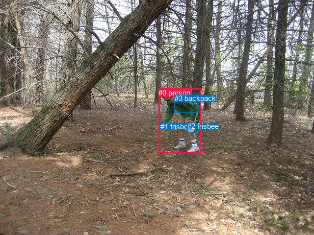
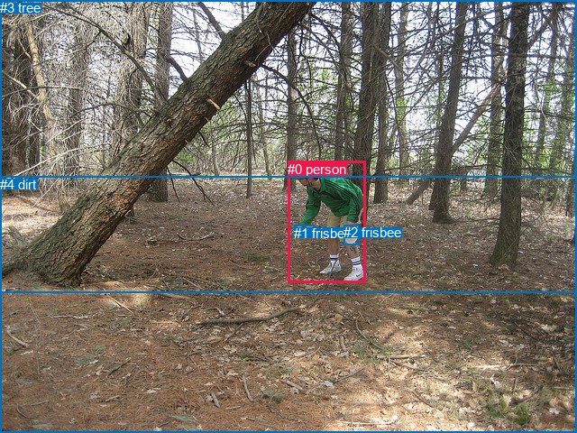

# 图片 0955：2358756.jpg

随机样本序号：166。图片 SHA256：`a1b87d38128e4507b46e9cb99ab1fe96b062f3838af2be0618e6e3fc5abdd5e5`。

红色框表示人，蓝色框表示其他物体。两个模式分别保留自身框编号，可依据位置比较对应对象。

## 自动检测框与输出

人的框编号：`[0]`。状态：`ok`。

### 自动检测全部物体框

| 编号 | 类别 | 是否为人 | 检测分数 | 像素坐标 xyxy |
|---|---|---|---|---|
| 0 | person | True | 0.9998 | 323.1, 180.8, 409.2, 312.9 |
| 1 | frisbee | False | 0.9993 | 326.9, 249.9, 349.7, 263.5 |
| 2 | frisbee | False | 0.9970 | 381.8, 249.2, 398.8, 271.1 |
| 3 | backpack | False | 0.5412 | 356.0, 191.8, 404.2, 229.7 |

### 自动检测 Top50 人相关候选

评分物体对：12；人相关物体对：6；输出关系：12。

| 排名 | 主语编号与类别 | 关系 | 宾语编号与类别 | 类型 | 人与人 | 排序分数 | 原始融合 logit |
|---|---|---|---|---|---|---|---|
| 1 | #0 person | holding | #1 frisbee | semantic | False | 0.99413 | 5.1320 |
| 2 | #0 person | wearing | #3 backpack | semantic | False | 0.99297 | 4.9508 |
| 3 | #0 person | wearing | #2 frisbee | semantic | False | 0.99154 | 4.7644 |
| 4 | #0 person | in | #3 backpack | spatial | False | 0.92556 | 2.5204 |
| 5 | #3 backpack | on | #0 person | spatial | False | 0.91344 | 2.3563 |
| 6 | #0 person | in | #2 frisbee | spatial | False | 0.85611 | 1.7833 |
| 7 | #2 frisbee | on | #0 person | spatial | False | 0.85466 | 1.7717 |
| 8 | #0 person | on | #1 frisbee | spatial | False | 0.78054 | 1.2688 |
| 9 | #3 backpack | wearing | #0 person | semantic | False | 0.35652 | -0.5905 |
| 10 | #1 frisbee | in | #0 person | spatial | False | 0.31202 | -0.7907 |
| 11 | #2 frisbee | wearing | #0 person | semantic | False | 0.16814 | -1.5989 |
| 12 | #1 frisbee | holding | #0 person | semantic | False | 0.15253 | -1.7149 |

### 自动检测逐条人相关 GT 核验

R@50：20.00%；命中 1/5。

| GT 主语编号 | GT 关系 | GT 宾语编号 | 结果阶段 | 匹配预测主语编号 | 匹配预测宾语编号 |
|---|---|---|---|---|---|
| 0 | holding | 1 | hit50 | [0] | [1] |
| 0 | throwing | 1 | wrong_predicate | [0] | [1] |
| 0 | holding | 2 | wrong_predicate | [0] | [2] |
| 0 | attached to | 3 | endpoint_missing_or_wrong_class | [0] | [] |
| 0 | standing on | 4 | endpoint_missing_or_wrong_class | [0] | [] |

## 真实框与输出

人的框编号：`[0]`。

### 真实框全部物体框

| 编号 | 类别 | 是否为人 | 检测分数 | 像素坐标 xyxy |
|---|---|---|---|---|
| 0 | person | True | GT | 319.0, 179.0, 406.0, 314.0 |
| 1 | frisbee | False | GT | 326.0, 250.0, 349.0, 264.0 |
| 2 | frisbee | False | GT | 381.0, 249.0, 399.0, 271.0 |
| 3 | tree | False | GT | 0.0, 0.0, 640.0, 325.0 |
| 4 | dirt | False | GT | 0.0, 196.0, 640.0, 480.0 |

### 真实框 Top50 人相关候选

评分物体对：20；人相关物体对：8；输出关系：16。

| 排名 | 主语编号与类别 | 关系 | 宾语编号与类别 | 类型 | 人与人 | 排序分数 | 原始融合 logit |
|---|---|---|---|---|---|---|---|
| 1 | #0 person | throwing | #1 frisbee | semantic | False | 0.99561 | 5.4235 |
| 2 | #0 person | wearing | #2 frisbee | semantic | False | 0.99114 | 4.7167 |
| 3 | #0 person | playing with | #4 dirt | semantic | False | 0.96835 | 3.4210 |
| 4 | #0 person | playing | #3 tree | semantic | False | 0.94894 | 2.9224 |
| 5 | #0 person | on | #4 dirt | spatial | False | 0.94438 | 2.8319 |
| 6 | #0 person | in | #3 tree | spatial | False | 0.92697 | 2.5411 |
| 7 | #3 tree | beside | #0 person | spatial | False | 0.89534 | 2.1464 |
| 8 | #2 frisbee | on | #0 person | spatial | False | 0.88646 | 2.0551 |
| 9 | #0 person | in | #2 frisbee | spatial | False | 0.85421 | 1.7680 |
| 10 | #0 person | on | #1 frisbee | spatial | False | 0.79717 | 1.3687 |
| 11 | #1 frisbee | in | #0 person | spatial | False | 0.54651 | 0.1866 |
| 12 | #3 tree | looking at | #0 person | semantic | False | 0.43491 | -0.2618 |
| 13 | #1 frisbee | holding | #0 person | semantic | False | 0.37891 | -0.4942 |
| 14 | #2 frisbee | wearing | #0 person | semantic | False | 0.22463 | -1.2389 |
| 15 | #4 dirt | in | #0 person | spatial | False | 0.17610 | -1.5430 |
| 16 | #4 dirt | holding | #0 person | semantic | False | 0.06465 | -2.6719 |

### 真实框逐条人相关 GT 核验

R@50：20.00%；命中 1/5。

| GT 主语编号 | GT 关系 | GT 宾语编号 | 结果阶段 | 匹配预测主语编号 | 匹配预测宾语编号 |
|---|---|---|---|---|---|
| 0 | holding | 1 | wrong_predicate | [0] | [1] |
| 0 | throwing | 1 | hit50 | [0] | [1] |
| 0 | holding | 2 | wrong_predicate | [0] | [2] |
| 0 | attached to | 3 | wrong_predicate | [0] | [3] |
| 0 | standing on | 4 | wrong_predicate | [0] | [4] |

## 全部人相关 GT

| 主语编号与类别 | 关系 | 宾语编号与类别 |
|---|---|---|
| #0 person | holding | #1 frisbee |
| #0 person | throwing | #1 frisbee |
| #0 person | holding | #2 frisbee |
| #0 person | attached to | #3 tree |
| #0 person | standing on | #4 dirt |

原始记录、全部人相关物体对的两项预测与分项分数见 [逐图证据 JSON](../evidence/cases/0955.json)。全部56类 logits 保留于本机 HOR/output/random500/logits/。

<!-- HOR_COMPLETE_RESULTS -->

## 六组条件的完整输出对照

以下保留同一图片三种框与候选模式、两种谓词输出规则的全部 Top50。框编号各自在所属模式内解释。

### 自动检测框完整枚举：空间与语义各保留一个谓词

| 排名 | 主语编号与类别 | 谓词 | 宾语编号与类别 | 分组 | 排序分数 | predicate logit | pair logit |
|---|---|---|---|---|---|---|---|
| 1 | #0 person | holding | #1 frisbee | semantic | 0.9941300 | 4.4386744 | 0.6933270 |
| 2 | #0 person | wearing | #3 backpack | semantic | 0.9929721 | 4.5467696 | 0.4040431 |
| 3 | #0 person | wearing | #2 frisbee | semantic | 0.9915445 | 4.2956605 | 0.4687817 |
| 4 | #0 person | in | #3 backpack | spatial | 0.9255628 | 2.1164031 | 0.4040431 |
| 5 | #3 backpack | on | #0 person | spatial | 0.9134368 | 2.6985784 | -0.3422392 |
| 6 | #0 person | in | #2 frisbee | spatial | 0.8561069 | 1.3145432 | 0.4687817 |
| 7 | #2 frisbee | on | #0 person | spatial | 0.8546641 | 2.0623469 | -0.2906860 |
| 8 | #0 person | on | #1 frisbee | spatial | 0.7805436 | 0.5755105 | 0.6933270 |
| 9 | #3 backpack | wearing | #0 person | semantic | 0.3565246 | -0.2482414 | -0.3422392 |
| 10 | #1 frisbee | in | #0 person | spatial | 0.3120208 | -0.0667810 | -0.7239075 |
| 11 | #2 frisbee | wearing | #0 person | semantic | 0.1681373 | -1.3082004 | -0.2906860 |
| 12 | #1 frisbee | holding | #0 person | semantic | 0.1525277 | -0.9910047 | -0.7239075 |

GT 命中：1/5，R@50=20.00%。

| GT主语 | GT谓词 | GT宾语 | 结果阶段 | 匹配主语框 | 匹配宾语框 |
|---|---|---|---|---|---|
| 0 | holding | 1 | hit50 | [0] | [1] |
| 0 | throwing | 1 | wrong_predicate | [0] | [1] |
| 0 | holding | 2 | wrong_predicate | [0] | [2] |
| 0 | attached to | 3 | endpoint_missing_or_wrong_class | [0] | [] |
| 0 | standing on | 4 | endpoint_missing_or_wrong_class | [0] | [] |

### 自动检测框完整枚举：每对只保留一个谓词

| 排名 | 主语编号与类别 | 谓词 | 宾语编号与类别 | 分组 | 排序分数 | predicate logit | pair logit |
|---|---|---|---|---|---|---|---|
| 1 | #0 person | holding | #1 frisbee | single | 0.9941300 | 4.4386744 | 0.6933270 |
| 2 | #0 person | wearing | #3 backpack | single | 0.9929721 | 4.5467696 | 0.4040431 |
| 3 | #0 person | wearing | #2 frisbee | single | 0.9915445 | 4.2956605 | 0.4687817 |
| 4 | #3 backpack | on | #0 person | single | 0.9134368 | 2.6985784 | -0.3422392 |
| 5 | #2 frisbee | on | #0 person | single | 0.8546641 | 2.0623469 | -0.2906860 |
| 6 | #1 frisbee | in | #0 person | single | 0.3120208 | -0.0667810 | -0.7239075 |

GT 命中：1/5，R@50=20.00%。

| GT主语 | GT谓词 | GT宾语 | 结果阶段 | 匹配主语框 | 匹配宾语框 |
|---|---|---|---|---|---|
| 0 | holding | 1 | hit50 | [0] | [1] |
| 0 | throwing | 1 | wrong_predicate | [0] | [1] |
| 0 | holding | 2 | wrong_predicate | [0] | [2] |
| 0 | attached to | 3 | endpoint_missing_or_wrong_class | [0] | [] |
| 0 | standing on | 4 | endpoint_missing_or_wrong_class | [0] | [] |

### 真实框完整枚举：空间与语义各保留一个谓词

| 排名 | 主语编号与类别 | 谓词 | 宾语编号与类别 | 分组 | 排序分数 | predicate logit | pair logit |
|---|---|---|---|---|---|---|---|
| 1 | #0 person | throwing | #1 frisbee | semantic | 0.9956078 | 4.6074004 | 0.8161293 |
| 2 | #0 person | wearing | #2 frisbee | semantic | 0.9911350 | 4.1928992 | 0.5238478 |
| 3 | #0 person | playing with | #4 dirt | semantic | 0.9683534 | 3.5976901 | -0.1767254 |
| 4 | #0 person | playing | #3 tree | semantic | 0.9489413 | 2.9371190 | -0.0147486 |
| 5 | #0 person | on | #4 dirt | spatial | 0.9443765 | 3.0086427 | -0.1767254 |
| 6 | #0 person | in | #3 tree | spatial | 0.9269708 | 2.5558124 | -0.0147486 |
| 7 | #3 tree | beside | #0 person | spatial | 0.8953364 | 2.6039810 | -0.4575316 |
| 8 | #2 frisbee | on | #0 person | spatial | 0.8864608 | 2.3311701 | -0.2760810 |
| 9 | #0 person | in | #2 frisbee | spatial | 0.8542125 | 1.2441816 | 0.5238478 |
| 10 | #0 person | on | #1 frisbee | spatial | 0.7971704 | 0.5525727 | 0.8161293 |
| 11 | #1 frisbee | in | #0 person | spatial | 0.5465128 | 0.8852925 | -0.6987019 |
| 12 | #3 tree | looking at | #0 person | semantic | 0.4349111 | 0.1956902 | -0.4575316 |
| 13 | #1 frisbee | holding | #0 person | semantic | 0.3789138 | 0.2045407 | -0.6987019 |
| 14 | #2 frisbee | wearing | #0 person | semantic | 0.2246256 | -0.9628298 | -0.2760810 |
| 15 | #4 dirt | in | #0 person | spatial | 0.1761010 | -0.3468904 | -1.1960995 |
| 16 | #4 dirt | holding | #0 person | semantic | 0.0646506 | -1.4758236 | -1.1960995 |

GT 命中：1/5，R@50=20.00%。

| GT主语 | GT谓词 | GT宾语 | 结果阶段 | 匹配主语框 | 匹配宾语框 |
|---|---|---|---|---|---|
| 0 | holding | 1 | wrong_predicate | [0] | [1] |
| 0 | throwing | 1 | hit50 | [0] | [1] |
| 0 | holding | 2 | wrong_predicate | [0] | [2] |
| 0 | attached to | 3 | wrong_predicate | [0] | [3] |
| 0 | standing on | 4 | wrong_predicate | [0] | [4] |

### 真实框完整枚举：每对只保留一个谓词

| 排名 | 主语编号与类别 | 谓词 | 宾语编号与类别 | 分组 | 排序分数 | predicate logit | pair logit |
|---|---|---|---|---|---|---|---|
| 1 | #0 person | throwing | #1 frisbee | single | 0.9956078 | 4.6074004 | 0.8161293 |
| 2 | #0 person | wearing | #2 frisbee | single | 0.9911350 | 4.1928992 | 0.5238478 |
| 3 | #0 person | playing with | #4 dirt | single | 0.9683534 | 3.5976901 | -0.1767254 |
| 4 | #0 person | playing | #3 tree | single | 0.9489413 | 2.9371190 | -0.0147486 |
| 5 | #3 tree | beside | #0 person | single | 0.8953364 | 2.6039810 | -0.4575316 |
| 6 | #2 frisbee | on | #0 person | single | 0.8864608 | 2.3311701 | -0.2760810 |
| 7 | #1 frisbee | in | #0 person | single | 0.5465128 | 0.8852925 | -0.6987019 |
| 8 | #4 dirt | in | #0 person | single | 0.1761010 | -0.3468904 | -1.1960995 |

GT 命中：1/5，R@50=20.00%。

| GT主语 | GT谓词 | GT宾语 | 结果阶段 | 匹配主语框 | 匹配宾语框 |
|---|---|---|---|---|---|
| 0 | holding | 1 | wrong_predicate | [0] | [1] |
| 0 | throwing | 1 | hit50 | [0] | [1] |
| 0 | holding | 2 | wrong_predicate | [0] | [2] |
| 0 | attached to | 3 | wrong_predicate | [0] | [3] |
| 0 | standing on | 4 | wrong_predicate | [0] | [4] |

### 真实框400候选：空间与语义各保留一个谓词

| 排名 | 主语编号与类别 | 谓词 | 宾语编号与类别 | 分组 | 排序分数 | predicate logit | pair logit |
|---|---|---|---|---|---|---|---|
| 1 | #0 person | throwing | #1 frisbee | semantic | 0.9956078 | 4.6074004 | 0.8161293 |
| 2 | #0 person | wearing | #2 frisbee | semantic | 0.9911350 | 4.1928992 | 0.5238478 |
| 3 | #0 person | playing with | #4 dirt | semantic | 0.9683534 | 3.5976901 | -0.1767254 |
| 4 | #0 person | playing | #3 tree | semantic | 0.9491756 | 2.9419665 | -0.0147486 |
| 5 | #0 person | on | #4 dirt | spatial | 0.9449457 | 3.0195332 | -0.1767254 |
| 6 | #0 person | in | #3 tree | spatial | 0.9237311 | 2.5089045 | -0.0147486 |
| 7 | #3 tree | beside | #0 person | spatial | 0.8953364 | 2.6039810 | -0.4575316 |
| 8 | #2 frisbee | on | #0 person | spatial | 0.8864608 | 2.3311701 | -0.2760810 |
| 9 | #0 person | in | #2 frisbee | spatial | 0.8550371 | 1.2508192 | 0.5238478 |
| 10 | #0 person | on | #1 frisbee | spatial | 0.7971704 | 0.5525727 | 0.8161293 |
| 11 | #1 frisbee | in | #0 person | spatial | 0.5523189 | 0.9087462 | -0.6987019 |
| 12 | #3 tree | looking at | #0 person | semantic | 0.4421483 | 0.2250838 | -0.4575316 |
| 13 | #1 frisbee | holding | #0 person | semantic | 0.3796094 | 0.2074952 | -0.6987019 |
| 14 | #2 frisbee | wearing | #0 person | semantic | 0.2225232 | -0.9749415 | -0.2760810 |
| 15 | #4 dirt | in | #0 person | spatial | 0.1761010 | -0.3468904 | -1.1960995 |
| 16 | #4 dirt | holding | #0 person | semantic | 0.0638349 | -1.4893923 | -1.1960995 |

GT 命中：1/5，R@50=20.00%。

| GT主语 | GT谓词 | GT宾语 | 结果阶段 | 匹配主语框 | 匹配宾语框 |
|---|---|---|---|---|---|
| 0 | holding | 1 | wrong_predicate | [0] | [1] |
| 0 | throwing | 1 | hit50 | [0] | [1] |
| 0 | holding | 2 | wrong_predicate | [0] | [2] |
| 0 | attached to | 3 | wrong_predicate | [0] | [3] |
| 0 | standing on | 4 | wrong_predicate | [0] | [4] |

### 真实框400候选：每对只保留一个谓词

| 排名 | 主语编号与类别 | 谓词 | 宾语编号与类别 | 分组 | 排序分数 | predicate logit | pair logit |
|---|---|---|---|---|---|---|---|
| 1 | #0 person | throwing | #1 frisbee | single | 0.9956078 | 4.6074004 | 0.8161293 |
| 2 | #0 person | wearing | #2 frisbee | single | 0.9911350 | 4.1928992 | 0.5238478 |
| 3 | #0 person | playing with | #4 dirt | single | 0.9683534 | 3.5976901 | -0.1767254 |
| 4 | #0 person | playing | #3 tree | single | 0.9491756 | 2.9419665 | -0.0147486 |
| 5 | #3 tree | beside | #0 person | single | 0.8953364 | 2.6039810 | -0.4575316 |
| 6 | #2 frisbee | on | #0 person | single | 0.8864608 | 2.3311701 | -0.2760810 |
| 7 | #1 frisbee | in | #0 person | single | 0.5523189 | 0.9087462 | -0.6987019 |
| 8 | #4 dirt | in | #0 person | single | 0.1761010 | -0.3468904 | -1.1960995 |

GT 命中：1/5，R@50=20.00%。

| GT主语 | GT谓词 | GT宾语 | 结果阶段 | 匹配主语框 | 匹配宾语框 |
|---|---|---|---|---|---|
| 0 | holding | 1 | wrong_predicate | [0] | [1] |
| 0 | throwing | 1 | hit50 | [0] | [1] |
| 0 | holding | 2 | wrong_predicate | [0] | [2] |
| 0 | attached to | 3 | wrong_predicate | [0] | [3] |
| 0 | standing on | 4 | wrong_predicate | [0] | [4] |
