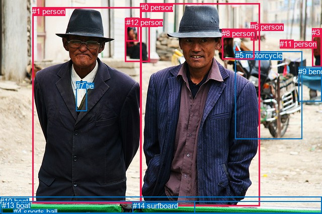
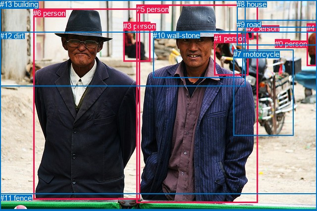

# 图片 0962：2359075.jpg

随机样本序号：419。图片 SHA256：`c219b7e4409b0dcaab0ec1932372f7f91bfc72abb999a3ed92405c1089eb0b0f`。

红色框表示人，蓝色框表示其他物体。两个模式分别保留自身框编号，可依据位置比较对应对象。

## 自动检测框与输出

人的框编号：`[0, 1, 2, 3, 6, 8, 11, 12]`。状态：`ok`。

### 自动检测全部物体框

| 编号 | 类别 | 是否为人 | 检测分数 | 像素坐标 xyxy |
|---|---|---|---|---|
| 0 | person | True | 0.9997 | 278.7, 6.4, 516.6, 411.8 |
| 1 | person | True | 0.9994 | 64.4, 14.1, 281.1, 405.6 |
| 2 | person | True | 0.9875 | 249.0, 36.1, 297.0, 123.7 |
| 3 | person | True | 0.9865 | 620.4, 56.2, 640.0, 133.5 |
| 4 | sports ball | False | 0.9731 | 26.5, 414.2, 58.4, 427.0 |
| 5 | motorcycle | False | 0.9645 | 467.5, 102.4, 600.8, 277.2 |
| 6 | person | True | 0.9218 | 498.2, 44.9, 510.1, 80.7 |
| 7 | tie | False | 0.9192 | 151.2, 162.5, 172.2, 221.1 |
| 8 | person | True | 0.8364 | 441.1, 57.9, 506.0, 118.7 |
| 9 | bench | False | 0.6607 | 593.5, 133.8, 640.0, 202.2 |
| 10 | boat | False | 0.6094 | 0.0, 392.8, 640.0, 425.7 |
| 11 | person | True | 0.5920 | 556.4, 79.2, 583.0, 96.3 |
| 12 | person | True | 0.5203 | 250.6, 35.6, 275.2, 83.0 |
| 13 | boat | False | 0.4529 | 3.8, 401.4, 387.5, 426.8 |
| 14 | surfboard | False | 0.3819 | 263.8, 401.7, 639.2, 426.5 |

### 自动检测 Top50 人相关候选

评分物体对：210；人相关物体对：168；输出关系：50。

| 排名 | 主语编号与类别 | 关系 | 宾语编号与类别 | 类型 | 人与人 | 排序分数 | 原始融合 logit |
|---|---|---|---|---|---|---|---|
| 1 | #1 person | wearing | #7 tie | semantic | False | 0.98760 | 4.3773 |
| 2 | #2 person | wearing | #12 person | semantic | True | 0.96999 | 3.4758 |
| 3 | #8 person | sitting on | #5 motorcycle | semantic | False | 0.96673 | 3.3692 |
| 4 | #8 person | on | #5 motorcycle | spatial | False | 0.95508 | 3.0568 |
| 5 | #0 person | standing on | #10 boat | semantic | False | 0.92421 | 2.5010 |
| 6 | #3 person | standing on | #9 bench | semantic | False | 0.91028 | 2.3171 |
| 7 | #2 person | in | #12 person | spatial | True | 0.90989 | 2.3123 |
| 8 | #1 person | standing on | #10 boat | semantic | False | 0.88109 | 2.0028 |
| 9 | #7 tie | on | #1 person | spatial | False | 0.87934 | 1.9862 |
| 10 | #3 person | beside | #9 bench | spatial | False | 0.84491 | 1.6952 |
| 11 | #1 person | in | #7 tie | spatial | False | 0.79600 | 1.3615 |
| 12 | #0 person | standing on | #14 surfboard | semantic | False | 0.77182 | 1.2186 |
| 13 | #0 person | beside | #5 motorcycle | spatial | False | 0.76731 | 1.1932 |
| 14 | #3 person | standing on | #5 motorcycle | semantic | False | 0.75371 | 1.1185 |
| 15 | #1 person | standing on | #13 boat | semantic | False | 0.74519 | 1.0731 |
| 16 | #0 person | on | #10 boat | spatial | False | 0.74081 | 1.0502 |
| 17 | #12 person | on | #2 person | spatial | True | 0.72643 | 0.9766 |
| 18 | #1 person | leaning on | #10 boat | spatial | False | 0.71317 | 0.9108 |
| 19 | #0 person | wearing | #5 motorcycle | semantic | False | 0.69347 | 0.8164 |
| 20 | #6 person | on | #5 motorcycle | spatial | False | 0.68426 | 0.7734 |
| 21 | #6 person | pushing | #5 motorcycle | semantic | False | 0.67889 | 0.7487 |
| 22 | #5 motorcycle | parked on | #11 person | semantic | False | 0.67440 | 0.7282 |
| 23 | #11 person | on | #5 motorcycle | spatial | False | 0.63462 | 0.5521 |
| 24 | #5 motorcycle | beside | #0 person | spatial | False | 0.60630 | 0.4318 |
| 25 | #11 person | on | #9 bench | spatial | False | 0.57432 | 0.2995 |
| 26 | #1 person | standing on | #0 person | semantic | True | 0.57174 | 0.2889 |
| 27 | #0 person | on | #14 surfboard | spatial | False | 0.56324 | 0.2543 |
| 28 | #3 person | on | #5 motorcycle | spatial | False | 0.56011 | 0.2416 |
| 29 | #1 person | beside | #0 person | spatial | True | 0.53275 | 0.1312 |
| 30 | #12 person | carrying | #2 person | semantic | True | 0.52806 | 0.1123 |
| 31 | #0 person | beside | #1 person | spatial | True | 0.52694 | 0.1078 |
| 32 | #3 person | standing on | #11 person | semantic | True | 0.52312 | 0.0925 |
| 33 | #10 boat | in front of | #0 person | spatial | False | 0.50673 | 0.0269 |
| 34 | #6 person | wearing | #12 person | semantic | True | 0.47520 | -0.0993 |
| 35 | #1 person | on | #13 boat | spatial | False | 0.47346 | -0.1063 |
| 36 | #3 person | on | #11 person | spatial | True | 0.47222 | -0.1112 |
| 37 | #0 person | standing on | #13 boat | semantic | False | 0.46715 | -0.1316 |
| 38 | #0 person | standing on | #1 person | semantic | True | 0.46220 | -0.1515 |
| 39 | #7 tie | wearing | #1 person | semantic | False | 0.45108 | -0.1963 |
| 40 | #11 person | sitting on | #9 bench | semantic | False | 0.43813 | -0.2487 |
| 41 | #8 person | sitting on | #6 person | semantic | True | 0.43628 | -0.2563 |
| 42 | #6 person | pushing | #8 person | semantic | True | 0.40464 | -0.3862 |
| 43 | #5 motorcycle | in | #11 person | spatial | False | 0.38590 | -0.4646 |
| 44 | #10 boat | in front of | #1 person | spatial | False | 0.35505 | -0.5969 |
| 45 | #14 surfboard | in front of | #0 person | spatial | False | 0.35375 | -0.6026 |
| 46 | #8 person | on | #6 person | spatial | True | 0.33033 | -0.7067 |
| 47 | #9 bench | in | #11 person | spatial | False | 0.32641 | -0.7245 |
| 48 | #0 person | wearing | #8 person | semantic | True | 0.30109 | -0.8421 |
| 49 | #9 bench | beside | #3 person | spatial | False | 0.28954 | -0.8976 |
| 50 | #1 person | standing on | #14 surfboard | semantic | False | 0.28652 | -0.9123 |

### 自动检测逐条人相关 GT 核验

R@50：33.33%；命中 2/6。

| GT 主语编号 | GT 关系 | GT 宾语编号 | 结果阶段 | 匹配预测主语编号 | 匹配预测宾语编号 |
|---|---|---|---|---|---|
| 5 | beside | 6 | hit50 | [0] | [1] |
| 5 | standing on | 12 | endpoint_missing_or_wrong_class | [0] | [] |
| 6 | beside | 5 | hit50 | [1] | [0] |
| 6 | standing on | 12 | endpoint_missing_or_wrong_class | [1] | [] |
| 11 | in front of | 5 | endpoint_missing_or_wrong_class | [] | [0] |
| 11 | in front of | 6 | endpoint_missing_or_wrong_class | [] | [1] |

## 真实框与输出

人的框编号：`[0, 1, 2, 3, 4, 5, 6]`。

### 真实框全部物体框

| 编号 | 类别 | 是否为人 | 检测分数 | 像素坐标 xyxy |
|---|---|---|---|---|
| 0 | person | True | GT | 555.0, 80.0, 585.0, 95.0 |
| 1 | person | True | GT | 432.0, 69.0, 501.0, 152.0 |
| 2 | person | True | GT | 498.0, 49.0, 511.0, 80.0 |
| 3 | person | True | GT | 249.0, 44.0, 303.0, 124.0 |
| 4 | person | True | GT | 619.0, 48.0, 640.0, 134.0 |
| 5 | person | True | GT | 276.0, 10.0, 521.0, 410.0 |
| 6 | person | True | GT | 67.0, 18.0, 282.0, 404.0 |
| 7 | motorcycle | False | GT | 471.0, 101.0, 592.0, 274.0 |
| 8 | house | False | GT | 478.0, 0.0, 640.0, 55.0 |
| 9 | road | False | GT | 478.0, 41.0, 640.0, 92.0 |
| 10 | wall-stone | False | GT | 309.0, 63.0, 490.0, 157.0 |
| 11 | fence | False | GT | 0.0, 392.0, 640.0, 427.0 |
| 12 | dirt | False | GT | 0.0, 64.0, 640.0, 424.0 |
| 13 | building | False | GT | 0.0, 0.0, 495.0, 174.0 |

### 真实框 Top50 人相关候选

评分物体对：182；人相关物体对：140；输出关系：50。

| 排名 | 主语编号与类别 | 关系 | 宾语编号与类别 | 类型 | 人与人 | 排序分数 | 原始融合 logit |
|---|---|---|---|---|---|---|---|
| 1 | #0 person | lying on | #12 dirt | semantic | False | 0.98295 | 4.0546 |
| 2 | #0 person | on | #9 road | spatial | False | 0.97724 | 3.7598 |
| 3 | #0 person | lying on | #9 road | semantic | False | 0.96807 | 3.4119 |
| 4 | #1 person | pushing | #7 motorcycle | semantic | False | 0.96269 | 3.2504 |
| 5 | #2 person | sitting on | #9 road | semantic | False | 0.96175 | 3.2245 |
| 6 | #1 person | on | #7 motorcycle | spatial | False | 0.95705 | 3.1039 |
| 7 | #3 person | sitting on | #12 dirt | semantic | False | 0.95679 | 3.0975 |
| 8 | #3 person | sitting on | #13 building | semantic | False | 0.95356 | 3.0220 |
| 9 | #6 person | standing on | #11 fence | semantic | False | 0.95258 | 3.0001 |
| 10 | #5 person | standing on | #11 fence | semantic | False | 0.95168 | 2.9805 |
| 11 | #2 person | on | #9 road | spatial | False | 0.94551 | 2.8537 |
| 12 | #0 person | on | #12 dirt | spatial | False | 0.94283 | 2.8029 |
| 13 | #5 person | standing on | #12 dirt | semantic | False | 0.93069 | 2.5973 |
| 14 | #6 person | standing on | #12 dirt | semantic | False | 0.92305 | 2.4846 |
| 15 | #5 person | in | #12 dirt | spatial | False | 0.91429 | 2.3671 |
| 16 | #6 person | in | #12 dirt | spatial | False | 0.91356 | 2.3579 |
| 17 | #11 fence | in front of | #5 person | spatial | False | 0.91151 | 2.3322 |
| 18 | #6 person | leaning on | #11 fence | spatial | False | 0.90846 | 2.2950 |
| 19 | #3 person | leaning on | #13 building | spatial | False | 0.90685 | 2.2758 |
| 20 | #4 person | standing on | #9 road | semantic | False | 0.90551 | 2.2600 |
| 21 | #1 person | sitting on | #10 wall-stone | semantic | False | 0.88372 | 2.0281 |
| 22 | #5 person | wearing | #10 wall-stone | semantic | False | 0.86535 | 1.8604 |
| 23 | #5 person | leaning on | #11 fence | spatial | False | 0.86044 | 1.8190 |
| 24 | #2 person | sitting on | #12 dirt | semantic | False | 0.85512 | 1.7754 |
| 25 | #11 fence | in front of | #6 person | spatial | False | 0.85367 | 1.7637 |
| 26 | #4 person | standing on | #12 dirt | semantic | False | 0.82992 | 1.5850 |
| 27 | #3 person | on | #12 dirt | spatial | False | 0.82851 | 1.5751 |
| 28 | #4 person | on | #9 road | spatial | False | 0.80375 | 1.4099 |
| 29 | #1 person | sitting on | #12 dirt | semantic | False | 0.78918 | 1.3200 |
| 30 | #5 person | in | #10 wall-stone | spatial | False | 0.78663 | 1.3047 |
| 31 | #7 motorcycle | beside | #5 person | spatial | False | 0.78097 | 1.2713 |
| 32 | #6 person | beside | #5 person | spatial | True | 0.77191 | 1.2191 |
| 33 | #6 person | standing on | #5 person | semantic | True | 0.76941 | 1.2050 |
| 34 | #1 person | leaning on | #10 wall-stone | spatial | False | 0.76694 | 1.1911 |
| 35 | #2 person | on | #12 dirt | spatial | False | 0.75666 | 1.1345 |
| 36 | #5 person | beside | #6 person | spatial | True | 0.73177 | 1.0036 |
| 37 | #5 person | beside | #7 motorcycle | spatial | False | 0.71894 | 0.9392 |
| 38 | #1 person | on | #12 dirt | spatial | False | 0.65902 | 0.6589 |
| 39 | #4 person | standing on | #7 motorcycle | semantic | False | 0.64980 | 0.6181 |
| 40 | #4 person | in | #12 dirt | spatial | False | 0.64553 | 0.5995 |
| 41 | #2 person | pushing | #7 motorcycle | semantic | False | 0.60687 | 0.4342 |
| 42 | #5 person | looking at | #6 person | semantic | True | 0.58413 | 0.3397 |
| 43 | #2 person | on | #7 motorcycle | spatial | False | 0.57777 | 0.3136 |
| 44 | #5 person | wearing | #7 motorcycle | semantic | False | 0.57749 | 0.3125 |
| 45 | #4 person | beside | #7 motorcycle | spatial | False | 0.52790 | 0.1117 |
| 46 | #4 person | beside | #8 house | spatial | False | 0.50562 | 0.0225 |
| 47 | #0 person | on back of | #7 motorcycle | spatial | False | 0.48709 | -0.0517 |
| 48 | #4 person | standing on | #8 house | semantic | False | 0.47293 | -0.1084 |
| 49 | #1 person | sitting on | #9 road | semantic | False | 0.45190 | -0.1930 |
| 50 | #5 person | wearing | #1 person | semantic | True | 0.43583 | -0.2581 |

### 真实框逐条人相关 GT 核验

R@50：100.00%；命中 6/6。

| GT 主语编号 | GT 关系 | GT 宾语编号 | 结果阶段 | 匹配预测主语编号 | 匹配预测宾语编号 |
|---|---|---|---|---|---|
| 5 | beside | 6 | hit50 | [5] | [6] |
| 5 | standing on | 12 | hit50 | [5] | [12] |
| 6 | beside | 5 | hit50 | [6] | [5] |
| 6 | standing on | 12 | hit50 | [6] | [12] |
| 11 | in front of | 5 | hit50 | [11] | [5] |
| 11 | in front of | 6 | hit50 | [11] | [6] |

## 全部人相关 GT

| 主语编号与类别 | 关系 | 宾语编号与类别 |
|---|---|---|
| #5 person | beside | #6 person |
| #5 person | standing on | #12 dirt |
| #6 person | beside | #5 person |
| #6 person | standing on | #12 dirt |
| #11 fence | in front of | #5 person |
| #11 fence | in front of | #6 person |

原始记录、全部人相关物体对的两项预测与分项分数见 [逐图证据 JSON](../evidence/cases/0962.json)。全部56类 logits 保留于本机 HOR/output/random500/logits/。

<!-- HOR_COMPLETE_RESULTS -->

## 六组条件的完整输出对照

以下保留同一图片三种框与候选模式、两种谓词输出规则的全部 Top50。框编号各自在所属模式内解释。

### 自动检测框完整枚举：空间与语义各保留一个谓词

| 排名 | 主语编号与类别 | 谓词 | 宾语编号与类别 | 分组 | 排序分数 | predicate logit | pair logit |
|---|---|---|---|---|---|---|---|
| 1 | #1 person | wearing | #7 tie | semantic | 0.9875960 | 4.2046351 | 0.1726176 |
| 2 | #2 person | wearing | #12 person | semantic | 0.9699919 | 3.2400656 | 0.2357537 |
| 3 | #8 person | sitting on | #5 motorcycle | semantic | 0.9667289 | 3.2591448 | 0.1100828 |
| 4 | #8 person | on | #5 motorcycle | spatial | 0.9550756 | 2.9467239 | 0.1100828 |
| 5 | #0 person | standing on | #10 boat | semantic | 0.9242131 | 2.4450555 | 0.0559619 |
| 6 | #3 person | standing on | #9 bench | semantic | 0.9102837 | 2.2625632 | 0.0545405 |
| 7 | #2 person | in | #12 person | spatial | 0.9098933 | 2.0765781 | 0.2357537 |
| 8 | #1 person | standing on | #10 boat | semantic | 0.8810948 | 2.0069461 | -0.0041079 |
| 9 | #7 tie | on | #1 person | spatial | 0.8793432 | 2.6770892 | -0.6908638 |
| 10 | #3 person | beside | #9 bench | spatial | 0.8449063 | 1.6406565 | 0.0545405 |
| 11 | #1 person | in | #7 tie | spatial | 0.7960024 | 1.1888762 | 0.1726176 |
| 12 | #0 person | standing on | #14 surfboard | semantic | 0.7718160 | 1.2062135 | 0.0123803 |
| 13 | #0 person | beside | #5 motorcycle | spatial | 0.7673075 | 1.8184280 | -0.6252580 |
| 14 | #3 person | standing on | #5 motorcycle | semantic | 0.7537140 | 1.5306869 | -0.4121670 |
| 15 | #1 person | standing on | #13 boat | semantic | 0.7451944 | 1.1129823 | -0.0398381 |
| 16 | #0 person | on | #10 boat | spatial | 0.7408079 | 0.9942102 | 0.0559619 |
| 17 | #12 person | on | #2 person | spatial | 0.7264300 | 1.6565356 | -0.6799511 |
| 18 | #1 person | leaning on | #10 boat | spatial | 0.7131702 | 0.9149394 | -0.0041079 |
| 19 | #0 person | wearing | #5 motorcycle | semantic | 0.6934744 | 1.4416709 | -0.6252580 |
| 20 | #6 person | on | #5 motorcycle | spatial | 0.6842622 | 0.8942051 | -0.1207762 |
| 21 | #6 person | pushing | #5 motorcycle | semantic | 0.6788904 | 0.8694534 | -0.1207762 |
| 22 | #5 motorcycle | parked on | #11 person | semantic | 0.6744000 | 1.2865014 | -0.5583478 |
| 23 | #11 person | on | #5 motorcycle | spatial | 0.6346181 | 0.9469442 | -0.3948640 |
| 24 | #5 motorcycle | beside | #0 person | spatial | 0.6062953 | 1.0363450 | -0.6045789 |
| 25 | #11 person | on | #9 bench | spatial | 0.5743215 | 0.5815630 | -0.2820580 |
| 26 | #1 person | standing on | #0 person | semantic | 0.5717376 | 0.9634390 | -0.6744951 |
| 27 | #0 person | on | #14 surfboard | spatial | 0.5632369 | 0.2419291 | 0.0123803 |
| 28 | #3 person | on | #5 motorcycle | spatial | 0.5601072 | 0.6537642 | -0.4121670 |
| 29 | #1 person | beside | #0 person | spatial | 0.5327484 | 0.8056765 | -0.6744951 |
| 30 | #12 person | carrying | #2 person | semantic | 0.5280573 | 0.7922983 | -0.6799511 |
| 31 | #0 person | beside | #1 person | spatial | 0.5269357 | 0.9218783 | -0.8140311 |
| 32 | #3 person | standing on | #11 person | semantic | 0.5231166 | 0.5574651 | -0.4649326 |
| 33 | #10 boat | in front of | #0 person | spatial | 0.5067288 | 0.6086268 | -0.5817100 |
| 34 | #6 person | wearing | #12 person | semantic | 0.4751980 | 0.6301775 | -0.7294669 |
| 35 | #1 person | on | #13 boat | spatial | 0.4734588 | -0.0664268 | -0.0398381 |
| 36 | #3 person | on | #11 person | spatial | 0.4722186 | 0.3536925 | -0.4649326 |
| 37 | #0 person | standing on | #13 boat | semantic | 0.4671458 | 0.0605030 | -0.1921094 |
| 38 | #0 person | standing on | #1 person | semantic | 0.4621963 | 0.6625271 | -0.8140311 |
| 39 | #7 tie | wearing | #1 person | semantic | 0.4510809 | 0.4945593 | -0.6908638 |
| 40 | #11 person | sitting on | #9 bench | semantic | 0.4381313 | 0.0333085 | -0.2820580 |
| 41 | #8 person | sitting on | #6 person | semantic | 0.4362797 | -0.0359025 | -0.2203721 |
| 42 | #6 person | pushing | #8 person | semantic | 0.4046396 | -0.0334878 | -0.3526824 |
| 43 | #5 motorcycle | in | #11 person | spatial | 0.3859011 | 0.0937729 | -0.5583478 |
| 44 | #10 boat | in front of | #1 person | spatial | 0.3550523 | -0.0250030 | -0.5719014 |
| 45 | #14 surfboard | in front of | #0 person | spatial | 0.3537458 | -0.0076241 | -0.5949904 |
| 46 | #8 person | on | #6 person | spatial | 0.3303316 | -0.4863138 | -0.2203721 |
| 47 | #9 bench | in | #11 person | spatial | 0.3264098 | -0.1976285 | -0.5268399 |
| 48 | #0 person | wearing | #8 person | semantic | 0.3010863 | 0.1008043 | -0.9429348 |
| 49 | #9 bench | beside | #3 person | spatial | 0.2895422 | -0.3431106 | -0.5544978 |
| 50 | #1 person | standing on | #14 surfboard | semantic | 0.2865246 | -0.6568937 | -0.2554297 |

GT 命中：2/6，R@50=33.33%。

| GT主语 | GT谓词 | GT宾语 | 结果阶段 | 匹配主语框 | 匹配宾语框 |
|---|---|---|---|---|---|
| 5 | beside | 6 | hit50 | [0] | [1] |
| 5 | standing on | 12 | endpoint_missing_or_wrong_class | [0] | [] |
| 6 | beside | 5 | hit50 | [1] | [0] |
| 6 | standing on | 12 | endpoint_missing_or_wrong_class | [1] | [] |
| 11 | in front of | 5 | endpoint_missing_or_wrong_class | [] | [0] |
| 11 | in front of | 6 | endpoint_missing_or_wrong_class | [] | [1] |

### 自动检测框完整枚举：每对只保留一个谓词

| 排名 | 主语编号与类别 | 谓词 | 宾语编号与类别 | 分组 | 排序分数 | predicate logit | pair logit |
|---|---|---|---|---|---|---|---|
| 1 | #1 person | wearing | #7 tie | single | 0.9875960 | 4.2046351 | 0.1726176 |
| 2 | #2 person | wearing | #12 person | single | 0.9699919 | 3.2400656 | 0.2357537 |
| 3 | #8 person | sitting on | #5 motorcycle | single | 0.9667289 | 3.2591448 | 0.1100828 |
| 4 | #0 person | standing on | #10 boat | single | 0.9242131 | 2.4450555 | 0.0559619 |
| 5 | #3 person | standing on | #9 bench | single | 0.9102837 | 2.2625632 | 0.0545405 |
| 6 | #1 person | standing on | #10 boat | single | 0.8810948 | 2.0069461 | -0.0041079 |
| 7 | #7 tie | on | #1 person | single | 0.8793432 | 2.6770892 | -0.6908638 |
| 8 | #0 person | standing on | #14 surfboard | single | 0.7718160 | 1.2062135 | 0.0123803 |
| 9 | #0 person | beside | #5 motorcycle | single | 0.7673075 | 1.8184280 | -0.6252580 |
| 10 | #3 person | standing on | #5 motorcycle | single | 0.7537140 | 1.5306869 | -0.4121670 |
| 11 | #1 person | standing on | #13 boat | single | 0.7451944 | 1.1129823 | -0.0398381 |
| 12 | #12 person | on | #2 person | single | 0.7264300 | 1.6565356 | -0.6799511 |
| 13 | #6 person | on | #5 motorcycle | single | 0.6842622 | 0.8942051 | -0.1207762 |
| 14 | #5 motorcycle | parked on | #11 person | single | 0.6744000 | 1.2865014 | -0.5583478 |
| 15 | #11 person | on | #5 motorcycle | single | 0.6346181 | 0.9469442 | -0.3948640 |
| 16 | #5 motorcycle | beside | #0 person | single | 0.6062953 | 1.0363450 | -0.6045789 |
| 17 | #11 person | on | #9 bench | single | 0.5743215 | 0.5815630 | -0.2820580 |
| 18 | #1 person | standing on | #0 person | single | 0.5717376 | 0.9634390 | -0.6744951 |
| 19 | #0 person | beside | #1 person | single | 0.5269357 | 0.9218783 | -0.8140311 |
| 20 | #3 person | standing on | #11 person | single | 0.5231166 | 0.5574651 | -0.4649326 |
| 21 | #10 boat | in front of | #0 person | single | 0.5067288 | 0.6086268 | -0.5817100 |
| 22 | #6 person | wearing | #12 person | single | 0.4751980 | 0.6301775 | -0.7294669 |
| 23 | #0 person | standing on | #13 boat | single | 0.4671458 | 0.0605030 | -0.1921094 |
| 24 | #8 person | sitting on | #6 person | single | 0.4362797 | -0.0359025 | -0.2203721 |
| 25 | #6 person | pushing | #8 person | single | 0.4046396 | -0.0334878 | -0.3526824 |
| 26 | #10 boat | in front of | #1 person | single | 0.3550523 | -0.0250030 | -0.5719014 |
| 27 | #14 surfboard | in front of | #0 person | single | 0.3537458 | -0.0076241 | -0.5949904 |
| 28 | #9 bench | in | #11 person | single | 0.3264098 | -0.1976285 | -0.5268399 |
| 29 | #0 person | wearing | #8 person | single | 0.3010863 | 0.1008043 | -0.9429348 |
| 30 | #9 bench | beside | #3 person | single | 0.2895422 | -0.3431106 | -0.5544978 |
| 31 | #1 person | standing on | #14 surfboard | single | 0.2865246 | -0.6568937 | -0.2554297 |
| 32 | #13 boat | in front of | #1 person | single | 0.2653280 | -0.4166484 | -0.6018089 |
| 33 | #6 person | sitting on | #9 bench | single | 0.2629569 | -0.5263438 | -0.5043122 |
| 34 | #6 person | in | #11 person | single | 0.2300446 | -0.8313253 | -0.3767339 |
| 35 | #6 person | looking at | #0 person | single | 0.1989165 | -0.2850723 | -1.1080079 |
| 36 | #8 person | looking at | #0 person | single | 0.1985735 | -0.5562425 | -0.8389914 |
| 37 | #2 person | looking at | #1 person | single | 0.1838644 | -0.6724238 | -0.8179584 |
| 38 | #13 boat | in front of | #0 person | single | 0.1808279 | -0.7487245 | -0.7620242 |
| 39 | #1 person | wearing | #12 person | single | 0.1743118 | -0.6117597 | -0.9436116 |
| 40 | #0 person | looking at | #4 sports ball | single | 0.1722558 | -1.0668135 | -0.5029099 |
| 41 | #3 person | looking at | #0 person | single | 0.1533619 | -0.5999303 | -1.1085428 |
| 42 | #8 person | wearing | #12 person | single | 0.1501768 | -1.0990875 | -0.6341274 |
| 43 | #8 person | sitting on | #9 bench | single | 0.1438609 | -1.0709906 | -0.7125953 |
| 44 | #1 person | looking at | #4 sports ball | single | 0.1409985 | -1.6748054 | -0.1322159 |
| 45 | #0 person | wearing | #7 tie | single | 0.1397305 | -0.5801282 | -1.2374021 |
| 46 | #14 surfboard | in front of | #1 person | single | 0.1315165 | -1.1607766 | -0.7268397 |
| 47 | #2 person | looking at | #0 person | single | 0.1285505 | -0.7703671 | -1.1434692 |
| 48 | #5 motorcycle | beside | #8 person | single | 0.1184750 | -1.1434996 | -0.8634523 |
| 49 | #8 person | looking at | #10 boat | single | 0.1165717 | -0.6221118 | -1.4031916 |
| 50 | #0 person | wearing | #6 person | single | 0.1108990 | -0.7871907 | -1.2944005 |

GT 命中：1/6，R@50=16.67%。

| GT主语 | GT谓词 | GT宾语 | 结果阶段 | 匹配主语框 | 匹配宾语框 |
|---|---|---|---|---|---|
| 5 | beside | 6 | hit50 | [0] | [1] |
| 5 | standing on | 12 | endpoint_missing_or_wrong_class | [0] | [] |
| 6 | beside | 5 | wrong_predicate | [1] | [0] |
| 6 | standing on | 12 | endpoint_missing_or_wrong_class | [1] | [] |
| 11 | in front of | 5 | endpoint_missing_or_wrong_class | [] | [0] |
| 11 | in front of | 6 | endpoint_missing_or_wrong_class | [] | [1] |

### 真实框完整枚举：空间与语义各保留一个谓词

| 排名 | 主语编号与类别 | 谓词 | 宾语编号与类别 | 分组 | 排序分数 | predicate logit | pair logit |
|---|---|---|---|---|---|---|---|
| 1 | #0 person | lying on | #12 dirt | semantic | 0.9829532 | 4.0225549 | 0.0320446 |
| 2 | #0 person | on | #9 road | spatial | 0.9772421 | 3.2889347 | 0.4708878 |
| 3 | #0 person | lying on | #9 road | semantic | 0.9680735 | 2.9409866 | 0.4708878 |
| 4 | #1 person | pushing | #7 motorcycle | semantic | 0.9626887 | 3.1860948 | 0.0643405 |
| 5 | #2 person | sitting on | #9 road | semantic | 0.9617455 | 3.1599064 | 0.0645828 |
| 6 | #1 person | on | #7 motorcycle | spatial | 0.9570539 | 3.0395741 | 0.0643405 |
| 7 | #3 person | sitting on | #12 dirt | semantic | 0.9567892 | 3.3615165 | -0.2640233 |
| 8 | #3 person | sitting on | #13 building | semantic | 0.9535582 | 3.1628466 | -0.1408462 |
| 9 | #6 person | standing on | #11 fence | semantic | 0.9525788 | 3.0219898 | -0.0218866 |
| 10 | #5 person | standing on | #11 fence | semantic | 0.9516848 | 2.9471192 | 0.0333691 |
| 11 | #2 person | on | #9 road | spatial | 0.9455094 | 2.7891135 | 0.0645828 |
| 12 | #0 person | on | #12 dirt | spatial | 0.9428298 | 2.7708092 | 0.0320446 |
| 13 | #5 person | standing on | #12 dirt | semantic | 0.9306877 | 3.0028152 | -0.4055153 |
| 14 | #6 person | standing on | #12 dirt | semantic | 0.9230523 | 2.9660945 | -0.4815345 |
| 15 | #5 person | in | #12 dirt | spatial | 0.9142876 | 2.7726631 | -0.4055153 |
| 16 | #6 person | in | #12 dirt | spatial | 0.9135639 | 2.8394833 | -0.4815345 |
| 17 | #11 fence | in front of | #5 person | spatial | 0.9115052 | 2.9180484 | -0.5858949 |
| 18 | #6 person | leaning on | #11 fence | spatial | 0.9084605 | 2.3168674 | -0.0218866 |
| 19 | #3 person | leaning on | #13 building | spatial | 0.9068492 | 2.4166026 | -0.1408462 |
| 20 | #4 person | standing on | #9 road | semantic | 0.9055119 | 2.1369977 | 0.1230287 |
| 21 | #1 person | sitting on | #10 wall-stone | semantic | 0.8837178 | 2.1066966 | -0.0785791 |
| 22 | #5 person | wearing | #10 wall-stone | semantic | 0.8653492 | 2.1844711 | -0.3240226 |
| 23 | #5 person | leaning on | #11 fence | spatial | 0.8604433 | 1.7856078 | 0.0333691 |
| 24 | #2 person | sitting on | #12 dirt | semantic | 0.8551225 | 2.0194426 | -0.2440867 |
| 25 | #11 fence | in front of | #6 person | spatial | 0.8536693 | 2.3377376 | -0.5740628 |
| 26 | #4 person | standing on | #12 dirt | semantic | 0.8299170 | 1.9856281 | -0.4005895 |
| 27 | #3 person | on | #12 dirt | spatial | 0.8285075 | 1.8391099 | -0.2640233 |
| 28 | #4 person | on | #9 road | spatial | 0.8037451 | 1.2868390 | 0.1230287 |
| 29 | #1 person | sitting on | #12 dirt | semantic | 0.7891825 | 2.0344648 | -0.7144601 |
| 30 | #5 person | in | #10 wall-stone | spatial | 0.7866262 | 1.6287303 | -0.3240226 |
| 31 | #7 motorcycle | beside | #5 person | spatial | 0.7809669 | 1.8790159 | -0.6077061 |
| 32 | #6 person | beside | #5 person | spatial | 0.7719092 | 1.8890772 | -0.6699539 |
| 33 | #6 person | standing on | #5 person | semantic | 0.7694124 | 1.8749499 | -0.6699539 |
| 34 | #1 person | leaning on | #10 wall-stone | spatial | 0.7669368 | 1.2696743 | -0.0785791 |
| 35 | #2 person | on | #12 dirt | spatial | 0.7566637 | 1.3785610 | -0.2440867 |
| 36 | #5 person | beside | #6 person | spatial | 0.7317749 | 1.8257718 | -0.8221252 |
| 37 | #5 person | beside | #7 motorcycle | spatial | 0.7189448 | 1.5803580 | -0.6411248 |
| 38 | #1 person | on | #12 dirt | spatial | 0.6590235 | 1.3734055 | -0.7144601 |
| 39 | #4 person | standing on | #7 motorcycle | semantic | 0.6497974 | 0.9413071 | -0.3231582 |
| 40 | #4 person | in | #12 dirt | spatial | 0.6455333 | 1.0000520 | -0.4005895 |
| 41 | #2 person | pushing | #7 motorcycle | semantic | 0.6068672 | 0.5685177 | -0.1343552 |
| 42 | #5 person | looking at | #6 person | semantic | 0.5841252 | 1.1618562 | -0.8221252 |
| 43 | #2 person | on | #7 motorcycle | spatial | 0.5777727 | 0.4479918 | -0.1343552 |
| 44 | #5 person | wearing | #7 motorcycle | semantic | 0.5774872 | 0.9535913 | -0.6411248 |
| 45 | #4 person | beside | #7 motorcycle | spatial | 0.5278983 | 0.4348674 | -0.3231582 |
| 46 | #4 person | beside | #8 house | spatial | 0.5056195 | 0.5902963 | -0.5678173 |
| 47 | #0 person | on back of | #7 motorcycle | spatial | 0.4870853 | 0.3499875 | -0.4016579 |
| 48 | #4 person | standing on | #8 house | semantic | 0.4729298 | 0.4594307 | -0.5678173 |
| 49 | #1 person | sitting on | #9 road | semantic | 0.4519011 | 0.6110830 | -0.8040752 |
| 50 | #5 person | wearing | #1 person | semantic | 0.4358280 | 0.5426922 | -0.8008035 |

GT 命中：6/6，R@50=100.00%。

| GT主语 | GT谓词 | GT宾语 | 结果阶段 | 匹配主语框 | 匹配宾语框 |
|---|---|---|---|---|---|
| 5 | beside | 6 | hit50 | [5] | [6] |
| 5 | standing on | 12 | hit50 | [5] | [12] |
| 6 | beside | 5 | hit50 | [6] | [5] |
| 6 | standing on | 12 | hit50 | [6] | [12] |
| 11 | in front of | 5 | hit50 | [11] | [5] |
| 11 | in front of | 6 | hit50 | [11] | [6] |

### 真实框完整枚举：每对只保留一个谓词

| 排名 | 主语编号与类别 | 谓词 | 宾语编号与类别 | 分组 | 排序分数 | predicate logit | pair logit |
|---|---|---|---|---|---|---|---|
| 1 | #0 person | lying on | #12 dirt | single | 0.9829532 | 4.0225549 | 0.0320446 |
| 2 | #0 person | on | #9 road | single | 0.9772421 | 3.2889347 | 0.4708878 |
| 3 | #1 person | pushing | #7 motorcycle | single | 0.9626887 | 3.1860948 | 0.0643405 |
| 4 | #2 person | sitting on | #9 road | single | 0.9617455 | 3.1599064 | 0.0645828 |
| 5 | #3 person | sitting on | #12 dirt | single | 0.9567892 | 3.3615165 | -0.2640233 |
| 6 | #3 person | sitting on | #13 building | single | 0.9535582 | 3.1628466 | -0.1408462 |
| 7 | #6 person | standing on | #11 fence | single | 0.9525788 | 3.0219898 | -0.0218866 |
| 8 | #5 person | standing on | #11 fence | single | 0.9516848 | 2.9471192 | 0.0333691 |
| 9 | #5 person | standing on | #12 dirt | single | 0.9306877 | 3.0028152 | -0.4055153 |
| 10 | #6 person | standing on | #12 dirt | single | 0.9230523 | 2.9660945 | -0.4815345 |
| 11 | #11 fence | in front of | #5 person | single | 0.9115052 | 2.9180484 | -0.5858949 |
| 12 | #4 person | standing on | #9 road | single | 0.9055119 | 2.1369977 | 0.1230287 |
| 13 | #1 person | sitting on | #10 wall-stone | single | 0.8837178 | 2.1066966 | -0.0785791 |
| 14 | #5 person | wearing | #10 wall-stone | single | 0.8653492 | 2.1844711 | -0.3240226 |
| 15 | #2 person | sitting on | #12 dirt | single | 0.8551225 | 2.0194426 | -0.2440867 |
| 16 | #11 fence | in front of | #6 person | single | 0.8536693 | 2.3377376 | -0.5740628 |
| 17 | #4 person | standing on | #12 dirt | single | 0.8299170 | 1.9856281 | -0.4005895 |
| 18 | #1 person | sitting on | #12 dirt | single | 0.7891825 | 2.0344648 | -0.7144601 |
| 19 | #7 motorcycle | beside | #5 person | single | 0.7809669 | 1.8790159 | -0.6077061 |
| 20 | #6 person | beside | #5 person | single | 0.7719092 | 1.8890772 | -0.6699539 |
| 21 | #5 person | beside | #6 person | single | 0.7317749 | 1.8257718 | -0.8221252 |
| 22 | #5 person | beside | #7 motorcycle | single | 0.7189448 | 1.5803580 | -0.6411248 |
| 23 | #4 person | standing on | #7 motorcycle | single | 0.6497974 | 0.9413071 | -0.3231582 |
| 24 | #2 person | pushing | #7 motorcycle | single | 0.6068672 | 0.5685177 | -0.1343552 |
| 25 | #4 person | beside | #8 house | single | 0.5056195 | 0.5902963 | -0.5678173 |
| 26 | #0 person | on back of | #7 motorcycle | single | 0.4870853 | 0.3499875 | -0.4016579 |
| 27 | #1 person | sitting on | #9 road | single | 0.4519011 | 0.6110830 | -0.8040752 |
| 28 | #5 person | wearing | #1 person | single | 0.4358280 | 0.5426922 | -0.8008035 |
| 29 | #2 person | sitting on | #8 house | single | 0.4288502 | 0.5568776 | -0.8434213 |
| 30 | #1 person | sitting on | #13 building | single | 0.3929956 | 0.4967427 | -0.9314802 |
| 31 | #7 motorcycle | parked on | #0 person | single | 0.3873672 | 0.1134038 | -0.5717962 |
| 32 | #10 wall-stone | on back of | #5 person | single | 0.3718915 | 0.0084243 | -0.5325351 |
| 33 | #6 person | wearing | #10 wall-stone | single | 0.3448291 | 0.3136978 | -0.9555449 |
| 34 | #6 person | in front of | #13 building | single | 0.3398619 | 0.1958265 | -0.8597364 |
| 35 | #3 person | looking at | #6 person | single | 0.2548361 | -0.1801562 | -0.8928272 |
| 36 | #2 person | wearing | #1 person | single | 0.2439591 | -0.7712364 | -0.3598582 |
| 37 | #3 person | looking at | #5 person | single | 0.2357736 | -0.0037923 | -1.1721996 |
| 38 | #0 person | on | #13 building | single | 0.2176273 | -0.9602730 | -0.3192744 |
| 39 | #1 person | looking at | #5 person | single | 0.2087633 | -0.5489216 | -0.7834747 |
| 40 | #4 person | standing on | #0 person | single | 0.2084852 | -0.9023178 | -0.4317629 |
| 41 | #2 person | sitting on | #13 building | single | 0.2066102 | -0.8498685 | -0.4956123 |
| 42 | #1 person | looking at | #11 fence | single | 0.2020620 | 0.0755653 | -1.4490216 |
| 43 | #1 person | wearing | #2 person | single | 0.1950699 | -1.0753860 | -0.3420116 |
| 44 | #4 person | standing on | #11 fence | single | 0.1832045 | -0.2859039 | -1.2088821 |
| 45 | #12 dirt | beside | #5 person | single | 0.1810894 | -0.4036112 | -1.1053729 |
| 46 | #3 person | sitting on | #9 road | single | 0.1780827 | -1.0890486 | -0.4403430 |
| 47 | #0 person | in | #8 house | single | 0.1724781 | -1.1926985 | -0.3754668 |
| 48 | #7 motorcycle | beside | #1 person | single | 0.1686196 | -0.9489691 | -0.6464733 |
| 49 | #4 person | looking at | #13 building | single | 0.1651622 | -0.9022918 | -0.7180176 |
| 50 | #4 person | looking at | #5 person | single | 0.1632822 | -0.5940037 | -1.0400028 |

GT 命中：6/6，R@50=100.00%。

| GT主语 | GT谓词 | GT宾语 | 结果阶段 | 匹配主语框 | 匹配宾语框 |
|---|---|---|---|---|---|
| 5 | beside | 6 | hit50 | [5] | [6] |
| 5 | standing on | 12 | hit50 | [5] | [12] |
| 6 | beside | 5 | hit50 | [6] | [5] |
| 6 | standing on | 12 | hit50 | [6] | [12] |
| 11 | in front of | 5 | hit50 | [11] | [5] |
| 11 | in front of | 6 | hit50 | [11] | [6] |

### 真实框400候选：空间与语义各保留一个谓词

| 排名 | 主语编号与类别 | 谓词 | 宾语编号与类别 | 分组 | 排序分数 | predicate logit | pair logit |
|---|---|---|---|---|---|---|---|
| 1 | #0 person | lying on | #12 dirt | semantic | 0.9829540 | 4.0226026 | 0.0320446 |
| 2 | #0 person | on | #9 road | spatial | 0.9769986 | 3.2780452 | 0.4708878 |
| 3 | #0 person | lying on | #9 road | semantic | 0.9661648 | 2.8809466 | 0.4708878 |
| 4 | #2 person | sitting on | #9 road | semantic | 0.9610756 | 3.1418486 | 0.0645828 |
| 5 | #1 person | sitting on | #7 motorcycle | semantic | 0.9610642 | 3.1417842 | 0.0643405 |
| 6 | #3 person | sitting on | #12 dirt | semantic | 0.9567892 | 3.3615165 | -0.2640233 |
| 7 | #1 person | on | #7 motorcycle | spatial | 0.9566041 | 3.0286851 | 0.0643405 |
| 8 | #3 person | sitting on | #13 building | semantic | 0.9535582 | 3.1628466 | -0.1408462 |
| 9 | #6 person | standing on | #11 fence | semantic | 0.9525788 | 3.0219898 | -0.0218866 |
| 10 | #5 person | standing on | #11 fence | semantic | 0.9520214 | 2.9544635 | 0.0333691 |
| 11 | #2 person | on | #9 road | spatial | 0.9479939 | 2.8384061 | 0.0645828 |
| 12 | #0 person | on | #12 dirt | spatial | 0.9428298 | 2.7708092 | 0.0320446 |
| 13 | #5 person | standing on | #12 dirt | semantic | 0.9306877 | 3.0028152 | -0.4055153 |
| 14 | #6 person | standing on | #12 dirt | semantic | 0.9225291 | 2.9587507 | -0.4815345 |
| 15 | #5 person | in | #12 dirt | spatial | 0.9142876 | 2.7726631 | -0.4055153 |
| 16 | #6 person | in | #12 dirt | spatial | 0.9135639 | 2.8394833 | -0.4815345 |
| 17 | #11 fence | in front of | #5 person | spatial | 0.9115299 | 2.9183545 | -0.5858949 |
| 18 | #6 person | leaning on | #11 fence | spatial | 0.9084605 | 2.3168674 | -0.0218866 |
| 19 | #4 person | standing on | #9 road | semantic | 0.9074402 | 2.1597447 | 0.1230287 |
| 20 | #3 person | leaning on | #13 building | spatial | 0.9068492 | 2.4166026 | -0.1408462 |
| 21 | #1 person | sitting on | #10 wall-stone | semantic | 0.8858647 | 2.1277585 | -0.0785791 |
| 22 | #5 person | wearing | #10 wall-stone | semantic | 0.8653492 | 2.1844711 | -0.3240226 |
| 23 | #5 person | leaning on | #11 fence | spatial | 0.8605026 | 1.7861018 | 0.0333691 |
| 24 | #11 fence | in front of | #6 person | spatial | 0.8536310 | 2.3374310 | -0.5740628 |
| 25 | #2 person | sitting on | #12 dirt | semantic | 0.8524935 | 1.9983802 | -0.2440867 |
| 26 | #3 person | on | #12 dirt | spatial | 0.8346482 | 1.8829579 | -0.2640233 |
| 27 | #4 person | standing on | #12 dirt | semantic | 0.8256271 | 1.9555368 | -0.4005895 |
| 28 | #4 person | on | #9 road | spatial | 0.8076038 | 1.3114858 | 0.1230287 |
| 29 | #1 person | sitting on | #12 dirt | semantic | 0.7926653 | 2.0555267 | -0.7144601 |
| 30 | #5 person | in | #10 wall-stone | spatial | 0.7866262 | 1.6287303 | -0.3240226 |
| 31 | #7 motorcycle | beside | #5 person | spatial | 0.7809372 | 1.8788424 | -0.6077061 |
| 32 | #1 person | leaning on | #10 wall-stone | spatial | 0.7773499 | 1.3288684 | -0.0785791 |
| 33 | #6 person | beside | #5 person | spatial | 0.7719092 | 1.8890772 | -0.6699539 |
| 34 | #6 person | standing on | #5 person | semantic | 0.7666683 | 1.8595471 | -0.6699539 |
| 35 | #2 person | on | #12 dirt | spatial | 0.7556598 | 1.3731165 | -0.2440867 |
| 36 | #5 person | beside | #6 person | spatial | 0.7317749 | 1.8257718 | -0.8221252 |
| 37 | #5 person | beside | #7 motorcycle | spatial | 0.7189331 | 1.5803003 | -0.6411248 |
| 38 | #1 person | on | #12 dirt | spatial | 0.6688068 | 1.4172535 | -0.7144601 |
| 39 | #4 person | standing on | #7 motorcycle | semantic | 0.6481243 | 0.9339628 | -0.3231582 |
| 40 | #4 person | in | #12 dirt | spatial | 0.6397660 | 0.9749384 | -0.4005895 |
| 41 | #2 person | pushing | #7 motorcycle | semantic | 0.5996654 | 0.5384264 | -0.1343552 |
| 42 | #5 person | standing on | #6 person | semantic | 0.5794296 | 1.1425576 | -0.8221252 |
| 43 | #2 person | on | #7 motorcycle | spatial | 0.5751138 | 0.4371018 | -0.1343552 |
| 44 | #5 person | wearing | #7 motorcycle | semantic | 0.5701283 | 0.9234996 | -0.6411248 |
| 45 | #4 person | beside | #8 house | spatial | 0.5281583 | 0.6805696 | -0.5678173 |
| 46 | #4 person | beside | #7 motorcycle | spatial | 0.5278694 | 0.4347515 | -0.3231582 |
| 47 | #4 person | standing on | #8 house | semantic | 0.4954720 | 0.5497046 | -0.5678173 |
| 48 | #0 person | on back of | #7 motorcycle | spatial | 0.4864679 | 0.3475161 | -0.4016579 |
| 49 | #1 person | sitting on | #9 road | semantic | 0.4541386 | 0.6201124 | -0.8040752 |
| 50 | #2 person | sitting on | #8 house | semantic | 0.4266402 | 0.5478487 | -0.8434213 |

GT 命中：6/6，R@50=100.00%。

| GT主语 | GT谓词 | GT宾语 | 结果阶段 | 匹配主语框 | 匹配宾语框 |
|---|---|---|---|---|---|
| 5 | beside | 6 | hit50 | [5] | [6] |
| 5 | standing on | 12 | hit50 | [5] | [12] |
| 6 | beside | 5 | hit50 | [6] | [5] |
| 6 | standing on | 12 | hit50 | [6] | [12] |
| 11 | in front of | 5 | hit50 | [11] | [5] |
| 11 | in front of | 6 | hit50 | [11] | [6] |

### 真实框400候选：每对只保留一个谓词

| 排名 | 主语编号与类别 | 谓词 | 宾语编号与类别 | 分组 | 排序分数 | predicate logit | pair logit |
|---|---|---|---|---|---|---|---|
| 1 | #0 person | lying on | #12 dirt | single | 0.9829540 | 4.0226026 | 0.0320446 |
| 2 | #0 person | on | #9 road | single | 0.9769986 | 3.2780452 | 0.4708878 |
| 3 | #2 person | sitting on | #9 road | single | 0.9610756 | 3.1418486 | 0.0645828 |
| 4 | #1 person | sitting on | #7 motorcycle | single | 0.9610642 | 3.1417842 | 0.0643405 |
| 5 | #3 person | sitting on | #12 dirt | single | 0.9567892 | 3.3615165 | -0.2640233 |
| 6 | #3 person | sitting on | #13 building | single | 0.9535582 | 3.1628466 | -0.1408462 |
| 7 | #6 person | standing on | #11 fence | single | 0.9525788 | 3.0219898 | -0.0218866 |
| 8 | #5 person | standing on | #11 fence | single | 0.9520214 | 2.9544635 | 0.0333691 |
| 9 | #5 person | standing on | #12 dirt | single | 0.9306877 | 3.0028152 | -0.4055153 |
| 10 | #6 person | standing on | #12 dirt | single | 0.9225291 | 2.9587507 | -0.4815345 |
| 11 | #11 fence | in front of | #5 person | single | 0.9115299 | 2.9183545 | -0.5858949 |
| 12 | #4 person | standing on | #9 road | single | 0.9074402 | 2.1597447 | 0.1230287 |
| 13 | #1 person | sitting on | #10 wall-stone | single | 0.8858647 | 2.1277585 | -0.0785791 |
| 14 | #5 person | wearing | #10 wall-stone | single | 0.8653492 | 2.1844711 | -0.3240226 |
| 15 | #11 fence | in front of | #6 person | single | 0.8536310 | 2.3374310 | -0.5740628 |
| 16 | #2 person | sitting on | #12 dirt | single | 0.8524935 | 1.9983802 | -0.2440867 |
| 17 | #4 person | standing on | #12 dirt | single | 0.8256271 | 1.9555368 | -0.4005895 |
| 18 | #1 person | sitting on | #12 dirt | single | 0.7926653 | 2.0555267 | -0.7144601 |
| 19 | #7 motorcycle | beside | #5 person | single | 0.7809372 | 1.8788424 | -0.6077061 |
| 20 | #6 person | beside | #5 person | single | 0.7719092 | 1.8890772 | -0.6699539 |
| 21 | #5 person | beside | #6 person | single | 0.7317749 | 1.8257718 | -0.8221252 |
| 22 | #5 person | beside | #7 motorcycle | single | 0.7189331 | 1.5803003 | -0.6411248 |
| 23 | #4 person | standing on | #7 motorcycle | single | 0.6481243 | 0.9339628 | -0.3231582 |
| 24 | #2 person | pushing | #7 motorcycle | single | 0.5996654 | 0.5384264 | -0.1343552 |
| 25 | #4 person | beside | #8 house | single | 0.5281583 | 0.6805696 | -0.5678173 |
| 26 | #0 person | on back of | #7 motorcycle | single | 0.4864679 | 0.3475161 | -0.4016579 |
| 27 | #1 person | sitting on | #9 road | single | 0.4541386 | 0.6201124 | -0.8040752 |
| 28 | #2 person | sitting on | #8 house | single | 0.4266402 | 0.5478487 | -0.8434213 |
| 29 | #5 person | wearing | #1 person | single | 0.4225226 | 0.4883771 | -0.8008035 |
| 30 | #7 motorcycle | parked on | #0 person | single | 0.3945285 | 0.1434803 | -0.5717962 |
| 31 | #1 person | sitting on | #13 building | single | 0.3929956 | 0.4967427 | -0.9314802 |
| 32 | #10 wall-stone | on back of | #5 person | single | 0.3715617 | 0.0070124 | -0.5325351 |
| 33 | #6 person | wearing | #10 wall-stone | single | 0.3448291 | 0.3136978 | -0.9555449 |
| 34 | #6 person | in front of | #13 building | single | 0.3397932 | 0.1955204 | -0.8597364 |
| 35 | #3 person | looking at | #6 person | single | 0.2547700 | -0.1805048 | -0.8928272 |
| 36 | #2 person | wearing | #1 person | single | 0.2389850 | -0.7983937 | -0.3598582 |
| 37 | #3 person | looking at | #5 person | single | 0.2357109 | -0.0041404 | -1.1721996 |
| 38 | #0 person | on | #13 building | single | 0.2204461 | -0.9437940 | -0.3192744 |
| 39 | #2 person | sitting on | #13 building | single | 0.2083419 | -0.8393371 | -0.4956123 |
| 40 | #4 person | standing on | #0 person | single | 0.2078799 | -0.9059899 | -0.4317629 |
| 41 | #1 person | looking at | #5 person | single | 0.2038365 | -0.5790119 | -0.7834747 |
| 42 | #1 person | looking at | #11 fence | single | 0.2021745 | 0.0762630 | -1.4490216 |
| 43 | #1 person | wearing | #2 person | single | 0.1946096 | -1.0783200 | -0.3420116 |
| 44 | #12 dirt | beside | #5 person | single | 0.1855859 | -0.3735781 | -1.1053729 |
| 45 | #4 person | standing on | #11 fence | single | 0.1832045 | -0.2859039 | -1.2088821 |
| 46 | #3 person | sitting on | #9 road | single | 0.1780827 | -1.0890486 | -0.4403430 |
| 47 | #0 person | in | #8 house | single | 0.1683706 | -1.2217526 | -0.3754668 |
| 48 | #4 person | looking at | #5 person | single | 0.1674837 | -0.5635638 | -1.0400028 |
| 49 | #4 person | looking at | #13 building | single | 0.1672958 | -0.8868976 | -0.7180176 |
| 50 | #7 motorcycle | beside | #1 person | single | 0.1665269 | -0.9639714 | -0.6464733 |

GT 命中：6/6，R@50=100.00%。

| GT主语 | GT谓词 | GT宾语 | 结果阶段 | 匹配主语框 | 匹配宾语框 |
|---|---|---|---|---|---|
| 5 | beside | 6 | hit50 | [5] | [6] |
| 5 | standing on | 12 | hit50 | [5] | [12] |
| 6 | beside | 5 | hit50 | [6] | [5] |
| 6 | standing on | 12 | hit50 | [6] | [12] |
| 11 | in front of | 5 | hit50 | [11] | [5] |
| 11 | in front of | 6 | hit50 | [11] | [6] |
