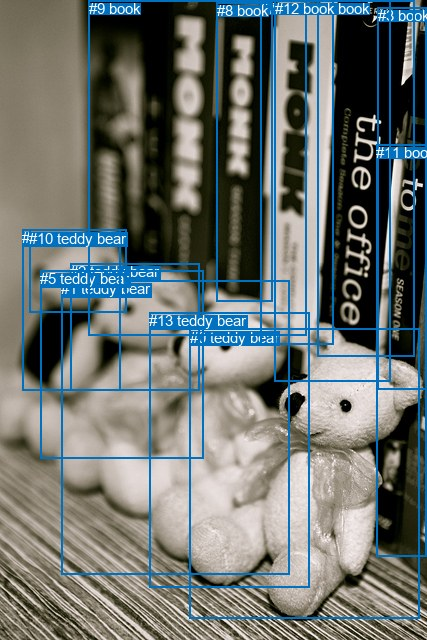
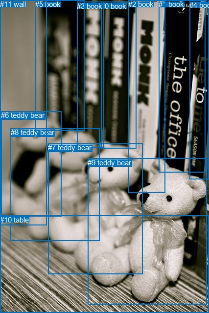

# 图片 0969：2359410.jpg

随机样本序号：345。图片 SHA256：`2e0b23c7ae0b7d4d09d7348bf0577fbdbc9c11a010cbd3f52c93ed33616d98c6`。

红色框表示人，蓝色框表示其他物体。两个模式分别保留自身框编号，可依据位置比较对应对象。

## 自动检测框与输出

人的框编号：`[]`。状态：`no_person`。

### 自动检测全部物体框

| 编号 | 类别 | 是否为人 | 检测分数 | 像素坐标 xyxy |
|---|---|---|---|---|
| 0 | teddy bear | False | 0.9977 | 189.6, 328.9, 419.4, 618.9 |
| 1 | teddy bear | False | 0.9921 | 61.3, 280.0, 289.4, 574.4 |
| 2 | teddy bear | False | 0.9406 | 70.2, 263.3, 199.6, 390.6 |
| 3 | book | False | 0.9346 | 377.8, 7.2, 426.7, 389.0 |
| 4 | book | False | 0.9287 | 317.9, 0.0, 414.5, 356.8 |
| 5 | teddy bear | False | 0.9063 | 40.3, 270.4, 203.8, 458.5 |
| 6 | teddy bear | False | 0.9030 | 22.1, 229.5, 120.5, 390.4 |
| 7 | book | False | 0.8743 | 260.3, 0.0, 333.0, 344.3 |
| 8 | book | False | 0.8417 | 216.6, 2.4, 272.4, 301.4 |
| 9 | book | False | 0.5860 | 88.9, 0.0, 306.9, 335.4 |
| 10 | teddy bear | False | 0.5488 | 29.0, 229.7, 126.7, 312.7 |
| 11 | book | False | 0.4441 | 376.0, 144.0, 426.5, 556.9 |
| 12 | book | False | 0.4351 | 274.7, 0.0, 390.4, 381.3 |
| 13 | teddy bear | False | 0.3811 | 149.4, 312.1, 309.2, 587.8 |

### 自动检测 Top50 人相关候选

评分物体对：0；人相关物体对：0；输出关系：0。

| 排名 | 主语编号与类别 | 关系 | 宾语编号与类别 | 类型 | 人与人 | 排序分数 | 原始融合 logit |
|---|---|---|---|---|---|---|---|

### 自动检测逐条人相关 GT 核验

本图没有人相关 GT，R@50 无分母；预测候选继续展示。

## 真实框与输出

人的框编号：`[]`。

### 真实框全部物体框

| 编号 | 类别 | 是否为人 | 检测分数 | 像素坐标 xyxy |
|---|---|---|---|---|
| 0 | book | False | GT | 206.0, 4.0, 278.0, 304.0 |
| 1 | book | False | GT | 324.0, 0.0, 419.0, 353.0 |
| 2 | book | False | GT | 262.0, 0.0, 337.0, 394.0 |
| 3 | book | False | GT | 157.0, 4.0, 212.0, 301.0 |
| 4 | book | False | GT | 387.0, 2.0, 427.0, 366.0 |
| 5 | book | False | GT | 72.0, 0.0, 172.0, 267.0 |
| 6 | teddy bear | False | GT | 2.0, 227.0, 125.0, 442.0 |
| 7 | teddy bear | False | GT | 98.0, 293.0, 291.0, 560.0 |
| 8 | teddy bear | False | GT | 22.0, 262.0, 204.0, 492.0 |
| 9 | teddy bear | False | GT | 179.0, 324.0, 422.0, 623.0 |
| 10 | table | False | GT | 0.0, 441.0, 427.0, 640.0 |
| 11 | wall | False | GT | 0.0, 0.0, 96.0, 460.0 |

### 真实框 Top50 人相关候选

评分物体对：0；人相关物体对：0；输出关系：0。

| 排名 | 主语编号与类别 | 关系 | 宾语编号与类别 | 类型 | 人与人 | 排序分数 | 原始融合 logit |
|---|---|---|---|---|---|---|---|

### 真实框逐条人相关 GT 核验

本图没有人相关 GT，R@50 无分母；预测候选继续展示。

## 全部人相关 GT

| 主语编号与类别 | 关系 | 宾语编号与类别 |
|---|---|---|

原始记录、全部人相关物体对的两项预测与分项分数见 [逐图证据 JSON](../evidence/cases/0969.json)。全部56类 logits 保留于本机 HOR/output/random500/logits/。

<!-- HOR_COMPLETE_RESULTS -->

## 六组条件的完整输出对照

以下保留同一图片三种框与候选模式、两种谓词输出规则的全部 Top50。框编号各自在所属模式内解释。

### 自动检测框完整枚举：空间与语义各保留一个谓词

| 排名 | 主语编号与类别 | 谓词 | 宾语编号与类别 | 分组 | 排序分数 | predicate logit | pair logit |
|---|---|---|---|---|---|---|---|

没有人相关 GT，本条件的召回率无分母。

### 自动检测框完整枚举：每对只保留一个谓词

| 排名 | 主语编号与类别 | 谓词 | 宾语编号与类别 | 分组 | 排序分数 | predicate logit | pair logit |
|---|---|---|---|---|---|---|---|

没有人相关 GT，本条件的召回率无分母。

### 真实框完整枚举：空间与语义各保留一个谓词

| 排名 | 主语编号与类别 | 谓词 | 宾语编号与类别 | 分组 | 排序分数 | predicate logit | pair logit |
|---|---|---|---|---|---|---|---|

没有人相关 GT，本条件的召回率无分母。

### 真实框完整枚举：每对只保留一个谓词

| 排名 | 主语编号与类别 | 谓词 | 宾语编号与类别 | 分组 | 排序分数 | predicate logit | pair logit |
|---|---|---|---|---|---|---|---|

没有人相关 GT，本条件的召回率无分母。

### 真实框400候选：空间与语义各保留一个谓词

| 排名 | 主语编号与类别 | 谓词 | 宾语编号与类别 | 分组 | 排序分数 | predicate logit | pair logit |
|---|---|---|---|---|---|---|---|

没有人相关 GT，本条件的召回率无分母。

### 真实框400候选：每对只保留一个谓词

| 排名 | 主语编号与类别 | 谓词 | 宾语编号与类别 | 分组 | 排序分数 | predicate logit | pair logit |
|---|---|---|---|---|---|---|---|

没有人相关 GT，本条件的召回率无分母。
