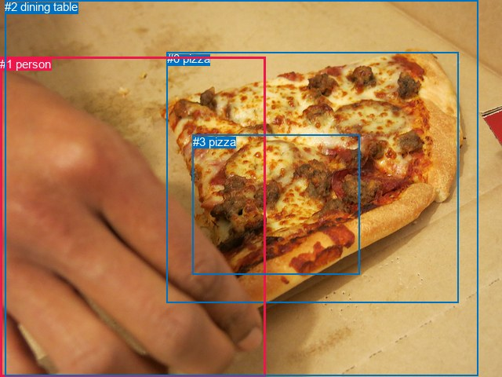
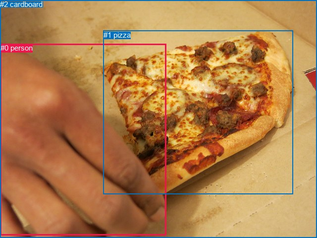

# 图片 0970：2359437.jpg

随机样本序号：201。图片 SHA256：`07c970316625f141017caa1385ee6c8ba59576b50c78f675940dc09ddc62f1c4`。

红色框表示人，蓝色框表示其他物体。两个模式分别保留自身框编号，可依据位置比较对应对象。

## 自动检测框与输出

人的框编号：`[1]`。状态：`ok`。

### 自动检测全部物体框

| 编号 | 类别 | 是否为人 | 检测分数 | 像素坐标 xyxy |
|---|---|---|---|---|
| 0 | pizza | False | 0.9971 | 212.8, 66.5, 584.6, 385.3 |
| 1 | person | True | 0.9672 | 0.0, 72.9, 338.4, 480.0 |
| 2 | dining table | False | 0.4931 | 6.4, 0.0, 609.6, 479.0 |
| 3 | pizza | False | 0.3939 | 245.6, 171.6, 458.4, 349.3 |

### 自动检测 Top50 人相关候选

评分物体对：12；人相关物体对：6；输出关系：12。

| 排名 | 主语编号与类别 | 关系 | 宾语编号与类别 | 类型 | 人与人 | 排序分数 | 原始融合 logit |
|---|---|---|---|---|---|---|---|
| 1 | #1 person | touching | #2 dining table | semantic | False | 0.98818 | 4.4259 |
| 2 | #1 person | touching | #0 pizza | semantic | False | 0.98284 | 4.0481 |
| 3 | #1 person | on | #2 dining table | spatial | False | 0.94636 | 2.8703 |
| 4 | #1 person | picking | #3 pizza | semantic | False | 0.92638 | 2.5323 |
| 5 | #1 person | beside | #0 pizza | spatial | False | 0.80550 | 1.4210 |
| 6 | #1 person | on | #3 pizza | spatial | False | 0.45124 | -0.1956 |
| 7 | #0 pizza | in | #1 person | spatial | False | 0.35366 | -0.6030 |
| 8 | #0 pizza | holding | #1 person | semantic | False | 0.17253 | -1.5678 |
| 9 | #2 dining table | holding | #1 person | semantic | False | 0.16428 | -1.6267 |
| 10 | #2 dining table | in | #1 person | spatial | False | 0.15529 | -1.6937 |
| 11 | #3 pizza | in | #1 person | spatial | False | 0.07263 | -2.5469 |
| 12 | #3 pizza | holding | #1 person | semantic | False | 0.02189 | -3.7997 |

### 自动检测逐条人相关 GT 核验

R@50：0.00%；命中 0/1。

| GT 主语编号 | GT 关系 | GT 宾语编号 | 结果阶段 | 匹配预测主语编号 | 匹配预测宾语编号 |
|---|---|---|---|---|---|
| 0 | picking | 1 | wrong_predicate | [1] | [0] |

## 真实框与输出

人的框编号：`[0]`。

### 真实框全部物体框

| 编号 | 类别 | 是否为人 | 检测分数 | 像素坐标 xyxy |
|---|---|---|---|---|
| 0 | person | True | GT | 1.0, 88.0, 335.0, 474.0 |
| 1 | pizza | False | GT | 209.0, 62.0, 591.0, 392.0 |
| 2 | cardboard | False | GT | 0.0, 0.0, 640.0, 480.0 |

### 真实框 Top50 人相关候选

评分物体对：6；人相关物体对：4；输出关系：8。

| 排名 | 主语编号与类别 | 关系 | 宾语编号与类别 | 类型 | 人与人 | 排序分数 | 原始融合 logit |
|---|---|---|---|---|---|---|---|
| 1 | #0 person | touching | #1 pizza | semantic | False | 0.99419 | 5.1418 |
| 2 | #0 person | touching | #2 cardboard | semantic | False | 0.99354 | 5.0359 |
| 3 | #0 person | on | #2 cardboard | spatial | False | 0.91506 | 2.3770 |
| 4 | #0 person | beside | #1 pizza | spatial | False | 0.88089 | 2.0009 |
| 5 | #1 pizza | beside | #0 person | spatial | False | 0.70077 | 0.8510 |
| 6 | #1 pizza | holding | #0 person | semantic | False | 0.19451 | -1.4210 |
| 7 | #2 cardboard | beside | #0 person | spatial | False | 0.09636 | -2.2383 |
| 8 | #2 cardboard | holding | #0 person | semantic | False | 0.05271 | -2.8889 |

### 真实框逐条人相关 GT 核验

R@50：0.00%；命中 0/1。

| GT 主语编号 | GT 关系 | GT 宾语编号 | 结果阶段 | 匹配预测主语编号 | 匹配预测宾语编号 |
|---|---|---|---|---|---|
| 0 | picking | 1 | wrong_predicate | [0] | [1] |

## 全部人相关 GT

| 主语编号与类别 | 关系 | 宾语编号与类别 |
|---|---|---|
| #0 person | picking | #1 pizza |

原始记录、全部人相关物体对的两项预测与分项分数见 [逐图证据 JSON](../evidence/cases/0970.json)。全部56类 logits 保留于本机 HOR/output/random500/logits/。

<!-- HOR_COMPLETE_RESULTS -->

## 六组条件的完整输出对照

以下保留同一图片三种框与候选模式、两种谓词输出规则的全部 Top50。框编号各自在所属模式内解释。

### 自动检测框完整枚举：空间与语义各保留一个谓词

| 排名 | 主语编号与类别 | 谓词 | 宾语编号与类别 | 分组 | 排序分数 | predicate logit | pair logit |
|---|---|---|---|---|---|---|---|
| 1 | #1 person | touching | #2 dining table | semantic | 0.9881782 | 4.6806197 | -0.2547047 |
| 2 | #1 person | touching | #0 pizza | semantic | 0.9828435 | 4.0776906 | -0.0296249 |
| 3 | #1 person | on | #2 dining table | spatial | 0.9463589 | 3.1250114 | -0.2547047 |
| 4 | #1 person | picking | #3 pizza | semantic | 0.9263757 | 3.3049083 | -0.7726029 |
| 5 | #1 person | beside | #0 pizza | spatial | 0.8054953 | 1.4506254 | -0.0296249 |
| 6 | #1 person | on | #3 pizza | spatial | 0.4512442 | 0.5769582 | -0.7726029 |
| 7 | #0 pizza | in | #1 person | spatial | 0.3536647 | 0.4040751 | -1.0070444 |
| 8 | #0 pizza | holding | #1 person | semantic | 0.1725260 | -0.5607853 | -1.0070444 |
| 9 | #2 dining table | holding | #1 person | semantic | 0.1642830 | -0.5796881 | -1.0470116 |
| 10 | #2 dining table | in | #1 person | spatial | 0.1552896 | -0.6466904 | -1.0470116 |
| 11 | #3 pizza | in | #1 person | spatial | 0.0726347 | -1.1669331 | -1.3799716 |
| 12 | #3 pizza | holding | #1 person | semantic | 0.0218874 | -2.4197409 | -1.3799716 |

GT 命中：0/1，R@50=0.00%。

| GT主语 | GT谓词 | GT宾语 | 结果阶段 | 匹配主语框 | 匹配宾语框 |
|---|---|---|---|---|---|
| 0 | picking | 1 | wrong_predicate | [1] | [0] |

### 自动检测框完整枚举：每对只保留一个谓词

| 排名 | 主语编号与类别 | 谓词 | 宾语编号与类别 | 分组 | 排序分数 | predicate logit | pair logit |
|---|---|---|---|---|---|---|---|
| 1 | #1 person | touching | #2 dining table | single | 0.9881782 | 4.6806197 | -0.2547047 |
| 2 | #1 person | touching | #0 pizza | single | 0.9828435 | 4.0776906 | -0.0296249 |
| 3 | #1 person | picking | #3 pizza | single | 0.9263757 | 3.3049083 | -0.7726029 |
| 4 | #0 pizza | in | #1 person | single | 0.3536647 | 0.4040751 | -1.0070444 |
| 5 | #2 dining table | holding | #1 person | single | 0.1642830 | -0.5796881 | -1.0470116 |
| 6 | #3 pizza | in | #1 person | single | 0.0726347 | -1.1669331 | -1.3799716 |

GT 命中：0/1，R@50=0.00%。

| GT主语 | GT谓词 | GT宾语 | 结果阶段 | 匹配主语框 | 匹配宾语框 |
|---|---|---|---|---|---|
| 0 | picking | 1 | wrong_predicate | [1] | [0] |

### 真实框完整枚举：空间与语义各保留一个谓词

| 排名 | 主语编号与类别 | 谓词 | 宾语编号与类别 | 分组 | 排序分数 | predicate logit | pair logit |
|---|---|---|---|---|---|---|---|
| 1 | #0 person | touching | #1 pizza | semantic | 0.9941868 | 5.2173448 | -0.0755579 |
| 2 | #0 person | touching | #2 cardboard | semantic | 0.9935414 | 5.3410602 | -0.3051981 |
| 3 | #0 person | on | #2 cardboard | spatial | 0.9150602 | 2.6822443 | -0.3051981 |
| 4 | #0 person | beside | #1 pizza | spatial | 0.8808942 | 2.0764842 | -0.0755579 |
| 5 | #1 pizza | beside | #0 person | spatial | 0.7007738 | 1.7883372 | -0.9373521 |
| 6 | #1 pizza | holding | #0 person | semantic | 0.1945067 | -0.4836359 | -0.9373521 |
| 7 | #2 cardboard | beside | #0 person | spatial | 0.0963612 | -1.4335952 | -0.8047310 |
| 8 | #2 cardboard | holding | #0 person | semantic | 0.0527067 | -2.0841358 | -0.8047310 |

GT 命中：0/1，R@50=0.00%。

| GT主语 | GT谓词 | GT宾语 | 结果阶段 | 匹配主语框 | 匹配宾语框 |
|---|---|---|---|---|---|
| 0 | picking | 1 | wrong_predicate | [0] | [1] |

### 真实框完整枚举：每对只保留一个谓词

| 排名 | 主语编号与类别 | 谓词 | 宾语编号与类别 | 分组 | 排序分数 | predicate logit | pair logit |
|---|---|---|---|---|---|---|---|
| 1 | #0 person | touching | #1 pizza | single | 0.9941868 | 5.2173448 | -0.0755579 |
| 2 | #0 person | touching | #2 cardboard | single | 0.9935414 | 5.3410602 | -0.3051981 |
| 3 | #1 pizza | beside | #0 person | single | 0.7007738 | 1.7883372 | -0.9373521 |
| 4 | #2 cardboard | beside | #0 person | single | 0.0963612 | -1.4335952 | -0.8047310 |

GT 命中：0/1，R@50=0.00%。

| GT主语 | GT谓词 | GT宾语 | 结果阶段 | 匹配主语框 | 匹配宾语框 |
|---|---|---|---|---|---|
| 0 | picking | 1 | wrong_predicate | [0] | [1] |

### 真实框400候选：空间与语义各保留一个谓词

| 排名 | 主语编号与类别 | 谓词 | 宾语编号与类别 | 分组 | 排序分数 | predicate logit | pair logit |
|---|---|---|---|---|---|---|---|
| 1 | #0 person | touching | #1 pizza | semantic | 0.9941870 | 5.2173810 | -0.0755579 |
| 2 | #0 person | touching | #2 cardboard | semantic | 0.9935414 | 5.3410602 | -0.3051981 |
| 3 | #0 person | on | #2 cardboard | spatial | 0.9150602 | 2.6822443 | -0.3051981 |
| 4 | #0 person | beside | #1 pizza | spatial | 0.8777144 | 2.0465198 | -0.0755579 |
| 5 | #1 pizza | beside | #0 person | spatial | 0.7007374 | 1.7881637 | -0.9373521 |
| 6 | #1 pizza | holding | #0 person | semantic | 0.1893816 | -0.5166812 | -0.9373521 |
| 7 | #2 cardboard | beside | #0 person | spatial | 0.0976742 | -1.4186072 | -0.8047310 |
| 8 | #2 cardboard | holding | #0 person | semantic | 0.0526698 | -2.0848744 | -0.8047310 |

GT 命中：0/1，R@50=0.00%。

| GT主语 | GT谓词 | GT宾语 | 结果阶段 | 匹配主语框 | 匹配宾语框 |
|---|---|---|---|---|---|
| 0 | picking | 1 | wrong_predicate | [0] | [1] |

### 真实框400候选：每对只保留一个谓词

| 排名 | 主语编号与类别 | 谓词 | 宾语编号与类别 | 分组 | 排序分数 | predicate logit | pair logit |
|---|---|---|---|---|---|---|---|
| 1 | #0 person | touching | #1 pizza | single | 0.9941870 | 5.2173810 | -0.0755579 |
| 2 | #0 person | touching | #2 cardboard | single | 0.9935414 | 5.3410602 | -0.3051981 |
| 3 | #1 pizza | beside | #0 person | single | 0.7007374 | 1.7881637 | -0.9373521 |
| 4 | #2 cardboard | beside | #0 person | single | 0.0976742 | -1.4186072 | -0.8047310 |

GT 命中：0/1，R@50=0.00%。

| GT主语 | GT谓词 | GT宾语 | 结果阶段 | 匹配主语框 | 匹配宾语框 |
|---|---|---|---|---|---|
| 0 | picking | 1 | wrong_predicate | [0] | [1] |
