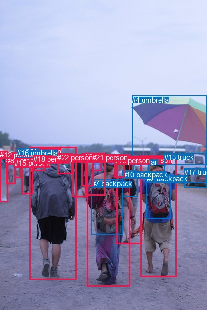
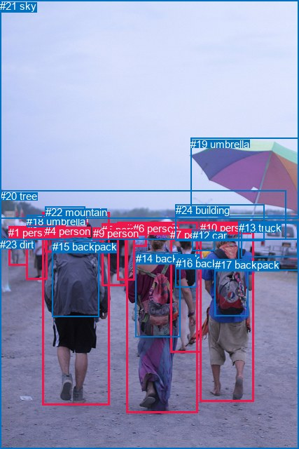

# 图片 0975：2359797.jpg

随机样本序号：158。图片 SHA256：`377ffb9cf36c1f830c8dbee3bd7157fe91ec90f5eaee8485a8f3a1afd975e81f`。

红色框表示人，蓝色框表示其他物体。两个模式分别保留自身框编号，可依据位置比较对应对象。

## 自动检测框与输出

人的框编号：`[0, 1, 3, 5, 6, 8, 9, 12, 14, 15, 18, 19, 20, 21, 22]`。状态：`ok`。

### 自动检测全部物体框

| 编号 | 类别 | 是否为人 | 检测分数 | 像素坐标 xyxy |
|---|---|---|---|---|
| 0 | person | True | 0.9989 | 289.8, 321.8, 364.1, 571.8 |
| 1 | person | True | 0.9987 | 60.5, 303.7, 157.9, 577.3 |
| 2 | backpack | False | 0.9964 | 302.6, 359.8, 352.0, 451.3 |
| 3 | person | True | 0.9958 | 179.2, 318.1, 268.1, 591.1 |
| 4 | umbrella | False | 0.9902 | 272.4, 197.9, 426.8, 340.3 |
| 5 | person | True | 0.9830 | 44.6, 318.9, 68.3, 400.2 |
| 6 | person | True | 0.9794 | 240.9, 322.2, 292.4, 503.5 |
| 7 | backpack | False | 0.9603 | 188.5, 370.5, 253.1, 484.5 |
| 8 | person | True | 0.9595 | 12.5, 322.7, 31.9, 379.8 |
| 9 | person | True | 0.9544 | 149.1, 318.1, 181.0, 406.6 |
| 10 | backpack | False | 0.9457 | 252.7, 351.5, 283.3, 405.4 |
| 11 | car | False | 0.9186 | 275.4, 326.2, 307.0, 357.9 |
| 12 | person | True | 0.9177 | 0.0, 311.4, 16.8, 417.2 |
| 13 | truck | False | 0.8884 | 338.7, 315.9, 424.7, 377.8 |
| 14 | person | True | 0.8804 | 168.5, 316.3, 192.2, 384.8 |
| 15 | person | True | 0.8348 | 30.2, 328.4, 42.5, 368.0 |
| 16 | umbrella | False | 0.8344 | 35.0, 306.5, 79.4, 325.0 |
| 17 | truck | False | 0.7958 | 380.1, 346.7, 426.6, 387.5 |
| 18 | person | True | 0.7813 | 68.7, 320.1, 94.0, 352.8 |
| 19 | person | True | 0.7071 | 236.1, 323.0, 256.6, 366.4 |
| 20 | person | True | 0.6822 | 175.5, 315.4, 217.8, 403.8 |
| 21 | person | True | 0.6424 | 190.3, 316.6, 209.2, 352.1 |
| 22 | person | True | 0.3842 | 118.3, 316.6, 149.9, 359.4 |

### 自动检测 Top50 人相关候选

评分物体对：506；人相关物体对：450；输出关系：50。

| 排名 | 主语编号与类别 | 关系 | 宾语编号与类别 | 类型 | 人与人 | 排序分数 | 原始融合 logit |
|---|---|---|---|---|---|---|---|
| 1 | #0 person | wearing | #2 backpack | semantic | False | 0.98793 | 4.4050 |
| 2 | #3 person | wearing | #7 backpack | semantic | False | 0.97860 | 3.8226 |
| 3 | #6 person | wearing | #10 backpack | semantic | False | 0.97728 | 3.7614 |
| 4 | #8 person | walking on | #12 person | semantic | True | 0.97424 | 3.6327 |
| 5 | #1 person | wearing | #18 person | semantic | True | 0.97298 | 3.5837 |
| 6 | #5 person | holding | #16 umbrella | semantic | False | 0.94947 | 2.9334 |
| 7 | #20 person | wearing | #21 person | semantic | True | 0.94083 | 2.7663 |
| 8 | #15 person | walking on | #16 umbrella | semantic | False | 0.93807 | 2.7178 |
| 9 | #0 person | in | #2 backpack | spatial | False | 0.93653 | 2.6916 |
| 10 | #6 person | in | #10 backpack | spatial | False | 0.92963 | 2.5810 |
| 11 | #15 person | walking on | #8 person | semantic | True | 0.92030 | 2.4464 |
| 12 | #3 person | wearing | #21 person | semantic | True | 0.91756 | 2.4096 |
| 13 | #8 person | walking on | #16 umbrella | semantic | False | 0.91353 | 2.3576 |
| 14 | #0 person | holding | #4 umbrella | semantic | False | 0.91052 | 2.3200 |
| 15 | #1 person | wearing | #22 person | semantic | True | 0.90625 | 2.2687 |
| 16 | #3 person | in | #7 backpack | spatial | False | 0.89815 | 2.1769 |
| 17 | #1 person | in | #18 person | spatial | True | 0.88715 | 2.0619 |
| 18 | #7 backpack | on | #3 person | spatial | False | 0.86471 | 1.8550 |
| 19 | #3 person | wearing | #19 person | semantic | True | 0.85554 | 1.7787 |
| 20 | #1 person | in | #22 person | spatial | True | 0.84859 | 1.7236 |
| 21 | #3 person | in | #19 person | spatial | True | 0.84486 | 1.6949 |
| 22 | #20 person | in | #21 person | spatial | True | 0.83815 | 1.6445 |
| 23 | #8 person | walking on | #15 person | semantic | True | 0.82576 | 1.5559 |
| 24 | #2 backpack | on | #0 person | spatial | False | 0.80996 | 1.4498 |
| 25 | #15 person | in | #16 umbrella | spatial | False | 0.80817 | 1.4382 |
| 26 | #1 person | walking on | #16 umbrella | semantic | False | 0.80171 | 1.3970 |
| 27 | #3 person | in | #21 person | spatial | True | 0.79467 | 1.3533 |
| 28 | #5 person | in | #16 umbrella | spatial | False | 0.78775 | 1.3114 |
| 29 | #6 person | wearing | #19 person | semantic | True | 0.75991 | 1.1522 |
| 30 | #0 person | wearing | #11 car | semantic | False | 0.75176 | 1.1080 |
| 31 | #8 person | in | #16 umbrella | spatial | False | 0.74603 | 1.0775 |
| 32 | #3 person | wearing | #20 person | semantic | True | 0.73944 | 1.0430 |
| 33 | #18 person | holding | #16 umbrella | semantic | False | 0.73269 | 1.0083 |
| 34 | #8 person | beside | #12 person | spatial | True | 0.72015 | 0.9452 |
| 35 | #6 person | in | #19 person | spatial | True | 0.70978 | 0.8943 |
| 36 | #12 person | walking on | #8 person | semantic | True | 0.69513 | 0.8242 |
| 37 | #12 person | on | #8 person | spatial | True | 0.69395 | 0.8187 |
| 38 | #21 person | on | #20 person | spatial | True | 0.69027 | 0.8014 |
| 39 | #1 person | in | #16 umbrella | spatial | False | 0.65983 | 0.6625 |
| 40 | #3 person | in | #20 person | spatial | True | 0.64288 | 0.5879 |
| 41 | #18 person | in | #16 umbrella | spatial | False | 0.61476 | 0.4674 |
| 42 | #6 person | wearing | #11 car | semantic | False | 0.61037 | 0.4489 |
| 43 | #15 person | walking on | #12 person | semantic | True | 0.58144 | 0.3287 |
| 44 | #20 person | carrying | #7 backpack | semantic | False | 0.56937 | 0.2793 |
| 45 | #3 person | wearing | #10 backpack | semantic | False | 0.56825 | 0.2747 |
| 46 | #0 person | in | #11 car | spatial | False | 0.56423 | 0.2583 |
| 47 | #5 person | walking on | #8 person | semantic | True | 0.54565 | 0.1831 |
| 48 | #15 person | in | #8 person | spatial | True | 0.53576 | 0.1433 |
| 49 | #5 person | walking on | #12 person | semantic | True | 0.50271 | 0.0108 |
| 50 | #0 person | in | #4 umbrella | spatial | False | 0.48756 | -0.0498 |

### 自动检测逐条人相关 GT 核验

R@50：25.00%；命中 1/4。

| GT 主语编号 | GT 关系 | GT 宾语编号 | 结果阶段 | 匹配预测主语编号 | 匹配预测宾语编号 |
|---|---|---|---|---|---|
| 3 | carrying | 14 | wrong_predicate | [3] | [7] |
| 8 | carrying | 15 | endpoint_missing_or_wrong_class | [1] | [] |
| 10 | holding | 19 | hit50 | [0] | [4] |
| 14 | on back of | 3 | wrong_predicate | [7] | [3] |

## 真实框与输出

人的框编号：`[0, 1, 2, 3, 4, 5, 6, 7, 8, 9, 10]`。

### 真实框全部物体框

| 编号 | 类别 | 是否为人 | 检测分数 | 像素坐标 xyxy |
|---|---|---|---|---|
| 0 | person | True | GT | 38.0, 321.0, 68.0, 398.0 |
| 1 | person | True | GT | 12.0, 323.0, 40.0, 379.0 |
| 2 | person | True | GT | 168.0, 317.0, 193.0, 400.0 |
| 3 | person | True | GT | 180.0, 317.0, 282.0, 588.0 |
| 4 | person | True | GT | 64.0, 321.0, 93.0, 360.0 |
| 5 | person | True | GT | 145.0, 319.0, 180.0, 408.0 |
| 6 | person | True | GT | 190.0, 317.0, 209.0, 351.0 |
| 7 | person | True | GT | 243.0, 326.0, 287.0, 502.0 |
| 8 | person | True | GT | 61.0, 303.0, 157.0, 578.0 |
| 9 | person | True | GT | 133.0, 324.0, 144.0, 344.0 |
| 10 | person | True | GT | 286.0, 316.0, 363.0, 572.0 |
| 11 | car | False | GT | 345.0, 317.0, 426.0, 366.0 |
| 12 | car | False | GT | 275.0, 327.0, 307.0, 358.0 |
| 13 | truck | False | GT | 341.0, 316.0, 427.0, 386.0 |
| 14 | backpack | False | GT | 194.0, 360.0, 258.0, 481.0 |
| 15 | backpack | False | GT | 75.0, 343.0, 142.0, 452.0 |
| 16 | backpack | False | GT | 251.0, 367.0, 280.0, 410.0 |
| 17 | backpack | False | GT | 307.0, 369.0, 355.0, 451.0 |
| 18 | umbrella | False | GT | 38.0, 307.0, 78.0, 324.0 |
| 19 | umbrella | False | GT | 272.0, 197.0, 427.0, 309.0 |
| 20 | tree | False | GT | 0.0, 271.0, 408.0, 341.0 |
| 21 | sky | False | GT | 0.0, 0.0, 427.0, 311.0 |
| 22 | mountain | False | GT | 65.0, 294.0, 122.0, 308.0 |
| 23 | dirt | False | GT | 0.0, 340.0, 427.0, 640.0 |
| 24 | building | False | GT | 251.0, 291.0, 378.0, 343.0 |

### 真实框 Top50 人相关候选

评分物体对：600；人相关物体对：418；输出关系：50。

| 排名 | 主语编号与类别 | 关系 | 宾语编号与类别 | 类型 | 人与人 | 排序分数 | 原始融合 logit |
|---|---|---|---|---|---|---|---|
| 1 | #8 person | walking on | #23 dirt | semantic | False | 0.99389 | 5.0910 |
| 2 | #1 person | walking on | #23 dirt | semantic | False | 0.99304 | 4.9611 |
| 3 | #10 person | walking on | #23 dirt | semantic | False | 0.99153 | 4.7621 |
| 4 | #8 person | wearing | #15 backpack | semantic | False | 0.99107 | 4.7094 |
| 5 | #3 person | walking on | #23 dirt | semantic | False | 0.99012 | 4.6072 |
| 6 | #0 person | walking on | #23 dirt | semantic | False | 0.98998 | 4.5935 |
| 7 | #5 person | walking on | #23 dirt | semantic | False | 0.98779 | 4.3935 |
| 8 | #10 person | wearing | #17 backpack | semantic | False | 0.98567 | 4.2306 |
| 9 | #7 person | wearing | #16 backpack | semantic | False | 0.98533 | 4.2070 |
| 10 | #8 person | wearing | #22 mountain | semantic | False | 0.98388 | 4.1117 |
| 11 | #2 person | walking on | #23 dirt | semantic | False | 0.98343 | 4.0835 |
| 12 | #7 person | walking on | #23 dirt | semantic | False | 0.98062 | 3.9240 |
| 13 | #3 person | carrying | #14 backpack | semantic | False | 0.98025 | 3.9046 |
| 14 | #8 person | wearing | #4 person | semantic | True | 0.96525 | 3.3242 |
| 15 | #0 person | carrying | #18 umbrella | semantic | False | 0.94977 | 2.9397 |
| 16 | #3 person | wearing | #16 backpack | semantic | False | 0.94409 | 2.8265 |
| 17 | #3 person | wearing | #6 person | semantic | True | 0.93921 | 2.7377 |
| 18 | #8 person | in | #15 backpack | spatial | False | 0.93652 | 2.6914 |
| 19 | #7 person | in | #16 backpack | spatial | False | 0.92031 | 2.4465 |
| 20 | #3 person | on | #23 dirt | spatial | False | 0.91614 | 2.3910 |
| 21 | #8 person | on | #23 dirt | spatial | False | 0.91446 | 2.3694 |
| 22 | #15 backpack | on | #8 person | spatial | False | 0.91393 | 2.3626 |
| 23 | #8 person | wearing | #9 person | semantic | True | 0.91089 | 2.3246 |
| 24 | #10 person | on | #23 dirt | spatial | False | 0.90448 | 2.2480 |
| 25 | #10 person | in | #17 backpack | spatial | False | 0.89574 | 2.1507 |
| 26 | #1 person | on | #23 dirt | spatial | False | 0.88764 | 2.0668 |
| 27 | #14 backpack | on | #3 person | spatial | False | 0.88337 | 2.0247 |
| 28 | #10 person | holding | #19 umbrella | semantic | False | 0.87835 | 1.9769 |
| 29 | #22 mountain | on | #8 person | spatial | False | 0.87771 | 1.9709 |
| 30 | #3 person | in | #14 backpack | spatial | False | 0.87401 | 1.9369 |
| 31 | #0 person | on | #23 dirt | spatial | False | 0.86247 | 1.8360 |
| 32 | #17 backpack | on | #10 person | spatial | False | 0.85344 | 1.7619 |
| 33 | #5 person | on | #23 dirt | spatial | False | 0.84133 | 1.6681 |
| 34 | #7 person | on | #23 dirt | spatial | False | 0.83410 | 1.6149 |
| 35 | #2 person | on | #23 dirt | spatial | False | 0.80410 | 1.4121 |
| 36 | #8 person | in | #4 person | spatial | True | 0.79988 | 1.3856 |
| 37 | #8 person | in | #22 mountain | spatial | False | 0.78501 | 1.2951 |
| 38 | #3 person | in | #6 person | spatial | True | 0.76524 | 1.1816 |
| 39 | #10 person | wearing | #12 car | semantic | False | 0.74134 | 1.0529 |
| 40 | #3 person | in | #16 backpack | spatial | False | 0.70356 | 0.8643 |
| 41 | #8 person | holding | #18 umbrella | semantic | False | 0.69837 | 0.8396 |
| 42 | #0 person | walking on | #1 person | semantic | True | 0.69048 | 0.8024 |
| 43 | #1 person | walking on | #18 umbrella | semantic | False | 0.68998 | 0.8000 |
| 44 | #8 person | in | #9 person | spatial | True | 0.67598 | 0.7353 |
| 45 | #4 person | holding | #18 umbrella | semantic | False | 0.67269 | 0.7204 |
| 46 | #0 person | in | #18 umbrella | spatial | False | 0.65707 | 0.6503 |
| 47 | #1 person | walking on | #20 tree | semantic | False | 0.63840 | 0.5684 |
| 48 | #9 person | walking on | #23 dirt | semantic | False | 0.62321 | 0.5032 |
| 49 | #14 backpack | carrying | #3 person | semantic | False | 0.57992 | 0.3224 |
| 50 | #4 person | walking on | #23 dirt | semantic | False | 0.57713 | 0.3110 |

### 真实框逐条人相关 GT 核验

R@50：50.00%；命中 2/4。

| GT 主语编号 | GT 关系 | GT 宾语编号 | 结果阶段 | 匹配预测主语编号 | 匹配预测宾语编号 |
|---|---|---|---|---|---|
| 3 | carrying | 14 | hit50 | [3] | [14] |
| 8 | carrying | 15 | wrong_predicate | [8] | [15] |
| 10 | holding | 19 | hit50 | [10] | [19] |
| 14 | on back of | 3 | wrong_predicate | [14] | [3] |

## 全部人相关 GT

| 主语编号与类别 | 关系 | 宾语编号与类别 |
|---|---|---|
| #3 person | carrying | #14 backpack |
| #8 person | carrying | #15 backpack |
| #10 person | holding | #19 umbrella |
| #14 backpack | on back of | #3 person |

原始记录、全部人相关物体对的两项预测与分项分数见 [逐图证据 JSON](../evidence/cases/0975.json)。全部56类 logits 保留于本机 HOR/output/random500/logits/。

<!-- HOR_COMPLETE_RESULTS -->

## 六组条件的完整输出对照

以下保留同一图片三种框与候选模式、两种谓词输出规则的全部 Top50。框编号各自在所属模式内解释。

### 自动检测框完整枚举：空间与语义各保留一个谓词

| 排名 | 主语编号与类别 | 谓词 | 宾语编号与类别 | 分组 | 排序分数 | predicate logit | pair logit |
|---|---|---|---|---|---|---|---|
| 1 | #0 person | wearing | #2 backpack | semantic | 0.9879317 | 3.9652629 | 0.4397708 |
| 2 | #3 person | wearing | #7 backpack | semantic | 0.9785973 | 3.6539721 | 0.1686318 |
| 3 | #6 person | wearing | #10 backpack | semantic | 0.9772778 | 3.7231746 | 0.0382577 |
| 4 | #8 person | walking on | #12 person | semantic | 0.9742356 | 3.6981597 | -0.0655019 |
| 5 | #1 person | wearing | #18 person | semantic | 0.9729770 | 3.5587287 | 0.0249448 |
| 6 | #5 person | holding | #16 umbrella | semantic | 0.9494720 | 3.0936399 | -0.1602624 |
| 7 | #20 person | wearing | #21 person | semantic | 0.9408289 | 3.1579156 | -0.3915877 |
| 8 | #15 person | walking on | #16 umbrella | semantic | 0.9380704 | 2.8918142 | -0.1739882 |
| 9 | #0 person | in | #2 backpack | spatial | 0.9365289 | 2.2518239 | 0.4397708 |
| 10 | #6 person | in | #10 backpack | spatial | 0.9296312 | 2.5427799 | 0.0382577 |
| 11 | #15 person | walking on | #8 person | semantic | 0.9202967 | 2.6450076 | -0.1986237 |
| 12 | #3 person | wearing | #21 person | semantic | 0.9175599 | 2.5311155 | -0.1214693 |
| 13 | #8 person | walking on | #16 umbrella | semantic | 0.9135348 | 2.6751547 | -0.3175760 |
| 14 | #0 person | holding | #4 umbrella | semantic | 0.9105163 | 2.3042612 | 0.0156934 |
| 15 | #1 person | wearing | #22 person | semantic | 0.9062476 | 2.3034787 | -0.0348243 |
| 16 | #3 person | in | #7 backpack | spatial | 0.8981515 | 2.0082197 | 0.1686318 |
| 17 | #1 person | in | #18 person | spatial | 0.8871466 | 2.0369759 | 0.0249448 |
| 18 | #7 backpack | on | #3 person | spatial | 0.8647137 | 2.5730586 | -0.7180537 |
| 19 | #3 person | wearing | #19 person | semantic | 0.8555418 | 1.7037630 | 0.0749817 |
| 20 | #1 person | in | #22 person | spatial | 0.8485894 | 1.7584038 | -0.0348243 |
| 21 | #3 person | in | #19 person | spatial | 0.8448634 | 1.6198869 | 0.0749817 |
| 22 | #20 person | in | #21 person | spatial | 0.8381460 | 2.0360851 | -0.3915877 |
| 23 | #8 person | walking on | #15 person | semantic | 0.8257615 | 1.9468880 | -0.3910068 |
| 24 | #2 backpack | on | #0 person | spatial | 0.8099649 | 2.2394772 | -0.7896949 |
| 25 | #15 person | in | #16 umbrella | spatial | 0.8081709 | 1.6121569 | -0.1739882 |
| 26 | #1 person | walking on | #16 umbrella | semantic | 0.8017145 | 2.0703197 | -0.6732754 |
| 27 | #3 person | in | #21 person | spatial | 0.7946660 | 1.4747534 | -0.1214693 |
| 28 | #5 person | in | #16 umbrella | spatial | 0.7877464 | 1.4716568 | -0.1602624 |
| 29 | #6 person | wearing | #19 person | semantic | 0.7599110 | 1.3368001 | -0.1846085 |
| 30 | #0 person | wearing | #11 car | semantic | 0.7517555 | 1.1409039 | -0.0329071 |
| 31 | #8 person | in | #16 umbrella | spatial | 0.7460258 | 1.3951035 | -0.3175760 |
| 32 | #3 person | wearing | #20 person | semantic | 0.7394360 | 1.5086188 | -0.4655799 |
| 33 | #18 person | holding | #16 umbrella | semantic | 0.7326947 | 1.8619652 | -0.8536277 |
| 34 | #8 person | beside | #12 person | spatial | 0.7201498 | 1.0107064 | -0.0655019 |
| 35 | #6 person | in | #19 person | spatial | 0.7097777 | 1.0789127 | -0.1846085 |
| 36 | #12 person | walking on | #8 person | semantic | 0.6951254 | 1.0306726 | -0.2064806 |
| 37 | #12 person | on | #8 person | spatial | 0.6939521 | 1.0251417 | -0.2064806 |
| 38 | #21 person | on | #20 person | spatial | 0.6902696 | 1.3341336 | -0.5327538 |
| 39 | #1 person | in | #16 umbrella | spatial | 0.6598297 | 1.3358107 | -0.6732754 |
| 40 | #3 person | in | #20 person | spatial | 0.6428823 | 1.0534759 | -0.4655799 |
| 41 | #18 person | in | #16 umbrella | spatial | 0.6147565 | 1.3209782 | -0.8536277 |
| 42 | #6 person | wearing | #11 car | semantic | 0.6103695 | 0.6366515 | -0.1877860 |
| 43 | #15 person | walking on | #12 person | semantic | 0.5814361 | 0.5928373 | -0.2641656 |
| 44 | #20 person | carrying | #7 backpack | semantic | 0.5693679 | 0.8992481 | -0.6199752 |
| 45 | #3 person | wearing | #10 backpack | semantic | 0.5682527 | 0.7409887 | -0.4662628 |
| 46 | #0 person | in | #11 car | spatial | 0.5642260 | 0.2912383 | -0.0329071 |
| 47 | #5 person | walking on | #8 person | semantic | 0.5456541 | 0.4694757 | -0.2863494 |
| 48 | #15 person | in | #8 person | spatial | 0.5357603 | 0.3419099 | -0.1986237 |
| 49 | #5 person | walking on | #12 person | semantic | 0.5027120 | 0.3671460 | -0.3562980 |
| 50 | #0 person | in | #4 umbrella | spatial | 0.4875646 | -0.0654454 | 0.0156934 |

GT 命中：1/4，R@50=25.00%。

| GT主语 | GT谓词 | GT宾语 | 结果阶段 | 匹配主语框 | 匹配宾语框 |
|---|---|---|---|---|---|
| 3 | carrying | 14 | wrong_predicate | [3] | [7] |
| 8 | carrying | 15 | endpoint_missing_or_wrong_class | [1] | [] |
| 10 | holding | 19 | hit50 | [0] | [4] |
| 14 | on back of | 3 | wrong_predicate | [7] | [3] |

### 自动检测框完整枚举：每对只保留一个谓词

| 排名 | 主语编号与类别 | 谓词 | 宾语编号与类别 | 分组 | 排序分数 | predicate logit | pair logit |
|---|---|---|---|---|---|---|---|
| 1 | #0 person | wearing | #2 backpack | single | 0.9879317 | 3.9652629 | 0.4397708 |
| 2 | #3 person | wearing | #7 backpack | single | 0.9785973 | 3.6539721 | 0.1686318 |
| 3 | #6 person | wearing | #10 backpack | single | 0.9772778 | 3.7231746 | 0.0382577 |
| 4 | #8 person | walking on | #12 person | single | 0.9742356 | 3.6981597 | -0.0655019 |
| 5 | #1 person | wearing | #18 person | single | 0.9729770 | 3.5587287 | 0.0249448 |
| 6 | #5 person | holding | #16 umbrella | single | 0.9494720 | 3.0936399 | -0.1602624 |
| 7 | #20 person | wearing | #21 person | single | 0.9408289 | 3.1579156 | -0.3915877 |
| 8 | #15 person | walking on | #16 umbrella | single | 0.9380704 | 2.8918142 | -0.1739882 |
| 9 | #15 person | walking on | #8 person | single | 0.9202967 | 2.6450076 | -0.1986237 |
| 10 | #3 person | wearing | #21 person | single | 0.9175599 | 2.5311155 | -0.1214693 |
| 11 | #8 person | walking on | #16 umbrella | single | 0.9135348 | 2.6751547 | -0.3175760 |
| 12 | #0 person | holding | #4 umbrella | single | 0.9105163 | 2.3042612 | 0.0156934 |
| 13 | #1 person | wearing | #22 person | single | 0.9062476 | 2.3034787 | -0.0348243 |
| 14 | #7 backpack | on | #3 person | single | 0.8647137 | 2.5730586 | -0.7180537 |
| 15 | #3 person | wearing | #19 person | single | 0.8555418 | 1.7037630 | 0.0749817 |
| 16 | #8 person | walking on | #15 person | single | 0.8257615 | 1.9468880 | -0.3910068 |
| 17 | #2 backpack | on | #0 person | single | 0.8099649 | 2.2394772 | -0.7896949 |
| 18 | #1 person | walking on | #16 umbrella | single | 0.8017145 | 2.0703197 | -0.6732754 |
| 19 | #6 person | wearing | #19 person | single | 0.7599110 | 1.3368001 | -0.1846085 |
| 20 | #0 person | wearing | #11 car | single | 0.7517555 | 1.1409039 | -0.0329071 |
| 21 | #3 person | wearing | #20 person | single | 0.7394360 | 1.5086188 | -0.4655799 |
| 22 | #18 person | holding | #16 umbrella | single | 0.7326947 | 1.8619652 | -0.8536277 |
| 23 | #12 person | walking on | #8 person | single | 0.6951254 | 1.0306726 | -0.2064806 |
| 24 | #21 person | on | #20 person | single | 0.6902696 | 1.3341336 | -0.5327538 |
| 25 | #6 person | wearing | #11 car | single | 0.6103695 | 0.6366515 | -0.1877860 |
| 26 | #15 person | walking on | #12 person | single | 0.5814361 | 0.5928373 | -0.2641656 |
| 27 | #20 person | carrying | #7 backpack | single | 0.5693679 | 0.8992481 | -0.6199752 |
| 28 | #3 person | wearing | #10 backpack | single | 0.5682527 | 0.7409887 | -0.4662628 |
| 29 | #5 person | walking on | #8 person | single | 0.5456541 | 0.4694757 | -0.2863494 |
| 30 | #5 person | walking on | #12 person | single | 0.5027120 | 0.3671460 | -0.3562980 |
| 31 | #4 umbrella | over | #0 person | single | 0.4840826 | 0.8653731 | -0.9290643 |
| 32 | #5 person | wearing | #18 person | single | 0.4489140 | 0.0980158 | -0.3030754 |
| 33 | #20 person | walking on | #3 person | single | 0.4437414 | 0.8215113 | -1.0475024 |
| 34 | #9 person | walking on | #14 person | single | 0.4363697 | 0.3129711 | -0.5688796 |
| 35 | #14 person | walking on | #9 person | single | 0.4205144 | 0.3400517 | -0.6607137 |
| 36 | #19 person | in | #10 backpack | single | 0.4203401 | 0.4440212 | -0.7653987 |
| 37 | #6 person | carrying | #7 backpack | single | 0.4194993 | 0.3624659 | -0.6872950 |
| 38 | #5 person | walking on | #15 person | single | 0.4109258 | 0.0105948 | -0.3707343 |
| 39 | #0 person | wearing | #10 backpack | single | 0.4041218 | -0.1933432 | -0.1949764 |
| 40 | #10 backpack | on | #6 person | single | 0.3882801 | 0.6191263 | -1.0736740 |
| 41 | #15 person | walking on | #17 truck | single | 0.3820334 | 0.4499073 | -0.9308336 |
| 42 | #6 person | holding | #4 umbrella | single | 0.3819758 | -0.1724629 | -0.3087072 |
| 43 | #21 person | looking at | #3 person | single | 0.3805427 | 0.3904004 | -0.8776457 |
| 44 | #18 person | on | #1 person | single | 0.3785510 | 0.2591605 | -0.7548636 |
| 45 | #14 person | wearing | #21 person | single | 0.3682547 | -0.0899763 | -0.4497353 |
| 46 | #14 person | walking on | #20 person | single | 0.3566099 | 0.0271249 | -0.6172338 |
| 47 | #1 person | walking on | #3 person | single | 0.3549986 | 0.5055604 | -1.1026990 |
| 48 | #1 person | walking on | #12 person | single | 0.3547665 | 0.4935322 | -1.0916845 |
| 49 | #19 person | on | #3 person | single | 0.3358920 | 0.1955318 | -0.8771868 |
| 50 | #16 umbrella | over | #15 person | single | 0.3321975 | -0.0355172 | -0.6627459 |

GT 命中：1/4，R@50=25.00%。

| GT主语 | GT谓词 | GT宾语 | 结果阶段 | 匹配主语框 | 匹配宾语框 |
|---|---|---|---|---|---|
| 3 | carrying | 14 | wrong_predicate | [3] | [7] |
| 8 | carrying | 15 | endpoint_missing_or_wrong_class | [1] | [] |
| 10 | holding | 19 | hit50 | [0] | [4] |
| 14 | on back of | 3 | wrong_predicate | [7] | [3] |

### 真实框完整枚举：空间与语义各保留一个谓词

| 排名 | 主语编号与类别 | 谓词 | 宾语编号与类别 | 分组 | 排序分数 | predicate logit | pair logit |
|---|---|---|---|---|---|---|---|
| 1 | #8 person | walking on | #23 dirt | semantic | 0.9938857 | 4.9711070 | 0.1198915 |
| 2 | #1 person | walking on | #23 dirt | semantic | 0.9930437 | 4.9018941 | 0.0592157 |
| 3 | #10 person | walking on | #23 dirt | semantic | 0.9915251 | 4.8447204 | -0.0825822 |
| 4 | #8 person | wearing | #15 backpack | semantic | 0.9910705 | 4.4835792 | 0.2258416 |
| 5 | #3 person | walking on | #23 dirt | semantic | 0.9901190 | 4.7273660 | -0.1201601 |
| 6 | #0 person | walking on | #23 dirt | semantic | 0.9899844 | 4.5468192 | 0.0467270 |
| 7 | #5 person | walking on | #23 dirt | semantic | 0.9877933 | 4.3392053 | 0.0542755 |
| 8 | #10 person | wearing | #17 backpack | semantic | 0.9856651 | 3.8433938 | 0.3872232 |
| 9 | #7 person | wearing | #16 backpack | semantic | 0.9853277 | 4.1459556 | 0.0610573 |
| 10 | #8 person | wearing | #22 mountain | semantic | 0.9838839 | 3.6423821 | 0.4693074 |
| 11 | #2 person | walking on | #23 dirt | semantic | 0.9834301 | 4.0112252 | 0.0722369 |
| 12 | #7 person | walking on | #23 dirt | semantic | 0.9806219 | 4.1135268 | -0.1894779 |
| 13 | #3 person | carrying | #14 backpack | semantic | 0.9802498 | 3.7186704 | 0.1859709 |
| 14 | #8 person | wearing | #4 person | semantic | 0.9652498 | 3.4133878 | -0.0891845 |
| 15 | #0 person | carrying | #18 umbrella | semantic | 0.9497749 | 3.0955439 | -0.1558324 |
| 16 | #3 person | wearing | #16 backpack | semantic | 0.9440917 | 3.1300797 | -0.3035688 |
| 17 | #3 person | wearing | #6 person | semantic | 0.9392137 | 2.8628707 | -0.1251924 |
| 18 | #8 person | in | #15 backpack | spatial | 0.9365172 | 2.4655585 | 0.2258416 |
| 19 | #7 person | in | #16 backpack | spatial | 0.9203066 | 2.3854637 | 0.0610573 |
| 20 | #3 person | on | #23 dirt | spatial | 0.9161367 | 2.5111384 | -0.1201601 |
| 21 | #8 person | on | #23 dirt | spatial | 0.9144631 | 2.2494984 | 0.1198915 |
| 22 | #15 backpack | on | #8 person | spatial | 0.9139345 | 2.9123745 | -0.5497249 |
| 23 | #8 person | wearing | #9 person | semantic | 0.9108906 | 2.4209824 | -0.0964241 |
| 24 | #10 person | on | #23 dirt | spatial | 0.9044787 | 2.3305912 | -0.0825822 |
| 25 | #10 person | in | #17 backpack | spatial | 0.8957367 | 1.7635036 | 0.3872232 |
| 26 | #1 person | on | #23 dirt | spatial | 0.8876368 | 2.0076103 | 0.0592157 |
| 27 | #14 backpack | on | #3 person | spatial | 0.8833704 | 2.7974539 | -0.7727128 |
| 28 | #10 person | holding | #19 umbrella | semantic | 0.8783470 | 2.0181203 | -0.0412505 |
| 29 | #22 mountain | on | #8 person | spatial | 0.8777109 | 2.2658324 | -0.2949028 |
| 30 | #3 person | in | #14 backpack | spatial | 0.8740075 | 1.7508960 | 0.1859709 |
| 31 | #0 person | on | #23 dirt | spatial | 0.8624709 | 1.7892385 | 0.0467270 |
| 32 | #17 backpack | on | #10 person | spatial | 0.8534437 | 2.5292106 | -0.7673399 |
| 33 | #5 person | on | #23 dirt | spatial | 0.8413252 | 1.6138458 | 0.0542755 |
| 34 | #7 person | on | #23 dirt | spatial | 0.8340956 | 1.8044143 | -0.1894779 |
| 35 | #2 person | on | #23 dirt | spatial | 0.8040977 | 1.3398681 | 0.0722369 |
| 36 | #8 person | in | #4 person | spatial | 0.7998839 | 1.4747534 | -0.0891845 |
| 37 | #8 person | in | #22 mountain | spatial | 0.7850100 | 0.8257976 | 0.4693074 |
| 38 | #3 person | in | #6 person | spatial | 0.7652389 | 1.3068123 | -0.1251924 |
| 39 | #10 person | wearing | #12 car | semantic | 0.7413356 | 1.1291680 | -0.0762460 |
| 40 | #3 person | in | #16 backpack | spatial | 0.7035587 | 1.1678710 | -0.3035688 |
| 41 | #8 person | holding | #18 umbrella | semantic | 0.6983746 | 1.4770260 | -0.6374561 |
| 42 | #0 person | walking on | #1 person | semantic | 0.6904848 | 1.1374626 | -0.3350761 |
| 43 | #1 person | walking on | #18 umbrella | semantic | 0.6899825 | 1.0532374 | -0.2532002 |
| 44 | #8 person | in | #9 person | spatial | 0.6759766 | 0.8317671 | -0.0964241 |
| 45 | #4 person | holding | #18 umbrella | semantic | 0.6726945 | 1.4382820 | -0.7178847 |
| 46 | #0 person | in | #18 umbrella | spatial | 0.6570726 | 0.8061080 | -0.1558324 |
| 47 | #1 person | walking on | #20 tree | semantic | 0.6383967 | 1.2247534 | -0.6563413 |
| 48 | #9 person | walking on | #23 dirt | semantic | 0.6232061 | 0.8998547 | -0.3966759 |
| 49 | #14 backpack | carrying | #3 person | semantic | 0.5799160 | 1.0951414 | -0.7727128 |
| 50 | #4 person | walking on | #23 dirt | semantic | 0.5771281 | 0.9871039 | -0.6761090 |

GT 命中：2/4，R@50=50.00%。

| GT主语 | GT谓词 | GT宾语 | 结果阶段 | 匹配主语框 | 匹配宾语框 |
|---|---|---|---|---|---|
| 3 | carrying | 14 | hit50 | [3] | [14] |
| 8 | carrying | 15 | wrong_predicate | [8] | [15] |
| 10 | holding | 19 | hit50 | [10] | [19] |
| 14 | on back of | 3 | wrong_predicate | [14] | [3] |

### 真实框完整枚举：每对只保留一个谓词

| 排名 | 主语编号与类别 | 谓词 | 宾语编号与类别 | 分组 | 排序分数 | predicate logit | pair logit |
|---|---|---|---|---|---|---|---|
| 1 | #8 person | walking on | #23 dirt | single | 0.9938857 | 4.9711070 | 0.1198915 |
| 2 | #1 person | walking on | #23 dirt | single | 0.9930437 | 4.9018941 | 0.0592157 |
| 3 | #10 person | walking on | #23 dirt | single | 0.9915251 | 4.8447204 | -0.0825822 |
| 4 | #8 person | wearing | #15 backpack | single | 0.9910705 | 4.4835792 | 0.2258416 |
| 5 | #3 person | walking on | #23 dirt | single | 0.9901190 | 4.7273660 | -0.1201601 |
| 6 | #0 person | walking on | #23 dirt | single | 0.9899844 | 4.5468192 | 0.0467270 |
| 7 | #5 person | walking on | #23 dirt | single | 0.9877933 | 4.3392053 | 0.0542755 |
| 8 | #10 person | wearing | #17 backpack | single | 0.9856651 | 3.8433938 | 0.3872232 |
| 9 | #7 person | wearing | #16 backpack | single | 0.9853277 | 4.1459556 | 0.0610573 |
| 10 | #8 person | wearing | #22 mountain | single | 0.9838839 | 3.6423821 | 0.4693074 |
| 11 | #2 person | walking on | #23 dirt | single | 0.9834301 | 4.0112252 | 0.0722369 |
| 12 | #7 person | walking on | #23 dirt | single | 0.9806219 | 4.1135268 | -0.1894779 |
| 13 | #3 person | carrying | #14 backpack | single | 0.9802498 | 3.7186704 | 0.1859709 |
| 14 | #8 person | wearing | #4 person | single | 0.9652498 | 3.4133878 | -0.0891845 |
| 15 | #0 person | carrying | #18 umbrella | single | 0.9497749 | 3.0955439 | -0.1558324 |
| 16 | #3 person | wearing | #16 backpack | single | 0.9440917 | 3.1300797 | -0.3035688 |
| 17 | #3 person | wearing | #6 person | single | 0.9392137 | 2.8628707 | -0.1251924 |
| 18 | #15 backpack | on | #8 person | single | 0.9139345 | 2.9123745 | -0.5497249 |
| 19 | #8 person | wearing | #9 person | single | 0.9108906 | 2.4209824 | -0.0964241 |
| 20 | #14 backpack | on | #3 person | single | 0.8833704 | 2.7974539 | -0.7727128 |
| 21 | #10 person | holding | #19 umbrella | single | 0.8783470 | 2.0181203 | -0.0412505 |
| 22 | #22 mountain | on | #8 person | single | 0.8777109 | 2.2658324 | -0.2949028 |
| 23 | #17 backpack | on | #10 person | single | 0.8534437 | 2.5292106 | -0.7673399 |
| 24 | #10 person | wearing | #12 car | single | 0.7413356 | 1.1291680 | -0.0762460 |
| 25 | #8 person | holding | #18 umbrella | single | 0.6983746 | 1.4770260 | -0.6374561 |
| 26 | #0 person | walking on | #1 person | single | 0.6904848 | 1.1374626 | -0.3350761 |
| 27 | #1 person | walking on | #18 umbrella | single | 0.6899825 | 1.0532374 | -0.2532002 |
| 28 | #4 person | holding | #18 umbrella | single | 0.6726945 | 1.4382820 | -0.7178847 |
| 29 | #1 person | walking on | #20 tree | single | 0.6383967 | 1.2247534 | -0.6563413 |
| 30 | #9 person | walking on | #23 dirt | single | 0.6232061 | 0.8998547 | -0.3966759 |
| 31 | #4 person | walking on | #23 dirt | single | 0.5771281 | 0.9871039 | -0.6761090 |
| 32 | #18 umbrella | over | #0 person | single | 0.5730033 | 1.1403399 | -0.8462248 |
| 33 | #4 person | wearing | #22 mountain | single | 0.5522262 | 0.6477809 | -0.4381115 |
| 34 | #16 backpack | on | #7 person | single | 0.5518558 | 1.2814226 | -1.0732508 |
| 35 | #7 person | wearing | #12 car | single | 0.4690243 | 0.0950093 | -0.2190710 |
| 36 | #6 person | walking on | #23 dirt | single | 0.4618561 | 0.6440859 | -0.7969584 |
| 37 | #0 person | walking on | #20 tree | single | 0.4435662 | 0.5251427 | -0.7518440 |
| 38 | #1 person | walking on | #0 person | single | 0.4422089 | 0.3460588 | -0.5782608 |
| 39 | #2 person | wearing | #6 person | single | 0.4381587 | 0.1405215 | -0.3891599 |
| 40 | #6 person | on | #3 person | single | 0.4266947 | 0.5872684 | -0.8826180 |
| 41 | #2 person | walking on | #5 person | single | 0.4168389 | 0.2979178 | -0.6336817 |
| 42 | #5 person | wearing | #9 person | single | 0.4119340 | -0.4054852 | 0.0495090 |
| 43 | #22 mountain | on | #4 person | single | 0.4061767 | 0.1438346 | -0.5236281 |
| 44 | #4 person | on | #8 person | single | 0.3883170 | 0.3883882 | -0.8427805 |
| 45 | #21 sky | over | #3 person | single | 0.3659198 | 0.3763566 | -0.9261179 |
| 46 | #0 person | wearing | #4 person | single | 0.3448592 | -0.3446240 | -0.2970901 |
| 47 | #19 umbrella | over | #10 person | single | 0.3446228 | 0.4017911 | -1.0445517 |
| 48 | #7 person | holding | #19 umbrella | single | 0.3436715 | -0.2810111 | -0.3659640 |
| 49 | #10 person | wearing | #16 backpack | single | 0.3284238 | -0.5448847 | -0.1704379 |
| 50 | #5 person | walking on | #20 tree | single | 0.3168659 | -0.0586052 | -0.7096072 |

GT 命中：2/4，R@50=50.00%。

| GT主语 | GT谓词 | GT宾语 | 结果阶段 | 匹配主语框 | 匹配宾语框 |
|---|---|---|---|---|---|
| 3 | carrying | 14 | hit50 | [3] | [14] |
| 8 | carrying | 15 | wrong_predicate | [8] | [15] |
| 10 | holding | 19 | hit50 | [10] | [19] |
| 14 | on back of | 3 | wrong_predicate | [14] | [3] |

### 真实框400候选：空间与语义各保留一个谓词

| 排名 | 主语编号与类别 | 谓词 | 宾语编号与类别 | 分组 | 排序分数 | predicate logit | pair logit |
|---|---|---|---|---|---|---|---|
| 1 | #8 person | walking on | #23 dirt | semantic | 0.9935283 | 4.9139352 | 0.1198915 |
| 2 | #1 person | walking on | #23 dirt | semantic | 0.9926593 | 4.8477321 | 0.0592157 |
| 3 | #10 person | walking on | #23 dirt | semantic | 0.9915251 | 4.8447204 | -0.0825822 |
| 4 | #8 person | wearing | #15 backpack | semantic | 0.9905218 | 4.4233975 | 0.2258416 |
| 5 | #0 person | walking on | #23 dirt | semantic | 0.9905074 | 4.6009812 | 0.0467270 |
| 6 | #3 person | walking on | #23 dirt | semantic | 0.9900894 | 4.7243552 | -0.1201601 |
| 7 | #5 person | walking on | #23 dirt | semantic | 0.9870842 | 4.2820334 | 0.0542755 |
| 8 | #7 person | wearing | #16 backpack | semantic | 0.9851570 | 4.1342196 | 0.0610573 |
| 9 | #10 person | wearing | #17 backpack | semantic | 0.9848770 | 3.7890792 | 0.3872232 |
| 10 | #2 person | walking on | #23 dirt | semantic | 0.9824204 | 3.9510427 | 0.0722369 |
| 11 | #8 person | wearing | #22 mountain | semantic | 0.9795870 | 3.4016519 | 0.4693074 |
| 12 | #7 person | walking on | #23 dirt | semantic | 0.9795052 | 4.0563550 | -0.1894779 |
| 13 | #3 person | carrying | #14 backpack | semantic | 0.9791456 | 3.6631474 | 0.1859709 |
| 14 | #8 person | wearing | #4 person | semantic | 0.9644539 | 3.3899169 | -0.0891845 |
| 15 | #3 person | wearing | #16 backpack | semantic | 0.9434690 | 3.1183434 | -0.3035688 |
| 16 | #3 person | wearing | #6 person | semantic | 0.9412761 | 2.8995814 | -0.1251924 |
| 17 | #0 person | carrying | #18 umbrella | semantic | 0.9406894 | 2.9196568 | -0.1558324 |
| 18 | #8 person | in | #15 backpack | spatial | 0.9365172 | 2.4655585 | 0.2258416 |
| 19 | #8 person | wearing | #9 person | semantic | 0.9175652 | 2.5061402 | -0.0964241 |
| 20 | #7 person | in | #16 backpack | spatial | 0.9170507 | 2.3418751 | 0.0610573 |
| 21 | #3 person | on | #23 dirt | spatial | 0.9131387 | 2.4727354 | -0.1201601 |
| 22 | #8 person | on | #23 dirt | spatial | 0.9109704 | 2.2056499 | 0.1198915 |
| 23 | #10 person | on | #23 dirt | spatial | 0.9020750 | 2.3030772 | -0.0825822 |
| 24 | #15 backpack | on | #8 person | spatial | 0.8996184 | 2.7427163 | -0.5497249 |
| 25 | #10 person | carrying | #19 umbrella | semantic | 0.8994536 | 2.2324181 | -0.0412505 |
| 26 | #10 person | in | #17 backpack | spatial | 0.8935258 | 1.7400498 | 0.3872232 |
| 27 | #1 person | on | #23 dirt | spatial | 0.8897907 | 2.0293894 | 0.0592157 |
| 28 | #14 backpack | on | #3 person | spatial | 0.8734265 | 2.7043133 | -0.7727128 |
| 29 | #3 person | in | #14 backpack | spatial | 0.8721441 | 1.7340798 | 0.1859709 |
| 30 | #0 person | on | #23 dirt | spatial | 0.8637574 | 1.8001275 | 0.0467270 |
| 31 | #22 mountain | on | #8 person | spatial | 0.8466313 | 2.0033236 | -0.2949028 |
| 32 | #17 backpack | on | #10 person | spatial | 0.8384784 | 2.4142900 | -0.7673399 |
| 33 | #5 person | on | #23 dirt | spatial | 0.8277173 | 1.5152597 | 0.0542755 |
| 34 | #7 person | on | #23 dirt | spatial | 0.8208026 | 1.7112732 | -0.1894779 |
| 35 | #2 person | on | #23 dirt | spatial | 0.7903897 | 1.2550387 | 0.0722369 |
| 36 | #8 person | in | #4 person | spatial | 0.7855640 | 1.3875751 | -0.0891845 |
| 37 | #3 person | in | #6 person | spatial | 0.7616025 | 1.2866774 | -0.1251924 |
| 38 | #10 person | wearing | #12 car | semantic | 0.7584037 | 1.2201939 | -0.0762460 |
| 39 | #8 person | in | #22 mountain | spatial | 0.7460407 | 0.6082988 | 0.4693074 |
| 40 | #3 person | in | #16 backpack | spatial | 0.6993422 | 1.1477361 | -0.3035688 |
| 41 | #8 person | holding | #18 umbrella | semantic | 0.6730823 | 1.3596153 | -0.6374561 |
| 42 | #8 person | in | #9 person | spatial | 0.6640903 | 0.7779999 | -0.0964241 |
| 43 | #0 person | walking on | #1 person | semantic | 0.6403098 | 0.9117851 | -0.3350761 |
| 44 | #0 person | in | #18 umbrella | spatial | 0.6104896 | 0.6052032 | -0.1558324 |
| 45 | #1 person | walking on | #18 umbrella | semantic | 0.5906691 | 0.6199322 | -0.2532002 |
| 46 | #14 backpack | carrying | #3 person | semantic | 0.5437546 | 0.9481797 | -0.7727128 |
| 47 | #4 person | holding | #18 umbrella | semantic | 0.5372340 | 0.8670969 | -0.7178847 |
| 48 | #18 umbrella | over | #0 person | spatial | 0.5305883 | 0.9687309 | -0.8462248 |
| 49 | #4 person | walking on | #23 dirt | semantic | 0.5258187 | 0.7794757 | -0.6761090 |
| 50 | #16 backpack | on | #7 person | spatial | 0.4891397 | 1.0298028 | -1.0732508 |

GT 命中：1/4，R@50=25.00%。

| GT主语 | GT谓词 | GT宾语 | 结果阶段 | 匹配主语框 | 匹配宾语框 |
|---|---|---|---|---|---|
| 3 | carrying | 14 | hit50 | [3] | [14] |
| 8 | carrying | 15 | wrong_predicate | [8] | [15] |
| 10 | holding | 19 | wrong_predicate | [10] | [19] |
| 14 | on back of | 3 | wrong_predicate | [14] | [3] |

### 真实框400候选：每对只保留一个谓词

| 排名 | 主语编号与类别 | 谓词 | 宾语编号与类别 | 分组 | 排序分数 | predicate logit | pair logit |
|---|---|---|---|---|---|---|---|
| 1 | #8 person | walking on | #23 dirt | single | 0.9935283 | 4.9139352 | 0.1198915 |
| 2 | #1 person | walking on | #23 dirt | single | 0.9926593 | 4.8477321 | 0.0592157 |
| 3 | #10 person | walking on | #23 dirt | single | 0.9915251 | 4.8447204 | -0.0825822 |
| 4 | #8 person | wearing | #15 backpack | single | 0.9905218 | 4.4233975 | 0.2258416 |
| 5 | #0 person | walking on | #23 dirt | single | 0.9905074 | 4.6009812 | 0.0467270 |
| 6 | #3 person | walking on | #23 dirt | single | 0.9900894 | 4.7243552 | -0.1201601 |
| 7 | #5 person | walking on | #23 dirt | single | 0.9870842 | 4.2820334 | 0.0542755 |
| 8 | #7 person | wearing | #16 backpack | single | 0.9851570 | 4.1342196 | 0.0610573 |
| 9 | #10 person | wearing | #17 backpack | single | 0.9848770 | 3.7890792 | 0.3872232 |
| 10 | #2 person | walking on | #23 dirt | single | 0.9824204 | 3.9510427 | 0.0722369 |
| 11 | #8 person | wearing | #22 mountain | single | 0.9795870 | 3.4016519 | 0.4693074 |
| 12 | #7 person | walking on | #23 dirt | single | 0.9795052 | 4.0563550 | -0.1894779 |
| 13 | #3 person | carrying | #14 backpack | single | 0.9791456 | 3.6631474 | 0.1859709 |
| 14 | #8 person | wearing | #4 person | single | 0.9644539 | 3.3899169 | -0.0891845 |
| 15 | #3 person | wearing | #16 backpack | single | 0.9434690 | 3.1183434 | -0.3035688 |
| 16 | #3 person | wearing | #6 person | single | 0.9412761 | 2.8995814 | -0.1251924 |
| 17 | #0 person | carrying | #18 umbrella | single | 0.9406894 | 2.9196568 | -0.1558324 |
| 18 | #8 person | wearing | #9 person | single | 0.9175652 | 2.5061402 | -0.0964241 |
| 19 | #15 backpack | on | #8 person | single | 0.8996184 | 2.7427163 | -0.5497249 |
| 20 | #10 person | carrying | #19 umbrella | single | 0.8994536 | 2.2324181 | -0.0412505 |
| 21 | #14 backpack | on | #3 person | single | 0.8734265 | 2.7043133 | -0.7727128 |
| 22 | #22 mountain | on | #8 person | single | 0.8466313 | 2.0033236 | -0.2949028 |
| 23 | #17 backpack | on | #10 person | single | 0.8384784 | 2.4142900 | -0.7673399 |
| 24 | #10 person | wearing | #12 car | single | 0.7584037 | 1.2201939 | -0.0762460 |
| 25 | #8 person | holding | #18 umbrella | single | 0.6730823 | 1.3596153 | -0.6374561 |
| 26 | #0 person | walking on | #1 person | single | 0.6403098 | 0.9117851 | -0.3350761 |
| 27 | #1 person | walking on | #18 umbrella | single | 0.5906691 | 0.6199322 | -0.2532002 |
| 28 | #4 person | holding | #18 umbrella | single | 0.5372340 | 0.8670969 | -0.7178847 |
| 29 | #18 umbrella | over | #0 person | single | 0.5305883 | 0.9687309 | -0.8462248 |
| 30 | #4 person | walking on | #23 dirt | single | 0.5258187 | 0.7794757 | -0.6761090 |
| 31 | #16 backpack | on | #7 person | single | 0.4891397 | 1.0298028 | -1.0732508 |
| 32 | #7 person | wearing | #12 car | single | 0.4774441 | 0.1287861 | -0.2190710 |
| 33 | #2 person | wearing | #6 person | single | 0.4052414 | 0.0054870 | -0.3891599 |
| 34 | #1 person | walking on | #0 person | single | 0.3996968 | 0.1715322 | -0.5782608 |
| 35 | #21 sky | over | #3 person | single | 0.3974321 | 0.5099416 | -0.9261179 |
| 36 | #2 person | walking on | #5 person | single | 0.3882620 | 0.1790581 | -0.6336817 |
| 37 | #5 person | wearing | #9 person | single | 0.3509054 | -0.6645708 | 0.0495090 |
| 38 | #4 person | on | #8 person | single | 0.3501645 | 0.2244644 | -0.8427805 |
| 39 | #6 person | on | #3 person | single | 0.3439920 | 0.2370634 | -0.8826180 |
| 40 | #7 person | holding | #19 umbrella | single | 0.3436715 | -0.2810111 | -0.3659640 |
| 41 | #3 person | holding | #19 umbrella | single | 0.3431425 | -0.2559004 | -0.3934208 |
| 42 | #10 person | wearing | #16 backpack | single | 0.3350947 | -0.5147934 | -0.1704379 |
| 43 | #19 umbrella | over | #10 person | single | 0.3349074 | 0.3584795 | -1.0445517 |
| 44 | #7 person | carrying | #14 backpack | single | 0.3293910 | -0.0970583 | -0.6138824 |
| 45 | #10 person | pushing | #3 person | single | 0.3230413 | 0.4473019 | -1.1871319 |
| 46 | #21 sky | over | #8 person | single | 0.3196568 | 0.4153862 | -1.1707357 |
| 47 | #3 person | holding | #7 person | single | 0.3039833 | 0.3559651 | -1.1843659 |
| 48 | #5 person | walking on | #2 person | single | 0.2767083 | -0.2211595 | -0.7396893 |
| 49 | #2 person | walking on | #3 person | single | 0.2751102 | 0.2588096 | -1.2276573 |
| 50 | #0 person | wearing | #4 person | single | 0.2749236 | -0.6726937 | -0.2970901 |

GT 命中：1/4，R@50=25.00%。

| GT主语 | GT谓词 | GT宾语 | 结果阶段 | 匹配主语框 | 匹配宾语框 |
|---|---|---|---|---|---|
| 3 | carrying | 14 | hit50 | [3] | [14] |
| 8 | carrying | 15 | wrong_predicate | [8] | [15] |
| 10 | holding | 19 | wrong_predicate | [10] | [19] |
| 14 | on back of | 3 | wrong_predicate | [14] | [3] |
