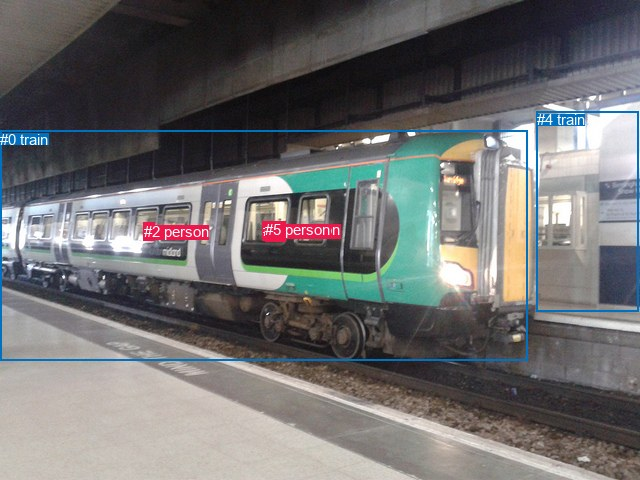
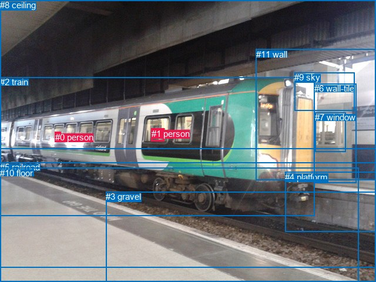

# 图片 0979：2359868.jpg

随机样本序号：110。图片 SHA256：`0bf52c9409ae0eeb5cd056d2cd8a48217073f9be09137b76e39a8c6f2411229d`。

红色框表示人，蓝色框表示其他物体。两个模式分别保留自身框编号，可依据位置比较对应对象。

## 自动检测框与输出

人的框编号：`[1, 2, 3, 5]`。状态：`ok`。

### 自动检测全部物体框

| 编号 | 类别 | 是否为人 | 检测分数 | 像素坐标 xyxy |
|---|---|---|---|---|
| 0 | train | False | 1.0000 | 0.2, 130.7, 527.1, 361.0 |
| 1 | person | True | 0.7666 | 275.4, 221.0, 286.0, 241.3 |
| 2 | person | True | 0.5922 | 143.9, 222.7, 154.6, 241.0 |
| 3 | person | True | 0.5781 | 262.9, 221.9, 275.8, 240.2 |
| 4 | train | False | 0.4137 | 536.6, 111.0, 638.3, 311.1 |
| 5 | person | True | 0.3798 | 265.2, 221.2, 281.9, 241.8 |

### 自动检测 Top50 人相关候选

评分物体对：30；人相关物体对：28；输出关系：50。

| 排名 | 主语编号与类别 | 关系 | 宾语编号与类别 | 类型 | 人与人 | 排序分数 | 原始融合 logit |
|---|---|---|---|---|---|---|---|
| 1 | #2 person | on | #0 train | spatial | False | 0.96820 | 3.4159 |
| 2 | #3 person | riding | #0 train | semantic | False | 0.96311 | 3.2623 |
| 3 | #1 person | on | #0 train | spatial | False | 0.95319 | 3.0138 |
| 4 | #5 person | riding | #0 train | semantic | False | 0.95207 | 2.9890 |
| 5 | #3 person | on | #0 train | spatial | False | 0.95124 | 2.9708 |
| 6 | #5 person | on | #0 train | spatial | False | 0.94997 | 2.9439 |
| 7 | #1 person | riding | #0 train | semantic | False | 0.92095 | 2.4553 |
| 8 | #2 person | riding | #0 train | semantic | False | 0.89830 | 2.1784 |
| 9 | #2 person | on | #4 train | spatial | False | 0.58384 | 0.3385 |
| 10 | #3 person | riding | #4 train | semantic | False | 0.51194 | 0.0478 |
| 11 | #5 person | riding | #4 train | semantic | False | 0.43591 | -0.2578 |
| 12 | #5 person | on | #3 person | spatial | True | 0.40222 | -0.3962 |
| 13 | #1 person | on | #4 train | spatial | False | 0.39146 | -0.4412 |
| 14 | #2 person | riding | #4 train | semantic | False | 0.36447 | -0.5560 |
| 15 | #1 person | riding | #4 train | semantic | False | 0.34428 | -0.6443 |
| 16 | #5 person | on | #4 train | spatial | False | 0.32892 | -0.7131 |
| 17 | #3 person | on | #4 train | spatial | False | 0.31081 | -0.7963 |
| 18 | #3 person | in | #5 person | spatial | True | 0.27652 | -0.9618 |
| 19 | #5 person | on | #1 person | spatial | True | 0.24157 | -1.1441 |
| 20 | #0 train | carrying | #1 person | semantic | False | 0.23703 | -1.1690 |
| 21 | #0 train | carrying | #3 person | semantic | False | 0.23693 | -1.1696 |
| 22 | #0 train | on | #2 person | spatial | False | 0.23531 | -1.1786 |
| 23 | #0 train | carrying | #5 person | semantic | False | 0.21842 | -1.2749 |
| 24 | #0 train | on | #5 person | spatial | False | 0.17739 | -1.5341 |
| 25 | #0 train | on | #1 person | spatial | False | 0.17235 | -1.5691 |
| 26 | #0 train | on | #3 person | spatial | False | 0.17068 | -1.5808 |
| 27 | #1 person | on | #5 person | spatial | True | 0.14616 | -1.7651 |
| 28 | #3 person | looking at | #5 person | semantic | True | 0.13791 | -1.8328 |
| 29 | #0 train | carrying | #2 person | semantic | False | 0.11637 | -2.0272 |
| 30 | #5 person | looking at | #3 person | semantic | True | 0.10829 | -2.1083 |
| 31 | #5 person | looking at | #1 person | semantic | True | 0.07474 | -2.5160 |
| 32 | #3 person | on | #1 person | spatial | True | 0.06405 | -2.6819 |
| 33 | #1 person | on | #3 person | spatial | True | 0.05501 | -2.8436 |
| 34 | #3 person | holding | #1 person | semantic | True | 0.01942 | -3.9221 |
| 35 | #1 person | looking at | #5 person | semantic | True | 0.01933 | -3.9266 |
| 36 | #1 person | holding | #3 person | semantic | True | 0.01180 | -4.4276 |
| 37 | #2 person | on | #5 person | spatial | True | 0.00855 | -4.7528 |
| 38 | #2 person | on | #3 person | spatial | True | 0.00852 | -4.7572 |
| 39 | #2 person | on | #1 person | spatial | True | 0.00781 | -4.8445 |
| 40 | #1 person | in | #2 person | spatial | True | 0.00571 | -5.1598 |
| 41 | #3 person | in | #2 person | spatial | True | 0.00518 | -5.2570 |
| 42 | #5 person | in | #2 person | spatial | True | 0.00399 | -5.5202 |
| 43 | #4 train | in | #2 person | spatial | False | 0.00351 | -5.6485 |
| 44 | #4 train | in | #5 person | spatial | False | 0.00285 | -5.8592 |
| 45 | #4 train | in | #3 person | spatial | False | 0.00251 | -5.9833 |
| 46 | #4 train | in | #1 person | spatial | False | 0.00239 | -6.0361 |
| 47 | #2 person | wearing | #3 person | semantic | True | 0.00193 | -6.2469 |
| 48 | #2 person | wearing | #5 person | semantic | True | 0.00175 | -6.3480 |
| 49 | #2 person | wearing | #1 person | semantic | True | 0.00168 | -6.3893 |
| 50 | #3 person | wearing | #2 person | semantic | True | 0.00110 | -6.8079 |

### 自动检测逐条人相关 GT 核验

R@50：0.00%；命中 0/2。

| GT 主语编号 | GT 关系 | GT 宾语编号 | 结果阶段 | 匹配预测主语编号 | 匹配预测宾语编号 |
|---|---|---|---|---|---|
| 0 | in | 2 | endpoint_missing_or_wrong_class | [] | [0] |
| 1 | in | 2 | wrong_predicate | [5] | [0] |

## 真实框与输出

人的框编号：`[0, 1]`。

### 真实框全部物体框

| 编号 | 类别 | 是否为人 | 检测分数 | 像素坐标 xyxy |
|---|---|---|---|---|
| 0 | person | True | GT | 94.0, 225.0, 104.0, 239.0 |
| 1 | person | True | GT | 258.0, 219.0, 280.0, 241.0 |
| 2 | train | False | GT | 0.0, 131.0, 536.0, 367.0 |
| 3 | gravel | False | GT | 180.0, 326.0, 640.0, 480.0 |
| 4 | platform | False | GT | 485.0, 293.0, 640.0, 395.0 |
| 5 | railroad | False | GT | 0.0, 276.0, 640.0, 455.0 |
| 6 | wall-tile | False | GT | 535.0, 142.0, 607.0, 311.0 |
| 7 | window | False | GT | 536.0, 191.0, 588.0, 259.0 |
| 8 | ceiling | False | GT | 0.0, 0.0, 640.0, 253.0 |
| 9 | sky | False | GT | 501.0, 123.0, 603.0, 188.0 |
| 10 | floor | False | GT | 0.0, 286.0, 611.0, 480.0 |
| 11 | wall | False | GT | 436.0, 84.0, 640.0, 306.0 |

### 真实框 Top50 人相关候选

评分物体对：132；人相关物体对：42；输出关系：50。

| 排名 | 主语编号与类别 | 关系 | 宾语编号与类别 | 类型 | 人与人 | 排序分数 | 原始融合 logit |
|---|---|---|---|---|---|---|---|
| 1 | #1 person | on | #2 train | spatial | False | 0.97140 | 3.5254 |
| 2 | #0 person | on | #2 train | spatial | False | 0.97093 | 3.5085 |
| 3 | #1 person | standing on | #2 train | semantic | False | 0.64693 | 0.6056 |
| 4 | #0 person | standing on | #2 train | semantic | False | 0.62908 | 0.5283 |
| 5 | #2 train | in | #0 person | spatial | False | 0.47760 | -0.0897 |
| 6 | #2 train | in | #1 person | spatial | False | 0.44566 | -0.2182 |
| 7 | #0 person | on | #6 wall-tile | spatial | False | 0.19580 | -1.4128 |
| 8 | #0 person | on | #11 wall | spatial | False | 0.18001 | -1.5163 |
| 9 | #2 train | wearing | #1 person | semantic | False | 0.15646 | -1.6848 |
| 10 | #2 train | wearing | #0 person | semantic | False | 0.15355 | -1.7071 |
| 11 | #1 person | on | #11 wall | spatial | False | 0.06969 | -2.5914 |
| 12 | #1 person | on | #6 wall-tile | spatial | False | 0.04503 | -3.0543 |
| 13 | #0 person | on | #8 ceiling | spatial | False | 0.04281 | -3.1073 |
| 14 | #0 person | on | #9 sky | spatial | False | 0.03223 | -3.4020 |
| 15 | #0 person | on | #7 window | spatial | False | 0.02845 | -3.5307 |
| 16 | #1 person | in | #8 ceiling | spatial | False | 0.02065 | -3.8594 |
| 17 | #0 person | on | #1 person | spatial | True | 0.01790 | -4.0049 |
| 18 | #1 person | on | #9 sky | spatial | False | 0.01736 | -4.0358 |
| 19 | #1 person | on | #7 window | spatial | False | 0.01707 | -4.0532 |
| 20 | #1 person | in | #0 person | spatial | True | 0.01679 | -4.0699 |
| 21 | #0 person | sitting on | #11 wall | semantic | False | 0.01515 | -4.1742 |
| 22 | #0 person | standing on | #6 wall-tile | semantic | False | 0.01388 | -4.2634 |
| 23 | #0 person | looking at | #8 ceiling | semantic | False | 0.01311 | -4.3213 |
| 24 | #1 person | sitting on | #11 wall | semantic | False | 0.01220 | -4.3938 |
| 25 | #11 wall | in | #0 person | spatial | False | 0.00826 | -4.7875 |
| 26 | #1 person | looking at | #8 ceiling | semantic | False | 0.00715 | -4.9335 |
| 27 | #1 person | standing on | #6 wall-tile | semantic | False | 0.00634 | -5.0551 |
| 28 | #6 wall-tile | in | #0 person | spatial | False | 0.00539 | -5.2174 |
| 29 | #1 person | looking at | #5 railroad | semantic | False | 0.00472 | -5.3514 |
| 30 | #0 person | on | #4 platform | spatial | False | 0.00408 | -5.4967 |
| 31 | #0 person | looking at | #9 sky | semantic | False | 0.00397 | -5.5257 |
| 32 | #0 person | wearing | #1 person | semantic | True | 0.00369 | -5.5974 |
| 33 | #1 person | on | #4 platform | spatial | False | 0.00365 | -5.6095 |
| 34 | #1 person | looking at | #3 gravel | semantic | False | 0.00343 | -5.6707 |
| 35 | #0 person | looking at | #7 window | semantic | False | 0.00332 | -5.7045 |
| 36 | #11 wall | in | #1 person | spatial | False | 0.00320 | -5.7426 |
| 37 | #7 window | in | #0 person | spatial | False | 0.00301 | -5.8023 |
| 38 | #1 person | looking at | #10 floor | semantic | False | 0.00286 | -5.8530 |
| 39 | #7 window | in | #1 person | spatial | False | 0.00271 | -5.9096 |
| 40 | #6 wall-tile | in | #1 person | spatial | False | 0.00235 | -6.0500 |
| 41 | #9 sky | in | #0 person | spatial | False | 0.00235 | -6.0506 |
| 42 | #1 person | wearing | #0 person | semantic | True | 0.00235 | -6.0519 |
| 43 | #1 person | on | #5 railroad | spatial | False | 0.00235 | -6.0524 |
| 44 | #0 person | looking at | #5 railroad | semantic | False | 0.00212 | -6.1538 |
| 45 | #1 person | looking at | #7 window | semantic | False | 0.00205 | -6.1892 |
| 46 | #0 person | looking at | #4 platform | semantic | False | 0.00200 | -6.2125 |
| 47 | #1 person | standing on | #9 sky | semantic | False | 0.00195 | -6.2361 |
| 48 | #0 person | on | #5 railroad | spatial | False | 0.00194 | -6.2453 |
| 49 | #0 person | looking at | #3 gravel | semantic | False | 0.00192 | -6.2539 |
| 50 | #0 person | looking at | #10 floor | semantic | False | 0.00183 | -6.2998 |

### 真实框逐条人相关 GT 核验

R@50：0.00%；命中 0/2。

| GT 主语编号 | GT 关系 | GT 宾语编号 | 结果阶段 | 匹配预测主语编号 | 匹配预测宾语编号 |
|---|---|---|---|---|---|
| 0 | in | 2 | wrong_predicate | [0] | [2] |
| 1 | in | 2 | wrong_predicate | [1] | [2] |

## 全部人相关 GT

| 主语编号与类别 | 关系 | 宾语编号与类别 |
|---|---|---|
| #0 person | in | #2 train |
| #1 person | in | #2 train |

原始记录、全部人相关物体对的两项预测与分项分数见 [逐图证据 JSON](../evidence/cases/0979.json)。全部56类 logits 保留于本机 HOR/output/random500/logits/。

<!-- HOR_COMPLETE_RESULTS -->

## 六组条件的完整输出对照

以下保留同一图片三种框与候选模式、两种谓词输出规则的全部 Top50。框编号各自在所属模式内解释。

### 自动检测框完整枚举：空间与语义各保留一个谓词

| 排名 | 主语编号与类别 | 谓词 | 宾语编号与类别 | 分组 | 排序分数 | predicate logit | pair logit |
|---|---|---|---|---|---|---|---|
| 1 | #2 person | on | #0 train | spatial | 0.9681968 | 3.1513667 | 0.2645013 |
| 2 | #3 person | riding | #0 train | semantic | 0.9631112 | 3.1080637 | 0.1541976 |
| 3 | #1 person | on | #0 train | spatial | 0.9531922 | 2.8601856 | 0.1535814 |
| 4 | #5 person | riding | #0 train | semantic | 0.9520729 | 2.8399310 | 0.1490299 |
| 5 | #3 person | on | #0 train | spatial | 0.9512385 | 2.8166270 | 0.1541976 |
| 6 | #5 person | on | #0 train | spatial | 0.9499734 | 2.7948480 | 0.1490299 |
| 7 | #1 person | riding | #0 train | semantic | 0.9209476 | 2.3017092 | 0.1535814 |
| 8 | #2 person | riding | #0 train | semantic | 0.8982971 | 1.9139438 | 0.2645013 |
| 9 | #2 person | on | #4 train | spatial | 0.5838372 | 0.8904972 | -0.5519515 |
| 10 | #3 person | riding | #4 train | semantic | 0.5119429 | 0.7100496 | -0.6622688 |
| 11 | #5 person | riding | #4 train | semantic | 0.4359142 | 0.4118252 | -0.6695859 |
| 12 | #5 person | on | #3 person | spatial | 0.4022179 | 0.5700936 | -0.9663260 |
| 13 | #1 person | on | #4 train | spatial | 0.3914593 | 0.2279110 | -0.6690932 |
| 14 | #2 person | riding | #4 train | semantic | 0.3644669 | -0.0040770 | -0.5519515 |
| 15 | #1 person | riding | #4 train | semantic | 0.3442751 | 0.0247927 | -0.6690932 |
| 16 | #5 person | on | #4 train | spatial | 0.3289196 | -0.0434895 | -0.6695859 |
| 17 | #3 person | on | #4 train | spatial | 0.3108129 | -0.1340528 | -0.6622688 |
| 18 | #3 person | in | #5 person | spatial | 0.2765232 | -0.0019445 | -0.9598291 |
| 19 | #5 person | on | #1 person | spatial | 0.2415705 | -0.1581197 | -0.9859688 |
| 20 | #0 train | carrying | #1 person | semantic | 0.2370294 | -0.7708814 | -0.3981539 |
| 21 | #0 train | carrying | #3 person | semantic | 0.2369270 | -0.7708814 | -0.3987200 |
| 22 | #0 train | on | #2 person | spatial | 0.2353052 | -0.9031024 | -0.2754910 |
| 23 | #0 train | carrying | #5 person | semantic | 0.2184239 | -0.8761010 | -0.3987738 |
| 24 | #0 train | on | #5 person | spatial | 0.1773874 | -1.1353755 | -0.3987738 |
| 25 | #0 train | on | #1 person | spatial | 0.1723496 | -1.1709120 | -0.3981539 |
| 26 | #0 train | on | #3 person | spatial | 0.1706807 | -1.1820910 | -0.3987200 |
| 27 | #1 person | on | #5 person | spatial | 0.1461571 | -0.7843018 | -0.9807635 |
| 28 | #3 person | looking at | #5 person | semantic | 0.1379073 | -0.8729522 | -0.9598291 |
| 29 | #0 train | carrying | #2 person | semantic | 0.1163731 | -1.7517426 | -0.2754910 |
| 30 | #5 person | looking at | #3 person | semantic | 0.1082925 | -1.1419759 | -0.9663260 |
| 31 | #5 person | looking at | #1 person | semantic | 0.0747446 | -1.5300243 | -0.9859688 |
| 32 | #3 person | on | #1 person | spatial | 0.0640484 | -1.7075436 | -0.9743807 |
| 33 | #1 person | on | #3 person | spatial | 0.0550141 | -1.8670943 | -0.9764867 |
| 34 | #3 person | holding | #1 person | semantic | 0.0194152 | -2.9477100 | -0.9743807 |
| 35 | #1 person | looking at | #5 person | semantic | 0.0193300 | -2.9458160 | -0.9807635 |
| 36 | #1 person | holding | #3 person | semantic | 0.0118024 | -3.4510946 | -0.9764867 |
| 37 | #2 person | on | #5 person | spatial | 0.0085533 | -3.1467252 | -1.6061237 |
| 38 | #2 person | on | #3 person | spatial | 0.0085162 | -3.1674328 | -1.5897987 |
| 39 | #2 person | on | #1 person | spatial | 0.0078104 | -3.2242846 | -1.6201701 |
| 40 | #1 person | in | #2 person | spatial | 0.0057101 | -3.3537996 | -1.8059888 |
| 41 | #3 person | in | #2 person | spatial | 0.0051840 | -3.4794765 | -1.7775037 |
| 42 | #5 person | in | #2 person | spatial | 0.0039890 | -3.7186584 | -1.8015482 |
| 43 | #4 train | in | #2 person | spatial | 0.0035104 | -4.5235362 | -1.1249664 |
| 44 | #4 train | in | #5 person | spatial | 0.0028455 | -4.4392905 | -1.4198686 |
| 45 | #4 train | in | #3 person | spatial | 0.0025142 | -4.5651317 | -1.4181604 |
| 46 | #4 train | in | #1 person | spatial | 0.0023852 | -4.6116524 | -1.4244392 |
| 47 | #2 person | wearing | #3 person | semantic | 0.0019326 | -4.6571469 | -1.5897987 |
| 48 | #2 person | wearing | #5 person | semantic | 0.0017473 | -4.7418346 | -1.6061237 |
| 49 | #2 person | wearing | #1 person | semantic | 0.0016766 | -4.7691326 | -1.6201701 |
| 50 | #3 person | wearing | #2 person | semantic | 0.0011038 | -5.0303822 | -1.7775037 |

GT 命中：0/2，R@50=0.00%。

| GT主语 | GT谓词 | GT宾语 | 结果阶段 | 匹配主语框 | 匹配宾语框 |
|---|---|---|---|---|---|
| 0 | in | 2 | endpoint_missing_or_wrong_class | [] | [0] |
| 1 | in | 2 | wrong_predicate | [5] | [0] |

### 自动检测框完整枚举：每对只保留一个谓词

| 排名 | 主语编号与类别 | 谓词 | 宾语编号与类别 | 分组 | 排序分数 | predicate logit | pair logit |
|---|---|---|---|---|---|---|---|
| 1 | #2 person | on | #0 train | single | 0.9681968 | 3.1513667 | 0.2645013 |
| 2 | #3 person | riding | #0 train | single | 0.9631112 | 3.1080637 | 0.1541976 |
| 3 | #1 person | on | #0 train | single | 0.9531922 | 2.8601856 | 0.1535814 |
| 4 | #5 person | riding | #0 train | single | 0.9520729 | 2.8399310 | 0.1490299 |
| 5 | #2 person | on | #4 train | single | 0.5838372 | 0.8904972 | -0.5519515 |
| 6 | #3 person | riding | #4 train | single | 0.5119429 | 0.7100496 | -0.6622688 |
| 7 | #5 person | riding | #4 train | single | 0.4359142 | 0.4118252 | -0.6695859 |
| 8 | #5 person | on | #3 person | single | 0.4022179 | 0.5700936 | -0.9663260 |
| 9 | #1 person | on | #4 train | single | 0.3914593 | 0.2279110 | -0.6690932 |
| 10 | #3 person | in | #5 person | single | 0.2765232 | -0.0019445 | -0.9598291 |
| 11 | #5 person | on | #1 person | single | 0.2415705 | -0.1581197 | -0.9859688 |
| 12 | #0 train | carrying | #1 person | single | 0.2370294 | -0.7708814 | -0.3981539 |
| 13 | #0 train | carrying | #3 person | single | 0.2369270 | -0.7708814 | -0.3987200 |
| 14 | #0 train | on | #2 person | single | 0.2353052 | -0.9031024 | -0.2754910 |
| 15 | #0 train | carrying | #5 person | single | 0.2184239 | -0.8761010 | -0.3987738 |
| 16 | #1 person | on | #5 person | single | 0.1461571 | -0.7843018 | -0.9807635 |
| 17 | #3 person | on | #1 person | single | 0.0640484 | -1.7075436 | -0.9743807 |
| 18 | #1 person | on | #3 person | single | 0.0550141 | -1.8670943 | -0.9764867 |
| 19 | #2 person | on | #5 person | single | 0.0085533 | -3.1467252 | -1.6061237 |
| 20 | #2 person | on | #3 person | single | 0.0085162 | -3.1674328 | -1.5897987 |
| 21 | #2 person | on | #1 person | single | 0.0078104 | -3.2242846 | -1.6201701 |
| 22 | #1 person | in | #2 person | single | 0.0057101 | -3.3537996 | -1.8059888 |
| 23 | #3 person | in | #2 person | single | 0.0051840 | -3.4794765 | -1.7775037 |
| 24 | #5 person | in | #2 person | single | 0.0039890 | -3.7186584 | -1.8015482 |
| 25 | #4 train | in | #2 person | single | 0.0035104 | -4.5235362 | -1.1249664 |
| 26 | #4 train | in | #5 person | single | 0.0028455 | -4.4392905 | -1.4198686 |
| 27 | #4 train | in | #3 person | single | 0.0025142 | -4.5651317 | -1.4181604 |
| 28 | #4 train | in | #1 person | single | 0.0023852 | -4.6116524 | -1.4244392 |

GT 命中：0/2，R@50=0.00%。

| GT主语 | GT谓词 | GT宾语 | 结果阶段 | 匹配主语框 | 匹配宾语框 |
|---|---|---|---|---|---|
| 0 | in | 2 | endpoint_missing_or_wrong_class | [] | [0] |
| 1 | in | 2 | wrong_predicate | [5] | [0] |

### 真实框完整枚举：空间与语义各保留一个谓词

| 排名 | 主语编号与类别 | 谓词 | 宾语编号与类别 | 分组 | 排序分数 | predicate logit | pair logit |
|---|---|---|---|---|---|---|---|
| 1 | #1 person | on | #2 train | spatial | 0.9714020 | 3.3600078 | 0.1653957 |
| 2 | #0 person | on | #2 train | spatial | 0.9709290 | 3.3221831 | 0.1863272 |
| 3 | #1 person | standing on | #2 train | semantic | 0.6469256 | 0.4401569 | 0.1653957 |
| 4 | #0 person | standing on | #2 train | semantic | 0.6290752 | 0.3419242 | 0.1863272 |
| 5 | #2 train | in | #0 person | spatial | 0.4775987 | 0.2657809 | -0.3554462 |
| 6 | #2 train | in | #1 person | spatial | 0.4456607 | 0.1755075 | -0.3937266 |
| 7 | #0 person | on | #6 wall-tile | spatial | 0.1957957 | -0.6978803 | -0.7149011 |
| 8 | #0 person | on | #11 wall | spatial | 0.1800108 | -0.8843069 | -0.6319675 |
| 9 | #2 train | wearing | #1 person | semantic | 0.1564631 | -1.2910566 | -0.3937266 |
| 10 | #2 train | wearing | #0 person | semantic | 0.1535453 | -1.3516150 | -0.3554462 |
| 11 | #1 person | on | #11 wall | spatial | 0.0696925 | -1.7853353 | -0.8060873 |
| 12 | #1 person | on | #6 wall-tile | spatial | 0.0450326 | -2.0591083 | -0.9951824 |
| 13 | #0 person | on | #8 ceiling | spatial | 0.0428069 | -1.9842591 | -1.1230468 |
| 14 | #0 person | on | #9 sky | spatial | 0.0322315 | -2.2240696 | -1.1779774 |
| 15 | #0 person | on | #7 window | spatial | 0.0284508 | -2.3526325 | -1.1780823 |
| 16 | #1 person | in | #8 ceiling | spatial | 0.0206451 | -2.6604261 | -1.1989901 |
| 17 | #0 person | on | #1 person | spatial | 0.0179000 | -2.2623205 | -1.7425739 |
| 18 | #1 person | on | #9 sky | spatial | 0.0173640 | -2.6490178 | -1.3868197 |
| 19 | #1 person | on | #7 window | spatial | 0.0170711 | -2.4867454 | -1.5664059 |
| 20 | #1 person | in | #0 person | spatial | 0.0167927 | -2.1722171 | -1.8976617 |
| 21 | #0 person | sitting on | #11 wall | semantic | 0.0151541 | -3.5422440 | -0.6319675 |
| 22 | #0 person | standing on | #6 wall-tile | semantic | 0.0138794 | -3.5484715 | -0.7149011 |
| 23 | #0 person | looking at | #8 ceiling | semantic | 0.0131086 | -3.1982460 | -1.1230468 |
| 24 | #1 person | sitting on | #11 wall | semantic | 0.0122024 | -3.5877604 | -0.8060873 |
| 25 | #11 wall | in | #0 person | spatial | 0.0082647 | -3.6438656 | -1.1436028 |
| 26 | #1 person | looking at | #8 ceiling | semantic | 0.0071500 | -3.7344830 | -1.1989901 |
| 27 | #1 person | standing on | #6 wall-tile | semantic | 0.0063362 | -4.0599427 | -0.9951824 |
| 28 | #6 wall-tile | in | #0 person | spatial | 0.0053924 | -3.8963275 | -1.3210276 |
| 29 | #1 person | looking at | #5 railroad | semantic | 0.0047191 | -3.0881994 | -2.2632139 |
| 30 | #0 person | on | #4 platform | spatial | 0.0040835 | -3.8586338 | -1.6380827 |
| 31 | #0 person | looking at | #9 sky | semantic | 0.0039673 | -4.3477206 | -1.1779774 |
| 32 | #0 person | wearing | #1 person | semantic | 0.0036938 | -3.8548369 | -1.7425739 |
| 33 | #1 person | on | #4 platform | spatial | 0.0036496 | -3.7861280 | -1.8233660 |
| 34 | #1 person | looking at | #3 gravel | semantic | 0.0034337 | -3.3437738 | -2.3269117 |
| 35 | #0 person | looking at | #7 window | semantic | 0.0033198 | -4.5264306 | -1.1780823 |
| 36 | #11 wall | in | #1 person | spatial | 0.0031962 | -4.1339564 | -1.6086373 |
| 37 | #7 window | in | #0 person | spatial | 0.0030115 | -4.2305388 | -1.5717657 |
| 38 | #1 person | looking at | #10 floor | semantic | 0.0028630 | -3.3214068 | -2.5316248 |
| 39 | #7 window | in | #1 person | spatial | 0.0027060 | -4.0214481 | -1.8881103 |
| 40 | #6 wall-tile | in | #1 person | spatial | 0.0023522 | -4.2682638 | -1.7817792 |
| 41 | #9 sky | in | #0 person | spatial | 0.0023508 | -4.4734263 | -1.5772153 |
| 42 | #1 person | wearing | #0 person | semantic | 0.0023479 | -4.1542234 | -1.8976617 |
| 43 | #1 person | on | #5 railroad | spatial | 0.0023468 | -3.7891400 | -2.2632139 |
| 44 | #0 person | looking at | #5 railroad | semantic | 0.0021209 | -3.8694990 | -2.2843113 |
| 45 | #1 person | looking at | #7 window | semantic | 0.0020472 | -4.6228299 | -1.5664059 |
| 46 | #0 person | looking at | #4 platform | semantic | 0.0020002 | -4.5744171 | -1.6380827 |
| 47 | #1 person | standing on | #9 sky | semantic | 0.0019536 | -4.8492951 | -1.3868197 |
| 48 | #0 person | on | #5 railroad | spatial | 0.0019359 | -3.9609413 | -2.2843113 |
| 49 | #0 person | looking at | #3 gravel | semantic | 0.0019192 | -3.8884368 | -2.3654995 |
| 50 | #0 person | looking at | #10 floor | semantic | 0.0018333 | -3.7571714 | -2.5426421 |

GT 命中：0/2，R@50=0.00%。

| GT主语 | GT谓词 | GT宾语 | 结果阶段 | 匹配主语框 | 匹配宾语框 |
|---|---|---|---|---|---|
| 0 | in | 2 | wrong_predicate | [0] | [2] |
| 1 | in | 2 | wrong_predicate | [1] | [2] |

### 真实框完整枚举：每对只保留一个谓词

| 排名 | 主语编号与类别 | 谓词 | 宾语编号与类别 | 分组 | 排序分数 | predicate logit | pair logit |
|---|---|---|---|---|---|---|---|
| 1 | #1 person | on | #2 train | single | 0.9714020 | 3.3600078 | 0.1653957 |
| 2 | #0 person | on | #2 train | single | 0.9709290 | 3.3221831 | 0.1863272 |
| 3 | #2 train | in | #0 person | single | 0.4775987 | 0.2657809 | -0.3554462 |
| 4 | #2 train | in | #1 person | single | 0.4456607 | 0.1755075 | -0.3937266 |
| 5 | #0 person | on | #6 wall-tile | single | 0.1957957 | -0.6978803 | -0.7149011 |
| 6 | #0 person | on | #11 wall | single | 0.1800108 | -0.8843069 | -0.6319675 |
| 7 | #1 person | on | #11 wall | single | 0.0696925 | -1.7853353 | -0.8060873 |
| 8 | #1 person | on | #6 wall-tile | single | 0.0450326 | -2.0591083 | -0.9951824 |
| 9 | #0 person | on | #8 ceiling | single | 0.0428069 | -1.9842591 | -1.1230468 |
| 10 | #0 person | on | #9 sky | single | 0.0322315 | -2.2240696 | -1.1779774 |
| 11 | #0 person | on | #7 window | single | 0.0284508 | -2.3526325 | -1.1780823 |
| 12 | #1 person | in | #8 ceiling | single | 0.0206451 | -2.6604261 | -1.1989901 |
| 13 | #0 person | on | #1 person | single | 0.0179000 | -2.2623205 | -1.7425739 |
| 14 | #1 person | on | #9 sky | single | 0.0173640 | -2.6490178 | -1.3868197 |
| 15 | #1 person | on | #7 window | single | 0.0170711 | -2.4867454 | -1.5664059 |
| 16 | #1 person | in | #0 person | single | 0.0167927 | -2.1722171 | -1.8976617 |
| 17 | #11 wall | in | #0 person | single | 0.0082647 | -3.6438656 | -1.1436028 |
| 18 | #6 wall-tile | in | #0 person | single | 0.0053924 | -3.8963275 | -1.3210276 |
| 19 | #1 person | looking at | #5 railroad | single | 0.0047191 | -3.0881994 | -2.2632139 |
| 20 | #0 person | on | #4 platform | single | 0.0040835 | -3.8586338 | -1.6380827 |
| 21 | #1 person | on | #4 platform | single | 0.0036496 | -3.7861280 | -1.8233660 |
| 22 | #1 person | looking at | #3 gravel | single | 0.0034337 | -3.3437738 | -2.3269117 |
| 23 | #11 wall | in | #1 person | single | 0.0031962 | -4.1339564 | -1.6086373 |
| 24 | #7 window | in | #0 person | single | 0.0030115 | -4.2305388 | -1.5717657 |
| 25 | #1 person | looking at | #10 floor | single | 0.0028630 | -3.3214068 | -2.5316248 |
| 26 | #7 window | in | #1 person | single | 0.0027060 | -4.0214481 | -1.8881103 |
| 27 | #6 wall-tile | in | #1 person | single | 0.0023522 | -4.2682638 | -1.7817792 |
| 28 | #9 sky | in | #0 person | single | 0.0023508 | -4.4734263 | -1.5772153 |
| 29 | #0 person | looking at | #5 railroad | single | 0.0021209 | -3.8694990 | -2.2843113 |
| 30 | #0 person | looking at | #3 gravel | single | 0.0019192 | -3.8884368 | -2.3654995 |
| 31 | #0 person | looking at | #10 floor | single | 0.0018333 | -3.7571714 | -2.5426421 |
| 32 | #8 ceiling | over | #1 person | single | 0.0015872 | -4.7205601 | -1.7236199 |
| 33 | #9 sky | in | #1 person | single | 0.0013691 | -4.6980610 | -1.8941447 |
| 34 | #5 railroad | in | #0 person | single | 0.0013457 | -4.8271580 | -1.7823359 |
| 35 | #8 ceiling | over | #0 person | single | 0.0012006 | -5.2824421 | -1.4412550 |
| 36 | #10 floor | in | #0 person | single | 0.0011252 | -4.8795419 | -1.9091225 |
| 37 | #5 railroad | in | #1 person | single | 0.0011199 | -4.9350219 | -1.8583986 |
| 38 | #3 gravel | in | #0 person | single | 0.0009765 | -4.8324118 | -2.0980988 |
| 39 | #10 floor | in | #1 person | single | 0.0008701 | -5.0461226 | -1.9998757 |
| 40 | #4 platform | in | #0 person | single | 0.0007790 | -5.0283918 | -2.1283062 |
| 41 | #3 gravel | in | #1 person | single | 0.0006628 | -5.2499013 | -2.0685172 |
| 42 | #4 platform | in | #1 person | single | 0.0004613 | -5.3453054 | -2.3356998 |

GT 命中：0/2，R@50=0.00%。

| GT主语 | GT谓词 | GT宾语 | 结果阶段 | 匹配主语框 | 匹配宾语框 |
|---|---|---|---|---|---|
| 0 | in | 2 | wrong_predicate | [0] | [2] |
| 1 | in | 2 | wrong_predicate | [1] | [2] |

### 真实框400候选：空间与语义各保留一个谓词

| 排名 | 主语编号与类别 | 谓词 | 宾语编号与类别 | 分组 | 排序分数 | predicate logit | pair logit |
|---|---|---|---|---|---|---|---|
| 1 | #1 person | on | #2 train | spatial | 0.9714020 | 3.3600078 | 0.1653957 |
| 2 | #0 person | on | #2 train | spatial | 0.9709290 | 3.3221831 | 0.1863272 |
| 3 | #1 person | standing on | #2 train | semantic | 0.6460865 | 0.4364848 | 0.1653957 |
| 4 | #0 person | standing on | #2 train | semantic | 0.6290752 | 0.3419242 | 0.1863272 |
| 5 | #2 train | in | #0 person | spatial | 0.4767707 | 0.2624621 | -0.3554462 |
| 6 | #2 train | in | #1 person | spatial | 0.4398742 | 0.1520538 | -0.3937266 |
| 7 | #0 person | on | #6 wall-tile | spatial | 0.1923666 | -0.7198040 | -0.7149011 |
| 8 | #0 person | on | #11 wall | spatial | 0.1800108 | -0.8843069 | -0.6319675 |
| 9 | #2 train | wearing | #1 person | semantic | 0.1548713 | -1.3031683 | -0.3937266 |
| 10 | #2 train | wearing | #0 person | semantic | 0.1535453 | -1.3516150 | -0.3554462 |
| 11 | #1 person | on | #11 wall | spatial | 0.0693403 | -1.7907803 | -0.8060873 |
| 12 | #1 person | on | #6 wall-tile | spatial | 0.0449348 | -2.0613837 | -0.9951824 |
| 13 | #0 person | on | #8 ceiling | spatial | 0.0418083 | -2.0089056 | -1.1230468 |
| 14 | #0 person | on | #9 sky | spatial | 0.0315754 | -2.2453132 | -1.1779774 |
| 15 | #0 person | on | #7 window | spatial | 0.0277269 | -2.3791504 | -1.1780823 |
| 16 | #1 person | in | #8 ceiling | spatial | 0.0206535 | -2.6600113 | -1.1989901 |
| 17 | #0 person | on | #1 person | spatial | 0.0177794 | -2.2691991 | -1.7425739 |
| 18 | #1 person | on | #9 sky | spatial | 0.0172483 | -2.6558239 | -1.3868197 |
| 19 | #1 person | on | #7 window | spatial | 0.0169674 | -2.4929430 | -1.5664059 |
| 20 | #1 person | in | #0 person | spatial | 0.0166137 | -2.1831143 | -1.8976617 |
| 21 | #0 person | sitting on | #11 wall | semantic | 0.0153121 | -3.5317130 | -0.6319675 |
| 22 | #0 person | standing on | #6 wall-tile | semantic | 0.0138292 | -3.5521436 | -0.7149011 |
| 23 | #0 person | looking at | #8 ceiling | semantic | 0.0128186 | -3.2209086 | -1.1230468 |
| 24 | #1 person | sitting on | #11 wall | semantic | 0.0120850 | -3.5975406 | -0.8060873 |
| 25 | #11 wall | in | #0 person | spatial | 0.0083751 | -3.6304793 | -1.1436028 |
| 26 | #1 person | looking at | #8 ceiling | semantic | 0.0071474 | -3.7348373 | -1.1989901 |
| 27 | #1 person | standing on | #6 wall-tile | semantic | 0.0063098 | -4.0641375 | -0.9951824 |
| 28 | #6 wall-tile | in | #0 person | spatial | 0.0054240 | -3.8904641 | -1.3210276 |
| 29 | #1 person | looking at | #5 railroad | semantic | 0.0047512 | -3.0813739 | -2.2632139 |
| 30 | #0 person | on | #4 platform | spatial | 0.0039953 | -3.8805578 | -1.6380827 |
| 31 | #0 person | looking at | #9 sky | semantic | 0.0039804 | -4.3443947 | -1.1779774 |
| 32 | #0 person | wearing | #1 person | semantic | 0.0037221 | -3.8471732 | -1.7425739 |
| 33 | #1 person | on | #4 platform | spatial | 0.0035953 | -3.8011737 | -1.8233660 |
| 34 | #1 person | looking at | #3 gravel | semantic | 0.0034337 | -3.3437738 | -2.3269117 |
| 35 | #0 person | looking at | #7 window | semantic | 0.0033041 | -4.5311980 | -1.1780823 |
| 36 | #11 wall | in | #1 person | spatial | 0.0032338 | -4.1222296 | -1.6086373 |
| 37 | #7 window | in | #0 person | spatial | 0.0030065 | -4.2321978 | -1.5717657 |
| 38 | #1 person | looking at | #10 floor | semantic | 0.0028198 | -3.3366265 | -2.5316248 |
| 39 | #7 window | in | #1 person | spatial | 0.0027105 | -4.0197887 | -1.8881103 |
| 40 | #9 sky | in | #0 person | spatial | 0.0023715 | -4.4646311 | -1.5772153 |
| 41 | #6 wall-tile | in | #1 person | spatial | 0.0023600 | -4.2649455 | -1.7817792 |
| 42 | #1 person | wearing | #0 person | semantic | 0.0023541 | -4.1515741 | -1.8976617 |
| 43 | #1 person | on | #5 railroad | spatial | 0.0023118 | -3.8041859 | -2.2632139 |
| 44 | #1 person | looking at | #7 window | semantic | 0.0020568 | -4.6181498 | -1.5664059 |
| 45 | #0 person | looking at | #5 railroad | semantic | 0.0020439 | -3.9065464 | -2.2843113 |
| 46 | #0 person | looking at | #4 platform | semantic | 0.0020000 | -4.5745044 | -1.6380827 |
| 47 | #1 person | standing on | #9 sky | semantic | 0.0019365 | -4.8581057 | -1.3868197 |
| 48 | #0 person | on | #5 railroad | spatial | 0.0018876 | -3.9862320 | -2.2843113 |
| 49 | #0 person | looking at | #3 gravel | semantic | 0.0018828 | -3.9076142 | -2.3654995 |
| 50 | #0 person | looking at | #10 floor | semantic | 0.0018191 | -3.7649448 | -2.5426421 |

GT 命中：0/2，R@50=0.00%。

| GT主语 | GT谓词 | GT宾语 | 结果阶段 | 匹配主语框 | 匹配宾语框 |
|---|---|---|---|---|---|
| 0 | in | 2 | wrong_predicate | [0] | [2] |
| 1 | in | 2 | wrong_predicate | [1] | [2] |

### 真实框400候选：每对只保留一个谓词

| 排名 | 主语编号与类别 | 谓词 | 宾语编号与类别 | 分组 | 排序分数 | predicate logit | pair logit |
|---|---|---|---|---|---|---|---|
| 1 | #1 person | on | #2 train | single | 0.9714020 | 3.3600078 | 0.1653957 |
| 2 | #0 person | on | #2 train | single | 0.9709290 | 3.3221831 | 0.1863272 |
| 3 | #2 train | in | #0 person | single | 0.4767707 | 0.2624621 | -0.3554462 |
| 4 | #2 train | in | #1 person | single | 0.4398742 | 0.1520538 | -0.3937266 |
| 5 | #0 person | on | #6 wall-tile | single | 0.1923666 | -0.7198040 | -0.7149011 |
| 6 | #0 person | on | #11 wall | single | 0.1800108 | -0.8843069 | -0.6319675 |
| 7 | #1 person | on | #11 wall | single | 0.0693403 | -1.7907803 | -0.8060873 |
| 8 | #1 person | on | #6 wall-tile | single | 0.0449348 | -2.0613837 | -0.9951824 |
| 9 | #0 person | on | #8 ceiling | single | 0.0418083 | -2.0089056 | -1.1230468 |
| 10 | #0 person | on | #9 sky | single | 0.0315754 | -2.2453132 | -1.1779774 |
| 11 | #0 person | on | #7 window | single | 0.0277269 | -2.3791504 | -1.1780823 |
| 12 | #1 person | in | #8 ceiling | single | 0.0206535 | -2.6600113 | -1.1989901 |
| 13 | #0 person | on | #1 person | single | 0.0177794 | -2.2691991 | -1.7425739 |
| 14 | #1 person | on | #9 sky | single | 0.0172483 | -2.6558239 | -1.3868197 |
| 15 | #1 person | on | #7 window | single | 0.0169674 | -2.4929430 | -1.5664059 |
| 16 | #1 person | in | #0 person | single | 0.0166137 | -2.1831143 | -1.8976617 |
| 17 | #11 wall | in | #0 person | single | 0.0083751 | -3.6304793 | -1.1436028 |
| 18 | #6 wall-tile | in | #0 person | single | 0.0054240 | -3.8904641 | -1.3210276 |
| 19 | #1 person | looking at | #5 railroad | single | 0.0047512 | -3.0813739 | -2.2632139 |
| 20 | #0 person | on | #4 platform | single | 0.0039953 | -3.8805578 | -1.6380827 |
| 21 | #1 person | on | #4 platform | single | 0.0035953 | -3.8011737 | -1.8233660 |
| 22 | #1 person | looking at | #3 gravel | single | 0.0034337 | -3.3437738 | -2.3269117 |
| 23 | #11 wall | in | #1 person | single | 0.0032338 | -4.1222296 | -1.6086373 |
| 24 | #7 window | in | #0 person | single | 0.0030065 | -4.2321978 | -1.5717657 |
| 25 | #1 person | looking at | #10 floor | single | 0.0028198 | -3.3366265 | -2.5316248 |
| 26 | #7 window | in | #1 person | single | 0.0027105 | -4.0197887 | -1.8881103 |
| 27 | #9 sky | in | #0 person | single | 0.0023715 | -4.4646311 | -1.5772153 |
| 28 | #6 wall-tile | in | #1 person | single | 0.0023600 | -4.2649455 | -1.7817792 |
| 29 | #0 person | looking at | #5 railroad | single | 0.0020439 | -3.9065464 | -2.2843113 |
| 30 | #0 person | looking at | #3 gravel | single | 0.0018828 | -3.9076142 | -2.3654995 |
| 31 | #0 person | looking at | #10 floor | single | 0.0018191 | -3.7649448 | -2.5426421 |
| 32 | #8 ceiling | over | #1 person | single | 0.0015619 | -4.7366996 | -1.7236199 |
| 33 | #9 sky | in | #1 person | single | 0.0013998 | -4.6758795 | -1.8941447 |
| 34 | #5 railroad | in | #0 person | single | 0.0013412 | -4.8304768 | -1.7823359 |
| 35 | #8 ceiling | over | #0 person | single | 0.0011942 | -5.2877994 | -1.4412550 |
| 36 | #10 floor | in | #0 person | single | 0.0011248 | -4.8799286 | -1.9091225 |
| 37 | #5 railroad | in | #1 person | single | 0.0011016 | -4.9515333 | -1.8583986 |
| 38 | #3 gravel | in | #0 person | single | 0.0009564 | -4.8533206 | -2.0980988 |
| 39 | #10 floor | in | #1 person | single | 0.0008660 | -5.0509071 | -1.9998757 |
| 40 | #4 platform | in | #0 person | single | 0.0007802 | -5.0269260 | -2.1283062 |
| 41 | #3 gravel | in | #1 person | single | 0.0006599 | -5.2542987 | -2.0685172 |
| 42 | #4 platform | in | #1 person | single | 0.0004570 | -5.3546710 | -2.3356998 |

GT 命中：0/2，R@50=0.00%。

| GT主语 | GT谓词 | GT宾语 | 结果阶段 | 匹配主语框 | 匹配宾语框 |
|---|---|---|---|---|---|
| 0 | in | 2 | wrong_predicate | [0] | [2] |
| 1 | in | 2 | wrong_predicate | [1] | [2] |
