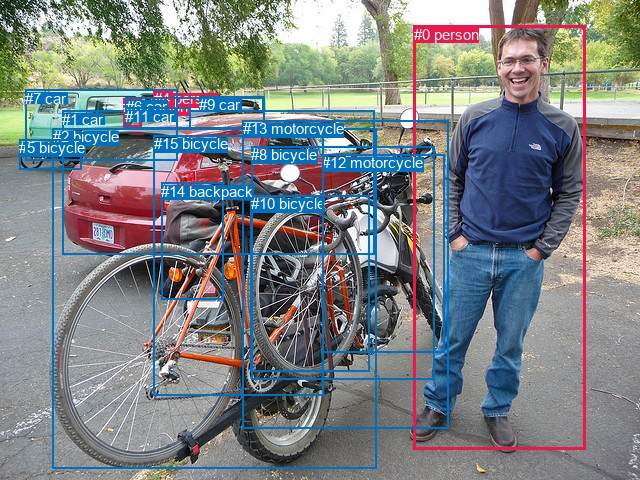
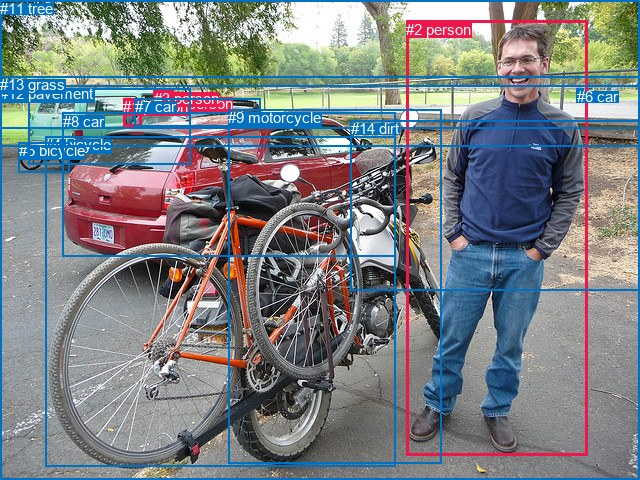

# 图片 0989：2360368.jpg

随机样本序号：103。图片 SHA256：`2807fcb8cc5b8787e149247b2dc01f9dff1c56cc66cf9759ae1f58f39fd9879c`。

红色框表示人，蓝色框表示其他物体。两个模式分别保留自身框编号，可依据位置比较对应对象。

## 自动检测框与输出

人的框编号：`[0, 3, 4]`。状态：`ok`。

### 自动检测全部物体框

| 编号 | 类别 | 是否为人 | 检测分数 | 像素坐标 xyxy |
|---|---|---|---|---|
| 0 | person | True | 0.9999 | 413.6, 25.8, 585.5, 449.9 |
| 1 | car | False | 0.9968 | 62.4, 110.8, 374.5, 254.6 |
| 2 | bicycle | False | 0.9932 | 52.6, 128.3, 376.7, 468.2 |
| 3 | person | True | 0.9732 | 123.4, 98.0, 141.1, 127.7 |
| 4 | person | True | 0.9525 | 153.9, 90.2, 172.2, 109.0 |
| 5 | bicycle | False | 0.9201 | 19.4, 139.3, 81.7, 169.8 |
| 6 | car | False | 0.9022 | 125.5, 98.0, 264.2, 128.2 |
| 7 | car | False | 0.7420 | 25.2, 89.8, 177.7, 160.9 |
| 8 | bicycle | False | 0.6438 | 251.5, 146.2, 434.4, 379.5 |
| 9 | car | False | 0.6303 | 199.0, 96.1, 263.9, 111.6 |
| 10 | bicycle | False | 0.4914 | 250.6, 195.2, 369.9, 371.9 |
| 11 | car | False | 0.4748 | 125.4, 107.8, 190.9, 128.1 |
| 12 | motorcycle | False | 0.4321 | 322.4, 154.1, 444.1, 352.3 |
| 13 | motorcycle | False | 0.4203 | 242.8, 120.2, 448.9, 428.1 |
| 14 | backpack | False | 0.4075 | 161.2, 182.8, 223.8, 299.8 |
| 15 | bicycle | False | 0.3540 | 153.8, 135.3, 323.3, 396.0 |

### 自动检测 Top50 人相关候选

评分物体对：240；人相关物体对：84；输出关系：50。

| 排名 | 主语编号与类别 | 关系 | 宾语编号与类别 | 类型 | 人与人 | 排序分数 | 原始融合 logit |
|---|---|---|---|---|---|---|---|
| 1 | #4 person | on | #11 car | spatial | False | 0.94807 | 2.9045 |
| 2 | #4 person | on | #6 car | spatial | False | 0.93970 | 2.7461 |
| 3 | #3 person | on | #7 car | spatial | False | 0.93868 | 2.7284 |
| 4 | #4 person | parked on | #6 car | semantic | False | 0.93001 | 2.5869 |
| 5 | #0 person | standing on | #2 bicycle | semantic | False | 0.92926 | 2.5754 |
| 6 | #0 person | standing on | #13 motorcycle | semantic | False | 0.92788 | 2.5545 |
| 7 | #4 person | on | #7 car | spatial | False | 0.91370 | 2.3596 |
| 8 | #3 person | on | #11 car | spatial | False | 0.91161 | 2.3334 |
| 9 | #4 person | parked on | #11 car | semantic | False | 0.89358 | 2.1278 |
| 10 | #3 person | on | #6 car | spatial | False | 0.88839 | 2.0744 |
| 11 | #3 person | riding | #7 car | semantic | False | 0.85779 | 1.7971 |
| 12 | #0 person | standing on | #8 bicycle | semantic | False | 0.84538 | 1.6988 |
| 13 | #0 person | beside | #2 bicycle | spatial | False | 0.81536 | 1.4852 |
| 14 | #0 person | beside | #13 motorcycle | spatial | False | 0.80583 | 1.4232 |
| 15 | #0 person | standing on | #12 motorcycle | semantic | False | 0.77703 | 1.2484 |
| 16 | #3 person | parked on | #11 car | semantic | False | 0.75123 | 1.1052 |
| 17 | #3 person | on | #1 car | spatial | False | 0.73690 | 1.0299 |
| 18 | #3 person | driving on | #6 car | semantic | False | 0.67141 | 0.7146 |
| 19 | #4 person | riding | #7 car | semantic | False | 0.65171 | 0.6266 |
| 20 | #0 person | beside | #8 bicycle | spatial | False | 0.64347 | 0.5904 |
| 21 | #0 person | beside | #12 motorcycle | spatial | False | 0.54252 | 0.1705 |
| 22 | #4 person | on back of | #1 car | spatial | False | 0.52435 | 0.0975 |
| 23 | #4 person | on | #9 car | spatial | False | 0.46874 | -0.1252 |
| 24 | #4 person | parked on | #1 car | semantic | False | 0.42511 | -0.3018 |
| 25 | #4 person | parked on | #9 car | semantic | False | 0.38453 | -0.4704 |
| 26 | #3 person | driving on | #1 car | semantic | False | 0.38299 | -0.4769 |
| 27 | #11 car | on | #4 person | spatial | False | 0.29093 | -0.8909 |
| 28 | #7 car | in | #3 person | spatial | False | 0.28292 | -0.9300 |
| 29 | #4 person | on | #2 bicycle | spatial | False | 0.27998 | -0.9446 |
| 30 | #4 person | on | #13 motorcycle | spatial | False | 0.27721 | -0.9583 |
| 31 | #7 car | in | #4 person | spatial | False | 0.25243 | -1.0857 |
| 32 | #0 person | wearing | #15 bicycle | semantic | False | 0.23832 | -1.1619 |
| 33 | #3 person | on | #4 person | spatial | True | 0.23752 | -1.1663 |
| 34 | #4 person | on | #8 bicycle | spatial | False | 0.20739 | -1.3407 |
| 35 | #0 person | standing on | #1 car | semantic | False | 0.20464 | -1.3576 |
| 36 | #3 person | on | #2 bicycle | spatial | False | 0.20004 | -1.3860 |
| 37 | #11 car | on | #3 person | spatial | False | 0.19389 | -1.4250 |
| 38 | #3 person | on | #9 car | spatial | False | 0.18430 | -1.4875 |
| 39 | #4 person | on | #12 motorcycle | spatial | False | 0.18189 | -1.5036 |
| 40 | #4 person | on | #5 bicycle | spatial | False | 0.17712 | -1.5360 |
| 41 | #6 car | on | #4 person | spatial | False | 0.17503 | -1.5504 |
| 42 | #0 person | beside | #1 car | spatial | False | 0.16459 | -1.6244 |
| 43 | #4 person | on | #3 person | spatial | True | 0.15444 | -1.7002 |
| 44 | #3 person | on | #13 motorcycle | spatial | False | 0.14458 | -1.7777 |
| 45 | #3 person | wearing | #4 person | semantic | True | 0.13911 | -1.8227 |
| 46 | #9 car | on | #4 person | spatial | False | 0.12444 | -1.9510 |
| 47 | #6 car | in | #3 person | spatial | False | 0.11501 | -2.0405 |
| 48 | #1 car | beside | #0 person | spatial | False | 0.11205 | -2.0699 |
| 49 | #7 car | wearing | #3 person | semantic | False | 0.10245 | -2.1703 |
| 50 | #0 person | on | #15 bicycle | spatial | False | 0.09682 | -2.2331 |

### 自动检测逐条人相关 GT 核验

R@50：40.00%；命中 2/5。

| GT 主语编号 | GT 关系 | GT 宾语编号 | 结果阶段 | 匹配预测主语编号 | 匹配预测宾语编号 |
|---|---|---|---|---|---|
| 2 | beside | 4 | hit50 | [0] | [2] |
| 2 | beside | 9 | hit50 | [0] | [13] |
| 2 | standing on | 12 | endpoint_missing_or_wrong_class | [0] | [] |
| 2 | in front of | 14 | endpoint_missing_or_wrong_class | [0] | [] |
| 4 | beside | 2 | rank_below50 | [2] | [0] |

## 真实框与输出

人的框编号：`[0, 1, 2, 3]`。

### 真实框全部物体框

| 编号 | 类别 | 是否为人 | 检测分数 | 像素坐标 xyxy |
|---|---|---|---|---|
| 0 | person | True | GT | 168.0, 95.0, 173.0, 103.0 |
| 1 | person | True | GT | 123.0, 98.0, 142.0, 127.0 |
| 2 | person | True | GT | 406.0, 21.0, 587.0, 456.0 |
| 3 | person | True | GT | 154.0, 90.0, 174.0, 109.0 |
| 4 | bicycle | False | GT | 45.0, 136.0, 396.0, 466.0 |
| 5 | bicycle | False | GT | 19.0, 142.0, 70.0, 173.0 |
| 6 | car | False | GT | 577.0, 88.0, 583.0, 91.0 |
| 7 | car | False | GT | 135.0, 98.0, 261.0, 127.0 |
| 8 | car | False | GT | 63.0, 113.0, 395.0, 257.0 |
| 9 | motorcycle | False | GT | 228.0, 109.0, 442.0, 463.0 |
| 10 | truck | False | GT | 28.0, 89.0, 191.0, 165.0 |
| 11 | tree | False | GT | 0.0, 0.0, 640.0, 128.0 |
| 12 | pavement | False | GT | 0.0, 85.0, 640.0, 480.0 |
| 13 | grass | False | GT | 0.0, 76.0, 640.0, 147.0 |
| 14 | dirt | False | GT | 351.0, 120.0, 640.0, 291.0 |

### 真实框 Top50 人相关候选

评分物体对：210；人相关物体对：100；输出关系：50。

| 排名 | 主语编号与类别 | 关系 | 宾语编号与类别 | 类型 | 人与人 | 排序分数 | 原始融合 logit |
|---|---|---|---|---|---|---|---|
| 1 | #2 person | standing on | #12 pavement | semantic | False | 0.98360 | 4.0938 |
| 2 | #2 person | standing on | #9 motorcycle | semantic | False | 0.96351 | 3.2735 |
| 3 | #0 person | attached to | #3 person | spatial | True | 0.95197 | 2.9867 |
| 4 | #3 person | attached to | #10 truck | spatial | False | 0.94513 | 2.8463 |
| 5 | #0 person | attached to | #10 truck | spatial | False | 0.93962 | 2.7449 |
| 6 | #2 person | standing on | #14 dirt | semantic | False | 0.93858 | 2.7266 |
| 7 | #2 person | standing on | #4 bicycle | semantic | False | 0.93577 | 2.6789 |
| 8 | #2 person | beside | #9 motorcycle | spatial | False | 0.93043 | 2.5934 |
| 9 | #3 person | parked on | #12 pavement | semantic | False | 0.93012 | 2.5885 |
| 10 | #1 person | on | #10 truck | spatial | False | 0.91269 | 2.3469 |
| 11 | #2 person | beside | #4 bicycle | spatial | False | 0.90117 | 2.2103 |
| 12 | #0 person | attached to | #7 car | spatial | False | 0.89462 | 2.1388 |
| 13 | #3 person | parked on | #7 car | semantic | False | 0.89080 | 2.0989 |
| 14 | #0 person | parked on | #12 pavement | semantic | False | 0.86462 | 1.8542 |
| 15 | #3 person | parked on | #13 grass | semantic | False | 0.85351 | 1.7624 |
| 16 | #3 person | attached to | #7 car | spatial | False | 0.82403 | 1.5439 |
| 17 | #1 person | parked on | #12 pavement | semantic | False | 0.80572 | 1.4225 |
| 18 | #2 person | on | #12 pavement | spatial | False | 0.78990 | 1.3243 |
| 19 | #3 person | wearing | #0 person | semantic | True | 0.78877 | 1.3175 |
| 20 | #1 person | driving on | #10 truck | semantic | False | 0.75618 | 1.1318 |
| 21 | #9 motorcycle | beside | #2 person | spatial | False | 0.72026 | 0.9458 |
| 22 | #3 person | parked on | #10 truck | semantic | False | 0.70947 | 0.8928 |
| 23 | #0 person | parked on | #13 grass | semantic | False | 0.66978 | 0.7072 |
| 24 | #2 person | on | #14 dirt | spatial | False | 0.65896 | 0.6587 |
| 25 | #4 bicycle | beside | #2 person | spatial | False | 0.63784 | 0.5660 |
| 26 | #3 person | in | #0 person | spatial | True | 0.62099 | 0.4937 |
| 27 | #1 person | on back of | #8 car | spatial | False | 0.58404 | 0.3394 |
| 28 | #3 person | in | #12 pavement | spatial | False | 0.58138 | 0.3285 |
| 29 | #3 person | parked on | #11 tree | semantic | False | 0.53669 | 0.1470 |
| 30 | #2 person | beside | #8 car | spatial | False | 0.51606 | 0.0642 |
| 31 | #0 person | on back of | #8 car | spatial | False | 0.50204 | 0.0082 |
| 32 | #2 person | standing on | #8 car | semantic | False | 0.48627 | -0.0549 |
| 33 | #0 person | standing on | #10 truck | semantic | False | 0.46585 | -0.1368 |
| 34 | #9 motorcycle | parked on | #2 person | semantic | False | 0.45127 | -0.1955 |
| 35 | #1 person | in | #12 pavement | spatial | False | 0.44920 | -0.2039 |
| 36 | #0 person | standing on | #3 person | semantic | True | 0.43262 | -0.2712 |
| 37 | #2 person | wearing | #6 car | semantic | False | 0.43059 | -0.2794 |
| 38 | #0 person | standing on | #7 car | semantic | False | 0.42022 | -0.3219 |
| 39 | #8 car | beside | #2 person | spatial | False | 0.40247 | -0.3952 |
| 40 | #3 person | on back of | #8 car | spatial | False | 0.38207 | -0.4808 |
| 41 | #0 person | parked on | #11 tree | semantic | False | 0.34968 | -0.6204 |
| 42 | #0 person | in | #12 pavement | spatial | False | 0.33407 | -0.6898 |
| 43 | #1 person | on | #7 car | spatial | False | 0.29921 | -0.8510 |
| 44 | #1 person | parked on | #13 grass | semantic | False | 0.29893 | -0.8524 |
| 45 | #3 person | in | #13 grass | spatial | False | 0.29633 | -0.8648 |
| 46 | #10 truck | in | #3 person | spatial | False | 0.28221 | -0.9336 |
| 47 | #4 bicycle | parked on | #2 person | semantic | False | 0.27637 | -0.9626 |
| 48 | #10 truck | in | #1 person | spatial | False | 0.27418 | -0.9735 |
| 49 | #11 tree | beside | #2 person | spatial | False | 0.27276 | -0.9807 |
| 50 | #14 dirt | beside | #2 person | spatial | False | 0.26081 | -1.0418 |

### 真实框逐条人相关 GT 核验

R@50：80.00%；命中 4/5。

| GT 主语编号 | GT 关系 | GT 宾语编号 | 结果阶段 | 匹配预测主语编号 | 匹配预测宾语编号 |
|---|---|---|---|---|---|
| 2 | beside | 4 | hit50 | [2] | [4] |
| 2 | beside | 9 | hit50 | [2] | [9] |
| 2 | standing on | 12 | hit50 | [2] | [12] |
| 2 | in front of | 14 | wrong_predicate | [2] | [14] |
| 4 | beside | 2 | hit50 | [4] | [2] |

## 全部人相关 GT

| 主语编号与类别 | 关系 | 宾语编号与类别 |
|---|---|---|
| #2 person | beside | #4 bicycle |
| #2 person | beside | #9 motorcycle |
| #2 person | standing on | #12 pavement |
| #2 person | in front of | #14 dirt |
| #4 bicycle | beside | #2 person |

原始记录、全部人相关物体对的两项预测与分项分数见 [逐图证据 JSON](../evidence/cases/0989.json)。全部56类 logits 保留于本机 HOR/output/random500/logits/。

<!-- HOR_COMPLETE_RESULTS -->

## 六组条件的完整输出对照

以下保留同一图片三种框与候选模式、两种谓词输出规则的全部 Top50。框编号各自在所属模式内解释。

### 自动检测框完整枚举：空间与语义各保留一个谓词

| 排名 | 主语编号与类别 | 谓词 | 宾语编号与类别 | 分组 | 排序分数 | predicate logit | pair logit |
|---|---|---|---|---|---|---|---|
| 1 | #4 person | on | #11 car | spatial | 0.9480666 | 3.2087107 | -0.3042474 |
| 2 | #4 person | on | #6 car | spatial | 0.9396954 | 3.0723004 | -0.3261539 |
| 3 | #3 person | on | #7 car | spatial | 0.9386828 | 2.8249674 | -0.0965516 |
| 4 | #4 person | parked on | #6 car | semantic | 0.9300126 | 2.9130378 | -0.3261539 |
| 5 | #0 person | standing on | #2 bicycle | semantic | 0.9292614 | 2.9750667 | -0.3996674 |
| 6 | #0 person | standing on | #13 motorcycle | semantic | 0.9278764 | 2.8357258 | -0.2812082 |
| 7 | #4 person | on | #7 car | spatial | 0.9136951 | 2.7312474 | -0.3716367 |
| 8 | #3 person | on | #11 car | spatial | 0.9116090 | 2.6378174 | -0.3043756 |
| 9 | #4 person | parked on | #11 car | semantic | 0.8935806 | 2.4320965 | -0.3042474 |
| 10 | #3 person | on | #6 car | spatial | 0.8883922 | 2.6492858 | -0.5748635 |
| 11 | #3 person | riding | #7 car | semantic | 0.8577926 | 1.8936272 | -0.0965516 |
| 12 | #0 person | standing on | #8 bicycle | semantic | 0.8453841 | 2.0884466 | -0.3895991 |
| 13 | #0 person | beside | #2 bicycle | spatial | 0.8153637 | 1.8849139 | -0.3996674 |
| 14 | #0 person | beside | #13 motorcycle | spatial | 0.8058331 | 1.7043667 | -0.2812082 |
| 15 | #0 person | standing on | #12 motorcycle | semantic | 0.7770259 | 1.6370783 | -0.3886601 |
| 16 | #3 person | parked on | #11 car | semantic | 0.7512271 | 1.4095430 | -0.3043756 |
| 17 | #3 person | on | #1 car | spatial | 0.7368959 | 1.2321296 | -0.2022328 |
| 18 | #3 person | driving on | #6 car | semantic | 0.6714140 | 1.2894511 | -0.5748635 |
| 19 | #4 person | riding | #7 car | semantic | 0.6517143 | 0.9982200 | -0.3716367 |
| 20 | #0 person | beside | #8 bicycle | spatial | 0.6434655 | 0.9800367 | -0.3895991 |
| 21 | #0 person | beside | #12 motorcycle | spatial | 0.5425230 | 0.5591640 | -0.3886601 |
| 22 | #4 person | on back of | #1 car | spatial | 0.5243535 | 0.3341789 | -0.2366878 |
| 23 | #4 person | on | #9 car | spatial | 0.4687414 | 0.2495737 | -0.3747715 |
| 24 | #4 person | parked on | #1 car | semantic | 0.4251066 | -0.0651569 | -0.2366878 |
| 25 | #4 person | parked on | #9 car | semantic | 0.3845321 | -0.0955839 | -0.3747715 |
| 26 | #3 person | driving on | #1 car | semantic | 0.3829859 | -0.2746611 | -0.2022328 |
| 27 | #11 car | on | #4 person | spatial | 0.2909320 | -0.5775151 | -0.3133468 |
| 28 | #7 car | in | #3 person | spatial | 0.2829168 | -0.4298592 | -0.5001796 |
| 29 | #4 person | on | #2 bicycle | spatial | 0.2799757 | -0.3055940 | -0.6389884 |
| 30 | #4 person | on | #13 motorcycle | spatial | 0.2772149 | -0.0048261 | -0.9534931 |
| 31 | #7 car | in | #4 person | spatial | 0.2524327 | -0.4393702 | -0.6463096 |
| 32 | #0 person | wearing | #15 bicycle | semantic | 0.2383194 | -0.1327004 | -1.0292151 |
| 33 | #3 person | on | #4 person | spatial | 0.2375199 | -0.7546449 | -0.4116802 |
| 34 | #4 person | on | #8 bicycle | spatial | 0.2073887 | -0.0899444 | -1.2507936 |
| 35 | #0 person | standing on | #1 car | semantic | 0.2046355 | -0.5601983 | -0.7973718 |
| 36 | #3 person | on | #2 bicycle | spatial | 0.2000425 | -0.6680932 | -0.7179356 |
| 37 | #11 car | on | #3 person | spatial | 0.1938859 | -1.0402079 | -0.3847473 |
| 38 | #3 person | on | #9 car | spatial | 0.1842959 | -0.7517493 | -0.7357600 |
| 39 | #4 person | on | #12 motorcycle | spatial | 0.1818931 | -0.0666595 | -1.4369147 |
| 40 | #4 person | on | #5 bicycle | spatial | 0.1771227 | -0.3709316 | -1.1650331 |
| 41 | #6 car | on | #4 person | spatial | 0.1750267 | -1.1455996 | -0.4048129 |
| 42 | #0 person | beside | #1 car | spatial | 0.1645930 | -0.8270717 | -0.7973718 |
| 43 | #4 person | on | #3 person | spatial | 0.1544411 | -1.2281988 | -0.4719867 |
| 44 | #3 person | on | #13 motorcycle | spatial | 0.1445816 | -0.6541920 | -1.1235546 |
| 45 | #3 person | wearing | #4 person | semantic | 0.1391071 | -1.4110456 | -0.4116802 |
| 46 | #9 car | on | #4 person | spatial | 0.1244420 | -1.4224851 | -0.5285369 |
| 47 | #6 car | in | #3 person | spatial | 0.1150147 | -1.3185930 | -0.7219179 |
| 48 | #1 car | beside | #0 person | spatial | 0.1120532 | -1.2816062 | -0.7883317 |
| 49 | #7 car | wearing | #3 person | semantic | 0.1024484 | -1.6701312 | -0.5001796 |
| 50 | #0 person | on | #15 bicycle | spatial | 0.0968185 | -1.2038703 | -1.0292151 |

GT 命中：2/5，R@50=40.00%。

| GT主语 | GT谓词 | GT宾语 | 结果阶段 | 匹配主语框 | 匹配宾语框 |
|---|---|---|---|---|---|
| 2 | beside | 4 | hit50 | [0] | [2] |
| 2 | beside | 9 | hit50 | [0] | [13] |
| 2 | standing on | 12 | endpoint_missing_or_wrong_class | [0] | [] |
| 2 | in front of | 14 | endpoint_missing_or_wrong_class | [0] | [] |
| 4 | beside | 2 | rank_below50 | [2] | [0] |

### 自动检测框完整枚举：每对只保留一个谓词

| 排名 | 主语编号与类别 | 谓词 | 宾语编号与类别 | 分组 | 排序分数 | predicate logit | pair logit |
|---|---|---|---|---|---|---|---|
| 1 | #4 person | on | #11 car | single | 0.9480666 | 3.2087107 | -0.3042474 |
| 2 | #4 person | on | #6 car | single | 0.9396954 | 3.0723004 | -0.3261539 |
| 3 | #3 person | on | #7 car | single | 0.9386828 | 2.8249674 | -0.0965516 |
| 4 | #0 person | standing on | #2 bicycle | single | 0.9292614 | 2.9750667 | -0.3996674 |
| 5 | #0 person | standing on | #13 motorcycle | single | 0.9278764 | 2.8357258 | -0.2812082 |
| 6 | #4 person | on | #7 car | single | 0.9136951 | 2.7312474 | -0.3716367 |
| 7 | #3 person | on | #11 car | single | 0.9116090 | 2.6378174 | -0.3043756 |
| 8 | #3 person | on | #6 car | single | 0.8883922 | 2.6492858 | -0.5748635 |
| 9 | #0 person | standing on | #8 bicycle | single | 0.8453841 | 2.0884466 | -0.3895991 |
| 10 | #0 person | standing on | #12 motorcycle | single | 0.7770259 | 1.6370783 | -0.3886601 |
| 11 | #3 person | on | #1 car | single | 0.7368959 | 1.2321296 | -0.2022328 |
| 12 | #4 person | on back of | #1 car | single | 0.5243535 | 0.3341789 | -0.2366878 |
| 13 | #4 person | on | #9 car | single | 0.4687414 | 0.2495737 | -0.3747715 |
| 14 | #11 car | on | #4 person | single | 0.2909320 | -0.5775151 | -0.3133468 |
| 15 | #7 car | in | #3 person | single | 0.2829168 | -0.4298592 | -0.5001796 |
| 16 | #4 person | on | #2 bicycle | single | 0.2799757 | -0.3055940 | -0.6389884 |
| 17 | #4 person | on | #13 motorcycle | single | 0.2772149 | -0.0048261 | -0.9534931 |
| 18 | #7 car | in | #4 person | single | 0.2524327 | -0.4393702 | -0.6463096 |
| 19 | #0 person | wearing | #15 bicycle | single | 0.2383194 | -0.1327004 | -1.0292151 |
| 20 | #3 person | on | #4 person | single | 0.2375199 | -0.7546449 | -0.4116802 |
| 21 | #4 person | on | #8 bicycle | single | 0.2073887 | -0.0899444 | -1.2507936 |
| 22 | #0 person | standing on | #1 car | single | 0.2046355 | -0.5601983 | -0.7973718 |
| 23 | #3 person | on | #2 bicycle | single | 0.2000425 | -0.6680932 | -0.7179356 |
| 24 | #11 car | on | #3 person | single | 0.1938859 | -1.0402079 | -0.3847473 |
| 25 | #3 person | on | #9 car | single | 0.1842959 | -0.7517493 | -0.7357600 |
| 26 | #4 person | on | #12 motorcycle | single | 0.1818931 | -0.0666595 | -1.4369147 |
| 27 | #4 person | on | #5 bicycle | single | 0.1771227 | -0.3709316 | -1.1650331 |
| 28 | #6 car | on | #4 person | single | 0.1750267 | -1.1455996 | -0.4048129 |
| 29 | #4 person | on | #3 person | single | 0.1544411 | -1.2281988 | -0.4719867 |
| 30 | #3 person | on | #13 motorcycle | single | 0.1445816 | -0.6541920 | -1.1235546 |
| 31 | #9 car | on | #4 person | single | 0.1244420 | -1.4224851 | -0.5285369 |
| 32 | #6 car | in | #3 person | single | 0.1150147 | -1.3185930 | -0.7219179 |
| 33 | #1 car | beside | #0 person | single | 0.1120532 | -1.2816062 | -0.7883317 |
| 34 | #4 person | on | #15 bicycle | single | 0.0949399 | -0.8542812 | -1.4004761 |
| 35 | #3 person | on | #8 bicycle | single | 0.0920830 | -0.8987591 | -1.3897033 |
| 36 | #13 motorcycle | beside | #0 person | single | 0.0856511 | -1.2995543 | -1.0683759 |
| 37 | #2 bicycle | beside | #0 person | single | 0.0851949 | -1.4390996 | -0.9346701 |
| 38 | #3 person | on | #12 motorcycle | single | 0.0699234 | -1.0439913 | -1.5438757 |
| 39 | #3 person | on | #5 bicycle | single | 0.0603835 | -1.6086981 | -1.1360573 |
| 40 | #0 person | wearing | #14 backpack | single | 0.0472504 | -1.7242270 | -1.2796640 |
| 41 | #1 car | in | #3 person | single | 0.0452621 | -2.4207382 | -0.6282292 |
| 42 | #4 person | on | #10 bicycle | single | 0.0448129 | -0.6735811 | -2.3858304 |
| 43 | #3 person | on | #15 bicycle | single | 0.0423575 | -1.3912535 | -1.7270753 |
| 44 | #9 car | on | #3 person | single | 0.0410351 | -2.2330263 | -0.9184010 |
| 45 | #0 person | wearing | #7 car | single | 0.0408786 | -1.8879225 | -1.2674894 |
| 46 | #4 person | on | #14 backpack | single | 0.0398067 | -1.6518223 | -1.5312781 |
| 47 | #8 bicycle | beside | #0 person | single | 0.0373678 | -2.0698590 | -1.1790042 |
| 48 | #5 bicycle | on | #4 person | single | 0.0358715 | -2.2641892 | -1.0270927 |
| 49 | #0 person | wearing | #10 bicycle | single | 0.0353206 | -1.8691912 | -1.4381384 |
| 50 | #1 car | in | #4 person | single | 0.0294170 | -2.8950043 | -0.6013196 |

GT 命中：1/5，R@50=20.00%。

| GT主语 | GT谓词 | GT宾语 | 结果阶段 | 匹配主语框 | 匹配宾语框 |
|---|---|---|---|---|---|
| 2 | beside | 4 | wrong_predicate | [0] | [2] |
| 2 | beside | 9 | wrong_predicate | [0] | [13] |
| 2 | standing on | 12 | endpoint_missing_or_wrong_class | [0] | [] |
| 2 | in front of | 14 | endpoint_missing_or_wrong_class | [0] | [] |
| 4 | beside | 2 | hit50 | [2] | [0] |

### 真实框完整枚举：空间与语义各保留一个谓词

| 排名 | 主语编号与类别 | 谓词 | 宾语编号与类别 | 分组 | 排序分数 | predicate logit | pair logit |
|---|---|---|---|---|---|---|---|
| 1 | #2 person | standing on | #12 pavement | semantic | 0.9835985 | 4.3019404 | -0.2080930 |
| 2 | #2 person | standing on | #9 motorcycle | semantic | 0.9635069 | 3.4669280 | -0.1934718 |
| 3 | #0 person | attached to | #3 person | spatial | 0.9519709 | 3.3173881 | -0.3306587 |
| 4 | #3 person | attached to | #10 truck | spatial | 0.9451297 | 3.1825104 | -0.3361610 |
| 5 | #0 person | attached to | #10 truck | spatial | 0.9396243 | 3.1231360 | -0.3782414 |
| 6 | #2 person | standing on | #14 dirt | semantic | 0.9385775 | 3.6676812 | -0.9410915 |
| 7 | #2 person | standing on | #4 bicycle | semantic | 0.9357713 | 3.0440226 | -0.3651009 |
| 8 | #2 person | beside | #9 motorcycle | spatial | 0.9304336 | 2.7868414 | -0.1934718 |
| 9 | #3 person | parked on | #12 pavement | semantic | 0.9301196 | 3.0607958 | -0.4722688 |
| 10 | #1 person | on | #10 truck | spatial | 0.9126863 | 2.4142900 | -0.0674046 |
| 11 | #2 person | beside | #4 bicycle | spatial | 0.9011700 | 2.5753932 | -0.3651009 |
| 12 | #0 person | attached to | #7 car | spatial | 0.8946194 | 2.4232445 | -0.2844244 |
| 13 | #3 person | parked on | #7 car | semantic | 0.8907967 | 2.4313645 | -0.3324589 |
| 14 | #0 person | parked on | #12 pavement | semantic | 0.8646159 | 2.3989477 | -0.5447782 |
| 15 | #3 person | parked on | #13 grass | semantic | 0.8535085 | 2.2486901 | -0.4863021 |
| 16 | #3 person | attached to | #7 car | spatial | 0.8240313 | 1.8763609 | -0.3324589 |
| 17 | #1 person | parked on | #12 pavement | semantic | 0.8057242 | 2.2495823 | -0.8271198 |
| 18 | #2 person | on | #12 pavement | spatial | 0.7899031 | 1.5324345 | -0.2080930 |
| 19 | #3 person | wearing | #0 person | semantic | 0.7887670 | 1.6581774 | -0.3406685 |
| 20 | #1 person | driving on | #10 truck | semantic | 0.7561776 | 1.1992407 | -0.0674046 |
| 21 | #9 motorcycle | beside | #2 person | spatial | 0.7202629 | 1.9190526 | -0.9732865 |
| 22 | #3 person | parked on | #10 truck | semantic | 0.7094685 | 1.2289653 | -0.3361610 |
| 23 | #0 person | parked on | #13 grass | semantic | 0.6697789 | 1.2565627 | -0.5493774 |
| 24 | #2 person | on | #14 dirt | spatial | 0.6589637 | 1.5997710 | -0.9410915 |
| 25 | #4 bicycle | beside | #2 person | spatial | 0.6378415 | 1.4642148 | -0.8982072 |
| 26 | #3 person | in | #0 person | spatial | 0.6209894 | 0.8344183 | -0.3406685 |
| 27 | #1 person | on back of | #8 car | spatial | 0.5840405 | 0.5532913 | -0.2139092 |
| 28 | #3 person | in | #12 pavement | spatial | 0.5813838 | 0.8007255 | -0.4722688 |
| 29 | #3 person | parked on | #11 tree | semantic | 0.5366929 | 0.8343549 | -0.6873189 |
| 30 | #2 person | beside | #8 car | spatial | 0.5160553 | 0.7662177 | -0.7019744 |
| 31 | #0 person | on back of | #8 car | spatial | 0.5020422 | 0.1950293 | -0.1868604 |
| 32 | #2 person | standing on | #8 car | semantic | 0.4862660 | 0.6470246 | -0.7019744 |
| 33 | #0 person | standing on | #10 truck | semantic | 0.4658548 | 0.2414479 | -0.3782414 |
| 34 | #9 motorcycle | parked on | #2 person | semantic | 0.4512745 | 0.7777638 | -0.9732865 |
| 35 | #1 person | in | #12 pavement | spatial | 0.4491955 | 0.6231980 | -0.8271198 |
| 36 | #0 person | standing on | #3 person | semantic | 0.4326157 | 0.0594716 | -0.3306587 |
| 37 | #2 person | wearing | #6 car | semantic | 0.4305907 | 0.9435778 | -1.2230194 |
| 38 | #0 person | standing on | #7 car | semantic | 0.4202234 | -0.0374322 | -0.2844244 |
| 39 | #8 car | beside | #2 person | spatial | 0.4024724 | 0.3427138 | -0.7378877 |
| 40 | #3 person | on back of | #8 car | spatial | 0.3820717 | -0.2492857 | -0.2314782 |
| 41 | #0 person | parked on | #11 tree | semantic | 0.3496824 | 0.1129179 | -0.7333535 |
| 42 | #0 person | in | #12 pavement | spatial | 0.3340702 | -0.1450548 | -0.5447782 |
| 43 | #1 person | on | #7 car | spatial | 0.2992141 | -0.2501025 | -0.6009407 |
| 44 | #1 person | parked on | #13 grass | semantic | 0.2989338 | -0.0960336 | -0.7563466 |
| 45 | #3 person | in | #13 grass | spatial | 0.2963309 | -0.3785295 | -0.4863021 |
| 46 | #10 truck | in | #3 person | spatial | 0.2822050 | -0.3197742 | -0.6137760 |
| 47 | #4 bicycle | parked on | #2 person | semantic | 0.2763667 | -0.0643487 | -0.8982072 |
| 48 | #10 truck | in | #1 person | spatial | 0.2741829 | -0.5057445 | -0.4677581 |
| 49 | #11 tree | beside | #2 person | spatial | 0.2727611 | -0.3211436 | -0.6595153 |
| 50 | #14 dirt | beside | #2 person | spatial | 0.2608083 | -0.1346116 | -0.9071600 |

GT 命中：4/5，R@50=80.00%。

| GT主语 | GT谓词 | GT宾语 | 结果阶段 | 匹配主语框 | 匹配宾语框 |
|---|---|---|---|---|---|
| 2 | beside | 4 | hit50 | [2] | [4] |
| 2 | beside | 9 | hit50 | [2] | [9] |
| 2 | standing on | 12 | hit50 | [2] | [12] |
| 2 | in front of | 14 | wrong_predicate | [2] | [14] |
| 4 | beside | 2 | hit50 | [4] | [2] |

### 真实框完整枚举：每对只保留一个谓词

| 排名 | 主语编号与类别 | 谓词 | 宾语编号与类别 | 分组 | 排序分数 | predicate logit | pair logit |
|---|---|---|---|---|---|---|---|
| 1 | #2 person | standing on | #12 pavement | single | 0.9835985 | 4.3019404 | -0.2080930 |
| 2 | #2 person | standing on | #9 motorcycle | single | 0.9635069 | 3.4669280 | -0.1934718 |
| 3 | #0 person | attached to | #3 person | single | 0.9519709 | 3.3173881 | -0.3306587 |
| 4 | #3 person | attached to | #10 truck | single | 0.9451297 | 3.1825104 | -0.3361610 |
| 5 | #0 person | attached to | #10 truck | single | 0.9396243 | 3.1231360 | -0.3782414 |
| 6 | #2 person | standing on | #14 dirt | single | 0.9385775 | 3.6676812 | -0.9410915 |
| 7 | #2 person | standing on | #4 bicycle | single | 0.9357713 | 3.0440226 | -0.3651009 |
| 8 | #3 person | parked on | #12 pavement | single | 0.9301196 | 3.0607958 | -0.4722688 |
| 9 | #1 person | on | #10 truck | single | 0.9126863 | 2.4142900 | -0.0674046 |
| 10 | #0 person | attached to | #7 car | single | 0.8946194 | 2.4232445 | -0.2844244 |
| 11 | #3 person | parked on | #7 car | single | 0.8907967 | 2.4313645 | -0.3324589 |
| 12 | #0 person | parked on | #12 pavement | single | 0.8646159 | 2.3989477 | -0.5447782 |
| 13 | #3 person | parked on | #13 grass | single | 0.8535085 | 2.2486901 | -0.4863021 |
| 14 | #1 person | parked on | #12 pavement | single | 0.8057242 | 2.2495823 | -0.8271198 |
| 15 | #3 person | wearing | #0 person | single | 0.7887670 | 1.6581774 | -0.3406685 |
| 16 | #9 motorcycle | beside | #2 person | single | 0.7202629 | 1.9190526 | -0.9732865 |
| 17 | #0 person | parked on | #13 grass | single | 0.6697789 | 1.2565627 | -0.5493774 |
| 18 | #4 bicycle | beside | #2 person | single | 0.6378415 | 1.4642148 | -0.8982072 |
| 19 | #1 person | on back of | #8 car | single | 0.5840405 | 0.5532913 | -0.2139092 |
| 20 | #3 person | parked on | #11 tree | single | 0.5366929 | 0.8343549 | -0.6873189 |
| 21 | #2 person | beside | #8 car | single | 0.5160553 | 0.7662177 | -0.7019744 |
| 22 | #0 person | on back of | #8 car | single | 0.5020422 | 0.1950293 | -0.1868604 |
| 23 | #2 person | wearing | #6 car | single | 0.4305907 | 0.9435778 | -1.2230194 |
| 24 | #8 car | beside | #2 person | single | 0.4024724 | 0.3427138 | -0.7378877 |
| 25 | #3 person | on back of | #8 car | single | 0.3820717 | -0.2492857 | -0.2314782 |
| 26 | #0 person | parked on | #11 tree | single | 0.3496824 | 0.1129179 | -0.7333535 |
| 27 | #1 person | on | #7 car | single | 0.2992141 | -0.2501025 | -0.6009407 |
| 28 | #1 person | parked on | #13 grass | single | 0.2989338 | -0.0960336 | -0.7563466 |
| 29 | #10 truck | in | #3 person | single | 0.2822050 | -0.3197742 | -0.6137760 |
| 30 | #10 truck | in | #1 person | single | 0.2741829 | -0.5057445 | -0.4677581 |
| 31 | #11 tree | beside | #2 person | single | 0.2727611 | -0.3211436 | -0.6595153 |
| 32 | #14 dirt | beside | #2 person | single | 0.2608083 | -0.1346116 | -0.9071600 |
| 33 | #0 person | on back of | #4 bicycle | single | 0.2533281 | -0.5101247 | -0.5708157 |
| 34 | #7 car | on | #0 person | single | 0.2424687 | -0.7761343 | -0.3630579 |
| 35 | #10 truck | in | #0 person | single | 0.2298851 | -0.5794249 | -0.6295351 |
| 36 | #13 grass | beside | #2 person | single | 0.2264309 | -0.4374614 | -0.7911137 |
| 37 | #2 person | looking at | #11 tree | single | 0.2260657 | -0.2298369 | -1.0008245 |
| 38 | #3 person | on back of | #4 bicycle | single | 0.2112921 | -0.6875911 | -0.6295633 |
| 39 | #2 person | standing on | #13 grass | single | 0.1863171 | -0.4801269 | -0.9939938 |
| 40 | #12 pavement | beside | #2 person | single | 0.1862558 | -0.3116312 | -1.1628940 |
| 41 | #1 person | parked on | #11 tree | single | 0.1613687 | -0.8185208 | -0.8295587 |
| 42 | #10 truck | beside | #2 person | single | 0.1416326 | -0.4392829 | -1.3625132 |
| 43 | #0 person | on | #9 motorcycle | single | 0.1351786 | -1.1291099 | -0.7268164 |
| 44 | #2 person | beside | #10 truck | single | 0.1135215 | -0.8272164 | -1.2280481 |
| 45 | #7 car | on | #3 person | single | 0.1065389 | -1.7279766 | -0.3986155 |
| 46 | #0 person | on | #1 person | single | 0.0989992 | -1.6809869 | -0.5274074 |
| 47 | #6 car | looking at | #2 person | single | 0.0866239 | -1.4035039 | -0.9520682 |
| 48 | #3 person | parked on | #14 dirt | single | 0.0831160 | -1.3461699 | -1.0545738 |
| 49 | #3 person | on | #9 motorcycle | single | 0.0759174 | -1.6955688 | -0.8035869 |
| 50 | #1 person | on back of | #4 bicycle | single | 0.0734646 | -1.8329606 | -0.7016875 |

GT 命中：2/5，R@50=40.00%。

| GT主语 | GT谓词 | GT宾语 | 结果阶段 | 匹配主语框 | 匹配宾语框 |
|---|---|---|---|---|---|
| 2 | beside | 4 | wrong_predicate | [2] | [4] |
| 2 | beside | 9 | wrong_predicate | [2] | [9] |
| 2 | standing on | 12 | hit50 | [2] | [12] |
| 2 | in front of | 14 | wrong_predicate | [2] | [14] |
| 4 | beside | 2 | hit50 | [4] | [2] |

### 真实框400候选：空间与语义各保留一个谓词

| 排名 | 主语编号与类别 | 谓词 | 宾语编号与类别 | 分组 | 排序分数 | predicate logit | pair logit |
|---|---|---|---|---|---|---|---|
| 1 | #2 person | standing on | #12 pavement | semantic | 0.9835985 | 4.3019404 | -0.2080930 |
| 2 | #2 person | standing on | #9 motorcycle | semantic | 0.9635069 | 3.4669280 | -0.1934718 |
| 3 | #0 person | attached to | #3 person | spatial | 0.9519709 | 3.3173881 | -0.3306587 |
| 4 | #3 person | attached to | #10 truck | spatial | 0.9451297 | 3.1825104 | -0.3361610 |
| 5 | #0 person | attached to | #10 truck | spatial | 0.9396243 | 3.1231360 | -0.3782414 |
| 6 | #2 person | standing on | #14 dirt | semantic | 0.9385775 | 3.6676812 | -0.9410915 |
| 7 | #2 person | standing on | #4 bicycle | semantic | 0.9357713 | 3.0440226 | -0.3651009 |
| 8 | #3 person | parked on | #12 pavement | semantic | 0.9301196 | 3.0607958 | -0.4722688 |
| 9 | #2 person | beside | #9 motorcycle | spatial | 0.9284682 | 2.7568660 | -0.1934718 |
| 10 | #1 person | on | #10 truck | spatial | 0.9126863 | 2.4142900 | -0.0674046 |
| 11 | #2 person | beside | #4 bicycle | spatial | 0.9011700 | 2.5753932 | -0.3651009 |
| 12 | #0 person | attached to | #7 car | spatial | 0.8948978 | 2.4262004 | -0.2844244 |
| 13 | #3 person | parked on | #7 car | semantic | 0.8907967 | 2.4313645 | -0.3324589 |
| 14 | #0 person | parked on | #12 pavement | semantic | 0.8646141 | 2.3989325 | -0.5447782 |
| 15 | #3 person | parked on | #13 grass | semantic | 0.8497118 | 2.2186441 | -0.4863021 |
| 16 | #3 person | attached to | #7 car | spatial | 0.8242455 | 1.8778391 | -0.3324589 |
| 17 | #1 person | parked on | #12 pavement | semantic | 0.8057242 | 2.2495823 | -0.8271198 |
| 18 | #3 person | wearing | #0 person | semantic | 0.7927747 | 1.6824012 | -0.3406685 |
| 19 | #2 person | on | #12 pavement | spatial | 0.7899031 | 1.5324345 | -0.2080930 |
| 20 | #1 person | driving on | #10 truck | semantic | 0.7616796 | 1.2293143 | -0.0674046 |
| 21 | #9 motorcycle | beside | #2 person | spatial | 0.7202398 | 1.9189377 | -0.9732865 |
| 22 | #3 person | parked on | #10 truck | semantic | 0.7094685 | 1.2289653 | -0.3361610 |
| 23 | #0 person | parked on | #13 grass | semantic | 0.6764035 | 1.2866697 | -0.5493774 |
| 24 | #2 person | on | #14 dirt | spatial | 0.6589637 | 1.5997710 | -0.9410915 |
| 25 | #4 bicycle | beside | #2 person | spatial | 0.6378415 | 1.4642148 | -0.8982072 |
| 26 | #3 person | in | #0 person | spatial | 0.6202081 | 0.8311000 | -0.3406685 |
| 27 | #1 person | on back of | #8 car | spatial | 0.5834400 | 0.5508204 | -0.2139092 |
| 28 | #3 person | in | #12 pavement | spatial | 0.5811818 | 0.7998958 | -0.4722688 |
| 29 | #3 person | parked on | #11 tree | semantic | 0.5292049 | 0.8042717 | -0.6873189 |
| 30 | #2 person | beside | #8 car | spatial | 0.5160409 | 0.7661600 | -0.7019744 |
| 31 | #0 person | on back of | #8 car | spatial | 0.4946741 | 0.1655560 | -0.1868604 |
| 32 | #2 person | standing on | #8 car | semantic | 0.4862660 | 0.6470246 | -0.7019744 |
| 33 | #0 person | standing on | #10 truck | semantic | 0.4658548 | 0.2414479 | -0.3782414 |
| 34 | #9 motorcycle | parked on | #2 person | semantic | 0.4587249 | 0.8078094 | -0.9732865 |
| 35 | #1 person | in | #12 pavement | spatial | 0.4486823 | 0.6211238 | -0.8271198 |
| 36 | #0 person | standing on | #3 person | semantic | 0.4308139 | 0.0521274 | -0.3306587 |
| 37 | #2 person | wearing | #6 car | semantic | 0.4298715 | 0.9406438 | -1.2230194 |
| 38 | #0 person | standing on | #7 car | semantic | 0.4275717 | -0.0073409 | -0.2844244 |
| 39 | #8 car | beside | #2 person | spatial | 0.4024724 | 0.3427138 | -0.7378877 |
| 40 | #3 person | on back of | #8 car | spatial | 0.3885296 | -0.2220192 | -0.2314782 |
| 41 | #0 person | parked on | #11 tree | semantic | 0.3496763 | 0.1128912 | -0.7333535 |
| 42 | #0 person | in | #12 pavement | spatial | 0.3335167 | -0.1475439 | -0.5447782 |
| 43 | #1 person | parked on | #13 grass | semantic | 0.3052764 | -0.0659499 | -0.7563466 |
| 44 | #1 person | on | #7 car | spatial | 0.2986436 | -0.2528248 | -0.6009407 |
| 45 | #3 person | in | #13 grass | spatial | 0.2968500 | -0.3760409 | -0.4863021 |
| 46 | #10 truck | in | #3 person | spatial | 0.2893628 | -0.2847047 | -0.6137760 |
| 47 | #4 bicycle | parked on | #2 person | semantic | 0.2763698 | -0.0643334 | -0.8982072 |
| 48 | #10 truck | in | #1 person | spatial | 0.2692136 | -0.5308580 | -0.4677581 |
| 49 | #14 dirt | beside | #2 person | spatial | 0.2666342 | -0.1046071 | -0.9071600 |
| 50 | #11 tree | beside | #2 person | spatial | 0.2610161 | -0.3811789 | -0.6595153 |

GT 命中：4/5，R@50=80.00%。

| GT主语 | GT谓词 | GT宾语 | 结果阶段 | 匹配主语框 | 匹配宾语框 |
|---|---|---|---|---|---|
| 2 | beside | 4 | hit50 | [2] | [4] |
| 2 | beside | 9 | hit50 | [2] | [9] |
| 2 | standing on | 12 | hit50 | [2] | [12] |
| 2 | in front of | 14 | wrong_predicate | [2] | [14] |
| 4 | beside | 2 | hit50 | [4] | [2] |

### 真实框400候选：每对只保留一个谓词

| 排名 | 主语编号与类别 | 谓词 | 宾语编号与类别 | 分组 | 排序分数 | predicate logit | pair logit |
|---|---|---|---|---|---|---|---|
| 1 | #2 person | standing on | #12 pavement | single | 0.9835985 | 4.3019404 | -0.2080930 |
| 2 | #2 person | standing on | #9 motorcycle | single | 0.9635069 | 3.4669280 | -0.1934718 |
| 3 | #0 person | attached to | #3 person | single | 0.9519709 | 3.3173881 | -0.3306587 |
| 4 | #3 person | attached to | #10 truck | single | 0.9451297 | 3.1825104 | -0.3361610 |
| 5 | #0 person | attached to | #10 truck | single | 0.9396243 | 3.1231360 | -0.3782414 |
| 6 | #2 person | standing on | #14 dirt | single | 0.9385775 | 3.6676812 | -0.9410915 |
| 7 | #2 person | standing on | #4 bicycle | single | 0.9357713 | 3.0440226 | -0.3651009 |
| 8 | #3 person | parked on | #12 pavement | single | 0.9301196 | 3.0607958 | -0.4722688 |
| 9 | #1 person | on | #10 truck | single | 0.9126863 | 2.4142900 | -0.0674046 |
| 10 | #0 person | attached to | #7 car | single | 0.8948978 | 2.4262004 | -0.2844244 |
| 11 | #3 person | parked on | #7 car | single | 0.8907967 | 2.4313645 | -0.3324589 |
| 12 | #0 person | parked on | #12 pavement | single | 0.8646141 | 2.3989325 | -0.5447782 |
| 13 | #3 person | parked on | #13 grass | single | 0.8497118 | 2.2186441 | -0.4863021 |
| 14 | #1 person | parked on | #12 pavement | single | 0.8057242 | 2.2495823 | -0.8271198 |
| 15 | #3 person | wearing | #0 person | single | 0.7927747 | 1.6824012 | -0.3406685 |
| 16 | #9 motorcycle | beside | #2 person | single | 0.7202398 | 1.9189377 | -0.9732865 |
| 17 | #0 person | parked on | #13 grass | single | 0.6764035 | 1.2866697 | -0.5493774 |
| 18 | #4 bicycle | beside | #2 person | single | 0.6378415 | 1.4642148 | -0.8982072 |
| 19 | #1 person | on back of | #8 car | single | 0.5834400 | 0.5508204 | -0.2139092 |
| 20 | #3 person | parked on | #11 tree | single | 0.5292049 | 0.8042717 | -0.6873189 |
| 21 | #2 person | beside | #8 car | single | 0.5160409 | 0.7661600 | -0.7019744 |
| 22 | #0 person | on back of | #8 car | single | 0.4946741 | 0.1655560 | -0.1868604 |
| 23 | #2 person | wearing | #6 car | single | 0.4298715 | 0.9406438 | -1.2230194 |
| 24 | #8 car | beside | #2 person | single | 0.4024724 | 0.3427138 | -0.7378877 |
| 25 | #3 person | on back of | #8 car | single | 0.3885296 | -0.2220192 | -0.2314782 |
| 26 | #0 person | parked on | #11 tree | single | 0.3496763 | 0.1128912 | -0.7333535 |
| 27 | #1 person | parked on | #13 grass | single | 0.3052764 | -0.0659499 | -0.7563466 |
| 28 | #1 person | on | #7 car | single | 0.2986436 | -0.2528248 | -0.6009407 |
| 29 | #10 truck | in | #3 person | single | 0.2893628 | -0.2847047 | -0.6137760 |
| 30 | #10 truck | in | #1 person | single | 0.2692136 | -0.5308580 | -0.4677581 |
| 31 | #14 dirt | beside | #2 person | single | 0.2666342 | -0.1046071 | -0.9071600 |
| 32 | #11 tree | beside | #2 person | single | 0.2610161 | -0.3811789 | -0.6595153 |
| 33 | #0 person | on back of | #4 bicycle | single | 0.2533281 | -0.5101247 | -0.5708157 |
| 34 | #7 car | on | #0 person | single | 0.2369845 | -0.8062260 | -0.3630579 |
| 35 | #10 truck | in | #0 person | single | 0.2304732 | -0.5761061 | -0.6295351 |
| 36 | #13 grass | beside | #2 person | single | 0.2264208 | -0.4375191 | -0.7911137 |
| 37 | #2 person | looking at | #11 tree | single | 0.2209344 | -0.2594051 | -1.0008245 |
| 38 | #3 person | on back of | #4 bicycle | single | 0.2111745 | -0.6882973 | -0.6295633 |
| 39 | #2 person | standing on | #13 grass | single | 0.1944606 | -0.4272885 | -0.9939938 |
| 40 | #12 pavement | beside | #2 person | single | 0.1862470 | -0.3116894 | -1.1628940 |
| 41 | #1 person | parked on | #11 tree | single | 0.1613656 | -0.8185437 | -0.8295587 |
| 42 | #10 truck | beside | #2 person | single | 0.1416247 | -0.4393477 | -1.3625132 |
| 43 | #0 person | on | #9 motorcycle | single | 0.1363164 | -1.1194112 | -0.7268164 |
| 44 | #2 person | beside | #10 truck | single | 0.1135114 | -0.8273172 | -1.2280481 |
| 45 | #7 car | on | #3 person | single | 0.1038983 | -1.7560263 | -0.3986155 |
| 46 | #0 person | on | #1 person | single | 0.0963473 | -1.7110782 | -0.5274074 |
| 47 | #6 car | looking at | #2 person | single | 0.0866515 | -1.4031553 | -0.9520682 |
| 48 | #3 person | parked on | #14 dirt | single | 0.0842698 | -1.3311241 | -1.0545738 |
| 49 | #3 person | on | #9 motorcycle | single | 0.0759651 | -1.6948884 | -0.8035869 |
| 50 | #1 person | on back of | #4 bicycle | single | 0.0744954 | -1.8179147 | -0.7016875 |

GT 命中：2/5，R@50=40.00%。

| GT主语 | GT谓词 | GT宾语 | 结果阶段 | 匹配主语框 | 匹配宾语框 |
|---|---|---|---|---|---|
| 2 | beside | 4 | wrong_predicate | [2] | [4] |
| 2 | beside | 9 | wrong_predicate | [2] | [9] |
| 2 | standing on | 12 | hit50 | [2] | [12] |
| 2 | in front of | 14 | wrong_predicate | [2] | [14] |
| 4 | beside | 2 | hit50 | [4] | [2] |
