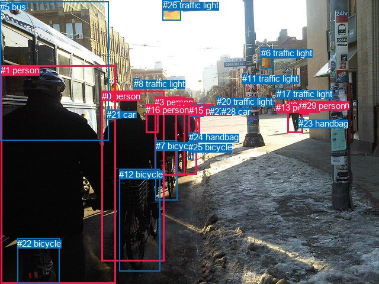
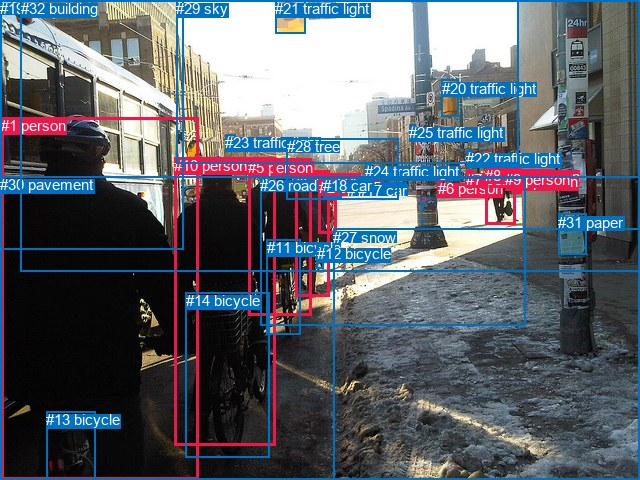

# 图片 1001：2360816.jpg

随机样本序号：86。图片 SHA256：`16c697f38aa036da979494b579d337c41fc7a4529802372f7e7c535478b6103d`。

红色框表示人，蓝色框表示其他物体。两个模式分别保留自身框编号，可依据位置比较对应对象。

## 自动检测框与输出

人的框编号：`[0, 1, 2, 3, 4, 13, 15, 16, 18, 19, 29]`。状态：`ok`。

### 自动检测全部物体框

| 编号 | 类别 | 是否为人 | 检测分数 | 像素坐标 xyxy |
|---|---|---|---|---|
| 0 | person | True | 0.9980 | 171.7, 153.7, 277.7, 441.4 |
| 1 | person | True | 0.9978 | 1.1, 110.3, 195.5, 480.0 |
| 2 | person | True | 0.9953 | 485.9, 170.1, 511.4, 224.5 |
| 3 | person | True | 0.9939 | 261.2, 163.7, 312.6, 296.1 |
| 4 | person | True | 0.9820 | 296.6, 174.0, 332.0, 296.0 |
| 5 | bus | False | 0.9816 | 0.0, 2.6, 183.6, 237.6 |
| 6 | traffic light | False | 0.9768 | 440.6, 80.9, 459.0, 115.9 |
| 7 | bicycle | False | 0.9747 | 262.9, 237.9, 299.9, 338.3 |
| 8 | traffic light | False | 0.9707 | 226.0, 133.0, 235.5, 148.3 |
| 9 | car | False | 0.9596 | 359.9, 179.6, 369.1, 187.3 |
| 10 | car | False | 0.9569 | 321.4, 177.3, 343.6, 197.7 |
| 11 | traffic light | False | 0.9553 | 409.1, 124.2, 416.5, 138.6 |
| 12 | bicycle | False | 0.9455 | 201.1, 285.9, 270.8, 458.7 |
| 13 | person | True | 0.9207 | 466.4, 173.0, 471.3, 188.4 |
| 14 | car | False | 0.9086 | 347.4, 180.6, 357.5, 188.3 |
| 15 | person | True | 0.9029 | 318.5, 178.3, 337.5, 231.8 |
| 16 | person | True | 0.8604 | 246.2, 176.8, 267.9, 224.8 |
| 17 | traffic light | False | 0.8299 | 466.5, 149.9, 471.3, 155.5 |
| 18 | person | True | 0.8208 | 505.4, 169.6, 513.9, 192.6 |
| 19 | person | True | 0.7058 | 516.9, 168.9, 521.8, 195.0 |
| 20 | traffic light | False | 0.6617 | 366.2, 162.7, 369.4, 168.6 |
| 21 | car | False | 0.6485 | 180.4, 185.1, 203.0, 200.0 |
| 22 | bicycle | False | 0.6172 | 29.2, 402.6, 100.3, 479.6 |
| 23 | handbag | False | 0.5963 | 503.6, 199.9, 513.3, 217.0 |
| 24 | handbag | False | 0.5267 | 319.1, 223.5, 334.4, 244.3 |
| 25 | bicycle | False | 0.4887 | 317.6, 240.4, 326.4, 269.3 |
| 26 | traffic light | False | 0.4750 | 274.7, 0.5, 305.8, 34.2 |
| 27 | car | False | 0.4590 | 354.2, 179.7, 361.9, 187.6 |
| 28 | car | False | 0.4324 | 373.8, 179.6, 383.3, 187.1 |
| 29 | person | True | 0.3877 | 509.9, 169.7, 516.4, 192.1 |

### 自动检测 Top50 人相关候选

评分物体对：870；人相关物体对：528；输出关系：50。

| 排名 | 主语编号与类别 | 关系 | 宾语编号与类别 | 类型 | 人与人 | 排序分数 | 原始融合 logit |
|---|---|---|---|---|---|---|---|
| 1 | #3 person | pushing | #7 bicycle | semantic | False | 0.99686 | 5.7602 |
| 2 | #0 person | pushing | #12 bicycle | semantic | False | 0.99362 | 5.0484 |
| 3 | #0 person | pushing | #7 bicycle | semantic | False | 0.99232 | 4.8620 |
| 4 | #4 person | pushing | #7 bicycle | semantic | False | 0.98691 | 4.3224 |
| 5 | #4 person | carrying | #24 handbag | semantic | False | 0.98665 | 4.3027 |
| 6 | #2 person | carrying | #23 handbag | semantic | False | 0.98577 | 4.2378 |
| 7 | #1 person | pushing | #12 bicycle | semantic | False | 0.98340 | 4.0814 |
| 8 | #4 person | holding | #25 bicycle | semantic | False | 0.97964 | 3.8738 |
| 9 | #0 person | on | #12 bicycle | spatial | False | 0.97613 | 3.7111 |
| 10 | #1 person | holding | #22 bicycle | semantic | False | 0.95645 | 3.0893 |
| 11 | #0 person | wearing | #21 car | semantic | False | 0.95048 | 2.9546 |
| 12 | #3 person | pushing | #12 bicycle | semantic | False | 0.94404 | 2.8256 |
| 13 | #4 person | wearing | #15 person | semantic | True | 0.93042 | 2.5932 |
| 14 | #0 person | wearing | #16 person | semantic | True | 0.89643 | 2.1582 |
| 15 | #15 person | wearing | #10 car | semantic | False | 0.88812 | 2.0717 |
| 16 | #1 person | wearing | #21 car | semantic | False | 0.88415 | 2.0323 |
| 17 | #3 person | on | #7 bicycle | spatial | False | 0.87574 | 1.9527 |
| 18 | #1 person | standing on | #5 bus | semantic | False | 0.83836 | 1.6461 |
| 19 | #4 person | in | #15 person | spatial | True | 0.82266 | 1.5345 |
| 20 | #15 person | carrying | #24 handbag | semantic | False | 0.82193 | 1.5294 |
| 21 | #22 bicycle | beside | #1 person | spatial | False | 0.81921 | 1.5110 |
| 22 | #3 person | pushing | #4 person | semantic | True | 0.80670 | 1.4287 |
| 23 | #1 person | beside | #5 bus | spatial | False | 0.78744 | 1.3096 |
| 24 | #4 person | wearing | #10 car | semantic | False | 0.78701 | 1.3070 |
| 25 | #3 person | pushing | #25 bicycle | semantic | False | 0.78364 | 1.2870 |
| 26 | #15 person | in | #10 car | spatial | False | 0.77919 | 1.2609 |
| 27 | #0 person | in | #21 car | spatial | False | 0.77119 | 1.2150 |
| 28 | #0 person | in | #16 person | spatial | True | 0.74391 | 1.0664 |
| 29 | #1 person | on | #22 bicycle | spatial | False | 0.74125 | 1.0525 |
| 30 | #2 person | holding | #18 person | semantic | True | 0.74020 | 1.0470 |
| 31 | #1 person | on | #12 bicycle | spatial | False | 0.72606 | 0.9747 |
| 32 | #4 person | on | #25 bicycle | spatial | False | 0.72248 | 0.9568 |
| 33 | #3 person | wearing | #16 person | semantic | True | 0.71224 | 0.9063 |
| 34 | #0 person | on | #7 bicycle | spatial | False | 0.71099 | 0.9002 |
| 35 | #4 person | pushing | #12 bicycle | semantic | False | 0.70065 | 0.8504 |
| 36 | #18 person | holding | #23 handbag | semantic | False | 0.69062 | 0.8030 |
| 37 | #22 bicycle | holding | #1 person | semantic | False | 0.67192 | 0.7169 |
| 38 | #4 person | in | #24 handbag | spatial | False | 0.66563 | 0.6885 |
| 39 | #29 person | pushing | #23 handbag | semantic | False | 0.65477 | 0.6401 |
| 40 | #3 person | holding | #24 handbag | semantic | False | 0.65353 | 0.6346 |
| 41 | #19 person | holding | #23 handbag | semantic | False | 0.62061 | 0.4921 |
| 42 | #2 person | holding | #29 person | semantic | True | 0.62005 | 0.4898 |
| 43 | #3 person | on | #12 bicycle | spatial | False | 0.61647 | 0.4746 |
| 44 | #2 person | in | #23 handbag | spatial | False | 0.61098 | 0.4514 |
| 45 | #4 person | on | #7 bicycle | spatial | False | 0.59844 | 0.3990 |
| 46 | #1 person | pushing | #7 bicycle | semantic | False | 0.58792 | 0.3554 |
| 47 | #4 person | in | #10 car | spatial | False | 0.58413 | 0.3398 |
| 48 | #2 person | walking on | #28 car | semantic | False | 0.54736 | 0.1900 |
| 49 | #1 person | in | #21 car | spatial | False | 0.53753 | 0.1504 |
| 50 | #29 person | wearing | #18 person | semantic | True | 0.53000 | 0.1201 |

### 自动检测逐条人相关 GT 核验

R@50：25.00%；命中 1/4。

| GT 主语编号 | GT 关系 | GT 宾语编号 | 结果阶段 | 匹配预测主语编号 | 匹配预测宾语编号 |
|---|---|---|---|---|---|
| 1 | riding | 13 | wrong_predicate | [1] | [22] |
| 5 | riding | 11 | wrong_predicate | [3] | [7] |
| 10 | on | 14 | hit50 | [0] | [12] |
| 10 | riding | 14 | wrong_predicate | [0] | [12] |

## 真实框与输出

人的框编号：`[0, 1, 2, 3, 4, 5, 6, 7, 8, 9, 10]`。

### 真实框全部物体框

| 编号 | 类别 | 是否为人 | 检测分数 | 像素坐标 xyxy |
|---|---|---|---|---|
| 0 | person | True | GT | 296.0, 170.0, 330.0, 296.0 |
| 1 | person | True | GT | 1.0, 117.0, 199.0, 479.0 |
| 2 | person | True | GT | 319.0, 179.0, 337.0, 234.0 |
| 3 | person | True | GT | 515.0, 168.0, 522.0, 194.0 |
| 4 | person | True | GT | 513.0, 173.0, 516.0, 185.0 |
| 5 | person | True | GT | 248.0, 159.0, 311.0, 316.0 |
| 6 | person | True | GT | 438.0, 180.0, 443.0, 196.0 |
| 7 | person | True | GT | 466.0, 171.0, 473.0, 188.0 |
| 8 | person | True | GT | 485.0, 167.0, 515.0, 225.0 |
| 9 | person | True | GT | 505.0, 171.0, 514.0, 191.0 |
| 10 | person | True | GT | 174.0, 157.0, 276.0, 445.0 |
| 11 | bicycle | False | GT | 267.0, 239.0, 301.0, 334.0 |
| 12 | bicycle | False | GT | 317.0, 245.0, 323.0, 268.0 |
| 13 | bicycle | False | GT | 46.0, 411.0, 95.0, 480.0 |
| 14 | bicycle | False | GT | 186.0, 292.0, 269.0, 458.0 |
| 15 | car | False | GT | 357.0, 179.0, 368.0, 184.0 |
| 16 | car | False | GT | 347.0, 182.0, 356.0, 188.0 |
| 17 | car | False | GT | 358.0, 182.0, 369.0, 188.0 |
| 18 | car | False | GT | 323.0, 177.0, 342.0, 198.0 |
| 19 | bus | False | GT | 0.0, 0.0, 184.0, 250.0 |
| 20 | traffic light | False | GT | 442.0, 80.0, 459.0, 116.0 |
| 21 | traffic light | False | GT | 275.0, 0.0, 305.0, 34.0 |
| 22 | traffic light | False | GT | 466.0, 150.0, 472.0, 157.0 |
| 23 | traffic light | False | GT | 225.0, 134.0, 235.0, 149.0 |
| 24 | traffic light | False | GT | 365.0, 163.0, 370.0, 170.0 |
| 25 | traffic light | False | GT | 409.0, 124.0, 416.0, 138.0 |
| 26 | road | False | GT | 260.0, 177.0, 525.0, 325.0 |
| 27 | snow | False | GT | 333.0, 229.0, 640.0, 480.0 |
| 28 | tree | False | GT | 287.0, 138.0, 399.0, 199.0 |
| 29 | sky | False | GT | 176.0, 0.0, 519.0, 163.0 |
| 30 | pavement | False | GT | 0.0, 176.0, 640.0, 480.0 |
| 31 | paper | False | GT | 558.0, 214.0, 586.0, 255.0 |
| 32 | building | False | GT | 21.0, 0.0, 640.0, 271.0 |

### 真实框 Top50 人相关候选

评分物体对：1056；人相关物体对：594；输出关系：50。

| 排名 | 主语编号与类别 | 关系 | 宾语编号与类别 | 类型 | 人与人 | 排序分数 | 原始融合 logit |
|---|---|---|---|---|---|---|---|
| 1 | #5 person | pushing | #11 bicycle | semantic | False | 0.99638 | 5.6167 |
| 2 | #1 person | pushing | #14 bicycle | semantic | False | 0.99290 | 4.9400 |
| 3 | #10 person | pushing | #14 bicycle | semantic | False | 0.99189 | 4.8059 |
| 4 | #8 person | walking on | #30 pavement | semantic | False | 0.98812 | 4.4211 |
| 5 | #0 person | pushing | #11 bicycle | semantic | False | 0.98590 | 4.2473 |
| 6 | #8 person | crossing | #26 road | semantic | False | 0.98448 | 4.1500 |
| 7 | #0 person | holding | #12 bicycle | semantic | False | 0.98402 | 4.1202 |
| 8 | #0 person | walking on | #30 pavement | semantic | False | 0.98280 | 4.0456 |
| 9 | #10 person | pushing | #11 bicycle | semantic | False | 0.98256 | 4.0314 |
| 10 | #1 person | walking on | #30 pavement | semantic | False | 0.98041 | 3.9131 |
| 11 | #0 person | crossing | #26 road | semantic | False | 0.97772 | 3.7817 |
| 12 | #10 person | walking on | #30 pavement | semantic | False | 0.97268 | 3.5724 |
| 13 | #10 person | on | #14 bicycle | spatial | False | 0.97134 | 3.5230 |
| 14 | #5 person | pushing | #14 bicycle | semantic | False | 0.96617 | 3.3520 |
| 15 | #5 person | walking on | #30 pavement | semantic | False | 0.96566 | 3.3366 |
| 16 | #5 person | crossing | #26 road | semantic | False | 0.96445 | 3.3005 |
| 17 | #1 person | carrying | #13 bicycle | semantic | False | 0.94335 | 2.8126 |
| 18 | #8 person | carrying | #9 person | semantic | True | 0.94106 | 2.7704 |
| 19 | #7 person | walking on | #30 pavement | semantic | False | 0.93829 | 2.7217 |
| 20 | #0 person | carrying | #2 person | semantic | True | 0.93543 | 2.6732 |
| 21 | #7 person | walking on | #26 road | semantic | False | 0.93061 | 2.5962 |
| 22 | #1 person | walking on | #26 road | semantic | False | 0.92790 | 2.5549 |
| 23 | #8 person | walking on | #27 snow | semantic | False | 0.90705 | 2.2781 |
| 24 | #1 person | on | #30 pavement | spatial | False | 0.90639 | 2.2704 |
| 25 | #9 person | walking on | #30 pavement | semantic | False | 0.90369 | 2.2389 |
| 26 | #3 person | walking on | #30 pavement | semantic | False | 0.90300 | 2.2310 |
| 27 | #10 person | on | #30 pavement | spatial | False | 0.89765 | 2.1713 |
| 28 | #0 person | on | #30 pavement | spatial | False | 0.88959 | 2.0866 |
| 29 | #9 person | walking on | #26 road | semantic | False | 0.88465 | 2.0372 |
| 30 | #8 person | holding | #4 person | semantic | True | 0.88067 | 1.9988 |
| 31 | #2 person | wearing | #18 car | semantic | False | 0.87354 | 1.9327 |
| 32 | #8 person | on | #30 pavement | spatial | False | 0.85891 | 1.8063 |
| 33 | #10 person | crossing | #26 road | semantic | False | 0.85707 | 1.7912 |
| 34 | #5 person | on | #30 pavement | spatial | False | 0.85192 | 1.7497 |
| 35 | #5 person | on | #11 bicycle | spatial | False | 0.84603 | 1.7038 |
| 36 | #3 person | walking on | #26 road | semantic | False | 0.84166 | 1.6707 |
| 37 | #8 person | on | #26 road | spatial | False | 0.84011 | 1.6591 |
| 38 | #0 person | on | #26 road | spatial | False | 0.83391 | 1.6136 |
| 39 | #4 person | walking on | #26 road | semantic | False | 0.80126 | 1.3942 |
| 40 | #4 person | walking on | #30 pavement | semantic | False | 0.79532 | 1.3573 |
| 41 | #1 person | standing on | #19 bus | semantic | False | 0.78442 | 1.2916 |
| 42 | #8 person | in | #9 person | spatial | True | 0.77910 | 1.2604 |
| 43 | #5 person | on | #26 road | spatial | False | 0.77852 | 1.2571 |
| 44 | #0 person | in | #2 person | spatial | True | 0.76881 | 1.2016 |
| 45 | #3 person | holding | #4 person | semantic | True | 0.76758 | 1.1947 |
| 46 | #0 person | on | #12 bicycle | spatial | False | 0.76063 | 1.1562 |
| 47 | #1 person | on | #14 bicycle | spatial | False | 0.72792 | 0.9841 |
| 48 | #1 person | on | #26 road | spatial | False | 0.70382 | 0.8656 |
| 49 | #13 bicycle | beside | #1 person | spatial | False | 0.70159 | 0.8549 |
| 50 | #1 person | standing on | #27 snow | semantic | False | 0.69779 | 0.8368 |

### 真实框逐条人相关 GT 核验

R@50：25.00%；命中 1/4。

| GT 主语编号 | GT 关系 | GT 宾语编号 | 结果阶段 | 匹配预测主语编号 | 匹配预测宾语编号 |
|---|---|---|---|---|---|
| 1 | riding | 13 | wrong_predicate | [1] | [13] |
| 5 | riding | 11 | wrong_predicate | [5] | [11] |
| 10 | on | 14 | hit50 | [10] | [14] |
| 10 | riding | 14 | wrong_predicate | [10] | [14] |

## 全部人相关 GT

| 主语编号与类别 | 关系 | 宾语编号与类别 |
|---|---|---|
| #1 person | riding | #13 bicycle |
| #5 person | riding | #11 bicycle |
| #10 person | on | #14 bicycle |
| #10 person | riding | #14 bicycle |

原始记录、全部人相关物体对的两项预测与分项分数见 [逐图证据 JSON](../evidence/cases/1001.json)。全部56类 logits 保留于本机 HOR/output/random500/logits/。

<!-- HOR_COMPLETE_RESULTS -->

## 六组条件的完整输出对照

以下保留同一图片三种框与候选模式、两种谓词输出规则的全部 Top50。框编号各自在所属模式内解释。

### 自动检测框完整枚举：空间与语义各保留一个谓词

| 排名 | 主语编号与类别 | 谓词 | 宾语编号与类别 | 分组 | 排序分数 | predicate logit | pair logit |
|---|---|---|---|---|---|---|---|
| 1 | #3 person | pushing | #7 bicycle | semantic | 0.9968594 | 5.5917983 | 0.1684089 |
| 2 | #0 person | pushing | #12 bicycle | semantic | 0.9936215 | 4.8102641 | 0.2381707 |
| 3 | #0 person | pushing | #7 bicycle | semantic | 0.9923240 | 5.2307963 | -0.3688410 |
| 4 | #4 person | pushing | #7 bicycle | semantic | 0.9869058 | 4.3883233 | -0.0659190 |
| 5 | #4 person | carrying | #24 handbag | semantic | 0.9866493 | 3.6247354 | 0.6780103 |
| 6 | #2 person | carrying | #23 handbag | semantic | 0.9857661 | 4.2634425 | -0.0256548 |
| 7 | #1 person | pushing | #12 bicycle | semantic | 0.9833971 | 4.3281875 | -0.2467534 |
| 8 | #4 person | holding | #25 bicycle | semantic | 0.9796434 | 3.4004607 | 0.4733221 |
| 9 | #0 person | on | #12 bicycle | spatial | 0.9761322 | 3.4728999 | 0.2381707 |
| 10 | #1 person | holding | #22 bicycle | semantic | 0.9564474 | 3.2284369 | -0.1391798 |
| 11 | #0 person | wearing | #21 car | semantic | 0.9504808 | 3.4249778 | -0.4703695 |
| 12 | #3 person | pushing | #12 bicycle | semantic | 0.9440419 | 3.0649371 | -0.2393699 |
| 13 | #4 person | wearing | #15 person | semantic | 0.9304214 | 2.1993599 | 0.3938203 |
| 14 | #0 person | wearing | #16 person | semantic | 0.8964344 | 2.2521710 | -0.0939514 |
| 15 | #15 person | wearing | #10 car | semantic | 0.8881234 | 2.7953172 | -0.7236028 |
| 16 | #1 person | wearing | #21 car | semantic | 0.8841483 | 2.9918189 | -0.9595054 |
| 17 | #3 person | on | #7 bicycle | spatial | 0.8757434 | 1.7843156 | 0.1684089 |
| 18 | #1 person | standing on | #5 bus | semantic | 0.8383593 | 2.5154409 | -0.8693704 |
| 19 | #4 person | in | #15 person | spatial | 0.8226599 | 1.1406531 | 0.3938203 |
| 20 | #15 person | carrying | #24 handbag | semantic | 0.8219258 | 2.1529946 | -0.6235451 |
| 21 | #22 bicycle | beside | #1 person | spatial | 0.8192149 | 2.0025029 | -0.4914653 |
| 22 | #3 person | pushing | #4 person | semantic | 0.8066950 | 1.9514565 | -0.5227797 |
| 23 | #1 person | beside | #5 bus | spatial | 0.7874420 | 2.1789451 | -0.8693704 |
| 24 | #4 person | wearing | #10 car | semantic | 0.7870138 | 1.2848139 | 0.0222042 |
| 25 | #3 person | pushing | #25 bicycle | semantic | 0.7836419 | 0.8081174 | 0.4789001 |
| 26 | #15 person | in | #10 car | spatial | 0.7791881 | 1.9845438 | -0.7236028 |
| 27 | #0 person | in | #21 car | spatial | 0.7711863 | 1.6853914 | -0.4703695 |
| 28 | #0 person | in | #16 person | spatial | 0.7439101 | 1.1603427 | -0.0939514 |
| 29 | #1 person | on | #22 bicycle | spatial | 0.7412475 | 1.1916428 | -0.1391798 |
| 30 | #2 person | holding | #18 person | semantic | 0.7401951 | 1.2610278 | -0.2140449 |
| 31 | #1 person | on | #12 bicycle | spatial | 0.7260591 | 1.2214727 | -0.2467534 |
| 32 | #4 person | on | #25 bicycle | spatial | 0.7224849 | 0.4834991 | 0.4733221 |
| 33 | #3 person | wearing | #16 person | semantic | 0.7122385 | 0.6447015 | 0.2615790 |
| 34 | #0 person | on | #7 bicycle | spatial | 0.7109880 | 1.2690282 | -0.3688410 |
| 35 | #4 person | pushing | #12 bicycle | semantic | 0.7006524 | 1.5605793 | -0.7101729 |
| 36 | #18 person | holding | #23 handbag | semantic | 0.6906224 | 1.3125572 | -0.5095264 |
| 37 | #22 bicycle | holding | #1 person | semantic | 0.6719208 | 1.2083507 | -0.4914653 |
| 38 | #4 person | in | #24 handbag | spatial | 0.6656266 | 0.0104604 | 0.6780103 |
| 39 | #29 person | pushing | #23 handbag | semantic | 0.6547722 | 1.1396685 | -0.4995859 |
| 40 | #3 person | holding | #24 handbag | semantic | 0.6535307 | 0.0475874 | 0.5870081 |
| 41 | #19 person | holding | #23 handbag | semantic | 0.6206114 | 0.9461031 | -0.4539590 |
| 42 | #2 person | holding | #29 person | semantic | 0.6200544 | 0.7223396 | -0.2325607 |
| 43 | #3 person | on | #12 bicycle | spatial | 0.6164666 | 0.7139473 | -0.2393699 |
| 44 | #2 person | in | #23 handbag | spatial | 0.6109798 | 0.4770875 | -0.0256548 |
| 45 | #4 person | on | #7 bicycle | spatial | 0.5984372 | 0.4648767 | -0.0659190 |
| 46 | #1 person | pushing | #7 bicycle | semantic | 0.5879219 | 1.6502557 | -1.2948747 |
| 47 | #4 person | in | #10 car | spatial | 0.5841346 | 0.3175654 | 0.0222042 |
| 48 | #2 person | walking on | #28 car | semantic | 0.5473593 | 0.8426266 | -0.6526199 |
| 49 | #1 person | in | #21 car | spatial | 0.5375265 | 1.1098943 | -0.9595054 |
| 50 | #29 person | wearing | #18 person | semantic | 0.5299953 | 0.5434432 | -0.4233179 |

GT 命中：1/4，R@50=25.00%。

| GT主语 | GT谓词 | GT宾语 | 结果阶段 | 匹配主语框 | 匹配宾语框 |
|---|---|---|---|---|---|
| 1 | riding | 13 | wrong_predicate | [1] | [22] |
| 5 | riding | 11 | wrong_predicate | [3] | [7] |
| 10 | on | 14 | hit50 | [0] | [12] |
| 10 | riding | 14 | wrong_predicate | [0] | [12] |

### 自动检测框完整枚举：每对只保留一个谓词

| 排名 | 主语编号与类别 | 谓词 | 宾语编号与类别 | 分组 | 排序分数 | predicate logit | pair logit |
|---|---|---|---|---|---|---|---|
| 1 | #3 person | pushing | #7 bicycle | single | 0.9968594 | 5.5917983 | 0.1684089 |
| 2 | #0 person | pushing | #12 bicycle | single | 0.9936215 | 4.8102641 | 0.2381707 |
| 3 | #0 person | pushing | #7 bicycle | single | 0.9923240 | 5.2307963 | -0.3688410 |
| 4 | #4 person | pushing | #7 bicycle | single | 0.9869058 | 4.3883233 | -0.0659190 |
| 5 | #4 person | carrying | #24 handbag | single | 0.9866493 | 3.6247354 | 0.6780103 |
| 6 | #2 person | carrying | #23 handbag | single | 0.9857661 | 4.2634425 | -0.0256548 |
| 7 | #1 person | pushing | #12 bicycle | single | 0.9833971 | 4.3281875 | -0.2467534 |
| 8 | #4 person | holding | #25 bicycle | single | 0.9796434 | 3.4004607 | 0.4733221 |
| 9 | #1 person | holding | #22 bicycle | single | 0.9564474 | 3.2284369 | -0.1391798 |
| 10 | #0 person | wearing | #21 car | single | 0.9504808 | 3.4249778 | -0.4703695 |
| 11 | #3 person | pushing | #12 bicycle | single | 0.9440419 | 3.0649371 | -0.2393699 |
| 12 | #4 person | wearing | #15 person | single | 0.9304214 | 2.1993599 | 0.3938203 |
| 13 | #0 person | wearing | #16 person | single | 0.8964344 | 2.2521710 | -0.0939514 |
| 14 | #15 person | wearing | #10 car | single | 0.8881234 | 2.7953172 | -0.7236028 |
| 15 | #1 person | wearing | #21 car | single | 0.8841483 | 2.9918189 | -0.9595054 |
| 16 | #1 person | standing on | #5 bus | single | 0.8383593 | 2.5154409 | -0.8693704 |
| 17 | #15 person | carrying | #24 handbag | single | 0.8219258 | 2.1529946 | -0.6235451 |
| 18 | #22 bicycle | beside | #1 person | single | 0.8192149 | 2.0025029 | -0.4914653 |
| 19 | #3 person | pushing | #4 person | single | 0.8066950 | 1.9514565 | -0.5227797 |
| 20 | #4 person | wearing | #10 car | single | 0.7870138 | 1.2848139 | 0.0222042 |
| 21 | #3 person | pushing | #25 bicycle | single | 0.7836419 | 0.8081174 | 0.4789001 |
| 22 | #2 person | holding | #18 person | single | 0.7401951 | 1.2610278 | -0.2140449 |
| 23 | #3 person | wearing | #16 person | single | 0.7122385 | 0.6447015 | 0.2615790 |
| 24 | #4 person | pushing | #12 bicycle | single | 0.7006524 | 1.5605793 | -0.7101729 |
| 25 | #18 person | holding | #23 handbag | single | 0.6906224 | 1.3125572 | -0.5095264 |
| 26 | #29 person | pushing | #23 handbag | single | 0.6547722 | 1.1396685 | -0.4995859 |
| 27 | #3 person | holding | #24 handbag | single | 0.6535307 | 0.0475874 | 0.5870081 |
| 28 | #19 person | holding | #23 handbag | single | 0.6206114 | 0.9461031 | -0.4539590 |
| 29 | #2 person | holding | #29 person | single | 0.6200544 | 0.7223396 | -0.2325607 |
| 30 | #1 person | pushing | #7 bicycle | single | 0.5879219 | 1.6502557 | -1.2948747 |
| 31 | #2 person | walking on | #28 car | single | 0.5473593 | 0.8426266 | -0.6526199 |
| 32 | #29 person | wearing | #18 person | single | 0.5299953 | 0.5434432 | -0.4233179 |
| 33 | #1 person | standing on | #0 person | single | 0.5023177 | 1.0476985 | -1.0384274 |
| 34 | #5 bus | beside | #1 person | single | 0.4924766 | 1.2505689 | -1.2806647 |
| 35 | #18 person | walking on | #28 car | single | 0.4888158 | 0.7011747 | -0.7459189 |
| 36 | #0 person | pushing | #25 bicycle | single | 0.4721308 | 0.5071406 | -0.6187330 |
| 37 | #29 person | walking on | #28 car | single | 0.4636906 | 0.5943565 | -0.7398503 |
| 38 | #10 car | wearing | #15 person | single | 0.4463027 | 0.2144032 | -0.4300237 |
| 39 | #18 person | wearing | #29 person | single | 0.4445009 | 0.2197385 | -0.4426534 |
| 40 | #12 bicycle | on | #0 person | single | 0.4419817 | 0.9174037 | -1.1505271 |
| 41 | #13 person | walking on | #28 car | single | 0.4252976 | -0.0646682 | -0.2363950 |
| 42 | #2 person | walking on | #9 car | single | 0.4221626 | 0.4905496 | -0.8044516 |
| 43 | #19 person | walking on | #28 car | single | 0.4133906 | 0.4288616 | -0.7788278 |
| 44 | #24 handbag | carrying | #4 person | single | 0.4094178 | 0.4459496 | -0.8123223 |
| 45 | #0 person | entering | #5 bus | single | 0.3725029 | 0.8082819 | -1.3297763 |
| 46 | #2 person | walking on | #27 car | single | 0.3722778 | 0.2784052 | -0.8008626 |
| 47 | #3 person | wearing | #15 person | single | 0.3538615 | -1.1300032 | 0.5278952 |
| 48 | #23 handbag | carrying | #2 person | single | 0.3507340 | 0.5964050 | -1.2122195 |
| 49 | #3 person | wearing | #10 car | single | 0.3417753 | -0.7285120 | 0.0731193 |
| 50 | #18 person | walking on | #9 car | single | 0.3314087 | 0.2121882 | -0.9140088 |

GT 命中：0/4，R@50=0.00%。

| GT主语 | GT谓词 | GT宾语 | 结果阶段 | 匹配主语框 | 匹配宾语框 |
|---|---|---|---|---|---|
| 1 | riding | 13 | wrong_predicate | [1] | [22] |
| 5 | riding | 11 | wrong_predicate | [3] | [7] |
| 10 | on | 14 | wrong_predicate | [0] | [12] |
| 10 | riding | 14 | wrong_predicate | [0] | [12] |

### 真实框完整枚举：空间与语义各保留一个谓词

| 排名 | 主语编号与类别 | 谓词 | 宾语编号与类别 | 分组 | 排序分数 | predicate logit | pair logit |
|---|---|---|---|---|---|---|---|
| 1 | #5 person | pushing | #11 bicycle | semantic | 0.9963767 | 5.5316052 | 0.0851242 |
| 2 | #1 person | pushing | #14 bicycle | semantic | 0.9928961 | 5.1704631 | -0.2304733 |
| 3 | #10 person | pushing | #14 bicycle | semantic | 0.9918853 | 4.5695472 | 0.2363872 |
| 4 | #8 person | walking on | #30 pavement | semantic | 0.9881223 | 4.5408263 | -0.1196830 |
| 5 | #0 person | pushing | #11 bicycle | semantic | 0.9858990 | 4.1475339 | 0.0997719 |
| 6 | #8 person | crossing | #26 road | semantic | 0.9844798 | 4.3022084 | -0.1522317 |
| 7 | #0 person | holding | #12 bicycle | semantic | 0.9840180 | 3.5160155 | 0.6041695 |
| 8 | #0 person | walking on | #30 pavement | semantic | 0.9828026 | 3.9119344 | 0.1337138 |
| 9 | #10 person | pushing | #11 bicycle | semantic | 0.9825593 | 4.4484706 | -0.4171160 |
| 10 | #1 person | walking on | #30 pavement | semantic | 0.9804128 | 4.0323262 | -0.1192310 |
| 11 | #0 person | crossing | #26 road | semantic | 0.9777229 | 3.8251557 | -0.0434887 |
| 12 | #10 person | walking on | #30 pavement | semantic | 0.9726803 | 3.6652112 | -0.0927626 |
| 13 | #10 person | on | #14 bicycle | spatial | 0.9713353 | 3.2866187 | 0.2363872 |
| 14 | #5 person | pushing | #14 bicycle | semantic | 0.9661706 | 3.5459371 | -0.1939276 |
| 15 | #5 person | walking on | #30 pavement | semantic | 0.9656621 | 3.3041158 | 0.0324476 |
| 16 | #5 person | crossing | #26 road | semantic | 0.9644470 | 3.5248818 | -0.2243532 |
| 17 | #1 person | carrying | #13 bicycle | semantic | 0.9433513 | 3.0536027 | -0.2410336 |
| 18 | #8 person | carrying | #9 person | semantic | 0.9410576 | 2.9095368 | -0.1390944 |
| 19 | #7 person | walking on | #30 pavement | semantic | 0.9382944 | 2.9971824 | -0.2754925 |
| 20 | #0 person | carrying | #2 person | semantic | 0.9354255 | 2.0902824 | 0.5829008 |
| 21 | #7 person | walking on | #26 road | semantic | 0.9306134 | 2.7173295 | -0.1211788 |
| 22 | #1 person | walking on | #26 road | semantic | 0.9279001 | 3.1326280 | -0.5777566 |
| 23 | #8 person | walking on | #27 snow | semantic | 0.9070498 | 2.8587685 | -0.5806349 |
| 24 | #1 person | on | #30 pavement | spatial | 0.9063944 | 2.3896151 | -0.1192310 |
| 25 | #9 person | walking on | #30 pavement | semantic | 0.9036875 | 2.7745161 | -0.5356296 |
| 26 | #3 person | walking on | #30 pavement | semantic | 0.9029950 | 2.7925649 | -0.5616102 |
| 27 | #10 person | on | #30 pavement | spatial | 0.8976455 | 2.2640948 | -0.0927626 |
| 28 | #0 person | on | #30 pavement | spatial | 0.8895926 | 1.9528723 | 0.1337138 |
| 29 | #9 person | walking on | #26 road | semantic | 0.8846461 | 2.5187335 | -0.4815509 |
| 30 | #8 person | holding | #4 person | semantic | 0.8806702 | 2.1277657 | -0.1289736 |
| 31 | #2 person | wearing | #18 car | semantic | 0.8735430 | 2.7101593 | -0.7775042 |
| 32 | #8 person | on | #30 pavement | spatial | 0.8589086 | 1.9259377 | -0.1196830 |
| 33 | #10 person | crossing | #26 road | semantic | 0.8570738 | 2.3852530 | -0.5940574 |
| 34 | #5 person | on | #30 pavement | spatial | 0.8519207 | 1.7172976 | 0.0324476 |
| 35 | #5 person | on | #11 bicycle | spatial | 0.8460277 | 1.6186547 | 0.0851242 |
| 36 | #3 person | walking on | #26 road | semantic | 0.8416641 | 2.1967607 | -0.5260985 |
| 37 | #8 person | on | #26 road | spatial | 0.8401139 | 1.8113074 | -0.1522317 |
| 38 | #0 person | on | #26 road | spatial | 0.8339142 | 1.6571150 | -0.0434887 |
| 39 | #4 person | walking on | #26 road | semantic | 0.8012568 | 1.9078908 | -0.5137231 |
| 40 | #4 person | walking on | #30 pavement | semantic | 0.7953222 | 1.9349852 | -0.5776751 |
| 41 | #1 person | standing on | #19 bus | semantic | 0.7844229 | 2.1792364 | -0.8876067 |
| 42 | #8 person | in | #9 person | spatial | 0.7790985 | 1.3995147 | -0.1390944 |
| 43 | #5 person | on | #26 road | spatial | 0.7785230 | 1.4814329 | -0.2243532 |
| 44 | #0 person | in | #2 person | spatial | 0.7688095 | 0.6187005 | 0.5829008 |
| 45 | #3 person | holding | #4 person | semantic | 0.7675834 | 1.5957446 | -0.4010292 |
| 46 | #0 person | on | #12 bicycle | spatial | 0.7606348 | 0.5519938 | 0.6041695 |
| 47 | #1 person | on | #14 bicycle | spatial | 0.7279223 | 1.2145801 | -0.2304733 |
| 48 | #1 person | on | #26 road | spatial | 0.7038215 | 1.4433193 | -0.5777566 |
| 49 | #13 bicycle | beside | #1 person | spatial | 0.7015855 | 1.3421144 | -0.4872550 |
| 50 | #1 person | standing on | #27 snow | semantic | 0.6977921 | 1.4893804 | -0.6525748 |

GT 命中：1/4，R@50=25.00%。

| GT主语 | GT谓词 | GT宾语 | 结果阶段 | 匹配主语框 | 匹配宾语框 |
|---|---|---|---|---|---|
| 1 | riding | 13 | wrong_predicate | [1] | [13] |
| 5 | riding | 11 | wrong_predicate | [5] | [11] |
| 10 | on | 14 | hit50 | [10] | [14] |
| 10 | riding | 14 | wrong_predicate | [10] | [14] |

### 真实框完整枚举：每对只保留一个谓词

| 排名 | 主语编号与类别 | 谓词 | 宾语编号与类别 | 分组 | 排序分数 | predicate logit | pair logit |
|---|---|---|---|---|---|---|---|
| 1 | #5 person | pushing | #11 bicycle | single | 0.9963767 | 5.5316052 | 0.0851242 |
| 2 | #1 person | pushing | #14 bicycle | single | 0.9928961 | 5.1704631 | -0.2304733 |
| 3 | #10 person | pushing | #14 bicycle | single | 0.9918853 | 4.5695472 | 0.2363872 |
| 4 | #8 person | walking on | #30 pavement | single | 0.9881223 | 4.5408263 | -0.1196830 |
| 5 | #0 person | pushing | #11 bicycle | single | 0.9858990 | 4.1475339 | 0.0997719 |
| 6 | #8 person | crossing | #26 road | single | 0.9844798 | 4.3022084 | -0.1522317 |
| 7 | #0 person | holding | #12 bicycle | single | 0.9840180 | 3.5160155 | 0.6041695 |
| 8 | #0 person | walking on | #30 pavement | single | 0.9828026 | 3.9119344 | 0.1337138 |
| 9 | #10 person | pushing | #11 bicycle | single | 0.9825593 | 4.4484706 | -0.4171160 |
| 10 | #1 person | walking on | #30 pavement | single | 0.9804128 | 4.0323262 | -0.1192310 |
| 11 | #0 person | crossing | #26 road | single | 0.9777229 | 3.8251557 | -0.0434887 |
| 12 | #10 person | walking on | #30 pavement | single | 0.9726803 | 3.6652112 | -0.0927626 |
| 13 | #5 person | pushing | #14 bicycle | single | 0.9661706 | 3.5459371 | -0.1939276 |
| 14 | #5 person | walking on | #30 pavement | single | 0.9656621 | 3.3041158 | 0.0324476 |
| 15 | #5 person | crossing | #26 road | single | 0.9644470 | 3.5248818 | -0.2243532 |
| 16 | #1 person | carrying | #13 bicycle | single | 0.9433513 | 3.0536027 | -0.2410336 |
| 17 | #8 person | carrying | #9 person | single | 0.9410576 | 2.9095368 | -0.1390944 |
| 18 | #7 person | walking on | #30 pavement | single | 0.9382944 | 2.9971824 | -0.2754925 |
| 19 | #0 person | carrying | #2 person | single | 0.9354255 | 2.0902824 | 0.5829008 |
| 20 | #7 person | walking on | #26 road | single | 0.9306134 | 2.7173295 | -0.1211788 |
| 21 | #1 person | walking on | #26 road | single | 0.9279001 | 3.1326280 | -0.5777566 |
| 22 | #8 person | walking on | #27 snow | single | 0.9070498 | 2.8587685 | -0.5806349 |
| 23 | #9 person | walking on | #30 pavement | single | 0.9036875 | 2.7745161 | -0.5356296 |
| 24 | #3 person | walking on | #30 pavement | single | 0.9029950 | 2.7925649 | -0.5616102 |
| 25 | #9 person | walking on | #26 road | single | 0.8846461 | 2.5187335 | -0.4815509 |
| 26 | #8 person | holding | #4 person | single | 0.8806702 | 2.1277657 | -0.1289736 |
| 27 | #2 person | wearing | #18 car | single | 0.8735430 | 2.7101593 | -0.7775042 |
| 28 | #10 person | crossing | #26 road | single | 0.8570738 | 2.3852530 | -0.5940574 |
| 29 | #3 person | walking on | #26 road | single | 0.8416641 | 2.1967607 | -0.5260985 |
| 30 | #4 person | walking on | #26 road | single | 0.8012568 | 1.9078908 | -0.5137231 |
| 31 | #4 person | walking on | #30 pavement | single | 0.7953222 | 1.9349852 | -0.5776751 |
| 32 | #1 person | standing on | #19 bus | single | 0.7844229 | 2.1792364 | -0.8876067 |
| 33 | #3 person | holding | #4 person | single | 0.7675834 | 1.5957446 | -0.4010292 |
| 34 | #13 bicycle | beside | #1 person | single | 0.7015855 | 1.3421144 | -0.4872550 |
| 35 | #1 person | standing on | #27 snow | single | 0.6977921 | 1.4893804 | -0.6525748 |
| 36 | #9 person | carrying | #4 person | single | 0.6597471 | 1.0734048 | -0.4112375 |
| 37 | #0 person | wearing | #18 car | single | 0.6480029 | 0.4642272 | 0.1460450 |
| 38 | #18 car | wearing | #2 person | single | 0.6427838 | 0.9498329 | -0.3623658 |
| 39 | #0 person | walking on | #27 snow | single | 0.6188883 | 0.9600649 | -0.4752325 |
| 40 | #6 person | on | #26 road | single | 0.6076381 | 0.6217031 | -0.1843084 |
| 41 | #0 person | pushing | #14 bicycle | single | 0.6012789 | 0.9887290 | -0.5779324 |
| 42 | #1 person | pushing | #10 person | single | 0.5663923 | 1.2897577 | -1.0226109 |
| 43 | #2 person | crossing | #26 road | single | 0.5537069 | 1.0301871 | -0.8145278 |
| 44 | #2 person | walking on | #30 pavement | single | 0.5470787 | 0.9359803 | -0.7471061 |
| 45 | #8 person | walking on | #32 building | single | 0.5392447 | 0.7433496 | -0.5860472 |
| 46 | #5 person | pushing | #0 person | single | 0.5056984 | 0.8083100 | -0.7855152 |
| 47 | #6 person | on | #30 pavement | single | 0.4966215 | 0.5064936 | -0.5200078 |
| 48 | #5 person | walking on | #27 snow | single | 0.4876718 | 0.5026889 | -0.5520118 |
| 49 | #9 person | walking on | #8 person | single | 0.4613494 | 0.5732832 | -0.7281944 |
| 50 | #5 person | pushing | #12 bicycle | single | 0.4368518 | -0.5758038 | 0.3218548 |

GT 命中：0/4，R@50=0.00%。

| GT主语 | GT谓词 | GT宾语 | 结果阶段 | 匹配主语框 | 匹配宾语框 |
|---|---|---|---|---|---|
| 1 | riding | 13 | wrong_predicate | [1] | [13] |
| 5 | riding | 11 | wrong_predicate | [5] | [11] |
| 10 | on | 14 | wrong_predicate | [10] | [14] |
| 10 | riding | 14 | wrong_predicate | [10] | [14] |

### 真实框400候选：空间与语义各保留一个谓词

| 排名 | 主语编号与类别 | 谓词 | 宾语编号与类别 | 分组 | 排序分数 | predicate logit | pair logit |
|---|---|---|---|---|---|---|---|
| 1 | #5 person | pushing | #11 bicycle | semantic | 0.9967861 | 5.6519237 | 0.0851242 |
| 2 | #1 person | pushing | #14 bicycle | semantic | 0.9950377 | 5.5313830 | -0.2304733 |
| 3 | #10 person | pushing | #14 bicycle | semantic | 0.9932160 | 4.7500014 | 0.2363872 |
| 4 | #8 person | walking on | #30 pavement | semantic | 0.9888416 | 4.6040187 | -0.1196830 |
| 5 | #8 person | crossing | #26 road | semantic | 0.9877459 | 4.5418019 | -0.1522317 |
| 6 | #0 person | walking on | #30 pavement | semantic | 0.9862291 | 4.1376109 | 0.1337138 |
| 7 | #0 person | crossing | #26 road | semantic | 0.9860988 | 4.3052649 | -0.0434887 |
| 8 | #0 person | holding | #12 bicycle | semantic | 0.9857218 | 3.6304727 | 0.6041695 |
| 9 | #10 person | pushing | #11 bicycle | semantic | 0.9853969 | 4.6289306 | -0.4171160 |
| 10 | #1 person | walking on | #30 pavement | semantic | 0.9823882 | 4.1406493 | -0.1192310 |
| 11 | #0 person | pushing | #11 bicycle | semantic | 0.9810418 | 3.8466105 | 0.0997719 |
| 12 | #5 person | crossing | #26 road | semantic | 0.9801792 | 4.1253572 | -0.2243532 |
| 13 | #10 person | walking on | #30 pavement | semantic | 0.9779491 | 3.8848681 | -0.0927626 |
| 14 | #5 person | walking on | #30 pavement | semantic | 0.9752429 | 3.6411262 | 0.0324476 |
| 15 | #5 person | pushing | #14 bicycle | semantic | 0.9732106 | 3.7865224 | -0.1939276 |
| 16 | #10 person | on | #14 bicycle | spatial | 0.9702464 | 3.2482147 | 0.2363872 |
| 17 | #1 person | walking on | #26 road | semantic | 0.9644671 | 3.8788743 | -0.5777566 |
| 18 | #8 person | walking on | #27 snow | semantic | 0.9578593 | 3.7043204 | -0.5806349 |
| 19 | #7 person | walking on | #26 road | semantic | 0.9538873 | 3.1506357 | -0.1211788 |
| 20 | #1 person | carrying | #13 bicycle | semantic | 0.9462463 | 3.1091247 | -0.2410336 |
| 21 | #8 person | carrying | #9 person | semantic | 0.9434444 | 2.9534082 | -0.1390944 |
| 22 | #10 person | crossing | #26 road | semantic | 0.9365833 | 3.2865691 | -0.5940574 |
| 23 | #0 person | carrying | #2 person | semantic | 0.9268200 | 1.9559369 | 0.5829008 |
| 24 | #9 person | walking on | #26 road | semantic | 0.9039409 | 2.7233510 | -0.4815509 |
| 25 | #10 person | on | #30 pavement | spatial | 0.9000938 | 2.2910295 | -0.0927626 |
| 26 | #1 person | on | #30 pavement | spatial | 0.8971604 | 2.2852955 | -0.1192310 |
| 27 | #0 person | on | #30 pavement | spatial | 0.8953121 | 2.0124755 | 0.1337138 |
| 28 | #7 person | walking on | #30 pavement | semantic | 0.8801122 | 2.2689853 | -0.2754925 |
| 29 | #1 person | walking on | #27 snow | semantic | 0.8796982 | 2.6421504 | -0.6525748 |
| 30 | #2 person | wearing | #18 car | semantic | 0.8762762 | 2.7351341 | -0.7775042 |
| 31 | #5 person | on | #30 pavement | spatial | 0.8664039 | 1.8370833 | 0.0324476 |
| 32 | #0 person | on | #26 road | spatial | 0.8645700 | 1.8972659 | -0.0434887 |
| 33 | #8 person | on | #30 pavement | spatial | 0.8541542 | 1.8872447 | -0.1196830 |
| 34 | #8 person | on | #26 road | spatial | 0.8465869 | 1.8603101 | -0.1522317 |
| 35 | #8 person | holding | #4 person | semantic | 0.8435609 | 1.8139386 | -0.1289736 |
| 36 | #3 person | walking on | #26 road | semantic | 0.8363804 | 2.1576381 | -0.5260985 |
| 37 | #5 person | on | #11 bicycle | spatial | 0.8361080 | 1.5444260 | 0.0851242 |
| 38 | #5 person | on | #26 road | spatial | 0.8283172 | 1.7981009 | -0.2243532 |
| 39 | #1 person | on | #26 road | spatial | 0.8015065 | 1.9734931 | -0.5777566 |
| 40 | #1 person | standing on | #19 bus | semantic | 0.7944258 | 2.2394190 | -0.8876067 |
| 41 | #0 person | walking on | #27 snow | semantic | 0.7913992 | 1.8086128 | -0.4752325 |
| 42 | #4 person | walking on | #26 road | semantic | 0.7714700 | 1.7303534 | -0.5137231 |
| 43 | #2 person | crossing | #26 road | semantic | 0.7695094 | 2.0200710 | -0.8145278 |
| 44 | #9 person | walking on | #30 pavement | semantic | 0.7605351 | 1.6912446 | -0.5356296 |
| 45 | #3 person | carrying | #4 person | semantic | 0.7535655 | 1.5187488 | -0.4010292 |
| 46 | #10 person | on | #26 road | spatial | 0.7523512 | 1.7052493 | -0.5940574 |
| 47 | #0 person | on | #12 bicycle | spatial | 0.7478333 | 0.4829202 | 0.6041695 |
| 48 | #2 person | walking on | #30 pavement | semantic | 0.7469794 | 1.8296728 | -0.7471061 |
| 49 | #8 person | in | #9 person | spatial | 0.7256737 | 1.1118770 | -0.1390944 |
| 50 | #1 person | on | #14 bicycle | spatial | 0.7090298 | 1.1211500 | -0.2304733 |

GT 命中：1/4，R@50=25.00%。

| GT主语 | GT谓词 | GT宾语 | 结果阶段 | 匹配主语框 | 匹配宾语框 |
|---|---|---|---|---|---|
| 1 | riding | 13 | wrong_predicate | [1] | [13] |
| 5 | riding | 11 | wrong_predicate | [5] | [11] |
| 10 | on | 14 | hit50 | [10] | [14] |
| 10 | riding | 14 | wrong_predicate | [10] | [14] |

### 真实框400候选：每对只保留一个谓词

| 排名 | 主语编号与类别 | 谓词 | 宾语编号与类别 | 分组 | 排序分数 | predicate logit | pair logit |
|---|---|---|---|---|---|---|---|
| 1 | #5 person | pushing | #11 bicycle | single | 0.9967861 | 5.6519237 | 0.0851242 |
| 2 | #1 person | pushing | #14 bicycle | single | 0.9950377 | 5.5313830 | -0.2304733 |
| 3 | #10 person | pushing | #14 bicycle | single | 0.9932160 | 4.7500014 | 0.2363872 |
| 4 | #8 person | walking on | #30 pavement | single | 0.9888416 | 4.6040187 | -0.1196830 |
| 5 | #8 person | crossing | #26 road | single | 0.9877459 | 4.5418019 | -0.1522317 |
| 6 | #0 person | walking on | #30 pavement | single | 0.9862291 | 4.1376109 | 0.1337138 |
| 7 | #0 person | crossing | #26 road | single | 0.9860988 | 4.3052649 | -0.0434887 |
| 8 | #0 person | holding | #12 bicycle | single | 0.9857218 | 3.6304727 | 0.6041695 |
| 9 | #10 person | pushing | #11 bicycle | single | 0.9853969 | 4.6289306 | -0.4171160 |
| 10 | #1 person | walking on | #30 pavement | single | 0.9823882 | 4.1406493 | -0.1192310 |
| 11 | #0 person | pushing | #11 bicycle | single | 0.9810418 | 3.8466105 | 0.0997719 |
| 12 | #5 person | crossing | #26 road | single | 0.9801792 | 4.1253572 | -0.2243532 |
| 13 | #10 person | walking on | #30 pavement | single | 0.9779491 | 3.8848681 | -0.0927626 |
| 14 | #5 person | walking on | #30 pavement | single | 0.9752429 | 3.6411262 | 0.0324476 |
| 15 | #5 person | pushing | #14 bicycle | single | 0.9732106 | 3.7865224 | -0.1939276 |
| 16 | #1 person | walking on | #26 road | single | 0.9644671 | 3.8788743 | -0.5777566 |
| 17 | #8 person | walking on | #27 snow | single | 0.9578593 | 3.7043204 | -0.5806349 |
| 18 | #7 person | walking on | #26 road | single | 0.9538873 | 3.1506357 | -0.1211788 |
| 19 | #1 person | carrying | #13 bicycle | single | 0.9462463 | 3.1091247 | -0.2410336 |
| 20 | #8 person | carrying | #9 person | single | 0.9434444 | 2.9534082 | -0.1390944 |
| 21 | #10 person | crossing | #26 road | single | 0.9365833 | 3.2865691 | -0.5940574 |
| 22 | #0 person | carrying | #2 person | single | 0.9268200 | 1.9559369 | 0.5829008 |
| 23 | #9 person | walking on | #26 road | single | 0.9039409 | 2.7233510 | -0.4815509 |
| 24 | #7 person | walking on | #30 pavement | single | 0.8801122 | 2.2689853 | -0.2754925 |
| 25 | #1 person | walking on | #27 snow | single | 0.8796982 | 2.6421504 | -0.6525748 |
| 26 | #2 person | wearing | #18 car | single | 0.8762762 | 2.7351341 | -0.7775042 |
| 27 | #8 person | holding | #4 person | single | 0.8435609 | 1.8139386 | -0.1289736 |
| 28 | #3 person | walking on | #26 road | single | 0.8363804 | 2.1576381 | -0.5260985 |
| 29 | #1 person | standing on | #19 bus | single | 0.7944258 | 2.2394190 | -0.8876067 |
| 30 | #0 person | walking on | #27 snow | single | 0.7913992 | 1.8086128 | -0.4752325 |
| 31 | #4 person | walking on | #26 road | single | 0.7714700 | 1.7303534 | -0.5137231 |
| 32 | #2 person | crossing | #26 road | single | 0.7695094 | 2.0200710 | -0.8145278 |
| 33 | #9 person | walking on | #30 pavement | single | 0.7605351 | 1.6912446 | -0.5356296 |
| 34 | #3 person | carrying | #4 person | single | 0.7535655 | 1.5187488 | -0.4010292 |
| 35 | #2 person | walking on | #30 pavement | single | 0.7469794 | 1.8296728 | -0.7471061 |
| 36 | #8 person | walking on | #32 building | single | 0.6908844 | 1.3903041 | -0.5860472 |
| 37 | #5 person | walking on | #27 snow | single | 0.6898087 | 1.3512368 | -0.5520118 |
| 38 | #13 bicycle | beside | #1 person | single | 0.6889216 | 1.2823372 | -0.4872550 |
| 39 | #1 person | pushing | #10 person | single | 0.6853667 | 1.8011575 | -1.0226109 |
| 40 | #3 person | walking on | #30 pavement | single | 0.6838561 | 1.3331604 | -0.5616102 |
| 41 | #6 person | on | #26 road | single | 0.6724101 | 0.9034142 | -0.1843084 |
| 42 | #0 person | pushing | #14 bicycle | single | 0.6367099 | 1.1390448 | -0.5779324 |
| 43 | #18 car | wearing | #2 person | single | 0.6303931 | 0.8962693 | -0.3623658 |
| 44 | #9 person | carrying | #4 person | single | 0.6139967 | 0.8753815 | -0.4112375 |
| 45 | #10 person | standing on | #27 snow | single | 0.5642491 | 0.9258051 | -0.6673802 |
| 46 | #5 person | pushing | #0 person | single | 0.5207178 | 0.8684340 | -0.7855152 |
| 47 | #0 person | wearing | #18 car | single | 0.4852276 | -0.2051520 | 0.1460450 |
| 48 | #1 person | pushing | #11 bicycle | single | 0.4731404 | 1.1989450 | -1.3064872 |
| 49 | #6 person | walking on | #30 pavement | single | 0.4686343 | 0.3943801 | -0.5200078 |
| 50 | #0 person | entering | #19 bus | single | 0.4343135 | 1.0656838 | -1.3299572 |

GT 命中：0/4，R@50=0.00%。

| GT主语 | GT谓词 | GT宾语 | 结果阶段 | 匹配主语框 | 匹配宾语框 |
|---|---|---|---|---|---|
| 1 | riding | 13 | wrong_predicate | [1] | [13] |
| 5 | riding | 11 | wrong_predicate | [5] | [11] |
| 10 | on | 14 | wrong_predicate | [10] | [14] |
| 10 | riding | 14 | wrong_predicate | [10] | [14] |
