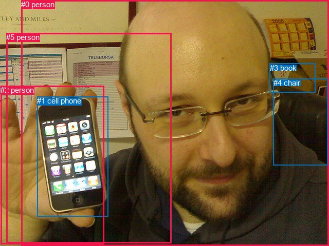
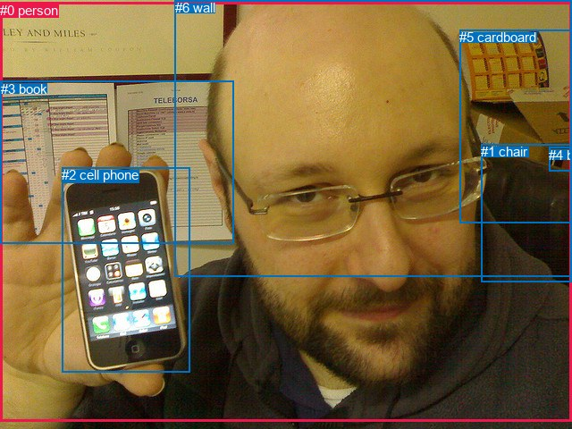

# 图片 1004：2360919.jpg

随机样本序号：92。图片 SHA256：`8180429aaf079e82eb8a349d28d66d452c2b93e40c580833b5135b2f60136fb5`。

红色框表示人，蓝色框表示其他物体。两个模式分别保留自身框编号，可依据位置比较对应对象。

## 自动检测框与输出

人的框编号：`[0, 2, 5]`。状态：`ok`。

### 自动检测全部物体框

| 编号 | 类别 | 是否为人 | 检测分数 | 像素坐标 xyxy |
|---|---|---|---|---|
| 0 | person | True | 0.9939 | 41.4, 0.1, 640.0, 480.0 |
| 1 | cell phone | False | 0.9923 | 72.2, 188.1, 210.3, 422.5 |
| 2 | person | True | 0.9681 | 1.2, 167.4, 202.2, 476.7 |
| 3 | book | False | 0.5530 | 524.6, 123.6, 613.8, 180.3 |
| 4 | chair | False | 0.4808 | 532.0, 153.3, 637.6, 322.8 |
| 5 | person | True | 0.3978 | 12.4, 64.5, 333.4, 474.7 |

### 自动检测 Top50 人相关候选

评分物体对：30；人相关物体对：24；输出关系：48。

| 排名 | 主语编号与类别 | 关系 | 宾语编号与类别 | 类型 | 人与人 | 排序分数 | 原始融合 logit |
|---|---|---|---|---|---|---|---|
| 1 | #2 person | holding | #1 cell phone | semantic | False | 0.99344 | 5.0197 |
| 2 | #0 person | holding | #1 cell phone | semantic | False | 0.99040 | 4.6364 |
| 3 | #0 person | sitting on | #4 chair | semantic | False | 0.98919 | 4.5162 |
| 4 | #1 cell phone | in | #2 person | spatial | False | 0.93769 | 2.7113 |
| 5 | #0 person | looking at | #5 person | semantic | True | 0.87874 | 1.9806 |
| 6 | #2 person | on | #1 cell phone | spatial | False | 0.87568 | 1.9521 |
| 7 | #0 person | on | #4 chair | spatial | False | 0.87387 | 1.9356 |
| 8 | #0 person | on | #1 cell phone | spatial | False | 0.86343 | 1.8441 |
| 9 | #0 person | holding | #2 person | semantic | True | 0.86080 | 1.8219 |
| 10 | #0 person | beside | #5 person | spatial | True | 0.76635 | 1.1878 |
| 11 | #0 person | wearing | #3 book | semantic | False | 0.74561 | 1.0753 |
| 12 | #3 book | beside | #0 person | spatial | False | 0.72464 | 0.9676 |
| 13 | #1 cell phone | on | #5 person | spatial | False | 0.68659 | 0.7842 |
| 14 | #0 person | in | #2 person | spatial | True | 0.65570 | 0.6442 |
| 15 | #5 person | beside | #0 person | spatial | True | 0.64667 | 0.6044 |
| 16 | #2 person | on | #0 person | spatial | True | 0.61784 | 0.4804 |
| 17 | #1 cell phone | in front of | #0 person | spatial | False | 0.55731 | 0.2303 |
| 18 | #3 book | on | #5 person | spatial | False | 0.43601 | -0.2574 |
| 19 | #2 person | talking to | #0 person | semantic | True | 0.40982 | -0.3647 |
| 20 | #1 cell phone | holding | #2 person | semantic | False | 0.36858 | -0.5383 |
| 21 | #1 cell phone | holding | #0 person | semantic | False | 0.35753 | -0.5861 |
| 22 | #2 person | on | #5 person | spatial | True | 0.33603 | -0.6810 |
| 23 | #0 person | beside | #3 book | spatial | False | 0.31724 | -0.7665 |
| 24 | #4 chair | beside | #0 person | spatial | False | 0.30583 | -0.8197 |
| 25 | #1 cell phone | holding | #5 person | semantic | False | 0.25412 | -1.0767 |
| 26 | #5 person | holding | #1 cell phone | semantic | False | 0.20297 | -1.3678 |
| 27 | #5 person | holding | #0 person | semantic | True | 0.17945 | -1.5201 |
| 28 | #5 person | on | #1 cell phone | spatial | False | 0.17387 | -1.5584 |
| 29 | #3 book | holding | #0 person | semantic | False | 0.16029 | -1.6560 |
| 30 | #2 person | touching | #5 person | semantic | True | 0.14712 | -1.7574 |
| 31 | #5 person | sitting on | #4 chair | semantic | False | 0.12664 | -1.9310 |
| 32 | #2 person | sitting on | #4 chair | semantic | False | 0.08882 | -2.3281 |
| 33 | #5 person | on | #4 chair | spatial | False | 0.06755 | -2.6249 |
| 34 | #4 chair | crossing | #0 person | semantic | False | 0.06593 | -2.6509 |
| 35 | #3 book | lying on | #5 person | semantic | False | 0.06281 | -2.7028 |
| 36 | #5 person | in | #2 person | spatial | True | 0.04827 | -2.9814 |
| 37 | #4 chair | beside | #5 person | spatial | False | 0.03980 | -3.1834 |
| 38 | #5 person | beside | #3 book | spatial | False | 0.02813 | -3.5422 |
| 39 | #2 person | on | #4 chair | spatial | False | 0.02746 | -3.5671 |
| 40 | #5 person | holding | #3 book | semantic | False | 0.01745 | -4.0310 |
| 41 | #5 person | holding | #2 person | semantic | True | 0.01258 | -4.3627 |
| 42 | #4 chair | beside | #2 person | spatial | False | 0.00677 | -4.9890 |
| 43 | #3 book | beside | #2 person | spatial | False | 0.00574 | -5.1553 |
| 44 | #2 person | in front of | #3 book | spatial | False | 0.00470 | -5.3548 |
| 45 | #4 chair | holding | #5 person | semantic | False | 0.00379 | -5.5727 |
| 46 | #2 person | sitting on | #3 book | semantic | False | 0.00237 | -6.0425 |
| 47 | #3 book | holding | #2 person | semantic | False | 0.00087 | -7.0510 |
| 48 | #4 chair | holding | #2 person | semantic | False | 0.00077 | -7.1648 |

### 自动检测逐条人相关 GT 核验

R@50：50.00%；命中 1/2。

| GT 主语编号 | GT 关系 | GT 宾语编号 | 结果阶段 | 匹配预测主语编号 | 匹配预测宾语编号 |
|---|---|---|---|---|---|
| 0 | holding | 2 | hit50 | [0] | [1] |
| 0 | in front of | 3 | endpoint_missing_or_wrong_class | [0] | [] |

## 真实框与输出

人的框编号：`[0]`。

### 真实框全部物体框

| 编号 | 类别 | 是否为人 | 检测分数 | 像素坐标 xyxy |
|---|---|---|---|---|
| 0 | person | True | GT | 0.0, 3.0, 640.0, 472.0 |
| 1 | chair | False | GT | 538.0, 161.0, 640.0, 315.0 |
| 2 | cell phone | False | GT | 69.0, 187.0, 212.0, 417.0 |
| 3 | book | False | GT | 1.0, 91.0, 262.0, 273.0 |
| 4 | book | False | GT | 614.0, 165.0, 640.0, 192.0 |
| 5 | cardboard | False | GT | 514.0, 33.0, 640.0, 250.0 |
| 6 | wall | False | GT | 196.0, 0.0, 640.0, 309.0 |

### 真实框 Top50 人相关候选

评分物体对：42；人相关物体对：12；输出关系：24。

| 排名 | 主语编号与类别 | 关系 | 宾语编号与类别 | 类型 | 人与人 | 排序分数 | 原始融合 logit |
|---|---|---|---|---|---|---|---|
| 1 | #0 person | holding | #2 cell phone | semantic | False | 0.99286 | 4.9346 |
| 2 | #0 person | sitting on | #1 chair | semantic | False | 0.98550 | 4.2191 |
| 3 | #0 person | on | #6 wall | spatial | False | 0.92651 | 2.5343 |
| 4 | #0 person | on | #2 cell phone | spatial | False | 0.87835 | 1.9769 |
| 5 | #0 person | on | #1 chair | spatial | False | 0.87681 | 1.9626 |
| 6 | #6 wall | on back of | #0 person | spatial | False | 0.78756 | 1.3103 |
| 7 | #3 book | beside | #0 person | spatial | False | 0.78536 | 1.2972 |
| 8 | #0 person | wearing | #6 wall | semantic | False | 0.76617 | 1.1868 |
| 9 | #2 cell phone | in | #0 person | spatial | False | 0.70656 | 0.8788 |
| 10 | #5 cardboard | beside | #0 person | spatial | False | 0.68167 | 0.7615 |
| 11 | #0 person | looking at | #3 book | semantic | False | 0.65963 | 0.6616 |
| 12 | #2 cell phone | holding | #0 person | semantic | False | 0.49454 | -0.0218 |
| 13 | #0 person | beside | #3 book | spatial | False | 0.47825 | -0.0871 |
| 14 | #0 person | wearing | #5 cardboard | semantic | False | 0.43338 | -0.2681 |
| 15 | #0 person | on | #5 cardboard | spatial | False | 0.43272 | -0.2707 |
| 16 | #4 book | beside | #0 person | spatial | False | 0.38481 | -0.4692 |
| 17 | #1 chair | beside | #0 person | spatial | False | 0.36728 | -0.5439 |
| 18 | #6 wall | wearing | #0 person | semantic | False | 0.33993 | -0.6636 |
| 19 | #3 book | looking at | #0 person | semantic | False | 0.26339 | -1.0284 |
| 20 | #0 person | wearing | #4 book | semantic | False | 0.25813 | -1.0557 |
| 21 | #5 cardboard | looking at | #0 person | semantic | False | 0.11000 | -2.0907 |
| 22 | #1 chair | crossing | #0 person | semantic | False | 0.08499 | -2.3764 |
| 23 | #4 book | looking at | #0 person | semantic | False | 0.05270 | -2.8889 |
| 24 | #0 person | on | #4 book | spatial | False | 0.03670 | -3.2675 |

### 真实框逐条人相关 GT 核验

R@50：50.00%；命中 1/2。

| GT 主语编号 | GT 关系 | GT 宾语编号 | 结果阶段 | 匹配预测主语编号 | 匹配预测宾语编号 |
|---|---|---|---|---|---|
| 0 | holding | 2 | hit50 | [0] | [2] |
| 0 | in front of | 3 | wrong_predicate | [0] | [3] |

## 全部人相关 GT

| 主语编号与类别 | 关系 | 宾语编号与类别 |
|---|---|---|
| #0 person | holding | #2 cell phone |
| #0 person | in front of | #3 book |

原始记录、全部人相关物体对的两项预测与分项分数见 [逐图证据 JSON](../evidence/cases/1004.json)。全部56类 logits 保留于本机 HOR/output/random500/logits/。

<!-- HOR_COMPLETE_RESULTS -->

## 六组条件的完整输出对照

以下保留同一图片三种框与候选模式、两种谓词输出规则的全部 Top50。框编号各自在所属模式内解释。

### 自动检测框完整枚举：空间与语义各保留一个谓词

| 排名 | 主语编号与类别 | 谓词 | 宾语编号与类别 | 分组 | 排序分数 | predicate logit | pair logit |
|---|---|---|---|---|---|---|---|
| 1 | #2 person | holding | #1 cell phone | semantic | 0.9934366 | 4.9619117 | 0.0577607 |
| 2 | #0 person | holding | #1 cell phone | semantic | 0.9904004 | 4.2968707 | 0.3395128 |
| 3 | #0 person | sitting on | #4 chair | semantic | 0.9891874 | 4.2462592 | 0.2699087 |
| 4 | #1 cell phone | in | #2 person | spatial | 0.9376878 | 3.1399503 | -0.4286918 |
| 5 | #0 person | looking at | #5 person | semantic | 0.8787422 | 2.1597486 | -0.1791761 |
| 6 | #2 person | on | #1 cell phone | spatial | 0.8756789 | 1.8943706 | 0.0577607 |
| 7 | #0 person | on | #4 chair | spatial | 0.8738676 | 1.6656876 | 0.2699087 |
| 8 | #0 person | on | #1 cell phone | spatial | 0.8634347 | 1.5046029 | 0.3395128 |
| 9 | #0 person | holding | #2 person | semantic | 0.8607991 | 1.6448684 | 0.1770750 |
| 10 | #0 person | beside | #5 person | spatial | 0.7663519 | 1.3670015 | -0.1791761 |
| 11 | #0 person | wearing | #3 book | semantic | 0.7456070 | 2.2440481 | -1.1687298 |
| 12 | #3 book | beside | #0 person | spatial | 0.7246424 | 1.5200601 | -0.5524527 |
| 13 | #1 cell phone | on | #5 person | spatial | 0.6865924 | 1.5267005 | -0.7424642 |
| 14 | #0 person | in | #2 person | spatial | 0.6557036 | 0.4671311 | 0.1770750 |
| 15 | #5 person | beside | #0 person | spatial | 0.6466662 | 0.8317199 | -0.2273028 |
| 16 | #2 person | on | #0 person | spatial | 0.6178353 | 0.6941662 | -0.2137958 |
| 17 | #1 cell phone | in front of | #0 person | spatial | 0.5573136 | 0.8093634 | -0.5790968 |
| 18 | #3 book | on | #5 person | spatial | 0.4360073 | 1.0412722 | -1.2986543 |
| 19 | #2 person | talking to | #0 person | semantic | 0.4098188 | -0.1509185 | -0.2137958 |
| 20 | #1 cell phone | holding | #2 person | semantic | 0.3685789 | -0.1096263 | -0.4286918 |
| 21 | #1 cell phone | holding | #0 person | semantic | 0.3575339 | -0.0069871 | -0.5790968 |
| 22 | #2 person | on | #5 person | spatial | 0.3360339 | 0.2872252 | -0.9682443 |
| 23 | #0 person | beside | #3 book | spatial | 0.3172433 | 0.4022603 | -1.1687298 |
| 24 | #4 chair | beside | #0 person | spatial | 0.3058317 | -0.5622425 | -0.2574371 |
| 25 | #1 cell phone | holding | #5 person | semantic | 0.2541231 | -0.3342776 | -0.7424642 |
| 26 | #5 person | holding | #1 cell phone | semantic | 0.2029713 | -0.7455945 | -0.6222315 |
| 27 | #5 person | holding | #0 person | semantic | 0.1794476 | -1.2927916 | -0.2273028 |
| 28 | #5 person | on | #1 cell phone | spatial | 0.1738710 | -0.9362059 | -0.6222315 |
| 29 | #3 book | holding | #0 person | semantic | 0.1602938 | -1.1035907 | -0.5524527 |
| 30 | #2 person | touching | #5 person | semantic | 0.1471174 | -0.7891467 | -0.9682443 |
| 31 | #5 person | sitting on | #4 chair | semantic | 0.1266445 | -0.7460275 | -1.1849310 |
| 32 | #2 person | sitting on | #4 chair | semantic | 0.0888226 | -0.8904591 | -1.4376377 |
| 33 | #5 person | on | #4 chair | spatial | 0.0675513 | -1.4399958 | -1.1849310 |
| 34 | #4 chair | crossing | #0 person | semantic | 0.0659329 | -2.3934743 | -0.2574371 |
| 35 | #3 book | lying on | #5 person | semantic | 0.0628082 | -1.4041479 | -1.2986543 |
| 36 | #5 person | in | #2 person | spatial | 0.0482715 | -2.0949655 | -0.8864734 |
| 37 | #4 chair | beside | #5 person | spatial | 0.0397951 | -1.9460425 | -1.2373593 |
| 38 | #5 person | beside | #3 book | spatial | 0.0281344 | -2.1230917 | -1.4191327 |
| 39 | #2 person | on | #4 chair | spatial | 0.0274634 | -2.1294153 | -1.4376377 |
| 40 | #5 person | holding | #3 book | semantic | 0.0174469 | -2.6118605 | -1.4191327 |
| 41 | #5 person | holding | #2 person | semantic | 0.0125836 | -3.4762230 | -0.8864734 |
| 42 | #4 chair | beside | #2 person | spatial | 0.0067662 | -3.2861440 | -1.7028773 |
| 43 | #3 book | beside | #2 person | spatial | 0.0057355 | -3.3911166 | -1.7642068 |
| 44 | #2 person | in front of | #3 book | spatial | 0.0047031 | -3.2149816 | -2.1398473 |
| 45 | #4 chair | holding | #5 person | semantic | 0.0037857 | -4.3353844 | -1.2373593 |
| 46 | #2 person | sitting on | #3 book | semantic | 0.0023700 | -3.9026279 | -2.1398473 |
| 47 | #3 book | holding | #2 person | semantic | 0.0008658 | -5.2867618 | -1.7642068 |
| 48 | #4 chair | holding | #2 person | semantic | 0.0007727 | -5.4619517 | -1.7028773 |

GT 命中：1/2，R@50=50.00%。

| GT主语 | GT谓词 | GT宾语 | 结果阶段 | 匹配主语框 | 匹配宾语框 |
|---|---|---|---|---|---|
| 0 | holding | 2 | hit50 | [0] | [1] |
| 0 | in front of | 3 | endpoint_missing_or_wrong_class | [0] | [] |

### 自动检测框完整枚举：每对只保留一个谓词

| 排名 | 主语编号与类别 | 谓词 | 宾语编号与类别 | 分组 | 排序分数 | predicate logit | pair logit |
|---|---|---|---|---|---|---|---|
| 1 | #2 person | holding | #1 cell phone | single | 0.9934366 | 4.9619117 | 0.0577607 |
| 2 | #0 person | holding | #1 cell phone | single | 0.9904004 | 4.2968707 | 0.3395128 |
| 3 | #0 person | sitting on | #4 chair | single | 0.9891874 | 4.2462592 | 0.2699087 |
| 4 | #1 cell phone | in | #2 person | single | 0.9376878 | 3.1399503 | -0.4286918 |
| 5 | #0 person | looking at | #5 person | single | 0.8787422 | 2.1597486 | -0.1791761 |
| 6 | #0 person | holding | #2 person | single | 0.8607991 | 1.6448684 | 0.1770750 |
| 7 | #0 person | wearing | #3 book | single | 0.7456070 | 2.2440481 | -1.1687298 |
| 8 | #3 book | beside | #0 person | single | 0.7246424 | 1.5200601 | -0.5524527 |
| 9 | #1 cell phone | on | #5 person | single | 0.6865924 | 1.5267005 | -0.7424642 |
| 10 | #5 person | beside | #0 person | single | 0.6466662 | 0.8317199 | -0.2273028 |
| 11 | #2 person | on | #0 person | single | 0.6178353 | 0.6941662 | -0.2137958 |
| 12 | #1 cell phone | in front of | #0 person | single | 0.5573136 | 0.8093634 | -0.5790968 |
| 13 | #3 book | on | #5 person | single | 0.4360073 | 1.0412722 | -1.2986543 |
| 14 | #2 person | on | #5 person | single | 0.3360339 | 0.2872252 | -0.9682443 |
| 15 | #4 chair | beside | #0 person | single | 0.3058317 | -0.5622425 | -0.2574371 |
| 16 | #5 person | holding | #1 cell phone | single | 0.2029713 | -0.7455945 | -0.6222315 |
| 17 | #5 person | sitting on | #4 chair | single | 0.1266445 | -0.7460275 | -1.1849310 |
| 18 | #2 person | sitting on | #4 chair | single | 0.0888226 | -0.8904591 | -1.4376377 |
| 19 | #5 person | in | #2 person | single | 0.0482715 | -2.0949655 | -0.8864734 |
| 20 | #4 chair | beside | #5 person | single | 0.0397951 | -1.9460425 | -1.2373593 |
| 21 | #5 person | beside | #3 book | single | 0.0281344 | -2.1230917 | -1.4191327 |
| 22 | #4 chair | beside | #2 person | single | 0.0067662 | -3.2861440 | -1.7028773 |
| 23 | #3 book | beside | #2 person | single | 0.0057355 | -3.3911166 | -1.7642068 |
| 24 | #2 person | in front of | #3 book | single | 0.0047031 | -3.2149816 | -2.1398473 |

GT 命中：1/2，R@50=50.00%。

| GT主语 | GT谓词 | GT宾语 | 结果阶段 | 匹配主语框 | 匹配宾语框 |
|---|---|---|---|---|---|
| 0 | holding | 2 | hit50 | [0] | [1] |
| 0 | in front of | 3 | endpoint_missing_or_wrong_class | [0] | [] |

### 真实框完整枚举：空间与语义各保留一个谓词

| 排名 | 主语编号与类别 | 谓词 | 宾语编号与类别 | 分组 | 排序分数 | predicate logit | pair logit |
|---|---|---|---|---|---|---|---|
| 1 | #0 person | holding | #2 cell phone | semantic | 0.9928578 | 4.5966849 | 0.3378776 |
| 2 | #0 person | sitting on | #1 chair | semantic | 0.9855008 | 3.9995198 | 0.2195311 |
| 3 | #0 person | on | #6 wall | spatial | 0.9265089 | 2.5833120 | -0.0490522 |
| 4 | #0 person | on | #2 cell phone | spatial | 0.8783495 | 1.6390142 | 0.3378776 |
| 5 | #0 person | on | #1 chair | spatial | 0.8768146 | 1.7430735 | 0.2195311 |
| 6 | #6 wall | on back of | #0 person | spatial | 0.7875569 | 1.5204816 | -0.2102201 |
| 7 | #3 book | beside | #0 person | spatial | 0.7853623 | 1.3723793 | -0.0751856 |
| 8 | #0 person | wearing | #6 wall | semantic | 0.7661690 | 1.2358565 | -0.0490522 |
| 9 | #2 cell phone | in | #0 person | spatial | 0.7065645 | 1.4446621 | -0.5659051 |
| 10 | #5 cardboard | beside | #0 person | spatial | 0.6816708 | 1.0976839 | -0.3362229 |
| 11 | #0 person | looking at | #3 book | semantic | 0.6596307 | 1.1853232 | -0.5236744 |
| 12 | #2 cell phone | holding | #0 person | semantic | 0.4945409 | 0.5440679 | -0.5659051 |
| 13 | #0 person | beside | #3 book | spatial | 0.4782457 | 0.4366021 | -0.5236744 |
| 14 | #0 person | wearing | #5 cardboard | semantic | 0.4333751 | 0.2760892 | -0.5441829 |
| 15 | #0 person | on | #5 cardboard | spatial | 0.4327246 | 0.2734394 | -0.5441829 |
| 16 | #4 book | beside | #0 person | spatial | 0.3848066 | -0.0152874 | -0.4539086 |
| 17 | #1 chair | beside | #0 person | spatial | 0.3672807 | -0.1398916 | -0.4040091 |
| 18 | #6 wall | wearing | #0 person | semantic | 0.3399295 | -0.4533882 | -0.2102201 |
| 19 | #3 book | looking at | #0 person | semantic | 0.2633926 | -0.9532239 | -0.0751856 |
| 20 | #0 person | wearing | #4 book | semantic | 0.2581280 | -0.1852932 | -0.8704281 |
| 21 | #5 cardboard | looking at | #0 person | semantic | 0.1100040 | -1.7544770 | -0.3362229 |
| 22 | #1 chair | crossing | #0 person | semantic | 0.0849886 | -1.9724102 | -0.4040091 |
| 23 | #4 book | looking at | #0 person | semantic | 0.0527038 | -2.4350164 | -0.4539086 |
| 24 | #0 person | on | #4 book | spatial | 0.0367024 | -2.3970933 | -0.8704281 |

GT 命中：1/2，R@50=50.00%。

| GT主语 | GT谓词 | GT宾语 | 结果阶段 | 匹配主语框 | 匹配宾语框 |
|---|---|---|---|---|---|
| 0 | holding | 2 | hit50 | [0] | [2] |
| 0 | in front of | 3 | wrong_predicate | [0] | [3] |

### 真实框完整枚举：每对只保留一个谓词

| 排名 | 主语编号与类别 | 谓词 | 宾语编号与类别 | 分组 | 排序分数 | predicate logit | pair logit |
|---|---|---|---|---|---|---|---|
| 1 | #0 person | holding | #2 cell phone | single | 0.9928578 | 4.5966849 | 0.3378776 |
| 2 | #0 person | sitting on | #1 chair | single | 0.9855008 | 3.9995198 | 0.2195311 |
| 3 | #0 person | on | #6 wall | single | 0.9265089 | 2.5833120 | -0.0490522 |
| 4 | #6 wall | on back of | #0 person | single | 0.7875569 | 1.5204816 | -0.2102201 |
| 5 | #3 book | beside | #0 person | single | 0.7853623 | 1.3723793 | -0.0751856 |
| 6 | #2 cell phone | in | #0 person | single | 0.7065645 | 1.4446621 | -0.5659051 |
| 7 | #5 cardboard | beside | #0 person | single | 0.6816708 | 1.0976839 | -0.3362229 |
| 8 | #0 person | looking at | #3 book | single | 0.6596307 | 1.1853232 | -0.5236744 |
| 9 | #0 person | wearing | #5 cardboard | single | 0.4333751 | 0.2760892 | -0.5441829 |
| 10 | #4 book | beside | #0 person | single | 0.3848066 | -0.0152874 | -0.4539086 |
| 11 | #1 chair | beside | #0 person | single | 0.3672807 | -0.1398916 | -0.4040091 |
| 12 | #0 person | wearing | #4 book | single | 0.2581280 | -0.1852932 | -0.8704281 |

GT 命中：1/2，R@50=50.00%。

| GT主语 | GT谓词 | GT宾语 | 结果阶段 | 匹配主语框 | 匹配宾语框 |
|---|---|---|---|---|---|
| 0 | holding | 2 | hit50 | [0] | [2] |
| 0 | in front of | 3 | wrong_predicate | [0] | [3] |

### 真实框400候选：空间与语义各保留一个谓词

| 排名 | 主语编号与类别 | 谓词 | 宾语编号与类别 | 分组 | 排序分数 | predicate logit | pair logit |
|---|---|---|---|---|---|---|---|
| 1 | #0 person | holding | #2 cell phone | semantic | 0.9928578 | 4.5966849 | 0.3378776 |
| 2 | #0 person | sitting on | #1 chair | semantic | 0.9855008 | 3.9995198 | 0.2195311 |
| 3 | #0 person | on | #6 wall | spatial | 0.9265089 | 2.5833120 | -0.0490522 |
| 4 | #0 person | on | #1 chair | spatial | 0.8809029 | 1.7814770 | 0.2195311 |
| 5 | #0 person | on | #2 cell phone | spatial | 0.8795083 | 1.6499043 | 0.3378776 |
| 6 | #6 wall | on back of | #0 person | spatial | 0.7877932 | 1.5218940 | -0.2102201 |
| 7 | #3 book | beside | #0 person | spatial | 0.7853526 | 1.3723216 | -0.0751856 |
| 8 | #0 person | wearing | #6 wall | semantic | 0.7704807 | 1.2600799 | -0.0490522 |
| 9 | #2 cell phone | in | #0 person | spatial | 0.7120845 | 1.4714346 | -0.5659051 |
| 10 | #5 cardboard | beside | #0 person | spatial | 0.6751311 | 1.0677080 | -0.3362229 |
| 11 | #0 person | looking at | #3 book | semantic | 0.6595525 | 1.1849747 | -0.5236744 |
| 12 | #2 cell phone | holding | #0 person | semantic | 0.4938025 | 0.5411139 | -0.5659051 |
| 13 | #0 person | beside | #3 book | spatial | 0.4782601 | 0.4366598 | -0.5236744 |
| 14 | #0 person | wearing | #5 cardboard | semantic | 0.4393329 | 0.3003130 | -0.5441829 |
| 15 | #0 person | on | #5 cardboard | spatial | 0.4327246 | 0.2734394 | -0.5441829 |
| 16 | #4 book | beside | #0 person | spatial | 0.3991487 | 0.0448952 | -0.4539086 |
| 17 | #1 chair | beside | #0 person | spatial | 0.3672807 | -0.1398916 | -0.4040091 |
| 18 | #6 wall | wearing | #0 person | semantic | 0.3345157 | -0.4776111 | -0.2102201 |
| 19 | #0 person | wearing | #4 book | semantic | 0.2675137 | -0.1368461 | -0.8704281 |
| 20 | #3 book | looking at | #0 person | semantic | 0.2633926 | -0.9532239 | -0.0751856 |
| 21 | #5 cardboard | looking at | #0 person | semantic | 0.1099699 | -1.7548258 | -0.3362229 |
| 22 | #1 chair | crossing | #0 person | semantic | 0.0849886 | -1.9724102 | -0.4040091 |
| 23 | #4 book | looking at | #0 person | semantic | 0.0534776 | -2.4196224 | -0.4539086 |
| 24 | #0 person | on | #4 book | spatial | 0.0362191 | -2.4108503 | -0.8704281 |

GT 命中：1/2，R@50=50.00%。

| GT主语 | GT谓词 | GT宾语 | 结果阶段 | 匹配主语框 | 匹配宾语框 |
|---|---|---|---|---|---|
| 0 | holding | 2 | hit50 | [0] | [2] |
| 0 | in front of | 3 | wrong_predicate | [0] | [3] |

### 真实框400候选：每对只保留一个谓词

| 排名 | 主语编号与类别 | 谓词 | 宾语编号与类别 | 分组 | 排序分数 | predicate logit | pair logit |
|---|---|---|---|---|---|---|---|
| 1 | #0 person | holding | #2 cell phone | single | 0.9928578 | 4.5966849 | 0.3378776 |
| 2 | #0 person | sitting on | #1 chair | single | 0.9855008 | 3.9995198 | 0.2195311 |
| 3 | #0 person | on | #6 wall | single | 0.9265089 | 2.5833120 | -0.0490522 |
| 4 | #6 wall | on back of | #0 person | single | 0.7877932 | 1.5218940 | -0.2102201 |
| 5 | #3 book | beside | #0 person | single | 0.7853526 | 1.3723216 | -0.0751856 |
| 6 | #2 cell phone | in | #0 person | single | 0.7120845 | 1.4714346 | -0.5659051 |
| 7 | #5 cardboard | beside | #0 person | single | 0.6751311 | 1.0677080 | -0.3362229 |
| 8 | #0 person | looking at | #3 book | single | 0.6595525 | 1.1849747 | -0.5236744 |
| 9 | #0 person | wearing | #5 cardboard | single | 0.4393329 | 0.3003130 | -0.5441829 |
| 10 | #4 book | beside | #0 person | single | 0.3991487 | 0.0448952 | -0.4539086 |
| 11 | #1 chair | beside | #0 person | single | 0.3672807 | -0.1398916 | -0.4040091 |
| 12 | #0 person | wearing | #4 book | single | 0.2675137 | -0.1368461 | -0.8704281 |

GT 命中：1/2，R@50=50.00%。

| GT主语 | GT谓词 | GT宾语 | 结果阶段 | 匹配主语框 | 匹配宾语框 |
|---|---|---|---|---|---|
| 0 | holding | 2 | hit50 | [0] | [2] |
| 0 | in front of | 3 | wrong_predicate | [0] | [3] |
