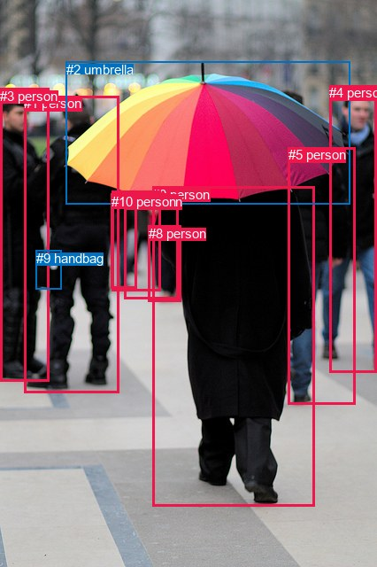
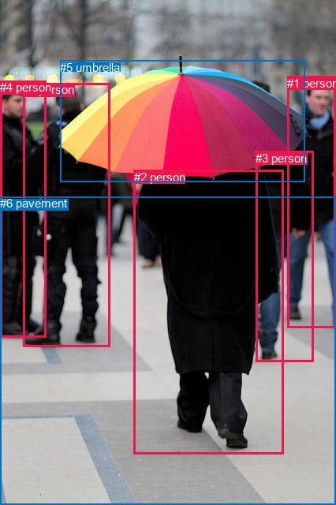

# 图片 1007：2361180.jpg

随机样本序号：422。图片 SHA256：`574c21ac9a17d685ccb2077c8c977ea2b20e419aa0a9d684a17b5be072fe58a5`。

红色框表示人，蓝色框表示其他物体。两个模式分别保留自身框编号，可依据位置比较对应对象。

## 自动检测框与输出

人的框编号：`[0, 1, 3, 4, 5, 6, 7, 8, 10]`。状态：`ok`。

### 自动检测全部物体框

| 编号 | 类别 | 是否为人 | 检测分数 | 像素坐标 xyxy |
|---|---|---|---|---|
| 0 | person | True | 0.9986 | 172.5, 210.9, 355.6, 571.1 |
| 1 | person | True | 0.9973 | 27.2, 108.1, 134.2, 443.1 |
| 2 | umbrella | False | 0.9970 | 74.7, 69.8, 395.1, 230.8 |
| 3 | person | True | 0.9956 | 0.0, 99.8, 56.0, 430.9 |
| 4 | person | True | 0.9706 | 372.2, 96.4, 425.9, 420.9 |
| 5 | person | True | 0.9693 | 325.9, 166.1, 401.4, 456.5 |
| 6 | person | True | 0.9456 | 126.7, 215.7, 181.4, 328.7 |
| 7 | person | True | 0.8437 | 140.6, 219.3, 201.9, 337.6 |
| 8 | person | True | 0.7054 | 168.0, 254.7, 204.5, 340.1 |
| 9 | handbag | False | 0.4492 | 40.8, 282.9, 69.2, 327.0 |
| 10 | person | True | 0.3921 | 125.7, 218.6, 154.2, 325.3 |

### 自动检测 Top50 人相关候选

评分物体对：110；人相关物体对：108；输出关系：50。

| 排名 | 主语编号与类别 | 关系 | 宾语编号与类别 | 类型 | 人与人 | 排序分数 | 原始融合 logit |
|---|---|---|---|---|---|---|---|
| 1 | #3 person | holding | #9 handbag | semantic | False | 0.98744 | 4.3650 |
| 2 | #1 person | carrying | #9 handbag | semantic | False | 0.98556 | 4.2230 |
| 3 | #0 person | holding | #2 umbrella | semantic | False | 0.97811 | 3.7997 |
| 4 | #1 person | holding | #2 umbrella | semantic | False | 0.90434 | 2.2465 |
| 5 | #4 person | holding | #2 umbrella | semantic | False | 0.88900 | 2.0805 |
| 6 | #4 person | walking on | #5 person | semantic | True | 0.88640 | 2.0545 |
| 7 | #6 person | walking on | #10 person | semantic | True | 0.88314 | 2.0225 |
| 8 | #3 person | beside | #1 person | spatial | True | 0.88152 | 2.0069 |
| 9 | #4 person | walking on | #0 person | semantic | True | 0.84723 | 1.7130 |
| 10 | #5 person | walking on | #0 person | semantic | True | 0.84391 | 1.6876 |
| 11 | #4 person | beside | #5 person | spatial | True | 0.83429 | 1.6163 |
| 12 | #1 person | walking on | #10 person | semantic | True | 0.82547 | 1.5538 |
| 13 | #1 person | beside | #3 person | spatial | True | 0.82074 | 1.5214 |
| 14 | #5 person | walking on | #4 person | semantic | True | 0.75483 | 1.1245 |
| 15 | #10 person | walking on | #6 person | semantic | True | 0.75174 | 1.1079 |
| 16 | #1 person | walking on | #6 person | semantic | True | 0.73425 | 1.0163 |
| 17 | #7 person | walking on | #8 person | semantic | True | 0.72626 | 0.9757 |
| 18 | #5 person | beside | #4 person | spatial | True | 0.70394 | 0.8662 |
| 19 | #9 handbag | beside | #1 person | spatial | False | 0.70161 | 0.8550 |
| 20 | #3 person | talking to | #1 person | semantic | True | 0.70144 | 0.8542 |
| 21 | #3 person | looking at | #0 person | semantic | True | 0.69328 | 0.8155 |
| 22 | #2 umbrella | over | #0 person | spatial | False | 0.69186 | 0.8088 |
| 23 | #0 person | in | #2 umbrella | spatial | False | 0.69038 | 0.8019 |
| 24 | #5 person | beside | #0 person | spatial | True | 0.69028 | 0.8014 |
| 25 | #1 person | beside | #10 person | spatial | True | 0.68294 | 0.7673 |
| 26 | #7 person | walking on | #6 person | semantic | True | 0.68261 | 0.7658 |
| 27 | #9 handbag | carrying | #1 person | semantic | False | 0.67013 | 0.7088 |
| 28 | #1 person | walking on | #0 person | semantic | True | 0.66575 | 0.6890 |
| 29 | #6 person | walking on | #7 person | semantic | True | 0.66431 | 0.6826 |
| 30 | #1 person | walking on | #3 person | semantic | True | 0.65484 | 0.6404 |
| 31 | #4 person | beside | #0 person | spatial | True | 0.61444 | 0.4660 |
| 32 | #8 person | walking on | #0 person | semantic | True | 0.60897 | 0.4430 |
| 33 | #3 person | beside | #9 handbag | spatial | False | 0.59807 | 0.3974 |
| 34 | #9 handbag | on | #3 person | spatial | False | 0.59756 | 0.3953 |
| 35 | #7 person | holding | #2 umbrella | semantic | False | 0.58592 | 0.3471 |
| 36 | #7 person | walking on | #0 person | semantic | True | 0.58524 | 0.3443 |
| 37 | #3 person | holding | #2 umbrella | semantic | False | 0.53227 | 0.1293 |
| 38 | #9 handbag | carrying | #3 person | semantic | False | 0.52445 | 0.0979 |
| 39 | #1 person | beside | #6 person | spatial | True | 0.52158 | 0.0864 |
| 40 | #1 person | in | #9 handbag | spatial | False | 0.51920 | 0.0768 |
| 41 | #8 person | walking on | #7 person | semantic | True | 0.45274 | -0.1896 |
| 42 | #1 person | walking on | #7 person | semantic | True | 0.44705 | -0.2126 |
| 43 | #10 person | beside | #6 person | spatial | True | 0.44320 | -0.2282 |
| 44 | #6 person | beside | #10 person | spatial | True | 0.44212 | -0.2326 |
| 45 | #7 person | walking on | #10 person | semantic | True | 0.43656 | -0.2551 |
| 46 | #8 person | beside | #0 person | spatial | True | 0.42231 | -0.3133 |
| 47 | #5 person | holding | #2 umbrella | semantic | False | 0.38927 | -0.4504 |
| 48 | #4 person | holding | #9 handbag | semantic | False | 0.32897 | -0.7128 |
| 49 | #6 person | walking on | #0 person | semantic | True | 0.32634 | -0.7248 |
| 50 | #6 person | holding | #2 umbrella | semantic | False | 0.31936 | -0.7567 |

### 自动检测逐条人相关 GT 核验

R@50：33.33%；命中 2/6。

| GT 主语编号 | GT 关系 | GT 宾语编号 | 结果阶段 | 匹配预测主语编号 | 匹配预测宾语编号 |
|---|---|---|---|---|---|
| 1 | walking on | 6 | endpoint_missing_or_wrong_class | [4] | [] |
| 2 | holding | 5 | hit50 | [0] | [2] |
| 2 | walking on | 6 | endpoint_missing_or_wrong_class | [0] | [] |
| 3 | in front of | 1 | wrong_predicate | [5] | [4] |
| 4 | talking to | 0 | hit50 | [3] | [1] |
| 4 | standing on | 6 | endpoint_missing_or_wrong_class | [3] | [] |

## 真实框与输出

人的框编号：`[0, 1, 2, 3, 4]`。

### 真实框全部物体框

| 编号 | 类别 | 是否为人 | 检测分数 | 像素坐标 xyxy |
|---|---|---|---|---|
| 0 | person | True | GT | 29.0, 105.0, 139.0, 439.0 |
| 1 | person | True | GT | 364.0, 97.0, 426.0, 416.0 |
| 2 | person | True | GT | 170.0, 216.0, 360.0, 575.0 |
| 3 | person | True | GT | 324.0, 192.0, 397.0, 459.0 |
| 4 | person | True | GT | 0.0, 102.0, 58.0, 427.0 |
| 5 | umbrella | False | GT | 76.0, 77.0, 387.0, 231.0 |
| 6 | pavement | False | GT | 0.0, 249.0, 426.0, 640.0 |

### 真实框 Top50 人相关候选

评分物体对：42；人相关物体对：40；输出关系：50。

| 排名 | 主语编号与类别 | 关系 | 宾语编号与类别 | 类型 | 人与人 | 排序分数 | 原始融合 logit |
|---|---|---|---|---|---|---|---|
| 1 | #0 person | walking on | #6 pavement | semantic | False | 0.99181 | 4.7960 |
| 2 | #1 person | walking on | #6 pavement | semantic | False | 0.99168 | 4.7810 |
| 3 | #3 person | walking on | #6 pavement | semantic | False | 0.98902 | 4.5010 |
| 4 | #2 person | walking on | #6 pavement | semantic | False | 0.98798 | 4.4092 |
| 5 | #4 person | standing on | #6 pavement | semantic | False | 0.98146 | 3.9689 |
| 6 | #2 person | holding | #5 umbrella | semantic | False | 0.97501 | 3.6640 |
| 7 | #0 person | holding | #5 umbrella | semantic | False | 0.94321 | 2.8100 |
| 8 | #0 person | on | #6 pavement | spatial | False | 0.92560 | 2.5209 |
| 9 | #2 person | on | #6 pavement | spatial | False | 0.91921 | 2.4317 |
| 10 | #1 person | on | #6 pavement | spatial | False | 0.90645 | 2.2711 |
| 11 | #4 person | on | #6 pavement | spatial | False | 0.89294 | 2.1211 |
| 12 | #1 person | holding | #5 umbrella | semantic | False | 0.85801 | 1.7988 |
| 13 | #3 person | on | #6 pavement | spatial | False | 0.84766 | 1.7164 |
| 14 | #4 person | holding | #5 umbrella | semantic | False | 0.82476 | 1.5489 |
| 15 | #4 person | beside | #0 person | spatial | True | 0.82036 | 1.5188 |
| 16 | #4 person | talking to | #0 person | semantic | True | 0.68050 | 0.7561 |
| 17 | #2 person | in | #5 umbrella | spatial | False | 0.66675 | 0.6935 |
| 18 | #0 person | beside | #4 person | spatial | True | 0.64976 | 0.6180 |
| 19 | #5 umbrella | over | #2 person | spatial | False | 0.62165 | 0.4965 |
| 20 | #0 person | looking at | #2 person | semantic | True | 0.61048 | 0.4493 |
| 21 | #4 person | looking at | #2 person | semantic | True | 0.56126 | 0.2463 |
| 22 | #3 person | beside | #1 person | spatial | True | 0.55473 | 0.2198 |
| 23 | #1 person | beside | #3 person | spatial | True | 0.55099 | 0.2047 |
| 24 | #0 person | holding | #4 person | semantic | True | 0.54184 | 0.1677 |
| 25 | #1 person | walking on | #3 person | semantic | True | 0.50207 | 0.0083 |
| 26 | #1 person | looking at | #2 person | semantic | True | 0.49877 | -0.0049 |
| 27 | #5 umbrella | carrying | #2 person | semantic | False | 0.43769 | -0.2505 |
| 28 | #3 person | walking on | #1 person | semantic | True | 0.42909 | -0.2855 |
| 29 | #3 person | beside | #2 person | spatial | True | 0.40980 | -0.3648 |
| 30 | #3 person | walking on | #2 person | semantic | True | 0.37162 | -0.5253 |
| 31 | #0 person | in | #5 umbrella | spatial | False | 0.35029 | -0.6178 |
| 32 | #0 person | beside | #2 person | spatial | True | 0.32268 | -0.7415 |
| 33 | #1 person | beside | #2 person | spatial | True | 0.31446 | -0.7794 |
| 34 | #4 person | in | #5 umbrella | spatial | False | 0.26535 | -1.0183 |
| 35 | #4 person | beside | #2 person | spatial | True | 0.25054 | -1.0957 |
| 36 | #3 person | holding | #5 umbrella | semantic | False | 0.24122 | -1.1460 |
| 37 | #1 person | in | #5 umbrella | spatial | False | 0.22955 | -1.2108 |
| 38 | #1 person | looking at | #0 person | semantic | True | 0.21567 | -1.2911 |
| 39 | #1 person | looking at | #4 person | semantic | True | 0.21371 | -1.3027 |
| 40 | #4 person | looking at | #1 person | semantic | True | 0.17469 | -1.5527 |
| 41 | #5 umbrella | over | #0 person | spatial | False | 0.13905 | -1.8232 |
| 42 | #1 person | beside | #0 person | spatial | True | 0.11191 | -2.0714 |
| 43 | #1 person | beside | #4 person | spatial | True | 0.11050 | -2.0857 |
| 44 | #4 person | looking at | #3 person | semantic | True | 0.09575 | -2.2453 |
| 45 | #2 person | walking on | #0 person | semantic | True | 0.09195 | -2.2901 |
| 46 | #0 person | looking at | #1 person | semantic | True | 0.09155 | -2.2949 |
| 47 | #3 person | looking at | #4 person | semantic | True | 0.09089 | -2.3028 |
| 48 | #2 person | walking on | #3 person | semantic | True | 0.07149 | -2.5640 |
| 49 | #4 person | beside | #1 person | spatial | True | 0.07042 | -2.5803 |
| 50 | #5 umbrella | holding | #0 person | semantic | False | 0.06215 | -2.7140 |

### 真实框逐条人相关 GT 核验

R@50：83.33%；命中 5/6。

| GT 主语编号 | GT 关系 | GT 宾语编号 | 结果阶段 | 匹配预测主语编号 | 匹配预测宾语编号 |
|---|---|---|---|---|---|
| 1 | walking on | 6 | hit50 | [1] | [6] |
| 2 | holding | 5 | hit50 | [2] | [5] |
| 2 | walking on | 6 | hit50 | [2] | [6] |
| 3 | in front of | 1 | wrong_predicate | [3] | [1] |
| 4 | talking to | 0 | hit50 | [4] | [0] |
| 4 | standing on | 6 | hit50 | [4] | [6] |

## 全部人相关 GT

| 主语编号与类别 | 关系 | 宾语编号与类别 |
|---|---|---|
| #1 person | walking on | #6 pavement |
| #2 person | holding | #5 umbrella |
| #2 person | walking on | #6 pavement |
| #3 person | in front of | #1 person |
| #4 person | talking to | #0 person |
| #4 person | standing on | #6 pavement |

原始记录、全部人相关物体对的两项预测与分项分数见 [逐图证据 JSON](../evidence/cases/1007.json)。全部56类 logits 保留于本机 HOR/output/random500/logits/。

<!-- HOR_COMPLETE_RESULTS -->

## 六组条件的完整输出对照

以下保留同一图片三种框与候选模式、两种谓词输出规则的全部 Top50。框编号各自在所属模式内解释。

### 自动检测框完整枚举：空间与语义各保留一个谓词

| 排名 | 主语编号与类别 | 谓词 | 宾语编号与类别 | 分组 | 排序分数 | predicate logit | pair logit |
|---|---|---|---|---|---|---|---|
| 1 | #3 person | holding | #9 handbag | semantic | 0.9874448 | 4.0990176 | 0.2659709 |
| 2 | #1 person | carrying | #9 handbag | semantic | 0.9855567 | 3.9275794 | 0.2953922 |
| 3 | #0 person | holding | #2 umbrella | semantic | 0.9781130 | 3.7094779 | 0.0902521 |
| 4 | #1 person | holding | #2 umbrella | semantic | 0.9043449 | 2.7240219 | -0.4775601 |
| 5 | #4 person | holding | #2 umbrella | semantic | 0.8889954 | 2.6867146 | -0.6061940 |
| 6 | #4 person | walking on | #5 person | semantic | 0.8863987 | 2.5216041 | -0.4671324 |
| 7 | #6 person | walking on | #10 person | semantic | 0.8831435 | 2.2071304 | -0.1845900 |
| 8 | #3 person | beside | #1 person | spatial | 0.8815246 | 3.1083045 | -1.1013573 |
| 9 | #4 person | walking on | #0 person | semantic | 0.8472287 | 2.5486851 | -0.8356564 |
| 10 | #5 person | walking on | #0 person | semantic | 0.8439139 | 2.5787764 | -0.8911339 |
| 11 | #4 person | beside | #5 person | spatial | 0.8342850 | 2.0834379 | -0.4671324 |
| 12 | #1 person | walking on | #10 person | semantic | 0.8254662 | 1.6941295 | -0.1402996 |
| 13 | #1 person | beside | #3 person | spatial | 0.8207392 | 2.4758677 | -0.9545039 |
| 14 | #5 person | walking on | #4 person | semantic | 0.7548298 | 2.2538352 | -1.1292953 |
| 15 | #10 person | walking on | #6 person | semantic | 0.7517397 | 1.6143508 | -0.5064382 |
| 16 | #1 person | walking on | #6 person | semantic | 0.7342509 | 1.4473782 | -0.4310798 |
| 17 | #7 person | walking on | #8 person | semantic | 0.7262599 | 1.2969084 | -0.3211793 |
| 18 | #5 person | beside | #4 person | spatial | 0.7039446 | 1.9954486 | -1.1292953 |
| 19 | #9 handbag | beside | #1 person | spatial | 0.7016104 | 1.5463347 | -0.6913567 |
| 20 | #3 person | talking to | #1 person | semantic | 0.7014419 | 1.9555311 | -1.1013573 |
| 21 | #3 person | looking at | #0 person | semantic | 0.6932811 | 1.4932084 | -0.6777045 |
| 22 | #2 umbrella | over | #0 person | spatial | 0.6918642 | 1.5564656 | -0.7476165 |
| 23 | #0 person | in | #2 umbrella | spatial | 0.6903760 | 0.7116256 | 0.0902521 |
| 24 | #5 person | beside | #0 person | spatial | 0.6902754 | 1.6925411 | -0.8911339 |
| 25 | #1 person | beside | #10 person | spatial | 0.6829364 | 0.9075990 | -0.1402996 |
| 26 | #7 person | walking on | #6 person | semantic | 0.6826074 | 1.1253786 | -0.3595982 |
| 27 | #9 handbag | carrying | #1 person | semantic | 0.6701264 | 1.4001136 | -0.6913567 |
| 28 | #1 person | walking on | #0 person | semantic | 0.6657472 | 1.4022908 | -0.7132783 |
| 29 | #6 person | walking on | #7 person | semantic | 0.6643135 | 1.1765294 | -0.4939528 |
| 30 | #1 person | walking on | #3 person | semantic | 0.6548417 | 1.5948939 | -0.9545039 |
| 31 | #4 person | beside | #0 person | spatial | 0.6144370 | 1.3016582 | -0.8356564 |
| 32 | #8 person | walking on | #0 person | semantic | 0.6089681 | 1.4278102 | -0.9848333 |
| 33 | #3 person | beside | #9 handbag | spatial | 0.5980686 | 0.1314530 | 0.2659709 |
| 34 | #9 handbag | on | #3 person | spatial | 0.5975574 | 1.0650210 | -0.6697233 |
| 35 | #7 person | holding | #2 umbrella | semantic | 0.5859165 | 1.2567272 | -0.9096179 |
| 36 | #7 person | walking on | #0 person | semantic | 0.5852432 | 1.3119888 | -0.9676539 |
| 37 | #3 person | holding | #2 umbrella | semantic | 0.5322747 | 0.6788950 | -0.5496164 |
| 38 | #9 handbag | carrying | #3 person | semantic | 0.5244533 | 0.7676148 | -0.6697233 |
| 39 | #1 person | beside | #6 person | spatial | 0.5215773 | 0.5174427 | -0.4310798 |
| 40 | #1 person | in | #9 handbag | spatial | 0.5192004 | -0.2185526 | 0.2953922 |
| 41 | #8 person | walking on | #7 person | semantic | 0.4527406 | 0.3430061 | -0.5326098 |
| 42 | #1 person | walking on | #7 person | semantic | 0.4470548 | 0.4483604 | -0.6609380 |
| 43 | #10 person | beside | #6 person | spatial | 0.4431962 | 0.2782378 | -0.5064382 |
| 44 | #6 person | beside | #10 person | spatial | 0.4421180 | -0.0479808 | -0.1845900 |
| 45 | #7 person | walking on | #10 person | semantic | 0.4365605 | -0.0338526 | -0.2212804 |
| 46 | #8 person | beside | #0 person | spatial | 0.4223098 | 0.6715345 | -0.9848333 |
| 47 | #5 person | holding | #2 umbrella | semantic | 0.3892655 | 0.3931327 | -0.8435333 |
| 48 | #4 person | holding | #9 handbag | semantic | 0.3289715 | 0.0894160 | -0.8022564 |
| 49 | #6 person | walking on | #0 person | semantic | 0.3263387 | 0.3896971 | -1.1144885 |
| 50 | #6 person | holding | #2 umbrella | semantic | 0.3193576 | 0.2843952 | -1.0411206 |

GT 命中：2/6，R@50=33.33%。

| GT主语 | GT谓词 | GT宾语 | 结果阶段 | 匹配主语框 | 匹配宾语框 |
|---|---|---|---|---|---|
| 1 | walking on | 6 | endpoint_missing_or_wrong_class | [4] | [] |
| 2 | holding | 5 | hit50 | [0] | [2] |
| 2 | walking on | 6 | endpoint_missing_or_wrong_class | [0] | [] |
| 3 | in front of | 1 | wrong_predicate | [5] | [4] |
| 4 | talking to | 0 | hit50 | [3] | [1] |
| 4 | standing on | 6 | endpoint_missing_or_wrong_class | [3] | [] |

### 自动检测框完整枚举：每对只保留一个谓词

| 排名 | 主语编号与类别 | 谓词 | 宾语编号与类别 | 分组 | 排序分数 | predicate logit | pair logit |
|---|---|---|---|---|---|---|---|
| 1 | #3 person | holding | #9 handbag | single | 0.9874448 | 4.0990176 | 0.2659709 |
| 2 | #1 person | carrying | #9 handbag | single | 0.9855567 | 3.9275794 | 0.2953922 |
| 3 | #0 person | holding | #2 umbrella | single | 0.9781130 | 3.7094779 | 0.0902521 |
| 4 | #1 person | holding | #2 umbrella | single | 0.9043449 | 2.7240219 | -0.4775601 |
| 5 | #4 person | holding | #2 umbrella | single | 0.8889954 | 2.6867146 | -0.6061940 |
| 6 | #4 person | walking on | #5 person | single | 0.8863987 | 2.5216041 | -0.4671324 |
| 7 | #6 person | walking on | #10 person | single | 0.8831435 | 2.2071304 | -0.1845900 |
| 8 | #3 person | beside | #1 person | single | 0.8815246 | 3.1083045 | -1.1013573 |
| 9 | #4 person | walking on | #0 person | single | 0.8472287 | 2.5486851 | -0.8356564 |
| 10 | #5 person | walking on | #0 person | single | 0.8439139 | 2.5787764 | -0.8911339 |
| 11 | #1 person | walking on | #10 person | single | 0.8254662 | 1.6941295 | -0.1402996 |
| 12 | #1 person | beside | #3 person | single | 0.8207392 | 2.4758677 | -0.9545039 |
| 13 | #5 person | walking on | #4 person | single | 0.7548298 | 2.2538352 | -1.1292953 |
| 14 | #10 person | walking on | #6 person | single | 0.7517397 | 1.6143508 | -0.5064382 |
| 15 | #1 person | walking on | #6 person | single | 0.7342509 | 1.4473782 | -0.4310798 |
| 16 | #7 person | walking on | #8 person | single | 0.7262599 | 1.2969084 | -0.3211793 |
| 17 | #9 handbag | beside | #1 person | single | 0.7016104 | 1.5463347 | -0.6913567 |
| 18 | #3 person | looking at | #0 person | single | 0.6932811 | 1.4932084 | -0.6777045 |
| 19 | #2 umbrella | over | #0 person | single | 0.6918642 | 1.5564656 | -0.7476165 |
| 20 | #7 person | walking on | #6 person | single | 0.6826074 | 1.1253786 | -0.3595982 |
| 21 | #1 person | walking on | #0 person | single | 0.6657472 | 1.4022908 | -0.7132783 |
| 22 | #6 person | walking on | #7 person | single | 0.6643135 | 1.1765294 | -0.4939528 |
| 23 | #8 person | walking on | #0 person | single | 0.6089681 | 1.4278102 | -0.9848333 |
| 24 | #9 handbag | on | #3 person | single | 0.5975574 | 1.0650210 | -0.6697233 |
| 25 | #7 person | holding | #2 umbrella | single | 0.5859165 | 1.2567272 | -0.9096179 |
| 26 | #7 person | walking on | #0 person | single | 0.5852432 | 1.3119888 | -0.9676539 |
| 27 | #3 person | holding | #2 umbrella | single | 0.5322747 | 0.6788950 | -0.5496164 |
| 28 | #8 person | walking on | #7 person | single | 0.4527406 | 0.3430061 | -0.5326098 |
| 29 | #1 person | walking on | #7 person | single | 0.4470548 | 0.4483604 | -0.6609380 |
| 30 | #7 person | walking on | #10 person | single | 0.4365605 | -0.0338526 | -0.2212804 |
| 31 | #5 person | holding | #2 umbrella | single | 0.3892655 | 0.3931327 | -0.8435333 |
| 32 | #4 person | holding | #9 handbag | single | 0.3289715 | 0.0894160 | -0.8022564 |
| 33 | #6 person | walking on | #0 person | single | 0.3263387 | 0.3896971 | -1.1144885 |
| 34 | #6 person | holding | #2 umbrella | single | 0.3193576 | 0.2843952 | -1.0411206 |
| 35 | #10 person | walking on | #1 person | single | 0.3149423 | 0.1850514 | -0.9621652 |
| 36 | #0 person | beside | #8 person | single | 0.3065287 | 0.1564851 | -0.9728835 |
| 37 | #10 person | walking on | #7 person | single | 0.3044384 | -0.1594853 | -0.6667655 |
| 38 | #4 person | walking on | #8 person | single | 0.2951010 | 0.1549740 | -1.0257108 |
| 39 | #3 person | walking on | #10 person | single | 0.2931762 | -0.1759877 | -0.7040198 |
| 40 | #0 person | beside | #7 person | single | 0.2927041 | 0.3051343 | -1.1874213 |
| 41 | #0 person | beside | #5 person | single | 0.2886763 | 0.3980393 | -1.2998610 |
| 42 | #8 person | walking on | #6 person | single | 0.2878938 | -0.3754063 | -0.5302290 |
| 43 | #6 person | walking on | #8 person | single | 0.2764072 | -0.4807048 | -0.4816488 |
| 44 | #6 person | walking on | #1 person | single | 0.2674072 | 0.0188041 | -1.0266213 |
| 45 | #4 person | walking on | #10 person | single | 0.2512780 | -0.4174986 | -0.6743093 |
| 46 | #0 person | in front of | #6 person | single | 0.2426555 | 0.2634215 | -1.4015973 |
| 47 | #3 person | walking on | #6 person | single | 0.2194780 | -0.3490090 | -0.9197021 |
| 48 | #4 person | walking on | #6 person | single | 0.2177464 | -0.4844546 | -0.7943932 |
| 49 | #1 person | walking on | #8 person | single | 0.2164275 | -0.6213627 | -0.6652454 |
| 50 | #4 person | looking at | #1 person | single | 0.2089705 | -0.0162349 | -1.3149073 |

GT 命中：1/6，R@50=16.67%。

| GT主语 | GT谓词 | GT宾语 | 结果阶段 | 匹配主语框 | 匹配宾语框 |
|---|---|---|---|---|---|
| 1 | walking on | 6 | endpoint_missing_or_wrong_class | [4] | [] |
| 2 | holding | 5 | hit50 | [0] | [2] |
| 2 | walking on | 6 | endpoint_missing_or_wrong_class | [0] | [] |
| 3 | in front of | 1 | wrong_predicate | [5] | [4] |
| 4 | talking to | 0 | wrong_predicate | [3] | [1] |
| 4 | standing on | 6 | endpoint_missing_or_wrong_class | [3] | [] |

### 真实框完整枚举：空间与语义各保留一个谓词

| 排名 | 主语编号与类别 | 谓词 | 宾语编号与类别 | 分组 | 排序分数 | predicate logit | pair logit |
|---|---|---|---|---|---|---|---|
| 1 | #0 person | walking on | #6 pavement | semantic | 0.9918053 | 4.8086228 | -0.0125770 |
| 2 | #1 person | walking on | #6 pavement | semantic | 0.9916824 | 4.8898511 | -0.1088210 |
| 3 | #3 person | walking on | #6 pavement | semantic | 0.9890240 | 4.9349809 | -0.4339696 |
| 4 | #2 person | walking on | #6 pavement | semantic | 0.9879816 | 4.7755342 | -0.3663075 |
| 5 | #4 person | standing on | #6 pavement | semantic | 0.9814566 | 4.1009879 | -0.1320654 |
| 6 | #2 person | holding | #5 umbrella | semantic | 0.9750108 | 3.6245637 | 0.0394428 |
| 7 | #0 person | holding | #5 umbrella | semantic | 0.9432149 | 3.3059258 | -0.4959054 |
| 8 | #0 person | on | #6 pavement | spatial | 0.9255954 | 2.5334969 | -0.0125770 |
| 9 | #2 person | on | #6 pavement | spatial | 0.9192148 | 2.7980337 | -0.3663075 |
| 10 | #1 person | on | #6 pavement | spatial | 0.9064519 | 2.3798838 | -0.1088210 |
| 11 | #4 person | on | #6 pavement | spatial | 0.8929409 | 2.2532053 | -0.1320654 |
| 12 | #1 person | holding | #5 umbrella | semantic | 0.8580056 | 2.4397368 | -0.6409135 |
| 13 | #3 person | on | #6 pavement | spatial | 0.8476598 | 2.1503334 | -0.4339696 |
| 14 | #4 person | holding | #5 umbrella | semantic | 0.8247591 | 2.1170468 | -0.5681168 |
| 15 | #4 person | beside | #0 person | spatial | 0.8203643 | 2.6583233 | -1.1395059 |
| 16 | #4 person | talking to | #0 person | semantic | 0.6805047 | 1.8955984 | -1.1395059 |
| 17 | #2 person | in | #5 umbrella | spatial | 0.6667532 | 0.6540937 | 0.0394428 |
| 18 | #0 person | beside | #4 person | spatial | 0.6497600 | 1.5456986 | -0.9277142 |
| 19 | #5 umbrella | over | #2 person | spatial | 0.6216457 | 1.2767053 | -0.7801657 |
| 20 | #0 person | looking at | #2 person | semantic | 0.6104750 | 1.1744075 | -0.7250982 |
| 21 | #4 person | looking at | #2 person | semantic | 0.5612648 | 0.9333286 | -0.6870321 |
| 22 | #3 person | beside | #1 person | spatial | 0.5547307 | 1.3389344 | -1.1191310 |
| 23 | #1 person | beside | #3 person | spatial | 0.5509923 | 0.7049942 | -0.5003133 |
| 24 | #0 person | holding | #4 person | semantic | 0.5418387 | 1.0954614 | -0.9277142 |
| 25 | #1 person | walking on | #3 person | semantic | 0.5020678 | 0.5085845 | -0.5003133 |
| 26 | #1 person | looking at | #2 person | semantic | 0.4987659 | 0.8157530 | -0.8206892 |
| 27 | #5 umbrella | carrying | #2 person | semantic | 0.4376923 | 0.5296326 | -0.7801657 |
| 28 | #3 person | walking on | #1 person | semantic | 0.4290937 | 0.8335814 | -1.1191310 |
| 29 | #3 person | beside | #2 person | spatial | 0.4098013 | 0.5502443 | -0.9150311 |
| 30 | #3 person | walking on | #2 person | semantic | 0.3716156 | 0.3897390 | -0.9150311 |
| 31 | #0 person | in | #5 umbrella | spatial | 0.3502890 | -0.1218638 | -0.4959054 |
| 32 | #0 person | beside | #2 person | spatial | 0.3226797 | -0.0163860 | -0.7250982 |
| 33 | #1 person | beside | #2 person | spatial | 0.3144599 | 0.0413389 | -0.8206892 |
| 34 | #4 person | in | #5 umbrella | spatial | 0.2653520 | -0.4502172 | -0.5681168 |
| 35 | #4 person | beside | #2 person | spatial | 0.2505404 | -0.4087000 | -0.6870321 |
| 36 | #3 person | holding | #5 umbrella | semantic | 0.2412249 | -0.1985221 | -0.9474534 |
| 37 | #1 person | in | #5 umbrella | spatial | 0.2295547 | -0.5699139 | -0.6409135 |
| 38 | #1 person | looking at | #0 person | semantic | 0.2156659 | 0.0102620 | -1.3013666 |
| 39 | #1 person | looking at | #4 person | semantic | 0.2137062 | -0.0761771 | -1.2265513 |
| 40 | #4 person | looking at | #1 person | semantic | 0.1746933 | 0.0939112 | -1.6466345 |
| 41 | #5 umbrella | over | #0 person | spatial | 0.1390518 | -0.0237684 | -1.7994194 |
| 42 | #1 person | beside | #0 person | spatial | 0.1119092 | -0.7700193 | -1.3013666 |
| 43 | #1 person | beside | #4 person | spatial | 0.1104964 | -0.8591290 | -1.2265513 |
| 44 | #4 person | looking at | #3 person | semantic | 0.0957548 | -1.2057648 | -1.0395448 |
| 45 | #2 person | walking on | #0 person | semantic | 0.0919483 | -0.8124058 | -1.4776685 |
| 46 | #0 person | looking at | #1 person | semantic | 0.0915452 | -0.9458055 | -1.3491069 |
| 47 | #3 person | looking at | #4 person | semantic | 0.0908926 | -0.9390614 | -1.3637235 |
| 48 | #2 person | walking on | #3 person | semantic | 0.0714883 | -1.2742693 | -1.2897798 |
| 49 | #4 person | beside | #1 person | spatial | 0.0704196 | -0.9336274 | -1.6466345 |
| 50 | #5 umbrella | holding | #0 person | semantic | 0.0621550 | -0.9145343 | -1.7994194 |

GT 命中：5/6，R@50=83.33%。

| GT主语 | GT谓词 | GT宾语 | 结果阶段 | 匹配主语框 | 匹配宾语框 |
|---|---|---|---|---|---|
| 1 | walking on | 6 | hit50 | [1] | [6] |
| 2 | holding | 5 | hit50 | [2] | [5] |
| 2 | walking on | 6 | hit50 | [2] | [6] |
| 3 | in front of | 1 | wrong_predicate | [3] | [1] |
| 4 | talking to | 0 | hit50 | [4] | [0] |
| 4 | standing on | 6 | hit50 | [4] | [6] |

### 真实框完整枚举：每对只保留一个谓词

| 排名 | 主语编号与类别 | 谓词 | 宾语编号与类别 | 分组 | 排序分数 | predicate logit | pair logit |
|---|---|---|---|---|---|---|---|
| 1 | #0 person | walking on | #6 pavement | single | 0.9918053 | 4.8086228 | -0.0125770 |
| 2 | #1 person | walking on | #6 pavement | single | 0.9916824 | 4.8898511 | -0.1088210 |
| 3 | #3 person | walking on | #6 pavement | single | 0.9890240 | 4.9349809 | -0.4339696 |
| 4 | #2 person | walking on | #6 pavement | single | 0.9879816 | 4.7755342 | -0.3663075 |
| 5 | #4 person | standing on | #6 pavement | single | 0.9814566 | 4.1009879 | -0.1320654 |
| 6 | #2 person | holding | #5 umbrella | single | 0.9750108 | 3.6245637 | 0.0394428 |
| 7 | #0 person | holding | #5 umbrella | single | 0.9432149 | 3.3059258 | -0.4959054 |
| 8 | #1 person | holding | #5 umbrella | single | 0.8580056 | 2.4397368 | -0.6409135 |
| 9 | #4 person | holding | #5 umbrella | single | 0.8247591 | 2.1170468 | -0.5681168 |
| 10 | #4 person | beside | #0 person | single | 0.8203643 | 2.6583233 | -1.1395059 |
| 11 | #0 person | beside | #4 person | single | 0.6497600 | 1.5456986 | -0.9277142 |
| 12 | #5 umbrella | over | #2 person | single | 0.6216457 | 1.2767053 | -0.7801657 |
| 13 | #0 person | looking at | #2 person | single | 0.6104750 | 1.1744075 | -0.7250982 |
| 14 | #4 person | looking at | #2 person | single | 0.5612648 | 0.9333286 | -0.6870321 |
| 15 | #3 person | beside | #1 person | single | 0.5547307 | 1.3389344 | -1.1191310 |
| 16 | #1 person | beside | #3 person | single | 0.5509923 | 0.7049942 | -0.5003133 |
| 17 | #1 person | looking at | #2 person | single | 0.4987659 | 0.8157530 | -0.8206892 |
| 18 | #3 person | beside | #2 person | single | 0.4098013 | 0.5502443 | -0.9150311 |
| 19 | #3 person | holding | #5 umbrella | single | 0.2412249 | -0.1985221 | -0.9474534 |
| 20 | #1 person | looking at | #0 person | single | 0.2156659 | 0.0102620 | -1.3013666 |
| 21 | #1 person | looking at | #4 person | single | 0.2137062 | -0.0761771 | -1.2265513 |
| 22 | #4 person | looking at | #1 person | single | 0.1746933 | 0.0939112 | -1.6466345 |
| 23 | #5 umbrella | over | #0 person | single | 0.1390518 | -0.0237684 | -1.7994194 |
| 24 | #4 person | looking at | #3 person | single | 0.0957548 | -1.2057648 | -1.0395448 |
| 25 | #2 person | walking on | #0 person | single | 0.0919483 | -0.8124058 | -1.4776685 |
| 26 | #0 person | looking at | #1 person | single | 0.0915452 | -0.9458055 | -1.3491069 |
| 27 | #3 person | looking at | #4 person | single | 0.0908926 | -0.9390614 | -1.3637235 |
| 28 | #2 person | walking on | #3 person | single | 0.0714883 | -1.2742693 | -1.2897798 |
| 29 | #3 person | walking on | #0 person | single | 0.0612552 | -1.3066394 | -1.4228548 |
| 30 | #6 pavement | in | #2 person | single | 0.0572221 | -1.3960979 | -1.4057920 |
| 31 | #5 umbrella | holding | #1 person | single | 0.0561145 | -1.2001269 | -1.6224842 |
| 32 | #2 person | walking on | #1 person | single | 0.0487251 | -1.3495047 | -1.6221046 |
| 33 | #2 person | walking on | #4 person | single | 0.0443749 | -1.5007203 | -1.5689706 |
| 34 | #0 person | walking on | #3 person | single | 0.0385912 | -2.2740474 | -0.9413271 |
| 35 | #5 umbrella | over | #3 person | single | 0.0323691 | -1.6288059 | -1.7688408 |
| 36 | #6 pavement | in | #0 person | single | 0.0233045 | -2.2796414 | -1.4558872 |
| 37 | #5 umbrella | over | #4 person | single | 0.0230269 | -1.7776432 | -1.9701513 |
| 38 | #6 pavement | in | #1 person | single | 0.0176870 | -2.4913323 | -1.5257454 |
| 39 | #6 pavement | in | #4 person | single | 0.0128971 | -2.8057423 | -1.5320284 |
| 40 | #6 pavement | in | #3 person | single | 0.0099239 | -2.7950220 | -1.8078163 |

GT 命中：4/6，R@50=66.67%。

| GT主语 | GT谓词 | GT宾语 | 结果阶段 | 匹配主语框 | 匹配宾语框 |
|---|---|---|---|---|---|
| 1 | walking on | 6 | hit50 | [1] | [6] |
| 2 | holding | 5 | hit50 | [2] | [5] |
| 2 | walking on | 6 | hit50 | [2] | [6] |
| 3 | in front of | 1 | wrong_predicate | [3] | [1] |
| 4 | talking to | 0 | wrong_predicate | [4] | [0] |
| 4 | standing on | 6 | hit50 | [4] | [6] |

### 真实框400候选：空间与语义各保留一个谓词

| 排名 | 主语编号与类别 | 谓词 | 宾语编号与类别 | 分组 | 排序分数 | predicate logit | pair logit |
|---|---|---|---|---|---|---|---|
| 1 | #0 person | walking on | #6 pavement | semantic | 0.9918053 | 4.8086228 | -0.0125770 |
| 2 | #1 person | walking on | #6 pavement | semantic | 0.9916576 | 4.8868403 | -0.1088210 |
| 3 | #3 person | walking on | #6 pavement | semantic | 0.9890240 | 4.9349809 | -0.4339696 |
| 4 | #2 person | walking on | #6 pavement | semantic | 0.9879816 | 4.7755342 | -0.3663075 |
| 5 | #4 person | standing on | #6 pavement | semantic | 0.9804701 | 4.0481486 | -0.1320654 |
| 6 | #2 person | holding | #5 umbrella | semantic | 0.9750108 | 3.6245637 | 0.0394428 |
| 7 | #0 person | holding | #5 umbrella | semantic | 0.9432149 | 3.3059258 | -0.4959054 |
| 8 | #0 person | on | #6 pavement | spatial | 0.9255954 | 2.5334969 | -0.0125770 |
| 9 | #2 person | on | #6 pavement | spatial | 0.9196182 | 2.8034782 | -0.3663075 |
| 10 | #1 person | on | #6 pavement | spatial | 0.9064519 | 2.3798838 | -0.1088210 |
| 11 | #4 person | on | #6 pavement | spatial | 0.8929409 | 2.2532053 | -0.1320654 |
| 12 | #1 person | holding | #5 umbrella | semantic | 0.8508895 | 2.3825083 | -0.6409135 |
| 13 | #3 person | on | #6 pavement | spatial | 0.8483616 | 2.1557779 | -0.4339696 |
| 14 | #4 person | holding | #5 umbrella | semantic | 0.8243318 | 2.1140928 | -0.5681168 |
| 15 | #4 person | beside | #0 person | spatial | 0.8203643 | 2.6583233 | -1.1395059 |
| 16 | #4 person | talking to | #0 person | semantic | 0.6804777 | 1.8954740 | -1.1395059 |
| 17 | #2 person | in | #5 umbrella | spatial | 0.6660154 | 0.6507750 | 0.0394428 |
| 18 | #0 person | beside | #4 person | spatial | 0.6565636 | 1.5757322 | -0.9277142 |
| 19 | #0 person | looking at | #2 person | semantic | 0.6175238 | 1.2041497 | -0.7250982 |
| 20 | #5 umbrella | over | #2 person | spatial | 0.6157946 | 1.2519021 | -0.7801657 |
| 21 | #4 person | looking at | #2 person | semantic | 0.5686603 | 0.9634194 | -0.6870321 |
| 22 | #1 person | beside | #3 person | spatial | 0.5657888 | 0.7650032 | -0.5003133 |
| 23 | #0 person | holding | #4 person | semantic | 0.5425721 | 1.0984159 | -0.9277142 |
| 24 | #3 person | beside | #1 person | spatial | 0.5398495 | 1.2788677 | -1.1191310 |
| 25 | #1 person | walking on | #3 person | semantic | 0.5092134 | 0.5371709 | -0.5003133 |
| 26 | #1 person | looking at | #2 person | semantic | 0.4987659 | 0.8157530 | -0.8206892 |
| 27 | #5 umbrella | carrying | #2 person | semantic | 0.4305864 | 0.5007067 | -0.7801657 |
| 28 | #3 person | beside | #2 person | spatial | 0.4098101 | 0.5502806 | -0.9150311 |
| 29 | #3 person | walking on | #1 person | semantic | 0.4082251 | 0.7478232 | -1.1191310 |
| 30 | #3 person | walking on | #2 person | semantic | 0.3712642 | 0.3882337 | -0.9150311 |
| 31 | #0 person | in | #5 umbrella | spatial | 0.3495340 | -0.1251826 | -0.4959054 |
| 32 | #0 person | beside | #2 person | spatial | 0.3226923 | -0.0163283 | -0.7250982 |
| 33 | #1 person | beside | #2 person | spatial | 0.3209639 | 0.0713434 | -0.8206892 |
| 34 | #4 person | in | #5 umbrella | spatial | 0.2653520 | -0.4502172 | -0.5681168 |
| 35 | #4 person | beside | #2 person | spatial | 0.2562301 | -0.3786235 | -0.6870321 |
| 36 | #3 person | holding | #5 umbrella | semantic | 0.2458842 | -0.1732316 | -0.9474534 |
| 37 | #1 person | in | #5 umbrella | spatial | 0.2283829 | -0.5765514 | -0.6409135 |
| 38 | #1 person | looking at | #4 person | semantic | 0.2186869 | -0.0467834 | -1.2265513 |
| 39 | #1 person | looking at | #0 person | semantic | 0.2156069 | 0.0099130 | -1.3013666 |
| 40 | #4 person | looking at | #1 person | semantic | 0.1746933 | 0.0939112 | -1.6466345 |
| 41 | #5 umbrella | over | #0 person | spatial | 0.1423704 | 0.0036788 | -1.7994194 |
| 42 | #1 person | beside | #4 person | spatial | 0.1104978 | -0.8591146 | -1.2265513 |
| 43 | #1 person | beside | #0 person | spatial | 0.1089557 | -0.8000865 | -1.3013666 |
| 44 | #4 person | looking at | #3 person | semantic | 0.0970655 | -1.1907194 | -1.0395448 |
| 45 | #2 person | walking on | #0 person | semantic | 0.0919483 | -0.8124058 | -1.4776685 |
| 46 | #3 person | looking at | #4 person | semantic | 0.0908638 | -0.9394102 | -1.3637235 |
| 47 | #0 person | looking at | #1 person | semantic | 0.0903589 | -0.9601538 | -1.3491069 |
| 48 | #2 person | walking on | #3 person | semantic | 0.0714883 | -1.2742693 | -1.2897798 |
| 49 | #4 person | beside | #1 person | spatial | 0.0714066 | -0.9186463 | -1.6466345 |
| 50 | #5 umbrella | holding | #0 person | semantic | 0.0623274 | -0.9115803 | -1.7994194 |

GT 命中：5/6，R@50=83.33%。

| GT主语 | GT谓词 | GT宾语 | 结果阶段 | 匹配主语框 | 匹配宾语框 |
|---|---|---|---|---|---|
| 1 | walking on | 6 | hit50 | [1] | [6] |
| 2 | holding | 5 | hit50 | [2] | [5] |
| 2 | walking on | 6 | hit50 | [2] | [6] |
| 3 | in front of | 1 | wrong_predicate | [3] | [1] |
| 4 | talking to | 0 | hit50 | [4] | [0] |
| 4 | standing on | 6 | hit50 | [4] | [6] |

### 真实框400候选：每对只保留一个谓词

| 排名 | 主语编号与类别 | 谓词 | 宾语编号与类别 | 分组 | 排序分数 | predicate logit | pair logit |
|---|---|---|---|---|---|---|---|
| 1 | #0 person | walking on | #6 pavement | single | 0.9918053 | 4.8086228 | -0.0125770 |
| 2 | #1 person | walking on | #6 pavement | single | 0.9916576 | 4.8868403 | -0.1088210 |
| 3 | #3 person | walking on | #6 pavement | single | 0.9890240 | 4.9349809 | -0.4339696 |
| 4 | #2 person | walking on | #6 pavement | single | 0.9879816 | 4.7755342 | -0.3663075 |
| 5 | #4 person | standing on | #6 pavement | single | 0.9804701 | 4.0481486 | -0.1320654 |
| 6 | #2 person | holding | #5 umbrella | single | 0.9750108 | 3.6245637 | 0.0394428 |
| 7 | #0 person | holding | #5 umbrella | single | 0.9432149 | 3.3059258 | -0.4959054 |
| 8 | #1 person | holding | #5 umbrella | single | 0.8508895 | 2.3825083 | -0.6409135 |
| 9 | #4 person | holding | #5 umbrella | single | 0.8243318 | 2.1140928 | -0.5681168 |
| 10 | #4 person | beside | #0 person | single | 0.8203643 | 2.6583233 | -1.1395059 |
| 11 | #0 person | beside | #4 person | single | 0.6565636 | 1.5757322 | -0.9277142 |
| 12 | #0 person | looking at | #2 person | single | 0.6175238 | 1.2041497 | -0.7250982 |
| 13 | #5 umbrella | over | #2 person | single | 0.6157946 | 1.2519021 | -0.7801657 |
| 14 | #4 person | looking at | #2 person | single | 0.5686603 | 0.9634194 | -0.6870321 |
| 15 | #1 person | beside | #3 person | single | 0.5657888 | 0.7650032 | -0.5003133 |
| 16 | #3 person | beside | #1 person | single | 0.5398495 | 1.2788677 | -1.1191310 |
| 17 | #1 person | looking at | #2 person | single | 0.4987659 | 0.8157530 | -0.8206892 |
| 18 | #3 person | beside | #2 person | single | 0.4098101 | 0.5502806 | -0.9150311 |
| 19 | #3 person | holding | #5 umbrella | single | 0.2458842 | -0.1732316 | -0.9474534 |
| 20 | #1 person | looking at | #4 person | single | 0.2186869 | -0.0467834 | -1.2265513 |
| 21 | #1 person | looking at | #0 person | single | 0.2156069 | 0.0099130 | -1.3013666 |
| 22 | #4 person | looking at | #1 person | single | 0.1746933 | 0.0939112 | -1.6466345 |
| 23 | #5 umbrella | over | #0 person | single | 0.1423704 | 0.0036788 | -1.7994194 |
| 24 | #4 person | looking at | #3 person | single | 0.0970655 | -1.1907194 | -1.0395448 |
| 25 | #2 person | walking on | #0 person | single | 0.0919483 | -0.8124058 | -1.4776685 |
| 26 | #3 person | looking at | #4 person | single | 0.0908638 | -0.9394102 | -1.3637235 |
| 27 | #0 person | looking at | #1 person | single | 0.0903589 | -0.9601538 | -1.3491069 |
| 28 | #2 person | walking on | #3 person | single | 0.0714883 | -1.2742693 | -1.2897798 |
| 29 | #3 person | looking at | #0 person | single | 0.0611971 | -1.3076518 | -1.4228548 |
| 30 | #6 pavement | in | #2 person | single | 0.0572221 | -1.3960979 | -1.4057920 |
| 31 | #5 umbrella | holding | #1 person | single | 0.0563496 | -1.1956956 | -1.6224842 |
| 32 | #2 person | walking on | #1 person | single | 0.0501389 | -1.3194134 | -1.6221046 |
| 33 | #2 person | walking on | #4 person | single | 0.0462624 | -1.4570887 | -1.5689706 |
| 34 | #0 person | walking on | #3 person | single | 0.0396086 | -2.2469666 | -0.9413271 |
| 35 | #5 umbrella | over | #3 person | single | 0.0328647 | -1.6130991 | -1.7688408 |
| 36 | #6 pavement | in | #0 person | single | 0.0233612 | -2.2771523 | -1.4558872 |
| 37 | #5 umbrella | over | #4 person | single | 0.0232888 | -1.7660680 | -1.9701513 |
| 38 | #6 pavement | in | #1 person | single | 0.0178919 | -2.4796054 | -1.5257454 |
| 39 | #6 pavement | in | #4 person | single | 0.0129328 | -2.8029420 | -1.5320284 |
| 40 | #6 pavement | in | #3 person | single | 0.0100439 | -2.7828803 | -1.8078163 |

GT 命中：4/6，R@50=66.67%。

| GT主语 | GT谓词 | GT宾语 | 结果阶段 | 匹配主语框 | 匹配宾语框 |
|---|---|---|---|---|---|
| 1 | walking on | 6 | hit50 | [1] | [6] |
| 2 | holding | 5 | hit50 | [2] | [5] |
| 2 | walking on | 6 | hit50 | [2] | [6] |
| 3 | in front of | 1 | wrong_predicate | [3] | [1] |
| 4 | talking to | 0 | wrong_predicate | [4] | [0] |
| 4 | standing on | 6 | hit50 | [4] | [6] |
