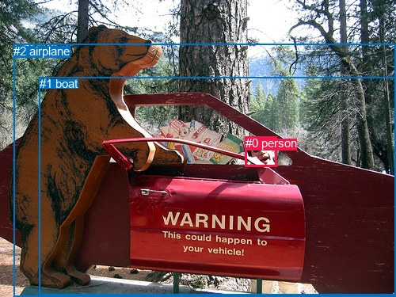
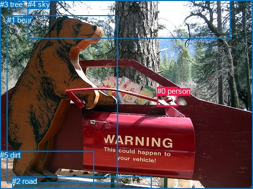

# 图片 1023：2361799.jpg

随机样本序号：105。图片 SHA256：`8dd624082055c6686acb10be52b5f46e6d65f718cd8b1008f2155389a8a238cd`。

红色框表示人，蓝色框表示其他物体。两个模式分别保留自身框编号，可依据位置比较对应对象。

## 自动检测框与输出

人的框编号：`[0]`。状态：`ok`。

### 自动检测全部物体框

| 编号 | 类别 | 是否为人 | 检测分数 | 像素坐标 xyxy |
|---|---|---|---|---|
| 0 | person | True | 0.9801 | 309.6, 172.2, 349.9, 210.8 |
| 1 | boat | False | 0.4893 | 49.6, 97.2, 500.0, 372.6 |
| 2 | airplane | False | 0.4731 | 17.1, 55.7, 500.0, 375.0 |

### 自动检测 Top50 人相关候选

评分物体对：6；人相关物体对：4；输出关系：8。

| 排名 | 主语编号与类别 | 关系 | 宾语编号与类别 | 类型 | 人与人 | 排序分数 | 原始融合 logit |
|---|---|---|---|---|---|---|---|
| 1 | #0 person | in | #1 boat | spatial | False | 0.95910 | 3.1549 |
| 2 | #0 person | in | #2 airplane | spatial | False | 0.94987 | 2.9418 |
| 3 | #0 person | looking at | #2 airplane | semantic | False | 0.94338 | 2.8131 |
| 4 | #0 person | looking at | #1 boat | semantic | False | 0.92518 | 2.5149 |
| 5 | #2 airplane | beside | #0 person | spatial | False | 0.38428 | -0.4714 |
| 6 | #1 boat | beside | #0 person | spatial | False | 0.36470 | -0.5550 |
| 7 | #2 airplane | talking to | #0 person | semantic | False | 0.22023 | -1.2643 |
| 8 | #1 boat | looking at | #0 person | semantic | False | 0.15435 | -1.7009 |

### 自动检测逐条人相关 GT 核验

R@50：0.00%；命中 0/2。

| GT 主语编号 | GT 关系 | GT 宾语编号 | 结果阶段 | 匹配预测主语编号 | 匹配预测宾语编号 |
|---|---|---|---|---|---|
| 0 | looking at | 1 | endpoint_missing_or_wrong_class | [0] | [] |
| 0 | in front of | 3 | endpoint_missing_or_wrong_class | [0] | [] |

## 真实框与输出

人的框编号：`[0]`。

### 真实框全部物体框

| 编号 | 类别 | 是否为人 | 检测分数 | 像素坐标 xyxy |
|---|---|---|---|---|
| 0 | person | True | GT | 311.0, 172.0, 352.0, 211.0 |
| 1 | bear | False | GT | 14.0, 31.0, 233.0, 364.0 |
| 2 | road | False | GT | 24.0, 351.0, 299.0, 375.0 |
| 3 | tree | False | GT | 0.0, 0.0, 500.0, 375.0 |
| 4 | sky | False | GT | 55.0, 0.0, 456.0, 76.0 |
| 5 | dirt | False | GT | 0.0, 299.0, 185.0, 375.0 |

### 真实框 Top50 人相关候选

评分物体对：30；人相关物体对：10；输出关系：20。

| 排名 | 主语编号与类别 | 关系 | 宾语编号与类别 | 类型 | 人与人 | 排序分数 | 原始融合 logit |
|---|---|---|---|---|---|---|---|
| 1 | #0 person | in | #3 tree | spatial | False | 0.96973 | 3.4668 |
| 2 | #0 person | looking at | #1 bear | semantic | False | 0.94397 | 2.8243 |
| 3 | #0 person | looking at | #3 tree | semantic | False | 0.89760 | 2.1708 |
| 4 | #1 bear | looking at | #0 person | semantic | False | 0.80589 | 1.4235 |
| 5 | #0 person | beside | #1 bear | spatial | False | 0.75458 | 1.1232 |
| 6 | #1 bear | beside | #0 person | spatial | False | 0.60188 | 0.4133 |
| 7 | #0 person | looking at | #4 sky | semantic | False | 0.59947 | 0.4033 |
| 8 | #4 sky | over | #0 person | spatial | False | 0.36611 | -0.5489 |
| 9 | #0 person | in | #4 sky | spatial | False | 0.33755 | -0.6742 |
| 10 | #0 person | on | #2 road | spatial | False | 0.31739 | -0.7658 |
| 11 | #0 person | standing on | #2 road | semantic | False | 0.21747 | -1.2805 |
| 12 | #3 tree | in | #0 person | spatial | False | 0.12461 | -1.9495 |
| 13 | #0 person | on | #5 dirt | spatial | False | 0.10547 | -2.1379 |
| 14 | #0 person | looking at | #5 dirt | semantic | False | 0.08861 | -2.3307 |
| 15 | #4 sky | looking at | #0 person | semantic | False | 0.04910 | -2.9635 |
| 16 | #3 tree | holding | #0 person | semantic | False | 0.03037 | -3.4635 |
| 17 | #5 dirt | beside | #0 person | spatial | False | 0.00721 | -4.9251 |
| 18 | #2 road | in front of | #0 person | spatial | False | 0.00602 | -5.1069 |
| 19 | #5 dirt | looking at | #0 person | semantic | False | 0.00237 | -6.0430 |
| 20 | #2 road | holding | #0 person | semantic | False | 0.00130 | -6.6449 |

### 真实框逐条人相关 GT 核验

R@50：50.00%；命中 1/2。

| GT 主语编号 | GT 关系 | GT 宾语编号 | 结果阶段 | 匹配预测主语编号 | 匹配预测宾语编号 |
|---|---|---|---|---|---|
| 0 | looking at | 1 | hit50 | [0] | [1] |
| 0 | in front of | 3 | wrong_predicate | [0] | [3] |

## 全部人相关 GT

| 主语编号与类别 | 关系 | 宾语编号与类别 |
|---|---|---|
| #0 person | looking at | #1 bear |
| #0 person | in front of | #3 tree |

原始记录、全部人相关物体对的两项预测与分项分数见 [逐图证据 JSON](../evidence/cases/1023.json)。全部56类 logits 保留于本机 HOR/output/random500/logits/。

<!-- HOR_COMPLETE_RESULTS -->

## 六组条件的完整输出对照

以下保留同一图片三种框与候选模式、两种谓词输出规则的全部 Top50。框编号各自在所属模式内解释。

### 自动检测框完整枚举：空间与语义各保留一个谓词

| 排名 | 主语编号与类别 | 谓词 | 宾语编号与类别 | 分组 | 排序分数 | predicate logit | pair logit |
|---|---|---|---|---|---|---|---|
| 1 | #0 person | in | #1 boat | spatial | 0.9591007 | 3.2209353 | -0.0660536 |
| 2 | #0 person | in | #2 airplane | spatial | 0.9498733 | 2.9797606 | -0.0379854 |
| 3 | #0 person | looking at | #2 airplane | semantic | 0.9433773 | 2.8510413 | -0.0379854 |
| 4 | #0 person | looking at | #1 boat | semantic | 0.9251773 | 2.5809174 | -0.0660536 |
| 5 | #2 airplane | beside | #0 person | spatial | 0.3842777 | 0.5848026 | -1.0562332 |
| 6 | #1 boat | beside | #0 person | spatial | 0.3646951 | 0.4970155 | -1.0520587 |
| 7 | #2 airplane | talking to | #0 person | semantic | 0.2202289 | -0.2080998 | -1.0562332 |
| 8 | #1 boat | looking at | #0 person | semantic | 0.1543469 | -0.6488481 | -1.0520587 |

GT 命中：0/2，R@50=0.00%。

| GT主语 | GT谓词 | GT宾语 | 结果阶段 | 匹配主语框 | 匹配宾语框 |
|---|---|---|---|---|---|
| 0 | looking at | 1 | endpoint_missing_or_wrong_class | [0] | [] |
| 0 | in front of | 3 | endpoint_missing_or_wrong_class | [0] | [] |

### 自动检测框完整枚举：每对只保留一个谓词

| 排名 | 主语编号与类别 | 谓词 | 宾语编号与类别 | 分组 | 排序分数 | predicate logit | pair logit |
|---|---|---|---|---|---|---|---|
| 1 | #0 person | in | #1 boat | single | 0.9591007 | 3.2209353 | -0.0660536 |
| 2 | #0 person | in | #2 airplane | single | 0.9498733 | 2.9797606 | -0.0379854 |
| 3 | #2 airplane | beside | #0 person | single | 0.3842777 | 0.5848026 | -1.0562332 |
| 4 | #1 boat | beside | #0 person | single | 0.3646951 | 0.4970155 | -1.0520587 |

GT 命中：0/2，R@50=0.00%。

| GT主语 | GT谓词 | GT宾语 | 结果阶段 | 匹配主语框 | 匹配宾语框 |
|---|---|---|---|---|---|
| 0 | looking at | 1 | endpoint_missing_or_wrong_class | [0] | [] |
| 0 | in front of | 3 | endpoint_missing_or_wrong_class | [0] | [] |

### 真实框完整枚举：空间与语义各保留一个谓词

| 排名 | 主语编号与类别 | 谓词 | 宾语编号与类别 | 分组 | 排序分数 | predicate logit | pair logit |
|---|---|---|---|---|---|---|---|
| 1 | #0 person | in | #3 tree | spatial | 0.9697279 | 3.8271718 | -0.3603833 |
| 2 | #0 person | looking at | #1 bear | semantic | 0.9439735 | 3.4340396 | -0.6097659 |
| 3 | #0 person | looking at | #3 tree | semantic | 0.8975975 | 2.5311942 | -0.3603833 |
| 4 | #1 bear | looking at | #0 person | semantic | 0.8058860 | 2.3528466 | -0.9293503 |
| 5 | #0 person | beside | #1 bear | spatial | 0.7545796 | 1.7329540 | -0.6097659 |
| 6 | #1 bear | beside | #0 person | spatial | 0.6018752 | 1.3426352 | -0.9293503 |
| 7 | #0 person | looking at | #4 sky | semantic | 0.5994746 | 1.8727813 | -1.4695046 |
| 8 | #4 sky | over | #0 person | spatial | 0.3661091 | 0.8054466 | -1.3543922 |
| 9 | #0 person | in | #4 sky | spatial | 0.3375472 | 0.7952609 | -1.4695046 |
| 10 | #0 person | on | #2 road | spatial | 0.3173879 | 0.5102010 | -1.2760031 |
| 11 | #0 person | standing on | #2 road | semantic | 0.2174675 | -0.0044827 | -1.2760031 |
| 12 | #3 tree | in | #0 person | spatial | 0.1246050 | -0.6577592 | -1.2917671 |
| 13 | #0 person | on | #5 dirt | spatial | 0.1054695 | -0.8088031 | -1.3290746 |
| 14 | #0 person | looking at | #5 dirt | semantic | 0.0886117 | -1.0016301 | -1.3290746 |
| 15 | #4 sky | looking at | #0 person | semantic | 0.0491007 | -1.6091418 | -1.3543922 |
| 16 | #3 tree | holding | #0 person | semantic | 0.0303679 | -2.1717651 | -1.2917671 |
| 17 | #5 dirt | beside | #0 person | spatial | 0.0072097 | -3.1195633 | -1.8055305 |
| 18 | #2 road | in front of | #0 person | spatial | 0.0060183 | -3.1023817 | -2.0045276 |
| 19 | #5 dirt | looking at | #0 person | semantic | 0.0023688 | -4.2374849 | -1.8055305 |
| 20 | #2 road | holding | #0 person | semantic | 0.0012990 | -4.6403489 | -2.0045276 |

GT 命中：1/2，R@50=50.00%。

| GT主语 | GT谓词 | GT宾语 | 结果阶段 | 匹配主语框 | 匹配宾语框 |
|---|---|---|---|---|---|
| 0 | looking at | 1 | hit50 | [0] | [1] |
| 0 | in front of | 3 | wrong_predicate | [0] | [3] |

### 真实框完整枚举：每对只保留一个谓词

| 排名 | 主语编号与类别 | 谓词 | 宾语编号与类别 | 分组 | 排序分数 | predicate logit | pair logit |
|---|---|---|---|---|---|---|---|
| 1 | #0 person | in | #3 tree | single | 0.9697279 | 3.8271718 | -0.3603833 |
| 2 | #0 person | looking at | #1 bear | single | 0.9439735 | 3.4340396 | -0.6097659 |
| 3 | #1 bear | looking at | #0 person | single | 0.8058860 | 2.3528466 | -0.9293503 |
| 4 | #0 person | looking at | #4 sky | single | 0.5994746 | 1.8727813 | -1.4695046 |
| 5 | #4 sky | over | #0 person | single | 0.3661091 | 0.8054466 | -1.3543922 |
| 6 | #0 person | on | #2 road | single | 0.3173879 | 0.5102010 | -1.2760031 |
| 7 | #3 tree | in | #0 person | single | 0.1246050 | -0.6577592 | -1.2917671 |
| 8 | #0 person | on | #5 dirt | single | 0.1054695 | -0.8088031 | -1.3290746 |
| 9 | #5 dirt | beside | #0 person | single | 0.0072097 | -3.1195633 | -1.8055305 |
| 10 | #2 road | in front of | #0 person | single | 0.0060183 | -3.1023817 | -2.0045276 |

GT 命中：1/2，R@50=50.00%。

| GT主语 | GT谓词 | GT宾语 | 结果阶段 | 匹配主语框 | 匹配宾语框 |
|---|---|---|---|---|---|
| 0 | looking at | 1 | hit50 | [0] | [1] |
| 0 | in front of | 3 | wrong_predicate | [0] | [3] |

### 真实框400候选：空间与语义各保留一个谓词

| 排名 | 主语编号与类别 | 谓词 | 宾语编号与类别 | 分组 | 排序分数 | predicate logit | pair logit |
|---|---|---|---|---|---|---|---|
| 1 | #0 person | in | #3 tree | spatial | 0.9697279 | 3.8271718 | -0.3603833 |
| 2 | #0 person | looking at | #1 bear | semantic | 0.9439366 | 3.4333425 | -0.6097659 |
| 3 | #0 person | looking at | #3 tree | semantic | 0.8975975 | 2.5311942 | -0.3603833 |
| 4 | #1 bear | looking at | #0 person | semantic | 0.8058860 | 2.3528466 | -0.9293503 |
| 5 | #0 person | beside | #1 bear | spatial | 0.7490080 | 1.7030945 | -0.6097659 |
| 6 | #0 person | looking at | #4 sky | semantic | 0.6066777 | 1.9028726 | -1.4695046 |
| 7 | #1 bear | beside | #0 person | spatial | 0.6018752 | 1.3426352 | -0.9293503 |
| 8 | #4 sky | over | #0 person | spatial | 0.3661091 | 0.8054466 | -1.3543922 |
| 9 | #0 person | in | #4 sky | spatial | 0.3435597 | 0.8220339 | -1.4695046 |
| 10 | #0 person | on | #2 road | spatial | 0.3109046 | 0.4801097 | -1.2760031 |
| 11 | #0 person | standing on | #2 road | semantic | 0.2162203 | -0.0118270 | -1.2760031 |
| 12 | #3 tree | in | #0 person | spatial | 0.1246050 | -0.6577592 | -1.2917671 |
| 13 | #0 person | on | #5 dirt | spatial | 0.1075558 | -0.7868793 | -1.3290746 |
| 14 | #0 person | looking at | #5 dirt | semantic | 0.0898344 | -0.9865842 | -1.3290746 |
| 15 | #4 sky | looking at | #0 person | semantic | 0.0491007 | -1.6091418 | -1.3543922 |
| 16 | #3 tree | holding | #0 person | semantic | 0.0300138 | -2.1838562 | -1.2917671 |
| 17 | #5 dirt | beside | #0 person | spatial | 0.0071025 | -3.1346524 | -1.8055305 |
| 18 | #2 road | in front of | #0 person | spatial | 0.0059272 | -3.1177335 | -2.0045276 |
| 19 | #5 dirt | looking at | #0 person | semantic | 0.0023080 | -4.2635536 | -1.8055305 |
| 20 | #2 road | holding | #0 person | semantic | 0.0013050 | -4.6357460 | -2.0045276 |

GT 命中：1/2，R@50=50.00%。

| GT主语 | GT谓词 | GT宾语 | 结果阶段 | 匹配主语框 | 匹配宾语框 |
|---|---|---|---|---|---|
| 0 | looking at | 1 | hit50 | [0] | [1] |
| 0 | in front of | 3 | wrong_predicate | [0] | [3] |

### 真实框400候选：每对只保留一个谓词

| 排名 | 主语编号与类别 | 谓词 | 宾语编号与类别 | 分组 | 排序分数 | predicate logit | pair logit |
|---|---|---|---|---|---|---|---|
| 1 | #0 person | in | #3 tree | single | 0.9697279 | 3.8271718 | -0.3603833 |
| 2 | #0 person | looking at | #1 bear | single | 0.9439366 | 3.4333425 | -0.6097659 |
| 3 | #1 bear | looking at | #0 person | single | 0.8058860 | 2.3528466 | -0.9293503 |
| 4 | #0 person | looking at | #4 sky | single | 0.6066777 | 1.9028726 | -1.4695046 |
| 5 | #4 sky | over | #0 person | single | 0.3661091 | 0.8054466 | -1.3543922 |
| 6 | #0 person | on | #2 road | single | 0.3109046 | 0.4801097 | -1.2760031 |
| 7 | #3 tree | in | #0 person | single | 0.1246050 | -0.6577592 | -1.2917671 |
| 8 | #0 person | on | #5 dirt | single | 0.1075558 | -0.7868793 | -1.3290746 |
| 9 | #5 dirt | beside | #0 person | single | 0.0071025 | -3.1346524 | -1.8055305 |
| 10 | #2 road | in front of | #0 person | single | 0.0059272 | -3.1177335 | -2.0045276 |

GT 命中：1/2，R@50=50.00%。

| GT主语 | GT谓词 | GT宾语 | 结果阶段 | 匹配主语框 | 匹配宾语框 |
|---|---|---|---|---|---|
| 0 | looking at | 1 | hit50 | [0] | [1] |
| 0 | in front of | 3 | wrong_predicate | [0] | [3] |
