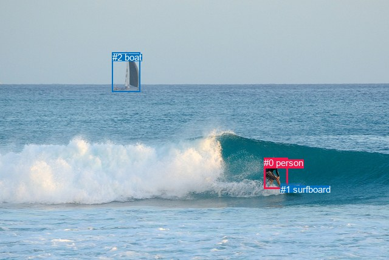
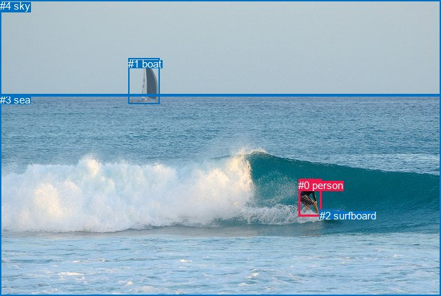

# 图片 1031：2362238.jpg

随机样本序号：492。图片 SHA256：`38980dbaeaf8b255b1d771ed80d66cc3ce0ad6540a10139000c791bd790f3862`。

红色框表示人，蓝色框表示其他物体。两个模式分别保留自身框编号，可依据位置比较对应对象。

## 自动检测框与输出

人的框编号：`[0]`。状态：`ok`。

### 自动检测全部物体框

| 编号 | 类别 | 是否为人 | 检测分数 | 像素坐标 xyxy |
|---|---|---|---|---|
| 0 | person | True | 0.9990 | 434.4, 260.3, 473.2, 311.8 |
| 1 | surfboard | False | 0.9941 | 461.7, 303.8, 496.9, 316.0 |
| 2 | boat | False | 0.9874 | 184.8, 86.5, 230.7, 151.3 |

### 自动检测 Top50 人相关候选

评分物体对：6；人相关物体对：4；输出关系：8。

| 排名 | 主语编号与类别 | 关系 | 宾语编号与类别 | 类型 | 人与人 | 排序分数 | 原始融合 logit |
|---|---|---|---|---|---|---|---|
| 1 | #0 person | riding | #1 surfboard | semantic | False | 0.98009 | 3.8965 |
| 2 | #0 person | on | #1 surfboard | spatial | False | 0.92739 | 2.5473 |
| 3 | #0 person | in front of | #2 boat | spatial | False | 0.58406 | 0.3394 |
| 4 | #2 boat | in | #0 person | spatial | False | 0.40706 | -0.3761 |
| 5 | #0 person | riding | #2 boat | semantic | False | 0.36393 | -0.5584 |
| 6 | #1 surfboard | in | #0 person | spatial | False | 0.34003 | -0.6632 |
| 7 | #1 surfboard | holding | #0 person | semantic | False | 0.21896 | -1.2718 |
| 8 | #2 boat | playing | #0 person | semantic | False | 0.18243 | -1.5000 |

### 自动检测逐条人相关 GT 核验

R@50：33.33%；命中 1/3。

| GT 主语编号 | GT 关系 | GT 宾语编号 | 结果阶段 | 匹配预测主语编号 | 匹配预测宾语编号 |
|---|---|---|---|---|---|
| 0 | playing | 2 | wrong_predicate | [0] | [1] |
| 0 | riding | 2 | hit50 | [0] | [1] |
| 0 | on | 3 | endpoint_missing_or_wrong_class | [0] | [] |

## 真实框与输出

人的框编号：`[0]`。

### 真实框全部物体框

| 编号 | 类别 | 是否为人 | 检测分数 | 像素坐标 xyxy |
|---|---|---|---|---|
| 0 | person | True | GT | 433.0, 260.0, 466.0, 314.0 |
| 1 | boat | False | GT | 186.0, 84.0, 231.0, 150.0 |
| 2 | surfboard | False | GT | 464.0, 304.0, 496.0, 316.0 |
| 3 | sea | False | GT | 0.0, 136.0, 640.0, 429.0 |
| 4 | sky | False | GT | 0.0, 0.0, 640.0, 140.0 |

### 真实框 Top50 人相关候选

评分物体对：20；人相关物体对：8；输出关系：16。

| 排名 | 主语编号与类别 | 关系 | 宾语编号与类别 | 类型 | 人与人 | 排序分数 | 原始融合 logit |
|---|---|---|---|---|---|---|---|
| 1 | #0 person | in | #3 sea | spatial | False | 0.97397 | 3.6222 |
| 2 | #0 person | riding | #2 surfboard | semantic | False | 0.96824 | 3.4174 |
| 3 | #0 person | on | #2 surfboard | spatial | False | 0.96347 | 3.2725 |
| 4 | #0 person | riding | #3 sea | semantic | False | 0.74215 | 1.0572 |
| 5 | #2 surfboard | beside | #0 person | spatial | False | 0.42419 | -0.3056 |
| 6 | #2 surfboard | holding | #0 person | semantic | False | 0.36426 | -0.5569 |
| 7 | #3 sea | beside | #0 person | spatial | False | 0.32159 | -0.7465 |
| 8 | #0 person | riding | #1 boat | semantic | False | 0.14721 | -1.7567 |
| 9 | #0 person | on | #1 boat | spatial | False | 0.14173 | -1.8010 |
| 10 | #4 sky | over | #0 person | spatial | False | 0.13572 | -1.8513 |
| 11 | #3 sea | playing | #0 person | semantic | False | 0.10017 | -2.1954 |
| 12 | #0 person | in | #4 sky | spatial | False | 0.08032 | -2.4380 |
| 13 | #1 boat | beside | #0 person | spatial | False | 0.07817 | -2.4675 |
| 14 | #1 boat | playing | #0 person | semantic | False | 0.03175 | -3.4176 |
| 15 | #4 sky | flying over | #0 person | semantic | False | 0.01788 | -4.0062 |
| 16 | #0 person | playing | #4 sky | semantic | False | 0.01677 | -4.0710 |

### 真实框逐条人相关 GT 核验

R@50：33.33%；命中 1/3。

| GT 主语编号 | GT 关系 | GT 宾语编号 | 结果阶段 | 匹配预测主语编号 | 匹配预测宾语编号 |
|---|---|---|---|---|---|
| 0 | playing | 2 | wrong_predicate | [0] | [2] |
| 0 | riding | 2 | hit50 | [0] | [2] |
| 0 | on | 3 | wrong_predicate | [0] | [3] |

## 全部人相关 GT

| 主语编号与类别 | 关系 | 宾语编号与类别 |
|---|---|---|
| #0 person | playing | #2 surfboard |
| #0 person | riding | #2 surfboard |
| #0 person | on | #3 sea |

原始记录、全部人相关物体对的两项预测与分项分数见 [逐图证据 JSON](../evidence/cases/1031.json)。全部56类 logits 保留于本机 HOR/output/random500/logits/。

<!-- HOR_COMPLETE_RESULTS -->

## 六组条件的完整输出对照

以下保留同一图片三种框与候选模式、两种谓词输出规则的全部 Top50。框编号各自在所属模式内解释。

### 自动检测框完整枚举：空间与语义各保留一个谓词

| 排名 | 主语编号与类别 | 谓词 | 宾语编号与类别 | 分组 | 排序分数 | predicate logit | pair logit |
|---|---|---|---|---|---|---|---|
| 1 | #0 person | riding | #1 surfboard | semantic | 0.9800915 | 4.5390048 | -0.6425078 |
| 2 | #0 person | on | #1 surfboard | spatial | 0.9273894 | 3.1897697 | -0.6425078 |
| 3 | #0 person | in front of | #2 boat | spatial | 0.5840569 | 2.2627883 | -1.9233384 |
| 4 | #2 boat | in | #0 person | spatial | 0.4070624 | 1.6464367 | -2.0225594 |
| 5 | #0 person | riding | #2 boat | semantic | 0.3639252 | 1.3649707 | -1.9233384 |
| 6 | #1 surfboard | in | #0 person | spatial | 0.3400269 | 0.1350145 | -0.7981892 |
| 7 | #1 surfboard | holding | #0 person | semantic | 0.2189571 | -0.4735651 | -0.7981892 |
| 8 | #2 boat | playing | #0 person | semantic | 0.1824311 | 0.5225968 | -2.0225594 |

GT 命中：1/3，R@50=33.33%。

| GT主语 | GT谓词 | GT宾语 | 结果阶段 | 匹配主语框 | 匹配宾语框 |
|---|---|---|---|---|---|
| 0 | playing | 2 | wrong_predicate | [0] | [1] |
| 0 | riding | 2 | hit50 | [0] | [1] |
| 0 | on | 3 | endpoint_missing_or_wrong_class | [0] | [] |

### 自动检测框完整枚举：每对只保留一个谓词

| 排名 | 主语编号与类别 | 谓词 | 宾语编号与类别 | 分组 | 排序分数 | predicate logit | pair logit |
|---|---|---|---|---|---|---|---|
| 1 | #0 person | riding | #1 surfboard | single | 0.9800915 | 4.5390048 | -0.6425078 |
| 2 | #0 person | in front of | #2 boat | single | 0.5840569 | 2.2627883 | -1.9233384 |
| 3 | #2 boat | in | #0 person | single | 0.4070624 | 1.6464367 | -2.0225594 |
| 4 | #1 surfboard | in | #0 person | single | 0.3400269 | 0.1350145 | -0.7981892 |

GT 命中：1/3，R@50=33.33%。

| GT主语 | GT谓词 | GT宾语 | 结果阶段 | 匹配主语框 | 匹配宾语框 |
|---|---|---|---|---|---|
| 0 | playing | 2 | wrong_predicate | [0] | [1] |
| 0 | riding | 2 | hit50 | [0] | [1] |
| 0 | on | 3 | endpoint_missing_or_wrong_class | [0] | [] |

### 真实框完整枚举：空间与语义各保留一个谓词

| 排名 | 主语编号与类别 | 谓词 | 宾语编号与类别 | 分组 | 排序分数 | predicate logit | pair logit |
|---|---|---|---|---|---|---|---|
| 1 | #0 person | in | #3 sea | spatial | 0.9739721 | 4.1714711 | -0.5492603 |
| 2 | #0 person | riding | #2 surfboard | semantic | 0.9682428 | 3.8860383 | -0.4686735 |
| 3 | #0 person | on | #2 surfboard | spatial | 0.9634722 | 3.7411437 | -0.4686735 |
| 4 | #0 person | riding | #3 sea | semantic | 0.7421502 | 1.6064343 | -0.5492603 |
| 5 | #2 surfboard | beside | #0 person | spatial | 0.4241878 | 0.4663463 | -0.7719514 |
| 6 | #2 surfboard | holding | #0 person | semantic | 0.3642648 | 0.2150502 | -0.7719514 |
| 7 | #3 sea | beside | #0 person | spatial | 0.3215854 | 0.6202140 | -1.3667092 |
| 8 | #0 person | riding | #1 boat | semantic | 0.1472099 | 0.0386343 | -1.7952881 |
| 9 | #0 person | on | #1 boat | spatial | 0.1417316 | -0.0056934 | -1.7952881 |
| 10 | #4 sky | over | #0 person | spatial | 0.1357172 | -0.0430279 | -1.8082989 |
| 11 | #3 sea | playing | #0 person | semantic | 0.1001659 | -0.8286736 | -1.3667092 |
| 12 | #0 person | in | #4 sky | spatial | 0.0803192 | -0.0729737 | -2.3650446 |
| 13 | #1 boat | beside | #0 person | spatial | 0.0781669 | -0.5245833 | -1.9429350 |
| 14 | #1 boat | playing | #0 person | semantic | 0.0317510 | -1.4746299 | -1.9429350 |
| 15 | #4 sky | flying over | #0 person | semantic | 0.0178772 | -2.1978884 | -1.8082989 |
| 16 | #0 person | playing | #4 sky | semantic | 0.0167744 | -1.7059371 | -2.3650446 |

GT 命中：1/3，R@50=33.33%。

| GT主语 | GT谓词 | GT宾语 | 结果阶段 | 匹配主语框 | 匹配宾语框 |
|---|---|---|---|---|---|
| 0 | playing | 2 | wrong_predicate | [0] | [2] |
| 0 | riding | 2 | hit50 | [0] | [2] |
| 0 | on | 3 | wrong_predicate | [0] | [3] |

### 真实框完整枚举：每对只保留一个谓词

| 排名 | 主语编号与类别 | 谓词 | 宾语编号与类别 | 分组 | 排序分数 | predicate logit | pair logit |
|---|---|---|---|---|---|---|---|
| 1 | #0 person | in | #3 sea | single | 0.9739721 | 4.1714711 | -0.5492603 |
| 2 | #0 person | riding | #2 surfboard | single | 0.9682428 | 3.8860383 | -0.4686735 |
| 3 | #2 surfboard | beside | #0 person | single | 0.4241878 | 0.4663463 | -0.7719514 |
| 4 | #3 sea | beside | #0 person | single | 0.3215854 | 0.6202140 | -1.3667092 |
| 5 | #0 person | riding | #1 boat | single | 0.1472099 | 0.0386343 | -1.7952881 |
| 6 | #4 sky | over | #0 person | single | 0.1357172 | -0.0430279 | -1.8082989 |
| 7 | #0 person | in | #4 sky | single | 0.0803192 | -0.0729737 | -2.3650446 |
| 8 | #1 boat | beside | #0 person | single | 0.0781669 | -0.5245833 | -1.9429350 |

GT 命中：1/3，R@50=33.33%。

| GT主语 | GT谓词 | GT宾语 | 结果阶段 | 匹配主语框 | 匹配宾语框 |
|---|---|---|---|---|---|
| 0 | playing | 2 | wrong_predicate | [0] | [2] |
| 0 | riding | 2 | hit50 | [0] | [2] |
| 0 | on | 3 | wrong_predicate | [0] | [3] |

### 真实框400候选：空间与语义各保留一个谓词

| 排名 | 主语编号与类别 | 谓词 | 宾语编号与类别 | 分组 | 排序分数 | predicate logit | pair logit |
|---|---|---|---|---|---|---|---|
| 1 | #0 person | in | #3 sea | spatial | 0.9739721 | 4.1714711 | -0.5492603 |
| 2 | #0 person | riding | #2 surfboard | semantic | 0.9682428 | 3.8860383 | -0.4686735 |
| 3 | #0 person | on | #2 surfboard | spatial | 0.9634722 | 3.7411437 | -0.4686735 |
| 4 | #0 person | riding | #3 sea | semantic | 0.7421502 | 1.6064343 | -0.5492603 |
| 5 | #2 surfboard | beside | #0 person | spatial | 0.4242019 | 0.4664040 | -0.7719514 |
| 6 | #2 surfboard | holding | #0 person | semantic | 0.3649493 | 0.2180047 | -0.7719514 |
| 7 | #3 sea | beside | #0 person | spatial | 0.3281599 | 0.6501899 | -1.3667092 |
| 8 | #0 person | riding | #1 boat | semantic | 0.1398581 | -0.0211811 | -1.7952881 |
| 9 | #0 person | on | #1 boat | spatial | 0.1394119 | -0.0248952 | -1.7952881 |
| 10 | #4 sky | over | #0 person | spatial | 0.1319230 | -0.0757627 | -1.8082989 |
| 11 | #3 sea | playing | #0 person | semantic | 0.0981277 | -0.8514936 | -1.3667092 |
| 12 | #1 boat | beside | #0 person | spatial | 0.0781710 | -0.5245256 | -1.9429350 |
| 13 | #0 person | in | #4 sky | spatial | 0.0781243 | -0.1030650 | -2.3650446 |
| 14 | #1 boat | playing | #0 person | semantic | 0.0330133 | -1.4343405 | -1.9429350 |
| 15 | #4 sky | flying over | #0 person | semantic | 0.0171028 | -2.2429638 | -1.8082989 |
| 16 | #0 person | playing | #4 sky | semantic | 0.0161612 | -1.7438028 | -2.3650446 |

GT 命中：1/3，R@50=33.33%。

| GT主语 | GT谓词 | GT宾语 | 结果阶段 | 匹配主语框 | 匹配宾语框 |
|---|---|---|---|---|---|
| 0 | playing | 2 | wrong_predicate | [0] | [2] |
| 0 | riding | 2 | hit50 | [0] | [2] |
| 0 | on | 3 | wrong_predicate | [0] | [3] |

### 真实框400候选：每对只保留一个谓词

| 排名 | 主语编号与类别 | 谓词 | 宾语编号与类别 | 分组 | 排序分数 | predicate logit | pair logit |
|---|---|---|---|---|---|---|---|
| 1 | #0 person | in | #3 sea | single | 0.9739721 | 4.1714711 | -0.5492603 |
| 2 | #0 person | riding | #2 surfboard | single | 0.9682428 | 3.8860383 | -0.4686735 |
| 3 | #2 surfboard | beside | #0 person | single | 0.4242019 | 0.4664040 | -0.7719514 |
| 4 | #3 sea | beside | #0 person | single | 0.3281599 | 0.6501899 | -1.3667092 |
| 5 | #0 person | riding | #1 boat | single | 0.1398581 | -0.0211811 | -1.7952881 |
| 6 | #4 sky | over | #0 person | single | 0.1319230 | -0.0757627 | -1.8082989 |
| 7 | #1 boat | beside | #0 person | single | 0.0781710 | -0.5245256 | -1.9429350 |
| 8 | #0 person | in | #4 sky | single | 0.0781243 | -0.1030650 | -2.3650446 |

GT 命中：1/3，R@50=33.33%。

| GT主语 | GT谓词 | GT宾语 | 结果阶段 | 匹配主语框 | 匹配宾语框 |
|---|---|---|---|---|---|
| 0 | playing | 2 | wrong_predicate | [0] | [2] |
| 0 | riding | 2 | hit50 | [0] | [2] |
| 0 | on | 3 | wrong_predicate | [0] | [3] |
