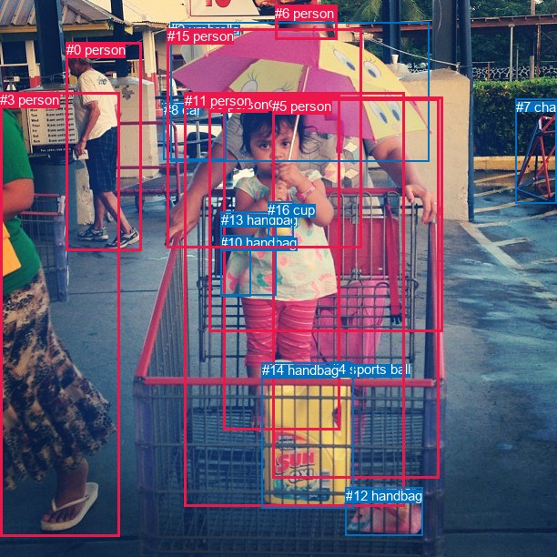
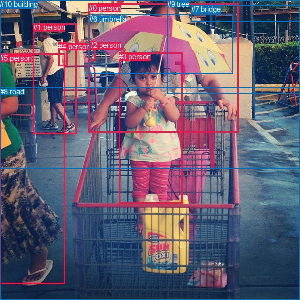

# 图片 1052：2362836.jpg

随机样本序号：486。图片 SHA256：`4d406247b349070eb79a47c16d299fc6285188c81241097169bb797cf921be2c`。

红色框表示人，蓝色框表示其他物体。两个模式分别保留自身框编号，可依据位置比较对应对象。

## 自动检测框与输出

人的框编号：`[0, 1, 3, 5, 6, 9, 11, 15]`。状态：`ok`。

### 自动检测全部物体框

| 编号 | 类别 | 是否为人 | 检测分数 | 像素坐标 xyxy |
|---|---|---|---|---|
| 0 | person | True | 0.9987 | 72.7, 46.4, 155.6, 275.2 |
| 1 | person | True | 0.9966 | 245.7, 104.2, 374.0, 472.4 |
| 2 | umbrella | False | 0.9847 | 187.2, 24.4, 471.6, 177.1 |
| 3 | person | True | 0.9779 | 0.0, 101.2, 131.8, 589.3 |
| 4 | sports ball | False | 0.8573 | 363.7, 397.3, 384.3, 411.4 |
| 5 | person | True | 0.7607 | 299.1, 108.2, 482.2, 525.5 |
| 6 | person | True | 0.7591 | 302.4, 5.6, 370.2, 43.5 |
| 7 | chair | False | 0.7108 | 566.6, 108.7, 611.7, 223.0 |
| 8 | car | False | 0.7090 | 179.9, 111.9, 248.3, 175.2 |
| 9 | person | True | 0.5198 | 229.5, 106.2, 486.9, 364.0 |
| 10 | handbag | False | 0.5007 | 242.1, 258.5, 275.6, 325.6 |
| 11 | person | True | 0.4280 | 202.9, 101.6, 444.4, 556.4 |
| 12 | handbag | False | 0.4181 | 380.0, 535.8, 464.0, 588.3 |
| 13 | handbag | False | 0.4167 | 242.7, 232.9, 303.2, 324.2 |
| 14 | handbag | False | 0.3961 | 287.7, 398.2, 388.2, 558.6 |
| 15 | person | True | 0.3890 | 183.6, 31.0, 397.5, 272.9 |
| 16 | cup | False | 0.3747 | 294.3, 221.7, 322.5, 260.8 |

### 自动检测 Top50 人相关候选

评分物体对：272；人相关物体对：200；输出关系：50。

| 排名 | 主语编号与类别 | 关系 | 宾语编号与类别 | 类型 | 人与人 | 排序分数 | 原始融合 logit |
|---|---|---|---|---|---|---|---|
| 1 | #1 person | eating | #16 cup | semantic | False | 0.99366 | 5.0545 |
| 2 | #11 person | eating | #16 cup | semantic | False | 0.99083 | 4.6824 |
| 3 | #1 person | holding | #2 umbrella | semantic | False | 0.98729 | 4.3530 |
| 4 | #11 person | holding | #2 umbrella | semantic | False | 0.98388 | 4.1111 |
| 5 | #5 person | holding | #2 umbrella | semantic | False | 0.98130 | 3.9606 |
| 6 | #1 person | wearing | #13 handbag | semantic | False | 0.97138 | 3.5244 |
| 7 | #11 person | holding | #14 handbag | semantic | False | 0.96999 | 3.4759 |
| 8 | #6 person | holding | #2 umbrella | semantic | False | 0.96794 | 3.4074 |
| 9 | #9 person | holding | #2 umbrella | semantic | False | 0.96674 | 3.3695 |
| 10 | #0 person | pushing | #7 chair | semantic | False | 0.96452 | 3.3027 |
| 11 | #9 person | holding | #16 cup | semantic | False | 0.95625 | 3.0845 |
| 12 | #1 person | holding | #14 handbag | semantic | False | 0.95487 | 3.0520 |
| 13 | #1 person | wearing | #10 handbag | semantic | False | 0.94344 | 2.8143 |
| 14 | #3 person | pushing | #7 chair | semantic | False | 0.93942 | 2.7413 |
| 15 | #5 person | holding | #16 cup | semantic | False | 0.93492 | 2.6648 |
| 16 | #11 person | wearing | #13 handbag | semantic | False | 0.93275 | 2.6296 |
| 17 | #15 person | holding | #2 umbrella | semantic | False | 0.93051 | 2.5946 |
| 18 | #1 person | holding | #15 person | semantic | True | 0.92041 | 2.4480 |
| 19 | #0 person | walking on | #3 person | semantic | True | 0.91925 | 2.4323 |
| 20 | #0 person | walking on | #8 car | semantic | False | 0.91908 | 2.4300 |
| 21 | #11 person | holding | #15 person | semantic | True | 0.89120 | 2.1031 |
| 22 | #5 person | holding | #14 handbag | semantic | False | 0.89024 | 2.0932 |
| 23 | #11 person | wearing | #10 handbag | semantic | False | 0.88848 | 2.0753 |
| 24 | #6 person | pushing | #7 chair | semantic | False | 0.87805 | 1.9741 |
| 25 | #1 person | in | #13 handbag | spatial | False | 0.83101 | 1.5928 |
| 26 | #1 person | on | #14 handbag | spatial | False | 0.82967 | 1.5833 |
| 27 | #11 person | holding | #9 person | semantic | True | 0.82106 | 1.5235 |
| 28 | #11 person | on | #14 handbag | spatial | False | 0.81523 | 1.4843 |
| 29 | #5 person | holding | #9 person | semantic | True | 0.81180 | 1.4618 |
| 30 | #1 person | eating | #4 sports ball | semantic | False | 0.80777 | 1.4356 |
| 31 | #11 person | eating | #4 sports ball | semantic | False | 0.80518 | 1.4190 |
| 32 | #1 person | on | #16 cup | spatial | False | 0.78824 | 1.3144 |
| 33 | #9 person | holding | #15 person | semantic | True | 0.78639 | 1.3033 |
| 34 | #9 person | wearing | #13 handbag | semantic | False | 0.77548 | 1.2395 |
| 35 | #11 person | holding | #1 person | semantic | True | 0.76323 | 1.1705 |
| 36 | #1 person | in | #10 handbag | spatial | False | 0.75545 | 1.1279 |
| 37 | #6 person | holding | #16 cup | semantic | False | 0.75077 | 1.1027 |
| 38 | #3 person | walking on | #8 car | semantic | False | 0.73986 | 1.0452 |
| 39 | #11 person | wearing | #12 handbag | semantic | False | 0.73583 | 1.0244 |
| 40 | #6 person | holding | #13 handbag | semantic | False | 0.72811 | 0.9850 |
| 41 | #1 person | wearing | #8 car | semantic | False | 0.72424 | 0.9656 |
| 42 | #15 person | holding | #16 cup | semantic | False | 0.72298 | 0.9593 |
| 43 | #6 person | holding | #15 person | semantic | True | 0.71791 | 0.9341 |
| 44 | #5 person | holding | #15 person | semantic | True | 0.71650 | 0.9272 |
| 45 | #5 person | pushing | #7 chair | semantic | False | 0.71628 | 0.9261 |
| 46 | #11 person | pushing | #7 chair | semantic | False | 0.71553 | 0.9224 |
| 47 | #11 person | in | #13 handbag | spatial | False | 0.71469 | 0.9183 |
| 48 | #9 person | pushing | #7 chair | semantic | False | 0.70917 | 0.8914 |
| 49 | #1 person | in | #2 umbrella | spatial | False | 0.69437 | 0.8206 |
| 50 | #1 person | holding | #9 person | semantic | True | 0.69162 | 0.8077 |

### 自动检测逐条人相关 GT 核验

R@50：20.00%；命中 1/5。

| GT 主语编号 | GT 关系 | GT 宾语编号 | 结果阶段 | 匹配预测主语编号 | 匹配预测宾语编号 |
|---|---|---|---|---|---|
| 0 | guiding | 3 | wrong_predicate | [15] | [1] |
| 3 | in front of | 0 | wrong_predicate | [1] | [15] |
| 3 | holding | 6 | hit50 | [1] | [2] |
| 4 | on | 1 | endpoint_missing_or_wrong_class | [] | [0] |
| 5 | walking on | 8 | endpoint_missing_or_wrong_class | [3] | [] |

## 真实框与输出

人的框编号：`[0, 1, 2, 3, 4, 5]`。

### 真实框全部物体框

| 编号 | 类别 | 是否为人 | 检测分数 | 像素坐标 xyxy |
|---|---|---|---|---|
| 0 | person | True | GT | 181.0, 8.0, 487.0, 270.0 |
| 1 | person | True | GT | 68.0, 47.0, 157.0, 273.0 |
| 2 | person | True | GT | 182.0, 83.0, 195.0, 123.0 |
| 3 | person | True | GT | 242.0, 107.0, 372.0, 416.0 |
| 4 | person | True | GT | 119.0, 86.0, 137.0, 135.0 |
| 5 | person | True | GT | 0.0, 110.0, 132.0, 580.0 |
| 6 | umbrella | False | GT | 182.0, 30.0, 476.0, 149.0 |
| 7 | bridge | False | GT | 390.0, 10.0, 612.0, 43.0 |
| 8 | road | False | GT | 0.0, 178.0, 612.0, 612.0 |
| 9 | tree | False | GT | 341.0, 0.0, 612.0, 191.0 |
| 10 | building | False | GT | 0.0, 0.0, 612.0, 343.0 |

### 真实框 Top50 人相关候选

评分物体对：110；人相关物体对：90；输出关系：50。

| 排名 | 主语编号与类别 | 关系 | 宾语编号与类别 | 类型 | 人与人 | 排序分数 | 原始融合 logit |
|---|---|---|---|---|---|---|---|
| 1 | #3 person | holding | #6 umbrella | semantic | False | 0.99164 | 4.7754 |
| 2 | #1 person | walking on | #8 road | semantic | False | 0.99046 | 4.6429 |
| 3 | #5 person | walking on | #8 road | semantic | False | 0.99042 | 4.6380 |
| 4 | #3 person | holding | #0 person | semantic | True | 0.98511 | 4.1921 |
| 5 | #1 person | walking on | #10 building | semantic | False | 0.97641 | 3.7230 |
| 6 | #1 person | wearing | #4 person | semantic | True | 0.96285 | 3.2549 |
| 7 | #0 person | holding | #6 umbrella | semantic | False | 0.95700 | 3.1026 |
| 8 | #1 person | in | #10 building | spatial | False | 0.94105 | 2.7703 |
| 9 | #5 person | on | #8 road | spatial | False | 0.93362 | 2.6438 |
| 10 | #3 person | sitting on | #8 road | semantic | False | 0.93010 | 2.5882 |
| 11 | #1 person | on | #8 road | spatial | False | 0.92728 | 2.5456 |
| 12 | #3 person | on | #8 road | spatial | False | 0.92261 | 2.4784 |
| 13 | #2 person | walking on | #10 building | semantic | False | 0.91418 | 2.3658 |
| 14 | #2 person | in | #10 building | spatial | False | 0.91339 | 2.3557 |
| 15 | #2 person | walking on | #8 road | semantic | False | 0.89692 | 2.1635 |
| 16 | #5 person | walking on | #10 building | semantic | False | 0.85924 | 1.8090 |
| 17 | #3 person | in | #10 building | spatial | False | 0.84935 | 1.7295 |
| 18 | #4 person | on | #1 person | spatial | True | 0.84886 | 1.7257 |
| 19 | #2 person | on | #8 road | spatial | False | 0.79793 | 1.3734 |
| 20 | #3 person | in | #6 umbrella | spatial | False | 0.79721 | 1.3689 |
| 21 | #1 person | in | #4 person | spatial | True | 0.77355 | 1.2284 |
| 22 | #0 person | in | #6 umbrella | spatial | False | 0.75646 | 1.1334 |
| 23 | #0 person | in | #10 building | spatial | False | 0.75559 | 1.1287 |
| 24 | #0 person | on | #8 road | spatial | False | 0.73299 | 1.0098 |
| 25 | #3 person | in | #0 person | spatial | True | 0.73284 | 1.0091 |
| 26 | #5 person | wearing | #4 person | semantic | True | 0.69169 | 0.8080 |
| 27 | #5 person | in | #10 building | spatial | False | 0.67128 | 0.7140 |
| 28 | #0 person | holding | #3 person | semantic | True | 0.64710 | 0.6063 |
| 29 | #5 person | beside | #3 person | spatial | True | 0.64498 | 0.5970 |
| 30 | #6 umbrella | on | #0 person | spatial | False | 0.62242 | 0.4998 |
| 31 | #2 person | holding | #6 umbrella | semantic | False | 0.59799 | 0.3971 |
| 32 | #0 person | over | #3 person | spatial | True | 0.57433 | 0.2995 |
| 33 | #6 umbrella | over | #3 person | spatial | False | 0.56523 | 0.2624 |
| 34 | #5 person | looking at | #3 person | semantic | True | 0.52861 | 0.1146 |
| 35 | #3 person | sitting on | #10 building | semantic | False | 0.52763 | 0.1106 |
| 36 | #2 person | looking at | #3 person | semantic | True | 0.49689 | -0.0124 |
| 37 | #1 person | looking at | #3 person | semantic | True | 0.47447 | -0.1022 |
| 38 | #0 person | pushing | #8 road | semantic | False | 0.39586 | -0.4228 |
| 39 | #1 person | beside | #3 person | spatial | True | 0.39121 | -0.4422 |
| 40 | #10 building | holding | #0 person | semantic | False | 0.36845 | -0.5389 |
| 41 | #1 person | walking on | #5 person | semantic | True | 0.32983 | -0.7090 |
| 42 | #2 person | wearing | #4 person | semantic | True | 0.29934 | -0.8504 |
| 43 | #2 person | looking at | #0 person | semantic | True | 0.28855 | -0.9024 |
| 44 | #1 person | walking on | #0 person | semantic | True | 0.27806 | -0.9541 |
| 45 | #4 person | carrying | #1 person | semantic | True | 0.27277 | -0.9806 |
| 46 | #10 building | holding | #3 person | semantic | False | 0.23561 | -1.1769 |
| 47 | #5 person | in | #4 person | spatial | True | 0.23073 | -1.2042 |
| 48 | #5 person | holding | #6 umbrella | semantic | False | 0.23047 | -1.2057 |
| 49 | #2 person | looking at | #1 person | semantic | True | 0.22494 | -1.2371 |
| 50 | #1 person | walking on | #9 tree | semantic | False | 0.21308 | -1.3064 |

### 真实框逐条人相关 GT 核验

R@50：60.00%；命中 3/5。

| GT 主语编号 | GT 关系 | GT 宾语编号 | 结果阶段 | 匹配预测主语编号 | 匹配预测宾语编号 |
|---|---|---|---|---|---|
| 0 | guiding | 3 | wrong_predicate | [0] | [3] |
| 3 | in front of | 0 | wrong_predicate | [3] | [0] |
| 3 | holding | 6 | hit50 | [3] | [6] |
| 4 | on | 1 | hit50 | [4] | [1] |
| 5 | walking on | 8 | hit50 | [5] | [8] |

## 全部人相关 GT

| 主语编号与类别 | 关系 | 宾语编号与类别 |
|---|---|---|
| #0 person | guiding | #3 person |
| #3 person | in front of | #0 person |
| #3 person | holding | #6 umbrella |
| #4 person | on | #1 person |
| #5 person | walking on | #8 road |

原始记录、全部人相关物体对的两项预测与分项分数见 [逐图证据 JSON](../evidence/cases/1052.json)。全部56类 logits 保留于本机 HOR/output/random500/logits/。

<!-- HOR_COMPLETE_RESULTS -->

## 六组条件的完整输出对照

以下保留同一图片三种框与候选模式、两种谓词输出规则的全部 Top50。框编号各自在所属模式内解释。

### 自动检测框完整枚举：空间与语义各保留一个谓词

| 排名 | 主语编号与类别 | 谓词 | 宾语编号与类别 | 分组 | 排序分数 | predicate logit | pair logit |
|---|---|---|---|---|---|---|---|
| 1 | #1 person | eating | #16 cup | semantic | 0.9936602 | 4.3145175 | 0.7400193 |
| 2 | #11 person | eating | #16 cup | semantic | 0.9908283 | 4.1339688 | 0.5484496 |
| 3 | #1 person | holding | #2 umbrella | semantic | 0.9872950 | 3.4960942 | 0.8568797 |
| 4 | #11 person | holding | #2 umbrella | semantic | 0.9838753 | 3.3897414 | 0.7214005 |
| 5 | #5 person | holding | #2 umbrella | semantic | 0.9813036 | 3.3956494 | 0.5649017 |
| 6 | #1 person | wearing | #13 handbag | semantic | 0.9713755 | 3.3384633 | 0.1859834 |
| 7 | #11 person | holding | #14 handbag | semantic | 0.9699931 | 3.2746062 | 0.2012560 |
| 8 | #6 person | holding | #2 umbrella | semantic | 0.9679359 | 3.5702901 | -0.1628587 |
| 9 | #9 person | holding | #2 umbrella | semantic | 0.9667381 | 2.7997336 | 0.5697814 |
| 10 | #0 person | pushing | #7 chair | semantic | 0.9645202 | 3.7866035 | -0.4839342 |
| 11 | #9 person | holding | #16 cup | semantic | 0.9562481 | 2.4703770 | 0.6141058 |
| 12 | #1 person | holding | #14 handbag | semantic | 0.9548677 | 2.8156824 | 0.2362903 |
| 13 | #1 person | wearing | #10 handbag | semantic | 0.9434416 | 2.8055491 | 0.0087109 |
| 14 | #3 person | pushing | #7 chair | semantic | 0.9394183 | 3.3051543 | -0.5638872 |
| 15 | #5 person | holding | #16 cup | semantic | 0.9349169 | 2.2979336 | 0.3668590 |
| 16 | #11 person | wearing | #13 handbag | semantic | 0.9327452 | 2.6969199 | -0.0672762 |
| 17 | #15 person | holding | #2 umbrella | semantic | 0.9305125 | 2.3736458 | 0.2209415 |
| 18 | #1 person | holding | #15 person | semantic | 0.9204139 | 2.6605458 | -0.2125626 |
| 19 | #0 person | walking on | #3 person | semantic | 0.9192538 | 2.9790359 | -0.5467844 |
| 20 | #0 person | walking on | #8 car | semantic | 0.9190840 | 2.9249020 | -0.4949363 |
| 21 | #11 person | holding | #15 person | semantic | 0.8912017 | 2.3577766 | -0.2547016 |
| 22 | #5 person | holding | #14 handbag | semantic | 0.8902440 | 2.1752429 | -0.0820071 |
| 23 | #11 person | wearing | #10 handbag | semantic | 0.8884797 | 2.3042307 | -0.2289253 |
| 24 | #6 person | pushing | #7 chair | semantic | 0.8780501 | 3.1853371 | -1.2112439 |
| 25 | #1 person | in | #13 handbag | spatial | 0.8310102 | 1.4068203 | 0.1859834 |
| 26 | #1 person | on | #14 handbag | spatial | 0.8296690 | 1.3469930 | 0.2362903 |
| 27 | #11 person | holding | #9 person | semantic | 0.8210592 | 2.1204205 | -0.5968806 |
| 28 | #11 person | on | #14 handbag | spatial | 0.8152258 | 1.2830749 | 0.2012560 |
| 29 | #5 person | holding | #9 person | semantic | 0.8118047 | 1.9031143 | -0.4413351 |
| 30 | #1 person | eating | #4 sports ball | semantic | 0.8077730 | 1.8722973 | -0.4366930 |
| 31 | #11 person | eating | #4 sports ball | semantic | 0.8051800 | 1.9305487 | -0.5115585 |
| 32 | #1 person | on | #16 cup | spatial | 0.7882437 | 0.5743518 | 0.7400193 |
| 33 | #9 person | holding | #15 person | semantic | 0.7863882 | 1.6675344 | -0.3642443 |
| 34 | #9 person | wearing | #13 handbag | semantic | 0.7754801 | 1.1600113 | 0.0795067 |
| 35 | #11 person | holding | #1 person | semantic | 0.7632347 | 1.9232450 | -0.7527487 |
| 36 | #1 person | in | #10 handbag | spatial | 0.7554498 | 1.1191821 | 0.0087109 |
| 37 | #6 person | holding | #16 cup | semantic | 0.7507663 | 1.8596892 | -0.7569860 |
| 38 | #3 person | walking on | #8 car | semantic | 0.7398574 | 1.9018273 | -0.8565998 |
| 39 | #11 person | wearing | #12 handbag | semantic | 0.7358305 | 1.3015928 | -0.2771841 |
| 40 | #6 person | holding | #13 handbag | semantic | 0.7281073 | 2.1161585 | -1.1311175 |
| 41 | #1 person | wearing | #8 car | semantic | 0.7242414 | 1.2362943 | -0.2706954 |
| 42 | #15 person | holding | #16 cup | semantic | 0.7229763 | 0.7896991 | 0.1695743 |
| 43 | #6 person | holding | #15 person | semantic | 0.7179065 | 1.5667510 | -0.6326500 |
| 44 | #5 person | holding | #15 person | semantic | 0.7165001 | 1.3618112 | -0.4346443 |
| 45 | #5 person | pushing | #7 chair | semantic | 0.7162756 | 1.8311148 | -0.9050532 |
| 46 | #11 person | pushing | #7 chair | semantic | 0.7155306 | 1.8613281 | -0.9389291 |
| 47 | #11 person | in | #13 handbag | spatial | 0.7146887 | 0.9855423 | -0.0672762 |
| 48 | #9 person | pushing | #7 chair | semantic | 0.7091724 | 1.9815359 | -1.0901675 |
| 49 | #1 person | in | #2 umbrella | spatial | 0.6943712 | -0.0362444 | 0.8568797 |
| 50 | #1 person | holding | #9 person | semantic | 0.6916189 | 1.4637718 | -0.6560731 |

GT 命中：1/5，R@50=20.00%。

| GT主语 | GT谓词 | GT宾语 | 结果阶段 | 匹配主语框 | 匹配宾语框 |
|---|---|---|---|---|---|
| 0 | guiding | 3 | wrong_predicate | [15] | [1] |
| 3 | in front of | 0 | wrong_predicate | [1] | [15] |
| 3 | holding | 6 | hit50 | [1] | [2] |
| 4 | on | 1 | endpoint_missing_or_wrong_class | [] | [0] |
| 5 | walking on | 8 | endpoint_missing_or_wrong_class | [3] | [] |

### 自动检测框完整枚举：每对只保留一个谓词

| 排名 | 主语编号与类别 | 谓词 | 宾语编号与类别 | 分组 | 排序分数 | predicate logit | pair logit |
|---|---|---|---|---|---|---|---|
| 1 | #1 person | eating | #16 cup | single | 0.9936602 | 4.3145175 | 0.7400193 |
| 2 | #11 person | eating | #16 cup | single | 0.9908283 | 4.1339688 | 0.5484496 |
| 3 | #1 person | holding | #2 umbrella | single | 0.9872950 | 3.4960942 | 0.8568797 |
| 4 | #11 person | holding | #2 umbrella | single | 0.9838753 | 3.3897414 | 0.7214005 |
| 5 | #5 person | holding | #2 umbrella | single | 0.9813036 | 3.3956494 | 0.5649017 |
| 6 | #1 person | wearing | #13 handbag | single | 0.9713755 | 3.3384633 | 0.1859834 |
| 7 | #11 person | holding | #14 handbag | single | 0.9699931 | 3.2746062 | 0.2012560 |
| 8 | #6 person | holding | #2 umbrella | single | 0.9679359 | 3.5702901 | -0.1628587 |
| 9 | #9 person | holding | #2 umbrella | single | 0.9667381 | 2.7997336 | 0.5697814 |
| 10 | #0 person | pushing | #7 chair | single | 0.9645202 | 3.7866035 | -0.4839342 |
| 11 | #9 person | holding | #16 cup | single | 0.9562481 | 2.4703770 | 0.6141058 |
| 12 | #1 person | holding | #14 handbag | single | 0.9548677 | 2.8156824 | 0.2362903 |
| 13 | #1 person | wearing | #10 handbag | single | 0.9434416 | 2.8055491 | 0.0087109 |
| 14 | #3 person | pushing | #7 chair | single | 0.9394183 | 3.3051543 | -0.5638872 |
| 15 | #5 person | holding | #16 cup | single | 0.9349169 | 2.2979336 | 0.3668590 |
| 16 | #11 person | wearing | #13 handbag | single | 0.9327452 | 2.6969199 | -0.0672762 |
| 17 | #15 person | holding | #2 umbrella | single | 0.9305125 | 2.3736458 | 0.2209415 |
| 18 | #1 person | holding | #15 person | single | 0.9204139 | 2.6605458 | -0.2125626 |
| 19 | #0 person | walking on | #3 person | single | 0.9192538 | 2.9790359 | -0.5467844 |
| 20 | #0 person | walking on | #8 car | single | 0.9190840 | 2.9249020 | -0.4949363 |
| 21 | #11 person | holding | #15 person | single | 0.8912017 | 2.3577766 | -0.2547016 |
| 22 | #5 person | holding | #14 handbag | single | 0.8902440 | 2.1752429 | -0.0820071 |
| 23 | #11 person | wearing | #10 handbag | single | 0.8884797 | 2.3042307 | -0.2289253 |
| 24 | #6 person | pushing | #7 chair | single | 0.8780501 | 3.1853371 | -1.2112439 |
| 25 | #11 person | holding | #9 person | single | 0.8210592 | 2.1204205 | -0.5968806 |
| 26 | #5 person | holding | #9 person | single | 0.8118047 | 1.9031143 | -0.4413351 |
| 27 | #1 person | eating | #4 sports ball | single | 0.8077730 | 1.8722973 | -0.4366930 |
| 28 | #11 person | eating | #4 sports ball | single | 0.8051800 | 1.9305487 | -0.5115585 |
| 29 | #9 person | holding | #15 person | single | 0.7863882 | 1.6675344 | -0.3642443 |
| 30 | #9 person | wearing | #13 handbag | single | 0.7754801 | 1.1600113 | 0.0795067 |
| 31 | #11 person | holding | #1 person | single | 0.7632347 | 1.9232450 | -0.7527487 |
| 32 | #6 person | holding | #16 cup | single | 0.7507663 | 1.8596892 | -0.7569860 |
| 33 | #3 person | walking on | #8 car | single | 0.7398574 | 1.9018273 | -0.8565998 |
| 34 | #11 person | wearing | #12 handbag | single | 0.7358305 | 1.3015928 | -0.2771841 |
| 35 | #6 person | holding | #13 handbag | single | 0.7281073 | 2.1161585 | -1.1311175 |
| 36 | #1 person | wearing | #8 car | single | 0.7242414 | 1.2362943 | -0.2706954 |
| 37 | #15 person | holding | #16 cup | single | 0.7229763 | 0.7896991 | 0.1695743 |
| 38 | #6 person | holding | #15 person | single | 0.7179065 | 1.5667510 | -0.6326500 |
| 39 | #5 person | holding | #15 person | single | 0.7165001 | 1.3618112 | -0.4346443 |
| 40 | #5 person | pushing | #7 chair | single | 0.7162756 | 1.8311148 | -0.9050532 |
| 41 | #11 person | pushing | #7 chair | single | 0.7155306 | 1.8613281 | -0.9389291 |
| 42 | #9 person | pushing | #7 chair | single | 0.7091724 | 1.9815359 | -1.0901675 |
| 43 | #1 person | holding | #9 person | single | 0.6916189 | 1.4637718 | -0.6560731 |
| 44 | #9 person | wearing | #10 handbag | single | 0.6893210 | 0.8568439 | -0.0598974 |
| 45 | #11 person | wearing | #8 car | single | 0.6880824 | 1.0996828 | -0.3085133 |
| 46 | #3 person | beside | #11 person | single | 0.6763302 | 1.2451334 | -0.5081759 |
| 47 | #5 person | wearing | #13 handbag | single | 0.6610072 | 0.8604565 | -0.1926707 |
| 48 | #1 person | holding | #11 person | single | 0.6375939 | 1.4438505 | -0.8789142 |
| 49 | #5 person | holding | #1 person | single | 0.6372873 | 1.0253181 | -0.4617087 |
| 50 | #9 person | holding | #11 person | single | 0.6355075 | 1.2444801 | -0.6885620 |

GT 命中：1/5，R@50=20.00%。

| GT主语 | GT谓词 | GT宾语 | 结果阶段 | 匹配主语框 | 匹配宾语框 |
|---|---|---|---|---|---|
| 0 | guiding | 3 | wrong_predicate | [15] | [1] |
| 3 | in front of | 0 | wrong_predicate | [1] | [15] |
| 3 | holding | 6 | hit50 | [1] | [2] |
| 4 | on | 1 | endpoint_missing_or_wrong_class | [] | [0] |
| 5 | walking on | 8 | endpoint_missing_or_wrong_class | [3] | [] |

### 真实框完整枚举：空间与语义各保留一个谓词

| 排名 | 主语编号与类别 | 谓词 | 宾语编号与类别 | 分组 | 排序分数 | predicate logit | pair logit |
|---|---|---|---|---|---|---|---|
| 1 | #3 person | holding | #6 umbrella | semantic | 0.9916357 | 4.0388350 | 0.7365388 |
| 2 | #1 person | walking on | #8 road | semantic | 0.9904622 | 4.6130233 | 0.0298903 |
| 3 | #5 person | walking on | #8 road | semantic | 0.9904159 | 4.7724957 | -0.1344699 |
| 4 | #3 person | holding | #0 person | semantic | 0.9851099 | 4.1570039 | 0.0350547 |
| 5 | #1 person | walking on | #10 building | semantic | 0.9764084 | 3.6500745 | 0.0729195 |
| 6 | #1 person | wearing | #4 person | semantic | 0.9628470 | 3.0595193 | 0.1953312 |
| 7 | #0 person | holding | #6 umbrella | semantic | 0.9569995 | 3.0877314 | 0.0148616 |
| 8 | #1 person | in | #10 building | spatial | 0.9410521 | 2.6974249 | 0.0729195 |
| 9 | #5 person | on | #8 road | spatial | 0.9336249 | 2.7782235 | -0.1344699 |
| 10 | #3 person | sitting on | #8 road | semantic | 0.9301007 | 2.9642730 | -0.3760352 |
| 11 | #1 person | on | #8 road | spatial | 0.9272776 | 2.5157146 | 0.0298903 |
| 12 | #3 person | on | #8 road | spatial | 0.9226148 | 2.8544507 | -0.3760352 |
| 13 | #2 person | walking on | #10 building | semantic | 0.9141831 | 2.4254074 | -0.0595933 |
| 14 | #2 person | in | #10 building | spatial | 0.9133893 | 2.4153323 | -0.0595933 |
| 15 | #2 person | walking on | #8 road | semantic | 0.8969238 | 2.3712730 | -0.2077709 |
| 16 | #5 person | walking on | #10 building | semantic | 0.8592356 | 2.0311961 | -0.2222404 |
| 17 | #3 person | in | #10 building | spatial | 0.8493537 | 1.9110656 | -0.1815247 |
| 18 | #4 person | on | #1 person | spatial | 0.8488602 | 2.3856187 | -0.6599293 |
| 19 | #2 person | on | #8 road | spatial | 0.7979299 | 1.5811772 | -0.2077709 |
| 20 | #3 person | in | #6 umbrella | spatial | 0.7972087 | 0.6324005 | 0.7365388 |
| 21 | #1 person | in | #4 person | spatial | 0.7735470 | 1.0331178 | 0.1953312 |
| 22 | #0 person | in | #6 umbrella | spatial | 0.7564613 | 1.1185141 | 0.0148616 |
| 23 | #0 person | in | #10 building | spatial | 0.7555923 | 1.5504165 | -0.4217522 |
| 24 | #0 person | on | #8 road | spatial | 0.7329885 | 1.9414029 | -0.9315647 |
| 25 | #3 person | in | #0 person | spatial | 0.7328406 | 0.9740281 | 0.0350547 |
| 26 | #5 person | wearing | #4 person | semantic | 0.6916862 | 1.1593323 | -0.3513181 |
| 27 | #5 person | in | #10 building | spatial | 0.6712770 | 0.9362068 | -0.2222404 |
| 28 | #0 person | holding | #3 person | semantic | 0.6471035 | 1.4846611 | -0.8783297 |
| 29 | #5 person | beside | #3 person | spatial | 0.6449797 | 1.1572881 | -0.5602444 |
| 30 | #6 umbrella | on | #0 person | spatial | 0.6224195 | 1.8147249 | -1.3148944 |
| 31 | #2 person | holding | #6 umbrella | semantic | 0.5979949 | 1.2933149 | -0.8961976 |
| 32 | #0 person | over | #3 person | spatial | 0.5743297 | 1.1778684 | -0.8783297 |
| 33 | #6 umbrella | over | #3 person | spatial | 0.5652300 | 1.5564656 | -1.2940503 |
| 34 | #5 person | looking at | #3 person | semantic | 0.5286123 | 0.6748185 | -0.5602444 |
| 35 | #3 person | sitting on | #10 building | semantic | 0.5276269 | 0.2921448 | -0.1815247 |
| 36 | #2 person | looking at | #3 person | semantic | 0.4968888 | 0.8647790 | -0.8772240 |
| 37 | #1 person | looking at | #3 person | semantic | 0.4744734 | 0.3220906 | -0.4242859 |
| 38 | #0 person | pushing | #8 road | semantic | 0.3958585 | 0.5088129 | -0.9315647 |
| 39 | #1 person | beside | #3 person | spatial | 0.3912090 | -0.0179472 | -0.4242859 |
| 40 | #10 building | holding | #0 person | semantic | 0.3684483 | -0.0733266 | -0.4655528 |
| 41 | #1 person | walking on | #5 person | semantic | 0.3298254 | -0.2000723 | -0.5089024 |
| 42 | #2 person | wearing | #4 person | semantic | 0.2993397 | -0.4179730 | -0.4324712 |
| 43 | #2 person | looking at | #0 person | semantic | 0.2885523 | -0.1304984 | -0.7719271 |
| 44 | #1 person | walking on | #0 person | semantic | 0.2780584 | -0.4799242 | -0.4741892 |
| 45 | #4 person | carrying | #1 person | semantic | 0.2727713 | -0.3206778 | -0.6599293 |
| 46 | #10 building | holding | #3 person | semantic | 0.2356095 | -0.6996343 | -0.4772689 |
| 47 | #5 person | in | #4 person | spatial | 0.2307261 | -0.8528974 | -0.3513181 |
| 48 | #5 person | holding | #6 umbrella | semantic | 0.2304699 | -1.0456879 | -0.1599716 |
| 49 | #2 person | looking at | #1 person | semantic | 0.2249375 | -0.4225864 | -0.8145348 |
| 50 | #1 person | walking on | #9 tree | semantic | 0.2130838 | -0.4949493 | -0.8114870 |

GT 命中：3/5，R@50=60.00%。

| GT主语 | GT谓词 | GT宾语 | 结果阶段 | 匹配主语框 | 匹配宾语框 |
|---|---|---|---|---|---|
| 0 | guiding | 3 | wrong_predicate | [0] | [3] |
| 3 | in front of | 0 | wrong_predicate | [3] | [0] |
| 3 | holding | 6 | hit50 | [3] | [6] |
| 4 | on | 1 | hit50 | [4] | [1] |
| 5 | walking on | 8 | hit50 | [5] | [8] |

### 真实框完整枚举：每对只保留一个谓词

| 排名 | 主语编号与类别 | 谓词 | 宾语编号与类别 | 分组 | 排序分数 | predicate logit | pair logit |
|---|---|---|---|---|---|---|---|
| 1 | #3 person | holding | #6 umbrella | single | 0.9916357 | 4.0388350 | 0.7365388 |
| 2 | #1 person | walking on | #8 road | single | 0.9904622 | 4.6130233 | 0.0298903 |
| 3 | #5 person | walking on | #8 road | single | 0.9904159 | 4.7724957 | -0.1344699 |
| 4 | #3 person | holding | #0 person | single | 0.9851099 | 4.1570039 | 0.0350547 |
| 5 | #1 person | walking on | #10 building | single | 0.9764084 | 3.6500745 | 0.0729195 |
| 6 | #1 person | wearing | #4 person | single | 0.9628470 | 3.0595193 | 0.1953312 |
| 7 | #0 person | holding | #6 umbrella | single | 0.9569995 | 3.0877314 | 0.0148616 |
| 8 | #3 person | sitting on | #8 road | single | 0.9301007 | 2.9642730 | -0.3760352 |
| 9 | #2 person | walking on | #10 building | single | 0.9141831 | 2.4254074 | -0.0595933 |
| 10 | #2 person | walking on | #8 road | single | 0.8969238 | 2.3712730 | -0.2077709 |
| 11 | #5 person | walking on | #10 building | single | 0.8592356 | 2.0311961 | -0.2222404 |
| 12 | #3 person | in | #10 building | single | 0.8493537 | 1.9110656 | -0.1815247 |
| 13 | #4 person | on | #1 person | single | 0.8488602 | 2.3856187 | -0.6599293 |
| 14 | #0 person | in | #10 building | single | 0.7555923 | 1.5504165 | -0.4217522 |
| 15 | #0 person | on | #8 road | single | 0.7329885 | 1.9414029 | -0.9315647 |
| 16 | #5 person | wearing | #4 person | single | 0.6916862 | 1.1593323 | -0.3513181 |
| 17 | #0 person | holding | #3 person | single | 0.6471035 | 1.4846611 | -0.8783297 |
| 18 | #5 person | beside | #3 person | single | 0.6449797 | 1.1572881 | -0.5602444 |
| 19 | #6 umbrella | on | #0 person | single | 0.6224195 | 1.8147249 | -1.3148944 |
| 20 | #2 person | holding | #6 umbrella | single | 0.5979949 | 1.2933149 | -0.8961976 |
| 21 | #6 umbrella | over | #3 person | single | 0.5652300 | 1.5564656 | -1.2940503 |
| 22 | #2 person | looking at | #3 person | single | 0.4968888 | 0.8647790 | -0.8772240 |
| 23 | #1 person | looking at | #3 person | single | 0.4744734 | 0.3220906 | -0.4242859 |
| 24 | #10 building | holding | #0 person | single | 0.3684483 | -0.0733266 | -0.4655528 |
| 25 | #1 person | walking on | #5 person | single | 0.3298254 | -0.2000723 | -0.5089024 |
| 26 | #2 person | wearing | #4 person | single | 0.2993397 | -0.4179730 | -0.4324712 |
| 27 | #2 person | looking at | #0 person | single | 0.2885523 | -0.1304984 | -0.7719271 |
| 28 | #1 person | walking on | #0 person | single | 0.2780584 | -0.4799242 | -0.4741892 |
| 29 | #10 building | holding | #3 person | single | 0.2356095 | -0.6996343 | -0.4772689 |
| 30 | #5 person | holding | #6 umbrella | single | 0.2304699 | -1.0456879 | -0.1599716 |
| 31 | #2 person | looking at | #1 person | single | 0.2249375 | -0.4225864 | -0.8145348 |
| 32 | #1 person | walking on | #9 tree | single | 0.2130838 | -0.4949493 | -0.8114870 |
| 33 | #5 person | holding | #0 person | single | 0.1959871 | -1.1683888 | -0.2431778 |
| 34 | #3 person | beside | #5 person | single | 0.1902142 | -0.5906205 | -0.8579981 |
| 35 | #4 person | on | #5 person | single | 0.1842723 | -0.3632855 | -1.1243807 |
| 36 | #1 person | walking on | #2 person | single | 0.1790631 | -0.9643533 | -0.5583551 |
| 37 | #0 person | wearing | #2 person | single | 0.1758342 | -0.4890661 | -1.0557642 |
| 38 | #5 person | beside | #1 person | single | 0.1602385 | -0.9322176 | -0.7242369 |
| 39 | #1 person | holding | #6 umbrella | single | 0.1446702 | -1.2845466 | -0.4924837 |
| 40 | #5 person | walking on | #9 tree | single | 0.1409842 | -0.8695638 | -0.9375756 |
| 41 | #8 road | holding | #0 person | single | 0.1135361 | -0.8599408 | -1.1951792 |
| 42 | #5 person | wearing | #2 person | single | 0.0886617 | -1.5094538 | -0.8206322 |
| 43 | #3 person | beside | #1 person | single | 0.0881124 | -1.3735859 | -0.9633173 |
| 44 | #2 person | walking on | #5 person | single | 0.0875749 | -1.2058847 | -1.1377264 |
| 45 | #8 road | holding | #3 person | single | 0.0868771 | -1.2740026 | -1.0783730 |
| 46 | #3 person | drinking | #2 person | single | 0.0835217 | -1.2384439 | -1.1569886 |
| 47 | #4 person | on | #10 building | single | 0.0830984 | -1.5317755 | -0.8691996 |
| 48 | #3 person | wearing | #4 person | single | 0.0798014 | -0.9558566 | -1.4891925 |
| 49 | #10 building | in | #2 person | single | 0.0721997 | -2.0904126 | -0.4629682 |
| 50 | #8 road | beside | #5 person | single | 0.0707541 | -1.4008293 | -1.1743336 |

GT 命中：3/5，R@50=60.00%。

| GT主语 | GT谓词 | GT宾语 | 结果阶段 | 匹配主语框 | 匹配宾语框 |
|---|---|---|---|---|---|
| 0 | guiding | 3 | wrong_predicate | [0] | [3] |
| 3 | in front of | 0 | wrong_predicate | [3] | [0] |
| 3 | holding | 6 | hit50 | [3] | [6] |
| 4 | on | 1 | hit50 | [4] | [1] |
| 5 | walking on | 8 | hit50 | [5] | [8] |

### 真实框400候选：空间与语义各保留一个谓词

| 排名 | 主语编号与类别 | 谓词 | 宾语编号与类别 | 分组 | 排序分数 | predicate logit | pair logit |
|---|---|---|---|---|---|---|---|
| 1 | #3 person | holding | #6 umbrella | semantic | 0.9911732 | 3.9845605 | 0.7365388 |
| 2 | #1 person | walking on | #8 road | semantic | 0.9904622 | 4.6130233 | 0.0298903 |
| 3 | #5 person | walking on | #8 road | semantic | 0.9904159 | 4.7724957 | -0.1344699 |
| 4 | #3 person | holding | #0 person | semantic | 0.9851964 | 4.1629128 | 0.0350547 |
| 5 | #1 person | walking on | #10 building | semantic | 0.9763391 | 3.6470647 | 0.0729195 |
| 6 | #1 person | wearing | #4 person | semantic | 0.9628470 | 3.0595193 | 0.1953312 |
| 7 | #0 person | holding | #6 umbrella | semantic | 0.9567558 | 3.0818233 | 0.0148616 |
| 8 | #1 person | in | #10 building | spatial | 0.9410521 | 2.6974249 | 0.0729195 |
| 9 | #5 person | on | #8 road | spatial | 0.9353098 | 2.8057370 | -0.1344699 |
| 10 | #3 person | sitting on | #8 road | semantic | 0.9312657 | 2.9823303 | -0.3760352 |
| 11 | #1 person | on | #8 road | spatial | 0.9272776 | 2.5157146 | 0.0298903 |
| 12 | #3 person | on | #8 road | spatial | 0.9226148 | 2.8544507 | -0.3760352 |
| 13 | #2 person | in | #10 building | spatial | 0.9172811 | 2.4655585 | -0.0595933 |
| 14 | #2 person | walking on | #10 building | semantic | 0.9141831 | 2.4254074 | -0.0595933 |
| 15 | #2 person | walking on | #8 road | semantic | 0.8969238 | 2.3712730 | -0.2077709 |
| 16 | #5 person | walking on | #10 building | semantic | 0.8555565 | 2.0011048 | -0.2222404 |
| 17 | #3 person | in | #10 building | spatial | 0.8485024 | 1.9044280 | -0.1815247 |
| 18 | #4 person | on | #1 person | spatial | 0.8474578 | 2.3747287 | -0.6599293 |
| 19 | #3 person | in | #6 umbrella | spatial | 0.7972087 | 0.6324005 | 0.7365388 |
| 20 | #2 person | on | #8 road | spatial | 0.7961685 | 1.5702877 | -0.2077709 |
| 21 | #1 person | in | #4 person | spatial | 0.7741278 | 1.0364366 | 0.1953312 |
| 22 | #0 person | in | #10 building | spatial | 0.7592915 | 1.5705514 | -0.4217522 |
| 23 | #0 person | in | #6 umbrella | spatial | 0.7570722 | 1.1218328 | 0.0148616 |
| 24 | #0 person | on | #8 road | spatial | 0.7404371 | 1.9798064 | -0.9315647 |
| 25 | #3 person | in | #0 person | spatial | 0.7328406 | 0.9740281 | 0.0350547 |
| 26 | #5 person | wearing | #4 person | semantic | 0.6916862 | 1.1593323 | -0.3513181 |
| 27 | #5 person | in | #10 building | spatial | 0.6653423 | 0.9094338 | -0.2222404 |
| 28 | #0 person | holding | #3 person | semantic | 0.6471035 | 1.4846611 | -0.8783297 |
| 29 | #5 person | beside | #3 person | spatial | 0.6449665 | 1.1572304 | -0.5602444 |
| 30 | #6 umbrella | on | #0 person | spatial | 0.6224195 | 1.8147249 | -1.3148944 |
| 31 | #2 person | holding | #6 umbrella | semantic | 0.5987048 | 1.2962689 | -0.8961976 |
| 32 | #0 person | over | #3 person | spatial | 0.5736832 | 1.1752243 | -0.8783297 |
| 33 | #6 umbrella | over | #3 person | spatial | 0.5726097 | 1.5865569 | -1.2940503 |
| 34 | #5 person | looking at | #3 person | semantic | 0.5211952 | 0.6450758 | -0.5602444 |
| 35 | #3 person | sitting on | #10 building | semantic | 0.5201213 | 0.2620535 | -0.1815247 |
| 36 | #2 person | looking at | #3 person | semantic | 0.5040628 | 0.8934755 | -0.8772240 |
| 37 | #1 person | looking at | #3 person | semantic | 0.4671501 | 0.2926965 | -0.4242859 |
| 38 | #0 person | pushing | #8 road | semantic | 0.4030742 | 0.5388927 | -0.9315647 |
| 39 | #1 person | beside | #3 person | spatial | 0.3912227 | -0.0178895 | -0.4242859 |
| 40 | #10 building | holding | #0 person | semantic | 0.3681046 | -0.0748038 | -0.4655528 |
| 41 | #1 person | walking on | #5 person | semantic | 0.3294929 | -0.2015772 | -0.5089024 |
| 42 | #2 person | looking at | #0 person | semantic | 0.2947688 | -0.1004071 | -0.7719271 |
| 43 | #2 person | wearing | #4 person | semantic | 0.2930669 | -0.4480639 | -0.4324712 |
| 44 | #1 person | walking on | #0 person | semantic | 0.2777562 | -0.4814301 | -0.4741892 |
| 45 | #4 person | carrying | #1 person | semantic | 0.2672993 | -0.3484392 | -0.6599293 |
| 46 | #10 building | holding | #3 person | semantic | 0.2366752 | -0.6937261 | -0.4772689 |
| 47 | #5 person | holding | #6 umbrella | semantic | 0.2355174 | -1.0174432 | -0.1599716 |
| 48 | #5 person | in | #4 person | spatial | 0.2304318 | -0.8545568 | -0.3513181 |
| 49 | #2 person | looking at | #1 person | semantic | 0.2249527 | -0.4224992 | -0.8145348 |
| 50 | #1 person | walking on | #9 tree | semantic | 0.2174037 | -0.4693742 | -0.8114870 |

GT 命中：3/5，R@50=60.00%。

| GT主语 | GT谓词 | GT宾语 | 结果阶段 | 匹配主语框 | 匹配宾语框 |
|---|---|---|---|---|---|
| 0 | guiding | 3 | wrong_predicate | [0] | [3] |
| 3 | in front of | 0 | wrong_predicate | [3] | [0] |
| 3 | holding | 6 | hit50 | [3] | [6] |
| 4 | on | 1 | hit50 | [4] | [1] |
| 5 | walking on | 8 | hit50 | [5] | [8] |

### 真实框400候选：每对只保留一个谓词

| 排名 | 主语编号与类别 | 谓词 | 宾语编号与类别 | 分组 | 排序分数 | predicate logit | pair logit |
|---|---|---|---|---|---|---|---|
| 1 | #3 person | holding | #6 umbrella | single | 0.9911732 | 3.9845605 | 0.7365388 |
| 2 | #1 person | walking on | #8 road | single | 0.9904622 | 4.6130233 | 0.0298903 |
| 3 | #5 person | walking on | #8 road | single | 0.9904159 | 4.7724957 | -0.1344699 |
| 4 | #3 person | holding | #0 person | single | 0.9851964 | 4.1629128 | 0.0350547 |
| 5 | #1 person | walking on | #10 building | single | 0.9763391 | 3.6470647 | 0.0729195 |
| 6 | #1 person | wearing | #4 person | single | 0.9628470 | 3.0595193 | 0.1953312 |
| 7 | #0 person | holding | #6 umbrella | single | 0.9567558 | 3.0818233 | 0.0148616 |
| 8 | #3 person | sitting on | #8 road | single | 0.9312657 | 2.9823303 | -0.3760352 |
| 9 | #2 person | in | #10 building | single | 0.9172811 | 2.4655585 | -0.0595933 |
| 10 | #2 person | walking on | #8 road | single | 0.8969238 | 2.3712730 | -0.2077709 |
| 11 | #5 person | walking on | #10 building | single | 0.8555565 | 2.0011048 | -0.2222404 |
| 12 | #3 person | in | #10 building | single | 0.8485024 | 1.9044280 | -0.1815247 |
| 13 | #4 person | on | #1 person | single | 0.8474578 | 2.3747287 | -0.6599293 |
| 14 | #0 person | in | #10 building | single | 0.7592915 | 1.5705514 | -0.4217522 |
| 15 | #0 person | on | #8 road | single | 0.7404371 | 1.9798064 | -0.9315647 |
| 16 | #5 person | wearing | #4 person | single | 0.6916862 | 1.1593323 | -0.3513181 |
| 17 | #0 person | holding | #3 person | single | 0.6471035 | 1.4846611 | -0.8783297 |
| 18 | #5 person | beside | #3 person | single | 0.6449665 | 1.1572304 | -0.5602444 |
| 19 | #6 umbrella | on | #0 person | single | 0.6224195 | 1.8147249 | -1.3148944 |
| 20 | #2 person | holding | #6 umbrella | single | 0.5987048 | 1.2962689 | -0.8961976 |
| 21 | #6 umbrella | over | #3 person | single | 0.5726097 | 1.5865569 | -1.2940503 |
| 22 | #2 person | looking at | #3 person | single | 0.5040628 | 0.8934755 | -0.8772240 |
| 23 | #1 person | looking at | #3 person | single | 0.4671501 | 0.2926965 | -0.4242859 |
| 24 | #10 building | holding | #0 person | single | 0.3681046 | -0.0748038 | -0.4655528 |
| 25 | #1 person | walking on | #5 person | single | 0.3294929 | -0.2015772 | -0.5089024 |
| 26 | #2 person | looking at | #0 person | single | 0.2947688 | -0.1004071 | -0.7719271 |
| 27 | #2 person | wearing | #4 person | single | 0.2930669 | -0.4480639 | -0.4324712 |
| 28 | #1 person | walking on | #0 person | single | 0.2777562 | -0.4814301 | -0.4741892 |
| 29 | #10 building | holding | #3 person | single | 0.2366752 | -0.6937261 | -0.4772689 |
| 30 | #5 person | holding | #6 umbrella | single | 0.2355174 | -1.0174432 | -0.1599716 |
| 31 | #2 person | looking at | #1 person | single | 0.2249527 | -0.4224992 | -0.8145348 |
| 32 | #1 person | walking on | #9 tree | single | 0.2174037 | -0.4693742 | -0.8114870 |
| 33 | #5 person | holding | #0 person | single | 0.1952897 | -1.1728203 | -0.2431778 |
| 34 | #3 person | beside | #5 person | single | 0.1948584 | -0.5607467 | -0.8579981 |
| 35 | #4 person | on | #5 person | single | 0.1875906 | -0.3413615 | -1.1243807 |
| 36 | #1 person | walking on | #2 person | single | 0.1792844 | -0.9628482 | -0.5583551 |
| 37 | #0 person | wearing | #2 person | single | 0.1725607 | -0.5118227 | -1.0557642 |
| 38 | #5 person | beside | #1 person | single | 0.1602346 | -0.9322467 | -0.7242369 |
| 39 | #1 person | holding | #6 umbrella | single | 0.1445988 | -1.2851236 | -0.4924837 |
| 40 | #5 person | walking on | #9 tree | single | 0.1411666 | -0.8680584 | -0.9375756 |
| 41 | #8 road | holding | #0 person | single | 0.1140574 | -0.8547709 | -1.1951792 |
| 42 | #3 person | beside | #1 person | single | 0.0881055 | -1.3736727 | -0.9633173 |
| 43 | #2 person | walking on | #5 person | single | 0.0875449 | -1.2062612 | -1.1377264 |
| 44 | #8 road | holding | #3 person | single | 0.0869357 | -1.2732642 | -1.0783730 |
| 45 | #3 person | drinking | #2 person | single | 0.0868695 | -1.1954830 | -1.1569886 |
| 46 | #5 person | wearing | #2 person | single | 0.0864918 | -1.5366111 | -0.8206322 |
| 47 | #3 person | wearing | #4 person | single | 0.0798014 | -0.9558566 | -1.4891925 |
| 48 | #4 person | on | #10 building | single | 0.0795185 | -1.5797071 | -0.8691996 |
| 49 | #10 building | in | #2 person | single | 0.0727090 | -2.0828340 | -0.4629682 |
| 50 | #8 road | beside | #5 person | single | 0.0697694 | -1.4159038 | -1.1743336 |

GT 命中：3/5，R@50=60.00%。

| GT主语 | GT谓词 | GT宾语 | 结果阶段 | 匹配主语框 | 匹配宾语框 |
|---|---|---|---|---|---|
| 0 | guiding | 3 | wrong_predicate | [0] | [3] |
| 3 | in front of | 0 | wrong_predicate | [3] | [0] |
| 3 | holding | 6 | hit50 | [3] | [6] |
| 4 | on | 1 | hit50 | [4] | [1] |
| 5 | walking on | 8 | hit50 | [5] | [8] |
