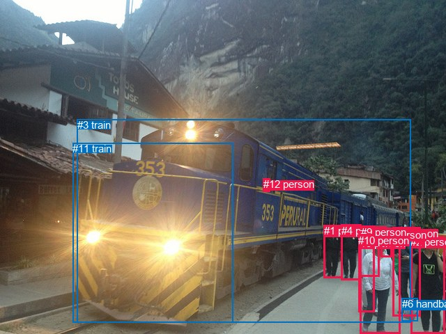
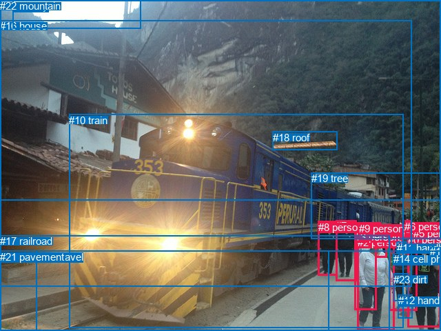

# 图片 1055：2363004.jpg

随机样本序号：23。图片 SHA256：`e7d1448bc57f8ffd10a19d12665a164779add701e07daa67b82ff51480a4105e`。

红色框表示人，蓝色框表示其他物体。两个模式分别保留自身框编号，可依据位置比较对应对象。

## 自动检测框与输出

人的框编号：`[0, 1, 2, 4, 5, 7, 8, 9, 10, 12]`。状态：`ok`。

### 自动检测全部物体框

| 编号 | 类别 | 是否为人 | 检测分数 | 像素坐标 xyxy |
|---|---|---|---|---|
| 0 | person | True | 0.9989 | 516.6, 340.9, 574.6, 479.8 |
| 1 | person | True | 0.9989 | 465.0, 323.3, 491.4, 400.0 |
| 2 | person | True | 0.9950 | 589.1, 339.4, 638.5, 479.4 |
| 3 | train | False | 0.9949 | 110.6, 171.2, 589.7, 463.4 |
| 4 | person | True | 0.9864 | 489.9, 322.5, 518.5, 402.6 |
| 5 | person | True | 0.9853 | 563.8, 326.7, 603.3, 454.5 |
| 6 | handbag | False | 0.9061 | 576.9, 428.2, 599.4, 461.7 |
| 7 | person | True | 0.7484 | 546.8, 329.0, 562.2, 369.9 |
| 8 | person | True | 0.6788 | 514.8, 332.5, 544.3, 397.7 |
| 9 | person | True | 0.6547 | 518.4, 324.6, 538.3, 351.1 |
| 10 | person | True | 0.6231 | 514.3, 336.5, 537.8, 448.9 |
| 11 | train | False | 0.6109 | 104.3, 205.2, 334.6, 463.9 |
| 12 | person | True | 0.3883 | 377.8, 256.2, 387.3, 275.6 |

### 自动检测 Top50 人相关候选

评分物体对：156；人相关物体对：150；输出关系：50。

| 排名 | 主语编号与类别 | 关系 | 宾语编号与类别 | 类型 | 人与人 | 排序分数 | 原始融合 logit |
|---|---|---|---|---|---|---|---|
| 1 | #12 person | on | #3 train | spatial | False | 0.98001 | 3.8925 |
| 2 | #5 person | carrying | #6 handbag | semantic | False | 0.97846 | 3.8161 |
| 3 | #10 person | wearing | #8 person | semantic | True | 0.97810 | 3.7990 |
| 4 | #0 person | walking on | #3 train | semantic | False | 0.97380 | 3.6156 |
| 5 | #2 person | carrying | #6 handbag | semantic | False | 0.97317 | 3.5910 |
| 6 | #10 person | walking on | #3 train | semantic | False | 0.96623 | 3.3538 |
| 7 | #5 person | walking on | #3 train | semantic | False | 0.95238 | 2.9957 |
| 8 | #10 person | in | #8 person | spatial | True | 0.94707 | 2.8844 |
| 9 | #2 person | walking on | #3 train | semantic | False | 0.94666 | 2.8763 |
| 10 | #1 person | walking on | #3 train | semantic | False | 0.94640 | 2.8711 |
| 11 | #4 person | walking on | #3 train | semantic | False | 0.93958 | 2.7441 |
| 12 | #10 person | wearing | #9 person | semantic | True | 0.93622 | 2.6865 |
| 13 | #12 person | on | #11 train | spatial | False | 0.92418 | 2.5006 |
| 14 | #0 person | wearing | #8 person | semantic | True | 0.90945 | 2.3070 |
| 15 | #0 person | beside | #3 train | spatial | False | 0.90841 | 2.2944 |
| 16 | #1 person | beside | #3 train | spatial | False | 0.89335 | 2.1254 |
| 17 | #8 person | wearing | #9 person | semantic | True | 0.89232 | 2.1147 |
| 18 | #8 person | walking on | #3 train | semantic | False | 0.88665 | 2.0570 |
| 19 | #0 person | carrying | #6 handbag | semantic | False | 0.87913 | 1.9843 |
| 20 | #5 person | beside | #3 train | spatial | False | 0.87458 | 1.9421 |
| 21 | #4 person | beside | #3 train | spatial | False | 0.86254 | 1.8366 |
| 22 | #12 person | driving on | #3 train | semantic | False | 0.85307 | 1.7589 |
| 23 | #10 person | beside | #3 train | spatial | False | 0.83774 | 1.6415 |
| 24 | #10 person | in | #9 person | spatial | True | 0.83763 | 1.6407 |
| 25 | #2 person | beside | #3 train | spatial | False | 0.82925 | 1.5803 |
| 26 | #7 person | walking on | #3 train | semantic | False | 0.81884 | 1.5085 |
| 27 | #9 person | walking on | #3 train | semantic | False | 0.81245 | 1.4660 |
| 28 | #9 person | on | #3 train | spatial | False | 0.78714 | 1.3078 |
| 29 | #0 person | in | #8 person | spatial | True | 0.77863 | 1.2577 |
| 30 | #8 person | in | #9 person | spatial | True | 0.76215 | 1.1645 |
| 31 | #0 person | wearing | #9 person | semantic | True | 0.70201 | 0.8569 |
| 32 | #0 person | wearing | #7 person | semantic | True | 0.69295 | 0.8139 |
| 33 | #10 person | carrying | #6 handbag | semantic | False | 0.69139 | 0.8066 |
| 34 | #5 person | in | #6 handbag | spatial | False | 0.64521 | 0.5980 |
| 35 | #2 person | in | #6 handbag | spatial | False | 0.62759 | 0.5219 |
| 36 | #4 person | wearing | #9 person | semantic | True | 0.57710 | 0.3109 |
| 37 | #1 person | looking at | #11 train | semantic | False | 0.55278 | 0.2119 |
| 38 | #8 person | beside | #3 train | spatial | False | 0.55228 | 0.2099 |
| 39 | #0 person | walking on | #11 train | semantic | False | 0.54841 | 0.1943 |
| 40 | #2 person | looking at | #11 train | semantic | False | 0.54180 | 0.1676 |
| 41 | #0 person | in | #7 person | spatial | True | 0.51081 | 0.0433 |
| 42 | #7 person | beside | #3 train | spatial | False | 0.50036 | 0.0014 |
| 43 | #12 person | sitting on | #11 train | semantic | False | 0.49500 | -0.0200 |
| 44 | #4 person | looking at | #11 train | semantic | False | 0.43920 | -0.2444 |
| 45 | #0 person | in | #9 person | spatial | True | 0.43736 | -0.2519 |
| 46 | #2 person | carrying | #5 person | semantic | True | 0.39443 | -0.4287 |
| 47 | #6 handbag | carrying | #5 person | semantic | False | 0.38857 | -0.4533 |
| 48 | #10 person | walking on | #0 person | semantic | True | 0.38682 | -0.4607 |
| 49 | #0 person | carrying | #5 person | semantic | True | 0.36174 | -0.5678 |
| 50 | #5 person | walking on | #2 person | semantic | True | 0.35672 | -0.5896 |

### 自动检测逐条人相关 GT 核验

R@50：0.00%；命中 0/6。

| GT 主语编号 | GT 关系 | GT 宾语编号 | 结果阶段 | 匹配预测主语编号 | 匹配预测宾语编号 |
|---|---|---|---|---|---|
| 0 | holding | 12 | wrong_predicate | [2] | [6] |
| 2 | walking on | 21 | endpoint_missing_or_wrong_class | [0] | [] |
| 3 | walking on | 21 | endpoint_missing_or_wrong_class | [10] | [] |
| 7 | walking on | 21 | endpoint_missing_or_wrong_class | [4] | [] |
| 8 | walking on | 21 | endpoint_missing_or_wrong_class | [1] | [] |
| 10 | beside | 8 | rank_below50 | [3] | [1] |

## 真实框与输出

人的框编号：`[0, 1, 2, 3, 4, 5, 6, 7, 8, 9]`。

### 真实框全部物体框

| 编号 | 类别 | 是否为人 | 检测分数 | 像素坐标 xyxy |
|---|---|---|---|---|
| 0 | person | True | GT | 592.0, 339.0, 640.0, 475.0 |
| 1 | person | True | GT | 545.0, 329.0, 562.0, 374.0 |
| 2 | person | True | GT | 519.0, 343.0, 573.0, 480.0 |
| 3 | person | True | GT | 515.0, 335.0, 547.0, 450.0 |
| 4 | person | True | GT | 564.0, 326.0, 605.0, 451.0 |
| 5 | person | True | GT | 600.0, 330.0, 616.0, 346.0 |
| 6 | person | True | GT | 587.0, 320.0, 596.0, 341.0 |
| 7 | person | True | GT | 487.0, 319.0, 517.0, 407.0 |
| 8 | person | True | GT | 462.0, 321.0, 490.0, 400.0 |
| 9 | person | True | GT | 521.0, 323.0, 540.0, 350.0 |
| 10 | train | False | GT | 100.0, 166.0, 586.0, 475.0 |
| 11 | handbag | False | GT | 576.0, 351.0, 591.0, 367.0 |
| 12 | handbag | False | GT | 578.0, 427.0, 599.0, 461.0 |
| 13 | cell phone | False | GT | 624.0, 356.0, 628.0, 362.0 |
| 14 | cell phone | False | GT | 571.0, 367.0, 579.0, 371.0 |
| 15 | gravel | False | GT | 53.0, 364.0, 478.0, 480.0 |
| 16 | house | False | GT | 0.0, 29.0, 598.0, 415.0 |
| 17 | railroad | False | GT | 0.0, 341.0, 565.0, 480.0 |
| 18 | roof | False | GT | 396.0, 191.0, 489.0, 218.0 |
| 19 | tree | False | GT | 452.0, 250.0, 640.0, 346.0 |
| 20 | sky | False | GT | 18.0, 0.0, 204.0, 41.0 |
| 21 | pavement | False | GT | 0.0, 364.0, 640.0, 480.0 |
| 22 | mountain | False | GT | 0.0, 0.0, 640.0, 291.0 |
| 23 | dirt | False | GT | 571.0, 397.0, 592.0, 437.0 |

### 真实框 Top50 人相关候选

评分物体对：552；人相关物体对：370；输出关系：50。

| 排名 | 主语编号与类别 | 关系 | 宾语编号与类别 | 类型 | 人与人 | 排序分数 | 原始融合 logit |
|---|---|---|---|---|---|---|---|
| 1 | #4 person | carrying | #23 dirt | semantic | False | 0.98197 | 3.9973 |
| 2 | #4 person | wearing | #11 handbag | semantic | False | 0.98169 | 3.9820 |
| 3 | #0 person | wearing | #13 cell phone | semantic | False | 0.97790 | 3.7900 |
| 4 | #4 person | carrying | #12 handbag | semantic | False | 0.97681 | 3.7405 |
| 5 | #4 person | wearing | #14 cell phone | semantic | False | 0.97503 | 3.6648 |
| 6 | #2 person | walking on | #10 train | semantic | False | 0.97056 | 3.4956 |
| 7 | #0 person | carrying | #12 handbag | semantic | False | 0.96904 | 3.4438 |
| 8 | #2 person | walking on | #21 pavement | semantic | False | 0.96780 | 3.4032 |
| 9 | #3 person | walking on | #10 train | semantic | False | 0.96689 | 3.3742 |
| 10 | #0 person | walking on | #21 pavement | semantic | False | 0.95627 | 3.0851 |
| 11 | #2 person | walking on | #17 railroad | semantic | False | 0.95183 | 2.9837 |
| 12 | #4 person | walking on | #10 train | semantic | False | 0.95140 | 2.9744 |
| 13 | #8 person | walking on | #21 pavement | semantic | False | 0.94966 | 2.9372 |
| 14 | #7 person | walking on | #10 train | semantic | False | 0.94942 | 2.9323 |
| 15 | #7 person | walking on | #21 pavement | semantic | False | 0.94517 | 2.8471 |
| 16 | #8 person | walking on | #10 train | semantic | False | 0.94099 | 2.7693 |
| 17 | #2 person | beside | #10 train | spatial | False | 0.93943 | 2.7416 |
| 18 | #4 person | wearing | #6 person | semantic | True | 0.93491 | 2.6646 |
| 19 | #0 person | walking on | #10 train | semantic | False | 0.93344 | 2.6408 |
| 20 | #8 person | walking on | #17 railroad | semantic | False | 0.92706 | 2.5424 |
| 21 | #4 person | walking on | #21 pavement | semantic | False | 0.92551 | 2.5197 |
| 22 | #3 person | beside | #10 train | spatial | False | 0.92429 | 2.5021 |
| 23 | #7 person | walking on | #17 railroad | semantic | False | 0.92216 | 2.4720 |
| 24 | #3 person | wearing | #9 person | semantic | True | 0.91912 | 2.4305 |
| 25 | #2 person | carrying | #23 dirt | semantic | False | 0.91426 | 2.3668 |
| 26 | #7 person | beside | #10 train | spatial | False | 0.91118 | 2.3281 |
| 27 | #4 person | beside | #10 train | spatial | False | 0.91027 | 2.3170 |
| 28 | #0 person | wearing | #5 person | semantic | True | 0.90759 | 2.2846 |
| 29 | #3 person | walking on | #21 pavement | semantic | False | 0.90736 | 2.2818 |
| 30 | #8 person | beside | #10 train | spatial | False | 0.90562 | 2.2613 |
| 31 | #0 person | walking on | #17 railroad | semantic | False | 0.89910 | 2.1873 |
| 32 | #0 person | beside | #10 train | spatial | False | 0.87605 | 1.9555 |
| 33 | #4 person | in | #11 handbag | spatial | False | 0.86942 | 1.8959 |
| 34 | #2 person | carrying | #12 handbag | semantic | False | 0.86761 | 1.8800 |
| 35 | #2 person | on | #21 pavement | spatial | False | 0.85326 | 1.7604 |
| 36 | #3 person | walking on | #17 railroad | semantic | False | 0.85063 | 1.7395 |
| 37 | #4 person | wearing | #5 person | semantic | True | 0.84604 | 1.7039 |
| 38 | #9 person | looking at | #10 train | semantic | False | 0.82903 | 1.5788 |
| 39 | #4 person | in | #14 cell phone | spatial | False | 0.82845 | 1.5747 |
| 40 | #2 person | wearing | #14 cell phone | semantic | False | 0.82178 | 1.5285 |
| 41 | #4 person | walking on | #17 railroad | semantic | False | 0.82113 | 1.5240 |
| 42 | #8 person | walking on | #15 gravel | semantic | False | 0.81290 | 1.4690 |
| 43 | #8 person | on | #21 pavement | spatial | False | 0.81163 | 1.4606 |
| 44 | #0 person | in | #13 cell phone | spatial | False | 0.80549 | 1.4210 |
| 45 | #3 person | in | #9 person | spatial | True | 0.79925 | 1.3816 |
| 46 | #1 person | looking at | #10 train | semantic | False | 0.79843 | 1.3765 |
| 47 | #0 person | on | #21 pavement | spatial | False | 0.79831 | 1.3758 |
| 48 | #2 person | wearing | #1 person | semantic | True | 0.77066 | 1.2120 |
| 49 | #2 person | walking on | #15 gravel | semantic | False | 0.76870 | 1.2010 |
| 50 | #0 person | walking on | #15 gravel | semantic | False | 0.76324 | 1.1705 |

### 真实框逐条人相关 GT 核验

R@50：66.67%；命中 4/6。

| GT 主语编号 | GT 关系 | GT 宾语编号 | 结果阶段 | 匹配预测主语编号 | 匹配预测宾语编号 |
|---|---|---|---|---|---|
| 0 | holding | 12 | wrong_predicate | [0] | [12] |
| 2 | walking on | 21 | hit50 | [2] | [21] |
| 3 | walking on | 21 | hit50 | [3] | [21] |
| 7 | walking on | 21 | hit50 | [7] | [21] |
| 8 | walking on | 21 | hit50 | [8] | [21] |
| 10 | beside | 8 | rank_below50 | [10] | [8] |

## 全部人相关 GT

| 主语编号与类别 | 关系 | 宾语编号与类别 |
|---|---|---|
| #0 person | holding | #12 handbag |
| #2 person | walking on | #21 pavement |
| #3 person | walking on | #21 pavement |
| #7 person | walking on | #21 pavement |
| #8 person | walking on | #21 pavement |
| #10 train | beside | #8 person |

原始记录、全部人相关物体对的两项预测与分项分数见 [逐图证据 JSON](../evidence/cases/1055.json)。全部56类 logits 保留于本机 HOR/output/random500/logits/。

<!-- HOR_COMPLETE_RESULTS -->

## 六组条件的完整输出对照

以下保留同一图片三种框与候选模式、两种谓词输出规则的全部 Top50。框编号各自在所属模式内解释。

### 自动检测框完整枚举：空间与语义各保留一个谓词

| 排名 | 主语编号与类别 | 谓词 | 宾语编号与类别 | 分组 | 排序分数 | predicate logit | pair logit |
|---|---|---|---|---|---|---|---|
| 1 | #12 person | on | #3 train | spatial | 0.9800133 | 3.6339850 | 0.2585140 |
| 2 | #5 person | carrying | #6 handbag | semantic | 0.9784614 | 3.5369925 | 0.2791400 |
| 3 | #10 person | wearing | #8 person | semantic | 0.9780976 | 3.6644959 | 0.1345193 |
| 4 | #0 person | walking on | #3 train | semantic | 0.9738047 | 3.6862006 | -0.0705681 |
| 5 | #2 person | carrying | #6 handbag | semantic | 0.9731687 | 3.0951443 | 0.4958437 |
| 6 | #10 person | walking on | #3 train | semantic | 0.9662302 | 3.6561236 | -0.3022889 |
| 7 | #5 person | walking on | #3 train | semantic | 0.9523804 | 3.1475973 | -0.1518777 |
| 8 | #10 person | in | #8 person | spatial | 0.9470696 | 2.7498770 | 0.1345193 |
| 9 | #2 person | walking on | #3 train | semantic | 0.9466644 | 3.0302424 | -0.1539028 |
| 10 | #1 person | walking on | #3 train | semantic | 0.9463968 | 2.8677864 | 0.0032682 |
| 11 | #4 person | walking on | #3 train | semantic | 0.9395780 | 2.9099054 | -0.1658283 |
| 12 | #10 person | wearing | #9 person | semantic | 0.9362243 | 2.5061402 | 0.1803416 |
| 13 | #12 person | on | #11 train | spatial | 0.9241849 | 2.9060607 | -0.4054468 |
| 14 | #0 person | wearing | #8 person | semantic | 0.9094522 | 2.2302032 | 0.0767619 |
| 15 | #0 person | beside | #3 train | spatial | 0.9084136 | 2.3649855 | -0.0705681 |
| 16 | #1 person | beside | #3 train | spatial | 0.8933516 | 2.1221743 | 0.0032682 |
| 17 | #8 person | wearing | #9 person | semantic | 0.8923202 | 2.6749520 | -0.5602882 |
| 18 | #8 person | walking on | #3 train | semantic | 0.8866498 | 2.9189091 | -0.8619412 |
| 19 | #0 person | carrying | #6 handbag | semantic | 0.8791340 | 1.6439738 | 0.3402809 |
| 20 | #5 person | beside | #3 train | spatial | 0.8745779 | 2.0939336 | -0.1518777 |
| 21 | #4 person | beside | #3 train | spatial | 0.8625413 | 2.0023875 | -0.1658283 |
| 22 | #12 person | driving on | #3 train | semantic | 0.8530721 | 1.5003881 | 0.2585140 |
| 23 | #10 person | beside | #3 train | spatial | 0.8377438 | 1.9438243 | -0.3022889 |
| 24 | #10 person | in | #9 person | spatial | 0.8376310 | 1.4603653 | 0.1803416 |
| 25 | #2 person | beside | #3 train | spatial | 0.8292503 | 1.7342262 | -0.1539028 |
| 26 | #7 person | walking on | #3 train | semantic | 0.8188421 | 2.2478981 | -0.7393761 |
| 27 | #9 person | walking on | #3 train | semantic | 0.8124470 | 2.0222344 | -0.5562453 |
| 28 | #9 person | on | #3 train | spatial | 0.7871401 | 1.8640175 | -0.5562453 |
| 29 | #0 person | in | #8 person | spatial | 0.7786273 | 1.1809230 | 0.0767619 |
| 30 | #8 person | in | #9 person | spatial | 0.7621464 | 1.7247715 | -0.5602882 |
| 31 | #0 person | wearing | #9 person | semantic | 0.7020053 | 0.7387333 | 0.1181322 |
| 32 | #0 person | wearing | #7 person | semantic | 0.6929489 | 0.7254949 | 0.0884475 |
| 33 | #10 person | carrying | #6 handbag | semantic | 0.6913882 | 0.8352056 | -0.0285884 |
| 34 | #5 person | in | #6 handbag | spatial | 0.6452080 | 0.3189011 | 0.2791400 |
| 35 | #2 person | in | #6 handbag | spatial | 0.6275935 | 0.0260630 | 0.4958437 |
| 36 | #4 person | wearing | #9 person | semantic | 0.5771017 | 0.1875377 | 0.1233492 |
| 37 | #1 person | looking at | #11 train | semantic | 0.5527788 | 0.9914193 | -0.7795145 |
| 38 | #8 person | beside | #3 train | spatial | 0.5522765 | 1.0718141 | -0.8619412 |
| 39 | #0 person | walking on | #11 train | semantic | 0.5484117 | 0.8125358 | -0.6182802 |
| 40 | #2 person | looking at | #11 train | semantic | 0.5418009 | 0.8993368 | -0.7317420 |
| 41 | #0 person | in | #7 person | spatial | 0.5108131 | -0.0451884 | 0.0884475 |
| 42 | #7 person | beside | #3 train | spatial | 0.5003586 | 0.7408104 | -0.7393761 |
| 43 | #12 person | sitting on | #11 train | semantic | 0.4950021 | 0.3854547 | -0.4054468 |
| 44 | #4 person | looking at | #11 train | semantic | 0.4391993 | 0.6257920 | -0.8702043 |
| 45 | #0 person | in | #9 person | spatial | 0.4373636 | -0.3700008 | 0.1181322 |
| 46 | #2 person | carrying | #5 person | semantic | 0.3944350 | 0.0227242 | -0.4514318 |
| 47 | #6 handbag | carrying | #5 person | semantic | 0.3885736 | 0.5952401 | -1.0485519 |
| 48 | #10 person | walking on | #0 person | semantic | 0.3868173 | 0.4273424 | -0.8880530 |
| 49 | #0 person | carrying | #5 person | semantic | 0.3617396 | 0.1599822 | -0.7278039 |
| 50 | #5 person | walking on | #2 person | semantic | 0.3567245 | 0.1090775 | -0.6986868 |

GT 命中：0/6，R@50=0.00%。

| GT主语 | GT谓词 | GT宾语 | 结果阶段 | 匹配主语框 | 匹配宾语框 |
|---|---|---|---|---|---|
| 0 | holding | 12 | wrong_predicate | [2] | [6] |
| 2 | walking on | 21 | endpoint_missing_or_wrong_class | [0] | [] |
| 3 | walking on | 21 | endpoint_missing_or_wrong_class | [10] | [] |
| 7 | walking on | 21 | endpoint_missing_or_wrong_class | [4] | [] |
| 8 | walking on | 21 | endpoint_missing_or_wrong_class | [1] | [] |
| 10 | beside | 8 | rank_below50 | [3] | [1] |

### 自动检测框完整枚举：每对只保留一个谓词

| 排名 | 主语编号与类别 | 谓词 | 宾语编号与类别 | 分组 | 排序分数 | predicate logit | pair logit |
|---|---|---|---|---|---|---|---|
| 1 | #12 person | on | #3 train | single | 0.9800133 | 3.6339850 | 0.2585140 |
| 2 | #5 person | carrying | #6 handbag | single | 0.9784614 | 3.5369925 | 0.2791400 |
| 3 | #10 person | wearing | #8 person | single | 0.9780976 | 3.6644959 | 0.1345193 |
| 4 | #0 person | walking on | #3 train | single | 0.9738047 | 3.6862006 | -0.0705681 |
| 5 | #2 person | carrying | #6 handbag | single | 0.9731687 | 3.0951443 | 0.4958437 |
| 6 | #10 person | walking on | #3 train | single | 0.9662302 | 3.6561236 | -0.3022889 |
| 7 | #5 person | walking on | #3 train | single | 0.9523804 | 3.1475973 | -0.1518777 |
| 8 | #2 person | walking on | #3 train | single | 0.9466644 | 3.0302424 | -0.1539028 |
| 9 | #1 person | walking on | #3 train | single | 0.9463968 | 2.8677864 | 0.0032682 |
| 10 | #4 person | walking on | #3 train | single | 0.9395780 | 2.9099054 | -0.1658283 |
| 11 | #10 person | wearing | #9 person | single | 0.9362243 | 2.5061402 | 0.1803416 |
| 12 | #12 person | on | #11 train | single | 0.9241849 | 2.9060607 | -0.4054468 |
| 13 | #0 person | wearing | #8 person | single | 0.9094522 | 2.2302032 | 0.0767619 |
| 14 | #8 person | wearing | #9 person | single | 0.8923202 | 2.6749520 | -0.5602882 |
| 15 | #8 person | walking on | #3 train | single | 0.8866498 | 2.9189091 | -0.8619412 |
| 16 | #0 person | carrying | #6 handbag | single | 0.8791340 | 1.6439738 | 0.3402809 |
| 17 | #7 person | walking on | #3 train | single | 0.8188421 | 2.2478981 | -0.7393761 |
| 18 | #9 person | walking on | #3 train | single | 0.8124470 | 2.0222344 | -0.5562453 |
| 19 | #0 person | wearing | #9 person | single | 0.7020053 | 0.7387333 | 0.1181322 |
| 20 | #0 person | wearing | #7 person | single | 0.6929489 | 0.7254949 | 0.0884475 |
| 21 | #10 person | carrying | #6 handbag | single | 0.6913882 | 0.8352056 | -0.0285884 |
| 22 | #4 person | wearing | #9 person | single | 0.5771017 | 0.1875377 | 0.1233492 |
| 23 | #1 person | looking at | #11 train | single | 0.5527788 | 0.9914193 | -0.7795145 |
| 24 | #0 person | walking on | #11 train | single | 0.5484117 | 0.8125358 | -0.6182802 |
| 25 | #2 person | looking at | #11 train | single | 0.5418009 | 0.8993368 | -0.7317420 |
| 26 | #4 person | looking at | #11 train | single | 0.4391993 | 0.6257920 | -0.8702043 |
| 27 | #2 person | carrying | #5 person | single | 0.3944350 | 0.0227242 | -0.4514318 |
| 28 | #6 handbag | carrying | #5 person | single | 0.3885736 | 0.5952401 | -1.0485519 |
| 29 | #10 person | walking on | #0 person | single | 0.3868173 | 0.4273424 | -0.8880530 |
| 30 | #0 person | carrying | #5 person | single | 0.3617396 | 0.1599822 | -0.7278039 |
| 31 | #5 person | walking on | #2 person | single | 0.3567245 | 0.1090775 | -0.6986868 |
| 32 | #10 person | walking on | #11 train | single | 0.3559914 | 0.3280926 | -0.9208983 |
| 33 | #5 person | looking at | #11 train | single | 0.3471721 | 0.1851654 | -0.8166584 |
| 34 | #7 person | holding | #6 handbag | single | 0.3396779 | 0.4079242 | -1.0726542 |
| 35 | #9 person | on | #8 person | single | 0.3028023 | -0.0469069 | -0.7870820 |
| 36 | #6 handbag | carrying | #2 person | single | 0.2813034 | -0.0100799 | -0.9279256 |
| 37 | #0 person | wearing | #10 person | single | 0.2781009 | -0.4767251 | -0.4771765 |
| 38 | #10 person | wearing | #7 person | single | 0.2771666 | -1.0382261 | 0.0796660 |
| 39 | #8 person | carrying | #6 handbag | single | 0.2615730 | 0.0483723 | -1.0861813 |
| 40 | #5 person | walking on | #0 person | single | 0.2447945 | -0.1308718 | -0.9956990 |
| 41 | #4 person | holding | #6 handbag | single | 0.2327109 | -0.5716038 | -0.6214628 |
| 42 | #9 person | on | #10 person | single | 0.2194450 | -0.2499576 | -1.0189459 |
| 43 | #5 person | wearing | #7 person | single | 0.2177967 | -1.4719548 | 0.1934021 |
| 44 | #1 person | walking on | #4 person | single | 0.1818329 | -1.1599605 | -0.3440182 |
| 45 | #4 person | carrying | #8 person | single | 0.1632035 | -1.5044394 | -0.1301439 |
| 46 | #5 person | wearing | #9 person | single | 0.1630974 | -1.7427759 | 0.1074162 |
| 47 | #1 person | holding | #6 handbag | single | 0.1585253 | -0.8562496 | -0.8129923 |
| 48 | #6 handbag | carrying | #0 person | single | 0.1511423 | -0.6586890 | -1.0669808 |
| 49 | #7 person | looking at | #11 train | single | 0.1395063 | -0.5822163 | -1.2371799 |
| 50 | #10 person | walking on | #4 person | single | 0.1196965 | -1.4405382 | -0.5547690 |

GT 命中：0/6，R@50=0.00%。

| GT主语 | GT谓词 | GT宾语 | 结果阶段 | 匹配主语框 | 匹配宾语框 |
|---|---|---|---|---|---|
| 0 | holding | 12 | wrong_predicate | [2] | [6] |
| 2 | walking on | 21 | endpoint_missing_or_wrong_class | [0] | [] |
| 3 | walking on | 21 | endpoint_missing_or_wrong_class | [10] | [] |
| 7 | walking on | 21 | endpoint_missing_or_wrong_class | [4] | [] |
| 8 | walking on | 21 | endpoint_missing_or_wrong_class | [1] | [] |
| 10 | beside | 8 | rank_below50 | [3] | [1] |

### 真实框完整枚举：空间与语义各保留一个谓词

| 排名 | 主语编号与类别 | 谓词 | 宾语编号与类别 | 分组 | 排序分数 | predicate logit | pair logit |
|---|---|---|---|---|---|---|---|
| 1 | #4 person | carrying | #23 dirt | semantic | 0.9819661 | 3.6014352 | 0.3958625 |
| 2 | #4 person | wearing | #11 handbag | semantic | 0.9816933 | 3.5865645 | 0.3954527 |
| 3 | #0 person | wearing | #13 cell phone | semantic | 0.9779046 | 3.3869090 | 0.4031298 |
| 4 | #4 person | carrying | #12 handbag | semantic | 0.9768074 | 3.4674897 | 0.2729645 |
| 5 | #4 person | wearing | #14 cell phone | semantic | 0.9750305 | 3.3091226 | 0.3556912 |
| 6 | #2 person | walking on | #10 train | semantic | 0.9705611 | 3.6290288 | -0.1334733 |
| 7 | #0 person | carrying | #12 handbag | semantic | 0.9690442 | 2.9677892 | 0.4759617 |
| 8 | #2 person | walking on | #21 pavement | semantic | 0.9678047 | 3.4816251 | -0.0784147 |
| 9 | #3 person | walking on | #10 train | semantic | 0.9668880 | 3.5959411 | -0.2217558 |
| 10 | #0 person | walking on | #21 pavement | semantic | 0.9562730 | 3.2469163 | -0.1618412 |
| 11 | #2 person | walking on | #17 railroad | semantic | 0.9518338 | 3.3642707 | -0.3805382 |
| 12 | #4 person | walking on | #10 train | semantic | 0.9514018 | 3.0813932 | -0.1070428 |
| 13 | #8 person | walking on | #21 pavement | semantic | 0.9496567 | 3.0302701 | -0.0930353 |
| 14 | #7 person | walking on | #10 train | semantic | 0.9494202 | 2.9369717 | -0.0046712 |
| 15 | #7 person | walking on | #21 pavement | semantic | 0.9451674 | 2.9068947 | -0.0598176 |
| 16 | #8 person | walking on | #10 train | semantic | 0.9409915 | 2.7504177 | 0.0188358 |
| 17 | #2 person | beside | #10 train | spatial | 0.9394349 | 2.8750339 | -0.1334733 |
| 18 | #4 person | wearing | #6 person | semantic | 0.9349075 | 2.4650645 | 0.1995743 |
| 19 | #0 person | walking on | #10 train | semantic | 0.9334403 | 2.8406634 | -0.1998859 |
| 20 | #8 person | walking on | #17 railroad | semantic | 0.9270636 | 2.8677864 | -0.3253524 |
| 21 | #4 person | walking on | #21 pavement | semantic | 0.9255081 | 2.6842136 | -0.1645601 |
| 22 | #3 person | beside | #10 train | spatial | 0.9242909 | 2.7238836 | -0.2217558 |
| 23 | #7 person | walking on | #17 railroad | semantic | 0.9221555 | 2.7775126 | -0.3055125 |
| 24 | #3 person | wearing | #9 person | semantic | 0.9191201 | 2.1779976 | 0.2524542 |
| 25 | #2 person | carrying | #23 dirt | semantic | 0.9142600 | 1.9563365 | 0.4104585 |
| 26 | #7 person | beside | #10 train | spatial | 0.9111810 | 2.3328128 | -0.0046712 |
| 27 | #4 person | beside | #10 train | spatial | 0.9102727 | 2.4240117 | -0.1070428 |
| 28 | #0 person | wearing | #5 person | semantic | 0.9075903 | 1.9160514 | 0.3685101 |
| 29 | #3 person | walking on | #21 pavement | semantic | 0.9073622 | 2.5457997 | -0.2639558 |
| 30 | #8 person | beside | #10 train | spatial | 0.9056173 | 2.2424235 | 0.0188358 |
| 31 | #0 person | walking on | #17 railroad | semantic | 0.8991047 | 2.6601439 | -0.4728274 |
| 32 | #0 person | beside | #10 train | spatial | 0.8760454 | 2.1553884 | -0.1998859 |
| 33 | #4 person | in | #11 handbag | spatial | 0.8694229 | 1.5004125 | 0.3954527 |
| 34 | #2 person | carrying | #12 handbag | semantic | 0.8676121 | 1.5259385 | 0.3540699 |
| 35 | #2 person | on | #21 pavement | spatial | 0.8532605 | 1.8388209 | -0.0784147 |
| 36 | #3 person | walking on | #17 railroad | semantic | 0.8506274 | 2.2749929 | -0.5354631 |
| 37 | #4 person | wearing | #5 person | semantic | 0.8460395 | 1.4103680 | 0.2935019 |
| 38 | #9 person | looking at | #10 train | semantic | 0.8290315 | 2.1618404 | -0.5830619 |
| 39 | #4 person | in | #14 cell phone | spatial | 0.8284466 | 1.2189670 | 0.3556912 |
| 40 | #2 person | wearing | #14 cell phone | semantic | 0.8217813 | 1.4786005 | 0.0498626 |
| 41 | #4 person | walking on | #17 railroad | semantic | 0.8211325 | 1.9710698 | -0.4470308 |
| 42 | #8 person | walking on | #15 gravel | semantic | 0.8128988 | 1.9710836 | -0.5021262 |
| 43 | #8 person | on | #21 pavement | spatial | 0.8116287 | 1.5536633 | -0.0930353 |
| 44 | #0 person | in | #13 cell phone | spatial | 0.8054904 | 1.0178399 | 0.4031298 |
| 45 | #3 person | in | #9 person | spatial | 0.7992467 | 1.1291385 | 0.2524542 |
| 46 | #1 person | looking at | #10 train | semantic | 0.7984296 | 2.1989040 | -0.8223960 |
| 47 | #0 person | on | #21 pavement | spatial | 0.7983120 | 1.5376186 | -0.1618412 |
| 48 | #2 person | wearing | #1 person | semantic | 0.7706576 | 1.0725985 | 0.1394295 |
| 49 | #2 person | walking on | #15 gravel | semantic | 0.7687019 | 1.7875113 | -0.5865153 |
| 50 | #0 person | walking on | #15 gravel | semantic | 0.7632412 | 1.8085852 | -0.6380533 |

GT 命中：4/6，R@50=66.67%。

| GT主语 | GT谓词 | GT宾语 | 结果阶段 | 匹配主语框 | 匹配宾语框 |
|---|---|---|---|---|---|
| 0 | holding | 12 | wrong_predicate | [0] | [12] |
| 2 | walking on | 21 | hit50 | [2] | [21] |
| 3 | walking on | 21 | hit50 | [3] | [21] |
| 7 | walking on | 21 | hit50 | [7] | [21] |
| 8 | walking on | 21 | hit50 | [8] | [21] |
| 10 | beside | 8 | rank_below50 | [10] | [8] |

### 真实框完整枚举：每对只保留一个谓词

| 排名 | 主语编号与类别 | 谓词 | 宾语编号与类别 | 分组 | 排序分数 | predicate logit | pair logit |
|---|---|---|---|---|---|---|---|
| 1 | #4 person | carrying | #23 dirt | single | 0.9819661 | 3.6014352 | 0.3958625 |
| 2 | #4 person | wearing | #11 handbag | single | 0.9816933 | 3.5865645 | 0.3954527 |
| 3 | #0 person | wearing | #13 cell phone | single | 0.9779046 | 3.3869090 | 0.4031298 |
| 4 | #4 person | carrying | #12 handbag | single | 0.9768074 | 3.4674897 | 0.2729645 |
| 5 | #4 person | wearing | #14 cell phone | single | 0.9750305 | 3.3091226 | 0.3556912 |
| 6 | #2 person | walking on | #10 train | single | 0.9705611 | 3.6290288 | -0.1334733 |
| 7 | #0 person | carrying | #12 handbag | single | 0.9690442 | 2.9677892 | 0.4759617 |
| 8 | #2 person | walking on | #21 pavement | single | 0.9678047 | 3.4816251 | -0.0784147 |
| 9 | #3 person | walking on | #10 train | single | 0.9668880 | 3.5959411 | -0.2217558 |
| 10 | #0 person | walking on | #21 pavement | single | 0.9562730 | 3.2469163 | -0.1618412 |
| 11 | #2 person | walking on | #17 railroad | single | 0.9518338 | 3.3642707 | -0.3805382 |
| 12 | #4 person | walking on | #10 train | single | 0.9514018 | 3.0813932 | -0.1070428 |
| 13 | #8 person | walking on | #21 pavement | single | 0.9496567 | 3.0302701 | -0.0930353 |
| 14 | #7 person | walking on | #10 train | single | 0.9494202 | 2.9369717 | -0.0046712 |
| 15 | #7 person | walking on | #21 pavement | single | 0.9451674 | 2.9068947 | -0.0598176 |
| 16 | #8 person | walking on | #10 train | single | 0.9409915 | 2.7504177 | 0.0188358 |
| 17 | #4 person | wearing | #6 person | single | 0.9349075 | 2.4650645 | 0.1995743 |
| 18 | #0 person | walking on | #10 train | single | 0.9334403 | 2.8406634 | -0.1998859 |
| 19 | #8 person | walking on | #17 railroad | single | 0.9270636 | 2.8677864 | -0.3253524 |
| 20 | #4 person | walking on | #21 pavement | single | 0.9255081 | 2.6842136 | -0.1645601 |
| 21 | #7 person | walking on | #17 railroad | single | 0.9221555 | 2.7775126 | -0.3055125 |
| 22 | #3 person | wearing | #9 person | single | 0.9191201 | 2.1779976 | 0.2524542 |
| 23 | #2 person | carrying | #23 dirt | single | 0.9142600 | 1.9563365 | 0.4104585 |
| 24 | #0 person | wearing | #5 person | single | 0.9075903 | 1.9160514 | 0.3685101 |
| 25 | #3 person | walking on | #21 pavement | single | 0.9073622 | 2.5457997 | -0.2639558 |
| 26 | #0 person | walking on | #17 railroad | single | 0.8991047 | 2.6601439 | -0.4728274 |
| 27 | #2 person | carrying | #12 handbag | single | 0.8676121 | 1.5259385 | 0.3540699 |
| 28 | #3 person | walking on | #17 railroad | single | 0.8506274 | 2.2749929 | -0.5354631 |
| 29 | #4 person | wearing | #5 person | single | 0.8460395 | 1.4103680 | 0.2935019 |
| 30 | #9 person | looking at | #10 train | single | 0.8290315 | 2.1618404 | -0.5830619 |
| 31 | #2 person | wearing | #14 cell phone | single | 0.8217813 | 1.4786005 | 0.0498626 |
| 32 | #4 person | walking on | #17 railroad | single | 0.8211325 | 1.9710698 | -0.4470308 |
| 33 | #8 person | walking on | #15 gravel | single | 0.8128988 | 1.9710836 | -0.5021262 |
| 34 | #1 person | looking at | #10 train | single | 0.7984296 | 2.1989040 | -0.8223960 |
| 35 | #2 person | wearing | #1 person | single | 0.7706576 | 1.0725985 | 0.1394295 |
| 36 | #2 person | walking on | #15 gravel | single | 0.7687019 | 1.7875113 | -0.5865153 |
| 37 | #0 person | walking on | #15 gravel | single | 0.7632412 | 1.8085852 | -0.6380533 |
| 38 | #6 person | looking at | #10 train | single | 0.7521842 | 1.6387844 | -0.5284892 |
| 39 | #5 person | looking at | #10 train | single | 0.7232559 | 1.4834471 | -0.5227773 |
| 40 | #7 person | walking on | #15 gravel | single | 0.7110483 | 1.3873215 | -0.4868405 |
| 41 | #3 person | carrying | #12 handbag | single | 0.7107072 | 0.7888031 | 0.1100183 |
| 42 | #4 person | walking on | #19 tree | single | 0.7101687 | 1.4113503 | -0.5151465 |
| 43 | #0 person | wearing | #11 handbag | single | 0.6850722 | 0.3791423 | 0.3980387 |
| 44 | #2 person | wearing | #9 person | single | 0.6838819 | 0.6337175 | 0.1379519 |
| 45 | #4 person | walking on | #15 gravel | single | 0.6681327 | 1.3030548 | -0.6033032 |
| 46 | #7 person | walking on | #19 tree | single | 0.6564215 | 1.2940097 | -0.6466218 |
| 47 | #0 person | wearing | #6 person | single | 0.6341773 | 0.2918024 | 0.2583772 |
| 48 | #3 person | walking on | #15 gravel | single | 0.6284031 | 1.2398620 | -0.7144896 |
| 49 | #0 person | carrying | #23 dirt | single | 0.6074132 | -0.1011190 | 0.5375705 |
| 50 | #13 cell phone | on | #0 person | single | 0.5932621 | 1.3478904 | -0.9704229 |

GT 命中：4/6，R@50=66.67%。

| GT主语 | GT谓词 | GT宾语 | 结果阶段 | 匹配主语框 | 匹配宾语框 |
|---|---|---|---|---|---|
| 0 | holding | 12 | wrong_predicate | [0] | [12] |
| 2 | walking on | 21 | hit50 | [2] | [21] |
| 3 | walking on | 21 | hit50 | [3] | [21] |
| 7 | walking on | 21 | hit50 | [7] | [21] |
| 8 | walking on | 21 | hit50 | [8] | [21] |
| 10 | beside | 8 | rank_below50 | [10] | [8] |

### 真实框400候选：空间与语义各保留一个谓词

| 排名 | 主语编号与类别 | 谓词 | 宾语编号与类别 | 分组 | 排序分数 | predicate logit | pair logit |
|---|---|---|---|---|---|---|---|
| 1 | #4 person | wearing | #11 handbag | semantic | 0.9814813 | 3.5748277 | 0.3954527 |
| 2 | #4 person | carrying | #23 dirt | semantic | 0.9798906 | 3.4903913 | 0.3958625 |
| 3 | #0 person | wearing | #13 cell phone | semantic | 0.9755716 | 3.2841482 | 0.4031298 |
| 4 | #4 person | carrying | #12 handbag | semantic | 0.9755156 | 3.4119678 | 0.2729645 |
| 5 | #4 person | wearing | #14 cell phone | semantic | 0.9722448 | 3.2004948 | 0.3556912 |
| 6 | #2 person | walking on | #21 pavement | semantic | 0.9710142 | 3.5899482 | -0.0784147 |
| 7 | #2 person | walking on | #10 train | semantic | 0.9705611 | 3.6290288 | -0.1334733 |
| 8 | #0 person | carrying | #12 handbag | semantic | 0.9672609 | 2.9099364 | 0.4759617 |
| 9 | #3 person | walking on | #10 train | semantic | 0.9669842 | 3.5989509 | -0.2217558 |
| 10 | #0 person | walking on | #21 pavement | semantic | 0.9626936 | 3.4124112 | -0.1618412 |
| 11 | #2 person | walking on | #17 railroad | semantic | 0.9588782 | 3.5297656 | -0.3805382 |
| 12 | #8 person | walking on | #21 pavement | semantic | 0.9571289 | 3.1987758 | -0.0930353 |
| 13 | #7 person | walking on | #21 pavement | semantic | 0.9532731 | 3.0754004 | -0.0598176 |
| 14 | #4 person | walking on | #10 train | semantic | 0.9514018 | 3.0813932 | -0.1070428 |
| 15 | #7 person | walking on | #10 train | semantic | 0.9467551 | 2.8828106 | -0.0046712 |
| 16 | #2 person | beside | #10 train | spatial | 0.9411117 | 2.9048939 | -0.1334733 |
| 17 | #8 person | walking on | #10 train | semantic | 0.9379114 | 2.6962562 | 0.0188358 |
| 18 | #8 person | walking on | #17 railroad | semantic | 0.9376691 | 3.0362916 | -0.3253524 |
| 19 | #4 person | wearing | #6 person | semantic | 0.9367595 | 2.4959078 | 0.1995743 |
| 20 | #0 person | walking on | #10 train | semantic | 0.9336271 | 2.8436742 | -0.1998859 |
| 21 | #7 person | walking on | #17 railroad | semantic | 0.9315288 | 2.9159265 | -0.3055125 |
| 22 | #4 person | walking on | #21 pavement | semantic | 0.9291573 | 2.7383752 | -0.1645601 |
| 23 | #3 person | wearing | #9 person | semantic | 0.9235357 | 2.2389321 | 0.2524542 |
| 24 | #3 person | beside | #10 train | spatial | 0.9221581 | 2.6937923 | -0.2217558 |
| 25 | #0 person | walking on | #17 railroad | semantic | 0.9180396 | 2.8888321 | -0.4728274 |
| 26 | #3 person | walking on | #21 pavement | semantic | 0.9163056 | 2.6571331 | -0.2639558 |
| 27 | #4 person | beside | #10 train | spatial | 0.9126819 | 2.4538717 | -0.1070428 |
| 28 | #7 person | beside | #10 train | spatial | 0.9111624 | 2.3325815 | -0.0046712 |
| 29 | #0 person | wearing | #5 person | semantic | 0.9083885 | 1.9256048 | 0.3685101 |
| 30 | #8 person | beside | #10 train | spatial | 0.9081292 | 2.2721677 | 0.0188358 |
| 31 | #2 person | carrying | #23 dirt | semantic | 0.8884696 | 1.6647449 | 0.4104585 |
| 32 | #0 person | beside | #10 train | spatial | 0.8760328 | 2.1552725 | -0.1998859 |
| 33 | #3 person | walking on | #17 railroad | semantic | 0.8638747 | 2.3833156 | -0.5354631 |
| 34 | #4 person | in | #11 handbag | spatial | 0.8616214 | 1.4333701 | 0.3954527 |
| 35 | #2 person | on | #21 pavement | spatial | 0.8546188 | 1.8497105 | -0.0784147 |
| 36 | #8 person | walking on | #15 gravel | semantic | 0.8483497 | 2.2238417 | -0.5021262 |
| 37 | #4 person | walking on | #17 railroad | semantic | 0.8449532 | 2.1425858 | -0.4470308 |
| 38 | #4 person | wearing | #5 person | semantic | 0.8437325 | 1.3927641 | 0.2935019 |
| 39 | #8 person | on | #21 pavement | spatial | 0.8316445 | 1.6903629 | -0.0930353 |
| 40 | #2 person | carrying | #12 handbag | semantic | 0.8303933 | 1.2343469 | 0.3540699 |
| 41 | #0 person | walking on | #15 gravel | semantic | 0.8191431 | 2.1486063 | -0.6380533 |
| 42 | #4 person | in | #14 cell phone | spatial | 0.8101141 | 1.0950603 | 0.3556912 |
| 43 | #0 person | on | #21 pavement | spatial | 0.8043789 | 1.5757322 | -0.1618412 |
| 44 | #2 person | walking on | #15 gravel | semantic | 0.8025967 | 1.9891186 | -0.5865153 |
| 45 | #9 person | looking at | #10 train | semantic | 0.8024563 | 1.9847794 | -0.5830619 |
| 46 | #2 person | wearing | #14 cell phone | semantic | 0.7971302 | 1.3185906 | 0.0498626 |
| 47 | #3 person | in | #9 person | spatial | 0.7921616 | 1.0855503 | 0.2524542 |
| 48 | #0 person | in | #13 cell phone | spatial | 0.7881616 | 0.9107494 | 0.4031298 |
| 49 | #1 person | walking on | #10 train | semantic | 0.7872006 | 2.1305294 | -0.8223960 |
| 50 | #2 person | wearing | #1 person | semantic | 0.7718254 | 1.0792179 | 0.1394295 |

GT 命中：4/6，R@50=66.67%。

| GT主语 | GT谓词 | GT宾语 | 结果阶段 | 匹配主语框 | 匹配宾语框 |
|---|---|---|---|---|---|
| 0 | holding | 12 | wrong_predicate | [0] | [12] |
| 2 | walking on | 21 | hit50 | [2] | [21] |
| 3 | walking on | 21 | hit50 | [3] | [21] |
| 7 | walking on | 21 | hit50 | [7] | [21] |
| 8 | walking on | 21 | hit50 | [8] | [21] |
| 10 | beside | 8 | rank_below50 | [10] | [8] |

### 真实框400候选：每对只保留一个谓词

| 排名 | 主语编号与类别 | 谓词 | 宾语编号与类别 | 分组 | 排序分数 | predicate logit | pair logit |
|---|---|---|---|---|---|---|---|
| 1 | #4 person | wearing | #11 handbag | single | 0.9814813 | 3.5748277 | 0.3954527 |
| 2 | #4 person | carrying | #23 dirt | single | 0.9798906 | 3.4903913 | 0.3958625 |
| 3 | #0 person | wearing | #13 cell phone | single | 0.9755716 | 3.2841482 | 0.4031298 |
| 4 | #4 person | carrying | #12 handbag | single | 0.9755156 | 3.4119678 | 0.2729645 |
| 5 | #4 person | wearing | #14 cell phone | single | 0.9722448 | 3.2004948 | 0.3556912 |
| 6 | #2 person | walking on | #21 pavement | single | 0.9710142 | 3.5899482 | -0.0784147 |
| 7 | #2 person | walking on | #10 train | single | 0.9705611 | 3.6290288 | -0.1334733 |
| 8 | #0 person | carrying | #12 handbag | single | 0.9672609 | 2.9099364 | 0.4759617 |
| 9 | #3 person | walking on | #10 train | single | 0.9669842 | 3.5989509 | -0.2217558 |
| 10 | #0 person | walking on | #21 pavement | single | 0.9626936 | 3.4124112 | -0.1618412 |
| 11 | #2 person | walking on | #17 railroad | single | 0.9588782 | 3.5297656 | -0.3805382 |
| 12 | #8 person | walking on | #21 pavement | single | 0.9571289 | 3.1987758 | -0.0930353 |
| 13 | #7 person | walking on | #21 pavement | single | 0.9532731 | 3.0754004 | -0.0598176 |
| 14 | #4 person | walking on | #10 train | single | 0.9514018 | 3.0813932 | -0.1070428 |
| 15 | #7 person | walking on | #10 train | single | 0.9467551 | 2.8828106 | -0.0046712 |
| 16 | #8 person | walking on | #10 train | single | 0.9379114 | 2.6962562 | 0.0188358 |
| 17 | #8 person | walking on | #17 railroad | single | 0.9376691 | 3.0362916 | -0.3253524 |
| 18 | #4 person | wearing | #6 person | single | 0.9367595 | 2.4959078 | 0.1995743 |
| 19 | #0 person | walking on | #10 train | single | 0.9336271 | 2.8436742 | -0.1998859 |
| 20 | #7 person | walking on | #17 railroad | single | 0.9315288 | 2.9159265 | -0.3055125 |
| 21 | #4 person | walking on | #21 pavement | single | 0.9291573 | 2.7383752 | -0.1645601 |
| 22 | #3 person | wearing | #9 person | single | 0.9235357 | 2.2389321 | 0.2524542 |
| 23 | #0 person | walking on | #17 railroad | single | 0.9180396 | 2.8888321 | -0.4728274 |
| 24 | #3 person | walking on | #21 pavement | single | 0.9163056 | 2.6571331 | -0.2639558 |
| 25 | #0 person | wearing | #5 person | single | 0.9083885 | 1.9256048 | 0.3685101 |
| 26 | #2 person | carrying | #23 dirt | single | 0.8884696 | 1.6647449 | 0.4104585 |
| 27 | #3 person | walking on | #17 railroad | single | 0.8638747 | 2.3833156 | -0.5354631 |
| 28 | #8 person | walking on | #15 gravel | single | 0.8483497 | 2.2238417 | -0.5021262 |
| 29 | #4 person | walking on | #17 railroad | single | 0.8449532 | 2.1425858 | -0.4470308 |
| 30 | #4 person | wearing | #5 person | single | 0.8437325 | 1.3927641 | 0.2935019 |
| 31 | #2 person | carrying | #12 handbag | single | 0.8303933 | 1.2343469 | 0.3540699 |
| 32 | #0 person | walking on | #15 gravel | single | 0.8191431 | 2.1486063 | -0.6380533 |
| 33 | #2 person | walking on | #15 gravel | single | 0.8025967 | 1.9891186 | -0.5865153 |
| 34 | #9 person | looking at | #10 train | single | 0.8024563 | 1.9847794 | -0.5830619 |
| 35 | #2 person | wearing | #14 cell phone | single | 0.7971302 | 1.3185906 | 0.0498626 |
| 36 | #1 person | walking on | #10 train | single | 0.7872006 | 2.1305294 | -0.8223960 |
| 37 | #2 person | wearing | #1 person | single | 0.7718254 | 1.0792179 | 0.1394295 |
| 38 | #7 person | walking on | #15 gravel | single | 0.7714350 | 1.7032723 | -0.4868405 |
| 39 | #4 person | walking on | #15 gravel | single | 0.7222240 | 1.5588236 | -0.6033032 |
| 40 | #6 person | looking at | #10 train | single | 0.7053801 | 1.4015403 | -0.5284892 |
| 41 | #2 person | wearing | #9 person | single | 0.6898842 | 0.6616263 | 0.1379519 |
| 42 | #3 person | walking on | #15 gravel | single | 0.6859260 | 1.4956307 | -0.7144896 |
| 43 | #4 person | walking on | #19 tree | single | 0.6808736 | 1.2729359 | -0.5151465 |
| 44 | #5 person | looking at | #10 train | single | 0.6670182 | 1.2175069 | -0.5227773 |
| 45 | #7 person | walking on | #19 tree | single | 0.6577783 | 1.3000307 | -0.6466218 |
| 46 | #3 person | carrying | #12 handbag | single | 0.6473086 | 0.4972115 | 0.1100183 |
| 47 | #0 person | wearing | #11 handbag | single | 0.6237763 | 0.1075692 | 0.3980387 |
| 48 | #0 person | wearing | #6 person | single | 0.6201057 | 0.2316198 | 0.2583772 |
| 49 | #8 person | walking on | #16 house | single | 0.5978584 | 0.9389358 | -0.5423861 |
| 50 | #13 cell phone | on | #0 person | single | 0.5813151 | 1.2985973 | -0.9704229 |

GT 命中：4/6，R@50=66.67%。

| GT主语 | GT谓词 | GT宾语 | 结果阶段 | 匹配主语框 | 匹配宾语框 |
|---|---|---|---|---|---|
| 0 | holding | 12 | wrong_predicate | [0] | [12] |
| 2 | walking on | 21 | hit50 | [2] | [21] |
| 3 | walking on | 21 | hit50 | [3] | [21] |
| 7 | walking on | 21 | hit50 | [7] | [21] |
| 8 | walking on | 21 | hit50 | [8] | [21] |
| 10 | beside | 8 | rank_below50 | [10] | [8] |
