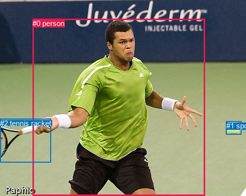
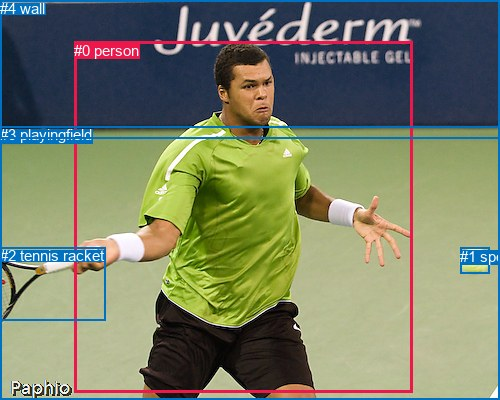

# 图片 1076：2364558.jpg

随机样本序号：198。图片 SHA256：`ab26f465308cd7c891d1f5693ebf60e7b1eabd16fb60d9757ca0a9d0a3cba71d`。

红色框表示人，蓝色框表示其他物体。两个模式分别保留自身框编号，可依据位置比较对应对象。

## 自动检测框与输出

人的框编号：`[0]`。状态：`ok`。

### 自动检测全部物体框

| 编号 | 类别 | 是否为人 | 检测分数 | 像素坐标 xyxy |
|---|---|---|---|---|
| 0 | person | True | 0.9996 | 66.1, 38.7, 416.2, 400.0 |
| 1 | sports ball | False | 0.9993 | 459.7, 247.6, 490.2, 274.9 |
| 2 | tennis racket | False | 0.9959 | 0.2, 242.9, 103.1, 331.1 |

### 自动检测 Top50 人相关候选

评分物体对：6；人相关物体对：4；输出关系：8。

| 排名 | 主语编号与类别 | 关系 | 宾语编号与类别 | 类型 | 人与人 | 排序分数 | 原始融合 logit |
|---|---|---|---|---|---|---|---|
| 1 | #0 person | holding | #2 tennis racket | semantic | False | 0.99500 | 5.2940 |
| 2 | #0 person | kicking | #1 sports ball | semantic | False | 0.94141 | 2.7769 |
| 3 | #0 person | beside | #1 sports ball | spatial | False | 0.81792 | 1.5023 |
| 4 | #0 person | beside | #2 tennis racket | spatial | False | 0.78782 | 1.3118 |
| 5 | #2 tennis racket | beside | #0 person | spatial | False | 0.63981 | 0.5745 |
| 6 | #1 sports ball | beside | #0 person | spatial | False | 0.61553 | 0.4706 |
| 7 | #1 sports ball | flying over | #0 person | semantic | False | 0.32727 | -0.7206 |
| 8 | #2 tennis racket | holding | #0 person | semantic | False | 0.28789 | -0.9057 |

### 自动检测逐条人相关 GT 核验

R@50：20.00%；命中 1/5。

| GT 主语编号 | GT 关系 | GT 宾语编号 | 结果阶段 | 匹配预测主语编号 | 匹配预测宾语编号 |
|---|---|---|---|---|---|
| 0 | about to hit | 1 | wrong_predicate | [0] | [1] |
| 0 | attached to | 2 | wrong_predicate | [0] | [2] |
| 0 | holding | 2 | hit50 | [0] | [2] |
| 0 | standing on | 3 | endpoint_missing_or_wrong_class | [0] | [] |
| 0 | in front of | 4 | endpoint_missing_or_wrong_class | [0] | [] |

## 真实框与输出

人的框编号：`[0]`。

### 真实框全部物体框

| 编号 | 类别 | 是否为人 | 检测分数 | 像素坐标 xyxy |
|---|---|---|---|---|
| 0 | person | True | GT | 74.0, 42.0, 413.0, 393.0 |
| 1 | sports ball | False | GT | 460.0, 248.0, 489.0, 274.0 |
| 2 | tennis racket | False | GT | 0.0, 247.0, 106.0, 320.0 |
| 3 | playingfield | False | GT | 0.0, 126.0, 500.0, 400.0 |
| 4 | wall | False | GT | 0.0, 0.0, 500.0, 139.0 |

### 真实框 Top50 人相关候选

评分物体对：20；人相关物体对：8；输出关系：16。

| 排名 | 主语编号与类别 | 关系 | 宾语编号与类别 | 类型 | 人与人 | 排序分数 | 原始融合 logit |
|---|---|---|---|---|---|---|---|
| 1 | #0 person | holding | #2 tennis racket | semantic | False | 0.99471 | 5.2359 |
| 2 | #0 person | playing | #1 sports ball | semantic | False | 0.97791 | 3.7904 |
| 3 | #0 person | playing | #3 playingfield | semantic | False | 0.96401 | 3.2879 |
| 4 | #0 person | on | #3 playingfield | spatial | False | 0.95853 | 3.1404 |
| 5 | #0 person | in | #1 sports ball | spatial | False | 0.82007 | 1.5168 |
| 6 | #0 person | on | #2 tennis racket | spatial | False | 0.77113 | 1.2147 |
| 7 | #0 person | in front of | #4 wall | spatial | False | 0.67007 | 0.7085 |
| 8 | #2 tennis racket | holding | #0 person | semantic | False | 0.65587 | 0.6449 |
| 9 | #2 tennis racket | in | #0 person | spatial | False | 0.53435 | 0.1376 |
| 10 | #4 wall | beside | #0 person | spatial | False | 0.53196 | 0.1280 |
| 11 | #1 sports ball | in | #0 person | spatial | False | 0.45738 | -0.1709 |
| 12 | #0 person | playing | #4 wall | semantic | False | 0.41257 | -0.3534 |
| 13 | #1 sports ball | flying over | #0 person | semantic | False | 0.34599 | -0.6367 |
| 14 | #4 wall | looking at | #0 person | semantic | False | 0.31027 | -0.7989 |
| 15 | #3 playingfield | beside | #0 person | spatial | False | 0.27273 | -0.9808 |
| 16 | #3 playingfield | holding | #0 person | semantic | False | 0.09979 | -2.1995 |

### 真实框逐条人相关 GT 核验

R@50：40.00%；命中 2/5。

| GT 主语编号 | GT 关系 | GT 宾语编号 | 结果阶段 | 匹配预测主语编号 | 匹配预测宾语编号 |
|---|---|---|---|---|---|
| 0 | about to hit | 1 | wrong_predicate | [0] | [1] |
| 0 | attached to | 2 | wrong_predicate | [0] | [2] |
| 0 | holding | 2 | hit50 | [0] | [2] |
| 0 | standing on | 3 | wrong_predicate | [0] | [3] |
| 0 | in front of | 4 | hit50 | [0] | [4] |

## 全部人相关 GT

| 主语编号与类别 | 关系 | 宾语编号与类别 |
|---|---|---|
| #0 person | about to hit | #1 sports ball |
| #0 person | attached to | #2 tennis racket |
| #0 person | holding | #2 tennis racket |
| #0 person | standing on | #3 playingfield |
| #0 person | in front of | #4 wall |

原始记录、全部人相关物体对的两项预测与分项分数见 [逐图证据 JSON](../evidence/cases/1076.json)。全部56类 logits 保留于本机 HOR/output/random500/logits/。

<!-- HOR_COMPLETE_RESULTS -->

## 六组条件的完整输出对照

以下保留同一图片三种框与候选模式、两种谓词输出规则的全部 Top50。框编号各自在所属模式内解释。

### 自动检测框完整枚举：空间与语义各保留一个谓词

| 排名 | 主语编号与类别 | 谓词 | 宾语编号与类别 | 分组 | 排序分数 | predicate logit | pair logit |
|---|---|---|---|---|---|---|---|
| 1 | #0 person | holding | #2 tennis racket | semantic | 0.9950035 | 5.0131526 | 0.2808508 |
| 2 | #0 person | kicking | #1 sports ball | semantic | 0.9414135 | 2.4307942 | 0.3460846 |
| 3 | #0 person | beside | #1 sports ball | spatial | 0.8179221 | 1.1562476 | 0.3460846 |
| 4 | #0 person | beside | #2 tennis racket | spatial | 0.7878196 | 1.0309815 | 0.2808508 |
| 5 | #2 tennis racket | beside | #0 person | spatial | 0.6398124 | 1.1227441 | -0.5481943 |
| 6 | #1 sports ball | beside | #0 person | spatial | 0.6155260 | 0.8487678 | -0.3781667 |
| 7 | #1 sports ball | flying over | #0 person | semantic | 0.3272718 | -0.3423839 | -0.3781667 |
| 8 | #2 tennis racket | holding | #0 person | semantic | 0.2878896 | -0.3574615 | -0.5481943 |

GT 命中：1/5，R@50=20.00%。

| GT主语 | GT谓词 | GT宾语 | 结果阶段 | 匹配主语框 | 匹配宾语框 |
|---|---|---|---|---|---|
| 0 | about to hit | 1 | wrong_predicate | [0] | [1] |
| 0 | attached to | 2 | wrong_predicate | [0] | [2] |
| 0 | holding | 2 | hit50 | [0] | [2] |
| 0 | standing on | 3 | endpoint_missing_or_wrong_class | [0] | [] |
| 0 | in front of | 4 | endpoint_missing_or_wrong_class | [0] | [] |

### 自动检测框完整枚举：每对只保留一个谓词

| 排名 | 主语编号与类别 | 谓词 | 宾语编号与类别 | 分组 | 排序分数 | predicate logit | pair logit |
|---|---|---|---|---|---|---|---|
| 1 | #0 person | holding | #2 tennis racket | single | 0.9950035 | 5.0131526 | 0.2808508 |
| 2 | #0 person | kicking | #1 sports ball | single | 0.9414135 | 2.4307942 | 0.3460846 |
| 3 | #2 tennis racket | beside | #0 person | single | 0.6398124 | 1.1227441 | -0.5481943 |
| 4 | #1 sports ball | beside | #0 person | single | 0.6155260 | 0.8487678 | -0.3781667 |

GT 命中：1/5，R@50=20.00%。

| GT主语 | GT谓词 | GT宾语 | 结果阶段 | 匹配主语框 | 匹配宾语框 |
|---|---|---|---|---|---|
| 0 | about to hit | 1 | wrong_predicate | [0] | [1] |
| 0 | attached to | 2 | wrong_predicate | [0] | [2] |
| 0 | holding | 2 | hit50 | [0] | [2] |
| 0 | standing on | 3 | endpoint_missing_or_wrong_class | [0] | [] |
| 0 | in front of | 4 | endpoint_missing_or_wrong_class | [0] | [] |

### 真实框完整枚举：空间与语义各保留一个谓词

| 排名 | 主语编号与类别 | 谓词 | 宾语编号与类别 | 分组 | 排序分数 | predicate logit | pair logit |
|---|---|---|---|---|---|---|---|
| 1 | #0 person | holding | #2 tennis racket | semantic | 0.9947060 | 4.9910359 | 0.2448287 |
| 2 | #0 person | playing | #1 sports ball | semantic | 0.9779123 | 3.4792228 | 0.3111774 |
| 3 | #0 person | playing | #3 playingfield | semantic | 0.9640127 | 3.4702535 | -0.1823157 |
| 4 | #0 person | on | #3 playingfield | spatial | 0.9585307 | 3.3227620 | -0.1823157 |
| 5 | #0 person | in | #1 sports ball | spatial | 0.8200740 | 1.2056718 | 0.3111774 |
| 6 | #0 person | on | #2 tennis racket | spatial | 0.7711264 | 0.9698534 | 0.2448287 |
| 7 | #0 person | in front of | #4 wall | spatial | 0.6700659 | 1.5921240 | -0.8836407 |
| 8 | #2 tennis racket | holding | #0 person | semantic | 0.6558706 | 1.2304668 | -0.5855212 |
| 9 | #2 tennis racket | in | #0 person | spatial | 0.5343452 | 0.7231188 | -0.5855212 |
| 10 | #4 wall | beside | #0 person | spatial | 0.5319595 | 0.3488145 | -0.2208019 |
| 11 | #1 sports ball | in | #0 person | spatial | 0.4573839 | 0.2157974 | -0.3866762 |
| 12 | #0 person | playing | #4 wall | semantic | 0.4125677 | 0.5302801 | -0.8836407 |
| 13 | #1 sports ball | flying over | #0 person | semantic | 0.3459938 | -0.2500200 | -0.3866762 |
| 14 | #4 wall | looking at | #0 person | semantic | 0.3102658 | -0.5780749 | -0.2208019 |
| 15 | #3 playingfield | beside | #0 person | spatial | 0.2727255 | -0.3463488 | -0.6344893 |
| 16 | #3 playingfield | holding | #0 person | semantic | 0.0997946 | -1.5650194 | -0.6344893 |

GT 命中：2/5，R@50=40.00%。

| GT主语 | GT谓词 | GT宾语 | 结果阶段 | 匹配主语框 | 匹配宾语框 |
|---|---|---|---|---|---|
| 0 | about to hit | 1 | wrong_predicate | [0] | [1] |
| 0 | attached to | 2 | wrong_predicate | [0] | [2] |
| 0 | holding | 2 | hit50 | [0] | [2] |
| 0 | standing on | 3 | wrong_predicate | [0] | [3] |
| 0 | in front of | 4 | hit50 | [0] | [4] |

### 真实框完整枚举：每对只保留一个谓词

| 排名 | 主语编号与类别 | 谓词 | 宾语编号与类别 | 分组 | 排序分数 | predicate logit | pair logit |
|---|---|---|---|---|---|---|---|
| 1 | #0 person | holding | #2 tennis racket | single | 0.9947060 | 4.9910359 | 0.2448287 |
| 2 | #0 person | playing | #1 sports ball | single | 0.9779123 | 3.4792228 | 0.3111774 |
| 3 | #0 person | playing | #3 playingfield | single | 0.9640127 | 3.4702535 | -0.1823157 |
| 4 | #0 person | in front of | #4 wall | single | 0.6700659 | 1.5921240 | -0.8836407 |
| 5 | #2 tennis racket | holding | #0 person | single | 0.6558706 | 1.2304668 | -0.5855212 |
| 6 | #4 wall | beside | #0 person | single | 0.5319595 | 0.3488145 | -0.2208019 |
| 7 | #1 sports ball | in | #0 person | single | 0.4573839 | 0.2157974 | -0.3866762 |
| 8 | #3 playingfield | beside | #0 person | single | 0.2727255 | -0.3463488 | -0.6344893 |

GT 命中：2/5，R@50=40.00%。

| GT主语 | GT谓词 | GT宾语 | 结果阶段 | 匹配主语框 | 匹配宾语框 |
|---|---|---|---|---|---|
| 0 | about to hit | 1 | wrong_predicate | [0] | [1] |
| 0 | attached to | 2 | wrong_predicate | [0] | [2] |
| 0 | holding | 2 | hit50 | [0] | [2] |
| 0 | standing on | 3 | wrong_predicate | [0] | [3] |
| 0 | in front of | 4 | hit50 | [0] | [4] |

### 真实框400候选：空间与语义各保留一个谓词

| 排名 | 主语编号与类别 | 谓词 | 宾语编号与类别 | 分组 | 排序分数 | predicate logit | pair logit |
|---|---|---|---|---|---|---|---|
| 1 | #0 person | holding | #2 tennis racket | semantic | 0.9947060 | 4.9910359 | 0.2448287 |
| 2 | #0 person | playing | #1 sports ball | semantic | 0.9779123 | 3.4792228 | 0.3111774 |
| 3 | #0 person | playing | #3 playingfield | semantic | 0.9641805 | 3.4751010 | -0.1823157 |
| 4 | #0 person | on | #3 playingfield | spatial | 0.9585307 | 3.3227620 | -0.1823157 |
| 5 | #0 person | in | #1 sports ball | spatial | 0.8200740 | 1.2056718 | 0.3111774 |
| 6 | #0 person | on | #2 tennis racket | spatial | 0.7711264 | 0.9698534 | 0.2448287 |
| 7 | #0 person | in front of | #4 wall | spatial | 0.6699982 | 1.5918179 | -0.8836407 |
| 8 | #2 tennis racket | holding | #0 person | semantic | 0.6558706 | 1.2304668 | -0.5855212 |
| 9 | #4 wall | beside | #0 person | spatial | 0.5394151 | 0.3787899 | -0.2208019 |
| 10 | #2 tennis racket | in | #0 person | spatial | 0.5351709 | 0.7264376 | -0.5855212 |
| 11 | #1 sports ball | in | #0 person | spatial | 0.4627978 | 0.2375917 | -0.3866762 |
| 12 | #0 person | playing | #4 wall | semantic | 0.4186989 | 0.5555239 | -0.8836407 |
| 13 | #1 sports ball | flying over | #0 person | semantic | 0.3459938 | -0.2500200 | -0.3866762 |
| 14 | #4 wall | looking at | #0 person | semantic | 0.3164401 | -0.5493784 | -0.2208019 |
| 15 | #3 playingfield | beside | #0 person | spatial | 0.2727199 | -0.3463774 | -0.6344893 |
| 16 | #3 playingfield | holding | #0 person | semantic | 0.1005516 | -1.5566208 | -0.6344893 |

GT 命中：2/5，R@50=40.00%。

| GT主语 | GT谓词 | GT宾语 | 结果阶段 | 匹配主语框 | 匹配宾语框 |
|---|---|---|---|---|---|
| 0 | about to hit | 1 | wrong_predicate | [0] | [1] |
| 0 | attached to | 2 | wrong_predicate | [0] | [2] |
| 0 | holding | 2 | hit50 | [0] | [2] |
| 0 | standing on | 3 | wrong_predicate | [0] | [3] |
| 0 | in front of | 4 | hit50 | [0] | [4] |

### 真实框400候选：每对只保留一个谓词

| 排名 | 主语编号与类别 | 谓词 | 宾语编号与类别 | 分组 | 排序分数 | predicate logit | pair logit |
|---|---|---|---|---|---|---|---|
| 1 | #0 person | holding | #2 tennis racket | single | 0.9947060 | 4.9910359 | 0.2448287 |
| 2 | #0 person | playing | #1 sports ball | single | 0.9779123 | 3.4792228 | 0.3111774 |
| 3 | #0 person | playing | #3 playingfield | single | 0.9641805 | 3.4751010 | -0.1823157 |
| 4 | #0 person | in front of | #4 wall | single | 0.6699982 | 1.5918179 | -0.8836407 |
| 5 | #2 tennis racket | holding | #0 person | single | 0.6558706 | 1.2304668 | -0.5855212 |
| 6 | #4 wall | beside | #0 person | single | 0.5394151 | 0.3787899 | -0.2208019 |
| 7 | #1 sports ball | in | #0 person | single | 0.4627978 | 0.2375917 | -0.3866762 |
| 8 | #3 playingfield | beside | #0 person | single | 0.2727199 | -0.3463774 | -0.6344893 |

GT 命中：2/5，R@50=40.00%。

| GT主语 | GT谓词 | GT宾语 | 结果阶段 | 匹配主语框 | 匹配宾语框 |
|---|---|---|---|---|---|
| 0 | about to hit | 1 | wrong_predicate | [0] | [1] |
| 0 | attached to | 2 | wrong_predicate | [0] | [2] |
| 0 | holding | 2 | hit50 | [0] | [2] |
| 0 | standing on | 3 | wrong_predicate | [0] | [3] |
| 0 | in front of | 4 | hit50 | [0] | [4] |
