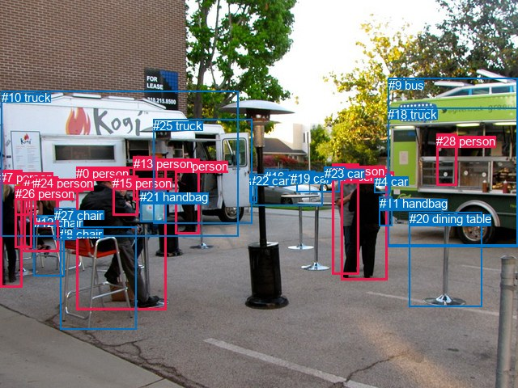
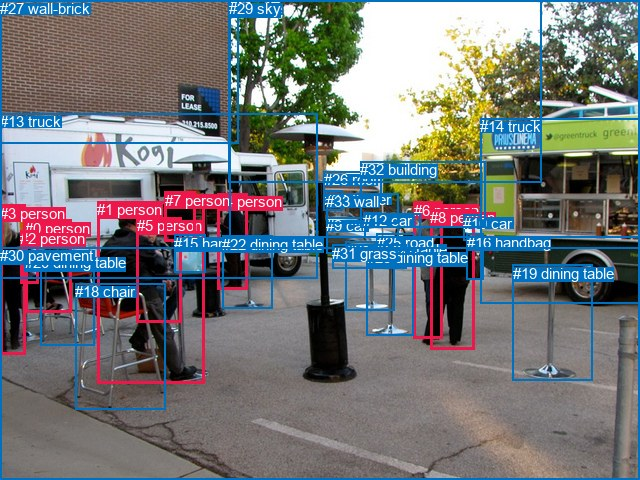

# 图片 1089：2365077.jpg

随机样本序号：456。图片 SHA256：`e051d5c7180bec8cb38caae0cbeca57f4d09879d097065c581bb9f9c0d474a09`。

红色框表示人，蓝色框表示其他物体。两个模式分别保留自身框编号，可依据位置比较对应对象。

## 自动检测框与输出

人的框编号：`[0, 1, 5, 6, 7, 13, 14, 15, 17, 24, 26, 28]`。状态：`ok`。

### 自动检测全部物体框

| 编号 | 类别 | 是否为人 | 检测分数 | 像素坐标 xyxy |
|---|---|---|---|---|
| 0 | person | True | 0.9990 | 94.2, 206.3, 205.4, 383.6 |
| 1 | person | True | 0.9967 | 421.3, 209.6, 478.9, 346.3 |
| 2 | car | False | 0.9964 | 366.0, 213.4, 419.5, 237.6 |
| 3 | car | False | 0.9947 | 313.1, 215.5, 398.4, 254.4 |
| 4 | car | False | 0.9935 | 462.8, 215.8, 482.5, 238.7 |
| 5 | person | True | 0.9934 | 216.9, 196.8, 246.1, 289.4 |
| 6 | person | True | 0.9864 | 410.4, 202.7, 443.3, 339.4 |
| 7 | person | True | 0.9801 | 0.0, 210.8, 27.3, 355.1 |
| 8 | chair | False | 0.9798 | 74.1, 280.8, 168.8, 407.8 |
| 9 | bus | False | 0.9717 | 479.9, 96.8, 639.6, 303.4 |
| 10 | truck | False | 0.9636 | 1.8, 112.3, 294.0, 292.7 |
| 11 | handbag | False | 0.9457 | 468.9, 243.2, 484.1, 279.8 |
| 12 | chair | False | 0.9236 | 41.7, 266.9, 79.7, 341.5 |
| 13 | person | True | 0.9162 | 164.6, 193.9, 194.3, 247.7 |
| 14 | person | True | 0.9087 | 29.2, 220.2, 72.2, 311.9 |
| 15 | person | True | 0.8104 | 139.2, 217.9, 170.2, 267.0 |
| 16 | car | False | 0.6810 | 327.3, 209.8, 356.1, 218.4 |
| 17 | person | True | 0.6670 | 18.0, 230.7, 35.4, 266.6 |
| 18 | truck | False | 0.6606 | 479.2, 133.2, 640.0, 305.5 |
| 19 | car | False | 0.6170 | 359.5, 211.6, 389.2, 222.3 |
| 20 | dining table | False | 0.6139 | 505.9, 262.4, 595.3, 379.8 |
| 21 | handbag | False | 0.6019 | 173.0, 235.1, 205.3, 274.3 |
| 22 | car | False | 0.5811 | 308.4, 215.2, 317.4, 250.8 |
| 23 | car | False | 0.5699 | 400.8, 206.2, 426.8, 222.1 |
| 24 | person | True | 0.4589 | 42.4, 218.3, 71.9, 277.1 |
| 25 | truck | False | 0.4433 | 189.3, 147.3, 311.4, 276.5 |
| 26 | person | True | 0.4041 | 18.8, 230.8, 39.2, 306.7 |
| 27 | chair | False | 0.3949 | 67.2, 257.9, 93.6, 296.6 |
| 28 | person | True | 0.3919 | 539.5, 165.9, 564.1, 229.3 |

### 自动检测 Top50 人相关候选

评分物体对：812；人相关物体对：540；输出关系：50。

| 排名 | 主语编号与类别 | 关系 | 宾语编号与类别 | 类型 | 人与人 | 排序分数 | 原始融合 logit |
|---|---|---|---|---|---|---|---|
| 1 | #14 person | sitting on | #12 chair | semantic | False | 0.99120 | 4.7243 |
| 2 | #0 person | sitting on | #8 chair | semantic | False | 0.98944 | 4.5403 |
| 3 | #6 person | talking to | #23 car | semantic | False | 0.98498 | 4.1836 |
| 4 | #24 person | sitting on | #12 chair | semantic | False | 0.98464 | 4.1607 |
| 5 | #26 person | wearing | #17 person | semantic | True | 0.97942 | 3.8627 |
| 6 | #1 person | carrying | #11 handbag | semantic | False | 0.97881 | 3.8328 |
| 7 | #1 person | talking to | #23 car | semantic | False | 0.97298 | 3.5836 |
| 8 | #28 person | in | #18 truck | spatial | False | 0.96995 | 3.4742 |
| 9 | #13 person | standing on | #10 truck | semantic | False | 0.96795 | 3.4078 |
| 10 | #28 person | driving on | #18 truck | semantic | False | 0.96577 | 3.3398 |
| 11 | #7 person | holding | #17 person | semantic | True | 0.96492 | 3.3145 |
| 12 | #28 person | in | #9 bus | spatial | False | 0.96302 | 3.2596 |
| 13 | #5 person | standing on | #25 truck | semantic | False | 0.96091 | 3.2020 |
| 14 | #28 person | driving on | #9 bus | semantic | False | 0.95899 | 3.1522 |
| 15 | #14 person | on | #12 chair | spatial | False | 0.95819 | 3.1319 |
| 16 | #0 person | on | #8 chair | spatial | False | 0.95631 | 3.0861 |
| 17 | #13 person | holding | #21 handbag | semantic | False | 0.95339 | 3.0181 |
| 18 | #5 person | standing on | #10 truck | semantic | False | 0.94744 | 2.8917 |
| 19 | #0 person | holding | #21 handbag | semantic | False | 0.94526 | 2.8489 |
| 20 | #0 person | talking to | #15 person | semantic | True | 0.94348 | 2.8150 |
| 21 | #24 person | on | #12 chair | spatial | False | 0.94340 | 2.8134 |
| 22 | #6 person | talking to | #1 person | semantic | True | 0.93865 | 2.7278 |
| 23 | #13 person | standing on | #25 truck | semantic | False | 0.93662 | 2.6931 |
| 24 | #26 person | sitting on | #12 chair | semantic | False | 0.93046 | 2.5938 |
| 25 | #1 person | talking to | #6 person | semantic | True | 0.91791 | 2.4143 |
| 26 | #24 person | sitting on | #27 chair | semantic | False | 0.91755 | 2.4095 |
| 27 | #7 person | holding | #26 person | semantic | True | 0.90647 | 2.2712 |
| 28 | #26 person | in | #17 person | spatial | True | 0.90479 | 2.2516 |
| 29 | #24 person | standing on | #10 truck | semantic | False | 0.87780 | 1.9717 |
| 30 | #7 person | sitting on | #12 chair | semantic | False | 0.87316 | 1.9292 |
| 31 | #14 person | sitting on | #27 chair | semantic | False | 0.87213 | 1.9199 |
| 32 | #14 person | sitting on | #8 chair | semantic | False | 0.86584 | 1.8647 |
| 33 | #13 person | on | #21 handbag | spatial | False | 0.86397 | 1.8487 |
| 34 | #14 person | wearing | #24 person | semantic | True | 0.86324 | 1.8425 |
| 35 | #14 person | in | #24 person | spatial | True | 0.85774 | 1.7966 |
| 36 | #24 person | on | #27 chair | spatial | False | 0.85430 | 1.7687 |
| 37 | #6 person | in | #23 car | spatial | False | 0.85358 | 1.7630 |
| 38 | #14 person | holding | #17 person | semantic | True | 0.84803 | 1.7192 |
| 39 | #13 person | on | #10 truck | spatial | False | 0.84689 | 1.7104 |
| 40 | #5 person | beside | #25 truck | spatial | False | 0.83957 | 1.6550 |
| 41 | #1 person | standing on | #9 bus | semantic | False | 0.82145 | 1.5262 |
| 42 | #14 person | standing on | #10 truck | semantic | False | 0.82001 | 1.5164 |
| 43 | #17 person | on | #26 person | spatial | True | 0.81895 | 1.5092 |
| 44 | #7 person | in | #17 person | spatial | True | 0.80260 | 1.4026 |
| 45 | #5 person | beside | #10 truck | spatial | False | 0.79317 | 1.3441 |
| 46 | #14 person | on | #27 chair | spatial | False | 0.78633 | 1.3029 |
| 47 | #26 person | on | #12 chair | spatial | False | 0.78152 | 1.2745 |
| 48 | #1 person | standing on | #18 truck | semantic | False | 0.77490 | 1.2362 |
| 49 | #14 person | leaning on | #10 truck | spatial | False | 0.76644 | 1.1883 |
| 50 | #0 person | sitting on | #10 truck | semantic | False | 0.76106 | 1.1585 |

### 自动检测逐条人相关 GT 核验

R@50：66.67%；命中 2/3。

| GT 主语编号 | GT 关系 | GT 宾语编号 | 结果阶段 | 匹配预测主语编号 | 匹配预测宾语编号 |
|---|---|---|---|---|---|
| 0 | talking to | 2 | wrong_predicate | [14] | [17, 26] |
| 1 | sitting on | 18 | hit50 | [0] | [8] |
| 8 | carrying | 16 | hit50 | [1] | [11] |

## 真实框与输出

人的框编号：`[0, 1, 2, 3, 4, 5, 6, 7, 8]`。

### 真实框全部物体框

| 编号 | 类别 | 是否为人 | 检测分数 | 像素坐标 xyxy |
|---|---|---|---|---|
| 0 | person | True | GT | 25.0, 220.0, 72.0, 313.0 |
| 1 | person | True | GT | 97.0, 201.0, 204.0, 383.0 |
| 2 | person | True | GT | 20.0, 230.0, 38.0, 283.0 |
| 3 | person | True | GT | 0.0, 205.0, 26.0, 355.0 |
| 4 | person | True | GT | 217.0, 193.0, 247.0, 289.0 |
| 5 | person | True | GT | 137.0, 217.0, 182.0, 323.0 |
| 6 | person | True | GT | 414.0, 202.0, 443.0, 339.0 |
| 7 | person | True | GT | 165.0, 192.0, 196.0, 242.0 |
| 8 | person | True | GT | 430.0, 209.0, 474.0, 350.0 |
| 9 | car | False | GT | 326.0, 217.0, 398.0, 253.0 |
| 10 | car | False | GT | 463.0, 215.0, 482.0, 241.0 |
| 11 | car | False | GT | 365.0, 214.0, 421.0, 238.0 |
| 12 | car | False | GT | 363.0, 212.0, 381.0, 221.0 |
| 13 | truck | False | GT | 0.0, 113.0, 317.0, 278.0 |
| 14 | truck | False | GT | 480.0, 118.0, 640.0, 303.0 |
| 15 | handbag | False | GT | 174.0, 235.0, 205.0, 273.0 |
| 16 | handbag | False | GT | 467.0, 234.0, 484.0, 280.0 |
| 17 | chair | False | GT | 41.0, 254.0, 94.0, 345.0 |
| 18 | chair | False | GT | 75.0, 283.0, 165.0, 409.0 |
| 19 | dining table | False | GT | 513.0, 265.0, 592.0, 381.0 |
| 20 | dining table | False | GT | 25.0, 254.0, 47.0, 262.0 |
| 21 | dining table | False | GT | 346.0, 241.0, 395.0, 310.0 |
| 22 | dining table | False | GT | 222.0, 236.0, 272.0, 309.0 |
| 23 | dining table | False | GT | 367.0, 249.0, 414.0, 335.0 |
| 24 | flower | False | GT | 324.0, 191.0, 343.0, 211.0 |
| 25 | road | False | GT | 377.0, 234.0, 415.0, 255.0 |
| 26 | roof | False | GT | 324.0, 171.0, 382.0, 202.0 |
| 27 | wall-brick | False | GT | 0.0, 0.0, 239.0, 143.0 |
| 28 | tree | False | GT | 229.0, 0.0, 640.0, 237.0 |
| 29 | sky | False | GT | 229.0, 0.0, 542.0, 183.0 |
| 30 | pavement | False | GT | 0.0, 247.0, 640.0, 480.0 |
| 31 | grass | False | GT | 332.0, 245.0, 406.0, 269.0 |
| 32 | building | False | GT | 360.0, 161.0, 485.0, 227.0 |
| 33 | wall | False | GT | 326.0, 193.0, 398.0, 223.0 |

### 真实框 Top50 人相关候选

评分物体对：1122；人相关物体对：522；输出关系：50。

| 排名 | 主语编号与类别 | 关系 | 宾语编号与类别 | 类型 | 人与人 | 排序分数 | 原始融合 logit |
|---|---|---|---|---|---|---|---|
| 1 | #0 person | sitting on | #17 chair | semantic | False | 0.99162 | 4.7737 |
| 2 | #1 person | sitting on | #18 chair | semantic | False | 0.99066 | 4.6640 |
| 3 | #8 person | carrying | #16 handbag | semantic | False | 0.98720 | 4.3451 |
| 4 | #2 person | holding | #20 dining table | semantic | False | 0.97779 | 3.7845 |
| 5 | #0 person | holding | #20 dining table | semantic | False | 0.97686 | 3.7427 |
| 6 | #6 person | talking to | #8 person | semantic | True | 0.97448 | 3.6424 |
| 7 | #3 person | holding | #20 dining table | semantic | False | 0.97428 | 3.6343 |
| 8 | #8 person | standing on | #30 pavement | semantic | False | 0.97317 | 3.5911 |
| 9 | #6 person | standing on | #30 pavement | semantic | False | 0.97206 | 3.5494 |
| 10 | #4 person | standing on | #22 dining table | semantic | False | 0.97071 | 3.5007 |
| 11 | #5 person | sitting on | #18 chair | semantic | False | 0.97031 | 3.4869 |
| 12 | #5 person | holding | #15 handbag | semantic | False | 0.96955 | 3.4609 |
| 13 | #8 person | talking to | #6 person | semantic | True | 0.96923 | 3.4500 |
| 14 | #1 person | holding | #15 handbag | semantic | False | 0.96484 | 3.3120 |
| 15 | #3 person | holding | #2 person | semantic | True | 0.96484 | 3.3120 |
| 16 | #0 person | on | #17 chair | spatial | False | 0.96100 | 3.2045 |
| 17 | #1 person | on | #18 chair | spatial | False | 0.95598 | 3.0782 |
| 18 | #0 person | holding | #2 person | semantic | True | 0.94848 | 2.9129 |
| 19 | #7 person | standing on | #13 truck | semantic | False | 0.94526 | 2.8489 |
| 20 | #3 person | standing on | #30 pavement | semantic | False | 0.94196 | 2.7868 |
| 21 | #7 person | holding | #15 handbag | semantic | False | 0.93545 | 2.6735 |
| 22 | #2 person | on | #20 dining table | spatial | False | 0.93350 | 2.6417 |
| 23 | #4 person | standing on | #30 pavement | semantic | False | 0.93261 | 2.6274 |
| 24 | #4 person | standing on | #13 truck | semantic | False | 0.90728 | 2.2808 |
| 25 | #0 person | on | #20 dining table | spatial | False | 0.90223 | 2.2223 |
| 26 | #5 person | on | #18 chair | spatial | False | 0.89910 | 2.1872 |
| 27 | #3 person | on | #20 dining table | spatial | False | 0.89658 | 2.1598 |
| 28 | #4 person | on | #22 dining table | spatial | False | 0.89170 | 2.1082 |
| 29 | #7 person | on | #13 truck | spatial | False | 0.89060 | 2.0968 |
| 30 | #1 person | talking to | #5 person | semantic | True | 0.87673 | 1.9619 |
| 31 | #0 person | sitting on | #18 chair | semantic | False | 0.87462 | 1.9424 |
| 32 | #3 person | sitting on | #17 chair | semantic | False | 0.84941 | 1.7300 |
| 33 | #1 person | sitting on | #17 chair | semantic | False | 0.84465 | 1.6932 |
| 34 | #0 person | sitting on | #13 truck | semantic | False | 0.84380 | 1.6868 |
| 35 | #7 person | on | #15 handbag | spatial | False | 0.83506 | 1.6219 |
| 36 | #5 person | sitting on | #13 truck | semantic | False | 0.83049 | 1.5891 |
| 37 | #0 person | standing on | #30 pavement | semantic | False | 0.81916 | 1.5107 |
| 38 | #4 person | beside | #13 truck | spatial | False | 0.80908 | 1.4440 |
| 39 | #8 person | on | #30 pavement | spatial | False | 0.80739 | 1.4331 |
| 40 | #0 person | leaning on | #13 truck | spatial | False | 0.80565 | 1.4220 |
| 41 | #8 person | looking at | #14 truck | semantic | False | 0.80189 | 1.3982 |
| 42 | #1 person | sitting on | #13 truck | semantic | False | 0.78834 | 1.3150 |
| 43 | #5 person | on | #15 handbag | spatial | False | 0.77940 | 1.2622 |
| 44 | #6 person | on | #30 pavement | spatial | False | 0.76915 | 1.2035 |
| 45 | #3 person | talking to | #0 person | semantic | True | 0.76828 | 1.1986 |
| 46 | #3 person | on | #2 person | spatial | True | 0.76257 | 1.1668 |
| 47 | #0 person | in | #2 person | spatial | True | 0.74292 | 1.0612 |
| 48 | #8 person | beside | #14 truck | spatial | False | 0.73756 | 1.0333 |
| 49 | #1 person | on | #30 pavement | spatial | False | 0.73700 | 1.0304 |
| 50 | #2 person | sitting on | #17 chair | semantic | False | 0.73442 | 1.0171 |

### 真实框逐条人相关 GT 核验

R@50：66.67%；命中 2/3。

| GT 主语编号 | GT 关系 | GT 宾语编号 | 结果阶段 | 匹配预测主语编号 | 匹配预测宾语编号 |
|---|---|---|---|---|---|
| 0 | talking to | 2 | wrong_predicate | [0] | [2] |
| 1 | sitting on | 18 | hit50 | [1] | [18] |
| 8 | carrying | 16 | hit50 | [8] | [16] |

## 全部人相关 GT

| 主语编号与类别 | 关系 | 宾语编号与类别 |
|---|---|---|
| #0 person | talking to | #2 person |
| #1 person | sitting on | #18 chair |
| #8 person | carrying | #16 handbag |

原始记录、全部人相关物体对的两项预测与分项分数见 [逐图证据 JSON](../evidence/cases/1089.json)。全部56类 logits 保留于本机 HOR/output/random500/logits/。

<!-- HOR_COMPLETE_RESULTS -->

## 六组条件的完整输出对照

以下保留同一图片三种框与候选模式、两种谓词输出规则的全部 Top50。框编号各自在所属模式内解释。

### 自动检测框完整枚举：空间与语义各保留一个谓词

| 排名 | 主语编号与类别 | 谓词 | 宾语编号与类别 | 分组 | 排序分数 | predicate logit | pair logit |
|---|---|---|---|---|---|---|---|
| 1 | #14 person | sitting on | #12 chair | semantic | 0.9912009 | 3.7647996 | 0.9594707 |
| 2 | #0 person | sitting on | #8 chair | semantic | 0.9894428 | 3.5661941 | 0.9741361 |
| 3 | #6 person | talking to | #23 car | semantic | 0.9849849 | 3.8586125 | 0.3249601 |
| 4 | #24 person | sitting on | #12 chair | semantic | 0.9846435 | 3.4759040 | 0.6848347 |
| 5 | #26 person | wearing | #17 person | semantic | 0.9794208 | 3.8611436 | 0.0015383 |
| 6 | #1 person | carrying | #11 handbag | semantic | 0.9788093 | 3.3261542 | 0.5066175 |
| 7 | #1 person | talking to | #23 car | semantic | 0.9729754 | 3.1944790 | 0.3891327 |
| 8 | #28 person | in | #18 truck | spatial | 0.9699450 | 2.8067408 | 0.6674703 |
| 9 | #13 person | standing on | #10 truck | semantic | 0.9679480 | 3.3341365 | 0.0736817 |
| 10 | #28 person | driving on | #18 truck | semantic | 0.9657701 | 2.6723571 | 0.6674703 |
| 11 | #7 person | holding | #17 person | semantic | 0.9649226 | 2.9507389 | 0.3637540 |
| 12 | #28 person | in | #9 bus | spatial | 0.9630171 | 2.5693297 | 0.6902864 |
| 13 | #5 person | standing on | #25 truck | semantic | 0.9609108 | 3.1845932 | 0.0174412 |
| 14 | #28 person | driving on | #9 bus | semantic | 0.9589947 | 2.4618988 | 0.6902864 |
| 15 | #14 person | on | #12 chair | spatial | 0.9581885 | 2.1724019 | 0.9594707 |
| 16 | #0 person | on | #8 chair | spatial | 0.9563143 | 2.1119299 | 0.9741361 |
| 17 | #13 person | holding | #21 handbag | semantic | 0.9533874 | 2.9038901 | 0.1142597 |
| 18 | #5 person | standing on | #10 truck | semantic | 0.9474351 | 3.0334225 | -0.1417136 |
| 19 | #0 person | holding | #21 handbag | semantic | 0.9452632 | 2.9238114 | -0.0748830 |
| 20 | #0 person | talking to | #15 person | semantic | 0.9434836 | 2.8137965 | 0.0012517 |
| 21 | #24 person | on | #12 chair | spatial | 0.9433951 | 2.1285543 | 0.6848347 |
| 22 | #6 person | talking to | #1 person | semantic | 0.9386481 | 3.7408729 | -1.0130589 |
| 23 | #13 person | standing on | #25 truck | semantic | 0.9366162 | 2.6011291 | 0.0919352 |
| 24 | #26 person | sitting on | #12 chair | semantic | 0.9304609 | 1.6583800 | 0.9354101 |
| 25 | #1 person | talking to | #6 person | semantic | 0.9179112 | 3.3826547 | -0.9683550 |
| 26 | #24 person | sitting on | #27 chair | semantic | 0.9175508 | 1.9442387 | 0.4652872 |
| 27 | #7 person | holding | #26 person | semantic | 0.9064666 | 1.9791660 | 0.2920693 |
| 28 | #26 person | in | #17 person | spatial | 0.9047868 | 2.2500429 | 0.0015383 |
| 29 | #24 person | standing on | #10 truck | semantic | 0.8777964 | 2.1337423 | -0.1620167 |
| 30 | #7 person | sitting on | #12 chair | semantic | 0.8731588 | 0.9692698 | 0.9599122 |
| 31 | #14 person | sitting on | #27 chair | semantic | 0.8721301 | 1.1919417 | 0.7279840 |
| 32 | #14 person | sitting on | #8 chair | semantic | 0.8658403 | 1.5169525 | 0.3477173 |
| 33 | #13 person | on | #21 handbag | spatial | 0.8639748 | 1.7344437 | 0.1142597 |
| 34 | #14 person | wearing | #24 person | semantic | 0.8632431 | 2.0304022 | -0.1879103 |
| 35 | #14 person | in | #24 person | spatial | 0.8577362 | 1.9845238 | -0.1879103 |
| 36 | #24 person | on | #27 chair | spatial | 0.8542987 | 1.3034348 | 0.4652872 |
| 37 | #6 person | in | #23 car | spatial | 0.8535830 | 1.4380245 | 0.3249601 |
| 38 | #14 person | holding | #17 person | semantic | 0.8480289 | 1.5313005 | 0.1879239 |
| 39 | #13 person | on | #10 truck | spatial | 0.8468930 | 1.6367555 | 0.0736817 |
| 40 | #5 person | beside | #25 truck | spatial | 0.8395700 | 1.6375918 | 0.0174412 |
| 41 | #1 person | standing on | #9 bus | semantic | 0.8214476 | 1.2904730 | 0.2357128 |
| 42 | #14 person | standing on | #10 truck | semantic | 0.8200128 | 1.5503769 | -0.0339429 |
| 43 | #17 person | on | #26 person | spatial | 0.8189496 | 1.6244459 | -0.1151989 |
| 44 | #7 person | in | #17 person | spatial | 0.8025992 | 1.0388651 | 0.3637540 |
| 45 | #5 person | beside | #10 truck | spatial | 0.7931715 | 1.4858632 | -0.1417136 |
| 46 | #14 person | on | #27 chair | spatial | 0.7863253 | 0.5749316 | 0.7279840 |
| 47 | #26 person | on | #12 chair | spatial | 0.7815180 | 0.3391242 | 0.9354101 |
| 48 | #1 person | standing on | #18 truck | semantic | 0.7749009 | 1.1099253 | 0.1262691 |
| 49 | #14 person | leaning on | #10 truck | spatial | 0.7664433 | 1.2222786 | -0.0339429 |
| 50 | #0 person | sitting on | #10 truck | semantic | 0.7610645 | 1.2460518 | -0.0875270 |

GT 命中：2/3，R@50=66.67%。

| GT主语 | GT谓词 | GT宾语 | 结果阶段 | 匹配主语框 | 匹配宾语框 |
|---|---|---|---|---|---|
| 0 | talking to | 2 | wrong_predicate | [14] | [17, 26] |
| 1 | sitting on | 18 | hit50 | [0] | [8] |
| 8 | carrying | 16 | hit50 | [1] | [11] |

### 自动检测框完整枚举：每对只保留一个谓词

| 排名 | 主语编号与类别 | 谓词 | 宾语编号与类别 | 分组 | 排序分数 | predicate logit | pair logit |
|---|---|---|---|---|---|---|---|
| 1 | #14 person | sitting on | #12 chair | single | 0.9912009 | 3.7647996 | 0.9594707 |
| 2 | #0 person | sitting on | #8 chair | single | 0.9894428 | 3.5661941 | 0.9741361 |
| 3 | #6 person | talking to | #23 car | single | 0.9849849 | 3.8586125 | 0.3249601 |
| 4 | #24 person | sitting on | #12 chair | single | 0.9846435 | 3.4759040 | 0.6848347 |
| 5 | #26 person | wearing | #17 person | single | 0.9794208 | 3.8611436 | 0.0015383 |
| 6 | #1 person | carrying | #11 handbag | single | 0.9788093 | 3.3261542 | 0.5066175 |
| 7 | #1 person | talking to | #23 car | single | 0.9729754 | 3.1944790 | 0.3891327 |
| 8 | #28 person | in | #18 truck | single | 0.9699450 | 2.8067408 | 0.6674703 |
| 9 | #13 person | standing on | #10 truck | single | 0.9679480 | 3.3341365 | 0.0736817 |
| 10 | #7 person | holding | #17 person | single | 0.9649226 | 2.9507389 | 0.3637540 |
| 11 | #28 person | in | #9 bus | single | 0.9630171 | 2.5693297 | 0.6902864 |
| 12 | #5 person | standing on | #25 truck | single | 0.9609108 | 3.1845932 | 0.0174412 |
| 13 | #13 person | holding | #21 handbag | single | 0.9533874 | 2.9038901 | 0.1142597 |
| 14 | #5 person | standing on | #10 truck | single | 0.9474351 | 3.0334225 | -0.1417136 |
| 15 | #0 person | holding | #21 handbag | single | 0.9452632 | 2.9238114 | -0.0748830 |
| 16 | #0 person | talking to | #15 person | single | 0.9434836 | 2.8137965 | 0.0012517 |
| 17 | #6 person | talking to | #1 person | single | 0.9386481 | 3.7408729 | -1.0130589 |
| 18 | #13 person | standing on | #25 truck | single | 0.9366162 | 2.6011291 | 0.0919352 |
| 19 | #26 person | sitting on | #12 chair | single | 0.9304609 | 1.6583800 | 0.9354101 |
| 20 | #1 person | talking to | #6 person | single | 0.9179112 | 3.3826547 | -0.9683550 |
| 21 | #24 person | sitting on | #27 chair | single | 0.9175508 | 1.9442387 | 0.4652872 |
| 22 | #7 person | holding | #26 person | single | 0.9064666 | 1.9791660 | 0.2920693 |
| 23 | #24 person | standing on | #10 truck | single | 0.8777964 | 2.1337423 | -0.1620167 |
| 24 | #7 person | sitting on | #12 chair | single | 0.8731588 | 0.9692698 | 0.9599122 |
| 25 | #14 person | sitting on | #27 chair | single | 0.8721301 | 1.1919417 | 0.7279840 |
| 26 | #14 person | sitting on | #8 chair | single | 0.8658403 | 1.5169525 | 0.3477173 |
| 27 | #14 person | wearing | #24 person | single | 0.8632431 | 2.0304022 | -0.1879103 |
| 28 | #14 person | holding | #17 person | single | 0.8480289 | 1.5313005 | 0.1879239 |
| 29 | #1 person | standing on | #9 bus | single | 0.8214476 | 1.2904730 | 0.2357128 |
| 30 | #14 person | standing on | #10 truck | single | 0.8200128 | 1.5503769 | -0.0339429 |
| 31 | #17 person | on | #26 person | single | 0.8189496 | 1.6244459 | -0.1151989 |
| 32 | #1 person | standing on | #18 truck | single | 0.7749009 | 1.1099253 | 0.1262691 |
| 33 | #0 person | sitting on | #10 truck | single | 0.7610645 | 1.2460518 | -0.0875270 |
| 34 | #13 person | talking to | #15 person | single | 0.7518504 | 1.3433270 | -0.2348218 |
| 35 | #15 person | sitting on | #10 truck | single | 0.7415977 | 1.1528215 | -0.0985321 |
| 36 | #15 person | holding | #21 handbag | single | 0.7366459 | 0.8861299 | 0.1424780 |
| 37 | #7 person | sitting on | #8 chair | single | 0.7088728 | 0.4727559 | 0.4171598 |
| 38 | #7 person | standing on | #10 truck | single | 0.7067123 | 1.0513706 | -0.1719010 |
| 39 | #0 person | sitting on | #12 chair | single | 0.6637068 | 0.4276271 | 0.2522302 |
| 40 | #6 person | standing on | #9 bus | single | 0.6556947 | 0.5315619 | 0.1126045 |
| 41 | #1 person | wearing | #4 car | single | 0.6467832 | 0.4839401 | 0.1209888 |
| 42 | #13 person | standing on | #9 bus | single | 0.6395321 | 0.7067099 | -0.1333755 |
| 43 | #15 person | talking to | #13 person | single | 0.6186731 | 1.2534909 | -0.7695711 |
| 44 | #14 person | holding | #26 person | single | 0.6135718 | 0.3909969 | 0.0713541 |
| 45 | #13 person | standing on | #18 truck | single | 0.6023477 | 0.4953570 | -0.0801000 |
| 46 | #17 person | sitting on | #12 chair | single | 0.5767837 | -0.4239569 | 0.7335408 |
| 47 | #24 person | sitting on | #8 chair | single | 0.5704420 | 0.2651215 | 0.0185333 |
| 48 | #5 person | standing on | #9 bus | single | 0.5660954 | 0.5200391 | -0.2541014 |
| 49 | #6 person | standing on | #18 truck | single | 0.5656471 | 0.2680850 | -0.0039721 |
| 50 | #15 person | sitting on | #8 chair | single | 0.5635684 | 0.1989303 | 0.0567268 |

GT 命中：2/3，R@50=66.67%。

| GT主语 | GT谓词 | GT宾语 | 结果阶段 | 匹配主语框 | 匹配宾语框 |
|---|---|---|---|---|---|
| 0 | talking to | 2 | wrong_predicate | [14] | [17, 26] |
| 1 | sitting on | 18 | hit50 | [0] | [8] |
| 8 | carrying | 16 | hit50 | [1] | [11] |

### 真实框完整枚举：空间与语义各保留一个谓词

| 排名 | 主语编号与类别 | 谓词 | 宾语编号与类别 | 分组 | 排序分数 | predicate logit | pair logit |
|---|---|---|---|---|---|---|---|
| 1 | #0 person | sitting on | #17 chair | semantic | 0.9916219 | 3.8671069 | 0.9065989 |
| 2 | #1 person | sitting on | #18 chair | semantic | 0.9906594 | 3.7467418 | 0.9172447 |
| 3 | #8 person | carrying | #16 handbag | semantic | 0.9871955 | 3.8375049 | 0.5075638 |
| 4 | #2 person | holding | #20 dining table | semantic | 0.9777854 | 3.2908154 | 0.4937283 |
| 5 | #0 person | holding | #20 dining table | semantic | 0.9768575 | 3.1057968 | 0.6368742 |
| 6 | #6 person | talking to | #8 person | semantic | 0.9744794 | 4.6418595 | -0.9994445 |
| 7 | #3 person | holding | #20 dining table | semantic | 0.9742779 | 2.9215364 | 0.7128100 |
| 8 | #8 person | standing on | #30 pavement | semantic | 0.9731715 | 3.6178994 | -0.0268016 |
| 9 | #6 person | standing on | #30 pavement | semantic | 0.9720616 | 3.6633935 | -0.1139770 |
| 10 | #4 person | standing on | #22 dining table | semantic | 0.9707065 | 3.3418784 | 0.1587824 |
| 11 | #5 person | sitting on | #18 chair | semantic | 0.9703119 | 3.1057968 | 0.3810729 |
| 12 | #5 person | holding | #15 handbag | semantic | 0.9695537 | 3.0452743 | 0.4155972 |
| 13 | #8 person | talking to | #6 person | semantic | 0.9692302 | 4.4628129 | -1.0128436 |
| 14 | #1 person | holding | #15 handbag | semantic | 0.9648396 | 3.3709188 | -0.0588760 |
| 15 | #3 person | holding | #2 person | semantic | 0.9648375 | 2.9969091 | 0.3150718 |
| 16 | #0 person | on | #17 chair | spatial | 0.9610040 | 2.2979221 | 0.9065989 |
| 17 | #1 person | on | #18 chair | spatial | 0.9559836 | 2.1609335 | 0.9172447 |
| 18 | #0 person | holding | #2 person | semantic | 0.9484786 | 2.7303495 | 0.1825142 |
| 19 | #7 person | standing on | #13 truck | semantic | 0.9452633 | 2.7588301 | 0.0900989 |
| 20 | #3 person | standing on | #30 pavement | semantic | 0.9419591 | 3.0527954 | -0.2659814 |
| 21 | #7 person | holding | #15 handbag | semantic | 0.9354469 | 2.5734353 | 0.1001005 |
| 22 | #2 person | on | #20 dining table | spatial | 0.9334986 | 2.1479878 | 0.4937283 |
| 23 | #4 person | standing on | #30 pavement | semantic | 0.9326068 | 2.9059124 | -0.2784735 |
| 24 | #4 person | standing on | #13 truck | semantic | 0.9072767 | 2.4434280 | -0.1626004 |
| 25 | #0 person | on | #20 dining table | spatial | 0.9022326 | 1.5854068 | 0.6368742 |
| 26 | #5 person | on | #18 chair | spatial | 0.8990964 | 1.8061519 | 0.3810729 |
| 27 | #3 person | on | #20 dining table | spatial | 0.8965818 | 1.4469981 | 0.7128100 |
| 28 | #4 person | on | #22 dining table | spatial | 0.8916956 | 1.9493971 | 0.1587824 |
| 29 | #7 person | on | #13 truck | spatial | 0.8905957 | 2.0067410 | 0.0900989 |
| 30 | #1 person | talking to | #5 person | semantic | 0.8767336 | 2.6052833 | -0.6434278 |
| 31 | #0 person | sitting on | #18 chair | semantic | 0.8746192 | 1.6132512 | 0.3291816 |
| 32 | #3 person | sitting on | #17 chair | semantic | 0.8494145 | 0.8639259 | 0.8660908 |
| 33 | #1 person | sitting on | #17 chair | semantic | 0.8446491 | 1.2791948 | 0.4140399 |
| 34 | #0 person | sitting on | #13 truck | semantic | 0.8438034 | 1.8087244 | -0.1219206 |
| 35 | #7 person | on | #15 handbag | spatial | 0.8350580 | 1.5218067 | 0.1001005 |
| 36 | #5 person | sitting on | #13 truck | semantic | 0.8304925 | 1.6131554 | -0.0240335 |
| 37 | #0 person | standing on | #30 pavement | semantic | 0.8191594 | 2.0443811 | -0.5337185 |
| 38 | #4 person | beside | #13 truck | spatial | 0.8090783 | 1.6066327 | -0.1626004 |
| 39 | #8 person | on | #30 pavement | spatial | 0.8073904 | 1.4599438 | -0.0268016 |
| 40 | #0 person | leaning on | #13 truck | spatial | 0.8056467 | 1.5438886 | -0.1219206 |
| 41 | #8 person | looking at | #14 truck | semantic | 0.8018928 | 1.1624455 | 0.2357212 |
| 42 | #1 person | sitting on | #13 truck | semantic | 0.7883436 | 1.4837294 | -0.1687596 |
| 43 | #5 person | on | #15 handbag | spatial | 0.7794029 | 0.8465929 | 0.4155972 |
| 44 | #6 person | on | #30 pavement | spatial | 0.7691526 | 1.3175097 | -0.1139770 |
| 45 | #3 person | talking to | #0 person | semantic | 0.7682827 | 1.8862200 | -0.6875803 |
| 46 | #3 person | on | #2 person | spatial | 0.7625697 | 0.8517480 | 0.3150718 |
| 47 | #0 person | in | #2 person | spatial | 0.7429177 | 0.8786750 | 0.1825142 |
| 48 | #8 person | beside | #14 truck | spatial | 0.7375556 | 0.7975807 | 0.2357212 |
| 49 | #1 person | on | #30 pavement | spatial | 0.7369952 | 1.8216171 | -0.7912083 |
| 50 | #2 person | sitting on | #17 chair | semantic | 0.7344167 | 0.3734694 | 0.6436785 |

GT 命中：2/3，R@50=66.67%。

| GT主语 | GT谓词 | GT宾语 | 结果阶段 | 匹配主语框 | 匹配宾语框 |
|---|---|---|---|---|---|
| 0 | talking to | 2 | wrong_predicate | [0] | [2] |
| 1 | sitting on | 18 | hit50 | [1] | [18] |
| 8 | carrying | 16 | hit50 | [8] | [16] |

### 真实框完整枚举：每对只保留一个谓词

| 排名 | 主语编号与类别 | 谓词 | 宾语编号与类别 | 分组 | 排序分数 | predicate logit | pair logit |
|---|---|---|---|---|---|---|---|
| 1 | #0 person | sitting on | #17 chair | single | 0.9916219 | 3.8671069 | 0.9065989 |
| 2 | #1 person | sitting on | #18 chair | single | 0.9906594 | 3.7467418 | 0.9172447 |
| 3 | #8 person | carrying | #16 handbag | single | 0.9871955 | 3.8375049 | 0.5075638 |
| 4 | #2 person | holding | #20 dining table | single | 0.9777854 | 3.2908154 | 0.4937283 |
| 5 | #0 person | holding | #20 dining table | single | 0.9768575 | 3.1057968 | 0.6368742 |
| 6 | #6 person | talking to | #8 person | single | 0.9744794 | 4.6418595 | -0.9994445 |
| 7 | #3 person | holding | #20 dining table | single | 0.9742779 | 2.9215364 | 0.7128100 |
| 8 | #8 person | standing on | #30 pavement | single | 0.9731715 | 3.6178994 | -0.0268016 |
| 9 | #6 person | standing on | #30 pavement | single | 0.9720616 | 3.6633935 | -0.1139770 |
| 10 | #4 person | standing on | #22 dining table | single | 0.9707065 | 3.3418784 | 0.1587824 |
| 11 | #5 person | sitting on | #18 chair | single | 0.9703119 | 3.1057968 | 0.3810729 |
| 12 | #5 person | holding | #15 handbag | single | 0.9695537 | 3.0452743 | 0.4155972 |
| 13 | #8 person | talking to | #6 person | single | 0.9692302 | 4.4628129 | -1.0128436 |
| 14 | #1 person | holding | #15 handbag | single | 0.9648396 | 3.3709188 | -0.0588760 |
| 15 | #3 person | holding | #2 person | single | 0.9648375 | 2.9969091 | 0.3150718 |
| 16 | #0 person | holding | #2 person | single | 0.9484786 | 2.7303495 | 0.1825142 |
| 17 | #7 person | standing on | #13 truck | single | 0.9452633 | 2.7588301 | 0.0900989 |
| 18 | #3 person | standing on | #30 pavement | single | 0.9419591 | 3.0527954 | -0.2659814 |
| 19 | #7 person | holding | #15 handbag | single | 0.9354469 | 2.5734353 | 0.1001005 |
| 20 | #4 person | standing on | #30 pavement | single | 0.9326068 | 2.9059124 | -0.2784735 |
| 21 | #4 person | standing on | #13 truck | single | 0.9072767 | 2.4434280 | -0.1626004 |
| 22 | #1 person | talking to | #5 person | single | 0.8767336 | 2.6052833 | -0.6434278 |
| 23 | #0 person | sitting on | #18 chair | single | 0.8746192 | 1.6132512 | 0.3291816 |
| 24 | #3 person | sitting on | #17 chair | single | 0.8494145 | 0.8639259 | 0.8660908 |
| 25 | #1 person | sitting on | #17 chair | single | 0.8446491 | 1.2791948 | 0.4140399 |
| 26 | #0 person | sitting on | #13 truck | single | 0.8438034 | 1.8087244 | -0.1219206 |
| 27 | #5 person | sitting on | #13 truck | single | 0.8304925 | 1.6131554 | -0.0240335 |
| 28 | #0 person | standing on | #30 pavement | single | 0.8191594 | 2.0443811 | -0.5337185 |
| 29 | #8 person | looking at | #14 truck | single | 0.8018928 | 1.1624455 | 0.2357212 |
| 30 | #1 person | sitting on | #13 truck | single | 0.7883436 | 1.4837294 | -0.1687596 |
| 31 | #3 person | talking to | #0 person | single | 0.7682827 | 1.8862200 | -0.6875803 |
| 32 | #1 person | on | #30 pavement | single | 0.7369952 | 1.8216171 | -0.7912083 |
| 33 | #2 person | sitting on | #17 chair | single | 0.7344167 | 0.3734694 | 0.6436785 |
| 34 | #5 person | talking to | #7 person | single | 0.7202383 | 1.3730431 | -0.4273993 |
| 35 | #5 person | sitting on | #17 chair | single | 0.7162970 | 0.5961251 | 0.3300416 |
| 36 | #7 person | talking to | #5 person | single | 0.7102998 | 1.7042341 | -0.8073933 |
| 37 | #8 person | wearing | #10 car | single | 0.6991194 | 0.6659184 | 0.1771901 |
| 38 | #5 person | standing on | #30 pavement | single | 0.6727560 | 1.3580985 | -0.6374217 |
| 39 | #5 person | talking to | #1 person | single | 0.6629875 | 2.0916686 | -1.4150326 |
| 40 | #6 person | standing on | #25 road | single | 0.6383519 | 0.2954168 | 0.2728012 |
| 41 | #20 dining table | on | #2 person | single | 0.6280941 | 0.8102732 | -0.2862240 |
| 42 | #6 person | standing on | #31 grass | single | 0.6169820 | 0.5611372 | -0.0843792 |
| 43 | #3 person | leaning on | #13 truck | single | 0.6160433 | 0.7170873 | -0.2442998 |
| 44 | #6 person | looking at | #14 truck | single | 0.6042353 | 0.2929368 | 0.1302071 |
| 45 | #2 person | holding | #0 person | single | 0.5988117 | 1.2751203 | -0.8746041 |
| 46 | #3 person | sitting on | #18 chair | single | 0.5858440 | -0.0252757 | 0.3720865 |
| 47 | #1 person | talking to | #7 person | single | 0.5305624 | 0.7441907 | -0.6217885 |
| 48 | #7 person | talking to | #4 person | single | 0.5141650 | 0.8043733 | -0.7476980 |
| 49 | #6 person | standing on | #23 dining table | single | 0.5003175 | -0.1374917 | 0.1387615 |
| 50 | #7 person | standing on | #30 pavement | single | 0.4863051 | 0.5828714 | -0.6376647 |

GT 命中：2/3，R@50=66.67%。

| GT主语 | GT谓词 | GT宾语 | 结果阶段 | 匹配主语框 | 匹配宾语框 |
|---|---|---|---|---|---|
| 0 | talking to | 2 | wrong_predicate | [0] | [2] |
| 1 | sitting on | 18 | hit50 | [1] | [18] |
| 8 | carrying | 16 | hit50 | [8] | [16] |

### 真实框400候选：空间与语义各保留一个谓词

| 排名 | 主语编号与类别 | 谓词 | 宾语编号与类别 | 分组 | 排序分数 | predicate logit | pair logit |
|---|---|---|---|---|---|---|---|
| 1 | #0 person | sitting on | #17 chair | semantic | 0.9905038 | 3.7407327 | 0.9065989 |
| 2 | #1 person | sitting on | #18 chair | semantic | 0.9898767 | 3.6654963 | 0.9172447 |
| 3 | #8 person | carrying | #16 handbag | semantic | 0.9812704 | 3.4511781 | 0.5075638 |
| 4 | #6 person | talking to | #8 person | semantic | 0.9745073 | 4.6429849 | -0.9994445 |
| 5 | #2 person | holding | #20 dining table | semantic | 0.9717171 | 3.0430784 | 0.4937283 |
| 6 | #8 person | standing on | #30 pavement | semantic | 0.9702701 | 3.5122228 | -0.0268016 |
| 7 | #0 person | holding | #20 dining table | semantic | 0.9699463 | 2.8373804 | 0.6368742 |
| 8 | #6 person | standing on | #30 pavement | semantic | 0.9686003 | 3.5430284 | -0.1139770 |
| 9 | #8 person | talking to | #6 person | semantic | 0.9674311 | 4.4041305 | -1.0128436 |
| 10 | #1 person | holding | #15 handbag | semantic | 0.9646387 | 3.3650107 | -0.0588760 |
| 11 | #5 person | holding | #15 handbag | semantic | 0.9624885 | 2.8292761 | 0.4155972 |
| 12 | #4 person | standing on | #22 dining table | semantic | 0.9611003 | 3.0483103 | 0.1587824 |
| 13 | #5 person | sitting on | #18 chair | semantic | 0.9586650 | 2.7627587 | 0.3810729 |
| 14 | #3 person | holding | #2 person | semantic | 0.9503572 | 2.6369119 | 0.3150718 |
| 15 | #1 person | on | #18 chair | spatial | 0.9392647 | 1.8213277 | 0.9172447 |
| 16 | #7 person | standing on | #13 truck | semantic | 0.9377096 | 2.6215339 | 0.0900989 |
| 17 | #0 person | on | #17 chair | spatial | 0.9320397 | 1.7118526 | 0.9065989 |
| 18 | #7 person | holding | #15 handbag | semantic | 0.9233090 | 2.3880777 | 0.1001005 |
| 19 | #2 person | on | #20 dining table | spatial | 0.9229378 | 1.9892201 | 0.4937283 |
| 20 | #0 person | holding | #2 person | semantic | 0.9057850 | 2.0807080 | 0.1825142 |
| 21 | #0 person | on | #20 dining table | spatial | 0.8842616 | 1.3965468 | 0.6368742 |
| 22 | #4 person | standing on | #13 truck | semantic | 0.8796042 | 2.1512885 | -0.1626004 |
| 23 | #1 person | talking to | #5 person | semantic | 0.8667423 | 2.5158849 | -0.6434278 |
| 24 | #0 person | sitting on | #18 chair | semantic | 0.8477105 | 1.3875747 | 0.3291816 |
| 25 | #0 person | standing on | #30 pavement | semantic | 0.8452525 | 2.2315588 | -0.5337185 |
| 26 | #7 person | in | #13 truck | spatial | 0.8418345 | 1.5818429 | 0.0900989 |
| 27 | #4 person | on | #22 dining table | spatial | 0.8360734 | 1.4705153 | 0.1587824 |
| 28 | #1 person | sitting on | #17 chair | semantic | 0.8299000 | 1.1708794 | 0.4140399 |
| 29 | #5 person | on | #18 chair | spatial | 0.8228136 | 1.1544547 | 0.3810729 |
| 30 | #1 person | standing on | #30 pavement | semantic | 0.8191997 | 2.3021426 | -0.7912083 |
| 31 | #7 person | on | #15 handbag | spatial | 0.7995933 | 1.2836537 | 0.1001005 |
| 32 | #3 person | sitting on | #17 chair | semantic | 0.7927942 | 0.4757600 | 0.8660908 |
| 33 | #8 person | on | #30 pavement | spatial | 0.7824189 | 1.3066201 | -0.0268016 |
| 34 | #1 person | on | #30 pavement | spatial | 0.7741958 | 2.0233650 | -0.7912083 |
| 35 | #5 person | on | #15 handbag | spatial | 0.7654519 | 0.7672086 | 0.4155972 |
| 36 | #4 person | beside | #13 truck | spatial | 0.7636936 | 1.3356380 | -0.1626004 |
| 37 | #5 person | sitting on | #13 truck | semantic | 0.7528186 | 1.1377358 | -0.0240335 |
| 38 | #8 person | looking at | #14 truck | semantic | 0.7524826 | 0.8761754 | 0.2357212 |
| 39 | #1 person | sitting on | #13 truck | semantic | 0.7521984 | 1.2791309 | -0.1687596 |
| 40 | #8 person | beside | #14 truck | spatial | 0.7375109 | 0.7973499 | 0.2357212 |
| 41 | #6 person | on | #30 pavement | spatial | 0.7328691 | 1.1232052 | -0.1139770 |
| 42 | #0 person | sitting on | #13 truck | semantic | 0.7300195 | 1.1166420 | -0.1219206 |
| 43 | #6 person | talking to | #1 person | semantic | 0.7002174 | 2.4882951 | -1.6399620 |
| 44 | #3 person | on | #2 person | spatial | 0.6841817 | 0.4579844 | 0.3150718 |
| 45 | #3 person | standing on | #30 pavement | semantic | 0.6833203 | 1.0350542 | -0.2659814 |
| 46 | #5 person | sitting on | #17 chair | semantic | 0.6788822 | 0.4185982 | 0.3300416 |
| 47 | #3 person | talking to | #0 person | semantic | 0.6726468 | 1.4077611 | -0.6875803 |
| 48 | #1 person | on | #15 handbag | spatial | 0.6699046 | 0.7666297 | -0.0588760 |
| 49 | #5 person | standing on | #30 pavement | semantic | 0.6669134 | 1.3316793 | -0.6374217 |
| 50 | #1 person | in front of | #13 truck | spatial | 0.6593577 | 0.8291926 | -0.1687596 |

GT 命中：2/3，R@50=66.67%。

| GT主语 | GT谓词 | GT宾语 | 结果阶段 | 匹配主语框 | 匹配宾语框 |
|---|---|---|---|---|---|
| 0 | talking to | 2 | wrong_predicate | [0] | [2] |
| 1 | sitting on | 18 | hit50 | [1] | [18] |
| 8 | carrying | 16 | hit50 | [8] | [16] |

### 真实框400候选：每对只保留一个谓词

| 排名 | 主语编号与类别 | 谓词 | 宾语编号与类别 | 分组 | 排序分数 | predicate logit | pair logit |
|---|---|---|---|---|---|---|---|
| 1 | #0 person | sitting on | #17 chair | single | 0.9905038 | 3.7407327 | 0.9065989 |
| 2 | #1 person | sitting on | #18 chair | single | 0.9898767 | 3.6654963 | 0.9172447 |
| 3 | #8 person | carrying | #16 handbag | single | 0.9812704 | 3.4511781 | 0.5075638 |
| 4 | #6 person | talking to | #8 person | single | 0.9745073 | 4.6429849 | -0.9994445 |
| 5 | #2 person | holding | #20 dining table | single | 0.9717171 | 3.0430784 | 0.4937283 |
| 6 | #8 person | standing on | #30 pavement | single | 0.9702701 | 3.5122228 | -0.0268016 |
| 7 | #0 person | holding | #20 dining table | single | 0.9699463 | 2.8373804 | 0.6368742 |
| 8 | #6 person | standing on | #30 pavement | single | 0.9686003 | 3.5430284 | -0.1139770 |
| 9 | #8 person | talking to | #6 person | single | 0.9674311 | 4.4041305 | -1.0128436 |
| 10 | #1 person | holding | #15 handbag | single | 0.9646387 | 3.3650107 | -0.0588760 |
| 11 | #5 person | holding | #15 handbag | single | 0.9624885 | 2.8292761 | 0.4155972 |
| 12 | #4 person | standing on | #22 dining table | single | 0.9611003 | 3.0483103 | 0.1587824 |
| 13 | #5 person | sitting on | #18 chair | single | 0.9586650 | 2.7627587 | 0.3810729 |
| 14 | #3 person | holding | #2 person | single | 0.9503572 | 2.6369119 | 0.3150718 |
| 15 | #7 person | standing on | #13 truck | single | 0.9377096 | 2.6215339 | 0.0900989 |
| 16 | #7 person | holding | #15 handbag | single | 0.9233090 | 2.3880777 | 0.1001005 |
| 17 | #0 person | holding | #2 person | single | 0.9057850 | 2.0807080 | 0.1825142 |
| 18 | #4 person | standing on | #13 truck | single | 0.8796042 | 2.1512885 | -0.1626004 |
| 19 | #1 person | talking to | #5 person | single | 0.8667423 | 2.5158849 | -0.6434278 |
| 20 | #0 person | sitting on | #18 chair | single | 0.8477105 | 1.3875747 | 0.3291816 |
| 21 | #0 person | standing on | #30 pavement | single | 0.8452525 | 2.2315588 | -0.5337185 |
| 22 | #1 person | sitting on | #17 chair | single | 0.8299000 | 1.1708794 | 0.4140399 |
| 23 | #1 person | standing on | #30 pavement | single | 0.8191997 | 2.3021426 | -0.7912083 |
| 24 | #3 person | sitting on | #17 chair | single | 0.7927942 | 0.4757600 | 0.8660908 |
| 25 | #5 person | sitting on | #13 truck | single | 0.7528186 | 1.1377358 | -0.0240335 |
| 26 | #8 person | looking at | #14 truck | single | 0.7524826 | 0.8761754 | 0.2357212 |
| 27 | #1 person | sitting on | #13 truck | single | 0.7521984 | 1.2791309 | -0.1687596 |
| 28 | #0 person | sitting on | #13 truck | single | 0.7300195 | 1.1166420 | -0.1219206 |
| 29 | #6 person | talking to | #1 person | single | 0.7002174 | 2.4882951 | -1.6399620 |
| 30 | #3 person | standing on | #30 pavement | single | 0.6833203 | 1.0350542 | -0.2659814 |
| 31 | #5 person | sitting on | #17 chair | single | 0.6788822 | 0.4185982 | 0.3300416 |
| 32 | #3 person | talking to | #0 person | single | 0.6726468 | 1.4077611 | -0.6875803 |
| 33 | #5 person | standing on | #30 pavement | single | 0.6669134 | 1.3316793 | -0.6374217 |
| 34 | #3 person | sitting on | #18 chair | single | 0.6383007 | 0.1959100 | 0.3720865 |
| 35 | #7 person | talking to | #5 person | single | 0.6313465 | 1.3453908 | -0.8073933 |
| 36 | #5 person | talking to | #7 person | single | 0.6075067 | 0.8642430 | -0.4273993 |
| 37 | #2 person | sitting on | #17 chair | single | 0.6016436 | -0.2313604 | 0.6436785 |
| 38 | #5 person | talking to | #1 person | single | 0.5931432 | 1.7920070 | -1.4150326 |
| 39 | #6 person | standing on | #23 dining table | single | 0.5871179 | 0.2133017 | 0.1387615 |
| 40 | #6 person | looking at | #14 truck | single | 0.5859297 | 0.2169571 | 0.1302071 |
| 41 | #1 person | looking at | #14 truck | single | 0.5744842 | 0.4889331 | -0.1887627 |
| 42 | #6 person | standing on | #31 grass | single | 0.5727924 | 0.3776321 | -0.0843792 |
| 43 | #8 person | wearing | #10 car | single | 0.5582129 | 0.0567222 | 0.1771901 |
| 44 | #8 person | talking to | #1 person | single | 0.5333705 | 1.7109241 | -1.5772433 |
| 45 | #3 person | standing on | #13 truck | single | 0.5151714 | 0.3050041 | -0.2442998 |
| 46 | #5 person | talking to | #4 person | single | 0.4837958 | 1.0786333 | -1.1434731 |
| 47 | #1 person | talking to | #7 person | single | 0.4782672 | 0.5348024 | -0.6217885 |
| 48 | #6 person | standing on | #25 road | single | 0.4747382 | -0.3739347 | 0.2728012 |
| 49 | #6 person | standing on | #21 dining table | single | 0.4568158 | -0.1734986 | 0.0003305 |
| 50 | #7 person | talking to | #4 person | single | 0.4473782 | 0.5364285 | -0.7476980 |

GT 命中：2/3，R@50=66.67%。

| GT主语 | GT谓词 | GT宾语 | 结果阶段 | 匹配主语框 | 匹配宾语框 |
|---|---|---|---|---|---|
| 0 | talking to | 2 | wrong_predicate | [0] | [2] |
| 1 | sitting on | 18 | hit50 | [1] | [18] |
| 8 | carrying | 16 | hit50 | [8] | [16] |
