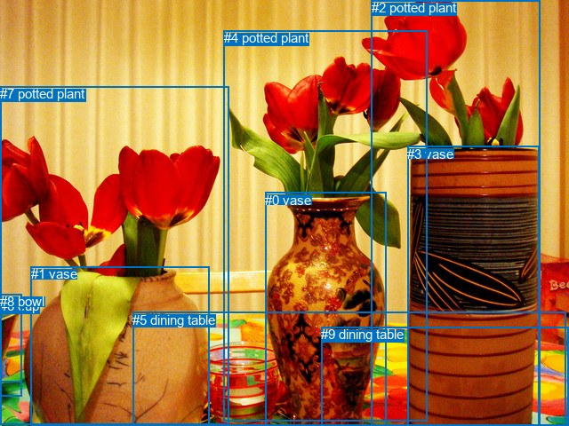
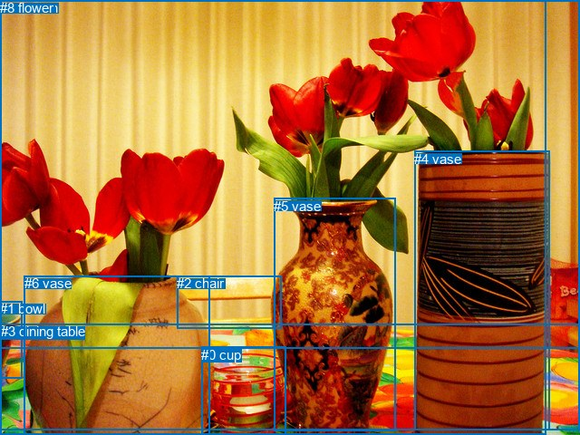

# 图片 1097：2365755.jpg

随机样本序号：264。图片 SHA256：`10741d3fd4125685d73542bca5210777c5a33240a41785661f42e3d42d5641b2`。

红色框表示人，蓝色框表示其他物体。两个模式分别保留自身框编号，可依据位置比较对应对象。

## 自动检测框与输出

人的框编号：`[]`。状态：`no_person`。

### 自动检测全部物体框

| 编号 | 类别 | 是否为人 | 检测分数 | 像素坐标 xyxy |
|---|---|---|---|---|
| 0 | vase | False | 0.9982 | 298.4, 216.8, 434.4, 479.0 |
| 1 | vase | False | 0.9791 | 34.7, 300.3, 235.1, 480.0 |
| 2 | potted plant | False | 0.9153 | 417.7, 0.0, 607.9, 480.0 |
| 3 | vase | False | 0.9028 | 458.3, 164.7, 606.5, 480.0 |
| 4 | potted plant | False | 0.6318 | 251.8, 34.2, 480.9, 474.9 |
| 5 | dining table | False | 0.5726 | 149.4, 351.8, 636.4, 480.0 |
| 6 | cup | False | 0.4972 | 0.0, 336.4, 24.5, 430.4 |
| 7 | potted plant | False | 0.4971 | 0.0, 97.1, 257.8, 478.5 |
| 8 | bowl | False | 0.4953 | 0.0, 331.2, 24.3, 446.9 |
| 9 | dining table | False | 0.4168 | 361.4, 368.3, 640.0, 480.0 |

### 自动检测 Top50 人相关候选

评分物体对：0；人相关物体对：0；输出关系：0。

| 排名 | 主语编号与类别 | 关系 | 宾语编号与类别 | 类型 | 人与人 | 排序分数 | 原始融合 logit |
|---|---|---|---|---|---|---|---|

### 自动检测逐条人相关 GT 核验

本图没有人相关 GT，R@50 无分母；预测候选继续展示。

## 真实框与输出

人的框编号：`[]`。

### 真实框全部物体框

| 编号 | 类别 | 是否为人 | 检测分数 | 像素坐标 xyxy |
|---|---|---|---|---|
| 0 | cup | False | GT | 222.0, 383.0, 315.0, 480.0 |
| 1 | bowl | False | GT | 0.0, 332.0, 24.0, 417.0 |
| 2 | chair | False | GT | 195.0, 304.0, 310.0, 362.0 |
| 3 | dining table | False | GT | 1.0, 357.0, 640.0, 474.0 |
| 4 | vase | False | GT | 457.0, 167.0, 606.0, 475.0 |
| 5 | vase | False | GT | 302.0, 219.0, 436.0, 475.0 |
| 6 | vase | False | GT | 27.0, 304.0, 232.0, 479.0 |
| 7 | curtain | False | GT | 0.0, 0.0, 640.0, 384.0 |
| 8 | flower | False | GT | 0.0, 0.0, 602.0, 480.0 |

### 真实框 Top50 人相关候选

评分物体对：0；人相关物体对：0；输出关系：0。

| 排名 | 主语编号与类别 | 关系 | 宾语编号与类别 | 类型 | 人与人 | 排序分数 | 原始融合 logit |
|---|---|---|---|---|---|---|---|

### 真实框逐条人相关 GT 核验

本图没有人相关 GT，R@50 无分母；预测候选继续展示。

## 全部人相关 GT

| 主语编号与类别 | 关系 | 宾语编号与类别 |
|---|---|---|

原始记录、全部人相关物体对的两项预测与分项分数见 [逐图证据 JSON](../evidence/cases/1097.json)。全部56类 logits 保留于本机 HOR/output/random500/logits/。

<!-- HOR_COMPLETE_RESULTS -->

## 六组条件的完整输出对照

以下保留同一图片三种框与候选模式、两种谓词输出规则的全部 Top50。框编号各自在所属模式内解释。

### 自动检测框完整枚举：空间与语义各保留一个谓词

| 排名 | 主语编号与类别 | 谓词 | 宾语编号与类别 | 分组 | 排序分数 | predicate logit | pair logit |
|---|---|---|---|---|---|---|---|

没有人相关 GT，本条件的召回率无分母。

### 自动检测框完整枚举：每对只保留一个谓词

| 排名 | 主语编号与类别 | 谓词 | 宾语编号与类别 | 分组 | 排序分数 | predicate logit | pair logit |
|---|---|---|---|---|---|---|---|

没有人相关 GT，本条件的召回率无分母。

### 真实框完整枚举：空间与语义各保留一个谓词

| 排名 | 主语编号与类别 | 谓词 | 宾语编号与类别 | 分组 | 排序分数 | predicate logit | pair logit |
|---|---|---|---|---|---|---|---|

没有人相关 GT，本条件的召回率无分母。

### 真实框完整枚举：每对只保留一个谓词

| 排名 | 主语编号与类别 | 谓词 | 宾语编号与类别 | 分组 | 排序分数 | predicate logit | pair logit |
|---|---|---|---|---|---|---|---|

没有人相关 GT，本条件的召回率无分母。

### 真实框400候选：空间与语义各保留一个谓词

| 排名 | 主语编号与类别 | 谓词 | 宾语编号与类别 | 分组 | 排序分数 | predicate logit | pair logit |
|---|---|---|---|---|---|---|---|

没有人相关 GT，本条件的召回率无分母。

### 真实框400候选：每对只保留一个谓词

| 排名 | 主语编号与类别 | 谓词 | 宾语编号与类别 | 分组 | 排序分数 | predicate logit | pair logit |
|---|---|---|---|---|---|---|---|

没有人相关 GT，本条件的召回率无分母。
