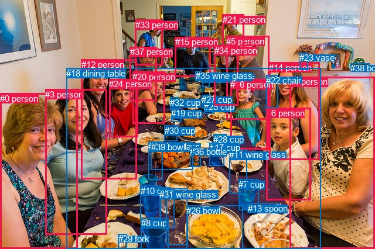
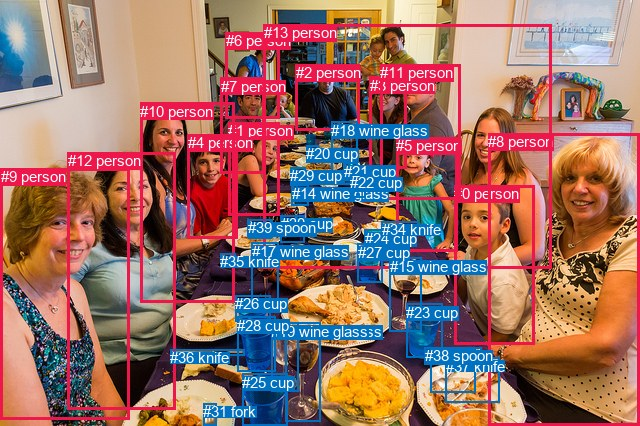

# 图片 1099：2365844.jpg

随机样本序号：123。图片 SHA256：`5f019938d891305fab6ae0d0e9edc79e0d74407cdbd0ecce324aada0ab93a86e`。

红色框表示人，蓝色框表示其他物体。两个模式分别保留自身框编号，可依据位置比较对应对象。

## 自动检测框与输出

人的框编号：`[0, 1, 3, 5, 6, 12, 14, 15, 16, 20, 21, 24, 33, 34, 37]`。状态：`ok`。

### 自动检测全部物体框

| 编号 | 类别 | 是否为人 | 检测分数 | 像素坐标 xyxy |
|---|---|---|---|---|
| 0 | person | True | 0.9991 | 0.0, 159.6, 132.8, 425.3 |
| 1 | person | True | 0.9985 | 494.4, 131.4, 639.6, 425.6 |
| 2 | wine glass | False | 0.9936 | 346.0, 124.4, 357.1, 148.3 |
| 3 | person | True | 0.9924 | 77.4, 152.7, 182.0, 401.9 |
| 4 | wine glass | False | 0.9911 | 253.1, 242.3, 277.8, 307.0 |
| 5 | person | True | 0.9909 | 386.5, 61.7, 459.1, 204.7 |
| 6 | person | True | 0.9886 | 454.5, 184.7, 530.1, 342.2 |
| 7 | cup | False | 0.9882 | 407.4, 306.6, 441.5, 359.0 |
| 8 | cup | False | 0.9880 | 240.7, 373.4, 288.0, 426.0 |
| 9 | wine glass | False | 0.9875 | 283.1, 322.1, 320.7, 419.2 |
| 10 | cup | False | 0.9869 | 239.8, 317.7, 274.7, 373.6 |
| 11 | wine glass | False | 0.9832 | 391.2, 256.4, 421.1, 331.4 |
| 12 | person | True | 0.9791 | 138.7, 101.6, 233.6, 306.3 |
| 13 | spoon | False | 0.9746 | 423.0, 347.7, 477.8, 364.9 |
| 14 | person | True | 0.9731 | 459.1, 106.5, 545.9, 273.8 |
| 15 | person | True | 0.9677 | 298.5, 63.5, 359.3, 131.0 |
| 16 | person | True | 0.9636 | 393.5, 136.0, 458.2, 255.2 |
| 17 | cup | False | 0.9573 | 357.7, 244.2, 382.4, 283.3 |
| 18 | dining table | False | 0.9552 | 113.2, 116.8, 547.2, 426.0 |
| 19 | cup | False | 0.9518 | 292.4, 185.4, 309.3, 208.1 |
| 20 | person | True | 0.9498 | 226.1, 122.7, 281.4, 211.8 |
| 21 | person | True | 0.9462 | 379.8, 24.5, 416.5, 89.1 |
| 22 | chair | False | 0.9376 | 454.2, 128.8, 474.1, 184.0 |
| 23 | vase | False | 0.9339 | 511.4, 90.2, 525.5, 119.8 |
| 24 | person | True | 0.9324 | 186.5, 135.1, 235.6, 234.2 |
| 25 | cup | False | 0.9269 | 348.0, 174.3, 365.3, 194.7 |
| 26 | bowl | False | 0.9266 | 318.2, 351.6, 414.6, 425.4 |
| 27 | cup | False | 0.9215 | 344.4, 162.4, 358.4, 185.2 |
| 28 | cup | False | 0.9130 | 364.3, 229.6, 386.8, 267.9 |
| 29 | fork | False | 0.9120 | 201.9, 400.5, 216.7, 426.0 |
| 30 | cup | False | 0.9104 | 280.9, 214.6, 302.4, 241.0 |
| 31 | wine glass | False | 0.9070 | 272.0, 323.8, 297.1, 390.6 |
| 32 | cup | False | 0.9054 | 290.5, 166.8, 305.5, 187.6 |
| 33 | person | True | 0.8853 | 230.7, 33.6, 277.2, 111.9 |
| 34 | person | True | 0.8828 | 366.0, 77.9, 406.1, 180.7 |
| 35 | wine glass | False | 0.8667 | 333.9, 121.3, 343.1, 137.4 |
| 36 | bottle | False | 0.8607 | 324.4, 251.3, 342.0, 285.4 |
| 37 | person | True | 0.8543 | 221.8, 80.4, 267.9, 172.8 |
| 38 | bowl | False | 0.8296 | 598.3, 108.2, 630.4, 119.4 |
| 39 | bowl | False | 0.8216 | 257.7, 243.3, 329.8, 291.0 |

### 自动检测 Top50 人相关候选

评分物体对：1560；人相关物体对：960；输出关系：50。

| 排名 | 主语编号与类别 | 关系 | 宾语编号与类别 | 类型 | 人与人 | 排序分数 | 原始融合 logit |
|---|---|---|---|---|---|---|---|
| 1 | #6 person | sitting on | #18 dining table | semantic | False | 0.93852 | 2.7256 |
| 2 | #20 person | sitting on | #18 dining table | semantic | False | 0.93775 | 2.7123 |
| 3 | #5 person | in | #18 dining table | spatial | False | 0.93719 | 2.7029 |
| 4 | #3 person | sitting on | #18 dining table | semantic | False | 0.92041 | 2.4479 |
| 5 | #24 person | sitting on | #18 dining table | semantic | False | 0.91886 | 2.4269 |
| 6 | #37 person | sitting on | #18 dining table | semantic | False | 0.91655 | 2.3964 |
| 7 | #12 person | sitting on | #18 dining table | semantic | False | 0.91464 | 2.3717 |
| 8 | #5 person | sitting on | #18 dining table | semantic | False | 0.90775 | 2.2865 |
| 9 | #24 person | in | #18 dining table | spatial | False | 0.90162 | 2.2153 |
| 10 | #12 person | in | #18 dining table | spatial | False | 0.89741 | 2.1688 |
| 11 | #34 person | sitting on | #18 dining table | semantic | False | 0.89740 | 2.1687 |
| 12 | #20 person | in | #18 dining table | spatial | False | 0.89700 | 2.1643 |
| 13 | #14 person | in | #18 dining table | spatial | False | 0.89654 | 2.1593 |
| 14 | #16 person | in | #18 dining table | spatial | False | 0.89424 | 2.1348 |
| 15 | #15 person | sitting on | #18 dining table | semantic | False | 0.89173 | 2.1085 |
| 16 | #1 person | holding | #6 person | semantic | True | 0.88908 | 2.0814 |
| 17 | #34 person | in | #18 dining table | spatial | False | 0.88861 | 2.0766 |
| 18 | #16 person | sitting on | #18 dining table | semantic | False | 0.88753 | 2.0657 |
| 19 | #6 person | in | #18 dining table | spatial | False | 0.87942 | 1.9869 |
| 20 | #14 person | sitting on | #18 dining table | semantic | False | 0.87869 | 1.9801 |
| 21 | #1 person | sitting on | #18 dining table | semantic | False | 0.87339 | 1.9313 |
| 22 | #37 person | in | #18 dining table | spatial | False | 0.86828 | 1.8859 |
| 23 | #3 person | in | #18 dining table | spatial | False | 0.86754 | 1.8794 |
| 24 | #15 person | drinking | #35 wine glass | semantic | False | 0.86624 | 1.8681 |
| 25 | #1 person | in | #18 dining table | spatial | False | 0.85877 | 1.8051 |
| 26 | #0 person | sitting on | #18 dining table | semantic | False | 0.84927 | 1.7289 |
| 27 | #15 person | in | #18 dining table | spatial | False | 0.84598 | 1.7034 |
| 28 | #0 person | in | #18 dining table | spatial | False | 0.84533 | 1.6984 |
| 29 | #14 person | holding | #6 person | semantic | True | 0.81671 | 1.4942 |
| 30 | #14 person | holding | #22 chair | semantic | False | 0.80060 | 1.3901 |
| 31 | #14 person | in | #22 chair | spatial | False | 0.79668 | 1.3657 |
| 32 | #33 person | sitting on | #18 dining table | semantic | False | 0.79003 | 1.3251 |
| 33 | #5 person | holding | #16 person | semantic | True | 0.71836 | 0.9363 |
| 34 | #33 person | in | #18 dining table | spatial | False | 0.71485 | 0.9190 |
| 35 | #1 person | beside | #6 person | spatial | True | 0.66973 | 0.7070 |
| 36 | #21 person | sitting on | #18 dining table | semantic | False | 0.65235 | 0.6294 |
| 37 | #15 person | eating | #2 wine glass | semantic | False | 0.63727 | 0.5635 |
| 38 | #5 person | holding | #22 chair | semantic | False | 0.63671 | 0.5611 |
| 39 | #15 person | in | #35 wine glass | spatial | False | 0.62493 | 0.5105 |
| 40 | #16 person | in | #22 chair | spatial | False | 0.60930 | 0.4444 |
| 41 | #21 person | in | #18 dining table | spatial | False | 0.60749 | 0.4368 |
| 42 | #5 person | in | #22 chair | spatial | False | 0.55226 | 0.2098 |
| 43 | #16 person | holding | #22 chair | semantic | False | 0.54077 | 0.1635 |
| 44 | #12 person | holding | #24 person | semantic | True | 0.52789 | 0.1117 |
| 45 | #0 person | beside | #3 person | spatial | True | 0.52470 | 0.0989 |
| 46 | #5 person | in | #16 person | spatial | True | 0.51731 | 0.0692 |
| 47 | #34 person | looking at | #5 person | semantic | True | 0.49950 | -0.0020 |
| 48 | #6 person | beside | #1 person | spatial | True | 0.49871 | -0.0052 |
| 49 | #14 person | beside | #6 person | spatial | True | 0.47771 | -0.0892 |
| 50 | #15 person | in | #2 wine glass | spatial | False | 0.41624 | -0.3382 |

### 自动检测逐条人相关 GT 核验

R@50：66.67%；命中 2/3。

| GT 主语编号 | GT 关系 | GT 宾语编号 | 结果阶段 | 匹配预测主语编号 | 匹配预测宾语编号 |
|---|---|---|---|---|---|
| 0 | beside | 8 | hit50 | [6] | [1] |
| 9 | beside | 12 | hit50 | [0] | [3] |
| 10 | beside | 12 | wrong_predicate | [12] | [3] |

## 真实框与输出

人的框编号：`[0, 1, 2, 3, 4, 5, 6, 7, 8, 9, 10, 11, 12, 13]`。

### 真实框全部物体框

| 编号 | 类别 | 是否为人 | 检测分数 | 像素坐标 xyxy |
|---|---|---|---|---|
| 0 | person | True | GT | 454.0, 185.0, 534.0, 344.0 |
| 1 | person | True | GT | 228.0, 122.0, 279.0, 215.0 |
| 2 | person | True | GT | 296.0, 64.0, 359.0, 130.0 |
| 3 | person | True | GT | 370.0, 77.0, 407.0, 169.0 |
| 4 | person | True | GT | 188.0, 134.0, 237.0, 238.0 |
| 5 | person | True | GT | 396.0, 137.0, 457.0, 251.0 |
| 6 | person | True | GT | 226.0, 32.0, 280.0, 118.0 |
| 7 | person | True | GT | 221.0, 78.0, 265.0, 174.0 |
| 8 | person | True | GT | 488.0, 133.0, 640.0, 426.0 |
| 9 | person | True | GT | 1.0, 168.0, 129.0, 420.0 |
| 10 | person | True | GT | 140.0, 103.0, 234.0, 303.0 |
| 11 | person | True | GT | 380.0, 64.0, 460.0, 199.0 |
| 12 | person | True | GT | 68.0, 152.0, 176.0, 409.0 |
| 13 | person | True | GT | 264.0, 24.0, 552.0, 269.0 |
| 14 | wine glass | False | GT | 292.0, 185.0, 309.0, 206.0 |
| 15 | wine glass | False | GT | 390.0, 258.0, 422.0, 332.0 |
| 16 | wine glass | False | GT | 285.0, 323.0, 320.0, 422.0 |
| 17 | wine glass | False | GT | 252.0, 243.0, 279.0, 310.0 |
| 18 | wine glass | False | GT | 331.0, 122.0, 357.0, 181.0 |
| 19 | wine glass | False | GT | 271.0, 323.0, 298.0, 392.0 |
| 20 | cup | False | GT | 306.0, 145.0, 318.0, 156.0 |
| 21 | cup | False | GT | 344.0, 163.0, 358.0, 185.0 |
| 22 | cup | False | GT | 350.0, 174.0, 365.0, 197.0 |
| 23 | cup | False | GT | 406.0, 304.0, 442.0, 358.0 |
| 24 | cup | False | GT | 365.0, 230.0, 387.0, 249.0 |
| 25 | cup | False | GT | 242.0, 374.0, 287.0, 426.0 |
| 26 | cup | False | GT | 235.0, 295.0, 270.0, 321.0 |
| 27 | cup | False | GT | 358.0, 244.0, 383.0, 283.0 |
| 28 | cup | False | GT | 237.0, 317.0, 275.0, 372.0 |
| 29 | cup | False | GT | 290.0, 167.0, 305.0, 185.0 |
| 30 | cup | False | GT | 281.0, 215.0, 305.0, 242.0 |
| 31 | fork | False | GT | 203.0, 403.0, 217.0, 426.0 |
| 32 | fork | False | GT | 248.0, 220.0, 272.0, 238.0 |
| 33 | fork | False | GT | 430.0, 350.0, 475.0, 393.0 |
| 34 | knife | False | GT | 382.0, 221.0, 419.0, 229.0 |
| 35 | knife | False | GT | 220.0, 253.0, 235.0, 257.0 |
| 36 | knife | False | GT | 170.0, 349.0, 244.0, 355.0 |
| 37 | knife | False | GT | 446.0, 358.0, 499.0, 403.0 |
| 38 | spoon | False | GT | 425.0, 347.0, 482.0, 364.0 |
| 39 | spoon | False | GT | 248.0, 219.0, 271.0, 238.0 |

### 真实框 Top50 人相关候选

评分物体对：1560；人相关物体对：910；输出关系：50。

| 排名 | 主语编号与类别 | 关系 | 宾语编号与类别 | 类型 | 人与人 | 排序分数 | 原始融合 logit |
|---|---|---|---|---|---|---|---|
| 1 | #5 person | eating | #34 knife | semantic | False | 0.98860 | 4.4627 |
| 2 | #8 person | holding | #37 knife | semantic | False | 0.91087 | 2.3243 |
| 3 | #8 person | holding | #0 person | semantic | True | 0.90632 | 2.2695 |
| 4 | #2 person | eating | #18 wine glass | semantic | False | 0.88610 | 2.0515 |
| 5 | #5 person | in | #34 knife | spatial | False | 0.82145 | 1.5262 |
| 6 | #0 person | holding | #37 knife | semantic | False | 0.81333 | 1.4718 |
| 7 | #11 person | holding | #5 person | semantic | True | 0.78960 | 1.3225 |
| 8 | #1 person | eating | #20 cup | semantic | False | 0.77573 | 1.2410 |
| 9 | #7 person | eating | #20 cup | semantic | False | 0.76945 | 1.2052 |
| 10 | #10 person | wearing | #35 knife | semantic | False | 0.76231 | 1.1654 |
| 11 | #1 person | eating | #29 cup | semantic | False | 0.72469 | 0.9678 |
| 12 | #0 person | holding | #33 fork | semantic | False | 0.68536 | 0.7785 |
| 13 | #0 person | eating | #34 knife | semantic | False | 0.67819 | 0.7455 |
| 14 | #1 person | eating | #39 spoon | semantic | False | 0.67346 | 0.7239 |
| 15 | #1 person | eating | #32 fork | semantic | False | 0.67208 | 0.7176 |
| 16 | #2 person | eating | #20 cup | semantic | False | 0.67142 | 0.7146 |
| 17 | #2 person | in | #18 wine glass | spatial | False | 0.65472 | 0.6398 |
| 18 | #4 person | eating | #32 fork | semantic | False | 0.65185 | 0.6272 |
| 19 | #8 person | beside | #0 person | spatial | True | 0.64190 | 0.5836 |
| 20 | #8 person | holding | #33 fork | semantic | False | 0.63612 | 0.5585 |
| 21 | #4 person | eating | #39 spoon | semantic | False | 0.63422 | 0.5504 |
| 22 | #7 person | eating | #29 cup | semantic | False | 0.59980 | 0.4046 |
| 23 | #11 person | in | #13 person | spatial | True | 0.59197 | 0.3721 |
| 24 | #12 person | sitting on | #36 knife | semantic | False | 0.58834 | 0.3571 |
| 25 | #4 person | eating | #20 cup | semantic | False | 0.58736 | 0.3531 |
| 26 | #11 person | in | #5 person | spatial | True | 0.56453 | 0.2596 |
| 27 | #5 person | eating | #22 cup | semantic | False | 0.55834 | 0.2344 |
| 28 | #8 person | sitting on | #36 knife | semantic | False | 0.55423 | 0.2178 |
| 29 | #8 person | holding | #38 spoon | semantic | False | 0.55119 | 0.2055 |
| 30 | #1 person | eating | #14 wine glass | semantic | False | 0.54803 | 0.1927 |
| 31 | #7 person | eating | #18 wine glass | semantic | False | 0.54529 | 0.1817 |
| 32 | #5 person | in | #22 cup | spatial | False | 0.50994 | 0.0398 |
| 33 | #4 person | eating | #29 cup | semantic | False | 0.50308 | 0.0123 |
| 34 | #0 person | in | #34 knife | spatial | False | 0.50220 | 0.0088 |
| 35 | #5 person | holding | #21 cup | semantic | False | 0.49452 | -0.0219 |
| 36 | #0 person | holding | #38 spoon | semantic | False | 0.48875 | -0.0450 |
| 37 | #3 person | holding | #18 wine glass | semantic | False | 0.48547 | -0.0581 |
| 38 | #10 person | holding | #4 person | semantic | True | 0.47596 | -0.0962 |
| 39 | #1 person | eating | #18 wine glass | semantic | False | 0.47165 | -0.1135 |
| 40 | #1 person | in | #18 wine glass | spatial | False | 0.47102 | -0.1160 |
| 41 | #3 person | in | #18 wine glass | spatial | False | 0.47003 | -0.1200 |
| 42 | #11 person | eating | #34 knife | semantic | False | 0.46937 | -0.1227 |
| 43 | #1 person | eating | #34 knife | semantic | False | 0.45709 | -0.1720 |
| 44 | #0 person | beside | #8 person | spatial | True | 0.44962 | -0.2022 |
| 45 | #11 person | holding | #3 person | semantic | True | 0.44374 | -0.2260 |
| 46 | #7 person | in | #18 wine glass | spatial | False | 0.44032 | -0.2399 |
| 47 | #10 person | sitting on | #36 knife | semantic | False | 0.42806 | -0.2898 |
| 48 | #3 person | eating | #34 knife | semantic | False | 0.41403 | -0.3473 |
| 49 | #1 person | eating | #30 cup | semantic | False | 0.41298 | -0.3516 |
| 50 | #10 person | in | #4 person | spatial | True | 0.40771 | -0.3734 |

### 真实框逐条人相关 GT 核验

R@50：33.33%；命中 1/3。

| GT 主语编号 | GT 关系 | GT 宾语编号 | 结果阶段 | 匹配预测主语编号 | 匹配预测宾语编号 |
|---|---|---|---|---|---|
| 0 | beside | 8 | hit50 | [0] | [8] |
| 9 | beside | 12 | rank_below50 | [9] | [12] |
| 10 | beside | 12 | wrong_predicate | [10] | [12] |

## 全部人相关 GT

| 主语编号与类别 | 关系 | 宾语编号与类别 |
|---|---|---|
| #0 person | beside | #8 person |
| #9 person | beside | #12 person |
| #10 person | beside | #12 person |

原始记录、全部人相关物体对的两项预测与分项分数见 [逐图证据 JSON](../evidence/cases/1099.json)。全部56类 logits 保留于本机 HOR/output/random500/logits/。

<!-- HOR_COMPLETE_RESULTS -->

## 六组条件的完整输出对照

以下保留同一图片三种框与候选模式、两种谓词输出规则的全部 Top50。框编号各自在所属模式内解释。

### 自动检测框完整枚举：空间与语义各保留一个谓词

| 排名 | 主语编号与类别 | 谓词 | 宾语编号与类别 | 分组 | 排序分数 | predicate logit | pair logit |
|---|---|---|---|---|---|---|---|
| 1 | #6 person | sitting on | #18 dining table | semantic | 0.9385194 | 2.8951092 | -0.1695277 |
| 2 | #20 person | sitting on | #18 dining table | semantic | 0.9377512 | 2.7717404 | -0.0593956 |
| 3 | #5 person | in | #18 dining table | spatial | 0.9371949 | 2.7848458 | -0.0819899 |
| 4 | #3 person | sitting on | #18 dining table | semantic | 0.9204097 | 2.5610852 | -0.1131577 |
| 5 | #24 person | sitting on | #18 dining table | semantic | 0.9188579 | 2.4888854 | -0.0619550 |
| 6 | #37 person | sitting on | #18 dining table | semantic | 0.9165528 | 2.6603880 | -0.2639824 |
| 7 | #12 person | sitting on | #18 dining table | semantic | 0.9146422 | 2.4768362 | -0.1051545 |
| 8 | #5 person | sitting on | #18 dining table | semantic | 0.9077527 | 2.3684883 | -0.0819899 |
| 9 | #24 person | in | #18 dining table | spatial | 0.9016173 | 2.2772808 | -0.0619550 |
| 10 | #12 person | in | #18 dining table | spatial | 0.8974133 | 2.2739620 | -0.1051545 |
| 11 | #34 person | sitting on | #18 dining table | semantic | 0.8974018 | 2.2722220 | -0.1035398 |
| 12 | #20 person | in | #18 dining table | spatial | 0.8970012 | 2.2237358 | -0.0593956 |
| 13 | #14 person | in | #18 dining table | spatial | 0.8965361 | 2.4303880 | -0.2710724 |
| 14 | #16 person | in | #18 dining table | spatial | 0.8942398 | 2.4345975 | -0.2997973 |
| 15 | #15 person | sitting on | #18 dining table | semantic | 0.8917275 | 2.2962890 | -0.1877793 |
| 16 | #1 person | holding | #6 person | semantic | 0.8890820 | 3.0500855 | -0.9686882 |
| 17 | #34 person | in | #18 dining table | spatial | 0.8886087 | 2.1801472 | -0.1035398 |
| 18 | #16 person | sitting on | #18 dining table | semantic | 0.8875263 | 2.3655162 | -0.2997973 |
| 19 | #6 person | in | #18 dining table | spatial | 0.8794194 | 2.1564708 | -0.1695277 |
| 20 | #14 person | sitting on | #18 dining table | semantic | 0.8786871 | 2.2511282 | -0.2710724 |
| 21 | #1 person | sitting on | #18 dining table | semantic | 0.8733888 | 2.1879411 | -0.2566818 |
| 22 | #37 person | in | #18 dining table | spatial | 0.8682817 | 2.1498332 | -0.2639824 |
| 23 | #3 person | in | #18 dining table | spatial | 0.8675375 | 1.9925170 | -0.1131577 |
| 24 | #15 person | drinking | #35 wine glass | semantic | 0.8662435 | 1.5754085 | 0.2927366 |
| 25 | #1 person | in | #18 dining table | spatial | 0.8587666 | 2.0617647 | -0.2566818 |
| 26 | #0 person | sitting on | #18 dining table | semantic | 0.8492653 | 1.8780150 | -0.1491647 |
| 27 | #15 person | in | #18 dining table | spatial | 0.8459776 | 1.8911738 | -0.1877793 |
| 28 | #0 person | in | #18 dining table | spatial | 0.8453283 | 1.8475852 | -0.1491647 |
| 29 | #14 person | holding | #6 person | semantic | 0.8167073 | 2.3299608 | -0.8357642 |
| 30 | #14 person | holding | #22 chair | semantic | 0.8006026 | 1.3181257 | 0.0719390 |
| 31 | #14 person | in | #22 chair | spatial | 0.7966844 | 1.2937603 | 0.0719390 |
| 32 | #33 person | sitting on | #18 dining table | semantic | 0.7900295 | 1.6312456 | -0.3061421 |
| 33 | #5 person | holding | #16 person | semantic | 0.7183583 | 1.2939439 | -0.3576113 |
| 34 | #33 person | in | #18 dining table | spatial | 0.7148460 | 1.2251797 | -0.3061421 |
| 35 | #1 person | beside | #6 person | spatial | 0.6697323 | 1.6756630 | -0.9686882 |
| 36 | #21 person | sitting on | #18 dining table | semantic | 0.6523489 | 1.2009549 | -0.5715747 |
| 37 | #15 person | eating | #2 wine glass | semantic | 0.6372688 | 0.4515715 | 0.1119579 |
| 38 | #5 person | holding | #22 chair | semantic | 0.6367136 | 0.4129834 | 0.1481450 |
| 39 | #15 person | in | #35 wine glass | spatial | 0.6249277 | 0.2177806 | 0.2927366 |
| 40 | #16 person | in | #22 chair | spatial | 0.6092992 | 0.3806214 | 0.0637459 |
| 41 | #21 person | in | #18 dining table | spatial | 0.6074902 | 1.0083489 | -0.5715747 |
| 42 | #5 person | in | #22 chair | spatial | 0.5522643 | 0.0616784 | 0.1481450 |
| 43 | #16 person | holding | #22 chair | semantic | 0.5407720 | 0.0997052 | 0.0637459 |
| 44 | #12 person | holding | #24 person | semantic | 0.5278930 | 1.1663628 | -1.0546749 |
| 45 | #0 person | beside | #3 person | spatial | 0.5246983 | 1.4348173 | -1.3359439 |
| 46 | #5 person | in | #16 person | spatial | 0.5173056 | 0.4268613 | -0.3576113 |
| 47 | #34 person | looking at | #5 person | semantic | 0.4994986 | 1.0155177 | -1.0175232 |
| 48 | #6 person | beside | #1 person | spatial | 0.4987113 | 1.5865455 | -1.5917000 |
| 49 | #14 person | beside | #6 person | spatial | 0.4777075 | 0.7465348 | -0.8357642 |
| 50 | #15 person | in | #2 wine glass | spatial | 0.4162374 | -0.4501967 | 0.1119579 |

GT 命中：2/3，R@50=66.67%。

| GT主语 | GT谓词 | GT宾语 | 结果阶段 | 匹配主语框 | 匹配宾语框 |
|---|---|---|---|---|---|
| 0 | beside | 8 | hit50 | [6] | [1] |
| 9 | beside | 12 | hit50 | [0] | [3] |
| 10 | beside | 12 | wrong_predicate | [12] | [3] |

### 自动检测框完整枚举：每对只保留一个谓词

| 排名 | 主语编号与类别 | 谓词 | 宾语编号与类别 | 分组 | 排序分数 | predicate logit | pair logit |
|---|---|---|---|---|---|---|---|
| 1 | #6 person | sitting on | #18 dining table | single | 0.9385194 | 2.8951092 | -0.1695277 |
| 2 | #20 person | sitting on | #18 dining table | single | 0.9377512 | 2.7717404 | -0.0593956 |
| 3 | #5 person | in | #18 dining table | single | 0.9371949 | 2.7848458 | -0.0819899 |
| 4 | #3 person | sitting on | #18 dining table | single | 0.9204097 | 2.5610852 | -0.1131577 |
| 5 | #24 person | sitting on | #18 dining table | single | 0.9188579 | 2.4888854 | -0.0619550 |
| 6 | #37 person | sitting on | #18 dining table | single | 0.9165528 | 2.6603880 | -0.2639824 |
| 7 | #12 person | sitting on | #18 dining table | single | 0.9146422 | 2.4768362 | -0.1051545 |
| 8 | #34 person | sitting on | #18 dining table | single | 0.8974018 | 2.2722220 | -0.1035398 |
| 9 | #14 person | in | #18 dining table | single | 0.8965361 | 2.4303880 | -0.2710724 |
| 10 | #16 person | in | #18 dining table | single | 0.8942398 | 2.4345975 | -0.2997973 |
| 11 | #15 person | sitting on | #18 dining table | single | 0.8917275 | 2.2962890 | -0.1877793 |
| 12 | #1 person | holding | #6 person | single | 0.8890820 | 3.0500855 | -0.9686882 |
| 13 | #1 person | sitting on | #18 dining table | single | 0.8733888 | 2.1879411 | -0.2566818 |
| 14 | #15 person | drinking | #35 wine glass | single | 0.8662435 | 1.5754085 | 0.2927366 |
| 15 | #0 person | sitting on | #18 dining table | single | 0.8492653 | 1.8780150 | -0.1491647 |
| 16 | #14 person | holding | #6 person | single | 0.8167073 | 2.3299608 | -0.8357642 |
| 17 | #14 person | holding | #22 chair | single | 0.8006026 | 1.3181257 | 0.0719390 |
| 18 | #33 person | sitting on | #18 dining table | single | 0.7900295 | 1.6312456 | -0.3061421 |
| 19 | #5 person | holding | #16 person | single | 0.7183583 | 1.2939439 | -0.3576113 |
| 20 | #21 person | sitting on | #18 dining table | single | 0.6523489 | 1.2009549 | -0.5715747 |
| 21 | #15 person | eating | #2 wine glass | single | 0.6372688 | 0.4515715 | 0.1119579 |
| 22 | #5 person | holding | #22 chair | single | 0.6367136 | 0.4129834 | 0.1481450 |
| 23 | #16 person | in | #22 chair | single | 0.6092992 | 0.3806214 | 0.0637459 |
| 24 | #12 person | holding | #24 person | single | 0.5278930 | 1.1663628 | -1.0546749 |
| 25 | #0 person | beside | #3 person | single | 0.5246983 | 1.4348173 | -1.3359439 |
| 26 | #34 person | looking at | #5 person | single | 0.4994986 | 1.0155177 | -1.0175232 |
| 27 | #6 person | beside | #1 person | single | 0.4987113 | 1.5865455 | -1.5917000 |
| 28 | #24 person | in | #12 person | single | 0.3678255 | 0.7047653 | -1.2463220 |
| 29 | #34 person | looking at | #16 person | single | 0.3507144 | -0.0657620 | -0.5501383 |
| 30 | #21 person | standing on | #35 wine glass | single | 0.3385932 | -0.5531473 | -0.1164223 |
| 31 | #33 person | looking at | #15 person | single | 0.3285790 | -0.0725822 | -0.6420369 |
| 32 | #5 person | holding | #6 person | single | 0.3275838 | 0.2265277 | -0.9456614 |
| 33 | #1 person | holding | #13 spoon | single | 0.3160922 | 0.1293182 | -0.9011074 |
| 34 | #16 person | holding | #6 person | single | 0.2955335 | 0.1504760 | -1.0191345 |
| 35 | #15 person | looking at | #21 person | single | 0.2891073 | -0.5695562 | -0.3301673 |
| 36 | #1 person | holding | #14 person | single | 0.2878730 | 0.3422914 | -1.2480280 |
| 37 | #5 person | beside | #34 person | single | 0.2771160 | -0.3099546 | -0.6488578 |
| 38 | #6 person | holding | #13 spoon | single | 0.2681684 | -0.2987761 | -0.7051588 |
| 39 | #14 person | beside | #1 person | single | 0.2680122 | 0.2952819 | -1.3000133 |
| 40 | #20 person | eating | #32 cup | single | 0.2525148 | -0.7272980 | -0.3579465 |
| 41 | #21 person | standing on | #2 wine glass | single | 0.2485717 | -0.9689689 | -0.1372755 |
| 42 | #24 person | beside | #20 person | single | 0.2433769 | -0.0963664 | -1.0378878 |
| 43 | #6 person | beside | #16 person | single | 0.2425699 | -0.3740120 | -0.7646292 |
| 44 | #37 person | in | #35 wine glass | single | 0.2403991 | -0.8698752 | -0.2806177 |
| 45 | #5 person | wearing | #21 person | single | 0.2308655 | -0.9793169 | -0.2241135 |
| 46 | #21 person | looking at | #15 person | single | 0.2206315 | -0.6202383 | -0.6417516 |
| 47 | #34 person | looking at | #21 person | single | 0.2203300 | -0.9834363 | -0.2803080 |
| 48 | #6 person | beside | #14 person | single | 0.2180894 | -0.0077124 | -1.2691233 |
| 49 | #0 person | eating | #29 fork | single | 0.2135280 | -0.3855128 | -0.9182764 |
| 50 | #16 person | in | #25 cup | single | 0.2008855 | -1.1761048 | -0.2046640 |

GT 命中：2/3，R@50=66.67%。

| GT主语 | GT谓词 | GT宾语 | 结果阶段 | 匹配主语框 | 匹配宾语框 |
|---|---|---|---|---|---|
| 0 | beside | 8 | hit50 | [6] | [1] |
| 9 | beside | 12 | hit50 | [0] | [3] |
| 10 | beside | 12 | wrong_predicate | [12] | [3] |

### 真实框完整枚举：空间与语义各保留一个谓词

| 排名 | 主语编号与类别 | 谓词 | 宾语编号与类别 | 分组 | 排序分数 | predicate logit | pair logit |
|---|---|---|---|---|---|---|---|
| 1 | #5 person | eating | #34 knife | semantic | 0.9886004 | 4.2942405 | 0.1684767 |
| 2 | #8 person | holding | #37 knife | semantic | 0.9108707 | 3.0116010 | -0.6872886 |
| 3 | #8 person | holding | #0 person | semantic | 0.9063181 | 3.2129068 | -0.9434213 |
| 4 | #2 person | eating | #18 wine glass | semantic | 0.8860957 | 2.1057854 | -0.0543190 |
| 5 | #5 person | in | #34 knife | spatial | 0.8214472 | 1.3577065 | 0.1684767 |
| 6 | #0 person | holding | #37 knife | semantic | 0.8133267 | 2.0826540 | -0.6108816 |
| 7 | #11 person | holding | #5 person | semantic | 0.7896023 | 1.6502280 | -0.3276982 |
| 8 | #1 person | eating | #20 cup | semantic | 0.7757334 | 1.4666281 | -0.2256548 |
| 9 | #7 person | eating | #20 cup | semantic | 0.7694468 | 1.5588331 | -0.3536429 |
| 10 | #10 person | wearing | #35 knife | semantic | 0.7623089 | 1.7404737 | -0.5750939 |
| 11 | #1 person | eating | #29 cup | semantic | 0.7246900 | 1.2957354 | -0.3278890 |
| 12 | #0 person | holding | #33 fork | semantic | 0.6853627 | 1.3820720 | -0.6035443 |
| 13 | #0 person | eating | #34 knife | semantic | 0.6781927 | 1.0307069 | -0.2852282 |
| 14 | #1 person | eating | #39 spoon | semantic | 0.6734633 | 1.3316197 | -0.6077284 |
| 15 | #1 person | eating | #32 fork | semantic | 0.6720824 | 1.3354816 | -0.6178630 |
| 16 | #2 person | eating | #20 cup | semantic | 0.6714152 | 0.8154020 | -0.1008090 |
| 17 | #2 person | in | #18 wine glass | spatial | 0.6547179 | 0.6941614 | -0.0543190 |
| 18 | #4 person | eating | #32 fork | semantic | 0.6518455 | 1.2695060 | -0.6423450 |
| 19 | #8 person | beside | #0 person | spatial | 0.6419036 | 1.5270572 | -0.9434213 |
| 20 | #8 person | holding | #33 fork | semantic | 0.6361158 | 1.3017588 | -0.7432138 |
| 21 | #4 person | eating | #39 spoon | semantic | 0.6342234 | 1.1792321 | -0.6288534 |
| 22 | #7 person | eating | #29 cup | semantic | 0.5997968 | 0.9219275 | -0.5173092 |
| 23 | #11 person | in | #13 person | spatial | 0.5919700 | 1.2975245 | -0.9254094 |
| 24 | #12 person | sitting on | #36 knife | semantic | 0.5883409 | 1.1709113 | -0.8138002 |
| 25 | #4 person | eating | #20 cup | semantic | 0.5873572 | 1.0210519 | -0.6680012 |
| 26 | #11 person | in | #5 person | spatial | 0.5645320 | 0.5872741 | -0.3276982 |
| 27 | #5 person | eating | #22 cup | semantic | 0.5583370 | 0.4308128 | -0.1963974 |
| 28 | #8 person | sitting on | #36 knife | semantic | 0.5542338 | 1.2611375 | -1.0433455 |
| 29 | #8 person | holding | #38 spoon | semantic | 0.5511871 | 1.0505195 | -0.8450513 |
| 30 | #1 person | eating | #14 wine glass | semantic | 0.5480333 | 0.9045491 | -0.7118216 |
| 31 | #7 person | eating | #18 wine glass | semantic | 0.5452898 | 0.7093582 | -0.5277010 |
| 32 | #5 person | in | #22 cup | spatial | 0.5099381 | 0.2361550 | -0.1963974 |
| 33 | #4 person | eating | #29 cup | semantic | 0.5030800 | 0.6869907 | -0.6746708 |
| 34 | #0 person | in | #34 knife | spatial | 0.5021956 | 0.2940106 | -0.2852282 |
| 35 | #5 person | holding | #21 cup | semantic | 0.4945247 | 0.1828928 | -0.2047948 |
| 36 | #0 person | holding | #38 spoon | semantic | 0.4887523 | 0.6024842 | -0.6474826 |
| 37 | #3 person | holding | #18 wine glass | semantic | 0.4854694 | 0.0521889 | -0.1103276 |
| 38 | #10 person | holding | #4 person | semantic | 0.4759625 | 0.9739981 | -1.0702225 |
| 39 | #1 person | eating | #18 wine glass | semantic | 0.4716541 | 0.3073902 | -0.4208953 |
| 40 | #1 person | in | #18 wine glass | spatial | 0.4710230 | 0.3048573 | -0.4208953 |
| 41 | #3 person | in | #18 wine glass | spatial | 0.4700254 | -0.0097146 | -0.1103276 |
| 42 | #11 person | eating | #34 knife | semantic | 0.4693736 | 0.1434174 | -0.2660763 |
| 43 | #1 person | eating | #34 knife | semantic | 0.4570942 | 0.4860072 | -0.6580534 |
| 44 | #0 person | beside | #8 person | spatial | 0.4496167 | 1.3763695 | -1.5785890 |
| 45 | #11 person | holding | #3 person | semantic | 0.4437392 | 0.3705268 | -0.5965271 |
| 46 | #7 person | in | #18 wine glass | spatial | 0.4403152 | 0.2878180 | -0.5277010 |
| 47 | #10 person | sitting on | #36 knife | semantic | 0.4280579 | 0.6774020 | -0.9671812 |
| 48 | #3 person | eating | #34 knife | semantic | 0.4140350 | -0.0340724 | -0.3132372 |
| 49 | #1 person | eating | #30 cup | semantic | 0.4129837 | 0.5326724 | -0.8843169 |
| 50 | #10 person | in | #4 person | spatial | 0.4077124 | 0.6967921 | -1.0702225 |

GT 命中：1/3，R@50=33.33%。

| GT主语 | GT谓词 | GT宾语 | 结果阶段 | 匹配主语框 | 匹配宾语框 |
|---|---|---|---|---|---|
| 0 | beside | 8 | hit50 | [0] | [8] |
| 9 | beside | 12 | rank_below50 | [9] | [12] |
| 10 | beside | 12 | wrong_predicate | [10] | [12] |

### 真实框完整枚举：每对只保留一个谓词

| 排名 | 主语编号与类别 | 谓词 | 宾语编号与类别 | 分组 | 排序分数 | predicate logit | pair logit |
|---|---|---|---|---|---|---|---|
| 1 | #5 person | eating | #34 knife | single | 0.9886004 | 4.2942405 | 0.1684767 |
| 2 | #8 person | holding | #37 knife | single | 0.9108707 | 3.0116010 | -0.6872886 |
| 3 | #8 person | holding | #0 person | single | 0.9063181 | 3.2129068 | -0.9434213 |
| 4 | #2 person | eating | #18 wine glass | single | 0.8860957 | 2.1057854 | -0.0543190 |
| 5 | #0 person | holding | #37 knife | single | 0.8133267 | 2.0826540 | -0.6108816 |
| 6 | #11 person | holding | #5 person | single | 0.7896023 | 1.6502280 | -0.3276982 |
| 7 | #1 person | eating | #20 cup | single | 0.7757334 | 1.4666281 | -0.2256548 |
| 8 | #7 person | eating | #20 cup | single | 0.7694468 | 1.5588331 | -0.3536429 |
| 9 | #10 person | wearing | #35 knife | single | 0.7623089 | 1.7404737 | -0.5750939 |
| 10 | #1 person | eating | #29 cup | single | 0.7246900 | 1.2957354 | -0.3278890 |
| 11 | #0 person | holding | #33 fork | single | 0.6853627 | 1.3820720 | -0.6035443 |
| 12 | #0 person | eating | #34 knife | single | 0.6781927 | 1.0307069 | -0.2852282 |
| 13 | #1 person | eating | #39 spoon | single | 0.6734633 | 1.3316197 | -0.6077284 |
| 14 | #1 person | eating | #32 fork | single | 0.6720824 | 1.3354816 | -0.6178630 |
| 15 | #2 person | eating | #20 cup | single | 0.6714152 | 0.8154020 | -0.1008090 |
| 16 | #4 person | eating | #32 fork | single | 0.6518455 | 1.2695060 | -0.6423450 |
| 17 | #8 person | holding | #33 fork | single | 0.6361158 | 1.3017588 | -0.7432138 |
| 18 | #4 person | eating | #39 spoon | single | 0.6342234 | 1.1792321 | -0.6288534 |
| 19 | #7 person | eating | #29 cup | single | 0.5997968 | 0.9219275 | -0.5173092 |
| 20 | #11 person | in | #13 person | single | 0.5919700 | 1.2975245 | -0.9254094 |
| 21 | #12 person | sitting on | #36 knife | single | 0.5883409 | 1.1709113 | -0.8138002 |
| 22 | #4 person | eating | #20 cup | single | 0.5873572 | 1.0210519 | -0.6680012 |
| 23 | #5 person | eating | #22 cup | single | 0.5583370 | 0.4308128 | -0.1963974 |
| 24 | #8 person | sitting on | #36 knife | single | 0.5542338 | 1.2611375 | -1.0433455 |
| 25 | #8 person | holding | #38 spoon | single | 0.5511871 | 1.0505195 | -0.8450513 |
| 26 | #1 person | eating | #14 wine glass | single | 0.5480333 | 0.9045491 | -0.7118216 |
| 27 | #7 person | eating | #18 wine glass | single | 0.5452898 | 0.7093582 | -0.5277010 |
| 28 | #4 person | eating | #29 cup | single | 0.5030800 | 0.6869907 | -0.6746708 |
| 29 | #5 person | holding | #21 cup | single | 0.4945247 | 0.1828928 | -0.2047948 |
| 30 | #0 person | holding | #38 spoon | single | 0.4887523 | 0.6024842 | -0.6474826 |
| 31 | #3 person | holding | #18 wine glass | single | 0.4854694 | 0.0521889 | -0.1103276 |
| 32 | #10 person | holding | #4 person | single | 0.4759625 | 0.9739981 | -1.0702225 |
| 33 | #1 person | eating | #18 wine glass | single | 0.4716541 | 0.3073902 | -0.4208953 |
| 34 | #11 person | eating | #34 knife | single | 0.4693736 | 0.1434174 | -0.2660763 |
| 35 | #1 person | eating | #34 knife | single | 0.4570942 | 0.4860072 | -0.6580534 |
| 36 | #0 person | beside | #8 person | single | 0.4496167 | 1.3763695 | -1.5785890 |
| 37 | #11 person | holding | #3 person | single | 0.4437392 | 0.3705268 | -0.5965271 |
| 38 | #10 person | sitting on | #36 knife | single | 0.4280579 | 0.6774020 | -0.9671812 |
| 39 | #3 person | eating | #34 knife | single | 0.4140350 | -0.0340724 | -0.3132372 |
| 40 | #1 person | eating | #30 cup | single | 0.4129837 | 0.5326724 | -0.8843169 |
| 41 | #2 person | eating | #29 cup | single | 0.4051680 | -0.0128317 | -0.3711457 |
| 42 | #0 person | sitting on | #36 knife | single | 0.4017324 | 0.8308468 | -1.2290986 |
| 43 | #9 person | eating | #31 fork | single | 0.3974241 | 0.5608325 | -0.9770422 |
| 44 | #1 person | eating | #22 cup | single | 0.3880759 | 0.0296497 | -0.4850572 |
| 45 | #1 person | eating | #35 knife | single | 0.3877202 | -0.0829916 | -0.3739136 |
| 46 | #0 person | holding | #5 person | single | 0.3858273 | 0.2959123 | -0.7607985 |
| 47 | #9 person | sitting on | #36 knife | single | 0.3821023 | 0.4938498 | -0.9744845 |
| 48 | #9 person | beside | #12 person | single | 0.3772417 | 0.8938689 | -1.3951411 |
| 49 | #1 person | eating | #21 cup | single | 0.3686016 | -0.0926461 | -0.4455743 |
| 50 | #13 person | eating | #34 knife | single | 0.3679818 | 0.4504452 | -0.9913300 |

GT 命中：2/3，R@50=66.67%。

| GT主语 | GT谓词 | GT宾语 | 结果阶段 | 匹配主语框 | 匹配宾语框 |
|---|---|---|---|---|---|
| 0 | beside | 8 | hit50 | [0] | [8] |
| 9 | beside | 12 | hit50 | [9] | [12] |
| 10 | beside | 12 | wrong_predicate | [10] | [12] |

### 真实框400候选：空间与语义各保留一个谓词

| 排名 | 主语编号与类别 | 谓词 | 宾语编号与类别 | 分组 | 排序分数 | predicate logit | pair logit |
|---|---|---|---|---|---|---|---|
| 1 | #5 person | eating | #34 knife | semantic | 0.9930733 | 4.7969413 | 0.1684767 |
| 2 | #8 person | holding | #0 person | semantic | 0.9001223 | 3.1420054 | -0.9434213 |
| 3 | #2 person | eating | #18 wine glass | semantic | 0.8804898 | 2.0513964 | -0.0543190 |
| 4 | #8 person | holding | #37 knife | semantic | 0.8695229 | 2.5840349 | -0.6872886 |
| 5 | #5 person | in | #34 knife | spatial | 0.7297997 | 0.8251300 | 0.1684767 |
| 6 | #11 person | holding | #5 person | semantic | 0.7094961 | 1.2206364 | -0.3276982 |
| 7 | #0 person | holding | #37 knife | semantic | 0.6671467 | 1.3061900 | -0.6108816 |
| 8 | #11 person | in | #13 person | spatial | 0.6386942 | 1.4951105 | -0.9254094 |
| 9 | #10 person | wearing | #35 knife | semantic | 0.6335110 | 1.1224027 | -0.5750939 |
| 10 | #8 person | beside | #0 person | spatial | 0.6277928 | 1.4661808 | -0.9434213 |
| 11 | #12 person | sitting on | #36 knife | semantic | 0.6199946 | 1.3033257 | -0.8138002 |
| 12 | #13 person | eating | #34 knife | semantic | 0.6123294 | 1.4484444 | -0.9913300 |
| 13 | #2 person | in | #18 wine glass | spatial | 0.5772488 | 0.3658085 | -0.0543190 |
| 14 | #13 person | eating | #20 cup | semantic | 0.5317141 | 1.0398798 | -0.9128526 |
| 15 | #0 person | holding | #33 fork | semantic | 0.5118665 | 0.6510191 | -0.6035443 |
| 16 | #2 person | in | #13 person | spatial | 0.5107058 | 1.0536985 | -1.0108685 |
| 17 | #8 person | holding | #33 fork | semantic | 0.4785788 | 0.6574764 | -0.7432138 |
| 18 | #11 person | in | #5 person | spatial | 0.4781198 | 0.2401214 | -0.3276982 |
| 19 | #7 person | eating | #18 wine glass | semantic | 0.4487637 | 0.3220339 | -0.5277010 |
| 20 | #13 person | eating | #18 wine glass | semantic | 0.4442798 | 0.4419165 | -0.6657267 |
| 21 | #1 person | eating | #18 wine glass | semantic | 0.4413216 | 0.1850948 | -0.4208953 |
| 22 | #0 person | beside | #8 person | spatial | 0.4345744 | 1.3153772 | -1.5785890 |
| 23 | #8 person | holding | #38 spoon | semantic | 0.4327053 | 0.5742292 | -0.8450513 |
| 24 | #4 person | in | #10 person | spatial | 0.3901754 | 0.7855277 | -1.2321026 |
| 25 | #11 person | holding | #3 person | semantic | 0.3665505 | 0.0494833 | -0.5965271 |
| 26 | #0 person | holding | #38 spoon | semantic | 0.3505683 | 0.0309405 | -0.6474826 |
| 27 | #3 person | looking at | #11 person | semantic | 0.3462018 | 0.3337040 | -0.9694811 |
| 28 | #10 person | holding | #4 person | semantic | 0.3363116 | 0.3904481 | -1.0702225 |
| 29 | #3 person | in | #13 person | spatial | 0.3338317 | 0.2624826 | -0.9533882 |
| 30 | #6 person | looking at | #2 person | semantic | 0.3285019 | -0.0377841 | -0.6771846 |
| 31 | #13 person | eating | #29 cup | semantic | 0.3252073 | 0.3806076 | -1.1105504 |
| 32 | #1 person | in | #18 wine glass | spatial | 0.3024329 | -0.4148440 | -0.4208953 |
| 33 | #0 person | holding | #5 person | semantic | 0.2901086 | -0.1340580 | -0.7607985 |
| 34 | #11 person | standing on | #13 person | semantic | 0.2811099 | -0.0135536 | -0.9254094 |
| 35 | #5 person | in | #18 wine glass | spatial | 0.2749985 | -0.5528550 | -0.4165533 |
| 36 | #11 person | in | #3 person | spatial | 0.2698897 | -0.3986549 | -0.5965271 |
| 37 | #9 person | beside | #12 person | spatial | 0.2666085 | 0.3832426 | -1.3951411 |
| 38 | #7 person | in | #18 wine glass | spatial | 0.2653096 | -0.4908509 | -0.5277010 |
| 39 | #10 person | in | #4 person | spatial | 0.2582417 | 0.0150948 | -1.0702225 |
| 40 | #3 person | in | #18 wine glass | spatial | 0.2513812 | -0.9809315 | -0.1103276 |
| 41 | #0 person | looking at | #8 person | semantic | 0.2475689 | 0.4669685 | -1.5785890 |
| 42 | #3 person | looking at | #5 person | semantic | 0.2470722 | -0.5621476 | -0.5521410 |
| 43 | #5 person | eating | #18 wine glass | semantic | 0.2387947 | -0.7427459 | -0.4165533 |
| 44 | #12 person | on | #36 knife | spatial | 0.2277163 | -0.4074512 | -0.8138002 |
| 45 | #5 person | holding | #0 person | semantic | 0.2217683 | -0.2449718 | -1.0104196 |
| 46 | #1 person | eating | #32 fork | semantic | 0.2209953 | -0.6420126 | -0.6178630 |
| 47 | #8 person | on | #37 knife | spatial | 0.2207056 | -0.5742707 | -0.6872886 |
| 48 | #13 person | eating | #22 cup | semantic | 0.2201310 | -0.4407072 | -0.8241962 |
| 49 | #1 person | eating | #39 spoon | semantic | 0.2175788 | -0.6721039 | -0.6077284 |
| 50 | #0 person | beside | #5 person | spatial | 0.2167582 | -0.5238605 | -0.7607985 |

GT 命中：2/3，R@50=66.67%。

| GT主语 | GT谓词 | GT宾语 | 结果阶段 | 匹配主语框 | 匹配宾语框 |
|---|---|---|---|---|---|
| 0 | beside | 8 | hit50 | [0] | [8] |
| 9 | beside | 12 | hit50 | [9] | [12] |
| 10 | beside | 12 | wrong_predicate | [10] | [12] |

### 真实框400候选：每对只保留一个谓词

| 排名 | 主语编号与类别 | 谓词 | 宾语编号与类别 | 分组 | 排序分数 | predicate logit | pair logit |
|---|---|---|---|---|---|---|---|
| 1 | #5 person | eating | #34 knife | single | 0.9930733 | 4.7969413 | 0.1684767 |
| 2 | #8 person | holding | #0 person | single | 0.9001223 | 3.1420054 | -0.9434213 |
| 3 | #2 person | eating | #18 wine glass | single | 0.8804898 | 2.0513964 | -0.0543190 |
| 4 | #8 person | holding | #37 knife | single | 0.8695229 | 2.5840349 | -0.6872886 |
| 5 | #11 person | holding | #5 person | single | 0.7094961 | 1.2206364 | -0.3276982 |
| 6 | #0 person | holding | #37 knife | single | 0.6671467 | 1.3061900 | -0.6108816 |
| 7 | #11 person | in | #13 person | single | 0.6386942 | 1.4951105 | -0.9254094 |
| 8 | #10 person | wearing | #35 knife | single | 0.6335110 | 1.1224027 | -0.5750939 |
| 9 | #12 person | sitting on | #36 knife | single | 0.6199946 | 1.3033257 | -0.8138002 |
| 10 | #13 person | eating | #34 knife | single | 0.6123294 | 1.4484444 | -0.9913300 |
| 11 | #13 person | eating | #20 cup | single | 0.5317141 | 1.0398798 | -0.9128526 |
| 12 | #0 person | holding | #33 fork | single | 0.5118665 | 0.6510191 | -0.6035443 |
| 13 | #2 person | in | #13 person | single | 0.5107058 | 1.0536985 | -1.0108685 |
| 14 | #8 person | holding | #33 fork | single | 0.4785788 | 0.6574764 | -0.7432138 |
| 15 | #7 person | eating | #18 wine glass | single | 0.4487637 | 0.3220339 | -0.5277010 |
| 16 | #13 person | eating | #18 wine glass | single | 0.4442798 | 0.4419165 | -0.6657267 |
| 17 | #1 person | eating | #18 wine glass | single | 0.4413216 | 0.1850948 | -0.4208953 |
| 18 | #0 person | beside | #8 person | single | 0.4345744 | 1.3153772 | -1.5785890 |
| 19 | #8 person | holding | #38 spoon | single | 0.4327053 | 0.5742292 | -0.8450513 |
| 20 | #4 person | in | #10 person | single | 0.3901754 | 0.7855277 | -1.2321026 |
| 21 | #11 person | holding | #3 person | single | 0.3665505 | 0.0494833 | -0.5965271 |
| 22 | #0 person | holding | #38 spoon | single | 0.3505683 | 0.0309405 | -0.6474826 |
| 23 | #3 person | looking at | #11 person | single | 0.3462018 | 0.3337040 | -0.9694811 |
| 24 | #10 person | holding | #4 person | single | 0.3363116 | 0.3904481 | -1.0702225 |
| 25 | #3 person | in | #13 person | single | 0.3338317 | 0.2624826 | -0.9533882 |
| 26 | #6 person | looking at | #2 person | single | 0.3285019 | -0.0377841 | -0.6771846 |
| 27 | #13 person | eating | #29 cup | single | 0.3252073 | 0.3806076 | -1.1105504 |
| 28 | #0 person | holding | #5 person | single | 0.2901086 | -0.1340580 | -0.7607985 |
| 29 | #5 person | in | #18 wine glass | single | 0.2749985 | -0.5528550 | -0.4165533 |
| 30 | #9 person | beside | #12 person | single | 0.2666085 | 0.3832426 | -1.3951411 |
| 31 | #3 person | in | #18 wine glass | single | 0.2513812 | -0.9809315 | -0.1103276 |
| 32 | #3 person | looking at | #5 person | single | 0.2470722 | -0.5621476 | -0.5521410 |
| 33 | #5 person | holding | #0 person | single | 0.2217683 | -0.2449718 | -1.0104196 |
| 34 | #1 person | eating | #32 fork | single | 0.2209953 | -0.6420126 | -0.6178630 |
| 35 | #13 person | eating | #22 cup | single | 0.2201310 | -0.4407072 | -0.8241962 |
| 36 | #1 person | eating | #39 spoon | single | 0.2175788 | -0.6721039 | -0.6077284 |
| 37 | #4 person | eating | #18 wine glass | single | 0.2113175 | -0.4236498 | -0.8933520 |
| 38 | #7 person | in | #1 person | single | 0.2096626 | -0.2859192 | -1.0410413 |
| 39 | #11 person | looking at | #0 person | single | 0.1958717 | -0.4785857 | -0.9337132 |
| 40 | #13 person | eating | #21 cup | single | 0.1949144 | -0.7512741 | -0.6671141 |
| 41 | #4 person | beside | #1 person | single | 0.1719417 | -0.4882469 | -1.0836809 |
| 42 | #5 person | in | #13 person | single | 0.1636983 | -0.3842669 | -1.2466977 |
| 43 | #12 person | in | #9 person | single | 0.1613279 | -0.3000841 | -1.3482966 |
| 44 | #6 person | standing on | #7 person | single | 0.1583417 | -0.8374407 | -0.8331782 |
| 45 | #5 person | drinking | #15 wine glass | single | 0.1541698 | -0.9621651 | -0.7400986 |
| 46 | #1 person | eating | #14 wine glass | single | 0.1504674 | -1.0191188 | -0.7118216 |
| 47 | #7 person | in | #6 person | single | 0.1486637 | -0.6668253 | -1.0782949 |
| 48 | #4 person | eating | #32 fork | single | 0.1478282 | -1.1093926 | -0.6423450 |
| 49 | #13 person | eating | #14 wine glass | single | 0.1469632 | -0.4785218 | -1.2800989 |
| 50 | #0 person | holding | #15 wine glass | single | 0.1462291 | -0.9096038 | -0.8548849 |

GT 命中：2/3，R@50=66.67%。

| GT主语 | GT谓词 | GT宾语 | 结果阶段 | 匹配主语框 | 匹配宾语框 |
|---|---|---|---|---|---|
| 0 | beside | 8 | hit50 | [0] | [8] |
| 9 | beside | 12 | hit50 | [9] | [12] |
| 10 | beside | 12 | wrong_predicate | [10] | [12] |
