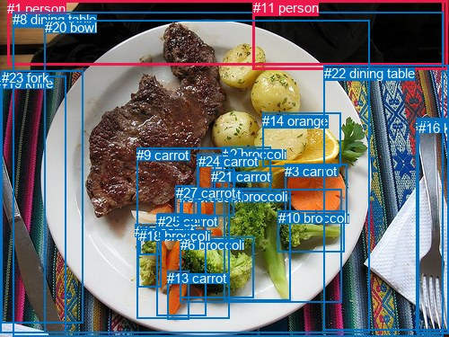
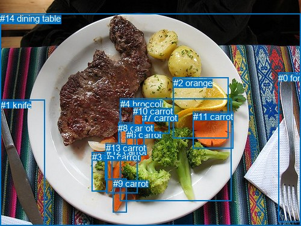

# 图片 1100：2365877.jpg

随机样本序号：181。图片 SHA256：`37d54ba3653e0c07cdf6e9e0caf83f6ba884d1778a576ed10426bd9d3d81815c`。

红色框表示人，蓝色框表示其他物体。两个模式分别保留自身框编号，可依据位置比较对应对象。

## 自动检测框与输出

人的框编号：`[1, 11]`。状态：`ok`。

### 自动检测全部物体框

| 编号 | 类别 | 是否为人 | 检测分数 | 像素坐标 xyxy |
|---|---|---|---|---|
| 0 | fork | False | 0.9894 | 463.4, 131.1, 499.8, 370.8 |
| 1 | person | True | 0.9712 | 8.1, 0.6, 494.1, 72.1 |
| 2 | broccoli | False | 0.9691 | 247.8, 163.4, 301.5, 210.5 |
| 3 | carrot | False | 0.9662 | 317.0, 182.2, 386.5, 243.8 |
| 4 | broccoli | False | 0.9618 | 249.0, 210.5, 323.4, 334.5 |
| 5 | broccoli | False | 0.8924 | 200.1, 210.9, 380.1, 336.9 |
| 6 | broccoli | False | 0.8756 | 200.9, 263.9, 282.9, 331.6 |
| 7 | broccoli | False | 0.8714 | 153.1, 252.7, 179.1, 319.6 |
| 8 | dining table | False | 0.8330 | 14.2, 13.1, 493.5, 375.0 |
| 9 | carrot | False | 0.8149 | 152.3, 164.3, 255.8, 354.4 |
| 10 | broccoli | False | 0.7905 | 309.9, 234.2, 383.6, 280.1 |
| 11 | person | True | 0.7685 | 281.8, 0.3, 498.0, 77.2 |
| 12 | carrot | False | 0.7497 | 174.5, 238.4, 229.4, 351.6 |
| 13 | carrot | False | 0.7338 | 186.3, 301.5, 210.4, 355.3 |
| 14 | orange | False | 0.7288 | 292.1, 125.8, 379.2, 185.3 |
| 15 | carrot | False | 0.7095 | 219.1, 171.5, 239.4, 242.4 |
| 16 | knife | False | 0.5979 | 465.8, 133.6, 499.4, 371.7 |
| 17 | carrot | False | 0.5814 | 150.2, 249.4, 174.4, 263.5 |
| 18 | broccoli | False | 0.5740 | 155.3, 253.9, 178.0, 283.7 |
| 19 | knife | False | 0.4993 | 0.0, 84.4, 73.9, 370.1 |
| 20 | bowl | False | 0.4813 | 49.9, 22.4, 411.1, 370.9 |
| 21 | carrot | False | 0.4579 | 235.4, 188.1, 261.4, 215.0 |
| 22 | dining table | False | 0.4227 | 360.9, 72.6, 500.0, 367.7 |
| 23 | fork | False | 0.3910 | 1.9, 78.2, 92.1, 359.9 |
| 24 | carrot | False | 0.3892 | 220.8, 171.0, 260.6, 240.2 |
| 25 | carrot | False | 0.3874 | 175.9, 237.9, 208.8, 265.9 |
| 26 | carrot | False | 0.3847 | 202.4, 208.1, 223.7, 249.5 |
| 27 | carrot | False | 0.3591 | 195.7, 206.0, 216.8, 248.2 |

### 自动检测 Top50 人相关候选

评分物体对：756；人相关物体对：106；输出关系：50。

| 排名 | 主语编号与类别 | 关系 | 宾语编号与类别 | 类型 | 人与人 | 排序分数 | 原始融合 logit |
|---|---|---|---|---|---|---|---|
| 1 | #1 person | wearing | #11 person | semantic | True | 0.99109 | 4.7112 |
| 2 | #11 person | sitting on | #1 person | semantic | True | 0.94865 | 2.9165 |
| 3 | #11 person | in | #1 person | spatial | True | 0.94209 | 2.7891 |
| 4 | #1 person | in | #11 person | spatial | True | 0.91755 | 2.4095 |
| 5 | #1 person | sitting on | #8 dining table | semantic | False | 0.87366 | 1.9337 |
| 6 | #1 person | on | #8 dining table | spatial | False | 0.83791 | 1.6428 |
| 7 | #11 person | sitting on | #8 dining table | semantic | False | 0.81340 | 1.4723 |
| 8 | #1 person | eating | #20 bowl | semantic | False | 0.78221 | 1.2786 |
| 9 | #11 person | on | #8 dining table | spatial | False | 0.73154 | 1.0025 |
| 10 | #1 person | beside | #20 bowl | spatial | False | 0.35130 | -0.6133 |
| 11 | #11 person | sitting on | #22 dining table | semantic | False | 0.25511 | -1.0715 |
| 12 | #8 dining table | on | #1 person | spatial | False | 0.18975 | -1.4516 |
| 13 | #11 person | on | #22 dining table | spatial | False | 0.16820 | -1.5984 |
| 14 | #11 person | beside | #20 bowl | spatial | False | 0.12703 | -1.9275 |
| 15 | #20 bowl | in front of | #1 person | spatial | False | 0.10744 | -2.1171 |
| 16 | #11 person | eating | #20 bowl | semantic | False | 0.09886 | -2.2100 |
| 17 | #1 person | sitting on | #22 dining table | semantic | False | 0.08158 | -2.4211 |
| 18 | #1 person | on | #22 dining table | spatial | False | 0.08039 | -2.4370 |
| 19 | #1 person | on | #23 fork | spatial | False | 0.06493 | -2.6674 |
| 20 | #8 dining table | holding | #1 person | semantic | False | 0.05571 | -2.8302 |
| 21 | #8 dining table | in | #11 person | spatial | False | 0.05151 | -2.9131 |
| 22 | #1 person | on | #19 knife | spatial | False | 0.05136 | -2.9161 |
| 23 | #1 person | wearing | #23 fork | semantic | False | 0.03843 | -3.2196 |
| 24 | #20 bowl | in front of | #11 person | spatial | False | 0.03364 | -3.3578 |
| 25 | #20 bowl | holding | #1 person | semantic | False | 0.03271 | -3.3868 |
| 26 | #1 person | holding | #19 knife | semantic | False | 0.02644 | -3.6062 |
| 27 | #11 person | sitting on | #23 fork | semantic | False | 0.02027 | -3.8783 |
| 28 | #11 person | on | #23 fork | spatial | False | 0.01905 | -3.9415 |
| 29 | #19 knife | in | #1 person | spatial | False | 0.01856 | -3.9682 |
| 30 | #23 fork | on | #1 person | spatial | False | 0.01849 | -3.9721 |
| 31 | #22 dining table | in | #11 person | spatial | False | 0.01809 | -3.9941 |
| 32 | #1 person | eating | #9 carrot | semantic | False | 0.01791 | -4.0041 |
| 33 | #22 dining table | in | #1 person | spatial | False | 0.01599 | -4.1195 |
| 34 | #11 person | on | #19 knife | spatial | False | 0.01476 | -4.2009 |
| 35 | #11 person | sitting on | #19 knife | semantic | False | 0.01320 | -4.3142 |
| 36 | #8 dining table | holding | #11 person | semantic | False | 0.01246 | -4.3730 |
| 37 | #11 person | eating | #5 broccoli | semantic | False | 0.01134 | -4.4680 |
| 38 | #11 person | eating | #9 carrot | semantic | False | 0.01086 | -4.5118 |
| 39 | #11 person | eating | #12 carrot | semantic | False | 0.00964 | -4.6319 |
| 40 | #1 person | eating | #5 broccoli | semantic | False | 0.00947 | -4.6499 |
| 41 | #20 bowl | holding | #11 person | semantic | False | 0.00929 | -4.6693 |
| 42 | #11 person | eating | #6 broccoli | semantic | False | 0.00861 | -4.7467 |
| 43 | #1 person | eating | #12 carrot | semantic | False | 0.00848 | -4.7614 |
| 44 | #11 person | eating | #4 broccoli | semantic | False | 0.00651 | -5.0281 |
| 45 | #23 fork | in | #11 person | spatial | False | 0.00639 | -5.0460 |
| 46 | #1 person | eating | #6 broccoli | semantic | False | 0.00635 | -5.0528 |
| 47 | #1 person | eating | #2 broccoli | semantic | False | 0.00605 | -5.1014 |
| 48 | #19 knife | in | #11 person | spatial | False | 0.00602 | -5.1067 |
| 49 | #1 person | eating | #24 carrot | semantic | False | 0.00600 | -5.1106 |
| 50 | #11 person | eating | #3 carrot | semantic | False | 0.00558 | -5.1833 |

### 自动检测逐条人相关 GT 核验

本图没有人相关 GT，R@50 无分母；预测候选继续展示。

## 真实框与输出

人的框编号：`[]`。

### 真实框全部物体框

| 编号 | 类别 | 是否为人 | 检测分数 | 像素坐标 xyxy |
|---|---|---|---|---|
| 0 | fork | False | GT | 462.0, 121.0, 499.0, 369.0 |
| 1 | knife | False | GT | 1.0, 166.0, 75.0, 375.0 |
| 2 | orange | False | GT | 288.0, 129.0, 380.0, 229.0 |
| 3 | broccoli | False | GT | 153.0, 252.0, 179.0, 317.0 |
| 4 | broccoli | False | GT | 200.0, 164.0, 385.0, 334.0 |
| 5 | carrot | False | GT | 174.0, 252.0, 186.0, 298.0 |
| 6 | carrot | False | GT | 210.0, 215.0, 228.0, 248.0 |
| 7 | carrot | False | GT | 236.0, 187.0, 281.0, 221.0 |
| 8 | carrot | False | GT | 196.0, 204.0, 222.0, 247.0 |
| 9 | carrot | False | GT | 188.0, 296.0, 211.0, 352.0 |
| 10 | carrot | False | GT | 221.0, 176.0, 239.0, 245.0 |
| 11 | carrot | False | GT | 321.0, 185.0, 388.0, 246.0 |
| 12 | carrot | False | GT | 177.0, 243.0, 229.0, 320.0 |
| 13 | carrot | False | GT | 176.0, 237.0, 211.0, 265.0 |
| 14 | dining table | False | GT | 0.0, 22.0, 500.0, 375.0 |

### 真实框 Top50 人相关候选

评分物体对：0；人相关物体对：0；输出关系：0。

| 排名 | 主语编号与类别 | 关系 | 宾语编号与类别 | 类型 | 人与人 | 排序分数 | 原始融合 logit |
|---|---|---|---|---|---|---|---|

### 真实框逐条人相关 GT 核验

本图没有人相关 GT，R@50 无分母；预测候选继续展示。

## 全部人相关 GT

| 主语编号与类别 | 关系 | 宾语编号与类别 |
|---|---|---|

原始记录、全部人相关物体对的两项预测与分项分数见 [逐图证据 JSON](../evidence/cases/1100.json)。全部56类 logits 保留于本机 HOR/output/random500/logits/。

<!-- HOR_COMPLETE_RESULTS -->

## 六组条件的完整输出对照

以下保留同一图片三种框与候选模式、两种谓词输出规则的全部 Top50。框编号各自在所属模式内解释。

### 自动检测框完整枚举：空间与语义各保留一个谓词

| 排名 | 主语编号与类别 | 谓词 | 宾语编号与类别 | 分组 | 排序分数 | predicate logit | pair logit |
|---|---|---|---|---|---|---|---|
| 1 | #1 person | wearing | #11 person | semantic | 0.9910865 | 4.2455649 | 0.4656788 |
| 2 | #11 person | sitting on | #1 person | semantic | 0.9486546 | 2.6061821 | 0.3102871 |
| 3 | #11 person | in | #1 person | spatial | 0.9420851 | 2.4788337 | 0.3102871 |
| 4 | #1 person | in | #11 person | spatial | 0.9175479 | 1.9438081 | 0.4656788 |
| 5 | #1 person | sitting on | #8 dining table | semantic | 0.8736631 | 2.0013847 | -0.0676425 |
| 6 | #1 person | on | #8 dining table | spatial | 0.8379104 | 1.7104049 | -0.0676425 |
| 7 | #11 person | sitting on | #8 dining table | semantic | 0.8134013 | 1.8087883 | -0.3365239 |
| 8 | #1 person | eating | #20 bowl | semantic | 0.7822117 | 1.9041591 | -0.6255572 |
| 9 | #11 person | on | #8 dining table | spatial | 0.7315450 | 1.3389993 | -0.3365239 |
| 10 | #1 person | beside | #20 bowl | spatial | 0.3513039 | 0.0122447 | -0.6255572 |
| 11 | #11 person | sitting on | #22 dining table | semantic | 0.2551095 | -0.2599969 | -0.8115473 |
| 12 | #8 dining table | on | #1 person | spatial | 0.1897489 | -0.7510822 | -0.7005606 |
| 13 | #11 person | on | #22 dining table | spatial | 0.1682016 | -0.7868793 | -0.8115473 |
| 14 | #11 person | beside | #20 bowl | spatial | 0.1270323 | -0.9668770 | -0.9605800 |
| 15 | #20 bowl | in front of | #1 person | spatial | 0.1074412 | -1.1826298 | -0.9345192 |
| 16 | #11 person | eating | #20 bowl | semantic | 0.0988589 | -1.2493882 | -0.9605800 |
| 17 | #1 person | sitting on | #22 dining table | semantic | 0.0815793 | -1.7480357 | -0.6730441 |
| 18 | #1 person | on | #22 dining table | spatial | 0.0803919 | -1.7639904 | -0.6730441 |
| 19 | #1 person | on | #23 fork | spatial | 0.0649270 | -1.8507597 | -0.8166020 |
| 20 | #8 dining table | holding | #1 person | semantic | 0.0557148 | -2.1296222 | -0.7005606 |
| 21 | #8 dining table | in | #11 person | spatial | 0.0515121 | -1.9627624 | -0.9502895 |
| 22 | #1 person | on | #19 knife | spatial | 0.0513647 | -1.9998548 | -0.9162179 |
| 23 | #1 person | wearing | #23 fork | semantic | 0.0384346 | -2.4030023 | -0.8166020 |
| 24 | #20 bowl | in front of | #11 person | spatial | 0.0336401 | -2.1506426 | -1.2071733 |
| 25 | #20 bowl | holding | #1 person | semantic | 0.0327093 | -2.4523218 | -0.9345192 |
| 26 | #1 person | holding | #19 knife | semantic | 0.0264376 | -2.6899581 | -0.9162179 |
| 27 | #11 person | sitting on | #23 fork | semantic | 0.0202674 | -2.8102663 | -1.0679986 |
| 28 | #11 person | on | #23 fork | spatial | 0.0190494 | -2.8734860 | -1.0679986 |
| 29 | #19 knife | in | #1 person | spatial | 0.0185562 | -2.6053228 | -1.3628962 |
| 30 | #23 fork | on | #1 person | spatial | 0.0184858 | -2.5619442 | -1.4101508 |
| 31 | #22 dining table | in | #11 person | spatial | 0.0180900 | -2.4920404 | -1.5021025 |
| 32 | #1 person | eating | #9 carrot | semantic | 0.0179135 | -2.4091890 | -1.5949340 |
| 33 | #22 dining table | in | #1 person | spatial | 0.0159926 | -2.6292722 | -1.4902343 |
| 34 | #11 person | on | #19 knife | spatial | 0.0147614 | -3.0663567 | -1.1345094 |
| 35 | #11 person | sitting on | #19 knife | semantic | 0.0132012 | -3.1796470 | -1.1345094 |
| 36 | #8 dining table | holding | #11 person | semantic | 0.0124567 | -3.4226699 | -0.9502895 |
| 37 | #11 person | eating | #5 broccoli | semantic | 0.0113396 | -2.2147224 | -2.2533247 |
| 38 | #11 person | eating | #9 carrot | semantic | 0.0108597 | -2.3509374 | -2.1608393 |
| 39 | #11 person | eating | #12 carrot | semantic | 0.0096420 | -2.2223656 | -2.4095762 |
| 40 | #1 person | eating | #5 broccoli | semantic | 0.0094718 | -2.8240299 | -1.8258846 |
| 41 | #20 bowl | holding | #11 person | semantic | 0.0092920 | -3.4620881 | -1.2071733 |
| 42 | #11 person | eating | #6 broccoli | semantic | 0.0086055 | -2.2682269 | -2.4784870 |
| 43 | #1 person | eating | #12 carrot | semantic | 0.0084812 | -2.9683311 | -1.7930567 |
| 44 | #11 person | eating | #4 broccoli | semantic | 0.0065089 | -2.7093773 | -2.3186808 |
| 45 | #23 fork | in | #11 person | spatial | 0.0063941 | -3.2614112 | -1.7845535 |
| 46 | #1 person | eating | #6 broccoli | semantic | 0.0063507 | -3.1341953 | -1.9186193 |
| 47 | #1 person | eating | #2 broccoli | semantic | 0.0060516 | -3.0900640 | -2.0112948 |
| 48 | #19 knife | in | #11 person | spatial | 0.0060198 | -3.3700495 | -1.7366133 |
| 49 | #1 person | eating | #24 carrot | semantic | 0.0059961 | -3.2669506 | -1.8436801 |
| 50 | #11 person | eating | #3 carrot | semantic | 0.0055782 | -2.9401708 | -2.2431319 |

没有人相关 GT，本条件的召回率无分母。

### 自动检测框完整枚举：每对只保留一个谓词

| 排名 | 主语编号与类别 | 谓词 | 宾语编号与类别 | 分组 | 排序分数 | predicate logit | pair logit |
|---|---|---|---|---|---|---|---|
| 1 | #1 person | wearing | #11 person | single | 0.9910865 | 4.2455649 | 0.4656788 |
| 2 | #11 person | sitting on | #1 person | single | 0.9486546 | 2.6061821 | 0.3102871 |
| 3 | #1 person | sitting on | #8 dining table | single | 0.8736631 | 2.0013847 | -0.0676425 |
| 4 | #11 person | sitting on | #8 dining table | single | 0.8134013 | 1.8087883 | -0.3365239 |
| 5 | #1 person | eating | #20 bowl | single | 0.7822117 | 1.9041591 | -0.6255572 |
| 6 | #11 person | sitting on | #22 dining table | single | 0.2551095 | -0.2599969 | -0.8115473 |
| 7 | #8 dining table | on | #1 person | single | 0.1897489 | -0.7510822 | -0.7005606 |
| 8 | #11 person | beside | #20 bowl | single | 0.1270323 | -0.9668770 | -0.9605800 |
| 9 | #20 bowl | in front of | #1 person | single | 0.1074412 | -1.1826298 | -0.9345192 |
| 10 | #1 person | sitting on | #22 dining table | single | 0.0815793 | -1.7480357 | -0.6730441 |
| 11 | #1 person | on | #23 fork | single | 0.0649270 | -1.8507597 | -0.8166020 |
| 12 | #8 dining table | in | #11 person | single | 0.0515121 | -1.9627624 | -0.9502895 |
| 13 | #1 person | on | #19 knife | single | 0.0513647 | -1.9998548 | -0.9162179 |
| 14 | #20 bowl | in front of | #11 person | single | 0.0336401 | -2.1506426 | -1.2071733 |
| 15 | #11 person | sitting on | #23 fork | single | 0.0202674 | -2.8102663 | -1.0679986 |
| 16 | #19 knife | in | #1 person | single | 0.0185562 | -2.6053228 | -1.3628962 |
| 17 | #23 fork | on | #1 person | single | 0.0184858 | -2.5619442 | -1.4101508 |
| 18 | #22 dining table | in | #11 person | single | 0.0180900 | -2.4920404 | -1.5021025 |
| 19 | #1 person | eating | #9 carrot | single | 0.0179135 | -2.4091890 | -1.5949340 |
| 20 | #22 dining table | in | #1 person | single | 0.0159926 | -2.6292722 | -1.4902343 |
| 21 | #11 person | on | #19 knife | single | 0.0147614 | -3.0663567 | -1.1345094 |
| 22 | #11 person | eating | #5 broccoli | single | 0.0113396 | -2.2147224 | -2.2533247 |
| 23 | #11 person | eating | #9 carrot | single | 0.0108597 | -2.3509374 | -2.1608393 |
| 24 | #11 person | eating | #12 carrot | single | 0.0096420 | -2.2223656 | -2.4095762 |
| 25 | #1 person | eating | #5 broccoli | single | 0.0094718 | -2.8240299 | -1.8258846 |
| 26 | #11 person | eating | #6 broccoli | single | 0.0086055 | -2.2682269 | -2.4784870 |
| 27 | #1 person | eating | #12 carrot | single | 0.0084812 | -2.9683311 | -1.7930567 |
| 28 | #11 person | eating | #4 broccoli | single | 0.0065089 | -2.7093773 | -2.3186808 |
| 29 | #23 fork | in | #11 person | single | 0.0063941 | -3.2614112 | -1.7845535 |
| 30 | #1 person | eating | #6 broccoli | single | 0.0063507 | -3.1341953 | -1.9186193 |
| 31 | #1 person | eating | #2 broccoli | single | 0.0060516 | -3.0900640 | -2.0112948 |
| 32 | #19 knife | in | #11 person | single | 0.0060198 | -3.3700495 | -1.7366133 |
| 33 | #1 person | eating | #24 carrot | single | 0.0059961 | -3.2669506 | -1.8436801 |
| 34 | #11 person | eating | #3 carrot | single | 0.0055782 | -2.9401708 | -2.2431319 |
| 35 | #11 person | eating | #2 broccoli | single | 0.0055492 | -2.7903180 | -2.3982162 |
| 36 | #11 person | eating | #13 carrot | single | 0.0054203 | -2.9153898 | -2.2967811 |
| 37 | #11 person | eating | #24 carrot | single | 0.0049480 | -2.9647508 | -2.3390689 |
| 38 | #1 person | eating | #3 carrot | single | 0.0044265 | -3.1638036 | -2.2519131 |
| 39 | #1 person | eating | #25 carrot | single | 0.0043101 | -3.5477085 | -1.8947691 |
| 40 | #1 person | eating | #26 carrot | single | 0.0041622 | -3.6920500 | -1.7854793 |
| 41 | #11 person | eating | #25 carrot | single | 0.0041352 | -2.9503083 | -2.5337610 |
| 42 | #1 person | eating | #15 carrot | single | 0.0041301 | -3.6400337 | -1.8452930 |
| 43 | #1 person | eating | #21 carrot | single | 0.0039206 | -3.6388674 | -1.8987166 |
| 44 | #1 person | eating | #27 carrot | single | 0.0039096 | -3.7719045 | -1.7684948 |
| 45 | #1 person | eating | #13 carrot | single | 0.0038751 | -3.7590110 | -1.7903001 |
| 46 | #11 person | eating | #26 carrot | single | 0.0038681 | -3.2006934 | -2.3504343 |
| 47 | #11 person | eating | #27 carrot | single | 0.0037855 | -3.2266412 | -2.3461423 |
| 48 | #11 person | holding | #0 fork | single | 0.0037308 | -3.8076282 | -1.7797573 |
| 49 | #11 person | eating | #15 carrot | single | 0.0037082 | -3.2136068 | -2.3798966 |
| 50 | #11 person | eating | #7 broccoli | single | 0.0036850 | -3.0873284 | -2.5124602 |

没有人相关 GT，本条件的召回率无分母。

### 真实框完整枚举：空间与语义各保留一个谓词

| 排名 | 主语编号与类别 | 谓词 | 宾语编号与类别 | 分组 | 排序分数 | predicate logit | pair logit |
|---|---|---|---|---|---|---|---|

没有人相关 GT，本条件的召回率无分母。

### 真实框完整枚举：每对只保留一个谓词

| 排名 | 主语编号与类别 | 谓词 | 宾语编号与类别 | 分组 | 排序分数 | predicate logit | pair logit |
|---|---|---|---|---|---|---|---|

没有人相关 GT，本条件的召回率无分母。

### 真实框400候选：空间与语义各保留一个谓词

| 排名 | 主语编号与类别 | 谓词 | 宾语编号与类别 | 分组 | 排序分数 | predicate logit | pair logit |
|---|---|---|---|---|---|---|---|

没有人相关 GT，本条件的召回率无分母。

### 真实框400候选：每对只保留一个谓词

| 排名 | 主语编号与类别 | 谓词 | 宾语编号与类别 | 分组 | 排序分数 | predicate logit | pair logit |
|---|---|---|---|---|---|---|---|

没有人相关 GT，本条件的召回率无分母。
