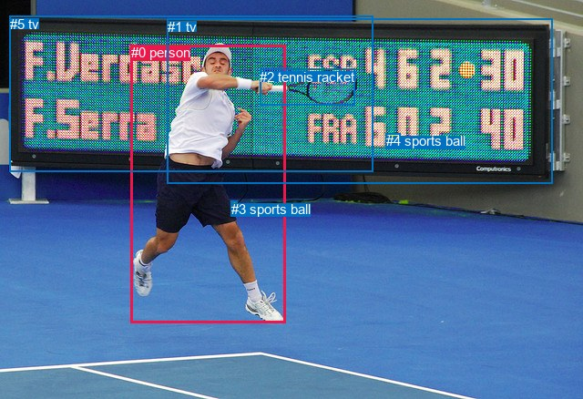
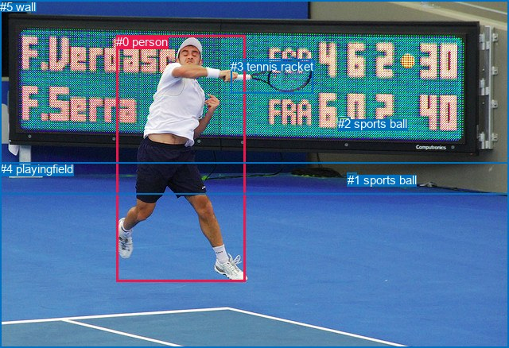

# 图片 1101：2365885.jpg

随机样本序号：470。图片 SHA256：`ddbfc26792efff1d7f2e675390c57303f274df9f8131997505aff801b85b4e6a`。

红色框表示人，蓝色框表示其他物体。两个模式分别保留自身框编号，可依据位置比较对应对象。

## 自动检测框与输出

人的框编号：`[0]`。状态：`ok`。

### 自动检测全部物体框

| 编号 | 类别 | 是否为人 | 检测分数 | 像素坐标 xyxy |
|---|---|---|---|---|
| 0 | person | True | 0.9997 | 143.9, 49.0, 313.7, 354.3 |
| 1 | tv | False | 0.9623 | 183.6, 20.8, 606.7, 201.9 |
| 2 | tennis racket | False | 0.9523 | 285.4, 75.8, 389.9, 115.3 |
| 3 | sports ball | False | 0.8706 | 253.7, 220.6, 260.6, 227.1 |
| 4 | sports ball | False | 0.7182 | 423.9, 146.3, 439.1, 160.1 |
| 5 | tv | False | 0.5398 | 11.0, 17.9, 409.7, 188.2 |

### 自动检测 Top50 人相关候选

评分物体对：30；人相关物体对：10；输出关系：20。

| 排名 | 主语编号与类别 | 关系 | 宾语编号与类别 | 类型 | 人与人 | 排序分数 | 原始融合 logit |
|---|---|---|---|---|---|---|---|
| 1 | #0 person | swinging | #2 tennis racket | semantic | False | 0.99750 | 5.9879 |
| 2 | #0 person | playing | #1 tv | semantic | False | 0.95306 | 3.0108 |
| 3 | #0 person | playing | #5 tv | semantic | False | 0.92487 | 2.5104 |
| 4 | #0 person | about to hit | #4 sports ball | semantic | False | 0.91603 | 2.3896 |
| 5 | #0 person | wearing | #3 sports ball | semantic | False | 0.88153 | 2.0070 |
| 6 | #3 sports ball | on | #0 person | spatial | False | 0.85133 | 1.7451 |
| 7 | #0 person | in | #2 tennis racket | spatial | False | 0.81385 | 1.4752 |
| 8 | #0 person | in | #3 sports ball | spatial | False | 0.77695 | 1.2480 |
| 9 | #0 person | in | #5 tv | spatial | False | 0.49387 | -0.0245 |
| 10 | #0 person | in | #1 tv | spatial | False | 0.47652 | -0.0940 |
| 11 | #2 tennis racket | holding | #0 person | semantic | False | 0.46943 | -0.1224 |
| 12 | #0 person | on | #4 sports ball | spatial | False | 0.39208 | -0.4386 |
| 13 | #2 tennis racket | in | #0 person | spatial | False | 0.27868 | -0.9510 |
| 14 | #5 tv | beside | #0 person | spatial | False | 0.15637 | -1.6855 |
| 15 | #1 tv | beside | #0 person | spatial | False | 0.14568 | -1.7689 |
| 16 | #3 sports ball | wearing | #0 person | semantic | False | 0.13411 | -1.8651 |
| 17 | #1 tv | looking at | #0 person | semantic | False | 0.03584 | -3.2923 |
| 18 | #4 sports ball | playing | #0 person | semantic | False | 0.03291 | -3.3806 |
| 19 | #4 sports ball | in | #0 person | spatial | False | 0.02912 | -3.5068 |
| 20 | #5 tv | holding | #0 person | semantic | False | 0.02885 | -3.5165 |

### 自动检测逐条人相关 GT 核验

R@50：0.00%；命中 0/3。

| GT 主语编号 | GT 关系 | GT 宾语编号 | 结果阶段 | 匹配预测主语编号 | 匹配预测宾语编号 |
|---|---|---|---|---|---|
| 0 | playing | 2 | wrong_predicate | [0] | [4] |
| 0 | holding | 3 | wrong_predicate | [0] | [2] |
| 0 | running on | 4 | endpoint_missing_or_wrong_class | [0] | [] |

## 真实框与输出

人的框编号：`[0]`。

### 真实框全部物体框

| 编号 | 类别 | 是否为人 | 检测分数 | 像素坐标 xyxy |
|---|---|---|---|---|
| 0 | person | True | GT | 146.0, 44.0, 308.0, 355.0 |
| 1 | sports ball | False | GT | 437.0, 218.0, 449.0, 224.0 |
| 2 | sports ball | False | GT | 425.0, 147.0, 440.0, 160.0 |
| 3 | tennis racket | False | GT | 290.0, 75.0, 393.0, 118.0 |
| 4 | playingfield | False | GT | 0.0, 204.0, 640.0, 438.0 |
| 5 | wall | False | GT | 0.0, 0.0, 640.0, 244.0 |

### 真实框 Top50 人相关候选

评分物体对：30；人相关物体对：10；输出关系：20。

| 排名 | 主语编号与类别 | 关系 | 宾语编号与类别 | 类型 | 人与人 | 排序分数 | 原始融合 logit |
|---|---|---|---|---|---|---|---|
| 1 | #0 person | swinging | #3 tennis racket | semantic | False | 0.99789 | 6.1576 |
| 2 | #0 person | about to hit | #2 sports ball | semantic | False | 0.95774 | 3.1208 |
| 3 | #0 person | playing with | #4 playingfield | semantic | False | 0.95255 | 2.9996 |
| 4 | #0 person | on | #4 playingfield | spatial | False | 0.94970 | 2.9382 |
| 5 | #0 person | about to hit | #1 sports ball | semantic | False | 0.91453 | 2.3702 |
| 6 | #0 person | playing | #5 wall | semantic | False | 0.87368 | 1.9339 |
| 7 | #0 person | in | #3 tennis racket | spatial | False | 0.82789 | 1.5707 |
| 8 | #0 person | in front of | #5 wall | spatial | False | 0.65108 | 0.6238 |
| 9 | #3 tennis racket | holding | #0 person | semantic | False | 0.50412 | 0.0165 |
| 10 | #0 person | in | #1 sports ball | spatial | False | 0.47889 | -0.0845 |
| 11 | #5 wall | beside | #0 person | spatial | False | 0.44629 | -0.2157 |
| 12 | #3 tennis racket | in | #0 person | spatial | False | 0.41700 | -0.3351 |
| 13 | #0 person | on | #2 sports ball | spatial | False | 0.34501 | -0.6410 |
| 14 | #1 sports ball | beside | #0 person | spatial | False | 0.11808 | -2.0108 |
| 15 | #4 playingfield | in | #0 person | spatial | False | 0.10921 | -2.0988 |
| 16 | #1 sports ball | looking at | #0 person | semantic | False | 0.10713 | -2.1204 |
| 17 | #2 sports ball | beside | #0 person | spatial | False | 0.09708 | -2.2301 |
| 18 | #2 sports ball | looking at | #0 person | semantic | False | 0.07709 | -2.4826 |
| 19 | #4 playingfield | holding | #0 person | semantic | False | 0.07384 | -2.5292 |
| 20 | #5 wall | looking at | #0 person | semantic | False | 0.06727 | -2.6294 |

### 真实框逐条人相关 GT 核验

R@50：0.00%；命中 0/3。

| GT 主语编号 | GT 关系 | GT 宾语编号 | 结果阶段 | 匹配预测主语编号 | 匹配预测宾语编号 |
|---|---|---|---|---|---|
| 0 | playing | 2 | wrong_predicate | [0] | [2] |
| 0 | holding | 3 | wrong_predicate | [0] | [3] |
| 0 | running on | 4 | wrong_predicate | [0] | [4] |

## 全部人相关 GT

| 主语编号与类别 | 关系 | 宾语编号与类别 |
|---|---|---|
| #0 person | playing | #2 sports ball |
| #0 person | holding | #3 tennis racket |
| #0 person | running on | #4 playingfield |

原始记录、全部人相关物体对的两项预测与分项分数见 [逐图证据 JSON](../evidence/cases/1101.json)。全部56类 logits 保留于本机 HOR/output/random500/logits/。

<!-- HOR_COMPLETE_RESULTS -->

## 六组条件的完整输出对照

以下保留同一图片三种框与候选模式、两种谓词输出规则的全部 Top50。框编号各自在所属模式内解释。

### 自动检测框完整枚举：空间与语义各保留一个谓词

| 排名 | 主语编号与类别 | 谓词 | 宾语编号与类别 | 分组 | 排序分数 | predicate logit | pair logit |
|---|---|---|---|---|---|---|---|
| 1 | #0 person | swinging | #2 tennis racket | semantic | 0.9974973 | 5.2928910 | 0.6949900 |
| 2 | #0 person | playing | #1 tv | semantic | 0.9530584 | 3.4856210 | -0.4748495 |
| 3 | #0 person | playing | #5 tv | semantic | 0.9248660 | 3.2069340 | -0.6965587 |
| 4 | #0 person | about to hit | #4 sports ball | semantic | 0.9160330 | 2.5242190 | -0.1345901 |
| 5 | #0 person | wearing | #3 sports ball | semantic | 0.8815320 | 2.2160659 | -0.2090475 |
| 6 | #3 sports ball | on | #0 person | spatial | 0.8513327 | 2.3907738 | -0.6456815 |
| 7 | #0 person | in | #2 tennis racket | spatial | 0.8138459 | 0.7802057 | 0.6949900 |
| 8 | #0 person | in | #3 sports ball | spatial | 0.7769496 | 1.4570255 | -0.2090475 |
| 9 | #0 person | in | #5 tv | spatial | 0.4938663 | 0.6720228 | -0.6965587 |
| 10 | #0 person | in | #1 tv | spatial | 0.4765159 | 0.3808436 | -0.4748495 |
| 11 | #2 tennis racket | holding | #0 person | semantic | 0.4694321 | 0.6096096 | -0.7320341 |
| 12 | #0 person | on | #4 sports ball | spatial | 0.3920768 | -0.3040004 | -0.1345901 |
| 13 | #2 tennis racket | in | #0 person | spatial | 0.2786773 | -0.2189980 | -0.7320341 |
| 14 | #5 tv | beside | #0 person | spatial | 0.1563666 | -1.1254544 | -0.5600605 |
| 15 | #1 tv | beside | #0 person | spatial | 0.1456764 | -1.2321038 | -0.5368181 |
| 16 | #3 sports ball | wearing | #0 person | semantic | 0.1341084 | -1.2194300 | -0.6456815 |
| 17 | #1 tv | looking at | #0 person | semantic | 0.0358354 | -2.7555070 | -0.5368181 |
| 18 | #4 sports ball | playing | #0 person | semantic | 0.0329058 | -2.3669388 | -1.0137074 |
| 19 | #4 sports ball | in | #0 person | spatial | 0.0291196 | -2.4930828 | -1.0137074 |
| 20 | #5 tv | holding | #0 person | semantic | 0.0288456 | -2.9564679 | -0.5600605 |

GT 命中：0/3，R@50=0.00%。

| GT主语 | GT谓词 | GT宾语 | 结果阶段 | 匹配主语框 | 匹配宾语框 |
|---|---|---|---|---|---|
| 0 | playing | 2 | wrong_predicate | [0] | [4] |
| 0 | holding | 3 | wrong_predicate | [0] | [2] |
| 0 | running on | 4 | endpoint_missing_or_wrong_class | [0] | [] |

### 自动检测框完整枚举：每对只保留一个谓词

| 排名 | 主语编号与类别 | 谓词 | 宾语编号与类别 | 分组 | 排序分数 | predicate logit | pair logit |
|---|---|---|---|---|---|---|---|
| 1 | #0 person | swinging | #2 tennis racket | single | 0.9974973 | 5.2928910 | 0.6949900 |
| 2 | #0 person | playing | #1 tv | single | 0.9530584 | 3.4856210 | -0.4748495 |
| 3 | #0 person | playing | #5 tv | single | 0.9248660 | 3.2069340 | -0.6965587 |
| 4 | #0 person | about to hit | #4 sports ball | single | 0.9160330 | 2.5242190 | -0.1345901 |
| 5 | #0 person | wearing | #3 sports ball | single | 0.8815320 | 2.2160659 | -0.2090475 |
| 6 | #3 sports ball | on | #0 person | single | 0.8513327 | 2.3907738 | -0.6456815 |
| 7 | #2 tennis racket | holding | #0 person | single | 0.4694321 | 0.6096096 | -0.7320341 |
| 8 | #5 tv | beside | #0 person | single | 0.1563666 | -1.1254544 | -0.5600605 |
| 9 | #1 tv | beside | #0 person | single | 0.1456764 | -1.2321038 | -0.5368181 |
| 10 | #4 sports ball | playing | #0 person | single | 0.0329058 | -2.3669388 | -1.0137074 |

GT 命中：0/3，R@50=0.00%。

| GT主语 | GT谓词 | GT宾语 | 结果阶段 | 匹配主语框 | 匹配宾语框 |
|---|---|---|---|---|---|
| 0 | playing | 2 | wrong_predicate | [0] | [4] |
| 0 | holding | 3 | wrong_predicate | [0] | [2] |
| 0 | running on | 4 | endpoint_missing_or_wrong_class | [0] | [] |

### 真实框完整枚举：空间与语义各保留一个谓词

| 排名 | 主语编号与类别 | 谓词 | 宾语编号与类别 | 分组 | 排序分数 | predicate logit | pair logit |
|---|---|---|---|---|---|---|---|
| 1 | #0 person | swinging | #3 tennis racket | semantic | 0.9978871 | 5.4734311 | 0.6841195 |
| 2 | #0 person | about to hit | #2 sports ball | semantic | 0.9577438 | 3.2750001 | -0.1541713 |
| 3 | #0 person | playing with | #4 playingfield | semantic | 0.9525542 | 2.9462075 | 0.0533531 |
| 4 | #0 person | on | #4 playingfield | spatial | 0.9497035 | 2.8848610 | 0.0533531 |
| 5 | #0 person | about to hit | #1 sports ball | semantic | 0.9145271 | 2.9819860 | -0.6117778 |
| 6 | #0 person | playing | #5 wall | semantic | 0.8736817 | 2.6176405 | -0.6837301 |
| 7 | #0 person | in | #3 tennis racket | spatial | 0.8278901 | 0.8866277 | 0.6841195 |
| 8 | #0 person | in front of | #5 wall | spatial | 0.6510795 | 1.3075180 | -0.6837301 |
| 9 | #3 tennis racket | holding | #0 person | semantic | 0.5041212 | 0.7576604 | -0.7411749 |
| 10 | #0 person | in | #1 sports ball | spatial | 0.4788916 | 0.5272937 | -0.6117778 |
| 11 | #5 wall | beside | #0 person | spatial | 0.4462917 | 0.2830811 | -0.4987464 |
| 12 | #3 tennis racket | in | #0 person | spatial | 0.4169962 | 0.4060583 | -0.7411749 |
| 13 | #0 person | on | #2 sports ball | spatial | 0.3450125 | -0.4868641 | -0.1541713 |
| 14 | #1 sports ball | beside | #0 person | spatial | 0.1180765 | -1.1843936 | -0.8263793 |
| 15 | #4 playingfield | in | #0 person | spatial | 0.1092143 | -1.1184165 | -0.9803748 |
| 16 | #1 sports ball | looking at | #0 person | semantic | 0.1071317 | -1.2940009 | -0.8263793 |
| 17 | #2 sports ball | beside | #0 person | spatial | 0.0970812 | -1.2023160 | -1.0277684 |
| 18 | #2 sports ball | looking at | #0 person | semantic | 0.0770857 | -1.4548507 | -1.0277684 |
| 19 | #4 playingfield | holding | #0 person | semantic | 0.0738375 | -1.5488083 | -0.9803748 |
| 20 | #5 wall | looking at | #0 person | semantic | 0.0672723 | -2.1306176 | -0.4987464 |

GT 命中：0/3，R@50=0.00%。

| GT主语 | GT谓词 | GT宾语 | 结果阶段 | 匹配主语框 | 匹配宾语框 |
|---|---|---|---|---|---|
| 0 | playing | 2 | wrong_predicate | [0] | [2] |
| 0 | holding | 3 | wrong_predicate | [0] | [3] |
| 0 | running on | 4 | wrong_predicate | [0] | [4] |

### 真实框完整枚举：每对只保留一个谓词

| 排名 | 主语编号与类别 | 谓词 | 宾语编号与类别 | 分组 | 排序分数 | predicate logit | pair logit |
|---|---|---|---|---|---|---|---|
| 1 | #0 person | swinging | #3 tennis racket | single | 0.9978871 | 5.4734311 | 0.6841195 |
| 2 | #0 person | about to hit | #2 sports ball | single | 0.9577438 | 3.2750001 | -0.1541713 |
| 3 | #0 person | playing with | #4 playingfield | single | 0.9525542 | 2.9462075 | 0.0533531 |
| 4 | #0 person | about to hit | #1 sports ball | single | 0.9145271 | 2.9819860 | -0.6117778 |
| 5 | #0 person | playing | #5 wall | single | 0.8736817 | 2.6176405 | -0.6837301 |
| 6 | #3 tennis racket | holding | #0 person | single | 0.5041212 | 0.7576604 | -0.7411749 |
| 7 | #5 wall | beside | #0 person | single | 0.4462917 | 0.2830811 | -0.4987464 |
| 8 | #1 sports ball | beside | #0 person | single | 0.1180765 | -1.1843936 | -0.8263793 |
| 9 | #4 playingfield | in | #0 person | single | 0.1092143 | -1.1184165 | -0.9803748 |
| 10 | #2 sports ball | beside | #0 person | single | 0.0970812 | -1.2023160 | -1.0277684 |

GT 命中：0/3，R@50=0.00%。

| GT主语 | GT谓词 | GT宾语 | 结果阶段 | 匹配主语框 | 匹配宾语框 |
|---|---|---|---|---|---|
| 0 | playing | 2 | wrong_predicate | [0] | [2] |
| 0 | holding | 3 | wrong_predicate | [0] | [3] |
| 0 | running on | 4 | wrong_predicate | [0] | [4] |

### 真实框400候选：空间与语义各保留一个谓词

| 排名 | 主语编号与类别 | 谓词 | 宾语编号与类别 | 分组 | 排序分数 | predicate logit | pair logit |
|---|---|---|---|---|---|---|---|
| 1 | #0 person | swinging | #3 tennis racket | semantic | 0.9980102 | 5.5336108 | 0.6841195 |
| 2 | #0 person | about to hit | #2 sports ball | semantic | 0.9577438 | 3.2750001 | -0.1541713 |
| 3 | #0 person | playing with | #4 playingfield | semantic | 0.9525542 | 2.9462075 | 0.0533531 |
| 4 | #0 person | on | #4 playingfield | spatial | 0.9497035 | 2.8848610 | 0.0533531 |
| 5 | #0 person | about to hit | #1 sports ball | semantic | 0.9179335 | 3.0263729 | -0.6117778 |
| 6 | #0 person | playing | #5 wall | semantic | 0.8680038 | 2.5671535 | -0.6837301 |
| 7 | #0 person | in | #3 tennis racket | spatial | 0.8278901 | 0.8866277 | 0.6841195 |
| 8 | #0 person | in front of | #5 wall | spatial | 0.6577462 | 1.3369966 | -0.6837301 |
| 9 | #3 tennis racket | holding | #0 person | semantic | 0.5041212 | 0.7576604 | -0.7411749 |
| 10 | #0 person | in | #1 sports ball | spatial | 0.4788916 | 0.5272937 | -0.6117778 |
| 11 | #5 wall | beside | #0 person | spatial | 0.4462845 | 0.2830520 | -0.4987464 |
| 12 | #3 tennis racket | in | #0 person | spatial | 0.4161896 | 0.4027395 | -0.7411749 |
| 13 | #0 person | on | #2 sports ball | spatial | 0.3450125 | -0.4868641 | -0.1541713 |
| 14 | #1 sports ball | beside | #0 person | spatial | 0.1228490 | -1.1393435 | -0.8263793 |
| 15 | #1 sports ball | looking at | #0 person | semantic | 0.1114919 | -1.2492127 | -0.8263793 |
| 16 | #4 playingfield | in | #0 person | spatial | 0.1095376 | -1.1150978 | -0.9803748 |
| 17 | #2 sports ball | beside | #0 person | spatial | 0.0957704 | -1.2173617 | -1.0277684 |
| 18 | #2 sports ball | looking at | #0 person | semantic | 0.0760221 | -1.4698961 | -1.0277684 |
| 19 | #4 playingfield | holding | #0 person | semantic | 0.0738059 | -1.5492702 | -0.9803748 |
| 20 | #5 wall | looking at | #0 person | semantic | 0.0672505 | -2.1309664 | -0.4987464 |

GT 命中：0/3，R@50=0.00%。

| GT主语 | GT谓词 | GT宾语 | 结果阶段 | 匹配主语框 | 匹配宾语框 |
|---|---|---|---|---|---|
| 0 | playing | 2 | wrong_predicate | [0] | [2] |
| 0 | holding | 3 | wrong_predicate | [0] | [3] |
| 0 | running on | 4 | wrong_predicate | [0] | [4] |

### 真实框400候选：每对只保留一个谓词

| 排名 | 主语编号与类别 | 谓词 | 宾语编号与类别 | 分组 | 排序分数 | predicate logit | pair logit |
|---|---|---|---|---|---|---|---|
| 1 | #0 person | swinging | #3 tennis racket | single | 0.9980102 | 5.5336108 | 0.6841195 |
| 2 | #0 person | about to hit | #2 sports ball | single | 0.9577438 | 3.2750001 | -0.1541713 |
| 3 | #0 person | playing with | #4 playingfield | single | 0.9525542 | 2.9462075 | 0.0533531 |
| 4 | #0 person | about to hit | #1 sports ball | single | 0.9179335 | 3.0263729 | -0.6117778 |
| 5 | #0 person | playing | #5 wall | single | 0.8680038 | 2.5671535 | -0.6837301 |
| 6 | #3 tennis racket | holding | #0 person | single | 0.5041212 | 0.7576604 | -0.7411749 |
| 7 | #5 wall | beside | #0 person | single | 0.4462845 | 0.2830520 | -0.4987464 |
| 8 | #1 sports ball | beside | #0 person | single | 0.1228490 | -1.1393435 | -0.8263793 |
| 9 | #4 playingfield | in | #0 person | single | 0.1095376 | -1.1150978 | -0.9803748 |
| 10 | #2 sports ball | beside | #0 person | single | 0.0957704 | -1.2173617 | -1.0277684 |

GT 命中：0/3，R@50=0.00%。

| GT主语 | GT谓词 | GT宾语 | 结果阶段 | 匹配主语框 | 匹配宾语框 |
|---|---|---|---|---|---|
| 0 | playing | 2 | wrong_predicate | [0] | [2] |
| 0 | holding | 3 | wrong_predicate | [0] | [3] |
| 0 | running on | 4 | wrong_predicate | [0] | [4] |
