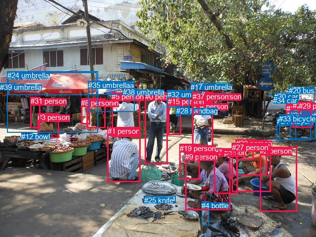
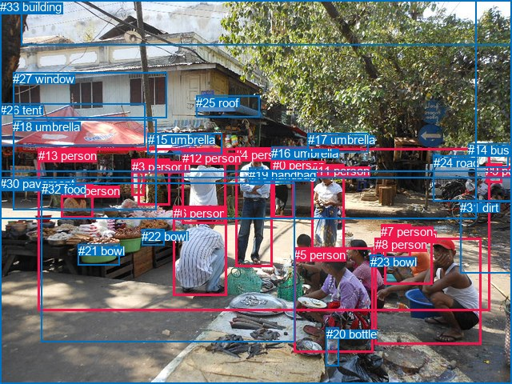

# 图片 1128：2366957.jpg

随机样本序号：398。图片 SHA256：`fcde3d391e5ff8ca3df743484effef4c13e1cf5f3aa548af815b777a23adc365`。

红色框表示人，蓝色框表示其他物体。两个模式分别保留自身框编号，可依据位置比较对应对象。

## 自动检测框与输出

人的框编号：`[0, 1, 2, 3, 5, 6, 7, 8, 9, 10, 14, 15, 18, 19, 22, 23, 27, 29, 31, 36, 37]`。状态：`ok`。

### 自动检测全部物体框

| 编号 | 类别 | 是否为人 | 检测分数 | 像素坐标 xyxy |
|---|---|---|---|---|
| 0 | person | True | 0.9956 | 293.6, 187.0, 339.2, 332.1 |
| 1 | person | True | 0.9935 | 217.6, 257.1, 284.4, 368.8 |
| 2 | person | True | 0.9933 | 526.0, 297.3, 601.7, 428.1 |
| 3 | person | True | 0.9890 | 76.2, 229.1, 119.5, 279.6 |
| 4 | bottle | False | 0.9869 | 408.3, 408.0, 423.2, 454.7 |
| 5 | person | True | 0.9854 | 226.1, 187.4, 283.5, 277.7 |
| 6 | person | True | 0.9774 | 175.4, 199.6, 213.1, 259.8 |
| 7 | person | True | 0.9757 | 433.8, 300.2, 481.3, 392.4 |
| 8 | person | True | 0.9738 | 164.2, 199.9, 182.8, 251.9 |
| 9 | person | True | 0.9701 | 375.3, 308.7, 466.0, 425.5 |
| 10 | person | True | 0.9695 | 478.8, 283.8, 540.8, 355.2 |
| 11 | umbrella | False | 0.9582 | 16.9, 146.8, 195.4, 192.5 |
| 12 | bowl | False | 0.9574 | 43.2, 268.5, 65.7, 277.8 |
| 13 | umbrella | False | 0.9508 | 338.2, 182.6, 384.6, 200.7 |
| 14 | person | True | 0.9356 | 389.4, 206.9, 431.4, 312.2 |
| 15 | person | True | 0.9332 | 340.0, 197.4, 366.3, 273.9 |
| 16 | umbrella | False | 0.9271 | 186.5, 165.5, 267.2, 192.0 |
| 17 | umbrella | False | 0.9239 | 386.3, 167.6, 458.3, 189.9 |
| 18 | person | True | 0.9199 | 579.9, 210.6, 602.6, 253.4 |
| 19 | person | True | 0.9037 | 363.8, 292.0, 404.6, 363.4 |
| 20 | bus | False | 0.8722 | 584.6, 175.2, 636.2, 207.2 |
| 21 | bicycle | False | 0.8673 | 560.6, 237.2, 599.1, 283.6 |
| 22 | person | True | 0.8387 | 593.0, 205.1, 632.4, 258.4 |
| 23 | person | True | 0.8239 | 477.8, 282.4, 513.5, 323.6 |
| 24 | umbrella | False | 0.8095 | 14.6, 144.4, 198.5, 268.5 |
| 25 | knife | False | 0.7806 | 291.7, 396.5, 355.1, 411.5 |
| 26 | motorcycle | False | 0.7705 | 587.4, 224.6, 639.1, 280.9 |
| 27 | person | True | 0.7472 | 469.8, 289.7, 548.7, 388.9 |
| 28 | handbag | False | 0.7083 | 356.9, 215.8, 364.9, 235.9 |
| 29 | person | True | 0.6916 | 605.2, 206.0, 631.2, 235.8 |
| 30 | car | False | 0.6724 | 555.0, 187.2, 582.2, 201.2 |
| 31 | person | True | 0.6401 | 61.8, 196.2, 82.0, 259.9 |
| 32 | umbrella | False | 0.5989 | 338.6, 183.1, 383.8, 217.6 |
| 33 | bicycle | False | 0.5955 | 565.3, 231.8, 629.6, 283.2 |
| 34 | car | False | 0.5750 | 553.1, 195.4, 562.6, 202.0 |
| 35 | umbrella | False | 0.5382 | 178.6, 164.4, 272.3, 226.8 |
| 36 | person | True | 0.5274 | 415.6, 187.0, 431.4, 205.6 |
| 37 | person | True | 0.5177 | 389.9, 187.0, 402.1, 231.2 |
| 38 | umbrella | False | 0.4953 | 248.6, 178.1, 275.5, 186.9 |
| 39 | umbrella | False | 0.4758 | 0.0, 168.2, 30.2, 182.2 |

### 自动检测 Top50 人相关候选

评分物体对：1560；人相关物体对：1218；输出关系：50。

| 排名 | 主语编号与类别 | 关系 | 宾语编号与类别 | 类型 | 人与人 | 排序分数 | 原始融合 logit |
|---|---|---|---|---|---|---|---|
| 1 | #5 person | holding | #16 umbrella | semantic | False | 0.98805 | 4.4149 |
| 2 | #5 person | holding | #35 umbrella | semantic | False | 0.98603 | 4.2570 |
| 3 | #22 person | wearing | #29 person | semantic | True | 0.98301 | 4.0580 |
| 4 | #18 person | sitting on | #33 bicycle | semantic | False | 0.98296 | 4.0548 |
| 5 | #22 person | sitting on | #26 motorcycle | semantic | False | 0.97898 | 3.8411 |
| 6 | #18 person | sitting on | #26 motorcycle | semantic | False | 0.97758 | 3.7752 |
| 7 | #18 person | sitting on | #21 bicycle | semantic | False | 0.97560 | 3.6886 |
| 8 | #22 person | sitting on | #33 bicycle | semantic | False | 0.97512 | 3.6686 |
| 9 | #15 person | holding | #13 umbrella | semantic | False | 0.97006 | 3.4781 |
| 10 | #15 person | holding | #32 umbrella | semantic | False | 0.96671 | 3.3685 |
| 11 | #27 person | wearing | #10 person | semantic | True | 0.96487 | 3.3129 |
| 12 | #10 person | wearing | #23 person | semantic | True | 0.96443 | 3.3000 |
| 13 | #15 person | wearing | #28 handbag | semantic | False | 0.95856 | 3.1411 |
| 14 | #0 person | holding | #13 umbrella | semantic | False | 0.95484 | 3.0513 |
| 15 | #20 bus | parked on | #29 person | semantic | False | 0.95321 | 3.0143 |
| 16 | #22 person | in | #29 person | spatial | True | 0.95177 | 2.9823 |
| 17 | #27 person | wearing | #23 person | semantic | True | 0.95080 | 2.9614 |
| 18 | #6 person | holding | #16 umbrella | semantic | False | 0.94663 | 2.8756 |
| 19 | #22 person | on | #26 motorcycle | spatial | False | 0.94384 | 2.8218 |
| 20 | #5 person | holding | #38 umbrella | semantic | False | 0.94291 | 2.8043 |
| 21 | #14 person | wearing | #37 person | semantic | True | 0.94176 | 2.7831 |
| 22 | #18 person | on | #33 bicycle | spatial | False | 0.93860 | 2.7269 |
| 23 | #0 person | holding | #32 umbrella | semantic | False | 0.93809 | 2.7181 |
| 24 | #22 person | on | #33 bicycle | spatial | False | 0.93520 | 2.6694 |
| 25 | #20 bus | on | #29 person | spatial | False | 0.92194 | 2.4690 |
| 26 | #18 person | on | #21 bicycle | spatial | False | 0.91895 | 2.4282 |
| 27 | #9 person | holding | #4 bottle | semantic | False | 0.91876 | 2.4256 |
| 28 | #14 person | holding | #13 umbrella | semantic | False | 0.90895 | 2.3008 |
| 29 | #18 person | on | #26 motorcycle | spatial | False | 0.90627 | 2.2690 |
| 30 | #31 person | standing on | #24 umbrella | semantic | False | 0.90484 | 2.2522 |
| 31 | #6 person | holding | #35 umbrella | semantic | False | 0.90119 | 2.2105 |
| 32 | #8 person | holding | #16 umbrella | semantic | False | 0.89907 | 2.1869 |
| 33 | #15 person | in | #28 handbag | spatial | False | 0.89559 | 2.1491 |
| 34 | #27 person | in | #10 person | spatial | True | 0.89477 | 2.1404 |
| 35 | #14 person | holding | #17 umbrella | semantic | False | 0.89317 | 2.1235 |
| 36 | #10 person | in | #23 person | spatial | True | 0.88933 | 2.0840 |
| 37 | #22 person | sitting on | #21 bicycle | semantic | False | 0.88904 | 2.0810 |
| 38 | #14 person | holding | #32 umbrella | semantic | False | 0.87660 | 1.9606 |
| 39 | #27 person | in | #23 person | spatial | True | 0.87216 | 1.9202 |
| 40 | #15 person | holding | #17 umbrella | semantic | False | 0.83487 | 1.6206 |
| 41 | #36 person | holding | #17 umbrella | semantic | False | 0.83441 | 1.6172 |
| 42 | #0 person | holding | #16 umbrella | semantic | False | 0.83290 | 1.6063 |
| 43 | #29 person | parked on | #20 bus | semantic | False | 0.82222 | 1.5315 |
| 44 | #3 person | sitting on | #24 umbrella | semantic | False | 0.79487 | 1.3545 |
| 45 | #29 person | on | #20 bus | spatial | False | 0.79124 | 1.3324 |
| 46 | #9 person | on | #4 bottle | spatial | False | 0.78419 | 1.2903 |
| 47 | #7 person | wearing | #23 person | semantic | True | 0.77372 | 1.2294 |
| 48 | #22 person | on | #21 bicycle | spatial | False | 0.77212 | 1.2203 |
| 49 | #5 person | talking to | #0 person | semantic | True | 0.77201 | 1.2197 |
| 50 | #29 person | riding | #22 person | semantic | True | 0.77109 | 1.2145 |

### 自动检测逐条人相关 GT 核验

R@50：0.00%；命中 0/2。

| GT 主语编号 | GT 关系 | GT 宾语编号 | 结果阶段 | 匹配预测主语编号 | 匹配预测宾语编号 |
|---|---|---|---|---|---|
| 4 | looking at | 30 | endpoint_missing_or_wrong_class | [0] | [] |
| 13 | in front of | 28 | endpoint_missing_or_wrong_class | [] | [] |

## 真实框与输出

人的框编号：`[0, 1, 2, 3, 4, 5, 6, 7, 8, 9, 10, 11, 12, 13]`。

### 真实框全部物体框

| 编号 | 类别 | 是否为人 | 检测分数 | 像素坐标 xyxy |
|---|---|---|---|---|
| 0 | person | True | GT | 341.0, 198.0, 367.0, 272.0 |
| 1 | person | True | GT | 173.0, 199.0, 213.0, 257.0 |
| 2 | person | True | GT | 481.0, 286.0, 541.0, 355.0 |
| 3 | person | True | GT | 165.0, 200.0, 181.0, 245.0 |
| 4 | person | True | GT | 294.0, 185.0, 340.0, 334.0 |
| 5 | person | True | GT | 367.0, 310.0, 466.0, 441.0 |
| 6 | person | True | GT | 217.0, 258.0, 284.0, 370.0 |
| 7 | person | True | GT | 476.0, 281.0, 513.0, 323.0 |
| 8 | person | True | GT | 469.0, 297.0, 602.0, 430.0 |
| 9 | person | True | GT | 607.0, 205.0, 628.0, 229.0 |
| 10 | person | True | GT | 77.0, 230.0, 117.0, 273.0 |
| 11 | person | True | GT | 389.0, 205.0, 431.0, 312.0 |
| 12 | person | True | GT | 228.0, 189.0, 283.0, 280.0 |
| 13 | person | True | GT | 48.0, 186.0, 613.0, 389.0 |
| 14 | bus | False | GT | 585.0, 179.0, 635.0, 209.0 |
| 15 | umbrella | False | GT | 185.0, 166.0, 278.0, 192.0 |
| 16 | umbrella | False | GT | 339.0, 183.0, 384.0, 199.0 |
| 17 | umbrella | False | GT | 385.0, 166.0, 461.0, 190.0 |
| 18 | umbrella | False | GT | 16.0, 150.0, 195.0, 263.0 |
| 19 | handbag | False | GT | 311.0, 210.0, 329.0, 231.0 |
| 20 | bottle | False | GT | 408.0, 409.0, 424.0, 457.0 |
| 21 | bowl | False | GT | 98.0, 305.0, 150.0, 331.0 |
| 22 | bowl | False | GT | 177.0, 287.0, 205.0, 307.0 |
| 23 | bowl | False | GT | 463.0, 319.0, 479.0, 334.0 |
| 24 | road | False | GT | 542.0, 195.0, 640.0, 252.0 |
| 25 | roof | False | GT | 245.0, 120.0, 324.0, 147.0 |
| 26 | tent | False | GT | 0.0, 129.0, 181.0, 182.0 |
| 27 | window | False | GT | 16.0, 90.0, 209.0, 147.0 |
| 28 | tree | False | GT | 0.0, 0.0, 640.0, 215.0 |
| 29 | sky | False | GT | 27.0, 0.0, 640.0, 57.0 |
| 30 | pavement | False | GT | 0.0, 221.0, 640.0, 480.0 |
| 31 | dirt | False | GT | 575.0, 251.0, 640.0, 341.0 |
| 32 | food | False | GT | 52.0, 228.0, 369.0, 428.0 |
| 33 | building | False | GT | 0.0, 0.0, 595.0, 274.0 |

### 真实框 Top50 人相关候选

评分物体对：1122；人相关物体对：742；输出关系：50。

| 排名 | 主语编号与类别 | 关系 | 宾语编号与类别 | 类型 | 人与人 | 排序分数 | 原始融合 logit |
|---|---|---|---|---|---|---|---|
| 1 | #12 person | holding | #15 umbrella | semantic | False | 0.98782 | 4.3957 |
| 2 | #11 person | standing on | #30 pavement | semantic | False | 0.98003 | 3.8933 |
| 3 | #4 person | standing on | #30 pavement | semantic | False | 0.97463 | 3.6486 |
| 4 | #4 person | holding | #19 handbag | semantic | False | 0.97433 | 3.6365 |
| 5 | #0 person | holding | #16 umbrella | semantic | False | 0.96798 | 3.4090 |
| 6 | #6 person | sitting on | #30 pavement | semantic | False | 0.96733 | 3.3882 |
| 7 | #12 person | standing on | #30 pavement | semantic | False | 0.96185 | 3.2273 |
| 8 | #9 person | on | #24 road | spatial | False | 0.95960 | 3.1676 |
| 9 | #4 person | holding | #16 umbrella | semantic | False | 0.95686 | 3.0992 |
| 10 | #8 person | sitting on | #30 pavement | semantic | False | 0.95293 | 3.0080 |
| 11 | #5 person | sitting on | #30 pavement | semantic | False | 0.95096 | 2.9649 |
| 12 | #8 person | sitting on | #31 dirt | semantic | False | 0.94603 | 2.8638 |
| 13 | #2 person | wearing | #7 person | semantic | True | 0.94515 | 2.8467 |
| 14 | #0 person | standing on | #30 pavement | semantic | False | 0.94466 | 2.8372 |
| 15 | #6 person | sitting on | #32 food | semantic | False | 0.93759 | 2.7095 |
| 16 | #9 person | driving on | #24 road | semantic | False | 0.93590 | 2.6811 |
| 17 | #6 person | on | #30 pavement | spatial | False | 0.93405 | 2.6507 |
| 18 | #8 person | drinking | #23 bowl | semantic | False | 0.93382 | 2.6469 |
| 19 | #5 person | on | #30 pavement | spatial | False | 0.93235 | 2.6234 |
| 20 | #14 bus | parked on | #9 person | semantic | False | 0.92855 | 2.5646 |
| 21 | #5 person | holding | #20 bottle | semantic | False | 0.92825 | 2.5602 |
| 22 | #8 person | on | #30 pavement | spatial | False | 0.92731 | 2.5461 |
| 23 | #6 person | in | #32 food | spatial | False | 0.91690 | 2.4010 |
| 24 | #14 bus | on | #9 person | spatial | False | 0.91581 | 2.3868 |
| 25 | #1 person | holding | #15 umbrella | semantic | False | 0.91311 | 2.3523 |
| 26 | #13 person | on | #30 pavement | spatial | False | 0.91145 | 2.3315 |
| 27 | #13 person | sitting on | #30 pavement | semantic | False | 0.89310 | 2.1229 |
| 28 | #10 person | sitting on | #32 food | semantic | False | 0.89240 | 2.1155 |
| 29 | #8 person | wearing | #7 person | semantic | True | 0.89148 | 2.1060 |
| 30 | #11 person | on | #30 pavement | spatial | False | 0.89023 | 2.0931 |
| 31 | #1 person | standing on | #30 pavement | semantic | False | 0.88727 | 2.0631 |
| 32 | #10 person | sitting on | #30 pavement | semantic | False | 0.88355 | 2.0265 |
| 33 | #24 road | wearing | #9 person | semantic | False | 0.88053 | 1.9975 |
| 34 | #9 person | parked on | #14 bus | semantic | False | 0.87919 | 1.9848 |
| 35 | #11 person | holding | #16 umbrella | semantic | False | 0.87600 | 1.9551 |
| 36 | #4 person | on | #30 pavement | spatial | False | 0.87133 | 1.9128 |
| 37 | #12 person | standing on | #32 food | semantic | False | 0.86571 | 1.8635 |
| 38 | #11 person | holding | #17 umbrella | semantic | False | 0.86401 | 1.8490 |
| 39 | #4 person | in | #19 handbag | spatial | False | 0.86293 | 1.8399 |
| 40 | #2 person | on | #7 person | spatial | True | 0.86084 | 1.8223 |
| 41 | #9 person | on | #14 bus | spatial | False | 0.86009 | 1.8160 |
| 42 | #8 person | on | #31 dirt | spatial | False | 0.85832 | 1.8014 |
| 43 | #10 person | in | #32 food | spatial | False | 0.85644 | 1.7861 |
| 44 | #1 person | holding | #3 person | semantic | True | 0.85372 | 1.7641 |
| 45 | #8 person | on | #7 person | spatial | True | 0.85040 | 1.7377 |
| 46 | #12 person | talking to | #4 person | semantic | True | 0.84415 | 1.6894 |
| 47 | #10 person | sitting on | #21 bowl | semantic | False | 0.84346 | 1.6842 |
| 48 | #4 person | standing on | #32 food | semantic | False | 0.84079 | 1.6641 |
| 49 | #4 person | standing on | #13 person | semantic | True | 0.82675 | 1.5628 |
| 50 | #3 person | standing on | #30 pavement | semantic | False | 0.82588 | 1.5567 |

### 真实框逐条人相关 GT 核验

R@50：0.00%；命中 0/2。

| GT 主语编号 | GT 关系 | GT 宾语编号 | 结果阶段 | 匹配预测主语编号 | 匹配预测宾语编号 |
|---|---|---|---|---|---|
| 4 | looking at | 30 | wrong_predicate | [4] | [30] |
| 13 | in front of | 28 | wrong_predicate | [13] | [28] |

## 全部人相关 GT

| 主语编号与类别 | 关系 | 宾语编号与类别 |
|---|---|---|
| #4 person | looking at | #30 pavement |
| #13 person | in front of | #28 tree |

原始记录、全部人相关物体对的两项预测与分项分数见 [逐图证据 JSON](../evidence/cases/1128.json)。全部56类 logits 保留于本机 HOR/output/random500/logits/。

<!-- HOR_COMPLETE_RESULTS -->

## 六组条件的完整输出对照

以下保留同一图片三种框与候选模式、两种谓词输出规则的全部 Top50。框编号各自在所属模式内解释。

### 自动检测框完整枚举：空间与语义各保留一个谓词

| 排名 | 主语编号与类别 | 谓词 | 宾语编号与类别 | 分组 | 排序分数 | predicate logit | pair logit |
|---|---|---|---|---|---|---|---|
| 1 | #5 person | holding | #16 umbrella | semantic | 0.9880483 | 4.3010030 | 0.1138515 |
| 2 | #5 person | holding | #35 umbrella | semantic | 0.9860328 | 4.1747289 | 0.0822519 |
| 3 | #22 person | wearing | #29 person | semantic | 0.9830095 | 4.0886350 | -0.0306724 |
| 4 | #18 person | sitting on | #33 bicycle | semantic | 0.9829558 | 4.0837054 | -0.0289516 |
| 5 | #22 person | sitting on | #26 motorcycle | semantic | 0.9789820 | 3.8519883 | -0.0108520 |
| 6 | #18 person | sitting on | #26 motorcycle | semantic | 0.9775814 | 3.7737479 | 0.0014397 |
| 7 | #18 person | sitting on | #21 bicycle | semantic | 0.9756042 | 3.8128695 | -0.1242219 |
| 8 | #22 person | sitting on | #33 bicycle | semantic | 0.9751214 | 3.7165694 | -0.0480151 |
| 9 | #15 person | holding | #13 umbrella | semantic | 0.9700574 | 3.6164584 | -0.1383862 |
| 10 | #15 person | holding | #32 umbrella | semantic | 0.9667057 | 3.3520951 | 0.0164121 |
| 11 | #27 person | wearing | #10 person | semantic | 0.9648693 | 3.4353557 | -0.1224412 |
| 12 | #10 person | wearing | #23 person | semantic | 0.9644301 | 3.2811408 | 0.0188961 |
| 13 | #15 person | wearing | #28 handbag | semantic | 0.9585576 | 2.9876003 | 0.1535252 |
| 14 | #0 person | holding | #13 umbrella | semantic | 0.9548370 | 2.9060864 | 0.1451759 |
| 15 | #20 bus | parked on | #29 person | semantic | 0.9532146 | 2.9426107 | 0.0716578 |
| 16 | #22 person | in | #29 person | spatial | 0.9517669 | 3.0129480 | -0.0306724 |
| 17 | #27 person | wearing | #23 person | semantic | 0.9507985 | 2.6880450 | 0.2733318 |
| 18 | #6 person | holding | #16 umbrella | semantic | 0.9466286 | 3.3192592 | -0.4436266 |
| 19 | #22 person | on | #26 motorcycle | spatial | 0.9438436 | 2.8326716 | -0.0108520 |
| 20 | #5 person | holding | #38 umbrella | semantic | 0.9429068 | 2.8507137 | -0.0464314 |
| 21 | #14 person | wearing | #37 person | semantic | 0.9417554 | 2.4048824 | 0.3782121 |
| 22 | #18 person | on | #33 bicycle | spatial | 0.9385962 | 2.7558656 | -0.0289516 |
| 23 | #0 person | holding | #32 umbrella | semantic | 0.9380886 | 2.5165472 | 0.2015931 |
| 24 | #22 person | on | #33 bicycle | spatial | 0.9351996 | 2.7174621 | -0.0480151 |
| 25 | #20 bus | on | #29 person | spatial | 0.9219423 | 2.3973765 | 0.0716578 |
| 26 | #18 person | on | #21 bicycle | spatial | 0.9189494 | 2.5523806 | -0.1242219 |
| 27 | #9 person | holding | #4 bottle | semantic | 0.9187591 | 2.5900631 | -0.1644572 |
| 28 | #14 person | holding | #13 umbrella | semantic | 0.9089465 | 2.2569933 | 0.0438452 |
| 29 | #18 person | on | #26 motorcycle | spatial | 0.9062729 | 2.2675133 | 0.0014397 |
| 30 | #31 person | standing on | #24 umbrella | semantic | 0.9048412 | 2.4891205 | -0.2369087 |
| 31 | #6 person | holding | #35 umbrella | semantic | 0.9011902 | 2.6255136 | -0.4149947 |
| 32 | #8 person | holding | #16 umbrella | semantic | 0.8990652 | 2.7351599 | -0.5482793 |
| 33 | #15 person | in | #28 handbag | spatial | 0.8955864 | 1.9955926 | 0.1535252 |
| 34 | #27 person | in | #10 person | spatial | 0.8947712 | 2.2628727 | -0.1224412 |
| 35 | #14 person | holding | #17 umbrella | semantic | 0.8931657 | 2.2542486 | -0.1307556 |
| 36 | #10 person | in | #23 person | spatial | 0.8893343 | 2.0650635 | 0.0188961 |
| 37 | #22 person | sitting on | #21 bicycle | semantic | 0.8890389 | 2.2300019 | -0.1490412 |
| 38 | #14 person | holding | #32 umbrella | semantic | 0.8766012 | 1.8368144 | 0.1238164 |
| 39 | #27 person | in | #23 person | spatial | 0.8721623 | 1.6468825 | 0.2733318 |
| 40 | #15 person | holding | #17 umbrella | semantic | 0.8348727 | 2.2185888 | -0.5980265 |
| 41 | #36 person | holding | #17 umbrella | semantic | 0.8344137 | 2.2166023 | -0.5993653 |
| 42 | #0 person | holding | #16 umbrella | semantic | 0.8328971 | 1.7343841 | -0.1280841 |
| 43 | #29 person | parked on | #20 bus | semantic | 0.8222224 | 1.7999973 | -0.2685199 |
| 44 | #3 person | sitting on | #24 umbrella | semantic | 0.7948681 | 1.7755966 | -0.4210739 |
| 45 | #29 person | on | #20 bus | spatial | 0.7912389 | 1.6009293 | -0.2685199 |
| 46 | #9 person | on | #4 bottle | spatial | 0.7841936 | 1.4547315 | -0.1644572 |
| 47 | #7 person | wearing | #23 person | semantic | 0.7737181 | 1.0983257 | 0.1311007 |
| 48 | #22 person | on | #21 bicycle | spatial | 0.7721182 | 1.3693519 | -0.1490412 |
| 49 | #5 person | talking to | #0 person | semantic | 0.7720148 | 2.5491028 | -1.3293798 |
| 50 | #29 person | riding | #22 person | semantic | 0.7710860 | 1.7412157 | -0.5267619 |

GT 命中：0/2，R@50=0.00%。

| GT主语 | GT谓词 | GT宾语 | 结果阶段 | 匹配主语框 | 匹配宾语框 |
|---|---|---|---|---|---|
| 4 | looking at | 30 | endpoint_missing_or_wrong_class | [0] | [] |
| 13 | in front of | 28 | endpoint_missing_or_wrong_class | [] | [] |

### 自动检测框完整枚举：每对只保留一个谓词

| 排名 | 主语编号与类别 | 谓词 | 宾语编号与类别 | 分组 | 排序分数 | predicate logit | pair logit |
|---|---|---|---|---|---|---|---|
| 1 | #5 person | holding | #16 umbrella | single | 0.9880483 | 4.3010030 | 0.1138515 |
| 2 | #5 person | holding | #35 umbrella | single | 0.9860328 | 4.1747289 | 0.0822519 |
| 3 | #22 person | wearing | #29 person | single | 0.9830095 | 4.0886350 | -0.0306724 |
| 4 | #18 person | sitting on | #33 bicycle | single | 0.9829558 | 4.0837054 | -0.0289516 |
| 5 | #22 person | sitting on | #26 motorcycle | single | 0.9789820 | 3.8519883 | -0.0108520 |
| 6 | #18 person | sitting on | #26 motorcycle | single | 0.9775814 | 3.7737479 | 0.0014397 |
| 7 | #18 person | sitting on | #21 bicycle | single | 0.9756042 | 3.8128695 | -0.1242219 |
| 8 | #22 person | sitting on | #33 bicycle | single | 0.9751214 | 3.7165694 | -0.0480151 |
| 9 | #15 person | holding | #13 umbrella | single | 0.9700574 | 3.6164584 | -0.1383862 |
| 10 | #15 person | holding | #32 umbrella | single | 0.9667057 | 3.3520951 | 0.0164121 |
| 11 | #27 person | wearing | #10 person | single | 0.9648693 | 3.4353557 | -0.1224412 |
| 12 | #10 person | wearing | #23 person | single | 0.9644301 | 3.2811408 | 0.0188961 |
| 13 | #15 person | wearing | #28 handbag | single | 0.9585576 | 2.9876003 | 0.1535252 |
| 14 | #0 person | holding | #13 umbrella | single | 0.9548370 | 2.9060864 | 0.1451759 |
| 15 | #20 bus | parked on | #29 person | single | 0.9532146 | 2.9426107 | 0.0716578 |
| 16 | #27 person | wearing | #23 person | single | 0.9507985 | 2.6880450 | 0.2733318 |
| 17 | #6 person | holding | #16 umbrella | single | 0.9466286 | 3.3192592 | -0.4436266 |
| 18 | #5 person | holding | #38 umbrella | single | 0.9429068 | 2.8507137 | -0.0464314 |
| 19 | #14 person | wearing | #37 person | single | 0.9417554 | 2.4048824 | 0.3782121 |
| 20 | #0 person | holding | #32 umbrella | single | 0.9380886 | 2.5165472 | 0.2015931 |
| 21 | #9 person | holding | #4 bottle | single | 0.9187591 | 2.5900631 | -0.1644572 |
| 22 | #14 person | holding | #13 umbrella | single | 0.9089465 | 2.2569933 | 0.0438452 |
| 23 | #31 person | standing on | #24 umbrella | single | 0.9048412 | 2.4891205 | -0.2369087 |
| 24 | #6 person | holding | #35 umbrella | single | 0.9011902 | 2.6255136 | -0.4149947 |
| 25 | #8 person | holding | #16 umbrella | single | 0.8990652 | 2.7351599 | -0.5482793 |
| 26 | #14 person | holding | #17 umbrella | single | 0.8931657 | 2.2542486 | -0.1307556 |
| 27 | #22 person | sitting on | #21 bicycle | single | 0.8890389 | 2.2300019 | -0.1490412 |
| 28 | #14 person | holding | #32 umbrella | single | 0.8766012 | 1.8368144 | 0.1238164 |
| 29 | #15 person | holding | #17 umbrella | single | 0.8348727 | 2.2185888 | -0.5980265 |
| 30 | #36 person | holding | #17 umbrella | single | 0.8344137 | 2.2166023 | -0.5993653 |
| 31 | #0 person | holding | #16 umbrella | single | 0.8328971 | 1.7343841 | -0.1280841 |
| 32 | #29 person | parked on | #20 bus | single | 0.8222224 | 1.7999973 | -0.2685199 |
| 33 | #3 person | sitting on | #24 umbrella | single | 0.7948681 | 1.7755966 | -0.4210739 |
| 34 | #7 person | wearing | #23 person | single | 0.7737181 | 1.0983257 | 0.1311007 |
| 35 | #5 person | talking to | #0 person | single | 0.7720148 | 2.5491028 | -1.3293798 |
| 36 | #29 person | riding | #22 person | single | 0.7710860 | 1.7412157 | -0.5267619 |
| 37 | #7 person | talking to | #27 person | single | 0.7663265 | 1.8612561 | -0.6735731 |
| 38 | #8 person | holding | #35 umbrella | single | 0.7628554 | 1.6932340 | -0.5248357 |
| 39 | #3 person | sitting on | #12 bowl | single | 0.7534864 | 1.6372542 | -0.5199604 |
| 40 | #14 person | wearing | #36 person | single | 0.7455629 | 0.9177775 | 0.1573081 |
| 41 | #27 person | talking to | #2 person | single | 0.7382780 | 1.8924723 | -0.8554350 |
| 42 | #0 person | holding | #35 umbrella | single | 0.7380432 | 1.2346497 | -0.1988268 |
| 43 | #5 person | holding | #13 umbrella | single | 0.7233258 | 1.3832493 | -0.4222301 |
| 44 | #6 person | holding | #38 umbrella | single | 0.7223422 | 1.4568958 | -0.5007864 |
| 45 | #37 person | holding | #17 umbrella | single | 0.7206771 | 1.9651527 | -1.0173299 |
| 46 | #37 person | holding | #13 umbrella | single | 0.7179622 | 1.8174415 | -0.8830655 |
| 47 | #9 person | sitting on | #25 knife | single | 0.7175649 | 1.5740027 | -0.6415880 |
| 48 | #9 person | talking to | #19 person | single | 0.7135156 | 1.2985258 | -0.3860056 |
| 49 | #8 person | standing on | #24 umbrella | single | 0.7099503 | 1.3015881 | -0.4064454 |
| 50 | #21 bicycle | leaning on | #18 person | single | 0.6991705 | 1.6622591 | -0.8189082 |

GT 命中：0/2，R@50=0.00%。

| GT主语 | GT谓词 | GT宾语 | 结果阶段 | 匹配主语框 | 匹配宾语框 |
|---|---|---|---|---|---|
| 4 | looking at | 30 | endpoint_missing_or_wrong_class | [0] | [] |
| 13 | in front of | 28 | endpoint_missing_or_wrong_class | [] | [] |

### 真实框完整枚举：空间与语义各保留一个谓词

| 排名 | 主语编号与类别 | 谓词 | 宾语编号与类别 | 分组 | 排序分数 | predicate logit | pair logit |
|---|---|---|---|---|---|---|---|
| 1 | #12 person | holding | #15 umbrella | semantic | 0.9878203 | 4.3010030 | 0.0947305 |
| 2 | #11 person | standing on | #30 pavement | semantic | 0.9800290 | 3.9834809 | -0.0901786 |
| 3 | #4 person | standing on | #30 pavement | semantic | 0.9746317 | 4.0010276 | -0.3524698 |
| 4 | #4 person | holding | #19 handbag | semantic | 0.9743320 | 3.5068135 | 0.1296946 |
| 5 | #0 person | holding | #16 umbrella | semantic | 0.9679846 | 3.5917268 | -0.1827258 |
| 6 | #6 person | sitting on | #30 pavement | semantic | 0.9673327 | 3.5179963 | -0.1298269 |
| 7 | #12 person | standing on | #30 pavement | semantic | 0.9618499 | 3.5150809 | -0.2877533 |
| 8 | #9 person | on | #24 road | spatial | 0.9595958 | 3.0992351 | 0.0683436 |
| 9 | #4 person | holding | #16 umbrella | semantic | 0.9568597 | 2.9286222 | 0.1705773 |
| 10 | #8 person | sitting on | #30 pavement | semantic | 0.9529334 | 3.2321382 | -0.2241554 |
| 11 | #5 person | sitting on | #30 pavement | semantic | 0.9509643 | 3.4006352 | -0.4357076 |
| 12 | #8 person | sitting on | #31 dirt | semantic | 0.9460260 | 3.0244231 | -0.1606563 |
| 13 | #2 person | wearing | #7 person | semantic | 0.9451473 | 2.8597183 | -0.0130289 |
| 14 | #0 person | standing on | #30 pavement | semantic | 0.9446556 | 3.1570430 | -0.3197969 |
| 15 | #6 person | sitting on | #32 food | semantic | 0.9375851 | 3.1929536 | -0.4834485 |
| 16 | #9 person | driving on | #24 road | semantic | 0.9359040 | 2.6127887 | 0.0683436 |
| 17 | #6 person | on | #30 pavement | spatial | 0.9340549 | 2.7805405 | -0.1298269 |
| 18 | #8 person | drinking | #23 bowl | semantic | 0.9338222 | 2.7214875 | -0.0745466 |
| 19 | #5 person | on | #30 pavement | spatial | 0.9323516 | 3.0590949 | -0.4357076 |
| 20 | #14 bus | parked on | #9 person | semantic | 0.9285454 | 2.3713651 | 0.1931916 |
| 21 | #5 person | holding | #20 bottle | semantic | 0.9282534 | 2.7152386 | -0.1550755 |
| 22 | #8 person | on | #30 pavement | spatial | 0.9273093 | 2.7702298 | -0.2241554 |
| 23 | #6 person | in | #32 food | spatial | 0.9169004 | 2.8844075 | -0.4834485 |
| 24 | #14 bus | on | #9 person | spatial | 0.9158147 | 2.1936026 | 0.1931916 |
| 25 | #1 person | holding | #15 umbrella | semantic | 0.9131141 | 2.8060613 | -0.4537971 |
| 26 | #13 person | on | #30 pavement | spatial | 0.9114488 | 3.1186981 | -0.7872443 |
| 27 | #13 person | sitting on | #30 pavement | semantic | 0.8931048 | 2.9100986 | -0.7872443 |
| 28 | #10 person | sitting on | #32 food | semantic | 0.8924032 | 2.4376841 | -0.3221571 |
| 29 | #8 person | wearing | #7 person | semantic | 0.8914805 | 2.0031724 | 0.1027816 |
| 30 | #11 person | on | #30 pavement | spatial | 0.8902320 | 2.1832914 | -0.0901786 |
| 31 | #1 person | standing on | #30 pavement | semantic | 0.8872685 | 2.3701844 | -0.3070457 |
| 32 | #10 person | sitting on | #30 pavement | semantic | 0.8835517 | 2.2752266 | -0.2487236 |
| 33 | #24 road | wearing | #9 person | semantic | 0.8805336 | 2.1485124 | -0.1510193 |
| 34 | #9 person | parked on | #14 bus | semantic | 0.8791930 | 2.0706048 | -0.0857944 |
| 35 | #11 person | holding | #16 umbrella | semantic | 0.8759972 | 1.8122916 | 0.1427671 |
| 36 | #4 person | on | #30 pavement | spatial | 0.8713315 | 2.2652531 | -0.3524698 |
| 37 | #12 person | standing on | #32 food | semantic | 0.8657097 | 2.4301686 | -0.5666226 |
| 38 | #11 person | holding | #17 umbrella | semantic | 0.8640116 | 1.9264088 | -0.0773918 |
| 39 | #4 person | in | #19 handbag | spatial | 0.8629316 | 1.7101607 | 0.1296946 |
| 40 | #2 person | on | #7 person | spatial | 0.8608371 | 1.8352890 | -0.0130289 |
| 41 | #9 person | on | #14 bus | spatial | 0.8600911 | 1.9018416 | -0.0857944 |
| 42 | #8 person | on | #31 dirt | spatial | 0.8583153 | 1.9620242 | -0.1606563 |
| 43 | #10 person | in | #32 food | spatial | 0.8564448 | 2.1082273 | -0.3221571 |
| 44 | #1 person | holding | #3 person | semantic | 0.8537208 | 1.8678732 | -0.1037860 |
| 45 | #8 person | on | #7 person | spatial | 0.8504000 | 1.6349607 | 0.1027816 |
| 46 | #12 person | talking to | #4 person | semantic | 0.8441479 | 3.0305629 | -1.3411431 |
| 47 | #10 person | sitting on | #21 bowl | semantic | 0.8434572 | 2.1367717 | -0.4525926 |
| 48 | #4 person | standing on | #32 food | semantic | 0.8407865 | 2.3142896 | -0.6501980 |
| 49 | #4 person | standing on | #13 person | semantic | 0.8267489 | 2.2306452 | -0.6678860 |
| 50 | #3 person | standing on | #30 pavement | semantic | 0.8258849 | 1.9136157 | -0.3568769 |

GT 命中：0/2，R@50=0.00%。

| GT主语 | GT谓词 | GT宾语 | 结果阶段 | 匹配主语框 | 匹配宾语框 |
|---|---|---|---|---|---|
| 4 | looking at | 30 | wrong_predicate | [4] | [30] |
| 13 | in front of | 28 | wrong_predicate | [13] | [28] |

### 真实框完整枚举：每对只保留一个谓词

| 排名 | 主语编号与类别 | 谓词 | 宾语编号与类别 | 分组 | 排序分数 | predicate logit | pair logit |
|---|---|---|---|---|---|---|---|
| 1 | #12 person | holding | #15 umbrella | single | 0.9878203 | 4.3010030 | 0.0947305 |
| 2 | #11 person | standing on | #30 pavement | single | 0.9800290 | 3.9834809 | -0.0901786 |
| 3 | #4 person | standing on | #30 pavement | single | 0.9746317 | 4.0010276 | -0.3524698 |
| 4 | #4 person | holding | #19 handbag | single | 0.9743320 | 3.5068135 | 0.1296946 |
| 5 | #0 person | holding | #16 umbrella | single | 0.9679846 | 3.5917268 | -0.1827258 |
| 6 | #6 person | sitting on | #30 pavement | single | 0.9673327 | 3.5179963 | -0.1298269 |
| 7 | #12 person | standing on | #30 pavement | single | 0.9618499 | 3.5150809 | -0.2877533 |
| 8 | #9 person | on | #24 road | single | 0.9595958 | 3.0992351 | 0.0683436 |
| 9 | #4 person | holding | #16 umbrella | single | 0.9568597 | 2.9286222 | 0.1705773 |
| 10 | #8 person | sitting on | #30 pavement | single | 0.9529334 | 3.2321382 | -0.2241554 |
| 11 | #5 person | sitting on | #30 pavement | single | 0.9509643 | 3.4006352 | -0.4357076 |
| 12 | #8 person | sitting on | #31 dirt | single | 0.9460260 | 3.0244231 | -0.1606563 |
| 13 | #2 person | wearing | #7 person | single | 0.9451473 | 2.8597183 | -0.0130289 |
| 14 | #0 person | standing on | #30 pavement | single | 0.9446556 | 3.1570430 | -0.3197969 |
| 15 | #6 person | sitting on | #32 food | single | 0.9375851 | 3.1929536 | -0.4834485 |
| 16 | #8 person | drinking | #23 bowl | single | 0.9338222 | 2.7214875 | -0.0745466 |
| 17 | #14 bus | parked on | #9 person | single | 0.9285454 | 2.3713651 | 0.1931916 |
| 18 | #5 person | holding | #20 bottle | single | 0.9282534 | 2.7152386 | -0.1550755 |
| 19 | #1 person | holding | #15 umbrella | single | 0.9131141 | 2.8060613 | -0.4537971 |
| 20 | #13 person | on | #30 pavement | single | 0.9114488 | 3.1186981 | -0.7872443 |
| 21 | #10 person | sitting on | #32 food | single | 0.8924032 | 2.4376841 | -0.3221571 |
| 22 | #8 person | wearing | #7 person | single | 0.8914805 | 2.0031724 | 0.1027816 |
| 23 | #1 person | standing on | #30 pavement | single | 0.8872685 | 2.3701844 | -0.3070457 |
| 24 | #10 person | sitting on | #30 pavement | single | 0.8835517 | 2.2752266 | -0.2487236 |
| 25 | #24 road | wearing | #9 person | single | 0.8805336 | 2.1485124 | -0.1510193 |
| 26 | #9 person | parked on | #14 bus | single | 0.8791930 | 2.0706048 | -0.0857944 |
| 27 | #11 person | holding | #16 umbrella | single | 0.8759972 | 1.8122916 | 0.1427671 |
| 28 | #12 person | standing on | #32 food | single | 0.8657097 | 2.4301686 | -0.5666226 |
| 29 | #11 person | holding | #17 umbrella | single | 0.8640116 | 1.9264088 | -0.0773918 |
| 30 | #1 person | holding | #3 person | single | 0.8537208 | 1.8678732 | -0.1037860 |
| 31 | #12 person | talking to | #4 person | single | 0.8441479 | 3.0305629 | -1.3411431 |
| 32 | #10 person | sitting on | #21 bowl | single | 0.8434572 | 2.1367717 | -0.4525926 |
| 33 | #4 person | standing on | #32 food | single | 0.8407865 | 2.3142896 | -0.6501980 |
| 34 | #4 person | standing on | #13 person | single | 0.8267489 | 2.2306452 | -0.6678860 |
| 35 | #3 person | standing on | #30 pavement | single | 0.8258849 | 1.9136157 | -0.3568769 |
| 36 | #4 person | holding | #15 umbrella | single | 0.8153424 | 1.5976009 | -0.1124962 |
| 37 | #8 person | wearing | #2 person | single | 0.8130158 | 1.7081275 | -0.2384011 |
| 38 | #5 person | wearing | #23 bowl | single | 0.7949948 | 1.5114799 | -0.1561795 |
| 39 | #2 person | sitting on | #30 pavement | single | 0.7781230 | 1.9261484 | -0.6713871 |
| 40 | #1 person | standing on | #32 food | single | 0.7758278 | 1.6983914 | -0.4568755 |
| 41 | #3 person | standing on | #18 umbrella | single | 0.7712451 | 1.6840010 | -0.4686463 |
| 42 | #12 person | talking to | #6 person | single | 0.7659408 | 2.2524424 | -1.0669112 |
| 43 | #10 person | sitting on | #18 umbrella | single | 0.7492331 | 1.5318298 | -0.4373035 |
| 44 | #7 person | on | #23 bowl | single | 0.7367173 | 1.2957015 | -0.2667256 |
| 45 | #6 person | in | #13 person | single | 0.7333365 | 1.8891702 | -0.8775530 |
| 46 | #9 person | parked on | #30 pavement | single | 0.7247410 | 1.2563720 | -0.2882699 |
| 47 | #7 person | on | #2 person | single | 0.7155204 | 1.3616190 | -0.4392706 |
| 48 | #12 person | in | #13 person | single | 0.7025738 | 1.5944500 | -0.7348655 |
| 49 | #0 person | holding | #17 umbrella | single | 0.6999641 | 1.4942026 | -0.6470755 |
| 50 | #11 person | standing on | #13 person | single | 0.6745006 | 1.3661575 | -0.6375453 |

GT 命中：0/2，R@50=0.00%。

| GT主语 | GT谓词 | GT宾语 | 结果阶段 | 匹配主语框 | 匹配宾语框 |
|---|---|---|---|---|---|
| 4 | looking at | 30 | wrong_predicate | [4] | [30] |
| 13 | in front of | 28 | wrong_predicate | [13] | [28] |

### 真实框400候选：空间与语义各保留一个谓词

| 排名 | 主语编号与类别 | 谓词 | 宾语编号与类别 | 分组 | 排序分数 | predicate logit | pair logit |
|---|---|---|---|---|---|---|---|
| 1 | #12 person | holding | #15 umbrella | semantic | 0.9864428 | 4.1924548 | 0.0947305 |
| 2 | #11 person | standing on | #30 pavement | semantic | 0.9840977 | 4.2154374 | -0.0901786 |
| 3 | #4 person | standing on | #30 pavement | semantic | 0.9807981 | 4.2858233 | -0.3524698 |
| 4 | #4 person | holding | #19 handbag | semantic | 0.9760725 | 3.5788131 | 0.1296946 |
| 5 | #6 person | sitting on | #30 pavement | semantic | 0.9748151 | 3.7858300 | -0.1298269 |
| 6 | #12 person | standing on | #30 pavement | semantic | 0.9747787 | 3.9422746 | -0.2877533 |
| 7 | #8 person | sitting on | #30 pavement | semantic | 0.9677729 | 3.6263433 | -0.2241554 |
| 8 | #0 person | standing on | #30 pavement | semantic | 0.9674582 | 3.7119451 | -0.3197969 |
| 9 | #5 person | sitting on | #30 pavement | semantic | 0.9642895 | 3.7316556 | -0.4357076 |
| 10 | #0 person | holding | #16 umbrella | semantic | 0.9609741 | 3.3864484 | -0.1827258 |
| 11 | #1 person | standing on | #30 pavement | semantic | 0.9604204 | 3.4961057 | -0.3070457 |
| 12 | #6 person | sitting on | #32 food | semantic | 0.9527729 | 3.4878573 | -0.4834485 |
| 13 | #8 person | sitting on | #31 dirt | semantic | 0.9512984 | 3.1327710 | -0.1606563 |
| 14 | #8 person | drinking | #23 bowl | semantic | 0.9501619 | 3.0223999 | -0.0745466 |
| 15 | #3 person | standing on | #30 pavement | semantic | 0.9456210 | 3.2127395 | -0.3568769 |
| 16 | #5 person | holding | #20 bottle | semantic | 0.9420826 | 2.9441514 | -0.1550755 |
| 17 | #2 person | wearing | #7 person | semantic | 0.9356180 | 2.6894026 | -0.0130289 |
| 18 | #2 person | sitting on | #30 pavement | semantic | 0.9296819 | 3.2532005 | -0.6713871 |
| 19 | #10 person | sitting on | #32 food | semantic | 0.9276983 | 2.8740153 | -0.3221571 |
| 20 | #12 person | standing on | #32 food | semantic | 0.9238733 | 3.0627995 | -0.5666226 |
| 21 | #13 person | sitting on | #30 pavement | semantic | 0.9230089 | 3.2711940 | -0.7872443 |
| 22 | #9 person | in | #24 road | spatial | 0.9213864 | 2.3929915 | 0.0683436 |
| 23 | #5 person | on | #30 pavement | spatial | 0.9207914 | 2.8888574 | -0.4357076 |
| 24 | #8 person | on | #30 pavement | spatial | 0.9191077 | 2.6544409 | -0.2241554 |
| 25 | #4 person | standing on | #32 food | semantic | 0.9152070 | 3.0291357 | -0.6501980 |
| 26 | #6 person | on | #30 pavement | spatial | 0.9145892 | 2.5008283 | -0.1298269 |
| 27 | #8 person | holding | #7 person | semantic | 0.9102457 | 2.2138577 | 0.1027816 |
| 28 | #4 person | standing on | #13 person | semantic | 0.9101735 | 2.9836411 | -0.6678860 |
| 29 | #6 person | in | #32 food | spatial | 0.9094669 | 2.7905922 | -0.4834485 |
| 30 | #10 person | sitting on | #30 pavement | semantic | 0.9058709 | 2.5129523 | -0.2487236 |
| 31 | #9 person | driving on | #24 road | semantic | 0.9001901 | 2.1309943 | 0.0683436 |
| 32 | #7 person | sitting on | #30 pavement | semantic | 0.8962495 | 2.9161396 | -0.7599102 |
| 33 | #13 person | on | #30 pavement | spatial | 0.8951624 | 2.9318371 | -0.7872443 |
| 34 | #1 person | standing on | #32 food | semantic | 0.8643751 | 2.3089895 | -0.4568755 |
| 35 | #11 person | on | #30 pavement | spatial | 0.8610801 | 1.9144688 | -0.0901786 |
| 36 | #10 person | in | #32 food | spatial | 0.8600246 | 2.1376510 | -0.3221571 |
| 37 | #8 person | sitting on | #13 person | semantic | 0.8545824 | 2.6753139 | -0.9043107 |
| 38 | #12 person | talking to | #4 person | semantic | 0.8522021 | 3.0931211 | -1.3411431 |
| 39 | #2 person | on | #7 person | spatial | 0.8503236 | 1.7501702 | -0.0130289 |
| 40 | #4 person | on | #30 pavement | spatial | 0.8482276 | 2.0732369 | -0.3524698 |
| 41 | #5 person | sitting on | #32 food | semantic | 0.8468555 | 2.3955283 | -0.6853802 |
| 42 | #6 person | sitting on | #13 person | semantic | 0.8445461 | 2.5700030 | -0.8775530 |
| 43 | #1 person | holding | #15 umbrella | semantic | 0.8411984 | 2.1209688 | -0.4537971 |
| 44 | #11 person | standing on | #13 person | semantic | 0.8411142 | 2.3040872 | -0.6375453 |
| 45 | #12 person | in | #32 food | spatial | 0.8360305 | 2.1956072 | -0.5666226 |
| 46 | #4 person | in | #32 food | spatial | 0.8350656 | 2.2721605 | -0.6501980 |
| 47 | #6 person | in | #13 person | spatial | 0.8347754 | 2.4974103 | -0.8775530 |
| 48 | #4 person | on | #19 handbag | spatial | 0.8337970 | 1.4830852 | 0.1296946 |
| 49 | #13 person | eating | #32 food | semantic | 0.8335099 | 2.3943081 | -0.7835989 |
| 50 | #8 person | on | #7 person | spatial | 0.8290591 | 1.4761920 | 0.1027816 |

GT 命中：0/2，R@50=0.00%。

| GT主语 | GT谓词 | GT宾语 | 结果阶段 | 匹配主语框 | 匹配宾语框 |
|---|---|---|---|---|---|
| 4 | looking at | 30 | wrong_predicate | [4] | [30] |
| 13 | in front of | 28 | wrong_predicate | [13] | [28] |

### 真实框400候选：每对只保留一个谓词

| 排名 | 主语编号与类别 | 谓词 | 宾语编号与类别 | 分组 | 排序分数 | predicate logit | pair logit |
|---|---|---|---|---|---|---|---|
| 1 | #12 person | holding | #15 umbrella | single | 0.9864428 | 4.1924548 | 0.0947305 |
| 2 | #11 person | standing on | #30 pavement | single | 0.9840977 | 4.2154374 | -0.0901786 |
| 3 | #4 person | standing on | #30 pavement | single | 0.9807981 | 4.2858233 | -0.3524698 |
| 4 | #4 person | holding | #19 handbag | single | 0.9760725 | 3.5788131 | 0.1296946 |
| 5 | #6 person | sitting on | #30 pavement | single | 0.9748151 | 3.7858300 | -0.1298269 |
| 6 | #12 person | standing on | #30 pavement | single | 0.9747787 | 3.9422746 | -0.2877533 |
| 7 | #8 person | sitting on | #30 pavement | single | 0.9677729 | 3.6263433 | -0.2241554 |
| 8 | #0 person | standing on | #30 pavement | single | 0.9674582 | 3.7119451 | -0.3197969 |
| 9 | #5 person | sitting on | #30 pavement | single | 0.9642895 | 3.7316556 | -0.4357076 |
| 10 | #0 person | holding | #16 umbrella | single | 0.9609741 | 3.3864484 | -0.1827258 |
| 11 | #1 person | standing on | #30 pavement | single | 0.9604204 | 3.4961057 | -0.3070457 |
| 12 | #6 person | sitting on | #32 food | single | 0.9527729 | 3.4878573 | -0.4834485 |
| 13 | #8 person | sitting on | #31 dirt | single | 0.9512984 | 3.1327710 | -0.1606563 |
| 14 | #8 person | drinking | #23 bowl | single | 0.9501619 | 3.0223999 | -0.0745466 |
| 15 | #3 person | standing on | #30 pavement | single | 0.9456210 | 3.2127395 | -0.3568769 |
| 16 | #5 person | holding | #20 bottle | single | 0.9420826 | 2.9441514 | -0.1550755 |
| 17 | #2 person | wearing | #7 person | single | 0.9356180 | 2.6894026 | -0.0130289 |
| 18 | #2 person | sitting on | #30 pavement | single | 0.9296819 | 3.2532005 | -0.6713871 |
| 19 | #10 person | sitting on | #32 food | single | 0.9276983 | 2.8740153 | -0.3221571 |
| 20 | #12 person | standing on | #32 food | single | 0.9238733 | 3.0627995 | -0.5666226 |
| 21 | #13 person | sitting on | #30 pavement | single | 0.9230089 | 3.2711940 | -0.7872443 |
| 22 | #9 person | in | #24 road | single | 0.9213864 | 2.3929915 | 0.0683436 |
| 23 | #4 person | standing on | #32 food | single | 0.9152070 | 3.0291357 | -0.6501980 |
| 24 | #8 person | holding | #7 person | single | 0.9102457 | 2.2138577 | 0.1027816 |
| 25 | #4 person | standing on | #13 person | single | 0.9101735 | 2.9836411 | -0.6678860 |
| 26 | #10 person | sitting on | #30 pavement | single | 0.9058709 | 2.5129523 | -0.2487236 |
| 27 | #7 person | sitting on | #30 pavement | single | 0.8962495 | 2.9161396 | -0.7599102 |
| 28 | #1 person | standing on | #32 food | single | 0.8643751 | 2.3089895 | -0.4568755 |
| 29 | #8 person | sitting on | #13 person | single | 0.8545824 | 2.6753139 | -0.9043107 |
| 30 | #12 person | talking to | #4 person | single | 0.8522021 | 3.0931211 | -1.3411431 |
| 31 | #5 person | sitting on | #32 food | single | 0.8468555 | 2.3955283 | -0.6853802 |
| 32 | #6 person | sitting on | #13 person | single | 0.8445461 | 2.5700030 | -0.8775530 |
| 33 | #1 person | holding | #15 umbrella | single | 0.8411984 | 2.1209688 | -0.4537971 |
| 34 | #11 person | standing on | #13 person | single | 0.8411142 | 2.3040872 | -0.6375453 |
| 35 | #13 person | eating | #32 food | single | 0.8335099 | 2.3943081 | -0.7835989 |
| 36 | #12 person | talking to | #6 person | single | 0.8247514 | 2.6157875 | -1.0669112 |
| 37 | #14 bus | parked on | #9 person | single | 0.8236317 | 1.3479571 | 0.1931916 |
| 38 | #8 person | holding | #2 person | single | 0.8109738 | 1.6947508 | -0.2384011 |
| 39 | #12 person | in | #13 person | single | 0.8064505 | 2.1619749 | -0.7348655 |
| 40 | #10 person | sitting on | #18 umbrella | single | 0.7790352 | 1.6973562 | -0.4373035 |
| 41 | #11 person | holding | #17 umbrella | single | 0.7755599 | 1.3173680 | -0.0773918 |
| 42 | #8 person | sitting on | #32 food | single | 0.7743851 | 1.8688908 | -0.6356511 |
| 43 | #5 person | sitting on | #13 person | single | 0.7650560 | 2.1126251 | -0.9320232 |
| 44 | #3 person | standing on | #18 umbrella | single | 0.7636362 | 1.6413655 | -0.4686463 |
| 45 | #7 person | on | #23 bowl | single | 0.7526761 | 1.3796620 | -0.2667256 |
| 46 | #1 person | holding | #3 person | single | 0.7465512 | 1.1840882 | -0.1037860 |
| 47 | #32 food | in | #13 person | single | 0.7439778 | 2.0371780 | -0.9704309 |
| 48 | #24 road | wearing | #9 person | single | 0.7337949 | 1.1649818 | -0.1510193 |
| 49 | #11 person | holding | #16 umbrella | single | 0.7255195 | 0.8292408 | 0.1427671 |
| 50 | #2 person | sitting on | #8 person | single | 0.7227684 | 1.9410267 | -0.9827911 |

GT 命中：0/2，R@50=0.00%。

| GT主语 | GT谓词 | GT宾语 | 结果阶段 | 匹配主语框 | 匹配宾语框 |
|---|---|---|---|---|---|
| 4 | looking at | 30 | wrong_predicate | [4] | [30] |
| 13 | in front of | 28 | wrong_predicate | [13] | [28] |
