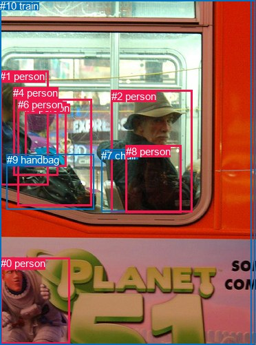
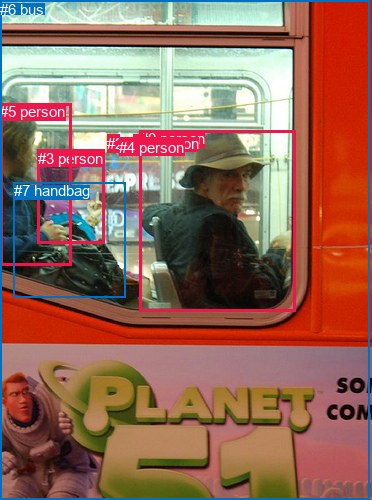

# 图片 1135：2367479.jpg

随机样本序号：194。图片 SHA256：`adebfe6c709de875533fe7e9c8b94eb0b71b62f7cc2216e1aef5d21287dcab6f`。

红色框表示人，蓝色框表示其他物体。两个模式分别保留自身框编号，可依据位置比较对应对象。

## 自动检测框与输出

人的框编号：`[0, 1, 2, 3, 4, 6, 8]`。状态：`ok`。

### 自动检测全部物体框

| 编号 | 类别 | 是否为人 | 检测分数 | 像素坐标 xyxy |
|---|---|---|---|---|
| 0 | person | True | 0.9933 | 0.8, 373.2, 101.4, 498.5 |
| 1 | person | True | 0.9883 | 0.0, 102.3, 70.2, 268.3 |
| 2 | person | True | 0.9865 | 161.6, 131.0, 279.7, 307.7 |
| 3 | person | True | 0.9729 | 36.4, 147.6, 96.2, 241.9 |
| 4 | person | True | 0.9036 | 19.5, 126.5, 84.3, 254.1 |
| 5 | bus | False | 0.8009 | 0.8, 0.0, 370.8, 500.0 |
| 6 | person | True | 0.7026 | 26.0, 143.4, 133.1, 298.1 |
| 7 | chair | False | 0.6117 | 147.4, 216.7, 183.8, 306.0 |
| 8 | person | True | 0.5811 | 183.0, 210.8, 263.7, 309.0 |
| 9 | handbag | False | 0.5313 | 9.7, 223.5, 136.5, 303.9 |
| 10 | train | False | 0.3667 | 0.0, 0.0, 365.0, 500.0 |

### 自动检测 Top50 人相关候选

评分物体对：110；人相关物体对：98；输出关系：50。

| 排名 | 主语编号与类别 | 关系 | 宾语编号与类别 | 类型 | 人与人 | 排序分数 | 原始融合 logit |
|---|---|---|---|---|---|---|---|
| 1 | #4 person | riding | #5 bus | semantic | False | 0.99273 | 4.9161 |
| 2 | #1 person | riding | #5 bus | semantic | False | 0.99263 | 4.9029 |
| 3 | #6 person | riding | #5 bus | semantic | False | 0.99219 | 4.8447 |
| 4 | #4 person | riding | #10 train | semantic | False | 0.99218 | 4.8435 |
| 5 | #1 person | riding | #10 train | semantic | False | 0.99202 | 4.8225 |
| 6 | #6 person | riding | #10 train | semantic | False | 0.99160 | 4.7713 |
| 7 | #3 person | riding | #5 bus | semantic | False | 0.99072 | 4.6705 |
| 8 | #3 person | riding | #10 train | semantic | False | 0.99008 | 4.6035 |
| 9 | #2 person | riding | #5 bus | semantic | False | 0.98936 | 4.5326 |
| 10 | #2 person | riding | #10 train | semantic | False | 0.98901 | 4.4995 |
| 11 | #2 person | wearing | #8 person | semantic | True | 0.98842 | 4.4472 |
| 12 | #0 person | painted on | #5 bus | spatial | False | 0.98382 | 4.1076 |
| 13 | #0 person | painted on | #10 train | spatial | False | 0.98328 | 4.0745 |
| 14 | #2 person | sitting on | #7 chair | semantic | False | 0.97099 | 3.5108 |
| 15 | #6 person | carrying | #9 handbag | semantic | False | 0.96958 | 3.4619 |
| 16 | #6 person | wearing | #3 person | semantic | True | 0.96644 | 3.3603 |
| 17 | #1 person | in | #5 bus | spatial | False | 0.96380 | 3.2819 |
| 18 | #1 person | in | #10 train | spatial | False | 0.96295 | 3.2576 |
| 19 | #2 person | in | #5 bus | spatial | False | 0.96290 | 3.2563 |
| 20 | #2 person | in | #10 train | spatial | False | 0.96194 | 3.2299 |
| 21 | #4 person | wearing | #3 person | semantic | True | 0.95605 | 3.0797 |
| 22 | #4 person | in | #5 bus | spatial | False | 0.95460 | 3.0459 |
| 23 | #4 person | in | #10 train | spatial | False | 0.95225 | 2.9929 |
| 24 | #6 person | in | #5 bus | spatial | False | 0.95215 | 2.9906 |
| 25 | #6 person | in | #10 train | spatial | False | 0.95153 | 2.9771 |
| 26 | #1 person | carrying | #9 handbag | semantic | False | 0.94960 | 2.9360 |
| 27 | #3 person | in | #5 bus | spatial | False | 0.94553 | 2.8541 |
| 28 | #3 person | in | #10 train | spatial | False | 0.94267 | 2.7999 |
| 29 | #2 person | beside | #6 person | spatial | True | 0.91588 | 2.3876 |
| 30 | #4 person | wearing | #9 handbag | semantic | False | 0.88790 | 2.0694 |
| 31 | #1 person | wearing | #4 person | semantic | True | 0.88563 | 2.0469 |
| 32 | #6 person | beside | #2 person | spatial | True | 0.86928 | 1.8946 |
| 33 | #1 person | wearing | #3 person | semantic | True | 0.85752 | 1.7948 |
| 34 | #1 person | beside | #6 person | spatial | True | 0.85636 | 1.7853 |
| 35 | #9 handbag | on | #6 person | spatial | False | 0.78757 | 1.3103 |
| 36 | #4 person | beside | #1 person | spatial | True | 0.78278 | 1.2819 |
| 37 | #6 person | wearing | #4 person | semantic | True | 0.77912 | 1.2605 |
| 38 | #3 person | wearing | #9 handbag | semantic | False | 0.75813 | 1.1425 |
| 39 | #3 person | wearing | #4 person | semantic | True | 0.75327 | 1.1161 |
| 40 | #2 person | beside | #4 person | spatial | True | 0.74149 | 1.0537 |
| 41 | #2 person | beside | #1 person | spatial | True | 0.73823 | 1.0368 |
| 42 | #9 handbag | on | #3 person | spatial | False | 0.73475 | 1.0189 |
| 43 | #6 person | beside | #1 person | spatial | True | 0.73347 | 1.0123 |
| 44 | #8 person | on | #2 person | spatial | True | 0.73062 | 0.9978 |
| 45 | #9 handbag | on | #4 person | spatial | False | 0.73016 | 0.9954 |
| 46 | #3 person | beside | #1 person | spatial | True | 0.71172 | 0.9037 |
| 47 | #1 person | beside | #4 person | spatial | True | 0.71160 | 0.9032 |
| 48 | #0 person | wearing | #5 bus | semantic | False | 0.70398 | 0.8663 |
| 49 | #9 handbag | on | #1 person | spatial | False | 0.70243 | 0.8589 |
| 50 | #0 person | wearing | #10 train | semantic | False | 0.69704 | 0.8333 |

### 自动检测逐条人相关 GT 核验

R@50：50.00%；命中 4/8。

| GT 主语编号 | GT 关系 | GT 宾语编号 | 结果阶段 | 匹配预测主语编号 | 匹配预测宾语编号 |
|---|---|---|---|---|---|
| 0 | in | 6 | hit50 | [2] | [5] |
| 3 | beside | 5 | hit50 | [3] | [1, 4] |
| 3 | in | 6 | hit50 | [3] | [5] |
| 5 | beside | 3 | rank_below50 | [1, 4] | [3] |
| 5 | looking at | 3 | wrong_predicate | [1, 4] | [3] |
| 5 | in | 6 | hit50 | [1, 4] | [5] |
| 5 | holding | 7 | wrong_predicate | [1, 4] | [9] |
| 7 | in front of | 3 | wrong_predicate | [9] | [3] |

## 真实框与输出

人的框编号：`[0, 1, 2, 3, 4, 5]`。

### 真实框全部物体框

| 编号 | 类别 | 是否为人 | 检测分数 | 像素坐标 xyxy |
|---|---|---|---|---|
| 0 | person | True | GT | 140.0, 130.0, 296.0, 312.0 |
| 1 | person | True | GT | 134.0, 135.0, 146.0, 153.0 |
| 2 | person | True | GT | 107.0, 135.0, 119.0, 153.0 |
| 3 | person | True | GT | 38.0, 150.0, 105.0, 244.0 |
| 4 | person | True | GT | 119.0, 139.0, 129.0, 153.0 |
| 5 | person | True | GT | 0.0, 103.0, 72.0, 265.0 |
| 6 | bus | False | GT | 0.0, 1.0, 369.0, 500.0 |
| 7 | handbag | False | GT | 14.0, 182.0, 125.0, 297.0 |

### 真实框 Top50 人相关候选

评分物体对：56；人相关物体对：54；输出关系：50。

| 排名 | 主语编号与类别 | 关系 | 宾语编号与类别 | 类型 | 人与人 | 排序分数 | 原始融合 logit |
|---|---|---|---|---|---|---|---|
| 1 | #5 person | riding | #6 bus | semantic | False | 0.99373 | 5.0662 |
| 2 | #3 person | riding | #6 bus | semantic | False | 0.99196 | 4.8148 |
| 3 | #1 person | riding | #6 bus | semantic | False | 0.98996 | 4.5916 |
| 4 | #4 person | riding | #6 bus | semantic | False | 0.98988 | 4.5834 |
| 5 | #2 person | riding | #6 bus | semantic | False | 0.98752 | 4.3713 |
| 6 | #0 person | riding | #6 bus | semantic | False | 0.98677 | 4.3119 |
| 7 | #5 person | wearing | #7 handbag | semantic | False | 0.98431 | 4.1387 |
| 8 | #3 person | wearing | #7 handbag | semantic | False | 0.98163 | 3.9785 |
| 9 | #5 person | in | #6 bus | spatial | False | 0.96065 | 3.1951 |
| 10 | #0 person | in | #6 bus | spatial | False | 0.95017 | 2.9479 |
| 11 | #3 person | in | #6 bus | spatial | False | 0.94365 | 2.8181 |
| 12 | #4 person | in | #6 bus | spatial | False | 0.93148 | 2.6096 |
| 13 | #2 person | in | #6 bus | spatial | False | 0.92563 | 2.5214 |
| 14 | #1 person | in | #6 bus | spatial | False | 0.92516 | 2.5147 |
| 15 | #5 person | beside | #3 person | spatial | True | 0.87613 | 1.9563 |
| 16 | #0 person | beside | #5 person | spatial | True | 0.77924 | 1.2613 |
| 17 | #5 person | holding | #3 person | semantic | True | 0.76629 | 1.1875 |
| 18 | #3 person | beside | #5 person | spatial | True | 0.75875 | 1.1459 |
| 19 | #7 handbag | on | #5 person | spatial | False | 0.73499 | 1.0201 |
| 20 | #7 handbag | on | #3 person | spatial | False | 0.68419 | 0.7731 |
| 21 | #5 person | beside | #0 person | spatial | True | 0.65154 | 0.6258 |
| 22 | #5 person | on | #7 handbag | spatial | False | 0.62453 | 0.5088 |
| 23 | #0 person | beside | #3 person | spatial | True | 0.52924 | 0.1171 |
| 24 | #7 handbag | carrying | #5 person | semantic | False | 0.47597 | -0.0962 |
| 25 | #4 person | beside | #2 person | spatial | True | 0.45667 | -0.1738 |
| 26 | #3 person | beside | #0 person | spatial | True | 0.45579 | -0.1773 |
| 27 | #6 bus | carrying | #0 person | semantic | False | 0.40984 | -0.3646 |
| 28 | #3 person | on | #7 handbag | spatial | False | 0.38955 | -0.4492 |
| 29 | #2 person | beside | #4 person | spatial | True | 0.38349 | -0.4748 |
| 30 | #4 person | beside | #1 person | spatial | True | 0.35633 | -0.5913 |
| 31 | #5 person | looking at | #0 person | semantic | True | 0.34182 | -0.6552 |
| 32 | #7 handbag | carrying | #3 person | semantic | False | 0.28233 | -0.9330 |
| 33 | #1 person | beside | #4 person | spatial | True | 0.27924 | -0.9482 |
| 34 | #3 person | looking at | #0 person | semantic | True | 0.27903 | -0.9493 |
| 35 | #0 person | looking at | #5 person | semantic | True | 0.27532 | -0.9678 |
| 36 | #3 person | looking at | #5 person | semantic | True | 0.26178 | -1.0367 |
| 37 | #0 person | wearing | #1 person | semantic | True | 0.23131 | -1.2009 |
| 38 | #1 person | beside | #2 person | spatial | True | 0.17514 | -1.5496 |
| 39 | #2 person | beside | #1 person | spatial | True | 0.17382 | -1.5588 |
| 40 | #4 person | looking at | #2 person | semantic | True | 0.16422 | -1.6272 |
| 41 | #7 handbag | beside | #0 person | spatial | False | 0.15979 | -1.6598 |
| 42 | #6 bus | carrying | #3 person | semantic | False | 0.15151 | -1.7228 |
| 43 | #4 person | looking at | #1 person | semantic | True | 0.14183 | -1.8001 |
| 44 | #1 person | looking at | #0 person | semantic | True | 0.12141 | -1.9792 |
| 45 | #2 person | looking at | #4 person | semantic | True | 0.11557 | -2.0350 |
| 46 | #4 person | looking at | #0 person | semantic | True | 0.11479 | -2.0427 |
| 47 | #6 bus | carrying | #5 person | semantic | False | 0.09705 | -2.2305 |
| 48 | #6 bus | carrying | #4 person | semantic | False | 0.08804 | -2.3378 |
| 49 | #0 person | looking at | #3 person | semantic | True | 0.08703 | -2.3504 |
| 50 | #3 person | looking at | #4 person | semantic | True | 0.08274 | -2.4057 |

### 真实框逐条人相关 GT 核验

R@50：62.50%；命中 5/8。

| GT 主语编号 | GT 关系 | GT 宾语编号 | 结果阶段 | 匹配预测主语编号 | 匹配预测宾语编号 |
|---|---|---|---|---|---|
| 0 | in | 6 | hit50 | [0] | [6] |
| 3 | beside | 5 | hit50 | [3] | [5] |
| 3 | in | 6 | hit50 | [3] | [6] |
| 5 | beside | 3 | hit50 | [5] | [3] |
| 5 | looking at | 3 | wrong_predicate | [5] | [3] |
| 5 | in | 6 | hit50 | [5] | [6] |
| 5 | holding | 7 | wrong_predicate | [5] | [7] |
| 7 | in front of | 3 | wrong_predicate | [7] | [3] |

## 全部人相关 GT

| 主语编号与类别 | 关系 | 宾语编号与类别 |
|---|---|---|
| #0 person | in | #6 bus |
| #3 person | beside | #5 person |
| #3 person | in | #6 bus |
| #5 person | beside | #3 person |
| #5 person | looking at | #3 person |
| #5 person | in | #6 bus |
| #5 person | holding | #7 handbag |
| #7 handbag | in front of | #3 person |

原始记录、全部人相关物体对的两项预测与分项分数见 [逐图证据 JSON](../evidence/cases/1135.json)。全部56类 logits 保留于本机 HOR/output/random500/logits/。

<!-- HOR_COMPLETE_RESULTS -->

## 六组条件的完整输出对照

以下保留同一图片三种框与候选模式、两种谓词输出规则的全部 Top50。框编号各自在所属模式内解释。

### 自动检测框完整枚举：空间与语义各保留一个谓词

| 排名 | 主语编号与类别 | 谓词 | 宾语编号与类别 | 分组 | 排序分数 | predicate logit | pair logit |
|---|---|---|---|---|---|---|---|
| 1 | #4 person | riding | #5 bus | semantic | 0.9927257 | 4.7234607 | 0.1926578 |
| 2 | #1 person | riding | #5 bus | semantic | 0.9926300 | 4.6021199 | 0.3008289 |
| 3 | #6 person | riding | #5 bus | semantic | 0.9921914 | 4.5475574 | 0.2971237 |
| 4 | #4 person | riding | #10 train | semantic | 0.9921822 | 4.6635242 | 0.1799778 |
| 5 | #1 person | riding | #10 train | semantic | 0.9920176 | 4.5426698 | 0.2798362 |
| 6 | #6 person | riding | #10 train | semantic | 0.9916016 | 4.4876180 | 0.2836656 |
| 7 | #3 person | riding | #5 bus | semantic | 0.9907190 | 4.5416923 | 0.1287712 |
| 8 | #3 person | riding | #10 train | semantic | 0.9900827 | 4.4819980 | 0.1215009 |
| 9 | #2 person | riding | #5 bus | semantic | 0.9893615 | 4.0692735 | 0.4633062 |
| 10 | #2 person | riding | #10 train | semantic | 0.9890077 | 4.0692735 | 0.4302314 |
| 11 | #2 person | wearing | #8 person | semantic | 0.9884244 | 4.3484721 | 0.0987454 |
| 12 | #0 person | painted on | #5 bus | spatial | 0.9838184 | 3.9691586 | 0.1384051 |
| 13 | #0 person | painted on | #10 train | spatial | 0.9832836 | 3.9691586 | 0.1053474 |
| 14 | #2 person | sitting on | #7 chair | semantic | 0.9709942 | 3.4007316 | 0.1100916 |
| 15 | #6 person | carrying | #9 handbag | semantic | 0.9695827 | 3.4041772 | 0.0576789 |
| 16 | #6 person | wearing | #3 person | semantic | 0.9664412 | 3.5573707 | -0.1970486 |
| 17 | #1 person | in | #5 bus | spatial | 0.9638035 | 2.9810963 | 0.3008289 |
| 18 | #1 person | in | #10 train | spatial | 0.9629457 | 2.9777775 | 0.2798362 |
| 19 | #2 person | in | #5 bus | spatial | 0.9628998 | 2.7930207 | 0.4633062 |
| 20 | #2 person | in | #10 train | spatial | 0.9619437 | 2.7996583 | 0.4302314 |
| 21 | #4 person | wearing | #3 person | semantic | 0.9560491 | 3.3253694 | -0.2456336 |
| 22 | #4 person | in | #5 bus | spatial | 0.9546035 | 2.8532033 | 0.1926578 |
| 23 | #4 person | in | #10 train | spatial | 0.9522529 | 2.8129334 | 0.1799778 |
| 24 | #6 person | in | #5 bus | spatial | 0.9521468 | 2.6934590 | 0.2971237 |
| 25 | #6 person | in | #10 train | spatial | 0.9515299 | 2.6934590 | 0.2836656 |
| 26 | #1 person | carrying | #9 handbag | semantic | 0.9495986 | 2.8489542 | 0.0870658 |
| 27 | #3 person | in | #5 bus | spatial | 0.9455293 | 2.7253103 | 0.1287712 |
| 28 | #3 person | in | #10 train | spatial | 0.9426706 | 2.6784029 | 0.1215009 |
| 29 | #2 person | beside | #6 person | spatial | 0.9158759 | 3.0916796 | -0.7040926 |
| 30 | #4 person | wearing | #9 handbag | semantic | 0.8878956 | 2.2404351 | -0.1710112 |
| 31 | #1 person | wearing | #4 person | semantic | 0.8856306 | 2.5326915 | -0.4858251 |
| 32 | #6 person | beside | #2 person | spatial | 0.8692827 | 2.7345595 | -0.8399289 |
| 33 | #1 person | wearing | #3 person | semantic | 0.8575165 | 2.0966711 | -0.3018571 |
| 34 | #1 person | beside | #6 person | spatial | 0.8563554 | 2.4372969 | -0.6519536 |
| 35 | #9 handbag | on | #6 person | spatial | 0.7875710 | 1.9207821 | -0.6104364 |
| 36 | #4 person | beside | #1 person | spatial | 0.7827786 | 2.0169015 | -0.7349687 |
| 37 | #6 person | wearing | #4 person | semantic | 0.7791203 | 1.7106743 | -0.4501265 |
| 38 | #3 person | wearing | #9 handbag | semantic | 0.7581317 | 1.4551287 | -0.3126648 |
| 39 | #3 person | wearing | #4 person | semantic | 0.7532724 | 1.6223640 | -0.5062224 |
| 40 | #2 person | beside | #4 person | spatial | 0.7414931 | 1.7998080 | -0.7460645 |
| 41 | #2 person | beside | #1 person | spatial | 0.7382292 | 1.7091875 | -0.6724023 |
| 42 | #9 handbag | on | #3 person | spatial | 0.7347534 | 1.6545658 | -0.6356906 |
| 43 | #6 person | beside | #1 person | spatial | 0.7334655 | 1.7766347 | -0.7643580 |
| 44 | #8 person | on | #2 person | spatial | 0.7306194 | 1.6107178 | -0.6129506 |
| 45 | #9 handbag | on | #4 person | spatial | 0.7301598 | 1.6152940 | -0.6198609 |
| 46 | #3 person | beside | #1 person | spatial | 0.7117173 | 1.6565156 | -0.7527764 |
| 47 | #1 person | beside | #4 person | spatial | 0.7116010 | 1.3889976 | -0.4858251 |
| 48 | #0 person | wearing | #5 bus | semantic | 0.7039800 | 0.7279181 | 0.1384051 |
| 49 | #9 handbag | on | #1 person | spatial | 0.7024282 | 1.4556570 | -0.5967692 |
| 50 | #0 person | wearing | #10 train | semantic | 0.6970450 | 0.7279181 | 0.1053474 |

GT 命中：4/8，R@50=50.00%。

| GT主语 | GT谓词 | GT宾语 | 结果阶段 | 匹配主语框 | 匹配宾语框 |
|---|---|---|---|---|---|
| 0 | in | 6 | hit50 | [2] | [5] |
| 3 | beside | 5 | hit50 | [3] | [1, 4] |
| 3 | in | 6 | hit50 | [3] | [5] |
| 5 | beside | 3 | rank_below50 | [1, 4] | [3] |
| 5 | looking at | 3 | wrong_predicate | [1, 4] | [3] |
| 5 | in | 6 | hit50 | [1, 4] | [5] |
| 5 | holding | 7 | wrong_predicate | [1, 4] | [9] |
| 7 | in front of | 3 | wrong_predicate | [9] | [3] |

### 自动检测框完整枚举：每对只保留一个谓词

| 排名 | 主语编号与类别 | 谓词 | 宾语编号与类别 | 分组 | 排序分数 | predicate logit | pair logit |
|---|---|---|---|---|---|---|---|
| 1 | #4 person | riding | #5 bus | single | 0.9927257 | 4.7234607 | 0.1926578 |
| 2 | #1 person | riding | #5 bus | single | 0.9926300 | 4.6021199 | 0.3008289 |
| 3 | #6 person | riding | #5 bus | single | 0.9921914 | 4.5475574 | 0.2971237 |
| 4 | #4 person | riding | #10 train | single | 0.9921822 | 4.6635242 | 0.1799778 |
| 5 | #1 person | riding | #10 train | single | 0.9920176 | 4.5426698 | 0.2798362 |
| 6 | #6 person | riding | #10 train | single | 0.9916016 | 4.4876180 | 0.2836656 |
| 7 | #3 person | riding | #5 bus | single | 0.9907190 | 4.5416923 | 0.1287712 |
| 8 | #3 person | riding | #10 train | single | 0.9900827 | 4.4819980 | 0.1215009 |
| 9 | #2 person | riding | #5 bus | single | 0.9893615 | 4.0692735 | 0.4633062 |
| 10 | #2 person | riding | #10 train | single | 0.9890077 | 4.0692735 | 0.4302314 |
| 11 | #2 person | wearing | #8 person | single | 0.9884244 | 4.3484721 | 0.0987454 |
| 12 | #0 person | painted on | #5 bus | single | 0.9838184 | 3.9691586 | 0.1384051 |
| 13 | #0 person | painted on | #10 train | single | 0.9832836 | 3.9691586 | 0.1053474 |
| 14 | #2 person | sitting on | #7 chair | single | 0.9709942 | 3.4007316 | 0.1100916 |
| 15 | #6 person | carrying | #9 handbag | single | 0.9695827 | 3.4041772 | 0.0576789 |
| 16 | #6 person | wearing | #3 person | single | 0.9664412 | 3.5573707 | -0.1970486 |
| 17 | #4 person | wearing | #3 person | single | 0.9560491 | 3.3253694 | -0.2456336 |
| 18 | #1 person | carrying | #9 handbag | single | 0.9495986 | 2.8489542 | 0.0870658 |
| 19 | #2 person | beside | #6 person | single | 0.9158759 | 3.0916796 | -0.7040926 |
| 20 | #4 person | wearing | #9 handbag | single | 0.8878956 | 2.2404351 | -0.1710112 |
| 21 | #1 person | wearing | #4 person | single | 0.8856306 | 2.5326915 | -0.4858251 |
| 22 | #6 person | beside | #2 person | single | 0.8692827 | 2.7345595 | -0.8399289 |
| 23 | #1 person | wearing | #3 person | single | 0.8575165 | 2.0966711 | -0.3018571 |
| 24 | #1 person | beside | #6 person | single | 0.8563554 | 2.4372969 | -0.6519536 |
| 25 | #9 handbag | on | #6 person | single | 0.7875710 | 1.9207821 | -0.6104364 |
| 26 | #4 person | beside | #1 person | single | 0.7827786 | 2.0169015 | -0.7349687 |
| 27 | #6 person | wearing | #4 person | single | 0.7791203 | 1.7106743 | -0.4501265 |
| 28 | #3 person | wearing | #9 handbag | single | 0.7581317 | 1.4551287 | -0.3126648 |
| 29 | #3 person | wearing | #4 person | single | 0.7532724 | 1.6223640 | -0.5062224 |
| 30 | #2 person | beside | #4 person | single | 0.7414931 | 1.7998080 | -0.7460645 |
| 31 | #2 person | beside | #1 person | single | 0.7382292 | 1.7091875 | -0.6724023 |
| 32 | #9 handbag | on | #3 person | single | 0.7347534 | 1.6545658 | -0.6356906 |
| 33 | #6 person | beside | #1 person | single | 0.7334655 | 1.7766347 | -0.7643580 |
| 34 | #8 person | on | #2 person | single | 0.7306194 | 1.6107178 | -0.6129506 |
| 35 | #9 handbag | on | #4 person | single | 0.7301598 | 1.6152940 | -0.6198609 |
| 36 | #3 person | beside | #1 person | single | 0.7117173 | 1.6565156 | -0.7527764 |
| 37 | #9 handbag | on | #1 person | single | 0.7024282 | 1.4556570 | -0.5967692 |
| 38 | #3 person | wearing | #6 person | single | 0.6860103 | 1.5290833 | -0.7475508 |
| 39 | #4 person | beside | #6 person | single | 0.6533229 | 1.3565636 | -0.7228856 |
| 40 | #4 person | beside | #2 person | single | 0.6375569 | 1.3217893 | -0.7570136 |
| 41 | #1 person | beside | #2 person | single | 0.5751793 | 1.0511699 | -0.7481549 |
| 42 | #6 person | sitting on | #7 chair | single | 0.4818433 | 0.4306316 | -0.5032904 |
| 43 | #3 person | beside | #2 person | single | 0.4462833 | 0.6323791 | -0.8480783 |
| 44 | #4 person | sitting on | #7 chair | single | 0.4400764 | 0.5449557 | -0.7858077 |
| 45 | #2 person | beside | #3 person | single | 0.4284621 | 0.5105109 | -0.7986394 |
| 46 | #5 bus | carrying | #2 person | single | 0.3919157 | 0.7287517 | -1.1680183 |
| 47 | #3 person | sitting on | #7 chair | single | 0.3725143 | 0.2590652 | -0.7805106 |
| 48 | #5 bus | carrying | #6 person | single | 0.3631340 | 0.5722699 | -1.1340575 |
| 49 | #10 train | carrying | #6 person | single | 0.3525471 | 0.5474215 | -1.1552831 |
| 50 | #10 train | carrying | #2 person | single | 0.3474168 | 0.5645146 | -1.1949279 |

GT 命中：1/8，R@50=12.50%。

| GT主语 | GT谓词 | GT宾语 | 结果阶段 | 匹配主语框 | 匹配宾语框 |
|---|---|---|---|---|---|
| 0 | in | 6 | wrong_predicate | [2] | [5] |
| 3 | beside | 5 | hit50 | [3] | [1, 4] |
| 3 | in | 6 | wrong_predicate | [3] | [5] |
| 5 | beside | 3 | wrong_predicate | [1, 4] | [3] |
| 5 | looking at | 3 | wrong_predicate | [1, 4] | [3] |
| 5 | in | 6 | wrong_predicate | [1, 4] | [5] |
| 5 | holding | 7 | wrong_predicate | [1, 4] | [9] |
| 7 | in front of | 3 | wrong_predicate | [9] | [3] |

### 真实框完整枚举：空间与语义各保留一个谓词

| 排名 | 主语编号与类别 | 谓词 | 宾语编号与类别 | 分组 | 排序分数 | predicate logit | pair logit |
|---|---|---|---|---|---|---|---|
| 1 | #5 person | riding | #6 bus | semantic | 0.9937333 | 4.7782683 | 0.2879527 |
| 2 | #3 person | riding | #6 bus | semantic | 0.9919560 | 4.6593699 | 0.1553813 |
| 3 | #1 person | riding | #6 bus | semantic | 0.9899648 | 4.5331397 | 0.0584258 |
| 4 | #4 person | riding | #6 bus | semantic | 0.9898828 | 4.5304523 | 0.0528991 |
| 5 | #2 person | riding | #6 bus | semantic | 0.9875228 | 4.4127746 | -0.0414757 |
| 6 | #0 person | riding | #6 bus | semantic | 0.9867693 | 3.8295207 | 0.4823793 |
| 7 | #5 person | wearing | #7 handbag | semantic | 0.9843072 | 3.8683696 | 0.2703681 |
| 8 | #3 person | wearing | #7 handbag | semantic | 0.9816293 | 3.9080873 | 0.0703654 |
| 9 | #5 person | in | #6 bus | spatial | 0.9606512 | 2.9071937 | 0.2879527 |
| 10 | #0 person | in | #6 bus | spatial | 0.9501659 | 2.4655585 | 0.4823793 |
| 11 | #3 person | in | #6 bus | spatial | 0.9436451 | 2.6626997 | 0.1553813 |
| 12 | #4 person | in | #6 bus | spatial | 0.9314770 | 2.5567021 | 0.0528991 |
| 13 | #2 person | in | #6 bus | spatial | 0.9256298 | 2.5628948 | -0.0414757 |
| 14 | #1 person | in | #6 bus | spatial | 0.9251643 | 2.4562497 | 0.0584258 |
| 15 | #5 person | beside | #3 person | spatial | 0.8761297 | 2.2884965 | -0.3322172 |
| 16 | #0 person | beside | #5 person | spatial | 0.7792441 | 1.8889837 | -0.6277168 |
| 17 | #5 person | holding | #3 person | semantic | 0.7662892 | 1.5196924 | -0.3322172 |
| 18 | #3 person | beside | #5 person | spatial | 0.7587526 | 1.8940287 | -0.7481759 |
| 19 | #7 handbag | on | #5 person | spatial | 0.7349949 | 1.7451005 | -0.7249858 |
| 20 | #7 handbag | on | #3 person | spatial | 0.6841940 | 1.5037918 | -0.7306787 |
| 21 | #5 person | beside | #0 person | spatial | 0.6515439 | 1.3507528 | -0.7249204 |
| 22 | #5 person | on | #7 handbag | spatial | 0.6245303 | 0.2384539 | 0.2703681 |
| 23 | #0 person | beside | #3 person | spatial | 0.5292422 | 0.8691196 | -0.7520171 |
| 24 | #7 handbag | carrying | #5 person | semantic | 0.4759744 | 0.6288095 | -0.7249858 |
| 25 | #4 person | beside | #2 person | spatial | 0.4566714 | 0.0913725 | -0.2651228 |
| 26 | #3 person | beside | #0 person | spatial | 0.4557881 | 0.6314249 | -0.8087355 |
| 27 | #6 bus | carrying | #0 person | semantic | 0.4098441 | 0.7983084 | -1.1629184 |
| 28 | #3 person | on | #7 handbag | spatial | 0.3895518 | -0.5195618 | 0.0703654 |
| 29 | #2 person | beside | #4 person | spatial | 0.3834895 | -0.0893478 | -0.3854152 |
| 30 | #4 person | beside | #1 person | spatial | 0.3563348 | -0.2090769 | -0.3822309 |
| 31 | #5 person | looking at | #0 person | semantic | 0.3418247 | 0.0697470 | -0.7249204 |
| 32 | #7 handbag | carrying | #3 person | semantic | 0.2823253 | -0.2022777 | -0.7306787 |
| 33 | #1 person | beside | #4 person | spatial | 0.2792427 | -0.6296606 | -0.3185604 |
| 34 | #3 person | looking at | #0 person | semantic | 0.2790298 | -0.1405435 | -0.8087355 |
| 35 | #0 person | looking at | #5 person | semantic | 0.2753176 | -0.3400912 | -0.6277168 |
| 36 | #3 person | looking at | #5 person | semantic | 0.2617805 | -0.2885590 | -0.7481759 |
| 37 | #0 person | wearing | #1 person | semantic | 0.2313112 | -0.4289203 | -0.7720018 |
| 38 | #1 person | beside | #2 person | spatial | 0.1751436 | -1.2460108 | -0.3035923 |
| 39 | #2 person | beside | #1 person | spatial | 0.1738232 | -1.0816078 | -0.4771622 |
| 40 | #4 person | looking at | #2 person | semantic | 0.1642166 | -1.3620605 | -0.2651228 |
| 41 | #7 handbag | beside | #0 person | spatial | 0.1597901 | -0.8685403 | -0.7912508 |
| 42 | #6 bus | carrying | #3 person | semantic | 0.1515088 | -0.5643892 | -1.1584266 |
| 43 | #4 person | looking at | #1 person | semantic | 0.1418342 | -1.4179072 | -0.3822309 |
| 44 | #1 person | looking at | #0 person | semantic | 0.1214056 | -0.9268706 | -1.0523160 |
| 45 | #2 person | looking at | #4 person | semantic | 0.1155725 | -1.6496272 | -0.3854152 |
| 46 | #4 person | looking at | #0 person | semantic | 0.1147937 | -0.9881532 | -1.0545306 |
| 47 | #6 bus | carrying | #5 person | semantic | 0.0970450 | -1.1275682 | -1.1029294 |
| 48 | #6 bus | carrying | #4 person | semantic | 0.0880365 | -1.6639504 | -0.6738980 |
| 49 | #0 person | looking at | #3 person | semantic | 0.0870326 | -1.5983999 | -0.7520171 |
| 50 | #3 person | looking at | #4 person | semantic | 0.0827409 | -1.7806363 | -0.6250401 |

GT 命中：5/8，R@50=62.50%。

| GT主语 | GT谓词 | GT宾语 | 结果阶段 | 匹配主语框 | 匹配宾语框 |
|---|---|---|---|---|---|
| 0 | in | 6 | hit50 | [0] | [6] |
| 3 | beside | 5 | hit50 | [3] | [5] |
| 3 | in | 6 | hit50 | [3] | [6] |
| 5 | beside | 3 | hit50 | [5] | [3] |
| 5 | looking at | 3 | wrong_predicate | [5] | [3] |
| 5 | in | 6 | hit50 | [5] | [6] |
| 5 | holding | 7 | wrong_predicate | [5] | [7] |
| 7 | in front of | 3 | wrong_predicate | [7] | [3] |

### 真实框完整枚举：每对只保留一个谓词

| 排名 | 主语编号与类别 | 谓词 | 宾语编号与类别 | 分组 | 排序分数 | predicate logit | pair logit |
|---|---|---|---|---|---|---|---|
| 1 | #5 person | riding | #6 bus | single | 0.9937333 | 4.7782683 | 0.2879527 |
| 2 | #3 person | riding | #6 bus | single | 0.9919560 | 4.6593699 | 0.1553813 |
| 3 | #1 person | riding | #6 bus | single | 0.9899648 | 4.5331397 | 0.0584258 |
| 4 | #4 person | riding | #6 bus | single | 0.9898828 | 4.5304523 | 0.0528991 |
| 5 | #2 person | riding | #6 bus | single | 0.9875228 | 4.4127746 | -0.0414757 |
| 6 | #0 person | riding | #6 bus | single | 0.9867693 | 3.8295207 | 0.4823793 |
| 7 | #5 person | wearing | #7 handbag | single | 0.9843072 | 3.8683696 | 0.2703681 |
| 8 | #3 person | wearing | #7 handbag | single | 0.9816293 | 3.9080873 | 0.0703654 |
| 9 | #5 person | beside | #3 person | single | 0.8761297 | 2.2884965 | -0.3322172 |
| 10 | #0 person | beside | #5 person | single | 0.7792441 | 1.8889837 | -0.6277168 |
| 11 | #3 person | beside | #5 person | single | 0.7587526 | 1.8940287 | -0.7481759 |
| 12 | #7 handbag | on | #5 person | single | 0.7349949 | 1.7451005 | -0.7249858 |
| 13 | #7 handbag | on | #3 person | single | 0.6841940 | 1.5037918 | -0.7306787 |
| 14 | #5 person | beside | #0 person | single | 0.6515439 | 1.3507528 | -0.7249204 |
| 15 | #0 person | beside | #3 person | single | 0.5292422 | 0.8691196 | -0.7520171 |
| 16 | #4 person | beside | #2 person | single | 0.4566714 | 0.0913725 | -0.2651228 |
| 17 | #3 person | beside | #0 person | single | 0.4557881 | 0.6314249 | -0.8087355 |
| 18 | #6 bus | carrying | #0 person | single | 0.4098441 | 0.7983084 | -1.1629184 |
| 19 | #2 person | beside | #4 person | single | 0.3834895 | -0.0893478 | -0.3854152 |
| 20 | #4 person | beside | #1 person | single | 0.3563348 | -0.2090769 | -0.3822309 |
| 21 | #1 person | beside | #4 person | single | 0.2792427 | -0.6296606 | -0.3185604 |
| 22 | #0 person | wearing | #1 person | single | 0.2313112 | -0.4289203 | -0.7720018 |
| 23 | #1 person | beside | #2 person | single | 0.1751436 | -1.2460108 | -0.3035923 |
| 24 | #2 person | beside | #1 person | single | 0.1738232 | -1.0816078 | -0.4771622 |
| 25 | #7 handbag | beside | #0 person | single | 0.1597901 | -0.8685403 | -0.7912508 |
| 26 | #6 bus | carrying | #3 person | single | 0.1515088 | -0.5643892 | -1.1584266 |
| 27 | #1 person | looking at | #0 person | single | 0.1214056 | -0.9268706 | -1.0523160 |
| 28 | #4 person | looking at | #0 person | single | 0.1147937 | -0.9881532 | -1.0545306 |
| 29 | #6 bus | carrying | #5 person | single | 0.0970450 | -1.1275682 | -1.1029294 |
| 30 | #6 bus | carrying | #4 person | single | 0.0880365 | -1.6639504 | -0.6738980 |
| 31 | #3 person | looking at | #4 person | single | 0.0827409 | -1.7806363 | -0.6250401 |
| 32 | #2 person | looking at | #0 person | single | 0.0824517 | -1.3546519 | -1.0548403 |
| 33 | #3 person | looking at | #2 person | single | 0.0699891 | -1.9583509 | -0.6285065 |
| 34 | #6 bus | carrying | #1 person | single | 0.0697684 | -1.9045806 | -0.6856722 |
| 35 | #0 person | looking at | #4 person | single | 0.0692730 | -1.8629570 | -0.7349534 |
| 36 | #2 person | looking at | #3 person | single | 0.0644512 | -1.8959353 | -0.7792903 |
| 37 | #4 person | looking at | #3 person | single | 0.0637498 | -1.9681780 | -0.7187394 |
| 38 | #6 bus | carrying | #2 person | single | 0.0614047 | -2.1126893 | -0.6142094 |
| 39 | #4 person | looking at | #5 person | single | 0.0525078 | -1.9302866 | -0.9625708 |
| 40 | #0 person | wearing | #7 handbag | single | 0.0494598 | -2.2268124 | -0.7290577 |
| 41 | #0 person | looking at | #2 person | single | 0.0482868 | -2.1107142 | -0.8703907 |
| 42 | #1 person | looking at | #3 person | single | 0.0468357 | -2.2063589 | -0.8067831 |
| 43 | #2 person | looking at | #5 person | single | 0.0437065 | -2.0971830 | -0.9883859 |
| 44 | #5 person | looking at | #4 person | single | 0.0398483 | -2.3613687 | -0.8206438 |
| 45 | #1 person | looking at | #5 person | single | 0.0342135 | -2.2882440 | -1.0520782 |
| 46 | #5 person | looking at | #2 person | single | 0.0313189 | -2.5835996 | -0.8481152 |
| 47 | #3 person | looking at | #1 person | single | 0.0304440 | -2.6841931 | -0.7767575 |
| 48 | #5 person | looking at | #1 person | single | 0.0200466 | -2.9309182 | -0.9585271 |
| 49 | #7 handbag | beside | #4 person | single | 0.0086462 | -3.5198426 | -1.2221124 |
| 50 | #2 person | looking at | #7 handbag | single | 0.0071478 | -3.7007508 | -1.2330283 |

GT 命中：2/8，R@50=25.00%。

| GT主语 | GT谓词 | GT宾语 | 结果阶段 | 匹配主语框 | 匹配宾语框 |
|---|---|---|---|---|---|
| 0 | in | 6 | wrong_predicate | [0] | [6] |
| 3 | beside | 5 | hit50 | [3] | [5] |
| 3 | in | 6 | wrong_predicate | [3] | [6] |
| 5 | beside | 3 | hit50 | [5] | [3] |
| 5 | looking at | 3 | wrong_predicate | [5] | [3] |
| 5 | in | 6 | wrong_predicate | [5] | [6] |
| 5 | holding | 7 | wrong_predicate | [5] | [7] |
| 7 | in front of | 3 | wrong_predicate | [7] | [3] |

### 真实框400候选：空间与语义各保留一个谓词

| 排名 | 主语编号与类别 | 谓词 | 宾语编号与类别 | 分组 | 排序分数 | predicate logit | pair logit |
|---|---|---|---|---|---|---|---|
| 1 | #5 person | riding | #6 bus | semantic | 0.9937333 | 4.7782683 | 0.2879527 |
| 2 | #3 person | riding | #6 bus | semantic | 0.9919560 | 4.6593699 | 0.1553813 |
| 3 | #1 person | riding | #6 bus | semantic | 0.9899648 | 4.5331397 | 0.0584258 |
| 4 | #4 person | riding | #6 bus | semantic | 0.9898852 | 4.5306973 | 0.0528991 |
| 5 | #0 person | riding | #6 bus | semantic | 0.9867693 | 3.8295207 | 0.4823793 |
| 6 | #2 person | riding | #6 bus | semantic | 0.9867655 | 4.3530812 | -0.0414757 |
| 7 | #5 person | wearing | #7 handbag | semantic | 0.9842164 | 3.8625016 | 0.2703681 |
| 8 | #3 person | wearing | #7 handbag | semantic | 0.9816293 | 3.9080873 | 0.0703654 |
| 9 | #5 person | in | #6 bus | spatial | 0.9606512 | 2.9071937 | 0.2879527 |
| 10 | #0 person | in | #6 bus | spatial | 0.9477332 | 2.4153323 | 0.4823793 |
| 11 | #3 person | in | #6 bus | spatial | 0.9410982 | 2.6157923 | 0.1553813 |
| 12 | #4 person | in | #6 bus | spatial | 0.9314770 | 2.5567021 | 0.0528991 |
| 13 | #2 person | in | #6 bus | spatial | 0.9256298 | 2.5628948 | -0.0414757 |
| 14 | #1 person | in | #6 bus | spatial | 0.9251643 | 2.4562497 | 0.0584258 |
| 15 | #5 person | beside | #3 person | spatial | 0.8761376 | 2.2885685 | -0.3322172 |
| 16 | #0 person | beside | #5 person | spatial | 0.7740343 | 1.8589501 | -0.6277168 |
| 17 | #5 person | holding | #3 person | semantic | 0.7668179 | 1.5226469 | -0.3322172 |
| 18 | #3 person | beside | #5 person | spatial | 0.7641996 | 1.9240189 | -0.7481759 |
| 19 | #7 handbag | on | #5 person | spatial | 0.7339330 | 1.7396555 | -0.7249858 |
| 20 | #7 handbag | on | #3 person | spatial | 0.6947468 | 1.5530844 | -0.7306787 |
| 21 | #5 person | beside | #0 person | spatial | 0.6515504 | 1.3507814 | -0.7249204 |
| 22 | #5 person | on | #7 handbag | spatial | 0.6219733 | 0.2275643 | 0.2703681 |
| 23 | #0 person | beside | #3 person | spatial | 0.5367033 | 0.8990951 | -0.7520171 |
| 24 | #7 handbag | carrying | #5 person | semantic | 0.4687650 | 0.5998831 | -0.7249858 |
| 25 | #3 person | beside | #0 person | spatial | 0.4632399 | 0.6614294 | -0.8087355 |
| 26 | #4 person | beside | #2 person | spatial | 0.4418106 | 0.0313058 | -0.2651228 |
| 27 | #6 bus | carrying | #0 person | semantic | 0.4032705 | 0.7710619 | -1.1629184 |
| 28 | #3 person | on | #7 handbag | spatial | 0.3895518 | -0.5195618 | 0.0703654 |
| 29 | #2 person | beside | #4 person | spatial | 0.3764141 | -0.1193814 | -0.3854152 |
| 30 | #4 person | beside | #1 person | spatial | 0.3563348 | -0.2090769 | -0.3822309 |
| 31 | #5 person | looking at | #0 person | semantic | 0.3484681 | 0.0991406 | -0.7249204 |
| 32 | #7 handbag | carrying | #3 person | semantic | 0.2826795 | -0.2005305 | -0.7306787 |
| 33 | #1 person | beside | #4 person | spatial | 0.2792310 | -0.6297188 | -0.3185604 |
| 34 | #0 person | looking at | #5 person | semantic | 0.2752829 | -0.3402653 | -0.6277168 |
| 35 | #3 person | looking at | #0 person | semantic | 0.2730860 | -0.1702857 | -0.8087355 |
| 36 | #3 person | looking at | #5 person | semantic | 0.2617805 | -0.2885590 | -0.7481759 |
| 37 | #0 person | wearing | #1 person | semantic | 0.2313112 | -0.4289203 | -0.7720018 |
| 38 | #1 person | beside | #2 person | spatial | 0.1751352 | -1.2460687 | -0.3035923 |
| 39 | #2 person | beside | #1 person | spatial | 0.1738232 | -1.0816078 | -0.4771622 |
| 40 | #4 person | looking at | #2 person | semantic | 0.1561915 | -1.4217203 | -0.2651228 |
| 41 | #7 handbag | beside | #0 person | spatial | 0.1558065 | -0.8985159 | -0.7912508 |
| 42 | #6 bus | carrying | #3 person | semantic | 0.1515088 | -0.5643892 | -1.1584266 |
| 43 | #4 person | looking at | #1 person | semantic | 0.1418303 | -1.4179397 | -0.3822309 |
| 44 | #1 person | looking at | #0 person | semantic | 0.1213870 | -0.9270449 | -1.0523160 |
| 45 | #2 person | looking at | #4 person | semantic | 0.1125278 | -1.6797619 | -0.3854152 |
| 46 | #4 person | looking at | #0 person | semantic | 0.1118058 | -1.0178959 | -1.0545306 |
| 47 | #6 bus | carrying | #5 person | semantic | 0.0970450 | -1.1275682 | -1.1029294 |
| 48 | #6 bus | carrying | #4 person | semantic | 0.0880365 | -1.6639504 | -0.6738980 |
| 49 | #0 person | looking at | #3 person | semantic | 0.0870465 | -1.5982256 | -0.7520171 |
| 50 | #3 person | looking at | #4 person | semantic | 0.0816094 | -1.7956383 | -0.6250401 |

GT 命中：5/8，R@50=62.50%。

| GT主语 | GT谓词 | GT宾语 | 结果阶段 | 匹配主语框 | 匹配宾语框 |
|---|---|---|---|---|---|
| 0 | in | 6 | hit50 | [0] | [6] |
| 3 | beside | 5 | hit50 | [3] | [5] |
| 3 | in | 6 | hit50 | [3] | [6] |
| 5 | beside | 3 | hit50 | [5] | [3] |
| 5 | looking at | 3 | wrong_predicate | [5] | [3] |
| 5 | in | 6 | hit50 | [5] | [6] |
| 5 | holding | 7 | wrong_predicate | [5] | [7] |
| 7 | in front of | 3 | wrong_predicate | [7] | [3] |

### 真实框400候选：每对只保留一个谓词

| 排名 | 主语编号与类别 | 谓词 | 宾语编号与类别 | 分组 | 排序分数 | predicate logit | pair logit |
|---|---|---|---|---|---|---|---|
| 1 | #5 person | riding | #6 bus | single | 0.9937333 | 4.7782683 | 0.2879527 |
| 2 | #3 person | riding | #6 bus | single | 0.9919560 | 4.6593699 | 0.1553813 |
| 3 | #1 person | riding | #6 bus | single | 0.9899648 | 4.5331397 | 0.0584258 |
| 4 | #4 person | riding | #6 bus | single | 0.9898852 | 4.5306973 | 0.0528991 |
| 5 | #0 person | riding | #6 bus | single | 0.9867693 | 3.8295207 | 0.4823793 |
| 6 | #2 person | riding | #6 bus | single | 0.9867655 | 4.3530812 | -0.0414757 |
| 7 | #5 person | wearing | #7 handbag | single | 0.9842164 | 3.8625016 | 0.2703681 |
| 8 | #3 person | wearing | #7 handbag | single | 0.9816293 | 3.9080873 | 0.0703654 |
| 9 | #5 person | beside | #3 person | single | 0.8761376 | 2.2885685 | -0.3322172 |
| 10 | #0 person | beside | #5 person | single | 0.7740343 | 1.8589501 | -0.6277168 |
| 11 | #3 person | beside | #5 person | single | 0.7641996 | 1.9240189 | -0.7481759 |
| 12 | #7 handbag | on | #5 person | single | 0.7339330 | 1.7396555 | -0.7249858 |
| 13 | #7 handbag | on | #3 person | single | 0.6947468 | 1.5530844 | -0.7306787 |
| 14 | #5 person | beside | #0 person | single | 0.6515504 | 1.3507814 | -0.7249204 |
| 15 | #0 person | beside | #3 person | single | 0.5367033 | 0.8990951 | -0.7520171 |
| 16 | #3 person | beside | #0 person | single | 0.4632399 | 0.6614294 | -0.8087355 |
| 17 | #4 person | beside | #2 person | single | 0.4418106 | 0.0313058 | -0.2651228 |
| 18 | #6 bus | carrying | #0 person | single | 0.4032705 | 0.7710619 | -1.1629184 |
| 19 | #2 person | beside | #4 person | single | 0.3764141 | -0.1193814 | -0.3854152 |
| 20 | #4 person | beside | #1 person | single | 0.3563348 | -0.2090769 | -0.3822309 |
| 21 | #1 person | beside | #4 person | single | 0.2792310 | -0.6297188 | -0.3185604 |
| 22 | #0 person | wearing | #1 person | single | 0.2313112 | -0.4289203 | -0.7720018 |
| 23 | #1 person | beside | #2 person | single | 0.1751352 | -1.2460687 | -0.3035923 |
| 24 | #2 person | beside | #1 person | single | 0.1738232 | -1.0816078 | -0.4771622 |
| 25 | #7 handbag | beside | #0 person | single | 0.1558065 | -0.8985159 | -0.7912508 |
| 26 | #6 bus | carrying | #3 person | single | 0.1515088 | -0.5643892 | -1.1584266 |
| 27 | #1 person | looking at | #0 person | single | 0.1213870 | -0.9270449 | -1.0523160 |
| 28 | #4 person | looking at | #0 person | single | 0.1118058 | -1.0178959 | -1.0545306 |
| 29 | #6 bus | carrying | #5 person | single | 0.0970450 | -1.1275682 | -1.1029294 |
| 30 | #6 bus | carrying | #4 person | single | 0.0880365 | -1.6639504 | -0.6738980 |
| 31 | #3 person | looking at | #4 person | single | 0.0816094 | -1.7956383 | -0.6250401 |
| 32 | #2 person | looking at | #0 person | single | 0.0813336 | -1.3695235 | -1.0548403 |
| 33 | #3 person | looking at | #2 person | single | 0.0709374 | -1.9438720 | -0.6285065 |
| 34 | #0 person | looking at | #4 person | single | 0.0692786 | -1.8628697 | -0.7349534 |
| 35 | #6 bus | carrying | #1 person | single | 0.0679696 | -1.9326329 | -0.6856722 |
| 36 | #4 person | looking at | #3 person | single | 0.0646300 | -1.9535248 | -0.7187394 |
| 37 | #2 person | looking at | #3 person | single | 0.0644512 | -1.8959353 | -0.7792903 |
| 38 | #6 bus | carrying | #2 person | single | 0.0606593 | -2.1256962 | -0.6142094 |
| 39 | #4 person | looking at | #5 person | single | 0.0524904 | -1.9306352 | -0.9625708 |
| 40 | #0 person | wearing | #7 handbag | single | 0.0476460 | -2.2660811 | -0.7290577 |
| 41 | #0 person | looking at | #2 person | single | 0.0476080 | -2.1255853 | -0.8703907 |
| 42 | #1 person | looking at | #3 person | single | 0.0461916 | -2.2208812 | -0.8067831 |
| 43 | #2 person | looking at | #5 person | single | 0.0425013 | -2.1264026 | -0.9883859 |
| 44 | #5 person | looking at | #4 person | single | 0.0387261 | -2.3911004 | -0.8206438 |
| 45 | #1 person | looking at | #5 person | single | 0.0337312 | -2.3029408 | -1.0520782 |
| 46 | #5 person | looking at | #2 person | single | 0.0313208 | -2.5835345 | -0.8481152 |
| 47 | #3 person | looking at | #1 person | single | 0.0304449 | -2.6841605 | -0.7767575 |
| 48 | #5 person | looking at | #1 person | single | 0.0197536 | -2.9459419 | -0.9585271 |
| 49 | #7 handbag | beside | #4 person | single | 0.0087106 | -3.5123487 | -1.2221124 |
| 50 | #2 person | looking at | #7 handbag | single | 0.0070442 | -3.7154477 | -1.2330283 |

GT 命中：2/8，R@50=25.00%。

| GT主语 | GT谓词 | GT宾语 | 结果阶段 | 匹配主语框 | 匹配宾语框 |
|---|---|---|---|---|---|
| 0 | in | 6 | wrong_predicate | [0] | [6] |
| 3 | beside | 5 | hit50 | [3] | [5] |
| 3 | in | 6 | wrong_predicate | [3] | [6] |
| 5 | beside | 3 | hit50 | [5] | [3] |
| 5 | looking at | 3 | wrong_predicate | [5] | [3] |
| 5 | in | 6 | wrong_predicate | [5] | [6] |
| 5 | holding | 7 | wrong_predicate | [5] | [7] |
| 7 | in front of | 3 | wrong_predicate | [7] | [3] |
