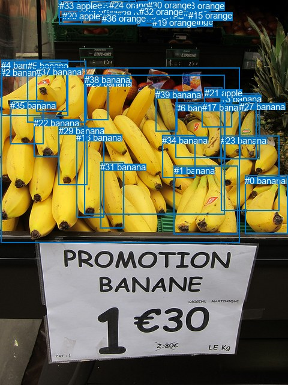
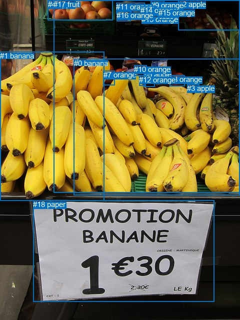

# 图片 1137：2367509.jpg

随机样本序号：326。图片 SHA256：`c52b59812cdbebaef4755007cfbcaf59165c437ca09724113c352905d38b1e4e`。

红色框表示人，蓝色框表示其他物体。两个模式分别保留自身框编号，可依据位置比较对应对象。

## 自动检测框与输出

人的框编号：`[]`。状态：`no_person`。

### 自动检测全部物体框

| 编号 | 类别 | 是否为人 | 检测分数 | 像素坐标 xyxy |
|---|---|---|---|---|
| 0 | banana | False | 0.9507 | 408.4, 291.8, 479.4, 388.8 |
| 1 | banana | False | 0.9244 | 290.0, 275.3, 396.1, 389.6 |
| 2 | banana | False | 0.9236 | 1.2, 112.3, 399.6, 403.1 |
| 3 | banana | False | 0.9210 | 368.0, 155.9, 432.6, 264.7 |
| 4 | banana | False | 0.8984 | 2.2, 99.8, 113.8, 192.1 |
| 5 | banana | False | 0.8834 | 45.5, 101.1, 143.8, 203.7 |
| 6 | banana | False | 0.8691 | 292.7, 170.9, 375.7, 262.9 |
| 7 | orange | False | 0.8058 | 281.0, 12.9, 314.7, 34.4 |
| 8 | orange | False | 0.8034 | 230.0, 1.0, 350.1, 44.0 |
| 9 | orange | False | 0.7895 | 148.2, 0.0, 182.2, 14.4 |
| 10 | orange | False | 0.7571 | 161.0, 7.9, 192.6, 32.1 |
| 11 | orange | False | 0.6756 | 281.5, 27.4, 314.5, 43.8 |
| 12 | orange | False | 0.6622 | 261.5, 5.4, 289.2, 34.3 |
| 13 | orange | False | 0.6365 | 301.4, 0.7, 331.4, 23.5 |
| 14 | orange | False | 0.6253 | 135.6, 10.7, 170.7, 40.9 |
| 15 | orange | False | 0.5933 | 314.3, 17.4, 347.6, 44.5 |
| 16 | banana | False | 0.5594 | 127.4, 220.5, 173.1, 361.4 |
| 17 | banana | False | 0.5534 | 336.9, 170.3, 386.3, 211.8 |
| 18 | orange | False | 0.5376 | 233.1, 21.2, 260.5, 41.7 |
| 19 | orange | False | 0.5372 | 254.4, 28.8, 281.6, 42.7 |
| 20 | apple | False | 0.5226 | 103.7, 17.8, 136.6, 39.0 |
| 21 | apple | False | 0.5221 | 340.9, 145.7, 370.6, 172.3 |
| 22 | banana | False | 0.5064 | 56.3, 195.5, 99.0, 260.8 |
| 23 | banana | False | 0.5059 | 368.2, 225.5, 465.9, 350.1 |
| 24 | orange | False | 0.5033 | 181.6, 0.2, 216.0, 23.9 |
| 25 | banana | False | 0.4989 | 143.7, 129.7, 180.8, 199.8 |
| 26 | orange | False | 0.4854 | 97.3, 0.3, 131.8, 29.6 |
| 27 | banana | False | 0.4852 | 399.4, 168.9, 427.6, 264.1 |
| 28 | orange | False | 0.4849 | 195.1, 15.2, 224.3, 39.2 |
| 29 | banana | False | 0.4643 | 97.5, 209.1, 145.7, 307.9 |
| 30 | orange | False | 0.4415 | 246.1, 0.0, 272.3, 14.4 |
| 31 | banana | False | 0.4391 | 167.4, 269.1, 206.1, 379.2 |
| 32 | orange | False | 0.4366 | 232.0, 11.1, 261.3, 35.9 |
| 33 | apple | False | 0.4178 | 98.5, 0.7, 226.6, 40.6 |
| 34 | banana | False | 0.4166 | 270.1, 224.7, 325.2, 295.0 |
| 35 | banana | False | 0.4116 | 17.2, 167.0, 72.3, 239.3 |
| 36 | orange | False | 0.4069 | 170.1, 22.0, 202.3, 40.6 |
| 37 | banana | False | 0.3964 | 60.4, 110.6, 111.7, 185.8 |
| 38 | banana | False | 0.3947 | 140.9, 124.3, 375.0, 356.4 |
| 39 | banana | False | 0.3872 | 259.1, 149.4, 295.1, 218.1 |

### 自动检测 Top50 人相关候选

评分物体对：0；人相关物体对：0；输出关系：0。

| 排名 | 主语编号与类别 | 关系 | 宾语编号与类别 | 类型 | 人与人 | 排序分数 | 原始融合 logit |
|---|---|---|---|---|---|---|---|

### 自动检测逐条人相关 GT 核验

本图没有人相关 GT，R@50 无分母；预测候选继续展示。

## 真实框与输出

人的框编号：`[]`。

### 真实框全部物体框

| 编号 | 类别 | 是否为人 | 检测分数 | 像素坐标 xyxy |
|---|---|---|---|---|
| 0 | banana | False | GT | 148.0, 118.0, 480.0, 390.0 |
| 1 | banana | False | GT | 0.0, 103.0, 208.0, 402.0 |
| 2 | apple | False | GT | 357.0, 0.0, 480.0, 61.0 |
| 3 | apple | False | GT | 374.0, 168.0, 398.0, 181.0 |
| 4 | apple | False | GT | 96.0, 0.0, 225.0, 40.0 |
| 5 | apple | False | GT | 288.0, 140.0, 310.0, 174.0 |
| 6 | orange | False | GT | 262.0, 6.0, 290.0, 35.0 |
| 7 | orange | False | GT | 207.0, 141.0, 230.0, 170.0 |
| 8 | orange | False | GT | 339.0, 150.0, 369.0, 172.0 |
| 9 | orange | False | GT | 302.0, 2.0, 329.0, 36.0 |
| 10 | orange | False | GT | 268.0, 130.0, 293.0, 151.0 |
| 11 | orange | False | GT | 232.0, 5.0, 262.0, 28.0 |
| 12 | orange | False | GT | 278.0, 151.0, 291.0, 172.0 |
| 13 | orange | False | GT | 283.0, 30.0, 316.0, 43.0 |
| 14 | orange | False | GT | 281.0, 12.0, 313.0, 31.0 |
| 15 | orange | False | GT | 317.0, 17.0, 348.0, 40.0 |
| 16 | orange | False | GT | 233.0, 22.0, 261.0, 42.0 |
| 17 | fruit | False | GT | 107.0, 0.0, 480.0, 386.0 |
| 18 | paper | False | GT | 66.0, 400.0, 428.0, 603.0 |

### 真实框 Top50 人相关候选

评分物体对：0；人相关物体对：0；输出关系：0。

| 排名 | 主语编号与类别 | 关系 | 宾语编号与类别 | 类型 | 人与人 | 排序分数 | 原始融合 logit |
|---|---|---|---|---|---|---|---|

### 真实框逐条人相关 GT 核验

本图没有人相关 GT，R@50 无分母；预测候选继续展示。

## 全部人相关 GT

| 主语编号与类别 | 关系 | 宾语编号与类别 |
|---|---|---|

原始记录、全部人相关物体对的两项预测与分项分数见 [逐图证据 JSON](../evidence/cases/1137.json)。全部56类 logits 保留于本机 HOR/output/random500/logits/。

<!-- HOR_COMPLETE_RESULTS -->

## 六组条件的完整输出对照

以下保留同一图片三种框与候选模式、两种谓词输出规则的全部 Top50。框编号各自在所属模式内解释。

### 自动检测框完整枚举：空间与语义各保留一个谓词

| 排名 | 主语编号与类别 | 谓词 | 宾语编号与类别 | 分组 | 排序分数 | predicate logit | pair logit |
|---|---|---|---|---|---|---|---|

没有人相关 GT，本条件的召回率无分母。

### 自动检测框完整枚举：每对只保留一个谓词

| 排名 | 主语编号与类别 | 谓词 | 宾语编号与类别 | 分组 | 排序分数 | predicate logit | pair logit |
|---|---|---|---|---|---|---|---|

没有人相关 GT，本条件的召回率无分母。

### 真实框完整枚举：空间与语义各保留一个谓词

| 排名 | 主语编号与类别 | 谓词 | 宾语编号与类别 | 分组 | 排序分数 | predicate logit | pair logit |
|---|---|---|---|---|---|---|---|

没有人相关 GT，本条件的召回率无分母。

### 真实框完整枚举：每对只保留一个谓词

| 排名 | 主语编号与类别 | 谓词 | 宾语编号与类别 | 分组 | 排序分数 | predicate logit | pair logit |
|---|---|---|---|---|---|---|---|

没有人相关 GT，本条件的召回率无分母。

### 真实框400候选：空间与语义各保留一个谓词

| 排名 | 主语编号与类别 | 谓词 | 宾语编号与类别 | 分组 | 排序分数 | predicate logit | pair logit |
|---|---|---|---|---|---|---|---|

没有人相关 GT，本条件的召回率无分母。

### 真实框400候选：每对只保留一个谓词

| 排名 | 主语编号与类别 | 谓词 | 宾语编号与类别 | 分组 | 排序分数 | predicate logit | pair logit |
|---|---|---|---|---|---|---|---|

没有人相关 GT，本条件的召回率无分母。
