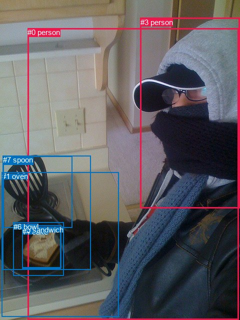
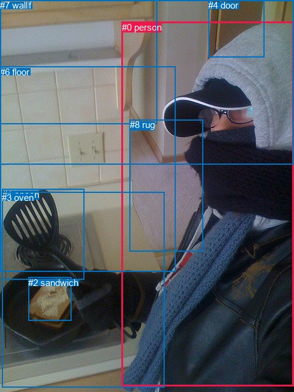

# 图片 1139：2367625.jpg

随机样本序号：52。图片 SHA256：`d181d6cf8249031cfe14c1077e99e4dec2b3871da1ee6564fc22f5d106820e84`。

红色框表示人，蓝色框表示其他物体。两个模式分别保留自身框编号，可依据位置比较对应对象。

## 自动检测框与输出

人的框编号：`[0, 3]`。状态：`ok`。

### 自动检测全部物体框

| 编号 | 类别 | 是否为人 | 检测分数 | 像素坐标 xyxy |
|---|---|---|---|---|
| 0 | person | True | 0.9906 | 55.1, 56.0, 477.4, 639.5 |
| 1 | oven | False | 0.7995 | 3.8, 344.5, 237.1, 633.8 |
| 2 | spoon | False | 0.7783 | 6.0, 312.5, 144.9, 455.5 |
| 3 | person | True | 0.7761 | 280.8, 35.9, 480.0, 416.5 |
| 4 | cake | False | 0.5165 | 44.1, 454.5, 121.6, 538.0 |
| 5 | sandwich | False | 0.4393 | 44.8, 450.5, 122.7, 535.1 |
| 6 | bowl | False | 0.3968 | 26.8, 444.5, 128.0, 551.1 |
| 7 | spoon | False | 0.3610 | 5.8, 311.2, 181.3, 539.6 |

### 自动检测 Top50 人相关候选

评分物体对：56；人相关物体对：26；输出关系：50。

| 排名 | 主语编号与类别 | 关系 | 宾语编号与类别 | 类型 | 人与人 | 排序分数 | 原始融合 logit |
|---|---|---|---|---|---|---|---|
| 1 | #0 person | wearing | #3 person | semantic | True | 0.98502 | 4.1859 |
| 2 | #0 person | holding | #7 spoon | semantic | False | 0.95052 | 2.9554 |
| 3 | #3 person | on | #0 person | spatial | True | 0.90690 | 2.2764 |
| 4 | #0 person | holding | #2 spoon | semantic | False | 0.90205 | 2.2202 |
| 5 | #0 person | holding | #5 sandwich | semantic | False | 0.89586 | 2.1520 |
| 6 | #0 person | holding | #4 cake | semantic | False | 0.88876 | 2.0781 |
| 7 | #0 person | holding | #6 bowl | semantic | False | 0.87140 | 1.9134 |
| 8 | #0 person | in | #3 person | spatial | True | 0.79661 | 1.3652 |
| 9 | #0 person | beside | #1 oven | spatial | False | 0.72560 | 0.9724 |
| 10 | #0 person | standing on | #1 oven | semantic | False | 0.63147 | 0.5385 |
| 11 | #3 person | wearing | #0 person | semantic | True | 0.59484 | 0.3840 |
| 12 | #0 person | on | #7 spoon | spatial | False | 0.37788 | -0.4985 |
| 13 | #1 oven | beside | #0 person | spatial | False | 0.29939 | -0.8502 |
| 14 | #5 sandwich | in | #0 person | spatial | False | 0.28080 | -0.9405 |
| 15 | #4 cake | in | #0 person | spatial | False | 0.27298 | -0.9795 |
| 16 | #0 person | on | #2 spoon | spatial | False | 0.26884 | -1.0005 |
| 17 | #6 bowl | in | #0 person | spatial | False | 0.23528 | -1.1787 |
| 18 | #7 spoon | in | #0 person | spatial | False | 0.19221 | -1.4357 |
| 19 | #0 person | on | #5 sandwich | spatial | False | 0.18570 | -1.4782 |
| 20 | #0 person | on | #4 cake | spatial | False | 0.17634 | -1.5413 |
| 21 | #0 person | on | #6 bowl | spatial | False | 0.17385 | -1.5586 |
| 22 | #3 person | holding | #7 spoon | semantic | False | 0.15805 | -1.6728 |
| 23 | #2 spoon | in | #0 person | spatial | False | 0.14136 | -1.8040 |
| 24 | #3 person | holding | #2 spoon | semantic | False | 0.10556 | -2.1369 |
| 25 | #7 spoon | holding | #0 person | semantic | False | 0.09810 | -2.2185 |
| 26 | #2 spoon | holding | #0 person | semantic | False | 0.09459 | -2.2588 |
| 27 | #1 oven | holding | #0 person | semantic | False | 0.05020 | -2.9402 |
| 28 | #3 person | eating | #5 sandwich | semantic | False | 0.03214 | -3.4050 |
| 29 | #3 person | eating | #6 bowl | semantic | False | 0.03123 | -3.4347 |
| 30 | #3 person | eating | #4 cake | semantic | False | 0.03044 | -3.4612 |
| 31 | #3 person | on | #1 oven | spatial | False | 0.02525 | -3.6533 |
| 32 | #2 spoon | in | #3 person | spatial | False | 0.02275 | -3.7603 |
| 33 | #5 sandwich | sitting on | #0 person | semantic | False | 0.02088 | -3.8480 |
| 34 | #1 oven | beside | #3 person | spatial | False | 0.02053 | -3.8651 |
| 35 | #4 cake | sitting on | #0 person | semantic | False | 0.02042 | -3.8704 |
| 36 | #5 sandwich | in | #3 person | spatial | False | 0.01979 | -3.9026 |
| 37 | #3 person | in | #7 spoon | spatial | False | 0.01960 | -3.9125 |
| 38 | #4 cake | in | #3 person | spatial | False | 0.01950 | -3.9174 |
| 39 | #6 bowl | sitting on | #0 person | semantic | False | 0.01708 | -4.0526 |
| 40 | #7 spoon | beside | #3 person | spatial | False | 0.01673 | -4.0735 |
| 41 | #3 person | in | #2 spoon | spatial | False | 0.01672 | -4.0745 |
| 42 | #6 bowl | in | #3 person | spatial | False | 0.01660 | -4.0814 |
| 43 | #2 spoon | holding | #3 person | semantic | False | 0.00870 | -4.7354 |
| 44 | #3 person | sitting on | #1 oven | semantic | False | 0.00800 | -4.8200 |
| 45 | #7 spoon | holding | #3 person | semantic | False | 0.00658 | -5.0179 |
| 46 | #1 oven | holding | #3 person | semantic | False | 0.00575 | -5.1535 |
| 47 | #3 person | in | #6 bowl | spatial | False | 0.00427 | -5.4522 |
| 48 | #3 person | in | #5 sandwich | spatial | False | 0.00392 | -5.5371 |
| 49 | #3 person | in | #4 cake | spatial | False | 0.00390 | -5.5418 |
| 50 | #5 sandwich | holding | #3 person | semantic | False | 0.00298 | -5.8141 |

### 自动检测逐条人相关 GT 核验

R@50：50.00%；命中 1/2。

| GT 主语编号 | GT 关系 | GT 宾语编号 | 结果阶段 | 匹配预测主语编号 | 匹配预测宾语编号 |
|---|---|---|---|---|---|
| 0 | holding | 1 | hit50 | [0] | [2] |
| 0 | in front of | 3 | wrong_predicate | [0] | [1] |

## 真实框与输出

人的框编号：`[0]`。

### 真实框全部物体框

| 编号 | 类别 | 是否为人 | 检测分数 | 像素坐标 xyxy |
|---|---|---|---|---|
| 0 | person | True | GT | 199.0, 36.0, 480.0, 630.0 |
| 1 | spoon | False | GT | 4.0, 309.0, 138.0, 457.0 |
| 2 | sandwich | False | GT | 46.0, 453.0, 116.0, 524.0 |
| 3 | oven | False | GT | 3.0, 314.0, 268.0, 633.0 |
| 4 | door | False | GT | 340.0, 0.0, 431.0, 94.0 |
| 5 | shelf | False | GT | 0.0, 0.0, 256.0, 202.0 |
| 6 | floor | False | GT | 0.0, 109.0, 286.0, 444.0 |
| 7 | wall | False | GT | 0.0, 0.0, 480.0, 269.0 |
| 8 | rug | False | GT | 212.0, 195.0, 332.0, 410.0 |

### 真实框 Top50 人相关候选

评分物体对：72；人相关物体对：16；输出关系：32。

| 排名 | 主语编号与类别 | 关系 | 宾语编号与类别 | 类型 | 人与人 | 排序分数 | 原始融合 logit |
|---|---|---|---|---|---|---|---|
| 1 | #0 person | holding | #2 sandwich | semantic | False | 0.91968 | 2.4381 |
| 2 | #0 person | holding | #1 spoon | semantic | False | 0.89721 | 2.1666 |
| 3 | #0 person | on | #8 rug | spatial | False | 0.87471 | 1.9432 |
| 4 | #0 person | wearing | #8 rug | semantic | False | 0.84915 | 1.7279 |
| 5 | #0 person | on | #3 oven | spatial | False | 0.83953 | 1.6547 |
| 6 | #0 person | holding | #3 oven | semantic | False | 0.63861 | 0.5693 |
| 7 | #8 rug | beside | #0 person | spatial | False | 0.59845 | 0.3990 |
| 8 | #0 person | in | #7 wall | spatial | False | 0.48342 | -0.0663 |
| 9 | #0 person | on | #2 sandwich | spatial | False | 0.42717 | -0.2934 |
| 10 | #0 person | in | #1 spoon | spatial | False | 0.33450 | -0.6879 |
| 11 | #0 person | on | #6 floor | spatial | False | 0.33281 | -0.6955 |
| 12 | #0 person | wearing | #4 door | semantic | False | 0.30626 | -0.8177 |
| 13 | #0 person | looking at | #7 wall | semantic | False | 0.25849 | -1.0539 |
| 14 | #0 person | in | #4 door | spatial | False | 0.21778 | -1.2787 |
| 15 | #2 sandwich | in | #0 person | spatial | False | 0.21086 | -1.3197 |
| 16 | #0 person | looking at | #6 floor | semantic | False | 0.19037 | -1.4476 |
| 17 | #3 oven | beside | #0 person | spatial | False | 0.18068 | -1.5118 |
| 18 | #8 rug | holding | #0 person | semantic | False | 0.14300 | -1.7906 |
| 19 | #4 door | beside | #0 person | spatial | False | 0.14249 | -1.7947 |
| 20 | #6 floor | beside | #0 person | spatial | False | 0.14134 | -1.8042 |
| 21 | #1 spoon | in | #0 person | spatial | False | 0.13825 | -1.8299 |
| 22 | #1 spoon | holding | #0 person | semantic | False | 0.12347 | -1.9599 |
| 23 | #7 wall | beside | #0 person | spatial | False | 0.10615 | -2.1307 |
| 24 | #0 person | on | #5 shelf | spatial | False | 0.06945 | -2.5952 |
| 25 | #2 sandwich | holding | #0 person | semantic | False | 0.04308 | -3.1007 |
| 26 | #3 oven | holding | #0 person | semantic | False | 0.04222 | -3.1218 |
| 27 | #5 shelf | beside | #0 person | spatial | False | 0.03821 | -3.2256 |
| 28 | #0 person | looking at | #5 shelf | semantic | False | 0.02866 | -3.5231 |
| 29 | #4 door | looking at | #0 person | semantic | False | 0.02600 | -3.6231 |
| 30 | #7 wall | holding | #0 person | semantic | False | 0.01526 | -4.1674 |
| 31 | #6 floor | holding | #0 person | semantic | False | 0.01437 | -4.2281 |
| 32 | #5 shelf | holding | #0 person | semantic | False | 0.00492 | -5.3096 |

### 真实框逐条人相关 GT 核验

R@50：50.00%；命中 1/2。

| GT 主语编号 | GT 关系 | GT 宾语编号 | 结果阶段 | 匹配预测主语编号 | 匹配预测宾语编号 |
|---|---|---|---|---|---|
| 0 | holding | 1 | hit50 | [0] | [1] |
| 0 | in front of | 3 | wrong_predicate | [0] | [3] |

## 全部人相关 GT

| 主语编号与类别 | 关系 | 宾语编号与类别 |
|---|---|---|
| #0 person | holding | #1 spoon |
| #0 person | in front of | #3 oven |

原始记录、全部人相关物体对的两项预测与分项分数见 [逐图证据 JSON](../evidence/cases/1139.json)。全部56类 logits 保留于本机 HOR/output/random500/logits/。

<!-- HOR_COMPLETE_RESULTS -->

## 六组条件的完整输出对照

以下保留同一图片三种框与候选模式、两种谓词输出规则的全部 Top50。框编号各自在所属模式内解释。

### 自动检测框完整枚举：空间与语义各保留一个谓词

| 排名 | 主语编号与类别 | 谓词 | 宾语编号与类别 | 分组 | 排序分数 | predicate logit | pair logit |
|---|---|---|---|---|---|---|---|
| 1 | #0 person | wearing | #3 person | semantic | 0.9850199 | 4.1531816 | 0.0327619 |
| 2 | #0 person | holding | #7 spoon | semantic | 0.9505177 | 3.1146593 | -0.1592667 |
| 3 | #3 person | on | #0 person | spatial | 0.9069008 | 2.7627583 | -0.4863913 |
| 4 | #0 person | holding | #2 spoon | semantic | 0.9020519 | 2.3403907 | -0.1201570 |
| 5 | #0 person | holding | #5 sandwich | semantic | 0.8958592 | 2.3825083 | -0.2304685 |
| 6 | #0 person | holding | #4 cake | semantic | 0.8887601 | 2.3252802 | -0.2471414 |
| 7 | #0 person | holding | #6 bowl | semantic | 0.8714041 | 2.2108240 | -0.2973936 |
| 8 | #0 person | in | #3 person | spatial | 0.7966091 | 1.3324723 | 0.0327619 |
| 9 | #0 person | beside | #1 oven | spatial | 0.7256036 | 1.3992906 | -0.4268602 |
| 10 | #0 person | standing on | #1 oven | semantic | 0.6314690 | 0.9653840 | -0.4268602 |
| 11 | #3 person | wearing | #0 person | semantic | 0.5948390 | 0.8703976 | -0.4863913 |
| 12 | #0 person | on | #7 spoon | spatial | 0.3778835 | -0.3392749 | -0.1592667 |
| 13 | #1 oven | beside | #0 person | spatial | 0.2993917 | 0.0466876 | -0.8968835 |
| 14 | #5 sandwich | in | #0 person | spatial | 0.2808041 | 0.1717634 | -1.1122398 |
| 15 | #4 cake | in | #0 person | spatial | 0.2729819 | 0.1400127 | -1.1195585 |
| 16 | #0 person | on | #2 spoon | spatial | 0.2688440 | -0.8803384 | -0.1201570 |
| 17 | #6 bowl | in | #0 person | spatial | 0.2352803 | -0.0627742 | -1.1159577 |
| 18 | #7 spoon | in | #0 person | spatial | 0.1922086 | -0.4966788 | -0.9390439 |
| 19 | #0 person | on | #5 sandwich | spatial | 0.1856972 | -1.2477467 | -0.2304685 |
| 20 | #0 person | on | #4 cake | spatial | 0.1763443 | -1.2941728 | -0.2471414 |
| 21 | #0 person | on | #6 bowl | spatial | 0.1738465 | -1.2612140 | -0.2973936 |
| 22 | #3 person | holding | #7 spoon | semantic | 0.1580479 | -0.6404643 | -1.0323609 |
| 23 | #2 spoon | in | #0 person | spatial | 0.1413603 | -0.8061111 | -0.9979265 |
| 24 | #3 person | holding | #2 spoon | semantic | 0.1055595 | -1.2470801 | -0.8898434 |
| 25 | #7 spoon | holding | #0 person | semantic | 0.0981000 | -1.2794721 | -0.9390439 |
| 26 | #2 spoon | holding | #0 person | semantic | 0.0945888 | -1.2609234 | -0.9979265 |
| 27 | #1 oven | holding | #0 person | semantic | 0.0502027 | -2.0432959 | -0.8968835 |
| 28 | #3 person | eating | #5 sandwich | semantic | 0.0321405 | -2.3082142 | -1.0967548 |
| 29 | #3 person | eating | #6 bowl | semantic | 0.0312277 | -2.2725713 | -1.1621522 |
| 30 | #3 person | eating | #4 cake | semantic | 0.0304378 | -2.3487649 | -1.1123939 |
| 31 | #3 person | on | #1 oven | spatial | 0.0252519 | -2.3925767 | -1.2607021 |
| 32 | #2 spoon | in | #3 person | spatial | 0.0227467 | -2.3611629 | -1.3991619 |
| 33 | #5 sandwich | sitting on | #0 person | semantic | 0.0208763 | -2.7358053 | -1.1122398 |
| 34 | #1 oven | beside | #3 person | spatial | 0.0205298 | -2.2571864 | -1.6079502 |
| 35 | #4 cake | sitting on | #0 person | semantic | 0.0204240 | -2.7508507 | -1.1195585 |
| 36 | #5 sandwich | in | #3 person | spatial | 0.0197891 | -2.3919725 | -1.5106633 |
| 37 | #3 person | in | #7 spoon | spatial | 0.0195979 | -2.8801813 | -1.0323609 |
| 38 | #4 cake | in | #3 person | spatial | 0.0195041 | -2.3928022 | -1.5246295 |
| 39 | #6 bowl | sitting on | #0 person | semantic | 0.0170797 | -2.9366798 | -1.1159577 |
| 40 | #7 spoon | beside | #3 person | spatial | 0.0167327 | -2.4096811 | -1.6638364 |
| 41 | #3 person | in | #2 spoon | spatial | 0.0167169 | -3.1846352 | -0.8898434 |
| 42 | #6 bowl | in | #3 person | spatial | 0.0166033 | -2.4940844 | -1.5873249 |
| 43 | #2 spoon | holding | #3 person | semantic | 0.0087022 | -3.3362787 | -1.3991619 |
| 44 | #3 person | sitting on | #1 oven | semantic | 0.0080021 | -3.5593095 | -1.2607021 |
| 45 | #7 spoon | holding | #3 person | semantic | 0.0065751 | -3.3540366 | -1.6638364 |
| 46 | #1 oven | holding | #3 person | semantic | 0.0057461 | -3.5455251 | -1.6079502 |
| 47 | #3 person | in | #6 bowl | spatial | 0.0042685 | -4.2900534 | -1.1621522 |
| 48 | #3 person | in | #5 sandwich | spatial | 0.0039225 | -4.4403453 | -1.0967548 |
| 49 | #3 person | in | #4 cake | spatial | 0.0039042 | -4.4293923 | -1.1123939 |
| 50 | #5 sandwich | holding | #3 person | semantic | 0.0029763 | -4.3034401 | -1.5106633 |

GT 命中：1/2，R@50=50.00%。

| GT主语 | GT谓词 | GT宾语 | 结果阶段 | 匹配主语框 | 匹配宾语框 |
|---|---|---|---|---|---|
| 0 | holding | 1 | hit50 | [0] | [2] |
| 0 | in front of | 3 | wrong_predicate | [0] | [1] |

### 自动检测框完整枚举：每对只保留一个谓词

| 排名 | 主语编号与类别 | 谓词 | 宾语编号与类别 | 分组 | 排序分数 | predicate logit | pair logit |
|---|---|---|---|---|---|---|---|
| 1 | #0 person | wearing | #3 person | single | 0.9850199 | 4.1531816 | 0.0327619 |
| 2 | #0 person | holding | #7 spoon | single | 0.9505177 | 3.1146593 | -0.1592667 |
| 3 | #3 person | on | #0 person | single | 0.9069008 | 2.7627583 | -0.4863913 |
| 4 | #0 person | holding | #2 spoon | single | 0.9020519 | 2.3403907 | -0.1201570 |
| 5 | #0 person | holding | #5 sandwich | single | 0.8958592 | 2.3825083 | -0.2304685 |
| 6 | #0 person | holding | #4 cake | single | 0.8887601 | 2.3252802 | -0.2471414 |
| 7 | #0 person | holding | #6 bowl | single | 0.8714041 | 2.2108240 | -0.2973936 |
| 8 | #0 person | beside | #1 oven | single | 0.7256036 | 1.3992906 | -0.4268602 |
| 9 | #1 oven | beside | #0 person | single | 0.2993917 | 0.0466876 | -0.8968835 |
| 10 | #5 sandwich | in | #0 person | single | 0.2808041 | 0.1717634 | -1.1122398 |
| 11 | #4 cake | in | #0 person | single | 0.2729819 | 0.1400127 | -1.1195585 |
| 12 | #6 bowl | in | #0 person | single | 0.2352803 | -0.0627742 | -1.1159577 |
| 13 | #7 spoon | in | #0 person | single | 0.1922086 | -0.4966788 | -0.9390439 |
| 14 | #3 person | holding | #7 spoon | single | 0.1580479 | -0.6404643 | -1.0323609 |
| 15 | #2 spoon | in | #0 person | single | 0.1413603 | -0.8061111 | -0.9979265 |
| 16 | #3 person | holding | #2 spoon | single | 0.1055595 | -1.2470801 | -0.8898434 |
| 17 | #3 person | eating | #5 sandwich | single | 0.0321405 | -2.3082142 | -1.0967548 |
| 18 | #3 person | eating | #6 bowl | single | 0.0312277 | -2.2725713 | -1.1621522 |
| 19 | #3 person | eating | #4 cake | single | 0.0304378 | -2.3487649 | -1.1123939 |
| 20 | #3 person | on | #1 oven | single | 0.0252519 | -2.3925767 | -1.2607021 |
| 21 | #2 spoon | in | #3 person | single | 0.0227467 | -2.3611629 | -1.3991619 |
| 22 | #1 oven | beside | #3 person | single | 0.0205298 | -2.2571864 | -1.6079502 |
| 23 | #5 sandwich | in | #3 person | single | 0.0197891 | -2.3919725 | -1.5106633 |
| 24 | #4 cake | in | #3 person | single | 0.0195041 | -2.3928022 | -1.5246295 |
| 25 | #7 spoon | beside | #3 person | single | 0.0167327 | -2.4096811 | -1.6638364 |
| 26 | #6 bowl | in | #3 person | single | 0.0166033 | -2.4940844 | -1.5873249 |

GT 命中：1/2，R@50=50.00%。

| GT主语 | GT谓词 | GT宾语 | 结果阶段 | 匹配主语框 | 匹配宾语框 |
|---|---|---|---|---|---|
| 0 | holding | 1 | hit50 | [0] | [2] |
| 0 | in front of | 3 | wrong_predicate | [0] | [1] |

### 真实框完整枚举：空间与语义各保留一个谓词

| 排名 | 主语编号与类别 | 谓词 | 宾语编号与类别 | 分组 | 排序分数 | predicate logit | pair logit |
|---|---|---|---|---|---|---|---|
| 1 | #0 person | holding | #2 sandwich | semantic | 0.9196839 | 2.9877067 | -0.5496465 |
| 2 | #0 person | holding | #1 spoon | semantic | 0.8972108 | 2.5335135 | -0.3669024 |
| 3 | #0 person | on | #8 rug | spatial | 0.8747077 | 2.9478817 | -1.0046411 |
| 4 | #0 person | wearing | #8 rug | semantic | 0.8491496 | 2.7325878 | -1.0046411 |
| 5 | #0 person | on | #3 oven | spatial | 0.8395314 | 2.2944479 | -0.6397027 |
| 6 | #0 person | holding | #3 oven | semantic | 0.6386078 | 1.2090297 | -0.6397027 |
| 7 | #8 rug | beside | #0 person | spatial | 0.5984521 | 1.1576929 | -0.7586734 |
| 8 | #0 person | in | #7 wall | spatial | 0.4834187 | 0.8923950 | -0.9587446 |
| 9 | #0 person | on | #2 sandwich | spatial | 0.4271693 | 0.2562366 | -0.5496465 |
| 10 | #0 person | in | #1 spoon | spatial | 0.3344979 | -0.3210087 | -0.3669024 |
| 11 | #0 person | on | #6 floor | spatial | 0.3328087 | 0.4362330 | -1.1317420 |
| 12 | #0 person | wearing | #4 door | semantic | 0.3062600 | 0.0376873 | -0.8553503 |
| 13 | #0 person | looking at | #7 wall | semantic | 0.2584853 | -0.0951118 | -0.9587446 |
| 14 | #0 person | in | #4 door | spatial | 0.2177762 | -0.4233227 | -0.8553503 |
| 15 | #2 sandwich | in | #0 person | spatial | 0.2108609 | 0.0195265 | -1.3392704 |
| 16 | #0 person | looking at | #6 floor | semantic | 0.1903707 | -0.3158612 | -1.1317420 |
| 17 | #3 oven | beside | #0 person | spatial | 0.1806793 | -0.4046235 | -1.1071281 |
| 18 | #8 rug | holding | #0 person | semantic | 0.1429969 | -1.0319452 | -0.7586734 |
| 19 | #4 door | beside | #0 person | spatial | 0.1424928 | -1.1449103 | -0.6498274 |
| 20 | #6 floor | beside | #0 person | spatial | 0.1413430 | -0.6474929 | -1.1566870 |
| 21 | #1 spoon | in | #0 person | spatial | 0.1382452 | -0.5938129 | -1.2361294 |
| 22 | #1 spoon | holding | #0 person | semantic | 0.1234728 | -0.7238171 | -1.2361294 |
| 23 | #7 wall | beside | #0 person | spatial | 0.1061456 | -1.2637851 | -0.8669457 |
| 24 | #0 person | on | #5 shelf | spatial | 0.0694503 | -1.3048890 | -1.2902746 |
| 25 | #2 sandwich | holding | #0 person | semantic | 0.0430790 | -1.7614160 | -1.3392704 |
| 26 | #3 oven | holding | #0 person | semantic | 0.0422157 | -2.0147016 | -1.1071281 |
| 27 | #5 shelf | beside | #0 person | spatial | 0.0382138 | -2.1673322 | -1.0582643 |
| 28 | #0 person | looking at | #5 shelf | semantic | 0.0286625 | -2.2328107 | -1.2902746 |
| 29 | #4 door | looking at | #0 person | semantic | 0.0260049 | -2.9732928 | -0.6498274 |
| 30 | #7 wall | holding | #0 person | semantic | 0.0152562 | -3.3004487 | -0.8669457 |
| 31 | #6 floor | holding | #0 person | semantic | 0.0143705 | -3.0714183 | -1.1566870 |
| 32 | #5 shelf | holding | #0 person | semantic | 0.0049194 | -4.2513657 | -1.0582643 |

GT 命中：1/2，R@50=50.00%。

| GT主语 | GT谓词 | GT宾语 | 结果阶段 | 匹配主语框 | 匹配宾语框 |
|---|---|---|---|---|---|
| 0 | holding | 1 | hit50 | [0] | [1] |
| 0 | in front of | 3 | wrong_predicate | [0] | [3] |

### 真实框完整枚举：每对只保留一个谓词

| 排名 | 主语编号与类别 | 谓词 | 宾语编号与类别 | 分组 | 排序分数 | predicate logit | pair logit |
|---|---|---|---|---|---|---|---|
| 1 | #0 person | holding | #2 sandwich | single | 0.9196839 | 2.9877067 | -0.5496465 |
| 2 | #0 person | holding | #1 spoon | single | 0.8972108 | 2.5335135 | -0.3669024 |
| 3 | #0 person | on | #8 rug | single | 0.8747077 | 2.9478817 | -1.0046411 |
| 4 | #0 person | on | #3 oven | single | 0.8395314 | 2.2944479 | -0.6397027 |
| 5 | #8 rug | beside | #0 person | single | 0.5984521 | 1.1576929 | -0.7586734 |
| 6 | #0 person | in | #7 wall | single | 0.4834187 | 0.8923950 | -0.9587446 |
| 7 | #0 person | on | #6 floor | single | 0.3328087 | 0.4362330 | -1.1317420 |
| 8 | #0 person | wearing | #4 door | single | 0.3062600 | 0.0376873 | -0.8553503 |
| 9 | #2 sandwich | in | #0 person | single | 0.2108609 | 0.0195265 | -1.3392704 |
| 10 | #3 oven | beside | #0 person | single | 0.1806793 | -0.4046235 | -1.1071281 |
| 11 | #4 door | beside | #0 person | single | 0.1424928 | -1.1449103 | -0.6498274 |
| 12 | #6 floor | beside | #0 person | single | 0.1413430 | -0.6474929 | -1.1566870 |
| 13 | #1 spoon | in | #0 person | single | 0.1382452 | -0.5938129 | -1.2361294 |
| 14 | #7 wall | beside | #0 person | single | 0.1061456 | -1.2637851 | -0.8669457 |
| 15 | #0 person | on | #5 shelf | single | 0.0694503 | -1.3048890 | -1.2902746 |
| 16 | #5 shelf | beside | #0 person | single | 0.0382138 | -2.1673322 | -1.0582643 |

GT 命中：1/2，R@50=50.00%。

| GT主语 | GT谓词 | GT宾语 | 结果阶段 | 匹配主语框 | 匹配宾语框 |
|---|---|---|---|---|---|
| 0 | holding | 1 | hit50 | [0] | [1] |
| 0 | in front of | 3 | wrong_predicate | [0] | [3] |

### 真实框400候选：空间与语义各保留一个谓词

| 排名 | 主语编号与类别 | 谓词 | 宾语编号与类别 | 分组 | 排序分数 | predicate logit | pair logit |
|---|---|---|---|---|---|---|---|
| 1 | #0 person | holding | #2 sandwich | semantic | 0.9196839 | 2.9877067 | -0.5496465 |
| 2 | #0 person | holding | #1 spoon | semantic | 0.8972108 | 2.5335135 | -0.3669024 |
| 3 | #0 person | on | #8 rug | spatial | 0.8747077 | 2.9478817 | -1.0046411 |
| 4 | #0 person | wearing | #8 rug | semantic | 0.8491496 | 2.7325878 | -1.0046411 |
| 5 | #0 person | on | #3 oven | spatial | 0.8395314 | 2.2944479 | -0.6397027 |
| 6 | #0 person | holding | #3 oven | semantic | 0.6386078 | 1.2090297 | -0.6397027 |
| 7 | #8 rug | beside | #0 person | spatial | 0.5984382 | 1.1576352 | -0.7586734 |
| 8 | #0 person | in | #7 wall | spatial | 0.4842475 | 0.8957138 | -0.9587446 |
| 9 | #0 person | on | #2 sandwich | spatial | 0.4271693 | 0.2562366 | -0.5496465 |
| 10 | #0 person | on | #6 floor | spatial | 0.3340189 | 0.4416780 | -1.1317420 |
| 11 | #0 person | in | #1 spoon | spatial | 0.3285648 | -0.3477812 | -0.3669024 |
| 12 | #0 person | wearing | #4 door | semantic | 0.3062600 | 0.0376873 | -0.8553503 |
| 13 | #0 person | looking at | #7 wall | semantic | 0.2642268 | -0.0653696 | -0.9587446 |
| 14 | #0 person | in | #4 door | spatial | 0.2183421 | -0.4200039 | -0.8553503 |
| 15 | #2 sandwich | in | #0 person | spatial | 0.2103092 | 0.0162077 | -1.3392704 |
| 16 | #0 person | looking at | #6 floor | semantic | 0.1904245 | -0.3155122 | -1.1317420 |
| 17 | #3 oven | beside | #0 person | spatial | 0.1762844 | -0.4345989 | -1.1071281 |
| 18 | #8 rug | holding | #0 person | semantic | 0.1428160 | -1.0334222 | -0.7586734 |
| 19 | #6 floor | beside | #0 person | spatial | 0.1413447 | -0.6474786 | -1.1566870 |
| 20 | #4 door | beside | #0 person | spatial | 0.1406756 | -1.1598623 | -0.6498274 |
| 21 | #1 spoon | in | #0 person | spatial | 0.1378502 | -0.5971317 | -1.2361294 |
| 22 | #1 spoon | holding | #0 person | semantic | 0.1234728 | -0.7238171 | -1.2361294 |
| 23 | #7 wall | beside | #0 person | spatial | 0.1075768 | -1.2487900 | -0.8669457 |
| 24 | #0 person | on | #5 shelf | spatial | 0.0682196 | -1.3240905 | -1.2902746 |
| 25 | #2 sandwich | holding | #0 person | semantic | 0.0424630 | -1.7764616 | -1.3392704 |
| 26 | #3 oven | holding | #0 person | semantic | 0.0417000 | -2.0275316 | -1.1071281 |
| 27 | #5 shelf | beside | #0 person | spatial | 0.0387679 | -2.1523588 | -1.0582643 |
| 28 | #0 person | looking at | #5 shelf | semantic | 0.0290696 | -2.2182879 | -1.2902746 |
| 29 | #4 door | looking at | #0 person | semantic | 0.0256222 | -2.9885125 | -0.6498274 |
| 30 | #7 wall | holding | #0 person | semantic | 0.0152451 | -3.3011870 | -0.8669457 |
| 31 | #6 floor | holding | #0 person | semantic | 0.0143287 | -3.0743725 | -1.1566870 |
| 32 | #5 shelf | holding | #0 person | semantic | 0.0049495 | -4.2452517 | -1.0582643 |

GT 命中：1/2，R@50=50.00%。

| GT主语 | GT谓词 | GT宾语 | 结果阶段 | 匹配主语框 | 匹配宾语框 |
|---|---|---|---|---|---|
| 0 | holding | 1 | hit50 | [0] | [1] |
| 0 | in front of | 3 | wrong_predicate | [0] | [3] |

### 真实框400候选：每对只保留一个谓词

| 排名 | 主语编号与类别 | 谓词 | 宾语编号与类别 | 分组 | 排序分数 | predicate logit | pair logit |
|---|---|---|---|---|---|---|---|
| 1 | #0 person | holding | #2 sandwich | single | 0.9196839 | 2.9877067 | -0.5496465 |
| 2 | #0 person | holding | #1 spoon | single | 0.8972108 | 2.5335135 | -0.3669024 |
| 3 | #0 person | on | #8 rug | single | 0.8747077 | 2.9478817 | -1.0046411 |
| 4 | #0 person | on | #3 oven | single | 0.8395314 | 2.2944479 | -0.6397027 |
| 5 | #8 rug | beside | #0 person | single | 0.5984382 | 1.1576352 | -0.7586734 |
| 6 | #0 person | in | #7 wall | single | 0.4842475 | 0.8957138 | -0.9587446 |
| 7 | #0 person | on | #6 floor | single | 0.3340189 | 0.4416780 | -1.1317420 |
| 8 | #0 person | wearing | #4 door | single | 0.3062600 | 0.0376873 | -0.8553503 |
| 9 | #2 sandwich | in | #0 person | single | 0.2103092 | 0.0162077 | -1.3392704 |
| 10 | #3 oven | beside | #0 person | single | 0.1762844 | -0.4345989 | -1.1071281 |
| 11 | #6 floor | beside | #0 person | single | 0.1413447 | -0.6474786 | -1.1566870 |
| 12 | #4 door | beside | #0 person | single | 0.1406756 | -1.1598623 | -0.6498274 |
| 13 | #1 spoon | in | #0 person | single | 0.1378502 | -0.5971317 | -1.2361294 |
| 14 | #7 wall | beside | #0 person | single | 0.1075768 | -1.2487900 | -0.8669457 |
| 15 | #0 person | on | #5 shelf | single | 0.0682196 | -1.3240905 | -1.2902746 |
| 16 | #5 shelf | beside | #0 person | single | 0.0387679 | -2.1523588 | -1.0582643 |

GT 命中：1/2，R@50=50.00%。

| GT主语 | GT谓词 | GT宾语 | 结果阶段 | 匹配主语框 | 匹配宾语框 |
|---|---|---|---|---|---|
| 0 | holding | 1 | hit50 | [0] | [1] |
| 0 | in front of | 3 | wrong_predicate | [0] | [3] |
