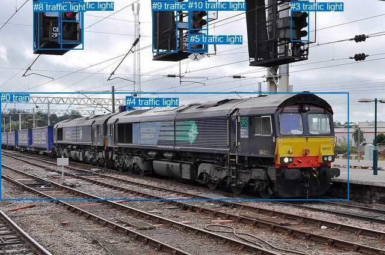
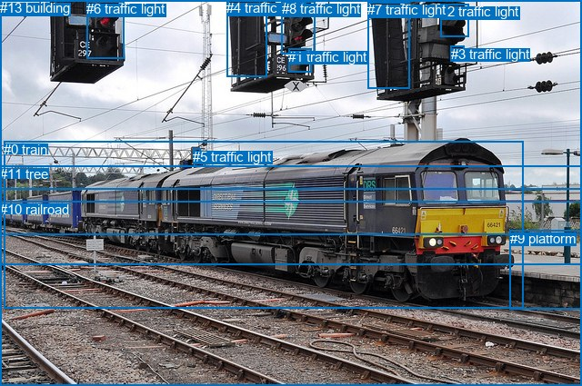

# 图片 1150：2368293.jpg

随机样本序号：352。图片 SHA256：`f846c7ca0bb668ebf86d282183cee4c3f88c4eddee9d81440d8c994fd77074f6`。

红色框表示人，蓝色框表示其他物体。两个模式分别保留自身框编号，可依据位置比较对应对象。

## 自动检测框与输出

人的框编号：`[]`。状态：`no_person`。

### 自动检测全部物体框

| 编号 | 类别 | 是否为人 | 检测分数 | 像素坐标 xyxy |
|---|---|---|---|---|
| 0 | train | False | 0.9987 | 0.6, 154.2, 579.4, 333.2 |
| 1 | traffic light | False | 0.9797 | 97.7, 0.1, 136.4, 72.1 |
| 2 | traffic light | False | 0.9717 | 316.9, 0.8, 345.1, 49.0 |
| 3 | traffic light | False | 0.9478 | 483.0, 1.8, 513.3, 68.3 |
| 4 | traffic light | False | 0.9101 | 209.8, 160.7, 220.7, 183.7 |
| 5 | traffic light | False | 0.7959 | 315.9, 56.1, 341.7, 82.6 |
| 6 | traffic light | False | 0.6838 | 63.5, 0.4, 138.5, 82.1 |
| 7 | traffic light | False | 0.6771 | 101.6, 0.3, 132.7, 35.6 |
| 8 | traffic light | False | 0.4555 | 55.8, 2.5, 102.2, 82.7 |
| 9 | traffic light | False | 0.3792 | 253.2, 0.7, 294.0, 87.0 |
| 10 | traffic light | False | 0.3686 | 313.3, 0.0, 345.8, 87.9 |

### 自动检测 Top50 人相关候选

评分物体对：0；人相关物体对：0；输出关系：0。

| 排名 | 主语编号与类别 | 关系 | 宾语编号与类别 | 类型 | 人与人 | 排序分数 | 原始融合 logit |
|---|---|---|---|---|---|---|---|

### 自动检测逐条人相关 GT 核验

本图没有人相关 GT，R@50 无分母；预测候选继续展示。

## 真实框与输出

人的框编号：`[]`。

### 真实框全部物体框

| 编号 | 类别 | 是否为人 | 检测分数 | 像素坐标 xyxy |
|---|---|---|---|---|
| 0 | train | False | GT | 4.0, 156.0, 575.0, 339.0 |
| 1 | traffic light | False | GT | 317.0, 54.0, 342.0, 80.0 |
| 2 | traffic light | False | GT | 484.0, 4.0, 515.0, 41.0 |
| 3 | traffic light | False | GT | 496.0, 51.0, 511.0, 67.0 |
| 4 | traffic light | False | GT | 249.0, 0.0, 293.0, 84.0 |
| 5 | traffic light | False | GT | 212.0, 164.0, 220.0, 179.0 |
| 6 | traffic light | False | GT | 95.0, 1.0, 136.0, 64.0 |
| 7 | traffic light | False | GT | 404.0, 2.0, 450.0, 97.0 |
| 8 | traffic light | False | GT | 310.0, 1.0, 347.0, 59.0 |
| 9 | platform | False | GT | 561.0, 254.0, 640.0, 341.0 |
| 10 | railroad | False | GT | 0.0, 222.0, 640.0, 425.0 |
| 11 | tree | False | GT | 0.0, 183.0, 640.0, 259.0 |
| 12 | sky | False | GT | 0.0, 0.0, 640.0, 208.0 |
| 13 | building | False | GT | 0.0, 0.0, 640.0, 292.0 |

### 真实框 Top50 人相关候选

评分物体对：0；人相关物体对：0；输出关系：0。

| 排名 | 主语编号与类别 | 关系 | 宾语编号与类别 | 类型 | 人与人 | 排序分数 | 原始融合 logit |
|---|---|---|---|---|---|---|---|

### 真实框逐条人相关 GT 核验

本图没有人相关 GT，R@50 无分母；预测候选继续展示。

## 全部人相关 GT

| 主语编号与类别 | 关系 | 宾语编号与类别 |
|---|---|---|

原始记录、全部人相关物体对的两项预测与分项分数见 [逐图证据 JSON](../evidence/cases/1150.json)。全部56类 logits 保留于本机 HOR/output/random500/logits/。

<!-- HOR_COMPLETE_RESULTS -->

## 六组条件的完整输出对照

以下保留同一图片三种框与候选模式、两种谓词输出规则的全部 Top50。框编号各自在所属模式内解释。

### 自动检测框完整枚举：空间与语义各保留一个谓词

| 排名 | 主语编号与类别 | 谓词 | 宾语编号与类别 | 分组 | 排序分数 | predicate logit | pair logit |
|---|---|---|---|---|---|---|---|

没有人相关 GT，本条件的召回率无分母。

### 自动检测框完整枚举：每对只保留一个谓词

| 排名 | 主语编号与类别 | 谓词 | 宾语编号与类别 | 分组 | 排序分数 | predicate logit | pair logit |
|---|---|---|---|---|---|---|---|

没有人相关 GT，本条件的召回率无分母。

### 真实框完整枚举：空间与语义各保留一个谓词

| 排名 | 主语编号与类别 | 谓词 | 宾语编号与类别 | 分组 | 排序分数 | predicate logit | pair logit |
|---|---|---|---|---|---|---|---|

没有人相关 GT，本条件的召回率无分母。

### 真实框完整枚举：每对只保留一个谓词

| 排名 | 主语编号与类别 | 谓词 | 宾语编号与类别 | 分组 | 排序分数 | predicate logit | pair logit |
|---|---|---|---|---|---|---|---|

没有人相关 GT，本条件的召回率无分母。

### 真实框400候选：空间与语义各保留一个谓词

| 排名 | 主语编号与类别 | 谓词 | 宾语编号与类别 | 分组 | 排序分数 | predicate logit | pair logit |
|---|---|---|---|---|---|---|---|

没有人相关 GT，本条件的召回率无分母。

### 真实框400候选：每对只保留一个谓词

| 排名 | 主语编号与类别 | 谓词 | 宾语编号与类别 | 分组 | 排序分数 | predicate logit | pair logit |
|---|---|---|---|---|---|---|---|

没有人相关 GT，本条件的召回率无分母。
