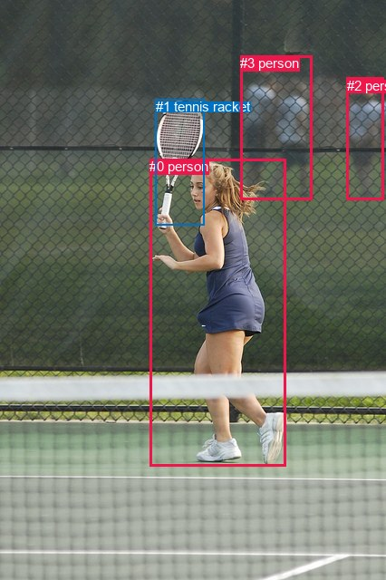
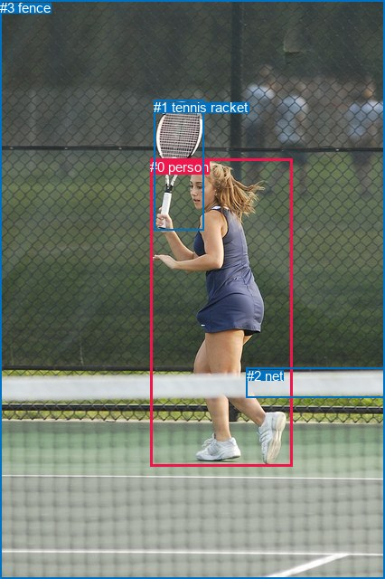

# 图片 1155：2368389.jpg

随机样本序号：500。图片 SHA256：`5d194b7c13af800e8b57c37b52f71e28d642bc046f6c2325e1bb278db9b6d130`。

红色框表示人，蓝色框表示其他物体。两个模式分别保留自身框编号，可依据位置比较对应对象。

## 自动检测框与输出

人的框编号：`[0, 2, 3]`。状态：`ok`。

### 自动检测全部物体框

| 编号 | 类别 | 是否为人 | 检测分数 | 像素坐标 xyxy |
|---|---|---|---|---|
| 0 | person | True | 0.9991 | 165.4, 175.1, 315.8, 514.5 |
| 1 | tennis racket | False | 0.9990 | 171.8, 109.5, 225.1, 248.3 |
| 2 | person | True | 0.9811 | 382.7, 85.6, 423.8, 220.4 |
| 3 | person | True | 0.7331 | 265.0, 61.4, 344.3, 220.9 |

### 自动检测 Top50 人相关候选

评分物体对：12；人相关物体对：12；输出关系：24。

| 排名 | 主语编号与类别 | 关系 | 宾语编号与类别 | 类型 | 人与人 | 排序分数 | 原始融合 logit |
|---|---|---|---|---|---|---|---|
| 1 | #0 person | holding | #1 tennis racket | semantic | False | 0.99417 | 5.1387 |
| 2 | #3 person | looking at | #0 person | semantic | True | 0.96763 | 3.3977 |
| 3 | #2 person | looking at | #0 person | semantic | True | 0.96678 | 3.3708 |
| 4 | #3 person | beside | #2 person | spatial | True | 0.84179 | 1.6716 |
| 5 | #0 person | in front of | #2 person | spatial | True | 0.81619 | 1.4907 |
| 6 | #0 person | in | #1 tennis racket | spatial | False | 0.76622 | 1.1871 |
| 7 | #0 person | in front of | #3 person | spatial | True | 0.76069 | 1.1565 |
| 8 | #2 person | beside | #3 person | spatial | True | 0.71231 | 0.9066 |
| 9 | #0 person | playing | #2 person | semantic | True | 0.61320 | 0.4608 |
| 10 | #0 person | playing | #3 person | semantic | True | 0.60905 | 0.4433 |
| 11 | #3 person | looking at | #2 person | semantic | True | 0.59836 | 0.3986 |
| 12 | #1 tennis racket | beside | #0 person | spatial | False | 0.54538 | 0.1820 |
| 13 | #2 person | swinging | #1 tennis racket | semantic | False | 0.47281 | -0.1089 |
| 14 | #2 person | looking at | #3 person | semantic | True | 0.46411 | -0.1438 |
| 15 | #3 person | swinging | #1 tennis racket | semantic | False | 0.30021 | -0.8463 |
| 16 | #3 person | over | #0 person | spatial | True | 0.24725 | -1.1133 |
| 17 | #3 person | beside | #1 tennis racket | spatial | False | 0.23784 | -1.1646 |
| 18 | #1 tennis racket | holding | #0 person | semantic | False | 0.22524 | -1.2354 |
| 19 | #2 person | beside | #0 person | spatial | True | 0.16629 | -1.6122 |
| 20 | #1 tennis racket | beside | #3 person | spatial | False | 0.13648 | -1.8448 |
| 21 | #2 person | beside | #1 tennis racket | spatial | False | 0.09684 | -2.2328 |
| 22 | #1 tennis racket | in front of | #2 person | spatial | False | 0.07308 | -2.5403 |
| 23 | #1 tennis racket | about to hit | #3 person | semantic | False | 0.02734 | -3.5718 |
| 24 | #1 tennis racket | swinging | #2 person | semantic | False | 0.00836 | -4.7764 |

### 自动检测逐条人相关 GT 核验

R@50：50.00%；命中 1/2。

| GT 主语编号 | GT 关系 | GT 宾语编号 | 结果阶段 | 匹配预测主语编号 | 匹配预测宾语编号 |
|---|---|---|---|---|---|
| 0 | holding | 1 | hit50 | [0] | [1] |
| 3 | enclosing | 0 | endpoint_missing_or_wrong_class | [] | [0] |

## 真实框与输出

人的框编号：`[0]`。

### 真实框全部物体框

| 编号 | 类别 | 是否为人 | 检测分数 | 像素坐标 xyxy |
|---|---|---|---|---|
| 0 | person | True | GT | 166.0, 176.0, 323.0, 515.0 |
| 1 | tennis racket | False | GT | 170.0, 110.0, 225.0, 254.0 |
| 2 | net | False | GT | 273.0, 407.0, 426.0, 440.0 |
| 3 | fence | False | GT | 0.0, 0.0, 426.0, 640.0 |

### 真实框 Top50 人相关候选

评分物体对：12；人相关物体对：6；输出关系：12。

| 排名 | 主语编号与类别 | 关系 | 宾语编号与类别 | 类型 | 人与人 | 排序分数 | 原始融合 logit |
|---|---|---|---|---|---|---|---|
| 1 | #0 person | holding | #1 tennis racket | semantic | False | 0.99364 | 5.0516 |
| 2 | #0 person | playing | #3 fence | semantic | False | 0.99197 | 4.8159 |
| 3 | #0 person | playing | #2 net | semantic | False | 0.88356 | 2.0266 |
| 4 | #0 person | on | #3 fence | spatial | False | 0.85239 | 1.7535 |
| 5 | #2 net | beside | #0 person | spatial | False | 0.81888 | 1.5088 |
| 6 | #0 person | in | #1 tennis racket | spatial | False | 0.76963 | 1.2062 |
| 7 | #0 person | in | #2 net | spatial | False | 0.60666 | 0.4333 |
| 8 | #3 fence | beside | #0 person | spatial | False | 0.44991 | -0.2010 |
| 9 | #1 tennis racket | holding | #0 person | semantic | False | 0.43547 | -0.2596 |
| 10 | #1 tennis racket | beside | #0 person | spatial | False | 0.30551 | -0.8212 |
| 11 | #2 net | looking at | #0 person | semantic | False | 0.28689 | -0.9105 |
| 12 | #3 fence | playing | #0 person | semantic | False | 0.26241 | -1.0335 |

### 真实框逐条人相关 GT 核验

R@50：50.00%；命中 1/2。

| GT 主语编号 | GT 关系 | GT 宾语编号 | 结果阶段 | 匹配预测主语编号 | 匹配预测宾语编号 |
|---|---|---|---|---|---|
| 0 | holding | 1 | hit50 | [0] | [1] |
| 3 | enclosing | 0 | wrong_predicate | [3] | [0] |

## 全部人相关 GT

| 主语编号与类别 | 关系 | 宾语编号与类别 |
|---|---|---|
| #0 person | holding | #1 tennis racket |
| #3 fence | enclosing | #0 person |

原始记录、全部人相关物体对的两项预测与分项分数见 [逐图证据 JSON](../evidence/cases/1155.json)。全部56类 logits 保留于本机 HOR/output/random500/logits/。

<!-- HOR_COMPLETE_RESULTS -->

## 六组条件的完整输出对照

以下保留同一图片三种框与候选模式、两种谓词输出规则的全部 Top50。框编号各自在所属模式内解释。

### 自动检测框完整枚举：空间与语义各保留一个谓词

| 排名 | 主语编号与类别 | 谓词 | 宾语编号与类别 | 分组 | 排序分数 | predicate logit | pair logit |
|---|---|---|---|---|---|---|---|
| 1 | #0 person | holding | #1 tennis racket | semantic | 0.9941688 | 4.7820439 | 0.3566357 |
| 2 | #3 person | looking at | #0 person | semantic | 0.9676310 | 3.7265849 | -0.3289342 |
| 3 | #2 person | looking at | #0 person | semantic | 0.9667792 | 3.7818875 | -0.4110926 |
| 4 | #3 person | beside | #2 person | spatial | 0.8417937 | 1.9284573 | -0.2568220 |
| 5 | #0 person | in front of | #2 person | spatial | 0.8161876 | 2.6874981 | -1.1967694 |
| 6 | #0 person | in | #1 tennis racket | spatial | 0.7662162 | 0.8304319 | 0.3566357 |
| 7 | #0 person | in front of | #3 person | spatial | 0.7606937 | 2.1776314 | -1.0211449 |
| 8 | #2 person | beside | #3 person | spatial | 0.7123065 | 1.2370377 | -0.3304249 |
| 9 | #0 person | playing | #2 person | semantic | 0.6132009 | 1.6575565 | -1.1967694 |
| 10 | #0 person | playing | #3 person | semantic | 0.6090528 | 1.4644775 | -1.0211449 |
| 11 | #3 person | looking at | #2 person | semantic | 0.5983626 | 0.6554694 | -0.2568220 |
| 12 | #1 tennis racket | beside | #0 person | spatial | 0.5453814 | 0.9099445 | -0.7279181 |
| 13 | #2 person | swinging | #1 tennis racket | semantic | 0.4728077 | 1.3509345 | -1.4598111 |
| 14 | #2 person | looking at | #3 person | semantic | 0.4641121 | 0.1866260 | -0.3304249 |
| 15 | #3 person | swinging | #1 tennis racket | semantic | 0.3002140 | 0.5084157 | -1.3546948 |
| 16 | #3 person | over | #0 person | spatial | 0.2472547 | -0.7843738 | -0.3289342 |
| 17 | #3 person | beside | #1 tennis racket | spatial | 0.2378353 | 0.1901107 | -1.3546948 |
| 18 | #1 tennis racket | holding | #0 person | semantic | 0.2252382 | -0.5074792 | -0.7279181 |
| 19 | #2 person | beside | #0 person | spatial | 0.1662902 | -1.2010584 | -0.4110926 |
| 20 | #1 tennis racket | beside | #3 person | spatial | 0.1364824 | -0.0247707 | -1.8200476 |
| 21 | #2 person | beside | #1 tennis racket | spatial | 0.0968434 | -0.7729900 | -1.4598111 |
| 22 | #1 tennis racket | in front of | #2 person | spatial | 0.0730833 | -0.2945275 | -2.2457359 |
| 23 | #1 tennis racket | about to hit | #3 person | semantic | 0.0273370 | -1.7517478 | -1.8200476 |
| 24 | #1 tennis racket | swinging | #2 person | semantic | 0.0083562 | -2.5306256 | -2.2457359 |

GT 命中：1/2，R@50=50.00%。

| GT主语 | GT谓词 | GT宾语 | 结果阶段 | 匹配主语框 | 匹配宾语框 |
|---|---|---|---|---|---|
| 0 | holding | 1 | hit50 | [0] | [1] |
| 3 | enclosing | 0 | endpoint_missing_or_wrong_class | [] | [0] |

### 自动检测框完整枚举：每对只保留一个谓词

| 排名 | 主语编号与类别 | 谓词 | 宾语编号与类别 | 分组 | 排序分数 | predicate logit | pair logit |
|---|---|---|---|---|---|---|---|
| 1 | #0 person | holding | #1 tennis racket | single | 0.9941688 | 4.7820439 | 0.3566357 |
| 2 | #3 person | looking at | #0 person | single | 0.9676310 | 3.7265849 | -0.3289342 |
| 3 | #2 person | looking at | #0 person | single | 0.9667792 | 3.7818875 | -0.4110926 |
| 4 | #3 person | beside | #2 person | single | 0.8417937 | 1.9284573 | -0.2568220 |
| 5 | #0 person | in front of | #2 person | single | 0.8161876 | 2.6874981 | -1.1967694 |
| 6 | #0 person | in front of | #3 person | single | 0.7606937 | 2.1776314 | -1.0211449 |
| 7 | #2 person | beside | #3 person | single | 0.7123065 | 1.2370377 | -0.3304249 |
| 8 | #1 tennis racket | beside | #0 person | single | 0.5453814 | 0.9099445 | -0.7279181 |
| 9 | #2 person | swinging | #1 tennis racket | single | 0.4728077 | 1.3509345 | -1.4598111 |
| 10 | #3 person | swinging | #1 tennis racket | single | 0.3002140 | 0.5084157 | -1.3546948 |
| 11 | #1 tennis racket | beside | #3 person | single | 0.1364824 | -0.0247707 | -1.8200476 |
| 12 | #1 tennis racket | in front of | #2 person | single | 0.0730833 | -0.2945275 | -2.2457359 |

GT 命中：1/2，R@50=50.00%。

| GT主语 | GT谓词 | GT宾语 | 结果阶段 | 匹配主语框 | 匹配宾语框 |
|---|---|---|---|---|---|
| 0 | holding | 1 | hit50 | [0] | [1] |
| 3 | enclosing | 0 | endpoint_missing_or_wrong_class | [] | [0] |

### 真实框完整枚举：空间与语义各保留一个谓词

| 排名 | 主语编号与类别 | 谓词 | 宾语编号与类别 | 分组 | 排序分数 | predicate logit | pair logit |
|---|---|---|---|---|---|---|---|
| 1 | #0 person | holding | #1 tennis racket | semantic | 0.9936419 | 4.7019391 | 0.3496985 |
| 2 | #0 person | playing | #3 fence | semantic | 0.9919651 | 4.8310380 | -0.0151457 |
| 3 | #0 person | playing | #2 net | semantic | 0.8835595 | 3.2525740 | -1.2259952 |
| 4 | #0 person | on | #3 fence | spatial | 0.8523901 | 1.7686172 | -0.0151457 |
| 5 | #2 net | beside | #0 person | spatial | 0.8188803 | 2.0323629 | -0.5235834 |
| 6 | #0 person | in | #1 tennis racket | spatial | 0.7696322 | 0.8565369 | 0.3496985 |
| 7 | #0 person | in | #2 net | spatial | 0.6066595 | 1.6592870 | -1.2259952 |
| 8 | #3 fence | beside | #0 person | spatial | 0.4499141 | 0.3158031 | -0.5168210 |
| 9 | #1 tennis racket | holding | #0 person | semantic | 0.4354697 | 0.4846435 | -0.7442123 |
| 10 | #1 tennis racket | beside | #0 person | spatial | 0.3055120 | -0.0769734 | -0.7442123 |
| 11 | #2 net | looking at | #0 person | semantic | 0.2868887 | -0.3869600 | -0.5235834 |
| 12 | #3 fence | playing | #0 person | semantic | 0.2624120 | -0.5166483 | -0.5168210 |

GT 命中：1/2，R@50=50.00%。

| GT主语 | GT谓词 | GT宾语 | 结果阶段 | 匹配主语框 | 匹配宾语框 |
|---|---|---|---|---|---|
| 0 | holding | 1 | hit50 | [0] | [1] |
| 3 | enclosing | 0 | wrong_predicate | [3] | [0] |

### 真实框完整枚举：每对只保留一个谓词

| 排名 | 主语编号与类别 | 谓词 | 宾语编号与类别 | 分组 | 排序分数 | predicate logit | pair logit |
|---|---|---|---|---|---|---|---|
| 1 | #0 person | holding | #1 tennis racket | single | 0.9936419 | 4.7019391 | 0.3496985 |
| 2 | #0 person | playing | #3 fence | single | 0.9919651 | 4.8310380 | -0.0151457 |
| 3 | #0 person | playing | #2 net | single | 0.8835595 | 3.2525740 | -1.2259952 |
| 4 | #2 net | beside | #0 person | single | 0.8188803 | 2.0323629 | -0.5235834 |
| 5 | #3 fence | beside | #0 person | single | 0.4499141 | 0.3158031 | -0.5168210 |
| 6 | #1 tennis racket | holding | #0 person | single | 0.4354697 | 0.4846435 | -0.7442123 |

GT 命中：1/2，R@50=50.00%。

| GT主语 | GT谓词 | GT宾语 | 结果阶段 | 匹配主语框 | 匹配宾语框 |
|---|---|---|---|---|---|
| 0 | holding | 1 | hit50 | [0] | [1] |
| 3 | enclosing | 0 | wrong_predicate | [3] | [0] |

### 真实框400候选：空间与语义各保留一个谓词

| 排名 | 主语编号与类别 | 谓词 | 宾语编号与类别 | 分组 | 排序分数 | predicate logit | pair logit |
|---|---|---|---|---|---|---|---|
| 1 | #0 person | holding | #1 tennis racket | semantic | 0.9936419 | 4.7019391 | 0.3496985 |
| 2 | #0 person | playing | #3 fence | semantic | 0.9919651 | 4.8310380 | -0.0151457 |
| 3 | #0 person | playing | #2 net | semantic | 0.8835595 | 3.2525740 | -1.2259952 |
| 4 | #0 person | on | #3 fence | spatial | 0.8523901 | 1.7686172 | -0.0151457 |
| 5 | #2 net | beside | #0 person | spatial | 0.8188803 | 2.0323629 | -0.5235834 |
| 6 | #0 person | in | #1 tennis racket | spatial | 0.7696322 | 0.8565369 | 0.3496985 |
| 7 | #0 person | in | #2 net | spatial | 0.6074511 | 1.6626058 | -1.2259952 |
| 8 | #3 fence | beside | #0 person | spatial | 0.4498998 | 0.3157454 | -0.5168210 |
| 9 | #1 tennis racket | holding | #0 person | semantic | 0.4354697 | 0.4846435 | -0.7442123 |
| 10 | #1 tennis racket | beside | #0 person | spatial | 0.2991711 | -0.1070356 | -0.7442123 |
| 11 | #2 net | looking at | #0 person | semantic | 0.2868173 | -0.3873086 | -0.5235834 |
| 12 | #3 fence | playing | #0 person | semantic | 0.2619432 | -0.5190721 | -0.5168210 |

GT 命中：1/2，R@50=50.00%。

| GT主语 | GT谓词 | GT宾语 | 结果阶段 | 匹配主语框 | 匹配宾语框 |
|---|---|---|---|---|---|
| 0 | holding | 1 | hit50 | [0] | [1] |
| 3 | enclosing | 0 | wrong_predicate | [3] | [0] |

### 真实框400候选：每对只保留一个谓词

| 排名 | 主语编号与类别 | 谓词 | 宾语编号与类别 | 分组 | 排序分数 | predicate logit | pair logit |
|---|---|---|---|---|---|---|---|
| 1 | #0 person | holding | #1 tennis racket | single | 0.9936419 | 4.7019391 | 0.3496985 |
| 2 | #0 person | playing | #3 fence | single | 0.9919651 | 4.8310380 | -0.0151457 |
| 3 | #0 person | playing | #2 net | single | 0.8835595 | 3.2525740 | -1.2259952 |
| 4 | #2 net | beside | #0 person | single | 0.8188803 | 2.0323629 | -0.5235834 |
| 5 | #3 fence | beside | #0 person | single | 0.4498998 | 0.3157454 | -0.5168210 |
| 6 | #1 tennis racket | holding | #0 person | single | 0.4354697 | 0.4846435 | -0.7442123 |

GT 命中：1/2，R@50=50.00%。

| GT主语 | GT谓词 | GT宾语 | 结果阶段 | 匹配主语框 | 匹配宾语框 |
|---|---|---|---|---|---|
| 0 | holding | 1 | hit50 | [0] | [1] |
| 3 | enclosing | 0 | wrong_predicate | [3] | [0] |
