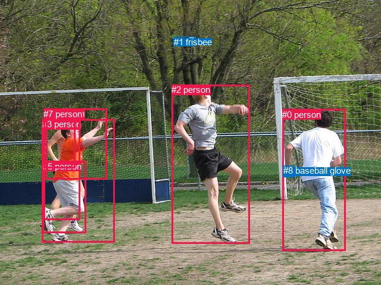
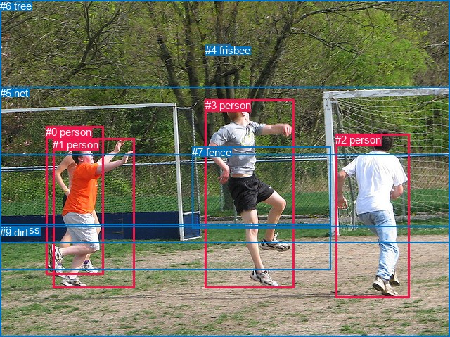

# 图片 1163：2368707.jpg

随机样本序号：135。图片 SHA256：`e46b9c2e8083aacc586872bdd7e609b3b3703f6fe47d32d1e5007372da5eddb7`。

红色框表示人，蓝色框表示其他物体。两个模式分别保留自身框编号，可依据位置比较对应对象。

## 自动检测框与输出

人的框编号：`[0, 2, 3, 4, 5, 6, 7]`。状态：`ok`。

### 自动检测全部物体框

| 编号 | 类别 | 是否为人 | 检测分数 | 像素坐标 xyxy |
|---|---|---|---|---|
| 0 | person | True | 0.9999 | 474.3, 183.9, 580.2, 421.4 |
| 1 | frisbee | False | 0.9998 | 291.6, 61.9, 327.9, 77.5 |
| 2 | person | True | 0.9998 | 288.3, 142.3, 419.1, 409.7 |
| 3 | person | True | 0.9998 | 70.7, 200.3, 192.8, 407.6 |
| 4 | person | True | 0.7490 | 73.6, 182.7, 134.6, 369.4 |
| 5 | person | True | 0.6589 | 72.0, 270.5, 144.6, 391.6 |
| 6 | person | True | 0.6146 | 77.3, 182.4, 179.5, 301.8 |
| 7 | person | True | 0.4992 | 73.3, 182.7, 126.3, 282.7 |
| 8 | baseball glove | False | 0.3727 | 475.9, 278.2, 494.6, 297.4 |

### 自动检测 Top50 人相关候选

评分物体对：72；人相关物体对：70；输出关系：50。

| 排名 | 主语编号与类别 | 关系 | 宾语编号与类别 | 类型 | 人与人 | 排序分数 | 原始融合 logit |
|---|---|---|---|---|---|---|---|
| 1 | #0 person | holding | #8 baseball glove | semantic | False | 0.99144 | 4.7522 |
| 2 | #2 person | catching | #1 frisbee | semantic | False | 0.98925 | 4.5223 |
| 3 | #3 person | wearing | #5 person | semantic | True | 0.98382 | 4.1077 |
| 4 | #4 person | wearing | #5 person | semantic | True | 0.96935 | 3.4540 |
| 5 | #3 person | playing | #1 frisbee | semantic | False | 0.96314 | 3.2632 |
| 6 | #0 person | playing | #1 frisbee | semantic | False | 0.96308 | 3.2615 |
| 7 | #4 person | playing | #1 frisbee | semantic | False | 0.95857 | 3.1415 |
| 8 | #4 person | wearing | #6 person | semantic | True | 0.92517 | 2.5148 |
| 9 | #3 person | in | #5 person | spatial | True | 0.90129 | 2.2116 |
| 10 | #2 person | throwing | #8 baseball glove | semantic | False | 0.90088 | 2.2070 |
| 11 | #6 person | catching | #1 frisbee | semantic | False | 0.89137 | 2.1048 |
| 12 | #3 person | wearing | #6 person | semantic | True | 0.88659 | 2.0564 |
| 13 | #4 person | in | #7 person | spatial | True | 0.88169 | 2.0085 |
| 14 | #4 person | in | #5 person | spatial | True | 0.85238 | 1.7534 |
| 15 | #4 person | wearing | #7 person | semantic | True | 0.84446 | 1.6918 |
| 16 | #1 frisbee | flying over | #2 person | semantic | False | 0.84370 | 1.6860 |
| 17 | #0 person | in | #8 baseball glove | spatial | False | 0.82726 | 1.5664 |
| 18 | #7 person | catching | #1 frisbee | semantic | False | 0.81638 | 1.4920 |
| 19 | #4 person | in | #6 person | spatial | True | 0.78939 | 1.3213 |
| 20 | #6 person | wearing | #5 person | semantic | True | 0.77036 | 1.2104 |
| 21 | #3 person | in | #6 person | spatial | True | 0.72097 | 0.9493 |
| 22 | #7 person | wearing | #5 person | semantic | True | 0.69120 | 0.8057 |
| 23 | #3 person | playing | #2 person | semantic | True | 0.68457 | 0.7749 |
| 24 | #0 person | looking at | #2 person | semantic | True | 0.67260 | 0.7200 |
| 25 | #4 person | playing | #2 person | semantic | True | 0.62699 | 0.5193 |
| 26 | #5 person | on | #3 person | spatial | True | 0.62106 | 0.4940 |
| 27 | #4 person | playing with | #3 person | semantic | True | 0.55586 | 0.2244 |
| 28 | #5 person | on | #4 person | spatial | True | 0.55118 | 0.2054 |
| 29 | #0 person | beside | #2 person | spatial | True | 0.54646 | 0.1864 |
| 30 | #7 person | wearing | #6 person | semantic | True | 0.49604 | -0.0159 |
| 31 | #2 person | in | #1 frisbee | spatial | False | 0.48648 | -0.0541 |
| 32 | #6 person | in | #7 person | spatial | True | 0.47589 | -0.0965 |
| 33 | #2 person | playing | #0 person | semantic | True | 0.46945 | -0.1223 |
| 34 | #3 person | playing | #7 person | semantic | True | 0.46455 | -0.1420 |
| 35 | #1 frisbee | over | #2 person | spatial | False | 0.46230 | -0.1511 |
| 36 | #8 baseball glove | on | #0 person | spatial | False | 0.45333 | -0.1872 |
| 37 | #0 person | wearing | #5 person | semantic | True | 0.45241 | -0.1909 |
| 38 | #2 person | wearing | #5 person | semantic | True | 0.43990 | -0.2416 |
| 39 | #2 person | playing | #3 person | semantic | True | 0.42994 | -0.2821 |
| 40 | #4 person | holding | #8 baseball glove | semantic | False | 0.41124 | -0.3589 |
| 41 | #3 person | in | #7 person | spatial | True | 0.38162 | -0.4827 |
| 42 | #3 person | wearing | #4 person | semantic | True | 0.37609 | -0.5062 |
| 43 | #3 person | holding | #8 baseball glove | semantic | False | 0.37341 | -0.5176 |
| 44 | #8 baseball glove | holding | #0 person | semantic | False | 0.36766 | -0.5423 |
| 45 | #7 person | in | #6 person | spatial | True | 0.36502 | -0.5537 |
| 46 | #6 person | holding | #7 person | semantic | True | 0.36099 | -0.5711 |
| 47 | #7 person | on | #4 person | spatial | True | 0.34448 | -0.6434 |
| 48 | #2 person | in | #8 baseball glove | spatial | False | 0.34321 | -0.6490 |
| 49 | #7 person | looking at | #2 person | semantic | True | 0.32236 | -0.7429 |
| 50 | #6 person | in | #5 person | spatial | True | 0.31295 | -0.7864 |

### 自动检测逐条人相关 GT 核验

R@50：0.00%；命中 0/7。

| GT 主语编号 | GT 关系 | GT 宾语编号 | 结果阶段 | 匹配预测主语编号 | 匹配预测宾语编号 |
|---|---|---|---|---|---|
| 0 | running on | 9 | endpoint_missing_or_wrong_class | [3, 4] | [] |
| 1 | looking at | 4 | wrong_predicate | [3] | [1] |
| 1 | running on | 9 | endpoint_missing_or_wrong_class | [3] | [] |
| 2 | running on | 9 | endpoint_missing_or_wrong_class | [0] | [] |
| 3 | looking at | 4 | wrong_predicate | [2] | [1] |
| 3 | throwing | 4 | wrong_predicate | [2] | [1] |
| 4 | over | 1 | rank_below50 | [1] | [3] |

## 真实框与输出

人的框编号：`[0, 1, 2, 3]`。

### 真实框全部物体框

| 编号 | 类别 | 是否为人 | 检测分数 | 像素坐标 xyxy |
|---|---|---|---|---|
| 0 | person | True | GT | 65.0, 179.0, 147.0, 390.0 |
| 1 | person | True | GT | 75.0, 197.0, 191.0, 410.0 |
| 2 | person | True | GT | 477.0, 190.0, 582.0, 423.0 |
| 3 | person | True | GT | 292.0, 141.0, 418.0, 410.0 |
| 4 | frisbee | False | GT | 292.0, 63.0, 327.0, 78.0 |
| 5 | net | False | GT | 0.0, 124.0, 640.0, 346.0 |
| 6 | tree | False | GT | 0.0, 0.0, 640.0, 221.0 |
| 7 | fence | False | GT | 273.0, 208.0, 470.0, 324.0 |
| 8 | grass | False | GT | 0.0, 318.0, 471.0, 383.0 |
| 9 | dirt | False | GT | 0.0, 322.0, 640.0, 479.0 |

### 真实框 Top50 人相关候选

评分物体对：90；人相关物体对：60；输出关系：50。

| 排名 | 主语编号与类别 | 关系 | 宾语编号与类别 | 类型 | 人与人 | 排序分数 | 原始融合 logit |
|---|---|---|---|---|---|---|---|
| 1 | #3 person | throwing | #4 frisbee | semantic | False | 0.99326 | 4.9926 |
| 2 | #1 person | catching | #4 frisbee | semantic | False | 0.98489 | 4.1771 |
| 3 | #0 person | catching | #4 frisbee | semantic | False | 0.98149 | 3.9709 |
| 4 | #2 person | playing | #4 frisbee | semantic | False | 0.97295 | 3.5825 |
| 5 | #0 person | running on | #9 dirt | semantic | False | 0.94980 | 2.9403 |
| 6 | #3 person | wearing | #7 fence | semantic | False | 0.94386 | 2.8221 |
| 7 | #2 person | on | #9 dirt | spatial | False | 0.94248 | 2.7964 |
| 8 | #1 person | running on | #9 dirt | semantic | False | 0.93552 | 2.6748 |
| 9 | #2 person | standing on | #9 dirt | semantic | False | 0.93493 | 2.6651 |
| 10 | #1 person | on | #9 dirt | spatial | False | 0.92997 | 2.5862 |
| 11 | #0 person | on | #9 dirt | spatial | False | 0.92098 | 2.4557 |
| 12 | #3 person | running on | #9 dirt | semantic | False | 0.91873 | 2.4252 |
| 13 | #3 person | on | #9 dirt | spatial | False | 0.91783 | 2.4133 |
| 14 | #3 person | playing | #5 net | semantic | False | 0.91353 | 2.3575 |
| 15 | #0 person | playing | #3 person | semantic | True | 0.91272 | 2.3473 |
| 16 | #1 person | playing | #3 person | semantic | True | 0.89652 | 2.1592 |
| 17 | #4 frisbee | flying over | #3 person | semantic | False | 0.89168 | 2.1080 |
| 18 | #3 person | in | #7 fence | spatial | False | 0.86542 | 1.8610 |
| 19 | #0 person | playing | #5 net | semantic | False | 0.84664 | 1.7085 |
| 20 | #1 person | playing | #5 net | semantic | False | 0.78488 | 1.2943 |
| 21 | #2 person | playing | #3 person | semantic | True | 0.78388 | 1.2884 |
| 22 | #3 person | playing | #2 person | semantic | True | 0.74035 | 1.0478 |
| 23 | #2 person | playing | #5 net | semantic | False | 0.70077 | 0.8510 |
| 24 | #3 person | playing | #0 person | semantic | True | 0.69254 | 0.8120 |
| 25 | #3 person | playing | #1 person | semantic | True | 0.67268 | 0.7203 |
| 26 | #0 person | playing with | #1 person | semantic | True | 0.64183 | 0.5833 |
| 27 | #0 person | on | #8 grass | spatial | False | 0.63082 | 0.5357 |
| 28 | #0 person | playing | #8 grass | semantic | False | 0.62970 | 0.5309 |
| 29 | #1 person | on | #8 grass | spatial | False | 0.62770 | 0.5224 |
| 30 | #2 person | beside | #3 person | spatial | True | 0.58682 | 0.3508 |
| 31 | #1 person | playing | #8 grass | semantic | False | 0.58073 | 0.3258 |
| 32 | #5 net | beside | #3 person | spatial | False | 0.57404 | 0.2984 |
| 33 | #3 person | in | #5 net | spatial | False | 0.57063 | 0.2844 |
| 34 | #2 person | in | #7 fence | spatial | False | 0.56761 | 0.2721 |
| 35 | #4 frisbee | over | #3 person | spatial | False | 0.56624 | 0.2665 |
| 36 | #2 person | wearing | #7 fence | semantic | False | 0.54462 | 0.1790 |
| 37 | #0 person | leaning on | #5 net | spatial | False | 0.49786 | -0.0086 |
| 38 | #2 person | beside | #5 net | spatial | False | 0.49780 | -0.0088 |
| 39 | #3 person | playing | #8 grass | semantic | False | 0.46989 | -0.1206 |
| 40 | #2 person | playing | #1 person | semantic | True | 0.44683 | -0.2135 |
| 41 | #3 person | on | #8 grass | spatial | False | 0.43496 | -0.2617 |
| 42 | #3 person | in | #4 frisbee | spatial | False | 0.41173 | -0.3568 |
| 43 | #1 person | leaning on | #5 net | spatial | False | 0.40029 | -0.4043 |
| 44 | #2 person | playing | #0 person | semantic | True | 0.38402 | -0.4725 |
| 45 | #0 person | playing | #2 person | semantic | True | 0.38208 | -0.4807 |
| 46 | #1 person | playing | #2 person | semantic | True | 0.36081 | -0.5719 |
| 47 | #5 net | beside | #2 person | spatial | False | 0.34158 | -0.6563 |
| 48 | #1 person | playing with | #0 person | semantic | True | 0.33952 | -0.6654 |
| 49 | #5 net | beside | #1 person | spatial | False | 0.33611 | -0.6807 |
| 50 | #5 net | beside | #0 person | spatial | False | 0.33332 | -0.6932 |

### 真实框逐条人相关 GT 核验

R@50：42.86%；命中 3/7。

| GT 主语编号 | GT 关系 | GT 宾语编号 | 结果阶段 | 匹配预测主语编号 | 匹配预测宾语编号 |
|---|---|---|---|---|---|
| 0 | running on | 9 | hit50 | [0] | [9] |
| 1 | looking at | 4 | wrong_predicate | [1] | [4] |
| 1 | running on | 9 | hit50 | [1] | [9] |
| 2 | running on | 9 | wrong_predicate | [2] | [9] |
| 3 | looking at | 4 | wrong_predicate | [3] | [4] |
| 3 | throwing | 4 | hit50 | [3] | [4] |
| 4 | over | 1 | rank_below50 | [4] | [1] |

## 全部人相关 GT

| 主语编号与类别 | 关系 | 宾语编号与类别 |
|---|---|---|
| #0 person | running on | #9 dirt |
| #1 person | looking at | #4 frisbee |
| #1 person | running on | #9 dirt |
| #2 person | running on | #9 dirt |
| #3 person | looking at | #4 frisbee |
| #3 person | throwing | #4 frisbee |
| #4 frisbee | over | #1 person |

原始记录、全部人相关物体对的两项预测与分项分数见 [逐图证据 JSON](../evidence/cases/1163.json)。全部56类 logits 保留于本机 HOR/output/random500/logits/。

<!-- HOR_COMPLETE_RESULTS -->

## 六组条件的完整输出对照

以下保留同一图片三种框与候选模式、两种谓词输出规则的全部 Top50。框编号各自在所属模式内解释。

### 自动检测框完整枚举：空间与语义各保留一个谓词

| 排名 | 主语编号与类别 | 谓词 | 宾语编号与类别 | 分组 | 排序分数 | predicate logit | pair logit |
|---|---|---|---|---|---|---|---|
| 1 | #0 person | holding | #8 baseball glove | semantic | 0.9914412 | 4.5605559 | 0.1916402 |
| 2 | #2 person | catching | #1 frisbee | semantic | 0.9892530 | 4.0162206 | 0.5061053 |
| 3 | #3 person | wearing | #5 person | semantic | 0.9838200 | 3.8259368 | 0.2817304 |
| 4 | #4 person | wearing | #5 person | semantic | 0.9693489 | 3.2930231 | 0.1609356 |
| 5 | #3 person | playing | #1 frisbee | semantic | 0.9631433 | 2.9222131 | 0.3409553 |
| 6 | #0 person | playing | #1 frisbee | semantic | 0.9630834 | 3.0474248 | 0.2140551 |
| 7 | #4 person | playing | #1 frisbee | semantic | 0.9585720 | 2.8474879 | 0.2939987 |
| 8 | #4 person | wearing | #6 person | semantic | 0.9251706 | 2.8217959 | -0.3070287 |
| 9 | #3 person | in | #5 person | spatial | 0.9012878 | 1.9298859 | 0.2817304 |
| 10 | #2 person | throwing | #8 baseball glove | semantic | 0.9008786 | 2.4133739 | -0.2063483 |
| 11 | #6 person | catching | #1 frisbee | semantic | 0.8913661 | 2.1626410 | -0.0578692 |
| 12 | #3 person | wearing | #6 person | semantic | 0.8865911 | 2.3814111 | -0.3250268 |
| 13 | #4 person | in | #7 person | spatial | 0.8816887 | 2.3221645 | -0.3136456 |
| 14 | #4 person | in | #5 person | spatial | 0.8523815 | 1.5924668 | 0.1609356 |
| 15 | #4 person | wearing | #7 person | semantic | 0.8444584 | 2.0054274 | -0.3136456 |
| 16 | #1 frisbee | flying over | #2 person | semantic | 0.8437026 | 2.4884524 | -0.8024129 |
| 17 | #0 person | in | #8 baseball glove | spatial | 0.8272648 | 1.3747253 | 0.1916402 |
| 18 | #7 person | catching | #1 frisbee | semantic | 0.8163757 | 1.6708565 | -0.1788739 |
| 19 | #4 person | in | #6 person | spatial | 0.7893941 | 1.6283054 | -0.3070287 |
| 20 | #6 person | wearing | #5 person | semantic | 0.7703637 | 1.6224370 | -0.4120705 |
| 21 | #3 person | in | #6 person | spatial | 0.7209676 | 1.2742929 | -0.3250268 |
| 22 | #7 person | wearing | #5 person | semantic | 0.6911985 | 1.4463267 | -0.6405985 |
| 23 | #3 person | playing | #2 person | semantic | 0.6845729 | 1.3267341 | -0.5518667 |
| 24 | #0 person | looking at | #2 person | semantic | 0.6726040 | 1.2107739 | -0.4907875 |
| 25 | #4 person | playing | #2 person | semantic | 0.6269948 | 1.0908518 | -0.5715058 |
| 26 | #5 person | on | #3 person | spatial | 0.6210587 | 1.2917337 | -0.7976892 |
| 27 | #4 person | playing with | #3 person | semantic | 0.5558604 | 1.0474119 | -0.8230336 |
| 28 | #5 person | on | #4 person | spatial | 0.5511757 | 1.0618930 | -0.8564711 |
| 29 | #0 person | beside | #2 person | spatial | 0.5464583 | 0.6771584 | -0.4907875 |
| 30 | #7 person | wearing | #6 person | semantic | 0.4960374 | 0.3898344 | -0.4056849 |
| 31 | #2 person | in | #1 frisbee | spatial | 0.4864794 | -0.5602007 | 0.5061053 |
| 32 | #6 person | in | #7 person | spatial | 0.4758878 | 0.3761897 | -0.4727134 |
| 33 | #2 person | playing | #0 person | semantic | 0.4694518 | 0.9517393 | -1.0740844 |
| 34 | #3 person | playing | #7 person | semantic | 0.4645520 | 0.2429047 | -0.3849349 |
| 35 | #1 frisbee | over | #2 person | spatial | 0.4623035 | 0.6513400 | -0.8024129 |
| 36 | #8 baseball glove | on | #0 person | spatial | 0.4533347 | 0.6428752 | -0.8300813 |
| 37 | #0 person | wearing | #5 person | semantic | 0.4524106 | 0.6117492 | -0.8026848 |
| 38 | #2 person | wearing | #5 person | semantic | 0.4398984 | 0.7652121 | -1.0067865 |
| 39 | #2 person | playing | #3 person | semantic | 0.4299415 | 0.6703987 | -0.9524884 |
| 40 | #4 person | holding | #8 baseball glove | semantic | 0.4112365 | 0.3185782 | -0.6774344 |
| 41 | #3 person | in | #7 person | spatial | 0.3816202 | -0.0977421 | -0.3849349 |
| 42 | #3 person | wearing | #4 person | semantic | 0.3760859 | 0.4060802 | -0.9122753 |
| 43 | #3 person | holding | #8 baseball glove | semantic | 0.3734145 | 0.2519379 | -0.7695342 |
| 44 | #8 baseball glove | holding | #0 person | semantic | 0.3676589 | 0.2878079 | -0.8300813 |
| 45 | #7 person | in | #6 person | spatial | 0.3650171 | -0.1479688 | -0.4056849 |
| 46 | #6 person | holding | #7 person | semantic | 0.3609896 | -0.0983582 | -0.4727134 |
| 47 | #7 person | on | #4 person | spatial | 0.3444777 | 0.1224613 | -0.7658645 |
| 48 | #2 person | in | #8 baseball glove | spatial | 0.3432065 | -0.4426889 | -0.2063483 |
| 49 | #7 person | looking at | #2 person | semantic | 0.3223599 | -0.0351696 | -0.7077780 |
| 50 | #6 person | in | #5 person | spatial | 0.3129461 | -0.3743110 | -0.4120705 |

GT 命中：0/7，R@50=0.00%。

| GT主语 | GT谓词 | GT宾语 | 结果阶段 | 匹配主语框 | 匹配宾语框 |
|---|---|---|---|---|---|
| 0 | running on | 9 | endpoint_missing_or_wrong_class | [3, 4] | [] |
| 1 | looking at | 4 | wrong_predicate | [3] | [1] |
| 1 | running on | 9 | endpoint_missing_or_wrong_class | [3] | [] |
| 2 | running on | 9 | endpoint_missing_or_wrong_class | [0] | [] |
| 3 | looking at | 4 | wrong_predicate | [2] | [1] |
| 3 | throwing | 4 | wrong_predicate | [2] | [1] |
| 4 | over | 1 | rank_below50 | [1] | [3] |

### 自动检测框完整枚举：每对只保留一个谓词

| 排名 | 主语编号与类别 | 谓词 | 宾语编号与类别 | 分组 | 排序分数 | predicate logit | pair logit |
|---|---|---|---|---|---|---|---|
| 1 | #0 person | holding | #8 baseball glove | single | 0.9914412 | 4.5605559 | 0.1916402 |
| 2 | #2 person | catching | #1 frisbee | single | 0.9892530 | 4.0162206 | 0.5061053 |
| 3 | #3 person | wearing | #5 person | single | 0.9838200 | 3.8259368 | 0.2817304 |
| 4 | #4 person | wearing | #5 person | single | 0.9693489 | 3.2930231 | 0.1609356 |
| 5 | #3 person | playing | #1 frisbee | single | 0.9631433 | 2.9222131 | 0.3409553 |
| 6 | #0 person | playing | #1 frisbee | single | 0.9630834 | 3.0474248 | 0.2140551 |
| 7 | #4 person | playing | #1 frisbee | single | 0.9585720 | 2.8474879 | 0.2939987 |
| 8 | #4 person | wearing | #6 person | single | 0.9251706 | 2.8217959 | -0.3070287 |
| 9 | #2 person | throwing | #8 baseball glove | single | 0.9008786 | 2.4133739 | -0.2063483 |
| 10 | #6 person | catching | #1 frisbee | single | 0.8913661 | 2.1626410 | -0.0578692 |
| 11 | #3 person | wearing | #6 person | single | 0.8865911 | 2.3814111 | -0.3250268 |
| 12 | #4 person | in | #7 person | single | 0.8816887 | 2.3221645 | -0.3136456 |
| 13 | #1 frisbee | flying over | #2 person | single | 0.8437026 | 2.4884524 | -0.8024129 |
| 14 | #7 person | catching | #1 frisbee | single | 0.8163757 | 1.6708565 | -0.1788739 |
| 15 | #6 person | wearing | #5 person | single | 0.7703637 | 1.6224370 | -0.4120705 |
| 16 | #7 person | wearing | #5 person | single | 0.6911985 | 1.4463267 | -0.6405985 |
| 17 | #3 person | playing | #2 person | single | 0.6845729 | 1.3267341 | -0.5518667 |
| 18 | #0 person | looking at | #2 person | single | 0.6726040 | 1.2107739 | -0.4907875 |
| 19 | #4 person | playing | #2 person | single | 0.6269948 | 1.0908518 | -0.5715058 |
| 20 | #5 person | on | #3 person | single | 0.6210587 | 1.2917337 | -0.7976892 |
| 21 | #4 person | playing with | #3 person | single | 0.5558604 | 1.0474119 | -0.8230336 |
| 22 | #5 person | on | #4 person | single | 0.5511757 | 1.0618930 | -0.8564711 |
| 23 | #7 person | wearing | #6 person | single | 0.4960374 | 0.3898344 | -0.4056849 |
| 24 | #6 person | in | #7 person | single | 0.4758878 | 0.3761897 | -0.4727134 |
| 25 | #2 person | playing | #0 person | single | 0.4694518 | 0.9517393 | -1.0740844 |
| 26 | #3 person | playing | #7 person | single | 0.4645520 | 0.2429047 | -0.3849349 |
| 27 | #8 baseball glove | on | #0 person | single | 0.4533347 | 0.6428752 | -0.8300813 |
| 28 | #0 person | wearing | #5 person | single | 0.4524106 | 0.6117492 | -0.8026848 |
| 29 | #2 person | wearing | #5 person | single | 0.4398984 | 0.7652121 | -1.0067865 |
| 30 | #2 person | playing | #3 person | single | 0.4299415 | 0.6703987 | -0.9524884 |
| 31 | #4 person | holding | #8 baseball glove | single | 0.4112365 | 0.3185782 | -0.6774344 |
| 32 | #3 person | wearing | #4 person | single | 0.3760859 | 0.4060802 | -0.9122753 |
| 33 | #3 person | holding | #8 baseball glove | single | 0.3734145 | 0.2519379 | -0.7695342 |
| 34 | #7 person | on | #4 person | single | 0.3444777 | 0.1224613 | -0.7658645 |
| 35 | #7 person | looking at | #2 person | single | 0.3223599 | -0.0351696 | -0.7077780 |
| 36 | #2 person | playing | #4 person | single | 0.3109375 | 0.2572165 | -1.0529566 |
| 37 | #7 person | holding | #8 baseball glove | single | 0.2991028 | -0.3782434 | -0.4733304 |
| 38 | #5 person | on | #6 person | single | 0.2742244 | 0.0889235 | -1.0622176 |
| 39 | #5 person | on | #7 person | single | 0.2500766 | 0.1330614 | -1.2312651 |
| 40 | #6 person | holding | #8 baseball glove | single | 0.2195906 | -0.4986858 | -0.7693680 |
| 41 | #0 person | playing | #3 person | single | 0.2161088 | -0.4037848 | -0.8847035 |
| 42 | #6 person | looking at | #2 person | single | 0.1893938 | -0.6069031 | -0.8470511 |
| 43 | #1 frisbee | flying over | #3 person | single | 0.1873929 | 0.0819826 | -1.5490229 |
| 44 | #2 person | wearing | #6 person | single | 0.1703274 | -0.5692539 | -1.0140545 |
| 45 | #6 person | on | #3 person | single | 0.1596877 | -0.7762794 | -0.8842737 |
| 46 | #1 frisbee | flying over | #4 person | single | 0.1411327 | -0.1585021 | -1.6474115 |
| 47 | #1 frisbee | flying over | #0 person | single | 0.1366478 | -0.1591620 | -1.6842539 |
| 48 | #6 person | on | #4 person | single | 0.1047865 | -1.2063034 | -0.9388338 |
| 49 | #0 person | playing | #4 person | single | 0.1026894 | -1.2169335 | -0.9507592 |
| 50 | #3 person | playing | #0 person | single | 0.1004853 | -0.9571345 | -1.2347100 |

GT 命中：0/7，R@50=0.00%。

| GT主语 | GT谓词 | GT宾语 | 结果阶段 | 匹配主语框 | 匹配宾语框 |
|---|---|---|---|---|---|
| 0 | running on | 9 | endpoint_missing_or_wrong_class | [3, 4] | [] |
| 1 | looking at | 4 | wrong_predicate | [3] | [1] |
| 1 | running on | 9 | endpoint_missing_or_wrong_class | [3] | [] |
| 2 | running on | 9 | endpoint_missing_or_wrong_class | [0] | [] |
| 3 | looking at | 4 | wrong_predicate | [2] | [1] |
| 3 | throwing | 4 | wrong_predicate | [2] | [1] |
| 4 | over | 1 | wrong_predicate | [1] | [3] |

### 真实框完整枚举：空间与语义各保留一个谓词

| 排名 | 主语编号与类别 | 谓词 | 宾语编号与类别 | 分组 | 排序分数 | predicate logit | pair logit |
|---|---|---|---|---|---|---|---|
| 1 | #3 person | throwing | #4 frisbee | semantic | 0.9932578 | 4.4814258 | 0.5111642 |
| 2 | #1 person | catching | #4 frisbee | semantic | 0.9848888 | 3.8387437 | 0.3383486 |
| 3 | #0 person | catching | #4 frisbee | semantic | 0.9814917 | 3.6661029 | 0.3047483 |
| 4 | #2 person | playing | #4 frisbee | semantic | 0.9729465 | 3.4008374 | 0.1816766 |
| 5 | #0 person | running on | #9 dirt | semantic | 0.9498017 | 3.0194864 | -0.0792139 |
| 6 | #3 person | wearing | #7 fence | semantic | 0.9438598 | 3.0213046 | -0.1991781 |
| 7 | #2 person | on | #9 dirt | spatial | 0.9424820 | 2.8742609 | -0.0778421 |
| 8 | #1 person | running on | #9 dirt | semantic | 0.9355206 | 2.6782331 | -0.0034745 |
| 9 | #2 person | standing on | #9 dirt | semantic | 0.9349337 | 2.7429113 | -0.0778421 |
| 10 | #1 person | on | #9 dirt | spatial | 0.9299686 | 2.5896821 | -0.0034745 |
| 11 | #0 person | on | #9 dirt | spatial | 0.9209795 | 2.5349445 | -0.0792139 |
| 12 | #3 person | running on | #9 dirt | semantic | 0.9187310 | 2.7443686 | -0.3191409 |
| 13 | #3 person | on | #9 dirt | spatial | 0.9178332 | 2.7324057 | -0.3191409 |
| 14 | #3 person | playing | #5 net | semantic | 0.9135313 | 3.0380940 | -0.6805587 |
| 15 | #0 person | playing | #3 person | semantic | 0.9127163 | 2.8761120 | -0.5288503 |
| 16 | #1 person | playing | #3 person | semantic | 0.8965232 | 2.7101073 | -0.5509308 |
| 17 | #4 frisbee | flying over | #3 person | semantic | 0.8916795 | 2.9104671 | -0.8024543 |
| 18 | #3 person | in | #7 fence | spatial | 0.8654168 | 2.0602069 | -0.1991781 |
| 19 | #0 person | playing | #5 net | semantic | 0.8466405 | 2.1727190 | -0.4642279 |
| 20 | #1 person | playing | #5 net | semantic | 0.7848805 | 1.8314261 | -0.5370886 |
| 21 | #2 person | playing | #3 person | semantic | 0.7838793 | 1.8003292 | -0.5119115 |
| 22 | #3 person | playing | #2 person | semantic | 0.7403489 | 2.0925522 | -1.0447693 |
| 23 | #2 person | playing | #5 net | semantic | 0.7007747 | 1.4216738 | -0.5706841 |
| 24 | #3 person | playing | #0 person | semantic | 0.6925361 | 1.8237429 | -1.0117406 |
| 25 | #3 person | playing | #1 person | semantic | 0.6726802 | 1.6708627 | -0.9505302 |
| 26 | #0 person | playing with | #1 person | semantic | 0.6418347 | 1.3989844 | -0.8156480 |
| 27 | #0 person | on | #8 grass | spatial | 0.6308231 | 1.1934371 | -0.6576875 |
| 28 | #0 person | playing | #8 grass | semantic | 0.6297023 | 1.1886272 | -0.6576875 |
| 29 | #1 person | on | #8 grass | spatial | 0.6277027 | 1.1822581 | -0.6598844 |
| 30 | #2 person | beside | #3 person | spatial | 0.5868176 | 0.8627362 | -0.5119115 |
| 31 | #1 person | playing | #8 grass | semantic | 0.5807341 | 0.9856720 | -0.6598844 |
| 32 | #5 net | beside | #3 person | spatial | 0.5740422 | 0.7121072 | -0.4137445 |
| 33 | #3 person | in | #5 net | spatial | 0.5706305 | 0.9649825 | -0.6805587 |
| 34 | #2 person | in | #7 fence | spatial | 0.5676100 | 0.7098646 | -0.4377583 |
| 35 | #4 frisbee | over | #3 person | spatial | 0.5662366 | 1.0689669 | -0.8024543 |
| 36 | #2 person | wearing | #7 fence | semantic | 0.5446213 | 0.6167197 | -0.4377583 |
| 37 | #0 person | leaning on | #5 net | spatial | 0.4978580 | 0.4556599 | -0.4642279 |
| 38 | #2 person | beside | #5 net | spatial | 0.4977993 | 0.5618815 | -0.5706841 |
| 39 | #3 person | playing | #8 grass | semantic | 0.4698864 | 0.9759769 | -1.0965772 |
| 40 | #2 person | playing | #1 person | semantic | 0.4468307 | 0.6928062 | -0.9062904 |
| 41 | #3 person | on | #8 grass | spatial | 0.4349563 | 0.8349199 | -1.0965772 |
| 42 | #3 person | in | #4 frisbee | spatial | 0.4117322 | -0.8679733 | 0.5111642 |
| 43 | #1 person | leaning on | #5 net | spatial | 0.4002857 | 0.1328139 | -0.5370886 |
| 44 | #2 person | playing | #0 person | semantic | 0.3840170 | 0.4718790 | -0.9444118 |
| 45 | #0 person | playing | #2 person | semantic | 0.3820766 | 0.7350168 | -1.2157601 |
| 46 | #1 person | playing | #2 person | semantic | 0.3608082 | 0.6699862 | -1.2418444 |
| 47 | #5 net | beside | #2 person | spatial | 0.3415801 | 0.1395636 | -0.7958245 |
| 48 | #1 person | playing with | #0 person | semantic | 0.3395225 | 0.3377318 | -1.0031549 |
| 49 | #5 net | beside | #1 person | spatial | 0.3361070 | -0.0715957 | -0.6090958 |
| 50 | #5 net | beside | #0 person | spatial | 0.3333218 | -0.1016870 | -0.5915121 |

GT 命中：3/7，R@50=42.86%。

| GT主语 | GT谓词 | GT宾语 | 结果阶段 | 匹配主语框 | 匹配宾语框 |
|---|---|---|---|---|---|
| 0 | running on | 9 | hit50 | [0] | [9] |
| 1 | looking at | 4 | wrong_predicate | [1] | [4] |
| 1 | running on | 9 | hit50 | [1] | [9] |
| 2 | running on | 9 | wrong_predicate | [2] | [9] |
| 3 | looking at | 4 | wrong_predicate | [3] | [4] |
| 3 | throwing | 4 | hit50 | [3] | [4] |
| 4 | over | 1 | rank_below50 | [4] | [1] |

### 真实框完整枚举：每对只保留一个谓词

| 排名 | 主语编号与类别 | 谓词 | 宾语编号与类别 | 分组 | 排序分数 | predicate logit | pair logit |
|---|---|---|---|---|---|---|---|
| 1 | #3 person | throwing | #4 frisbee | single | 0.9932578 | 4.4814258 | 0.5111642 |
| 2 | #1 person | catching | #4 frisbee | single | 0.9848888 | 3.8387437 | 0.3383486 |
| 3 | #0 person | catching | #4 frisbee | single | 0.9814917 | 3.6661029 | 0.3047483 |
| 4 | #2 person | playing | #4 frisbee | single | 0.9729465 | 3.4008374 | 0.1816766 |
| 5 | #0 person | running on | #9 dirt | single | 0.9498017 | 3.0194864 | -0.0792139 |
| 6 | #3 person | wearing | #7 fence | single | 0.9438598 | 3.0213046 | -0.1991781 |
| 7 | #2 person | on | #9 dirt | single | 0.9424820 | 2.8742609 | -0.0778421 |
| 8 | #1 person | running on | #9 dirt | single | 0.9355206 | 2.6782331 | -0.0034745 |
| 9 | #3 person | running on | #9 dirt | single | 0.9187310 | 2.7443686 | -0.3191409 |
| 10 | #3 person | playing | #5 net | single | 0.9135313 | 3.0380940 | -0.6805587 |
| 11 | #0 person | playing | #3 person | single | 0.9127163 | 2.8761120 | -0.5288503 |
| 12 | #1 person | playing | #3 person | single | 0.8965232 | 2.7101073 | -0.5509308 |
| 13 | #4 frisbee | flying over | #3 person | single | 0.8916795 | 2.9104671 | -0.8024543 |
| 14 | #0 person | playing | #5 net | single | 0.8466405 | 2.1727190 | -0.4642279 |
| 15 | #1 person | playing | #5 net | single | 0.7848805 | 1.8314261 | -0.5370886 |
| 16 | #2 person | playing | #3 person | single | 0.7838793 | 1.8003292 | -0.5119115 |
| 17 | #3 person | playing | #2 person | single | 0.7403489 | 2.0925522 | -1.0447693 |
| 18 | #2 person | playing | #5 net | single | 0.7007747 | 1.4216738 | -0.5706841 |
| 19 | #3 person | playing | #0 person | single | 0.6925361 | 1.8237429 | -1.0117406 |
| 20 | #3 person | playing | #1 person | single | 0.6726802 | 1.6708627 | -0.9505302 |
| 21 | #0 person | playing with | #1 person | single | 0.6418347 | 1.3989844 | -0.8156480 |
| 22 | #0 person | on | #8 grass | single | 0.6308231 | 1.1934371 | -0.6576875 |
| 23 | #1 person | on | #8 grass | single | 0.6277027 | 1.1822581 | -0.6598844 |
| 24 | #5 net | beside | #3 person | single | 0.5740422 | 0.7121072 | -0.4137445 |
| 25 | #2 person | in | #7 fence | single | 0.5676100 | 0.7098646 | -0.4377583 |
| 26 | #3 person | playing | #8 grass | single | 0.4698864 | 0.9759769 | -1.0965772 |
| 27 | #2 person | playing | #1 person | single | 0.4468307 | 0.6928062 | -0.9062904 |
| 28 | #2 person | playing | #0 person | single | 0.3840170 | 0.4718790 | -0.9444118 |
| 29 | #0 person | playing | #2 person | single | 0.3820766 | 0.7350168 | -1.2157601 |
| 30 | #1 person | playing | #2 person | single | 0.3608082 | 0.6699862 | -1.2418444 |
| 31 | #5 net | beside | #2 person | single | 0.3415801 | 0.1395636 | -0.7958245 |
| 32 | #1 person | playing with | #0 person | single | 0.3395225 | 0.3377318 | -1.0031549 |
| 33 | #5 net | beside | #1 person | single | 0.3361070 | -0.0715957 | -0.6090958 |
| 34 | #5 net | beside | #0 person | single | 0.3333218 | -0.1016870 | -0.5915121 |
| 35 | #4 frisbee | flying over | #0 person | single | 0.2584626 | 0.5645480 | -1.6185226 |
| 36 | #4 frisbee | flying over | #1 person | single | 0.2463118 | 0.4141226 | -1.5325029 |
| 37 | #7 fence | beside | #3 person | single | 0.2204386 | -0.5851417 | -0.6779705 |
| 38 | #3 person | playing | #6 tree | single | 0.2099006 | -0.2549281 | -1.0705967 |
| 39 | #0 person | playing | #7 fence | single | 0.2057497 | -0.4124746 | -0.9382639 |
| 40 | #2 person | on | #8 grass | single | 0.1689542 | -0.7620015 | -0.8310560 |
| 41 | #4 frisbee | flying over | #2 person | single | 0.1545416 | 0.0223832 | -1.7217985 |
| 42 | #1 person | playing | #7 fence | single | 0.1540943 | -0.6853070 | -1.0175364 |
| 43 | #2 person | in | #6 tree | single | 0.1107684 | -0.8281686 | -1.2547477 |
| 44 | #8 grass | beside | #1 person | single | 0.1100278 | -1.0364959 | -1.0539613 |
| 45 | #0 person | playing | #6 tree | single | 0.0919639 | -1.0664771 | -1.2234107 |
| 46 | #8 grass | beside | #0 person | single | 0.0910349 | -1.3062909 | -0.9947730 |
| 47 | #8 grass | beside | #3 person | single | 0.0713538 | -1.5935240 | -0.9725525 |
| 48 | #9 dirt | in | #3 person | single | 0.0698810 | -1.5487700 | -1.0397484 |
| 49 | #1 person | playing | #6 tree | single | 0.0650701 | -1.3509259 | -1.3140807 |
| 50 | #9 dirt | in | #1 person | single | 0.0648646 | -1.5166855 | -1.1517038 |

GT 命中：3/7，R@50=42.86%。

| GT主语 | GT谓词 | GT宾语 | 结果阶段 | 匹配主语框 | 匹配宾语框 |
|---|---|---|---|---|---|
| 0 | running on | 9 | hit50 | [0] | [9] |
| 1 | looking at | 4 | wrong_predicate | [1] | [4] |
| 1 | running on | 9 | hit50 | [1] | [9] |
| 2 | running on | 9 | wrong_predicate | [2] | [9] |
| 3 | looking at | 4 | wrong_predicate | [3] | [4] |
| 3 | throwing | 4 | hit50 | [3] | [4] |
| 4 | over | 1 | wrong_predicate | [4] | [1] |

### 真实框400候选：空间与语义各保留一个谓词

| 排名 | 主语编号与类别 | 谓词 | 宾语编号与类别 | 分组 | 排序分数 | predicate logit | pair logit |
|---|---|---|---|---|---|---|---|
| 1 | #3 person | throwing | #4 frisbee | semantic | 0.9932566 | 4.4812560 | 0.5111642 |
| 2 | #1 person | catching | #4 frisbee | semantic | 0.9848888 | 3.8387437 | 0.3383486 |
| 3 | #0 person | catching | #4 frisbee | semantic | 0.9814917 | 3.6661029 | 0.3047483 |
| 4 | #2 person | playing | #4 frisbee | semantic | 0.9728186 | 3.3959899 | 0.1816766 |
| 5 | #0 person | running on | #9 dirt | semantic | 0.9498017 | 3.0194864 | -0.0792139 |
| 6 | #3 person | wearing | #7 fence | semantic | 0.9438598 | 3.0213046 | -0.1991781 |
| 7 | #2 person | on | #9 dirt | spatial | 0.9427764 | 2.8797054 | -0.0778421 |
| 8 | #1 person | running on | #9 dirt | semantic | 0.9371955 | 2.7063398 | -0.0034745 |
| 9 | #2 person | standing on | #9 dirt | semantic | 0.9353791 | 2.7502556 | -0.0778421 |
| 10 | #1 person | on | #9 dirt | spatial | 0.9299686 | 2.5896821 | -0.0034745 |
| 11 | #0 person | on | #9 dirt | spatial | 0.9205824 | 2.5295000 | -0.0792139 |
| 12 | #3 person | running on | #9 dirt | semantic | 0.9187310 | 2.7443686 | -0.3191409 |
| 13 | #3 person | on | #9 dirt | spatial | 0.9178332 | 2.7324057 | -0.3191409 |
| 14 | #3 person | playing | #5 net | semantic | 0.9135313 | 3.0380940 | -0.6805587 |
| 15 | #0 person | playing | #3 person | semantic | 0.9127163 | 2.8761120 | -0.5288503 |
| 16 | #1 person | playing | #3 person | semantic | 0.8962981 | 2.7076836 | -0.5509308 |
| 17 | #4 frisbee | flying over | #3 person | semantic | 0.8887448 | 2.8804374 | -0.8024543 |
| 18 | #3 person | in | #7 fence | spatial | 0.8626617 | 2.0367532 | -0.1991781 |
| 19 | #0 person | playing | #5 net | semantic | 0.8463255 | 2.1702952 | -0.4642279 |
| 20 | #1 person | playing | #5 net | semantic | 0.7887084 | 1.8542461 | -0.5370886 |
| 21 | #2 person | playing | #3 person | semantic | 0.7787379 | 1.7702379 | -0.5119115 |
| 22 | #3 person | playing | #2 person | semantic | 0.7354669 | 2.0673084 | -1.0447693 |
| 23 | #2 person | playing | #5 net | semantic | 0.7002662 | 1.4192500 | -0.5706841 |
| 24 | #3 person | playing | #0 person | semantic | 0.6920197 | 1.8213191 | -1.0117406 |
| 25 | #3 person | playing | #1 person | semantic | 0.6721463 | 1.6684389 | -0.9505302 |
| 26 | #0 person | playing | #8 grass | semantic | 0.6297023 | 1.1886272 | -0.6576875 |
| 27 | #0 person | playing with | #1 person | semantic | 0.6278849 | 1.3388019 | -0.8156480 |
| 28 | #1 person | on | #8 grass | spatial | 0.6238775 | 1.1659236 | -0.6598844 |
| 29 | #0 person | on | #8 grass | spatial | 0.6192714 | 1.1441445 | -0.6576875 |
| 30 | #2 person | beside | #3 person | spatial | 0.5795171 | 0.8327031 | -0.5119115 |
| 31 | #1 person | playing | #8 grass | semantic | 0.5745755 | 0.9604287 | -0.6598844 |
| 32 | #3 person | in | #5 net | spatial | 0.5710370 | 0.9666419 | -0.6805587 |
| 33 | #2 person | in | #7 fence | spatial | 0.5684243 | 0.7131834 | -0.4377583 |
| 34 | #5 net | beside | #3 person | spatial | 0.5666826 | 0.6820736 | -0.4137445 |
| 35 | #4 frisbee | over | #3 person | spatial | 0.5649373 | 1.0636787 | -0.8024543 |
| 36 | #2 person | wearing | #7 fence | semantic | 0.5506222 | 0.6409431 | -0.4377583 |
| 37 | #0 person | leaning on | #5 net | spatial | 0.4905218 | 0.4263105 | -0.4642279 |
| 38 | #2 person | beside | #5 net | spatial | 0.4902923 | 0.5318484 | -0.5706841 |
| 39 | #3 person | playing | #8 grass | semantic | 0.4636036 | 0.9507337 | -1.0965772 |
| 40 | #2 person | playing | #1 person | semantic | 0.4468307 | 0.6928062 | -0.9062904 |
| 41 | #3 person | on | #8 grass | spatial | 0.4336186 | 0.8294749 | -1.0965772 |
| 42 | #3 person | in | #4 frisbee | spatial | 0.4117322 | -0.8679733 | 0.5111642 |
| 43 | #1 person | leaning on | #5 net | spatial | 0.3933792 | 0.1039586 | -0.5370886 |
| 44 | #0 person | playing | #2 person | semantic | 0.3815044 | 0.7325926 | -1.2157601 |
| 45 | #2 person | playing | #0 person | semantic | 0.3727127 | 0.4238148 | -0.9444118 |
| 46 | #1 person | playing | #2 person | semantic | 0.3666503 | 0.6952300 | -1.2418444 |
| 47 | #1 person | playing with | #0 person | semantic | 0.3392976 | 0.3367290 | -1.0031549 |
| 48 | #5 net | beside | #1 person | spatial | 0.3361070 | -0.0715957 | -0.6090958 |
| 49 | #5 net | beside | #2 person | spatial | 0.3348321 | 0.1094141 | -0.7958245 |
| 50 | #5 net | beside | #0 person | spatial | 0.3266942 | -0.1316628 | -0.5915121 |

GT 命中：3/7，R@50=42.86%。

| GT主语 | GT谓词 | GT宾语 | 结果阶段 | 匹配主语框 | 匹配宾语框 |
|---|---|---|---|---|---|
| 0 | running on | 9 | hit50 | [0] | [9] |
| 1 | looking at | 4 | wrong_predicate | [1] | [4] |
| 1 | running on | 9 | hit50 | [1] | [9] |
| 2 | running on | 9 | wrong_predicate | [2] | [9] |
| 3 | looking at | 4 | wrong_predicate | [3] | [4] |
| 3 | throwing | 4 | hit50 | [3] | [4] |
| 4 | over | 1 | rank_below50 | [4] | [1] |

### 真实框400候选：每对只保留一个谓词

| 排名 | 主语编号与类别 | 谓词 | 宾语编号与类别 | 分组 | 排序分数 | predicate logit | pair logit |
|---|---|---|---|---|---|---|---|
| 1 | #3 person | throwing | #4 frisbee | single | 0.9932566 | 4.4812560 | 0.5111642 |
| 2 | #1 person | catching | #4 frisbee | single | 0.9848888 | 3.8387437 | 0.3383486 |
| 3 | #0 person | catching | #4 frisbee | single | 0.9814917 | 3.6661029 | 0.3047483 |
| 4 | #2 person | playing | #4 frisbee | single | 0.9728186 | 3.3959899 | 0.1816766 |
| 5 | #0 person | running on | #9 dirt | single | 0.9498017 | 3.0194864 | -0.0792139 |
| 6 | #3 person | wearing | #7 fence | single | 0.9438598 | 3.0213046 | -0.1991781 |
| 7 | #2 person | on | #9 dirt | single | 0.9427764 | 2.8797054 | -0.0778421 |
| 8 | #1 person | running on | #9 dirt | single | 0.9371955 | 2.7063398 | -0.0034745 |
| 9 | #3 person | running on | #9 dirt | single | 0.9187310 | 2.7443686 | -0.3191409 |
| 10 | #3 person | playing | #5 net | single | 0.9135313 | 3.0380940 | -0.6805587 |
| 11 | #0 person | playing | #3 person | single | 0.9127163 | 2.8761120 | -0.5288503 |
| 12 | #1 person | playing | #3 person | single | 0.8962981 | 2.7076836 | -0.5509308 |
| 13 | #4 frisbee | flying over | #3 person | single | 0.8887448 | 2.8804374 | -0.8024543 |
| 14 | #0 person | playing | #5 net | single | 0.8463255 | 2.1702952 | -0.4642279 |
| 15 | #1 person | playing | #5 net | single | 0.7887084 | 1.8542461 | -0.5370886 |
| 16 | #2 person | playing | #3 person | single | 0.7787379 | 1.7702379 | -0.5119115 |
| 17 | #3 person | playing | #2 person | single | 0.7354669 | 2.0673084 | -1.0447693 |
| 18 | #2 person | playing | #5 net | single | 0.7002662 | 1.4192500 | -0.5706841 |
| 19 | #3 person | playing | #0 person | single | 0.6920197 | 1.8213191 | -1.0117406 |
| 20 | #3 person | playing | #1 person | single | 0.6721463 | 1.6684389 | -0.9505302 |
| 21 | #0 person | playing | #8 grass | single | 0.6297023 | 1.1886272 | -0.6576875 |
| 22 | #0 person | playing with | #1 person | single | 0.6278849 | 1.3388019 | -0.8156480 |
| 23 | #1 person | on | #8 grass | single | 0.6238775 | 1.1659236 | -0.6598844 |
| 24 | #2 person | in | #7 fence | single | 0.5684243 | 0.7131834 | -0.4377583 |
| 25 | #5 net | beside | #3 person | single | 0.5666826 | 0.6820736 | -0.4137445 |
| 26 | #3 person | playing | #8 grass | single | 0.4636036 | 0.9507337 | -1.0965772 |
| 27 | #2 person | playing | #1 person | single | 0.4468307 | 0.6928062 | -0.9062904 |
| 28 | #0 person | playing | #2 person | single | 0.3815044 | 0.7325926 | -1.2157601 |
| 29 | #2 person | playing | #0 person | single | 0.3727127 | 0.4238148 | -0.9444118 |
| 30 | #1 person | playing | #2 person | single | 0.3666503 | 0.6952300 | -1.2418444 |
| 31 | #1 person | playing with | #0 person | single | 0.3392976 | 0.3367290 | -1.0031549 |
| 32 | #5 net | beside | #1 person | single | 0.3361070 | -0.0715957 | -0.6090958 |
| 33 | #5 net | beside | #2 person | single | 0.3348321 | 0.1094141 | -0.7958245 |
| 34 | #5 net | beside | #0 person | single | 0.3266942 | -0.1316628 | -0.5915121 |
| 35 | #4 frisbee | flying over | #0 person | single | 0.2584685 | 0.5645790 | -1.6185226 |
| 36 | #4 frisbee | flying over | #1 person | single | 0.2463118 | 0.4141226 | -1.5325029 |
| 37 | #7 fence | beside | #3 person | single | 0.2204287 | -0.5851994 | -0.6779705 |
| 38 | #3 person | playing | #6 tree | single | 0.2053490 | -0.2825956 | -1.0705967 |
| 39 | #0 person | playing | #7 fence | single | 0.1897381 | -0.5134492 | -0.9382639 |
| 40 | #2 person | on | #8 grass | single | 0.1634640 | -0.8016212 | -0.8310560 |
| 41 | #4 frisbee | flying over | #2 person | single | 0.1545416 | 0.0223832 | -1.7217985 |
| 42 | #1 person | playing | #7 fence | single | 0.1505222 | -0.7129745 | -1.0175364 |
| 43 | #2 person | in | #6 tree | single | 0.1107684 | -0.8281686 | -1.2547477 |
| 44 | #8 grass | beside | #1 person | single | 0.1085687 | -1.0514839 | -1.0539613 |
| 45 | #0 person | playing | #6 tree | single | 0.0953841 | -1.0261879 | -1.2234107 |
| 46 | #8 grass | beside | #0 person | single | 0.0897964 | -1.3213511 | -0.9947730 |
| 47 | #8 grass | beside | #3 person | single | 0.0713534 | -1.5935311 | -0.9725525 |
| 48 | #9 dirt | in | #3 person | single | 0.0691226 | -1.5604968 | -1.0397484 |
| 49 | #9 dirt | in | #1 person | single | 0.0655796 | -1.5049586 | -1.1517038 |
| 50 | #1 person | playing | #6 tree | single | 0.0643064 | -1.3635478 | -1.3140807 |

GT 命中：3/7，R@50=42.86%。

| GT主语 | GT谓词 | GT宾语 | 结果阶段 | 匹配主语框 | 匹配宾语框 |
|---|---|---|---|---|---|
| 0 | running on | 9 | hit50 | [0] | [9] |
| 1 | looking at | 4 | wrong_predicate | [1] | [4] |
| 1 | running on | 9 | hit50 | [1] | [9] |
| 2 | running on | 9 | wrong_predicate | [2] | [9] |
| 3 | looking at | 4 | wrong_predicate | [3] | [4] |
| 3 | throwing | 4 | hit50 | [3] | [4] |
| 4 | over | 1 | wrong_predicate | [4] | [1] |
