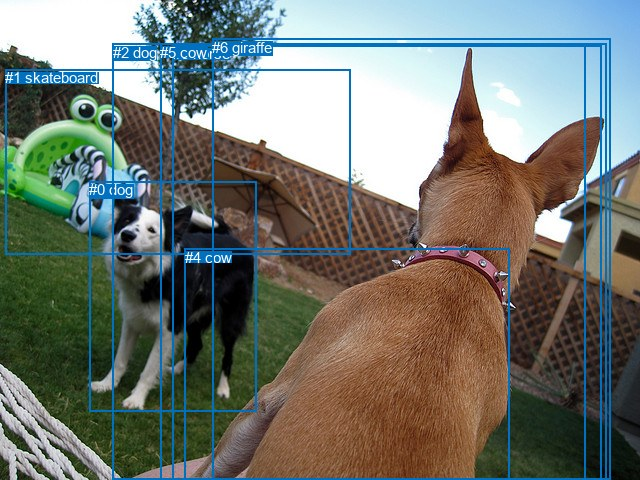
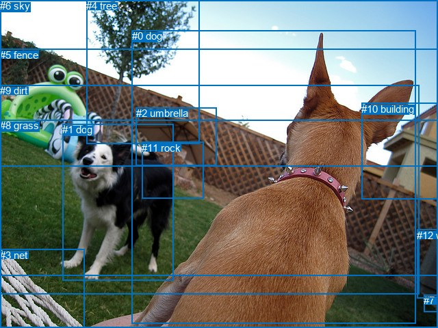

# 图片 1165：2368889.jpg

随机样本序号：314。图片 SHA256：`934c460ce0c137108b3dbc00c554dd00760c15b20a54b110c79f4b83dacce779`。

红色框表示人，蓝色框表示其他物体。两个模式分别保留自身框编号，可依据位置比较对应对象。

## 自动检测框与输出

人的框编号：`[]`。状态：`no_person`。

### 自动检测全部物体框

| 编号 | 类别 | 是否为人 | 检测分数 | 像素坐标 xyxy |
|---|---|---|---|---|
| 0 | dog | False | 0.9982 | 89.1, 181.5, 256.2, 411.0 |
| 1 | skateboard | False | 0.9234 | 5.1, 69.4, 350.8, 254.4 |
| 2 | dog | False | 0.8750 | 112.7, 43.7, 585.0, 480.0 |
| 3 | horse | False | 0.6127 | 172.6, 45.3, 601.8, 480.0 |
| 4 | cow | False | 0.5127 | 184.9, 248.7, 509.7, 479.0 |
| 5 | cow | False | 0.5064 | 160.3, 43.7, 606.9, 480.0 |
| 6 | giraffe | False | 0.4889 | 212.4, 38.8, 610.1, 480.0 |

### 自动检测 Top50 人相关候选

评分物体对：0；人相关物体对：0；输出关系：0。

| 排名 | 主语编号与类别 | 关系 | 宾语编号与类别 | 类型 | 人与人 | 排序分数 | 原始融合 logit |
|---|---|---|---|---|---|---|---|

### 自动检测逐条人相关 GT 核验

本图没有人相关 GT，R@50 无分母；预测候选继续展示。

## 真实框与输出

人的框编号：`[]`。

### 真实框全部物体框

| 编号 | 类别 | 是否为人 | 检测分数 | 像素坐标 xyxy |
|---|---|---|---|---|
| 0 | dog | False | GT | 193.0, 44.0, 607.0, 473.0 |
| 1 | dog | False | GT | 91.0, 181.0, 254.0, 410.0 |
| 2 | umbrella | False | GT | 199.0, 157.0, 317.0, 242.0 |
| 3 | net | False | GT | 0.0, 365.0, 123.0, 480.0 |
| 4 | tree | False | GT | 126.0, 0.0, 291.0, 211.0 |
| 5 | fence | False | GT | 0.0, 72.0, 640.0, 403.0 |
| 6 | sky | False | GT | 0.0, 0.0, 640.0, 243.0 |
| 7 | floor | False | GT | 619.0, 431.0, 640.0, 456.0 |
| 8 | grass | False | GT | 0.0, 175.0, 640.0, 480.0 |
| 9 | dirt | False | GT | 0.0, 124.0, 613.0, 430.0 |
| 10 | building | False | GT | 528.0, 151.0, 640.0, 292.0 |
| 11 | rock | False | GT | 207.0, 208.0, 297.0, 291.0 |
| 12 | wall | False | GT | 609.0, 336.0, 640.0, 437.0 |

### 真实框 Top50 人相关候选

评分物体对：0；人相关物体对：0；输出关系：0。

| 排名 | 主语编号与类别 | 关系 | 宾语编号与类别 | 类型 | 人与人 | 排序分数 | 原始融合 logit |
|---|---|---|---|---|---|---|---|

### 真实框逐条人相关 GT 核验

本图没有人相关 GT，R@50 无分母；预测候选继续展示。

## 全部人相关 GT

| 主语编号与类别 | 关系 | 宾语编号与类别 |
|---|---|---|

原始记录、全部人相关物体对的两项预测与分项分数见 [逐图证据 JSON](../evidence/cases/1165.json)。全部56类 logits 保留于本机 HOR/output/random500/logits/。

<!-- HOR_COMPLETE_RESULTS -->

## 六组条件的完整输出对照

以下保留同一图片三种框与候选模式、两种谓词输出规则的全部 Top50。框编号各自在所属模式内解释。

### 自动检测框完整枚举：空间与语义各保留一个谓词

| 排名 | 主语编号与类别 | 谓词 | 宾语编号与类别 | 分组 | 排序分数 | predicate logit | pair logit |
|---|---|---|---|---|---|---|---|

没有人相关 GT，本条件的召回率无分母。

### 自动检测框完整枚举：每对只保留一个谓词

| 排名 | 主语编号与类别 | 谓词 | 宾语编号与类别 | 分组 | 排序分数 | predicate logit | pair logit |
|---|---|---|---|---|---|---|---|

没有人相关 GT，本条件的召回率无分母。

### 真实框完整枚举：空间与语义各保留一个谓词

| 排名 | 主语编号与类别 | 谓词 | 宾语编号与类别 | 分组 | 排序分数 | predicate logit | pair logit |
|---|---|---|---|---|---|---|---|

没有人相关 GT，本条件的召回率无分母。

### 真实框完整枚举：每对只保留一个谓词

| 排名 | 主语编号与类别 | 谓词 | 宾语编号与类别 | 分组 | 排序分数 | predicate logit | pair logit |
|---|---|---|---|---|---|---|---|

没有人相关 GT，本条件的召回率无分母。

### 真实框400候选：空间与语义各保留一个谓词

| 排名 | 主语编号与类别 | 谓词 | 宾语编号与类别 | 分组 | 排序分数 | predicate logit | pair logit |
|---|---|---|---|---|---|---|---|

没有人相关 GT，本条件的召回率无分母。

### 真实框400候选：每对只保留一个谓词

| 排名 | 主语编号与类别 | 谓词 | 宾语编号与类别 | 分组 | 排序分数 | predicate logit | pair logit |
|---|---|---|---|---|---|---|---|

没有人相关 GT，本条件的召回率无分母。
