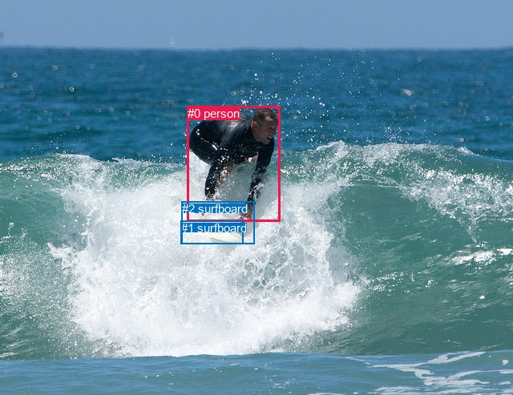
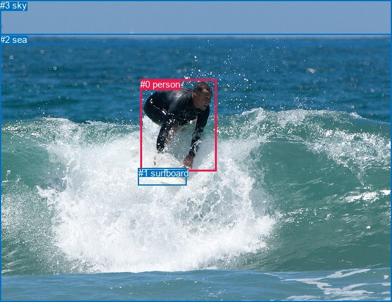

# 图片 1172：2369539.jpg

随机样本序号：483。图片 SHA256：`4f9e88d3513f55ee2e1eafc69834d894287fd3bdb49abb8bfa15e17ec8c5a5bd`。

红色框表示人，蓝色框表示其他物体。两个模式分别保留自身框编号，可依据位置比较对应对象。

## 自动检测框与输出

人的框编号：`[0]`。状态：`ok`。

### 自动检测全部物体框

| 编号 | 类别 | 是否为人 | 检测分数 | 像素坐标 xyxy |
|---|---|---|---|---|
| 0 | person | True | 0.9989 | 234.0, 132.6, 349.5, 276.9 |
| 1 | surfboard | False | 0.9172 | 225.8, 275.8, 303.8, 304.9 |
| 2 | surfboard | False | 0.5047 | 226.7, 251.7, 317.2, 304.0 |

### 自动检测 Top50 人相关候选

评分物体对：6；人相关物体对：4；输出关系：8。

| 排名 | 主语编号与类别 | 关系 | 宾语编号与类别 | 类型 | 人与人 | 排序分数 | 原始融合 logit |
|---|---|---|---|---|---|---|---|
| 1 | #0 person | riding | #2 surfboard | semantic | False | 0.98992 | 4.5868 |
| 2 | #0 person | riding | #1 surfboard | semantic | False | 0.98850 | 4.4534 |
| 3 | #0 person | on | #2 surfboard | spatial | False | 0.77163 | 1.2175 |
| 4 | #0 person | on | #1 surfboard | spatial | False | 0.70716 | 0.8816 |
| 5 | #1 surfboard | in | #0 person | spatial | False | 0.03421 | -3.3406 |
| 6 | #2 surfboard | in | #0 person | spatial | False | 0.02899 | -3.5113 |
| 7 | #1 surfboard | holding | #0 person | semantic | False | 0.01116 | -4.4843 |
| 8 | #2 surfboard | holding | #0 person | semantic | False | 0.01059 | -4.5371 |

### 自动检测逐条人相关 GT 核验

R@50：25.00%；命中 1/4。

| GT 主语编号 | GT 关系 | GT 宾语编号 | 结果阶段 | 匹配预测主语编号 | 匹配预测宾语编号 |
|---|---|---|---|---|---|
| 0 | catching | 1 | wrong_predicate | [0] | [1] |
| 0 | playing | 1 | wrong_predicate | [0] | [1] |
| 0 | riding | 1 | hit50 | [0] | [1] |
| 0 | on | 2 | endpoint_missing_or_wrong_class | [0] | [] |

## 真实框与输出

人的框编号：`[0]`。

### 真实框全部物体框

| 编号 | 类别 | 是否为人 | 检测分数 | 像素坐标 xyxy |
|---|---|---|---|---|
| 0 | person | True | GT | 229.0, 129.0, 353.0, 279.0 |
| 1 | surfboard | False | GT | 226.0, 274.0, 305.0, 302.0 |
| 2 | sea | False | GT | 0.0, 56.0, 640.0, 493.0 |
| 3 | sky | False | GT | 0.0, 0.0, 640.0, 72.0 |

### 真实框 Top50 人相关候选

评分物体对：12；人相关物体对：6；输出关系：12。

| 排名 | 主语编号与类别 | 关系 | 宾语编号与类别 | 类型 | 人与人 | 排序分数 | 原始融合 logit |
|---|---|---|---|---|---|---|---|
| 1 | #0 person | riding | #1 surfboard | semantic | False | 0.98892 | 4.4918 |
| 2 | #0 person | on | #1 surfboard | spatial | False | 0.98450 | 4.1510 |
| 3 | #0 person | in | #2 sea | spatial | False | 0.98441 | 4.1455 |
| 4 | #0 person | riding | #2 sea | semantic | False | 0.93501 | 2.6664 |
| 5 | #3 sky | over | #0 person | spatial | False | 0.84350 | 1.6845 |
| 6 | #3 sky | flying over | #0 person | semantic | False | 0.60779 | 0.4380 |
| 7 | #2 sea | beside | #0 person | spatial | False | 0.49398 | -0.0241 |
| 8 | #1 surfboard | beside | #0 person | spatial | False | 0.44654 | -0.2146 |
| 9 | #0 person | beside | #3 sky | spatial | False | 0.43580 | -0.2582 |
| 10 | #2 sea | catching | #0 person | semantic | False | 0.29614 | -0.8657 |
| 11 | #1 surfboard | holding | #0 person | semantic | False | 0.22038 | -1.2635 |
| 12 | #0 person | looking at | #3 sky | semantic | False | 0.20167 | -1.3759 |

### 真实框逐条人相关 GT 核验

R@50：25.00%；命中 1/4。

| GT 主语编号 | GT 关系 | GT 宾语编号 | 结果阶段 | 匹配预测主语编号 | 匹配预测宾语编号 |
|---|---|---|---|---|---|
| 0 | catching | 1 | wrong_predicate | [0] | [1] |
| 0 | playing | 1 | wrong_predicate | [0] | [1] |
| 0 | riding | 1 | hit50 | [0] | [1] |
| 0 | on | 2 | wrong_predicate | [0] | [2] |

## 全部人相关 GT

| 主语编号与类别 | 关系 | 宾语编号与类别 |
|---|---|---|
| #0 person | catching | #1 surfboard |
| #0 person | playing | #1 surfboard |
| #0 person | riding | #1 surfboard |
| #0 person | on | #2 sea |

原始记录、全部人相关物体对的两项预测与分项分数见 [逐图证据 JSON](../evidence/cases/1172.json)。全部56类 logits 保留于本机 HOR/output/random500/logits/。

<!-- HOR_COMPLETE_RESULTS -->

## 六组条件的完整输出对照

以下保留同一图片三种框与候选模式、两种谓词输出规则的全部 Top50。框编号各自在所属模式内解释。

### 自动检测框完整枚举：空间与语义各保留一个谓词

| 排名 | 主语编号与类别 | 谓词 | 宾语编号与类别 | 分组 | 排序分数 | predicate logit | pair logit |
|---|---|---|---|---|---|---|---|
| 1 | #0 person | riding | #2 surfboard | semantic | 0.9899173 | 4.4678264 | 0.1189811 |
| 2 | #0 person | riding | #1 surfboard | semantic | 0.9884953 | 4.2863021 | 0.1671304 |
| 3 | #0 person | on | #2 surfboard | spatial | 0.7716253 | 1.0985303 | 0.1189811 |
| 4 | #0 person | on | #1 surfboard | spatial | 0.7071595 | 0.7144980 | 0.1671304 |
| 5 | #1 surfboard | in | #0 person | spatial | 0.0342052 | -2.6937752 | -0.6467980 |
| 6 | #2 surfboard | in | #0 person | spatial | 0.0289929 | -2.8115399 | -0.6997437 |
| 7 | #1 surfboard | holding | #0 person | semantic | 0.0111587 | -3.8375173 | -0.6467980 |
| 8 | #2 surfboard | holding | #0 person | semantic | 0.0105915 | -3.8373077 | -0.6997437 |

GT 命中：1/4，R@50=25.00%。

| GT主语 | GT谓词 | GT宾语 | 结果阶段 | 匹配主语框 | 匹配宾语框 |
|---|---|---|---|---|---|
| 0 | catching | 1 | wrong_predicate | [0] | [1] |
| 0 | playing | 1 | wrong_predicate | [0] | [1] |
| 0 | riding | 1 | hit50 | [0] | [1] |
| 0 | on | 2 | endpoint_missing_or_wrong_class | [0] | [] |

### 自动检测框完整枚举：每对只保留一个谓词

| 排名 | 主语编号与类别 | 谓词 | 宾语编号与类别 | 分组 | 排序分数 | predicate logit | pair logit |
|---|---|---|---|---|---|---|---|
| 1 | #0 person | riding | #2 surfboard | single | 0.9899173 | 4.4678264 | 0.1189811 |
| 2 | #0 person | riding | #1 surfboard | single | 0.9884953 | 4.2863021 | 0.1671304 |
| 3 | #1 surfboard | in | #0 person | single | 0.0342052 | -2.6937752 | -0.6467980 |
| 4 | #2 surfboard | in | #0 person | single | 0.0289929 | -2.8115399 | -0.6997437 |

GT 命中：1/4，R@50=25.00%。

| GT主语 | GT谓词 | GT宾语 | 结果阶段 | 匹配主语框 | 匹配宾语框 |
|---|---|---|---|---|---|
| 0 | catching | 1 | wrong_predicate | [0] | [1] |
| 0 | playing | 1 | wrong_predicate | [0] | [1] |
| 0 | riding | 1 | hit50 | [0] | [1] |
| 0 | on | 2 | endpoint_missing_or_wrong_class | [0] | [] |

### 真实框完整枚举：空间与语义各保留一个谓词

| 排名 | 主语编号与类别 | 谓词 | 宾语编号与类别 | 分组 | 排序分数 | predicate logit | pair logit |
|---|---|---|---|---|---|---|---|
| 1 | #0 person | riding | #1 surfboard | semantic | 0.9889234 | 4.2464004 | 0.2453850 |
| 2 | #0 person | on | #1 surfboard | spatial | 0.9844960 | 3.9056468 | 0.2453850 |
| 3 | #0 person | in | #2 sea | spatial | 0.9844114 | 4.0050893 | 0.1404194 |
| 4 | #0 person | riding | #2 sea | semantic | 0.9350125 | 2.5259457 | 0.1404194 |
| 5 | #3 sky | over | #0 person | spatial | 0.8435015 | 2.4458632 | -0.7613480 |
| 6 | #3 sky | flying over | #0 person | semantic | 0.6077904 | 1.1993818 | -0.7613480 |
| 7 | #2 sea | beside | #0 person | spatial | 0.4939818 | 0.9504080 | -0.9744817 |
| 8 | #1 surfboard | beside | #0 person | spatial | 0.4465446 | 0.4364862 | -0.6511282 |
| 9 | #0 person | beside | #3 sky | spatial | 0.4357985 | 0.9430642 | -1.2012959 |
| 10 | #2 sea | catching | #0 person | semantic | 0.2961398 | 0.1087337 | -0.9744817 |
| 11 | #1 surfboard | holding | #0 person | semantic | 0.2203750 | -0.6123543 | -0.6511282 |
| 12 | #0 person | looking at | #3 sky | semantic | 0.2016725 | -0.1745777 | -1.2012959 |

GT 命中：1/4，R@50=25.00%。

| GT主语 | GT谓词 | GT宾语 | 结果阶段 | 匹配主语框 | 匹配宾语框 |
|---|---|---|---|---|---|
| 0 | catching | 1 | wrong_predicate | [0] | [1] |
| 0 | playing | 1 | wrong_predicate | [0] | [1] |
| 0 | riding | 1 | hit50 | [0] | [1] |
| 0 | on | 2 | wrong_predicate | [0] | [2] |

### 真实框完整枚举：每对只保留一个谓词

| 排名 | 主语编号与类别 | 谓词 | 宾语编号与类别 | 分组 | 排序分数 | predicate logit | pair logit |
|---|---|---|---|---|---|---|---|
| 1 | #0 person | riding | #1 surfboard | single | 0.9889234 | 4.2464004 | 0.2453850 |
| 2 | #0 person | in | #2 sea | single | 0.9844114 | 4.0050893 | 0.1404194 |
| 3 | #3 sky | over | #0 person | single | 0.8435015 | 2.4458632 | -0.7613480 |
| 4 | #2 sea | beside | #0 person | single | 0.4939818 | 0.9504080 | -0.9744817 |
| 5 | #1 surfboard | beside | #0 person | single | 0.4465446 | 0.4364862 | -0.6511282 |
| 6 | #0 person | beside | #3 sky | single | 0.4357985 | 0.9430642 | -1.2012959 |

GT 命中：1/4，R@50=25.00%。

| GT主语 | GT谓词 | GT宾语 | 结果阶段 | 匹配主语框 | 匹配宾语框 |
|---|---|---|---|---|---|
| 0 | catching | 1 | wrong_predicate | [0] | [1] |
| 0 | playing | 1 | wrong_predicate | [0] | [1] |
| 0 | riding | 1 | hit50 | [0] | [1] |
| 0 | on | 2 | wrong_predicate | [0] | [2] |

### 真实框400候选：空间与语义各保留一个谓词

| 排名 | 主语编号与类别 | 谓词 | 宾语编号与类别 | 分组 | 排序分数 | predicate logit | pair logit |
|---|---|---|---|---|---|---|---|
| 1 | #0 person | riding | #1 surfboard | semantic | 0.9895586 | 4.3060946 | 0.2453850 |
| 2 | #0 person | on | #1 surfboard | spatial | 0.9844960 | 3.9056468 | 0.2453850 |
| 3 | #0 person | in | #2 sea | spatial | 0.9844114 | 4.0050893 | 0.1404194 |
| 4 | #0 person | riding | #2 sea | semantic | 0.9331751 | 2.4960985 | 0.1404194 |
| 5 | #3 sky | over | #0 person | spatial | 0.8441983 | 2.4511514 | -0.7613480 |
| 6 | #3 sky | flying over | #0 person | semantic | 0.6149109 | 1.2293506 | -0.7613480 |
| 7 | #2 sea | beside | #0 person | spatial | 0.5014754 | 0.9803834 | -0.9744817 |
| 8 | #1 surfboard | beside | #0 person | spatial | 0.4465446 | 0.4364862 | -0.6511282 |
| 9 | #0 person | beside | #3 sky | spatial | 0.4431754 | 0.9730110 | -1.2012959 |
| 10 | #2 sea | catching | #0 person | semantic | 0.3021724 | 0.1375074 | -0.9744817 |
| 11 | #1 surfboard | holding | #0 person | semantic | 0.2245579 | -0.5881715 | -0.6511282 |
| 12 | #0 person | looking at | #3 sky | semantic | 0.2064465 | -0.1451836 | -1.2012959 |

GT 命中：1/4，R@50=25.00%。

| GT主语 | GT谓词 | GT宾语 | 结果阶段 | 匹配主语框 | 匹配宾语框 |
|---|---|---|---|---|---|
| 0 | catching | 1 | wrong_predicate | [0] | [1] |
| 0 | playing | 1 | wrong_predicate | [0] | [1] |
| 0 | riding | 1 | hit50 | [0] | [1] |
| 0 | on | 2 | wrong_predicate | [0] | [2] |

### 真实框400候选：每对只保留一个谓词

| 排名 | 主语编号与类别 | 谓词 | 宾语编号与类别 | 分组 | 排序分数 | predicate logit | pair logit |
|---|---|---|---|---|---|---|---|
| 1 | #0 person | riding | #1 surfboard | single | 0.9895586 | 4.3060946 | 0.2453850 |
| 2 | #0 person | in | #2 sea | single | 0.9844114 | 4.0050893 | 0.1404194 |
| 3 | #3 sky | over | #0 person | single | 0.8441983 | 2.4511514 | -0.7613480 |
| 4 | #2 sea | beside | #0 person | single | 0.5014754 | 0.9803834 | -0.9744817 |
| 5 | #1 surfboard | beside | #0 person | single | 0.4465446 | 0.4364862 | -0.6511282 |
| 6 | #0 person | beside | #3 sky | single | 0.4431754 | 0.9730110 | -1.2012959 |

GT 命中：1/4，R@50=25.00%。

| GT主语 | GT谓词 | GT宾语 | 结果阶段 | 匹配主语框 | 匹配宾语框 |
|---|---|---|---|---|---|
| 0 | catching | 1 | wrong_predicate | [0] | [1] |
| 0 | playing | 1 | wrong_predicate | [0] | [1] |
| 0 | riding | 1 | hit50 | [0] | [1] |
| 0 | on | 2 | wrong_predicate | [0] | [2] |
