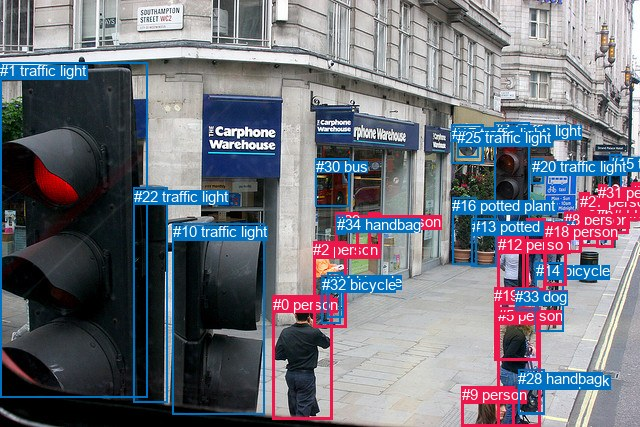
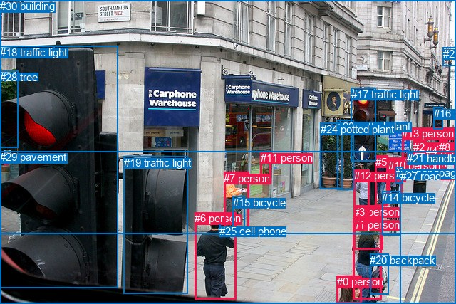

# 图片 1185：2370070.jpg

随机样本序号：308。图片 SHA256：`9188a63875d42908534f9192719b02a0fb26f110398ce6b052df664cf4aa5e55`。

红色框表示人，蓝色框表示其他物体。两个模式分别保留自身框编号，可依据位置比较对应对象。

## 自动检测框与输出

人的框编号：`[0, 2, 3, 5, 6, 7, 8, 9, 11, 12, 18, 19, 23, 24, 27, 29, 31]`。状态：`ok`。

### 自动检测全部物体框

| 编号 | 类别 | 是否为人 | 检测分数 | 像素坐标 xyxy |
|---|---|---|---|---|
| 0 | person | True | 0.9986 | 272.9, 295.9, 332.1, 419.1 |
| 1 | traffic light | False | 0.9981 | 0.2, 62.1, 147.1, 397.1 |
| 2 | person | True | 0.9899 | 313.4, 241.3, 346.2, 327.2 |
| 3 | person | True | 0.9883 | 580.4, 197.5, 598.1, 246.2 |
| 4 | traffic light | False | 0.9842 | 495.0, 122.2, 529.8, 230.1 |
| 5 | person | True | 0.9836 | 497.7, 307.1, 540.7, 426.5 |
| 6 | person | True | 0.9733 | 596.8, 203.9, 613.1, 247.2 |
| 7 | person | True | 0.9720 | 526.8, 218.2, 545.7, 290.9 |
| 8 | person | True | 0.9647 | 564.3, 211.2, 581.9, 252.8 |
| 9 | person | True | 0.9620 | 461.7, 386.4, 514.6, 426.8 |
| 10 | traffic light | False | 0.9601 | 172.6, 223.4, 264.3, 414.4 |
| 11 | person | True | 0.9558 | 614.7, 199.5, 628.0, 233.4 |
| 12 | person | True | 0.9536 | 497.7, 236.5, 524.1, 314.5 |
| 13 | potted plant | False | 0.9298 | 471.6, 218.4, 497.0, 266.1 |
| 14 | bicycle | False | 0.9236 | 535.9, 262.1, 563.0, 331.2 |
| 15 | traffic light | False | 0.9180 | 609.9, 154.9, 621.3, 191.1 |
| 16 | potted plant | False | 0.9141 | 452.4, 197.2, 476.6, 264.1 |
| 17 | traffic light | False | 0.8865 | 451.8, 124.9, 483.1, 163.7 |
| 18 | person | True | 0.8852 | 545.0, 222.8, 566.4, 285.5 |
| 19 | person | True | 0.8717 | 494.2, 287.2, 538.2, 360.8 |
| 20 | traffic light | False | 0.8603 | 531.8, 158.2, 543.2, 183.5 |
| 21 | bicycle | False | 0.8051 | 328.0, 272.6, 343.6, 317.4 |
| 22 | traffic light | False | 0.7827 | 133.6, 187.6, 167.9, 402.9 |
| 23 | person | True | 0.7743 | 631.8, 182.6, 640.0, 208.1 |
| 24 | person | True | 0.7412 | 368.3, 212.7, 380.2, 258.6 |
| 25 | traffic light | False | 0.7305 | 457.5, 129.4, 478.8, 157.4 |
| 26 | backpack | False | 0.6444 | 518.3, 372.2, 544.5, 414.7 |
| 27 | person | True | 0.6051 | 579.8, 192.9, 589.8, 212.8 |
| 28 | handbag | False | 0.5787 | 518.3, 369.9, 544.5, 413.9 |
| 29 | person | True | 0.5769 | 335.7, 212.4, 358.5, 259.0 |
| 30 | bus | False | 0.5571 | 315.6, 158.0, 349.1, 206.5 |
| 31 | person | True | 0.5384 | 598.2, 184.5, 606.1, 204.8 |
| 32 | bicycle | False | 0.4803 | 321.7, 276.0, 340.7, 323.3 |
| 33 | dog | False | 0.3953 | 515.2, 288.5, 538.2, 310.4 |
| 34 | handbag | False | 0.3608 | 336.9, 215.9, 345.6, 234.9 |

### 自动检测 Top50 人相关候选

评分物体对：1190；人相关物体对：884；输出关系：50。

| 排名 | 主语编号与类别 | 关系 | 宾语编号与类别 | 类型 | 人与人 | 排序分数 | 原始融合 logit |
|---|---|---|---|---|---|---|---|
| 1 | #2 person | pushing | #21 bicycle | semantic | False | 0.99378 | 5.0739 |
| 2 | #2 person | pushing | #32 bicycle | semantic | False | 0.99131 | 4.7370 |
| 3 | #7 person | pushing | #14 bicycle | semantic | False | 0.98826 | 4.4329 |
| 4 | #18 person | pushing | #14 bicycle | semantic | False | 0.98476 | 4.1683 |
| 5 | #0 person | pushing | #32 bicycle | semantic | False | 0.98465 | 4.1613 |
| 6 | #5 person | carrying | #28 handbag | semantic | False | 0.98323 | 4.0715 |
| 7 | #5 person | carrying | #26 backpack | semantic | False | 0.98128 | 3.9593 |
| 8 | #2 person | looking at | #29 person | semantic | True | 0.97444 | 3.6410 |
| 9 | #2 person | on | #32 bicycle | spatial | False | 0.97294 | 3.5823 |
| 10 | #0 person | pushing | #21 bicycle | semantic | False | 0.96442 | 3.2996 |
| 11 | #2 person | on | #21 bicycle | spatial | False | 0.96230 | 3.2397 |
| 12 | #19 person | wearing | #33 dog | semantic | False | 0.93926 | 2.7386 |
| 13 | #34 handbag | in | #29 person | spatial | False | 0.93870 | 2.7287 |
| 14 | #19 person | pushing | #14 bicycle | semantic | False | 0.93588 | 2.6808 |
| 15 | #29 person | in | #34 handbag | spatial | False | 0.92854 | 2.5644 |
| 16 | #5 person | carrying | #19 person | semantic | True | 0.92698 | 2.5411 |
| 17 | #12 person | pushing | #14 bicycle | semantic | False | 0.92557 | 2.5206 |
| 18 | #9 person | walking on | #5 person | semantic | True | 0.91425 | 2.3667 |
| 19 | #0 person | walking on | #10 traffic light | semantic | False | 0.88225 | 2.0140 |
| 20 | #29 person | wearing | #34 handbag | semantic | False | 0.87976 | 1.9902 |
| 21 | #19 person | in | #33 dog | spatial | False | 0.87668 | 1.9613 |
| 22 | #5 person | pushing | #14 bicycle | semantic | False | 0.87583 | 1.9535 |
| 23 | #5 person | in | #28 handbag | spatial | False | 0.85820 | 1.8004 |
| 24 | #18 person | on | #14 bicycle | spatial | False | 0.84928 | 1.7289 |
| 25 | #7 person | pushing | #18 person | semantic | True | 0.84844 | 1.7224 |
| 26 | #5 person | in | #26 backpack | spatial | False | 0.84783 | 1.7177 |
| 27 | #5 person | walking on | #9 person | semantic | True | 0.84268 | 1.6783 |
| 28 | #2 person | looking at | #34 handbag | semantic | False | 0.84023 | 1.6599 |
| 29 | #0 person | walking on | #2 person | semantic | True | 0.82989 | 1.5849 |
| 30 | #5 person | in | #19 person | spatial | True | 0.82896 | 1.5783 |
| 31 | #0 person | looking at | #1 traffic light | semantic | False | 0.81925 | 1.5113 |
| 32 | #3 person | wearing | #27 person | semantic | True | 0.81747 | 1.4993 |
| 33 | #0 person | on | #10 traffic light | spatial | False | 0.81170 | 1.4611 |
| 34 | #12 person | pushing | #33 dog | semantic | False | 0.80521 | 1.4192 |
| 35 | #26 backpack | on | #5 person | spatial | False | 0.79911 | 1.3807 |
| 36 | #2 person | beside | #29 person | spatial | True | 0.79597 | 1.3613 |
| 37 | #28 handbag | on | #5 person | spatial | False | 0.79350 | 1.3462 |
| 38 | #18 person | carrying | #8 person | semantic | True | 0.78698 | 1.3068 |
| 39 | #29 person | in | #30 bus | spatial | False | 0.77606 | 1.2428 |
| 40 | #7 person | on | #14 bicycle | spatial | False | 0.74983 | 1.0977 |
| 41 | #2 person | looking at | #24 person | semantic | True | 0.74525 | 1.0734 |
| 42 | #9 person | beside | #5 person | spatial | True | 0.72942 | 0.9917 |
| 43 | #3 person | carrying | #8 person | semantic | True | 0.72838 | 0.9864 |
| 44 | #5 person | holding | #33 dog | semantic | False | 0.72744 | 0.9817 |
| 45 | #30 bus | in | #29 person | spatial | False | 0.71640 | 0.9267 |
| 46 | #29 person | on | #24 person | spatial | True | 0.71487 | 0.9191 |
| 47 | #0 person | beside | #32 bicycle | spatial | False | 0.71176 | 0.9039 |
| 48 | #33 dog | on | #19 person | spatial | False | 0.71076 | 0.8991 |
| 49 | #3 person | in | #27 person | spatial | True | 0.70515 | 0.8719 |
| 50 | #14 bicycle | leaning on | #18 person | spatial | False | 0.70314 | 0.8623 |

### 自动检测逐条人相关 GT 核验

R@50：0.00%；命中 0/7。

| GT 主语编号 | GT 关系 | GT 宾语编号 | 结果阶段 | 匹配预测主语编号 | 匹配预测宾语编号 |
|---|---|---|---|---|---|
| 1 | talking to | 3 | wrong_predicate | [5] | [19] |
| 1 | holding | 20 | wrong_predicate | [5] | [26] |
| 2 | looking at | 29 | endpoint_missing_or_wrong_class | [3] | [] |
| 4 | looking at | 29 | endpoint_missing_or_wrong_class | [6] | [] |
| 6 | talking to | 25 | endpoint_missing_or_wrong_class | [0] | [] |
| 6 | walking on | 29 | endpoint_missing_or_wrong_class | [0] | [] |
| 7 | standing on | 29 | endpoint_missing_or_wrong_class | [2] | [] |

## 真实框与输出

人的框编号：`[0, 1, 2, 3, 4, 5, 6, 7, 8, 9, 10, 11, 12, 13]`。

### 真实框全部物体框

| 编号 | 类别 | 是否为人 | 检测分数 | 像素坐标 xyxy |
|---|---|---|---|---|
| 0 | person | True | GT | 473.0, 387.0, 507.0, 427.0 |
| 1 | person | True | GT | 496.0, 307.0, 536.0, 421.0 |
| 2 | person | True | GT | 580.0, 198.0, 598.0, 245.0 |
| 3 | person | True | GT | 496.0, 289.0, 537.0, 351.0 |
| 4 | person | True | GT | 598.0, 204.0, 613.0, 246.0 |
| 5 | person | True | GT | 527.0, 219.0, 545.0, 290.0 |
| 6 | person | True | GT | 273.0, 298.0, 331.0, 420.0 |
| 7 | person | True | GT | 314.0, 242.0, 349.0, 327.0 |
| 8 | person | True | GT | 616.0, 198.0, 629.0, 232.0 |
| 9 | person | True | GT | 562.0, 221.0, 570.0, 252.0 |
| 10 | person | True | GT | 545.0, 224.0, 564.0, 273.0 |
| 11 | person | True | GT | 366.0, 213.0, 381.0, 259.0 |
| 12 | person | True | GT | 497.0, 238.0, 519.0, 315.0 |
| 13 | person | True | GT | 564.0, 179.0, 640.0, 252.0 |
| 14 | bicycle | False | GT | 536.0, 269.0, 562.0, 331.0 |
| 15 | bicycle | False | GT | 327.0, 276.0, 344.0, 322.0 |
| 16 | traffic light | False | GT | 609.0, 151.0, 621.0, 182.0 |
| 17 | traffic light | False | GT | 493.0, 124.0, 527.0, 227.0 |
| 18 | traffic light | False | GT | 0.0, 65.0, 165.0, 405.0 |
| 19 | traffic light | False | GT | 174.0, 220.0, 264.0, 413.0 |
| 20 | backpack | False | GT | 519.0, 357.0, 545.0, 414.0 |
| 21 | handbag | False | GT | 571.0, 214.0, 578.0, 224.0 |
| 22 | handbag | False | GT | 556.0, 234.0, 566.0, 257.0 |
| 23 | potted plant | False | GT | 473.0, 169.0, 496.0, 267.0 |
| 24 | potted plant | False | GT | 450.0, 173.0, 481.0, 265.0 |
| 25 | cell phone | False | GT | 308.0, 316.0, 310.0, 322.0 |
| 26 | light | False | GT | 622.0, 67.0, 640.0, 93.0 |
| 27 | road | False | GT | 562.0, 239.0, 640.0, 427.0 |
| 28 | tree | False | GT | 0.0, 100.0, 26.0, 208.0 |
| 29 | pavement | False | GT | 0.0, 212.0, 640.0, 427.0 |
| 30 | building | False | GT | 0.0, 0.0, 640.0, 329.0 |

### 真实框 Top50 人相关候选

评分物体对：930；人相关物体对：658；输出关系：50。

| 排名 | 主语编号与类别 | 关系 | 宾语编号与类别 | 类型 | 人与人 | 排序分数 | 原始融合 logit |
|---|---|---|---|---|---|---|---|
| 1 | #7 person | pushing | #15 bicycle | semantic | False | 0.99400 | 5.1099 |
| 2 | #0 person | walking on | #29 pavement | semantic | False | 0.99191 | 4.8093 |
| 3 | #1 person | carrying | #20 backpack | semantic | False | 0.98769 | 4.3850 |
| 4 | #6 person | walking on | #29 pavement | semantic | False | 0.98731 | 4.3542 |
| 5 | #13 person | walking on | #29 pavement | semantic | False | 0.98729 | 4.3527 |
| 6 | #1 person | walking on | #29 pavement | semantic | False | 0.98458 | 4.1564 |
| 7 | #5 person | pushing | #14 bicycle | semantic | False | 0.98405 | 4.1221 |
| 8 | #7 person | crossing | #29 pavement | semantic | False | 0.97787 | 3.7883 |
| 9 | #6 person | wearing | #25 cell phone | semantic | False | 0.97721 | 3.7583 |
| 10 | #13 person | walking on | #27 road | semantic | False | 0.97202 | 3.5479 |
| 11 | #7 person | on | #15 bicycle | spatial | False | 0.96843 | 3.4235 |
| 12 | #1 person | carrying | #3 person | semantic | True | 0.96797 | 3.4084 |
| 13 | #12 person | walking on | #29 pavement | semantic | False | 0.96027 | 3.1852 |
| 14 | #10 person | pushing | #14 bicycle | semantic | False | 0.95980 | 3.1728 |
| 15 | #7 person | on | #29 pavement | spatial | False | 0.95649 | 3.0903 |
| 16 | #6 person | pushing | #15 bicycle | semantic | False | 0.95473 | 3.0487 |
| 17 | #11 person | in | #30 building | spatial | False | 0.95375 | 3.0262 |
| 18 | #5 person | walking on | #29 pavement | semantic | False | 0.95288 | 3.0069 |
| 19 | #10 person | carrying | #22 handbag | semantic | False | 0.95163 | 2.9792 |
| 20 | #2 person | walking on | #27 road | semantic | False | 0.94287 | 2.8035 |
| 21 | #8 person | walking on | #29 pavement | semantic | False | 0.94231 | 2.7933 |
| 22 | #6 person | on | #29 pavement | spatial | False | 0.93760 | 2.7098 |
| 23 | #4 person | walking on | #27 road | semantic | False | 0.93551 | 2.6746 |
| 24 | #1 person | walking on | #27 road | semantic | False | 0.93219 | 2.6208 |
| 25 | #3 person | pushing | #14 bicycle | semantic | False | 0.92440 | 2.5037 |
| 26 | #2 person | walking on | #29 pavement | semantic | False | 0.92239 | 2.4753 |
| 27 | #11 person | on | #29 pavement | spatial | False | 0.92150 | 2.4630 |
| 28 | #13 person | walking on | #30 building | semantic | False | 0.91776 | 2.4123 |
| 29 | #0 person | on | #29 pavement | spatial | False | 0.91402 | 2.3638 |
| 30 | #4 person | walking on | #29 pavement | semantic | False | 0.91027 | 2.3170 |
| 31 | #3 person | walking on | #29 pavement | semantic | False | 0.90833 | 2.2934 |
| 32 | #0 person | walking on | #27 road | semantic | False | 0.90809 | 2.2906 |
| 33 | #10 person | walking on | #29 pavement | semantic | False | 0.90753 | 2.2839 |
| 34 | #6 person | on | #25 cell phone | spatial | False | 0.90097 | 2.2080 |
| 35 | #1 person | on | #29 pavement | spatial | False | 0.89488 | 2.1416 |
| 36 | #10 person | crossing | #27 road | semantic | False | 0.89189 | 2.1102 |
| 37 | #0 person | walking on | #1 person | semantic | True | 0.86945 | 1.8961 |
| 38 | #13 person | on | #29 pavement | spatial | False | 0.85864 | 1.8040 |
| 39 | #1 person | walking on | #0 person | semantic | True | 0.85621 | 1.7842 |
| 40 | #13 person | carrying | #21 handbag | semantic | False | 0.84746 | 1.7148 |
| 41 | #6 person | looking at | #18 traffic light | semantic | False | 0.84493 | 1.6954 |
| 42 | #20 backpack | on | #1 person | spatial | False | 0.83171 | 1.5978 |
| 43 | #1 person | in | #3 person | spatial | True | 0.82848 | 1.5749 |
| 44 | #10 person | carrying | #9 person | semantic | True | 0.81540 | 1.4855 |
| 45 | #7 person | in | #30 building | spatial | False | 0.81021 | 1.4514 |
| 46 | #8 person | walking on | #27 road | semantic | False | 0.80624 | 1.4257 |
| 47 | #13 person | on | #27 road | spatial | False | 0.78769 | 1.3110 |
| 48 | #5 person | crossing | #27 road | semantic | False | 0.78423 | 1.2905 |
| 49 | #1 person | in | #20 backpack | spatial | False | 0.77736 | 1.2504 |
| 50 | #12 person | pushing | #14 bicycle | semantic | False | 0.77178 | 1.2184 |

### 真实框逐条人相关 GT 核验

R@50：14.29%；命中 1/7。

| GT 主语编号 | GT 关系 | GT 宾语编号 | 结果阶段 | 匹配预测主语编号 | 匹配预测宾语编号 |
|---|---|---|---|---|---|
| 1 | talking to | 3 | wrong_predicate | [1] | [3] |
| 1 | holding | 20 | wrong_predicate | [1] | [20] |
| 2 | looking at | 29 | wrong_predicate | [2] | [29] |
| 4 | looking at | 29 | wrong_predicate | [4] | [29] |
| 6 | talking to | 25 | wrong_predicate | [6] | [25] |
| 6 | walking on | 29 | hit50 | [6] | [29] |
| 7 | standing on | 29 | wrong_predicate | [7] | [29] |

## 全部人相关 GT

| 主语编号与类别 | 关系 | 宾语编号与类别 |
|---|---|---|
| #1 person | talking to | #3 person |
| #1 person | holding | #20 backpack |
| #2 person | looking at | #29 pavement |
| #4 person | looking at | #29 pavement |
| #6 person | talking to | #25 cell phone |
| #6 person | walking on | #29 pavement |
| #7 person | standing on | #29 pavement |

原始记录、全部人相关物体对的两项预测与分项分数见 [逐图证据 JSON](../evidence/cases/1185.json)。全部56类 logits 保留于本机 HOR/output/random500/logits/。

<!-- HOR_COMPLETE_RESULTS -->

## 六组条件的完整输出对照

以下保留同一图片三种框与候选模式、两种谓词输出规则的全部 Top50。框编号各自在所属模式内解释。

### 自动检测框完整枚举：空间与语义各保留一个谓词

| 排名 | 主语编号与类别 | 谓词 | 宾语编号与类别 | 分组 | 排序分数 | predicate logit | pair logit |
|---|---|---|---|---|---|---|---|
| 1 | #2 person | pushing | #21 bicycle | semantic | 0.9937811 | 4.2684941 | 0.8054287 |
| 2 | #2 person | pushing | #32 bicycle | semantic | 0.9913111 | 3.9677911 | 0.7691847 |
| 3 | #7 person | pushing | #14 bicycle | semantic | 0.9882591 | 4.6892829 | -0.2564175 |
| 4 | #18 person | pushing | #14 bicycle | semantic | 0.9847568 | 4.3887076 | -0.2204478 |
| 5 | #0 person | pushing | #32 bicycle | semantic | 0.9846526 | 4.2680459 | -0.1066995 |
| 6 | #5 person | carrying | #28 handbag | semantic | 0.9832345 | 3.7633424 | 0.3081816 |
| 7 | #5 person | carrying | #26 backpack | semantic | 0.9812806 | 3.7101493 | 0.2491496 |
| 8 | #2 person | looking at | #29 person | semantic | 0.9744441 | 3.4977088 | 0.1432885 |
| 9 | #2 person | on | #32 bicycle | spatial | 0.9729419 | 2.8131528 | 0.7691847 |
| 10 | #0 person | pushing | #21 bicycle | semantic | 0.9644160 | 3.4858241 | -0.1861990 |
| 11 | #2 person | on | #21 bicycle | spatial | 0.9623014 | 2.4342752 | 0.8054287 |
| 12 | #19 person | wearing | #33 dog | semantic | 0.9392647 | 3.0697508 | -0.3311784 |
| 13 | #34 handbag | in | #29 person | spatial | 0.9386985 | 2.5766149 | 0.1520753 |
| 14 | #19 person | pushing | #14 bicycle | semantic | 0.9358832 | 3.1853251 | -0.5045422 |
| 15 | #29 person | in | #34 handbag | spatial | 0.9285371 | 2.1677217 | 0.3967095 |
| 16 | #5 person | carrying | #19 person | semantic | 0.9269759 | 2.5166202 | 0.0245181 |
| 17 | #12 person | pushing | #14 bicycle | semantic | 0.9255723 | 2.8838425 | -0.3632587 |
| 18 | #9 person | walking on | #5 person | semantic | 0.9142520 | 2.5998917 | -0.2331972 |
| 19 | #0 person | walking on | #10 traffic light | semantic | 0.8822548 | 2.3833017 | -0.3693442 |
| 20 | #29 person | wearing | #34 handbag | semantic | 0.8797637 | 1.5934844 | 0.3967095 |
| 21 | #19 person | in | #33 dog | spatial | 0.8766779 | 2.2925186 | -0.3311784 |
| 22 | #5 person | pushing | #14 bicycle | semantic | 0.8758251 | 2.3125110 | -0.3590359 |
| 23 | #5 person | in | #28 handbag | spatial | 0.8581999 | 1.4922371 | 0.3081816 |
| 24 | #18 person | on | #14 bicycle | spatial | 0.8492780 | 1.9493971 | -0.2204478 |
| 25 | #7 person | pushing | #18 person | semantic | 0.8484393 | 2.0417070 | -0.3192945 |
| 26 | #5 person | in | #26 backpack | spatial | 0.8478337 | 1.4685607 | 0.2491496 |
| 27 | #5 person | walking on | #9 person | semantic | 0.8426826 | 2.1034069 | -0.4250816 |
| 28 | #2 person | looking at | #34 handbag | semantic | 0.8402311 | 1.5585127 | 0.1014356 |
| 29 | #0 person | walking on | #2 person | semantic | 0.8298917 | 2.1034484 | -0.5185885 |
| 30 | #5 person | in | #19 person | spatial | 0.8289570 | 1.5537353 | 0.0245181 |
| 31 | #0 person | looking at | #1 traffic light | semantic | 0.8192478 | 2.0043030 | -0.4930429 |
| 32 | #3 person | wearing | #27 person | semantic | 0.8174687 | 1.8587294 | -0.3594385 |
| 33 | #0 person | on | #10 traffic light | spatial | 0.8117020 | 1.8304515 | -0.3693442 |
| 34 | #12 person | pushing | #33 dog | semantic | 0.8052099 | 1.7111287 | -0.2919481 |
| 35 | #26 backpack | on | #5 person | spatial | 0.7991071 | 2.1551986 | -0.7744759 |
| 36 | #2 person | beside | #29 person | spatial | 0.7959676 | 1.2179914 | 0.1432885 |
| 37 | #28 handbag | on | #5 person | spatial | 0.7935038 | 2.1884470 | -0.8422707 |
| 38 | #18 person | carrying | #8 person | semantic | 0.7869788 | 1.6596847 | -0.3528748 |
| 39 | #29 person | in | #30 bus | spatial | 0.7760592 | 1.2791500 | -0.0363030 |
| 40 | #7 person | on | #14 bicycle | spatial | 0.7498343 | 1.3541465 | -0.2564175 |
| 41 | #2 person | looking at | #24 person | semantic | 0.7452486 | 1.3730836 | -0.2996536 |
| 42 | #9 person | beside | #5 person | spatial | 0.7294186 | 1.2248721 | -0.2331972 |
| 43 | #3 person | carrying | #8 person | semantic | 0.7283837 | 1.2036557 | -0.2172182 |
| 44 | #5 person | holding | #33 dog | semantic | 0.7274421 | 1.1429381 | -0.1612550 |
| 45 | #30 bus | in | #29 person | spatial | 0.7164045 | 0.9207058 | 0.0059903 |
| 46 | #29 person | on | #24 person | spatial | 0.7148678 | 0.6528959 | 0.2662487 |
| 47 | #0 person | beside | #32 bicycle | spatial | 0.7117603 | 1.0106483 | -0.1066995 |
| 48 | #33 dog | on | #19 person | spatial | 0.7107577 | 1.3189292 | -0.4198625 |
| 49 | #3 person | in | #27 person | spatial | 0.7051479 | 1.2313719 | -0.3594385 |
| 50 | #14 bicycle | leaning on | #18 person | spatial | 0.7031365 | 1.7126827 | -0.8504043 |

GT 命中：0/7，R@50=0.00%。

| GT主语 | GT谓词 | GT宾语 | 结果阶段 | 匹配主语框 | 匹配宾语框 |
|---|---|---|---|---|---|
| 1 | talking to | 3 | wrong_predicate | [5] | [19] |
| 1 | holding | 20 | wrong_predicate | [5] | [26] |
| 2 | looking at | 29 | endpoint_missing_or_wrong_class | [3] | [] |
| 4 | looking at | 29 | endpoint_missing_or_wrong_class | [6] | [] |
| 6 | talking to | 25 | endpoint_missing_or_wrong_class | [0] | [] |
| 6 | walking on | 29 | endpoint_missing_or_wrong_class | [0] | [] |
| 7 | standing on | 29 | endpoint_missing_or_wrong_class | [2] | [] |

### 自动检测框完整枚举：每对只保留一个谓词

| 排名 | 主语编号与类别 | 谓词 | 宾语编号与类别 | 分组 | 排序分数 | predicate logit | pair logit |
|---|---|---|---|---|---|---|---|
| 1 | #2 person | pushing | #21 bicycle | single | 0.9937811 | 4.2684941 | 0.8054287 |
| 2 | #2 person | pushing | #32 bicycle | single | 0.9913111 | 3.9677911 | 0.7691847 |
| 3 | #7 person | pushing | #14 bicycle | single | 0.9882591 | 4.6892829 | -0.2564175 |
| 4 | #18 person | pushing | #14 bicycle | single | 0.9847568 | 4.3887076 | -0.2204478 |
| 5 | #0 person | pushing | #32 bicycle | single | 0.9846526 | 4.2680459 | -0.1066995 |
| 6 | #5 person | carrying | #28 handbag | single | 0.9832345 | 3.7633424 | 0.3081816 |
| 7 | #5 person | carrying | #26 backpack | single | 0.9812806 | 3.7101493 | 0.2491496 |
| 8 | #2 person | looking at | #29 person | single | 0.9744441 | 3.4977088 | 0.1432885 |
| 9 | #0 person | pushing | #21 bicycle | single | 0.9644160 | 3.4858241 | -0.1861990 |
| 10 | #19 person | wearing | #33 dog | single | 0.9392647 | 3.0697508 | -0.3311784 |
| 11 | #34 handbag | in | #29 person | single | 0.9386985 | 2.5766149 | 0.1520753 |
| 12 | #19 person | pushing | #14 bicycle | single | 0.9358832 | 3.1853251 | -0.5045422 |
| 13 | #29 person | in | #34 handbag | single | 0.9285371 | 2.1677217 | 0.3967095 |
| 14 | #5 person | carrying | #19 person | single | 0.9269759 | 2.5166202 | 0.0245181 |
| 15 | #12 person | pushing | #14 bicycle | single | 0.9255723 | 2.8838425 | -0.3632587 |
| 16 | #9 person | walking on | #5 person | single | 0.9142520 | 2.5998917 | -0.2331972 |
| 17 | #0 person | walking on | #10 traffic light | single | 0.8822548 | 2.3833017 | -0.3693442 |
| 18 | #5 person | pushing | #14 bicycle | single | 0.8758251 | 2.3125110 | -0.3590359 |
| 19 | #7 person | pushing | #18 person | single | 0.8484393 | 2.0417070 | -0.3192945 |
| 20 | #5 person | walking on | #9 person | single | 0.8426826 | 2.1034069 | -0.4250816 |
| 21 | #2 person | looking at | #34 handbag | single | 0.8402311 | 1.5585127 | 0.1014356 |
| 22 | #0 person | walking on | #2 person | single | 0.8298917 | 2.1034484 | -0.5185885 |
| 23 | #0 person | looking at | #1 traffic light | single | 0.8192478 | 2.0043030 | -0.4930429 |
| 24 | #3 person | wearing | #27 person | single | 0.8174687 | 1.8587294 | -0.3594385 |
| 25 | #12 person | pushing | #33 dog | single | 0.8052099 | 1.7111287 | -0.2919481 |
| 26 | #26 backpack | on | #5 person | single | 0.7991071 | 2.1551986 | -0.7744759 |
| 27 | #28 handbag | on | #5 person | single | 0.7935038 | 2.1884470 | -0.8422707 |
| 28 | #18 person | carrying | #8 person | single | 0.7869788 | 1.6596847 | -0.3528748 |
| 29 | #29 person | in | #30 bus | single | 0.7760592 | 1.2791500 | -0.0363030 |
| 30 | #2 person | looking at | #24 person | single | 0.7452486 | 1.3730836 | -0.2996536 |
| 31 | #3 person | carrying | #8 person | single | 0.7283837 | 1.2036557 | -0.2172182 |
| 32 | #5 person | holding | #33 dog | single | 0.7274421 | 1.1429381 | -0.1612550 |
| 33 | #30 bus | in | #29 person | single | 0.7164045 | 0.9207058 | 0.0059903 |
| 34 | #29 person | on | #24 person | single | 0.7148678 | 0.6528959 | 0.2662487 |
| 35 | #33 dog | on | #19 person | single | 0.7107577 | 1.3189292 | -0.4198625 |
| 36 | #14 bicycle | leaning on | #18 person | single | 0.7031365 | 1.7126827 | -0.8504043 |
| 37 | #19 person | on | #5 person | single | 0.6915308 | 1.4518924 | -0.6446066 |
| 38 | #7 person | walking on | #33 dog | single | 0.6874689 | 1.0563316 | -0.2680188 |
| 39 | #0 person | walking on | #22 traffic light | single | 0.6642197 | 1.5136938 | -0.8315378 |
| 40 | #7 person | walking on | #4 traffic light | single | 0.6562440 | 1.1495743 | -0.5029737 |
| 41 | #31 person | walking on | #15 traffic light | single | 0.6491023 | 0.6260090 | -0.0109132 |
| 42 | #19 person | carrying | #28 handbag | single | 0.6374398 | 0.9607954 | -0.3965261 |
| 43 | #19 person | carrying | #26 backpack | single | 0.6323327 | 0.9943819 | -0.4521446 |
| 44 | #24 person | in | #34 handbag | single | 0.6045971 | 0.0677490 | 0.3569078 |
| 45 | #24 person | in | #29 person | single | 0.5905550 | 0.1144347 | 0.2518253 |
| 46 | #3 person | carrying | #6 person | single | 0.5627554 | 0.5523334 | -0.2999811 |
| 47 | #8 person | pushing | #14 bicycle | single | 0.5404593 | 0.7783289 | -0.6161369 |
| 48 | #24 person | in | #30 bus | single | 0.5272178 | 0.2053761 | -0.0963971 |
| 49 | #9 person | walking on | #19 person | single | 0.5084608 | 0.1084228 | -0.0745765 |
| 50 | #30 bus | in | #24 person | single | 0.4684328 | -0.0296068 | -0.0968302 |

GT 命中：0/7，R@50=0.00%。

| GT主语 | GT谓词 | GT宾语 | 结果阶段 | 匹配主语框 | 匹配宾语框 |
|---|---|---|---|---|---|
| 1 | talking to | 3 | wrong_predicate | [5] | [19] |
| 1 | holding | 20 | wrong_predicate | [5] | [26] |
| 2 | looking at | 29 | endpoint_missing_or_wrong_class | [3] | [] |
| 4 | looking at | 29 | endpoint_missing_or_wrong_class | [6] | [] |
| 6 | talking to | 25 | endpoint_missing_or_wrong_class | [0] | [] |
| 6 | walking on | 29 | endpoint_missing_or_wrong_class | [0] | [] |
| 7 | standing on | 29 | endpoint_missing_or_wrong_class | [2] | [] |

### 真实框完整枚举：空间与语义各保留一个谓词

| 排名 | 主语编号与类别 | 谓词 | 宾语编号与类别 | 分组 | 排序分数 | predicate logit | pair logit |
|---|---|---|---|---|---|---|---|
| 1 | #7 person | pushing | #15 bicycle | semantic | 0.9939994 | 4.3286996 | 0.7811634 |
| 2 | #0 person | walking on | #29 pavement | semantic | 0.9919121 | 4.5949874 | 0.2142880 |
| 3 | #1 person | carrying | #20 backpack | semantic | 0.9876907 | 4.1151166 | 0.2698913 |
| 4 | #6 person | walking on | #29 pavement | semantic | 0.9873106 | 4.2489734 | 0.1052524 |
| 5 | #13 person | walking on | #29 pavement | semantic | 0.9872919 | 4.2278714 | 0.1248608 |
| 6 | #1 person | walking on | #29 pavement | semantic | 0.9845776 | 3.9570632 | 0.1993253 |
| 7 | #5 person | pushing | #14 bicycle | semantic | 0.9840478 | 4.3882184 | -0.2661418 |
| 8 | #7 person | crossing | #29 pavement | semantic | 0.9778668 | 3.7078462 | 0.0804507 |
| 9 | #6 person | wearing | #25 cell phone | semantic | 0.9772090 | 3.2062159 | 0.5521196 |
| 10 | #13 person | walking on | #27 road | semantic | 0.9720216 | 3.5959687 | -0.0480232 |
| 11 | #7 person | on | #15 bicycle | spatial | 0.9684309 | 2.6423359 | 0.7811634 |
| 12 | #1 person | carrying | #3 person | semantic | 0.9679653 | 3.4212871 | -0.0129119 |
| 13 | #12 person | walking on | #29 pavement | semantic | 0.9602748 | 3.3733029 | -0.1880702 |
| 14 | #10 person | pushing | #14 bicycle | semantic | 0.9597979 | 3.4859757 | -0.3131711 |
| 15 | #7 person | on | #29 pavement | spatial | 0.9564888 | 3.0098019 | 0.0804507 |
| 16 | #6 person | pushing | #15 bicycle | semantic | 0.9547280 | 3.1847377 | -0.1359992 |
| 17 | #11 person | in | #30 building | spatial | 0.9537450 | 3.3633990 | -0.3371718 |
| 18 | #5 person | walking on | #29 pavement | semantic | 0.9528840 | 3.1145372 | -0.1076592 |
| 19 | #10 person | carrying | #22 handbag | semantic | 0.9516272 | 3.1731677 | -0.1939332 |
| 20 | #2 person | walking on | #27 road | semantic | 0.9428666 | 3.0513158 | -0.2477792 |
| 21 | #8 person | walking on | #29 pavement | semantic | 0.9423099 | 2.8376808 | -0.0444308 |
| 22 | #6 person | on | #29 pavement | spatial | 0.9376037 | 2.6045690 | 0.1052524 |
| 23 | #4 person | walking on | #27 road | semantic | 0.9355083 | 2.9881229 | -0.3135707 |
| 24 | #1 person | walking on | #27 road | semantic | 0.9321870 | 2.8467121 | -0.2259329 |
| 25 | #3 person | pushing | #14 bicycle | semantic | 0.9244027 | 2.9141436 | -0.4104161 |
| 26 | #2 person | walking on | #29 pavement | semantic | 0.9223886 | 2.5247402 | -0.0494879 |
| 27 | #11 person | on | #29 pavement | spatial | 0.9215034 | 3.0470467 | -0.5840954 |
| 28 | #13 person | walking on | #30 building | semantic | 0.9177601 | 3.0754004 | -0.6631051 |
| 29 | #0 person | on | #29 pavement | spatial | 0.9140211 | 2.1494641 | 0.2142880 |
| 30 | #4 person | walking on | #29 pavement | semantic | 0.9102726 | 2.4254346 | -0.1084667 |
| 31 | #3 person | walking on | #29 pavement | semantic | 0.9083320 | 2.5548315 | -0.2613950 |
| 32 | #0 person | walking on | #27 road | semantic | 0.9080924 | 2.6180105 | -0.3274486 |
| 33 | #10 person | walking on | #29 pavement | semantic | 0.9075349 | 2.3622561 | -0.0783557 |
| 34 | #6 person | on | #25 cell phone | spatial | 0.9009674 | 1.6558995 | 0.5521196 |
| 35 | #1 person | on | #29 pavement | spatial | 0.8948810 | 1.9422722 | 0.1993253 |
| 36 | #10 person | crossing | #27 road | semantic | 0.8918896 | 2.3807750 | -0.2705853 |
| 37 | #0 person | walking on | #1 person | semantic | 0.8694452 | 2.1214561 | -0.2253942 |
| 38 | #13 person | on | #29 pavement | spatial | 0.8586406 | 1.6791835 | 0.1248608 |
| 39 | #1 person | walking on | #0 person | semantic | 0.8562139 | 2.2929721 | -0.5087789 |
| 40 | #13 person | carrying | #21 handbag | semantic | 0.8474581 | 1.6414437 | 0.0733584 |
| 41 | #6 person | looking at | #18 traffic light | semantic | 0.8449270 | 2.1505752 | -0.4552209 |
| 42 | #20 backpack | on | #1 person | spatial | 0.8317096 | 2.4005051 | -0.8027129 |
| 43 | #1 person | in | #3 person | spatial | 0.8284811 | 1.5878124 | -0.0129119 |
| 44 | #10 person | carrying | #9 person | semantic | 0.8153983 | 1.7858744 | -0.3003979 |
| 45 | #7 person | in | #30 building | spatial | 0.8102145 | 1.7398071 | -0.2884022 |
| 46 | #8 person | walking on | #27 road | semantic | 0.8062358 | 1.6220303 | -0.1962957 |
| 47 | #13 person | on | #27 road | spatial | 0.7876883 | 1.3590698 | -0.0480232 |
| 48 | #5 person | crossing | #27 road | semantic | 0.7842259 | 1.6902041 | -0.3997391 |
| 49 | #1 person | in | #20 backpack | spatial | 0.7773613 | 0.9804635 | 0.2698913 |
| 50 | #12 person | pushing | #14 bicycle | semantic | 0.7717834 | 1.6201205 | -0.4017118 |

GT 命中：1/7，R@50=14.29%。

| GT主语 | GT谓词 | GT宾语 | 结果阶段 | 匹配主语框 | 匹配宾语框 |
|---|---|---|---|---|---|
| 1 | talking to | 3 | wrong_predicate | [1] | [3] |
| 1 | holding | 20 | wrong_predicate | [1] | [20] |
| 2 | looking at | 29 | wrong_predicate | [2] | [29] |
| 4 | looking at | 29 | wrong_predicate | [4] | [29] |
| 6 | talking to | 25 | wrong_predicate | [6] | [25] |
| 6 | walking on | 29 | hit50 | [6] | [29] |
| 7 | standing on | 29 | wrong_predicate | [7] | [29] |

### 真实框完整枚举：每对只保留一个谓词

| 排名 | 主语编号与类别 | 谓词 | 宾语编号与类别 | 分组 | 排序分数 | predicate logit | pair logit |
|---|---|---|---|---|---|---|---|
| 1 | #7 person | pushing | #15 bicycle | single | 0.9939994 | 4.3286996 | 0.7811634 |
| 2 | #0 person | walking on | #29 pavement | single | 0.9919121 | 4.5949874 | 0.2142880 |
| 3 | #1 person | carrying | #20 backpack | single | 0.9876907 | 4.1151166 | 0.2698913 |
| 4 | #6 person | walking on | #29 pavement | single | 0.9873106 | 4.2489734 | 0.1052524 |
| 5 | #13 person | walking on | #29 pavement | single | 0.9872919 | 4.2278714 | 0.1248608 |
| 6 | #1 person | walking on | #29 pavement | single | 0.9845776 | 3.9570632 | 0.1993253 |
| 7 | #5 person | pushing | #14 bicycle | single | 0.9840478 | 4.3882184 | -0.2661418 |
| 8 | #7 person | crossing | #29 pavement | single | 0.9778668 | 3.7078462 | 0.0804507 |
| 9 | #6 person | wearing | #25 cell phone | single | 0.9772090 | 3.2062159 | 0.5521196 |
| 10 | #13 person | walking on | #27 road | single | 0.9720216 | 3.5959687 | -0.0480232 |
| 11 | #1 person | carrying | #3 person | single | 0.9679653 | 3.4212871 | -0.0129119 |
| 12 | #12 person | walking on | #29 pavement | single | 0.9602748 | 3.3733029 | -0.1880702 |
| 13 | #10 person | pushing | #14 bicycle | single | 0.9597979 | 3.4859757 | -0.3131711 |
| 14 | #6 person | pushing | #15 bicycle | single | 0.9547280 | 3.1847377 | -0.1359992 |
| 15 | #11 person | in | #30 building | single | 0.9537450 | 3.3633990 | -0.3371718 |
| 16 | #5 person | walking on | #29 pavement | single | 0.9528840 | 3.1145372 | -0.1076592 |
| 17 | #10 person | carrying | #22 handbag | single | 0.9516272 | 3.1731677 | -0.1939332 |
| 18 | #2 person | walking on | #27 road | single | 0.9428666 | 3.0513158 | -0.2477792 |
| 19 | #8 person | walking on | #29 pavement | single | 0.9423099 | 2.8376808 | -0.0444308 |
| 20 | #4 person | walking on | #27 road | single | 0.9355083 | 2.9881229 | -0.3135707 |
| 21 | #1 person | walking on | #27 road | single | 0.9321870 | 2.8467121 | -0.2259329 |
| 22 | #3 person | pushing | #14 bicycle | single | 0.9244027 | 2.9141436 | -0.4104161 |
| 23 | #2 person | walking on | #29 pavement | single | 0.9223886 | 2.5247402 | -0.0494879 |
| 24 | #11 person | on | #29 pavement | single | 0.9215034 | 3.0470467 | -0.5840954 |
| 25 | #13 person | walking on | #30 building | single | 0.9177601 | 3.0754004 | -0.6631051 |
| 26 | #4 person | walking on | #29 pavement | single | 0.9102726 | 2.4254346 | -0.1084667 |
| 27 | #3 person | walking on | #29 pavement | single | 0.9083320 | 2.5548315 | -0.2613950 |
| 28 | #0 person | walking on | #27 road | single | 0.9080924 | 2.6180105 | -0.3274486 |
| 29 | #10 person | walking on | #29 pavement | single | 0.9075349 | 2.3622561 | -0.0783557 |
| 30 | #10 person | crossing | #27 road | single | 0.8918896 | 2.3807750 | -0.2705853 |
| 31 | #0 person | walking on | #1 person | single | 0.8694452 | 2.1214561 | -0.2253942 |
| 32 | #1 person | walking on | #0 person | single | 0.8562139 | 2.2929721 | -0.5087789 |
| 33 | #13 person | carrying | #21 handbag | single | 0.8474581 | 1.6414437 | 0.0733584 |
| 34 | #6 person | looking at | #18 traffic light | single | 0.8449270 | 2.1505752 | -0.4552209 |
| 35 | #20 backpack | on | #1 person | single | 0.8317096 | 2.4005051 | -0.8027129 |
| 36 | #10 person | carrying | #9 person | single | 0.8153983 | 1.7858744 | -0.3003979 |
| 37 | #7 person | in | #30 building | single | 0.8102145 | 1.7398071 | -0.2884022 |
| 38 | #8 person | walking on | #27 road | single | 0.8062358 | 1.6220303 | -0.1962957 |
| 39 | #5 person | crossing | #27 road | single | 0.7842259 | 1.6902041 | -0.3997391 |
| 40 | #12 person | pushing | #14 bicycle | single | 0.7717834 | 1.6201205 | -0.4017118 |
| 41 | #6 person | beside | #19 traffic light | single | 0.7628434 | 1.5525222 | -0.3841898 |
| 42 | #13 person | carrying | #9 person | single | 0.7549464 | 1.1737647 | -0.0485949 |
| 43 | #7 person | looking at | #11 person | single | 0.7421877 | 1.3402033 | -0.2828330 |
| 44 | #3 person | on | #1 person | single | 0.7376411 | 1.6851511 | -0.6514072 |
| 45 | #13 person | carrying | #8 person | single | 0.7362565 | 1.0743699 | -0.0477685 |
| 46 | #13 person | carrying | #4 person | single | 0.7258261 | 1.0603890 | -0.0868410 |
| 47 | #9 person | carrying | #22 handbag | single | 0.7181111 | 1.3009200 | -0.3658088 |
| 48 | #3 person | walking on | #27 road | single | 0.7134123 | 1.5167041 | -0.6046889 |
| 49 | #13 person | carrying | #2 person | single | 0.7085136 | 1.0695105 | -0.1813347 |
| 50 | #9 person | walking on | #29 pavement | single | 0.6883169 | 1.0743675 | -0.2821050 |

GT 命中：1/7，R@50=14.29%。

| GT主语 | GT谓词 | GT宾语 | 结果阶段 | 匹配主语框 | 匹配宾语框 |
|---|---|---|---|---|---|
| 1 | talking to | 3 | wrong_predicate | [1] | [3] |
| 1 | holding | 20 | wrong_predicate | [1] | [20] |
| 2 | looking at | 29 | wrong_predicate | [2] | [29] |
| 4 | looking at | 29 | wrong_predicate | [4] | [29] |
| 6 | talking to | 25 | wrong_predicate | [6] | [25] |
| 6 | walking on | 29 | hit50 | [6] | [29] |
| 7 | standing on | 29 | wrong_predicate | [7] | [29] |

### 真实框400候选：空间与语义各保留一个谓词

| 排名 | 主语编号与类别 | 谓词 | 宾语编号与类别 | 分组 | 排序分数 | predicate logit | pair logit |
|---|---|---|---|---|---|---|---|
| 1 | #7 person | pushing | #15 bicycle | semantic | 0.9939985 | 4.3285604 | 0.7811634 |
| 2 | #0 person | walking on | #29 pavement | semantic | 0.9914659 | 4.5408263 | 0.2142880 |
| 3 | #1 person | carrying | #20 backpack | semantic | 0.9889954 | 4.2284913 | 0.2698913 |
| 4 | #13 person | walking on | #29 pavement | semantic | 0.9886495 | 4.3422160 | 0.1248608 |
| 5 | #6 person | walking on | #29 pavement | semantic | 0.9859213 | 4.1436601 | 0.1052524 |
| 6 | #1 person | walking on | #29 pavement | semantic | 0.9828941 | 3.8517528 | 0.1993253 |
| 7 | #7 person | crossing | #29 pavement | semantic | 0.9814318 | 3.8871140 | 0.0804507 |
| 8 | #6 person | wearing | #25 cell phone | semantic | 0.9801170 | 3.3456883 | 0.5521196 |
| 9 | #5 person | pushing | #14 bicycle | semantic | 0.9785656 | 4.0872359 | -0.2661418 |
| 10 | #13 person | walking on | #27 road | semantic | 0.9778098 | 3.8336892 | -0.0480232 |
| 11 | #1 person | carrying | #3 person | semantic | 0.9681814 | 3.4282775 | -0.0129119 |
| 12 | #2 person | walking on | #27 road | semantic | 0.9674004 | 3.6380887 | -0.2477792 |
| 13 | #4 person | walking on | #27 road | semantic | 0.9670315 | 3.6922498 | -0.3135707 |
| 14 | #12 person | walking on | #29 pavement | semantic | 0.9646204 | 3.4936681 | -0.1880702 |
| 15 | #5 person | walking on | #29 pavement | semantic | 0.9603583 | 3.2950845 | -0.1076592 |
| 16 | #7 person | on | #15 bicycle | spatial | 0.9603552 | 2.4061823 | 0.7811634 |
| 17 | #10 person | carrying | #22 handbag | semantic | 0.9586506 | 3.3374038 | -0.1939332 |
| 18 | #10 person | crossing | #27 road | semantic | 0.9556735 | 3.3414207 | -0.2705853 |
| 19 | #6 person | pushing | #15 bicycle | semantic | 0.9547263 | 3.1846962 | -0.1359992 |
| 20 | #1 person | crossing | #27 road | semantic | 0.9497882 | 3.1659203 | -0.2259329 |
| 21 | #7 person | on | #29 pavement | spatial | 0.9482957 | 2.8286748 | 0.0804507 |
| 22 | #11 person | in | #30 building | spatial | 0.9471251 | 3.2226758 | -0.3371718 |
| 23 | #10 person | pushing | #14 bicycle | semantic | 0.9464366 | 3.1850109 | -0.3131711 |
| 24 | #0 person | walking on | #27 road | semantic | 0.9254813 | 2.8467121 | -0.3274486 |
| 25 | #6 person | on | #29 pavement | spatial | 0.9230933 | 2.3798838 | 0.1052524 |
| 26 | #8 person | walking on | #27 road | semantic | 0.9168794 | 2.5969787 | -0.1962957 |
| 27 | #13 person | walking on | #30 building | semantic | 0.9154613 | 3.0453229 | -0.6631051 |
| 28 | #5 person | crossing | #27 road | semantic | 0.9021683 | 2.6212921 | -0.3997391 |
| 29 | #11 person | on | #29 pavement | spatial | 0.8992549 | 2.7730689 | -0.5840954 |
| 30 | #3 person | walking on | #29 pavement | semantic | 0.8921496 | 2.3742838 | -0.2613950 |
| 31 | #0 person | on | #29 pavement | spatial | 0.8882660 | 1.8588624 | 0.2142880 |
| 32 | #6 person | looking at | #18 traffic light | semantic | 0.8868778 | 2.5144596 | -0.4552209 |
| 33 | #6 person | on | #25 cell phone | spatial | 0.8801892 | 1.4421039 | 0.5521196 |
| 34 | #0 person | walking on | #1 person | semantic | 0.8677286 | 2.1064172 | -0.2253942 |
| 35 | #1 person | on | #29 pavement | spatial | 0.8649153 | 1.6574044 | 0.1993253 |
| 36 | #13 person | holding | #21 handbag | semantic | 0.8608423 | 1.7489457 | 0.0733584 |
| 37 | #3 person | pushing | #14 bicycle | semantic | 0.8595600 | 2.2220564 | -0.4104161 |
| 38 | #1 person | walking on | #0 person | semantic | 0.8569536 | 2.2989936 | -0.5087789 |
| 39 | #3 person | walking on | #27 road | semantic | 0.8502429 | 2.3411956 | -0.6046889 |
| 40 | #13 person | on | #29 pavement | spatial | 0.8490217 | 1.6020880 | 0.1248608 |
| 41 | #8 person | walking on | #30 building | semantic | 0.8486759 | 2.5097017 | -0.7854483 |
| 42 | #6 person | walking on | #19 traffic light | semantic | 0.8343769 | 2.0011606 | -0.3841898 |
| 43 | #2 person | walking on | #29 pavement | semantic | 0.8259929 | 1.6069779 | -0.0494879 |
| 44 | #6 person | beside | #19 traffic light | spatial | 0.8175272 | 1.8838730 | -0.3841898 |
| 45 | #5 person | entering | #30 building | semantic | 0.8050311 | 2.6051989 | -1.1871582 |
| 46 | #7 person | in | #30 building | spatial | 0.8044324 | 1.7026329 | -0.2884022 |
| 47 | #13 person | on | #27 road | spatial | 0.8009798 | 1.4404526 | -0.0480232 |
| 48 | #7 person | entering | #30 building | semantic | 0.7979164 | 1.6617246 | -0.2884022 |
| 49 | #1 person | in | #3 person | spatial | 0.7941818 | 1.3632312 | -0.0129119 |
| 50 | #9 person | walking on | #27 road | semantic | 0.7929969 | 1.8567119 | -0.5136260 |

GT 命中：1/7，R@50=14.29%。

| GT主语 | GT谓词 | GT宾语 | 结果阶段 | 匹配主语框 | 匹配宾语框 |
|---|---|---|---|---|---|
| 1 | talking to | 3 | wrong_predicate | [1] | [3] |
| 1 | holding | 20 | wrong_predicate | [1] | [20] |
| 2 | looking at | 29 | wrong_predicate | [2] | [29] |
| 4 | looking at | 29 | wrong_predicate | [4] | [29] |
| 6 | talking to | 25 | wrong_predicate | [6] | [25] |
| 6 | walking on | 29 | hit50 | [6] | [29] |
| 7 | standing on | 29 | wrong_predicate | [7] | [29] |

### 真实框400候选：每对只保留一个谓词

| 排名 | 主语编号与类别 | 谓词 | 宾语编号与类别 | 分组 | 排序分数 | predicate logit | pair logit |
|---|---|---|---|---|---|---|---|
| 1 | #7 person | pushing | #15 bicycle | single | 0.9939985 | 4.3285604 | 0.7811634 |
| 2 | #0 person | walking on | #29 pavement | single | 0.9914659 | 4.5408263 | 0.2142880 |
| 3 | #1 person | carrying | #20 backpack | single | 0.9889954 | 4.2284913 | 0.2698913 |
| 4 | #13 person | walking on | #29 pavement | single | 0.9886495 | 4.3422160 | 0.1248608 |
| 5 | #6 person | walking on | #29 pavement | single | 0.9859213 | 4.1436601 | 0.1052524 |
| 6 | #1 person | walking on | #29 pavement | single | 0.9828941 | 3.8517528 | 0.1993253 |
| 7 | #7 person | crossing | #29 pavement | single | 0.9814318 | 3.8871140 | 0.0804507 |
| 8 | #6 person | wearing | #25 cell phone | single | 0.9801170 | 3.3456883 | 0.5521196 |
| 9 | #5 person | pushing | #14 bicycle | single | 0.9785656 | 4.0872359 | -0.2661418 |
| 10 | #13 person | walking on | #27 road | single | 0.9778098 | 3.8336892 | -0.0480232 |
| 11 | #1 person | carrying | #3 person | single | 0.9681814 | 3.4282775 | -0.0129119 |
| 12 | #2 person | walking on | #27 road | single | 0.9674004 | 3.6380887 | -0.2477792 |
| 13 | #4 person | walking on | #27 road | single | 0.9670315 | 3.6922498 | -0.3135707 |
| 14 | #12 person | walking on | #29 pavement | single | 0.9646204 | 3.4936681 | -0.1880702 |
| 15 | #5 person | walking on | #29 pavement | single | 0.9603583 | 3.2950845 | -0.1076592 |
| 16 | #10 person | carrying | #22 handbag | single | 0.9586506 | 3.3374038 | -0.1939332 |
| 17 | #10 person | crossing | #27 road | single | 0.9556735 | 3.3414207 | -0.2705853 |
| 18 | #6 person | pushing | #15 bicycle | single | 0.9547263 | 3.1846962 | -0.1359992 |
| 19 | #1 person | crossing | #27 road | single | 0.9497882 | 3.1659203 | -0.2259329 |
| 20 | #11 person | in | #30 building | single | 0.9471251 | 3.2226758 | -0.3371718 |
| 21 | #10 person | pushing | #14 bicycle | single | 0.9464366 | 3.1850109 | -0.3131711 |
| 22 | #0 person | walking on | #27 road | single | 0.9254813 | 2.8467121 | -0.3274486 |
| 23 | #8 person | walking on | #27 road | single | 0.9168794 | 2.5969787 | -0.1962957 |
| 24 | #13 person | walking on | #30 building | single | 0.9154613 | 3.0453229 | -0.6631051 |
| 25 | #5 person | crossing | #27 road | single | 0.9021683 | 2.6212921 | -0.3997391 |
| 26 | #11 person | on | #29 pavement | single | 0.8992549 | 2.7730689 | -0.5840954 |
| 27 | #3 person | walking on | #29 pavement | single | 0.8921496 | 2.3742838 | -0.2613950 |
| 28 | #6 person | looking at | #18 traffic light | single | 0.8868778 | 2.5144596 | -0.4552209 |
| 29 | #0 person | walking on | #1 person | single | 0.8677286 | 2.1064172 | -0.2253942 |
| 30 | #13 person | holding | #21 handbag | single | 0.8608423 | 1.7489457 | 0.0733584 |
| 31 | #3 person | pushing | #14 bicycle | single | 0.8595600 | 2.2220564 | -0.4104161 |
| 32 | #1 person | walking on | #0 person | single | 0.8569536 | 2.2989936 | -0.5087789 |
| 33 | #3 person | walking on | #27 road | single | 0.8502429 | 2.3411956 | -0.6046889 |
| 34 | #8 person | walking on | #30 building | single | 0.8486759 | 2.5097017 | -0.7854483 |
| 35 | #6 person | walking on | #19 traffic light | single | 0.8343769 | 2.0011606 | -0.3841898 |
| 36 | #2 person | walking on | #29 pavement | single | 0.8259929 | 1.6069779 | -0.0494879 |
| 37 | #5 person | entering | #30 building | single | 0.8050311 | 2.6051989 | -1.1871582 |
| 38 | #7 person | in | #30 building | single | 0.8044324 | 1.7026329 | -0.2884022 |
| 39 | #9 person | walking on | #27 road | single | 0.7929969 | 1.8567119 | -0.5136260 |
| 40 | #10 person | carrying | #9 person | single | 0.7827608 | 1.5822258 | -0.3003979 |
| 41 | #20 backpack | on | #1 person | single | 0.7787637 | 2.0611892 | -0.8027129 |
| 42 | #13 person | carrying | #9 person | single | 0.7781392 | 1.3034501 | -0.0485949 |
| 43 | #12 person | walking on | #30 building | single | 0.7759303 | 2.5578418 | -1.3157359 |
| 44 | #7 person | looking at | #18 traffic light | single | 0.7687984 | 2.3100963 | -1.1085572 |
| 45 | #13 person | carrying | #8 person | single | 0.7639986 | 1.2224965 | -0.0477685 |
| 46 | #2 person | walking on | #30 building | single | 0.7631871 | 2.1877298 | -1.0174973 |
| 47 | #10 person | walking on | #29 pavement | single | 0.7577641 | 1.2188158 | -0.0783557 |
| 48 | #4 person | walking on | #30 building | single | 0.7566609 | 2.1907258 | -1.0562668 |
| 49 | #13 person | carrying | #4 person | single | 0.7493369 | 1.1819201 | -0.0868410 |
| 50 | #13 person | carrying | #2 person | single | 0.7388108 | 1.2211313 | -0.1813347 |

GT 命中：1/7，R@50=14.29%。

| GT主语 | GT谓词 | GT宾语 | 结果阶段 | 匹配主语框 | 匹配宾语框 |
|---|---|---|---|---|---|
| 1 | talking to | 3 | wrong_predicate | [1] | [3] |
| 1 | holding | 20 | wrong_predicate | [1] | [20] |
| 2 | looking at | 29 | wrong_predicate | [2] | [29] |
| 4 | looking at | 29 | wrong_predicate | [4] | [29] |
| 6 | talking to | 25 | wrong_predicate | [6] | [25] |
| 6 | walking on | 29 | hit50 | [6] | [29] |
| 7 | standing on | 29 | wrong_predicate | [7] | [29] |
