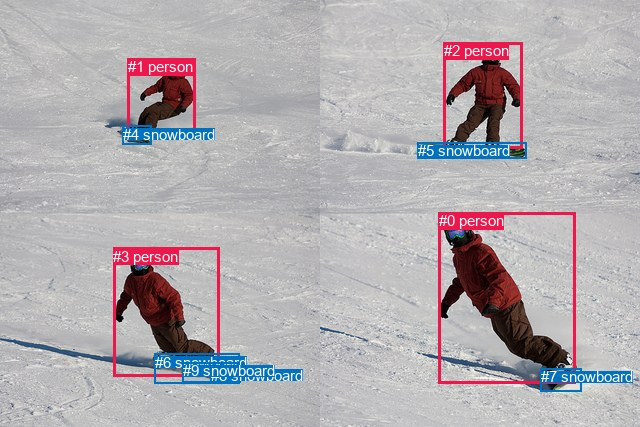
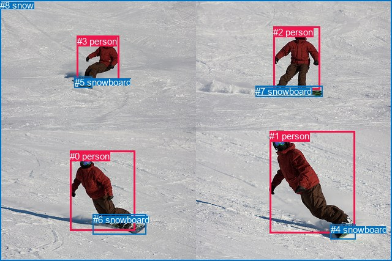

# 图片 1203：2371154.jpg

随机样本序号：281。图片 SHA256：`1f3d555cf1ca8f3778dda88a1848994114ab7825ba8bddd0e1d5b14bcae6a164`。

红色框表示人，蓝色框表示其他物体。两个模式分别保留自身框编号，可依据位置比较对应对象。

## 自动检测框与输出

人的框编号：`[0, 1, 2, 3]`。状态：`ok`。

### 自动检测全部物体框

| 编号 | 类别 | 是否为人 | 检测分数 | 像素坐标 xyxy |
|---|---|---|---|---|
| 0 | person | True | 0.9997 | 438.9, 212.5, 575.2, 383.9 |
| 1 | person | True | 0.9997 | 127.6, 58.4, 195.8, 139.7 |
| 2 | person | True | 0.9995 | 443.9, 42.5, 522.4, 148.8 |
| 3 | person | True | 0.9994 | 113.2, 247.5, 219.6, 376.4 |
| 4 | snowboard | False | 0.9919 | 122.5, 125.6, 151.1, 144.7 |
| 5 | snowboard | False | 0.9905 | 417.6, 142.0, 526.4, 158.3 |
| 6 | snowboard | False | 0.9880 | 154.9, 353.9, 239.6, 383.0 |
| 7 | snowboard | False | 0.9762 | 540.7, 368.1, 581.0, 391.9 |
| 8 | snowboard | False | 0.8539 | 210.7, 366.9, 240.3, 382.7 |
| 9 | snowboard | False | 0.5757 | 182.7, 362.1, 239.7, 382.9 |

### 自动检测 Top50 人相关候选

评分物体对：90；人相关物体对：60；输出关系：50。

| 排名 | 主语编号与类别 | 关系 | 宾语编号与类别 | 类型 | 人与人 | 排序分数 | 原始融合 logit |
|---|---|---|---|---|---|---|---|
| 1 | #3 person | wearing | #6 snowboard | semantic | False | 0.98811 | 4.4203 |
| 2 | #3 person | wearing | #9 snowboard | semantic | False | 0.98483 | 4.1730 |
| 3 | #0 person | wearing | #7 snowboard | semantic | False | 0.98243 | 4.0237 |
| 4 | #1 person | wearing | #4 snowboard | semantic | False | 0.97929 | 3.8560 |
| 5 | #3 person | wearing | #8 snowboard | semantic | False | 0.97638 | 3.7217 |
| 6 | #2 person | wearing | #5 snowboard | semantic | False | 0.97239 | 3.5615 |
| 7 | #0 person | on | #7 snowboard | spatial | False | 0.95731 | 3.1101 |
| 8 | #1 person | on | #4 snowboard | spatial | False | 0.94601 | 2.8635 |
| 9 | #3 person | on | #6 snowboard | spatial | False | 0.94592 | 2.8617 |
| 10 | #2 person | on | #5 snowboard | spatial | False | 0.94411 | 2.8268 |
| 11 | #3 person | on | #9 snowboard | spatial | False | 0.94080 | 2.7657 |
| 12 | #3 person | on | #8 snowboard | spatial | False | 0.90919 | 2.3037 |
| 13 | #3 person | wearing | #7 snowboard | semantic | False | 0.64466 | 0.5957 |
| 14 | #3 person | wearing | #4 snowboard | semantic | False | 0.63762 | 0.5650 |
| 15 | #0 person | wearing | #5 snowboard | semantic | False | 0.62261 | 0.5007 |
| 16 | #2 person | wearing | #4 snowboard | semantic | False | 0.56706 | 0.2699 |
| 17 | #1 person | wearing | #5 snowboard | semantic | False | 0.56669 | 0.2683 |
| 18 | #1 person | wearing | #9 snowboard | semantic | False | 0.49004 | -0.0398 |
| 19 | #7 snowboard | on | #0 person | spatial | False | 0.48759 | -0.0497 |
| 20 | #0 person | standing on | #9 snowboard | semantic | False | 0.48594 | -0.0562 |
| 21 | #1 person | wearing | #6 snowboard | semantic | False | 0.47803 | -0.0879 |
| 22 | #0 person | wearing | #6 snowboard | semantic | False | 0.47032 | -0.1189 |
| 23 | #1 person | riding | #8 snowboard | semantic | False | 0.44406 | -0.2247 |
| 24 | #0 person | standing on | #8 snowboard | semantic | False | 0.43340 | -0.2680 |
| 25 | #4 snowboard | on | #1 person | spatial | False | 0.42003 | -0.3227 |
| 26 | #0 person | on | #5 snowboard | spatial | False | 0.32937 | -0.7110 |
| 27 | #2 person | wearing | #7 snowboard | semantic | False | 0.29369 | -0.8775 |
| 28 | #1 person | on | #5 snowboard | spatial | False | 0.25606 | -1.0666 |
| 29 | #3 person | wearing | #5 snowboard | semantic | False | 0.25489 | -1.0727 |
| 30 | #0 person | on | #6 snowboard | spatial | False | 0.24845 | -1.1069 |
| 31 | #7 snowboard | wearing | #0 person | semantic | False | 0.24457 | -1.1278 |
| 32 | #0 person | on | #9 snowboard | spatial | False | 0.21787 | -1.2781 |
| 33 | #1 person | on | #6 snowboard | spatial | False | 0.21713 | -1.2825 |
| 34 | #1 person | on | #9 snowboard | spatial | False | 0.21428 | -1.2993 |
| 35 | #2 person | riding | #9 snowboard | semantic | False | 0.19518 | -1.4167 |
| 36 | #0 person | wearing | #4 snowboard | semantic | False | 0.18730 | -1.4676 |
| 37 | #1 person | wearing | #7 snowboard | semantic | False | 0.17598 | -1.5438 |
| 38 | #2 person | riding | #8 snowboard | semantic | False | 0.17099 | -1.5786 |
| 39 | #0 person | on | #8 snowboard | spatial | False | 0.16310 | -1.6353 |
| 40 | #1 person | on | #8 snowboard | spatial | False | 0.16283 | -1.6373 |
| 41 | #2 person | wearing | #6 snowboard | semantic | False | 0.15834 | -1.6706 |
| 42 | #6 snowboard | on | #3 person | spatial | False | 0.13863 | -1.8267 |
| 43 | #3 person | on | #7 snowboard | spatial | False | 0.13726 | -1.8382 |
| 44 | #9 snowboard | on | #3 person | spatial | False | 0.13247 | -1.8793 |
| 45 | #8 snowboard | on | #3 person | spatial | False | 0.12464 | -1.9492 |
| 46 | #2 person | on | #4 snowboard | spatial | False | 0.12233 | -1.9705 |
| 47 | #3 person | on | #4 snowboard | spatial | False | 0.10993 | -2.0915 |
| 48 | #5 snowboard | on | #2 person | spatial | False | 0.09832 | -2.2161 |
| 49 | #0 person | wearing | #2 person | semantic | True | 0.08470 | -2.3801 |
| 50 | #1 person | wearing | #2 person | semantic | True | 0.07566 | -2.5028 |

### 自动检测逐条人相关 GT 核验

R@50：40.00%；命中 2/5。

| GT 主语编号 | GT 关系 | GT 宾语编号 | 结果阶段 | 匹配预测主语编号 | 匹配预测宾语编号 |
|---|---|---|---|---|---|
| 0 | on | 8 | endpoint_missing_or_wrong_class | [3] | [] |
| 1 | on | 4 | hit50 | [0] | [7] |
| 1 | playing | 4 | wrong_predicate | [0] | [7] |
| 2 | wearing | 7 | hit50 | [2] | [5] |
| 3 | standing on | 5 | wrong_predicate | [1] | [4] |

## 真实框与输出

人的框编号：`[0, 1, 2, 3]`。

### 真实框全部物体框

| 编号 | 类别 | 是否为人 | 检测分数 | 像素坐标 xyxy |
|---|---|---|---|---|
| 0 | person | True | GT | 114.0, 247.0, 220.0, 378.0 |
| 1 | person | True | GT | 440.0, 214.0, 579.0, 381.0 |
| 2 | person | True | GT | 446.0, 44.0, 522.0, 147.0 |
| 3 | person | True | GT | 126.0, 59.0, 195.0, 138.0 |
| 4 | snowboard | False | GT | 540.0, 367.0, 581.0, 391.0 |
| 5 | snowboard | False | GT | 122.0, 126.0, 151.0, 144.0 |
| 6 | snowboard | False | GT | 152.0, 351.0, 239.0, 384.0 |
| 7 | snowboard | False | GT | 417.0, 141.0, 526.0, 159.0 |
| 8 | snow | False | GT | 0.0, 0.0, 640.0, 427.0 |

### 真实框 Top50 人相关候选

评分物体对：72；人相关物体对：52；输出关系：50。

| 排名 | 主语编号与类别 | 关系 | 宾语编号与类别 | 类型 | 人与人 | 排序分数 | 原始融合 logit |
|---|---|---|---|---|---|---|---|
| 1 | #0 person | on | #6 snowboard | spatial | False | 0.98612 | 4.2632 |
| 2 | #0 person | riding | #6 snowboard | semantic | False | 0.98549 | 4.2184 |
| 3 | #1 person | on | #4 snowboard | spatial | False | 0.98284 | 4.0477 |
| 4 | #1 person | wearing | #4 snowboard | semantic | False | 0.98073 | 3.9300 |
| 5 | #3 person | on | #5 snowboard | spatial | False | 0.97580 | 3.6968 |
| 6 | #2 person | on | #7 snowboard | spatial | False | 0.97434 | 3.6367 |
| 7 | #3 person | wearing | #5 snowboard | semantic | False | 0.97424 | 3.6328 |
| 8 | #0 person | on | #8 snow | spatial | False | 0.96235 | 3.2411 |
| 9 | #1 person | on | #8 snow | spatial | False | 0.95983 | 3.1736 |
| 10 | #2 person | riding | #7 snowboard | semantic | False | 0.95598 | 3.0782 |
| 11 | #3 person | in | #8 snow | spatial | False | 0.95301 | 3.0098 |
| 12 | #0 person | going down | #8 snow | semantic | False | 0.91690 | 2.4010 |
| 13 | #2 person | on | #8 snow | spatial | False | 0.91484 | 2.3743 |
| 14 | #1 person | going down | #8 snow | semantic | False | 0.90810 | 2.2907 |
| 15 | #3 person | going down | #8 snow | semantic | False | 0.90667 | 2.2736 |
| 16 | #2 person | going down | #8 snow | semantic | False | 0.85168 | 1.7479 |
| 17 | #4 snowboard | on | #1 person | spatial | False | 0.65647 | 0.6476 |
| 18 | #5 snowboard | on | #3 person | spatial | False | 0.61388 | 0.4637 |
| 19 | #4 snowboard | wearing | #1 person | semantic | False | 0.45155 | -0.1944 |
| 20 | #6 snowboard | on | #0 person | spatial | False | 0.35972 | -0.5766 |
| 21 | #0 person | wearing | #5 snowboard | semantic | False | 0.35901 | -0.5797 |
| 22 | #0 person | wearing | #4 snowboard | semantic | False | 0.34546 | -0.6391 |
| 23 | #7 snowboard | on | #2 person | spatial | False | 0.23583 | -1.1757 |
| 24 | #3 person | wearing | #2 person | semantic | True | 0.21846 | -1.2747 |
| 25 | #5 snowboard | wearing | #3 person | semantic | False | 0.20847 | -1.3342 |
| 26 | #1 person | on | #6 snowboard | spatial | False | 0.15544 | -1.6926 |
| 27 | #0 person | in | #1 person | spatial | True | 0.13836 | -1.8290 |
| 28 | #1 person | wearing | #7 snowboard | semantic | False | 0.12816 | -1.9174 |
| 29 | #0 person | looking at | #1 person | semantic | True | 0.12368 | -1.9581 |
| 30 | #0 person | in front of | #3 person | spatial | True | 0.12117 | -1.9814 |
| 31 | #0 person | on | #5 snowboard | spatial | False | 0.11979 | -1.9944 |
| 32 | #1 person | wearing | #2 person | semantic | True | 0.11885 | -2.0034 |
| 33 | #1 person | wearing | #6 snowboard | semantic | False | 0.11749 | -2.0164 |
| 34 | #2 person | wearing | #5 snowboard | semantic | False | 0.11437 | -2.0469 |
| 35 | #2 person | on | #5 snowboard | spatial | False | 0.10850 | -2.1062 |
| 36 | #3 person | on | #7 snowboard | spatial | False | 0.10239 | -2.1710 |
| 37 | #0 person | on | #4 snowboard | spatial | False | 0.09336 | -2.2732 |
| 38 | #7 snowboard | wearing | #2 person | semantic | False | 0.08680 | -2.3533 |
| 39 | #0 person | looking at | #3 person | semantic | True | 0.08628 | -2.3599 |
| 40 | #8 snow | in | #0 person | spatial | False | 0.08476 | -2.3794 |
| 41 | #3 person | in | #2 person | spatial | True | 0.08321 | -2.3996 |
| 42 | #6 snowboard | wearing | #0 person | semantic | False | 0.08319 | -2.3998 |
| 43 | #1 person | on | #7 snowboard | spatial | False | 0.08313 | -2.4005 |
| 44 | #3 person | wearing | #7 snowboard | semantic | False | 0.07731 | -2.4795 |
| 45 | #1 person | in | #2 person | spatial | True | 0.07302 | -2.5412 |
| 46 | #1 person | looking at | #0 person | semantic | True | 0.06670 | -2.6385 |
| 47 | #1 person | in | #0 person | spatial | True | 0.06581 | -2.6528 |
| 48 | #3 person | on | #6 snowboard | spatial | False | 0.06510 | -2.6646 |
| 49 | #3 person | wearing | #6 snowboard | semantic | False | 0.05471 | -2.8494 |
| 50 | #2 person | wearing | #3 person | semantic | True | 0.05429 | -2.8575 |

### 真实框逐条人相关 GT 核验

R@50：40.00%；命中 2/5。

| GT 主语编号 | GT 关系 | GT 宾语编号 | 结果阶段 | 匹配预测主语编号 | 匹配预测宾语编号 |
|---|---|---|---|---|---|
| 0 | on | 8 | hit50 | [0] | [8] |
| 1 | on | 4 | hit50 | [1] | [4] |
| 1 | playing | 4 | wrong_predicate | [1] | [4] |
| 2 | wearing | 7 | wrong_predicate | [2] | [7] |
| 3 | standing on | 5 | wrong_predicate | [3] | [5] |

## 全部人相关 GT

| 主语编号与类别 | 关系 | 宾语编号与类别 |
|---|---|---|
| #0 person | on | #8 snow |
| #1 person | on | #4 snowboard |
| #1 person | playing | #4 snowboard |
| #2 person | wearing | #7 snowboard |
| #3 person | standing on | #5 snowboard |

原始记录、全部人相关物体对的两项预测与分项分数见 [逐图证据 JSON](../evidence/cases/1203.json)。全部56类 logits 保留于本机 HOR/output/random500/logits/。

<!-- HOR_COMPLETE_RESULTS -->

## 六组条件的完整输出对照

以下保留同一图片三种框与候选模式、两种谓词输出规则的全部 Top50。框编号各自在所属模式内解释。

### 自动检测框完整枚举：空间与语义各保留一个谓词

| 排名 | 主语编号与类别 | 谓词 | 宾语编号与类别 | 分组 | 排序分数 | predicate logit | pair logit |
|---|---|---|---|---|---|---|---|
| 1 | #3 person | wearing | #6 snowboard | semantic | 0.9881124 | 3.8754487 | 0.5448513 |
| 2 | #3 person | wearing | #9 snowboard | semantic | 0.9848284 | 3.6581903 | 0.5148500 |
| 3 | #0 person | wearing | #7 snowboard | semantic | 0.9824279 | 3.6523223 | 0.3713905 |
| 4 | #1 person | wearing | #4 snowboard | semantic | 0.9792861 | 3.3792472 | 0.4767733 |
| 5 | #3 person | wearing | #8 snowboard | semantic | 0.9763798 | 3.2662525 | 0.4554963 |
| 6 | #2 person | wearing | #5 snowboard | semantic | 0.9723873 | 3.3690143 | 0.1924633 |
| 7 | #0 person | on | #7 snowboard | spatial | 0.9573056 | 2.7386622 | 0.3713905 |
| 8 | #1 person | on | #4 snowboard | spatial | 0.9460120 | 2.3867197 | 0.4767733 |
| 9 | #3 person | on | #6 snowboard | spatial | 0.9459181 | 2.3168058 | 0.5448513 |
| 10 | #2 person | on | #5 snowboard | spatial | 0.9441072 | 2.6343422 | 0.1924633 |
| 11 | #3 person | on | #9 snowboard | spatial | 0.9407961 | 2.2508888 | 0.5148500 |
| 12 | #3 person | on | #8 snowboard | spatial | 0.9091855 | 1.8482337 | 0.4554963 |
| 13 | #3 person | wearing | #7 snowboard | semantic | 0.6446641 | 0.8419552 | -0.2462891 |
| 14 | #3 person | wearing | #4 snowboard | semantic | 0.6376197 | 0.7986245 | -0.2335766 |
| 15 | #0 person | wearing | #5 snowboard | semantic | 0.6226144 | 0.8830304 | -0.3823707 |
| 16 | #2 person | wearing | #4 snowboard | semantic | 0.5670649 | 0.8207388 | -0.5508529 |
| 17 | #1 person | wearing | #5 snowboard | semantic | 0.5666867 | 0.4044318 | -0.1360861 |
| 18 | #1 person | wearing | #9 snowboard | semantic | 0.4900409 | 0.2613463 | -0.3011881 |
| 19 | #7 snowboard | on | #0 person | spatial | 0.4875854 | 0.5804329 | -0.6301014 |
| 20 | #0 person | standing on | #9 snowboard | semantic | 0.4859436 | 0.3212309 | -0.3774712 |
| 21 | #1 person | wearing | #6 snowboard | semantic | 0.4780333 | 0.1886764 | -0.2765997 |
| 22 | #0 person | wearing | #6 snowboard | semantic | 0.4703202 | 0.2848182 | -0.4036770 |
| 23 | #1 person | riding | #8 snowboard | semantic | 0.4440647 | 0.1402707 | -0.3649525 |
| 24 | #0 person | standing on | #8 snowboard | semantic | 0.4333960 | 0.0915174 | -0.3595262 |
| 25 | #4 snowboard | on | #1 person | spatial | 0.4200276 | 0.5142264 | -0.8368863 |
| 26 | #0 person | on | #5 snowboard | spatial | 0.3293742 | -0.3286462 | -0.3823707 |
| 27 | #2 person | wearing | #7 snowboard | semantic | 0.2936889 | -0.3147511 | -0.5627836 |
| 28 | #1 person | on | #5 snowboard | spatial | 0.2560583 | -0.9304712 | -0.1360861 |
| 29 | #3 person | wearing | #5 snowboard | semantic | 0.2548885 | -0.3750796 | -0.6976280 |
| 30 | #0 person | on | #6 snowboard | spatial | 0.2484519 | -0.7032087 | -0.4036770 |
| 31 | #7 snowboard | wearing | #0 person | semantic | 0.2445670 | -0.4977002 | -0.6301014 |
| 32 | #0 person | on | #9 snowboard | spatial | 0.2178668 | -0.9006698 | -0.3774712 |
| 33 | #1 person | on | #6 snowboard | spatial | 0.2171321 | -1.0058584 | -0.2765997 |
| 34 | #1 person | on | #9 snowboard | spatial | 0.2142805 | -0.9981256 | -0.3011881 |
| 35 | #2 person | riding | #9 snowboard | semantic | 0.1951796 | -0.6709714 | -0.7457279 |
| 36 | #0 person | wearing | #4 snowboard | semantic | 0.1873013 | -0.5431395 | -0.9245025 |
| 37 | #1 person | wearing | #7 snowboard | semantic | 0.1759841 | -1.1387210 | -0.4050753 |
| 38 | #2 person | riding | #8 snowboard | semantic | 0.1709891 | -0.7925577 | -0.7860757 |
| 39 | #0 person | on | #8 snowboard | spatial | 0.1631005 | -1.2758112 | -0.3595262 |
| 40 | #1 person | on | #8 snowboard | spatial | 0.1628265 | -1.2723932 | -0.3649525 |
| 41 | #2 person | wearing | #6 snowboard | semantic | 0.1583444 | -0.9199593 | -0.7506390 |
| 42 | #6 snowboard | on | #3 person | spatial | 0.1386295 | -0.9644730 | -0.8622470 |
| 43 | #3 person | on | #7 snowboard | spatial | 0.1372623 | -1.5919282 | -0.2462891 |
| 44 | #9 snowboard | on | #3 person | spatial | 0.1324748 | -1.0230048 | -0.8562478 |
| 45 | #8 snowboard | on | #3 person | spatial | 0.1246445 | -1.0914993 | -0.8576647 |
| 46 | #2 person | on | #4 snowboard | spatial | 0.1223303 | -1.4196928 | -0.5508529 |
| 47 | #3 person | on | #4 snowboard | spatial | 0.1099296 | -1.8578837 | -0.2335766 |
| 48 | #5 snowboard | on | #2 person | spatial | 0.0983152 | -1.1382146 | -1.0778718 |
| 49 | #0 person | wearing | #2 person | semantic | 0.0847036 | -1.5598528 | -0.8202365 |
| 50 | #1 person | wearing | #2 person | semantic | 0.0756606 | -1.5826454 | -0.9201766 |

GT 命中：2/5，R@50=40.00%。

| GT主语 | GT谓词 | GT宾语 | 结果阶段 | 匹配主语框 | 匹配宾语框 |
|---|---|---|---|---|---|
| 0 | on | 8 | endpoint_missing_or_wrong_class | [3] | [] |
| 1 | on | 4 | hit50 | [0] | [7] |
| 1 | playing | 4 | wrong_predicate | [0] | [7] |
| 2 | wearing | 7 | hit50 | [2] | [5] |
| 3 | standing on | 5 | wrong_predicate | [1] | [4] |

### 自动检测框完整枚举：每对只保留一个谓词

| 排名 | 主语编号与类别 | 谓词 | 宾语编号与类别 | 分组 | 排序分数 | predicate logit | pair logit |
|---|---|---|---|---|---|---|---|
| 1 | #3 person | wearing | #6 snowboard | single | 0.9881124 | 3.8754487 | 0.5448513 |
| 2 | #3 person | wearing | #9 snowboard | single | 0.9848284 | 3.6581903 | 0.5148500 |
| 3 | #0 person | wearing | #7 snowboard | single | 0.9824279 | 3.6523223 | 0.3713905 |
| 4 | #1 person | wearing | #4 snowboard | single | 0.9792861 | 3.3792472 | 0.4767733 |
| 5 | #3 person | wearing | #8 snowboard | single | 0.9763798 | 3.2662525 | 0.4554963 |
| 6 | #2 person | wearing | #5 snowboard | single | 0.9723873 | 3.3690143 | 0.1924633 |
| 7 | #3 person | wearing | #7 snowboard | single | 0.6446641 | 0.8419552 | -0.2462891 |
| 8 | #3 person | wearing | #4 snowboard | single | 0.6376197 | 0.7986245 | -0.2335766 |
| 9 | #0 person | wearing | #5 snowboard | single | 0.6226144 | 0.8830304 | -0.3823707 |
| 10 | #2 person | wearing | #4 snowboard | single | 0.5670649 | 0.8207388 | -0.5508529 |
| 11 | #1 person | wearing | #5 snowboard | single | 0.5666867 | 0.4044318 | -0.1360861 |
| 12 | #1 person | wearing | #9 snowboard | single | 0.4900409 | 0.2613463 | -0.3011881 |
| 13 | #7 snowboard | on | #0 person | single | 0.4875854 | 0.5804329 | -0.6301014 |
| 14 | #0 person | standing on | #9 snowboard | single | 0.4859436 | 0.3212309 | -0.3774712 |
| 15 | #1 person | wearing | #6 snowboard | single | 0.4780333 | 0.1886764 | -0.2765997 |
| 16 | #0 person | wearing | #6 snowboard | single | 0.4703202 | 0.2848182 | -0.4036770 |
| 17 | #1 person | riding | #8 snowboard | single | 0.4440647 | 0.1402707 | -0.3649525 |
| 18 | #0 person | standing on | #8 snowboard | single | 0.4333960 | 0.0915174 | -0.3595262 |
| 19 | #4 snowboard | on | #1 person | single | 0.4200276 | 0.5142264 | -0.8368863 |
| 20 | #2 person | wearing | #7 snowboard | single | 0.2936889 | -0.3147511 | -0.5627836 |
| 21 | #3 person | wearing | #5 snowboard | single | 0.2548885 | -0.3750796 | -0.6976280 |
| 22 | #2 person | riding | #9 snowboard | single | 0.1951796 | -0.6709714 | -0.7457279 |
| 23 | #0 person | wearing | #4 snowboard | single | 0.1873013 | -0.5431395 | -0.9245025 |
| 24 | #1 person | wearing | #7 snowboard | single | 0.1759841 | -1.1387210 | -0.4050753 |
| 25 | #2 person | riding | #8 snowboard | single | 0.1709891 | -0.7925577 | -0.7860757 |
| 26 | #2 person | wearing | #6 snowboard | single | 0.1583444 | -0.9199593 | -0.7506390 |
| 27 | #6 snowboard | on | #3 person | single | 0.1386295 | -0.9644730 | -0.8622470 |
| 28 | #9 snowboard | on | #3 person | single | 0.1324748 | -1.0230048 | -0.8562478 |
| 29 | #8 snowboard | on | #3 person | single | 0.1246445 | -1.0914993 | -0.8576647 |
| 30 | #5 snowboard | on | #2 person | single | 0.0983152 | -1.1382146 | -1.0778718 |
| 31 | #0 person | wearing | #2 person | single | 0.0847036 | -1.5598528 | -0.8202365 |
| 32 | #1 person | wearing | #2 person | single | 0.0756606 | -1.5826454 | -0.9201766 |
| 33 | #3 person | in front of | #1 person | single | 0.0719275 | -1.6158569 | -0.9415937 |
| 34 | #3 person | in | #0 person | single | 0.0534887 | -1.8632052 | -1.0101068 |
| 35 | #0 person | in | #3 person | single | 0.0405129 | -1.9438112 | -1.2209681 |
| 36 | #2 person | wearing | #1 person | single | 0.0239507 | -2.4299407 | -1.2775769 |
| 37 | #0 person | in front of | #1 person | single | 0.0208041 | -2.6659873 | -1.1855941 |
| 38 | #7 snowboard | on | #3 person | single | 0.0206723 | -2.5103643 | -1.3477051 |
| 39 | #4 snowboard | on | #3 person | single | 0.0200143 | -2.7552500 | -1.1358421 |
| 40 | #1 person | in | #3 person | single | 0.0194424 | -2.6776166 | -1.2430483 |
| 41 | #1 person | in | #0 person | single | 0.0183312 | -2.6806016 | -1.3000488 |
| 42 | #3 person | in | #2 person | single | 0.0178510 | -2.9788125 | -1.0288697 |
| 43 | #2 person | in | #0 person | single | 0.0142367 | -2.8763061 | -1.3612863 |
| 44 | #8 snowboard | on | #0 person | single | 0.0120621 | -3.1467257 | -1.2588248 |
| 45 | #4 snowboard | on | #2 person | single | 0.0110648 | -2.9449639 | -1.5478959 |
| 46 | #7 snowboard | on | #2 person | single | 0.0104407 | -3.1090322 | -1.4425166 |
| 47 | #4 snowboard | on | #0 person | single | 0.0101446 | -3.1776714 | -1.4029477 |
| 48 | #7 snowboard | on | #1 person | single | 0.0095019 | -3.1450026 | -1.5017176 |
| 49 | #9 snowboard | on | #0 person | single | 0.0082329 | -3.5013766 | -1.2899674 |
| 50 | #2 person | in | #3 person | single | 0.0080672 | -3.1068573 | -1.7049900 |

GT 命中：1/5，R@50=20.00%。

| GT主语 | GT谓词 | GT宾语 | 结果阶段 | 匹配主语框 | 匹配宾语框 |
|---|---|---|---|---|---|
| 0 | on | 8 | endpoint_missing_or_wrong_class | [3] | [] |
| 1 | on | 4 | wrong_predicate | [0] | [7] |
| 1 | playing | 4 | wrong_predicate | [0] | [7] |
| 2 | wearing | 7 | hit50 | [2] | [5] |
| 3 | standing on | 5 | wrong_predicate | [1] | [4] |

### 真实框完整枚举：空间与语义各保留一个谓词

| 排名 | 主语编号与类别 | 谓词 | 宾语编号与类别 | 分组 | 排序分数 | predicate logit | pair logit |
|---|---|---|---|---|---|---|---|
| 1 | #0 person | on | #6 snowboard | spatial | 0.9861183 | 3.6952682 | 0.5679289 |
| 2 | #0 person | riding | #6 snowboard | semantic | 0.9854910 | 3.6504397 | 0.5679289 |
| 3 | #1 person | on | #4 snowboard | spatial | 0.9828371 | 3.7010036 | 0.3466901 |
| 4 | #1 person | wearing | #4 snowboard | semantic | 0.9807340 | 3.5832658 | 0.3466901 |
| 5 | #3 person | on | #5 snowboard | spatial | 0.9757976 | 3.2670979 | 0.4297062 |
| 6 | #2 person | on | #7 snowboard | spatial | 0.9743380 | 3.6133075 | 0.0234399 |
| 7 | #3 person | wearing | #5 snowboard | semantic | 0.9742383 | 3.2030635 | 0.4297062 |
| 8 | #0 person | on | #8 snow | spatial | 0.9623536 | 3.2115493 | 0.0295950 |
| 9 | #1 person | on | #8 snow | spatial | 0.9598281 | 3.2659969 | -0.0924086 |
| 10 | #2 person | riding | #7 snowboard | semantic | 0.9559830 | 3.0547237 | 0.0234399 |
| 11 | #3 person | in | #8 snow | spatial | 0.9530145 | 2.8005486 | 0.2092427 |
| 12 | #0 person | going down | #8 snow | semantic | 0.9169043 | 2.3714156 | 0.0295950 |
| 13 | #2 person | on | #8 snow | spatial | 0.9148445 | 2.6200352 | -0.2457603 |
| 14 | #1 person | going down | #8 snow | semantic | 0.9081041 | 2.3831115 | -0.0924086 |
| 15 | #3 person | going down | #8 snow | semantic | 0.9066681 | 2.0643711 | 0.2092427 |
| 16 | #2 person | going down | #8 snow | semantic | 0.8516834 | 1.9936261 | -0.2457603 |
| 17 | #4 snowboard | on | #1 person | spatial | 0.6564712 | 1.2911544 | -0.6435465 |
| 18 | #5 snowboard | on | #3 person | spatial | 0.6138811 | 1.3261113 | -0.8624552 |
| 19 | #4 snowboard | wearing | #1 person | semantic | 0.4515458 | 0.4491196 | -0.6435465 |
| 20 | #6 snowboard | on | #0 person | spatial | 0.3597189 | 0.2611594 | -0.8377438 |
| 21 | #0 person | wearing | #5 snowboard | semantic | 0.3590080 | -0.3331070 | -0.2465652 |
| 22 | #0 person | wearing | #4 snowboard | semantic | 0.3454602 | -0.3859181 | -0.2531369 |
| 23 | #7 snowboard | on | #2 person | spatial | 0.2358270 | -0.0719881 | -1.1037079 |
| 24 | #3 person | wearing | #2 person | semantic | 0.2184587 | -0.3865967 | -0.8880743 |
| 25 | #5 snowboard | wearing | #3 person | semantic | 0.2084658 | -0.4717431 | -0.8624552 |
| 26 | #1 person | on | #6 snowboard | spatial | 0.1554375 | -1.2248094 | -0.4677656 |
| 27 | #0 person | in | #1 person | spatial | 0.1383563 | -0.8194873 | -1.0095220 |
| 28 | #1 person | wearing | #7 snowboard | semantic | 0.1281551 | -1.4853764 | -0.4319939 |
| 29 | #0 person | looking at | #1 person | semantic | 0.1236781 | -0.9485288 | -1.0095220 |
| 30 | #0 person | in front of | #3 person | spatial | 0.1211748 | -1.0895307 | -0.8918209 |
| 31 | #0 person | on | #5 snowboard | spatial | 0.1197897 | -1.7478578 | -0.2465652 |
| 32 | #1 person | wearing | #2 person | semantic | 0.1188452 | -1.2574368 | -0.7459743 |
| 33 | #1 person | wearing | #6 snowboard | semantic | 0.1174913 | -1.5486386 | -0.4677656 |
| 34 | #2 person | wearing | #5 snowboard | semantic | 0.1143707 | -1.3812573 | -0.6655964 |
| 35 | #2 person | on | #5 snowboard | spatial | 0.1084957 | -1.4406035 | -0.6655964 |
| 36 | #3 person | on | #7 snowboard | spatial | 0.1023862 | -1.9844034 | -0.1865847 |
| 37 | #0 person | on | #4 snowboard | spatial | 0.0933640 | -2.0200982 | -0.2531369 |
| 38 | #7 snowboard | wearing | #2 person | semantic | 0.0868028 | -1.2496054 | -1.1037079 |
| 39 | #0 person | looking at | #3 person | semantic | 0.0862848 | -1.4680443 | -0.8918209 |
| 40 | #8 snow | in | #0 person | spatial | 0.0847564 | -1.1746125 | -1.2047961 |
| 41 | #3 person | in | #2 person | spatial | 0.0832063 | -1.5114849 | -0.8880743 |
| 42 | #6 snowboard | wearing | #0 person | semantic | 0.0831904 | -1.5620239 | -0.8377438 |
| 43 | #1 person | on | #7 snowboard | spatial | 0.0831337 | -1.9685173 | -0.4319939 |
| 44 | #3 person | wearing | #7 snowboard | semantic | 0.0773111 | -2.2928696 | -0.1865847 |
| 45 | #1 person | in | #2 person | spatial | 0.0730205 | -1.7952166 | -0.7459743 |
| 46 | #1 person | looking at | #0 person | semantic | 0.0667022 | -1.4173293 | -1.2211576 |
| 47 | #1 person | in | #0 person | spatial | 0.0658141 | -1.4316831 | -1.2211576 |
| 48 | #3 person | on | #6 snowboard | spatial | 0.0650970 | -2.3413565 | -0.3232086 |
| 49 | #3 person | wearing | #6 snowboard | semantic | 0.0547104 | -2.5262282 | -0.3232086 |
| 50 | #2 person | wearing | #3 person | semantic | 0.0542941 | -1.5715156 | -1.2860000 |

GT 命中：2/5，R@50=40.00%。

| GT主语 | GT谓词 | GT宾语 | 结果阶段 | 匹配主语框 | 匹配宾语框 |
|---|---|---|---|---|---|
| 0 | on | 8 | hit50 | [0] | [8] |
| 1 | on | 4 | hit50 | [1] | [4] |
| 1 | playing | 4 | wrong_predicate | [1] | [4] |
| 2 | wearing | 7 | wrong_predicate | [2] | [7] |
| 3 | standing on | 5 | wrong_predicate | [3] | [5] |

### 真实框完整枚举：每对只保留一个谓词

| 排名 | 主语编号与类别 | 谓词 | 宾语编号与类别 | 分组 | 排序分数 | predicate logit | pair logit |
|---|---|---|---|---|---|---|---|
| 1 | #0 person | on | #6 snowboard | single | 0.9861183 | 3.6952682 | 0.5679289 |
| 2 | #1 person | on | #4 snowboard | single | 0.9828371 | 3.7010036 | 0.3466901 |
| 3 | #3 person | on | #5 snowboard | single | 0.9757976 | 3.2670979 | 0.4297062 |
| 4 | #2 person | on | #7 snowboard | single | 0.9743380 | 3.6133075 | 0.0234399 |
| 5 | #0 person | on | #8 snow | single | 0.9623536 | 3.2115493 | 0.0295950 |
| 6 | #1 person | on | #8 snow | single | 0.9598281 | 3.2659969 | -0.0924086 |
| 7 | #3 person | in | #8 snow | single | 0.9530145 | 2.8005486 | 0.2092427 |
| 8 | #2 person | on | #8 snow | single | 0.9148445 | 2.6200352 | -0.2457603 |
| 9 | #4 snowboard | on | #1 person | single | 0.6564712 | 1.2911544 | -0.6435465 |
| 10 | #5 snowboard | on | #3 person | single | 0.6138811 | 1.3261113 | -0.8624552 |
| 11 | #6 snowboard | on | #0 person | single | 0.3597189 | 0.2611594 | -0.8377438 |
| 12 | #0 person | wearing | #5 snowboard | single | 0.3590080 | -0.3331070 | -0.2465652 |
| 13 | #0 person | wearing | #4 snowboard | single | 0.3454602 | -0.3859181 | -0.2531369 |
| 14 | #7 snowboard | on | #2 person | single | 0.2358270 | -0.0719881 | -1.1037079 |
| 15 | #3 person | wearing | #2 person | single | 0.2184587 | -0.3865967 | -0.8880743 |
| 16 | #1 person | on | #6 snowboard | single | 0.1554375 | -1.2248094 | -0.4677656 |
| 17 | #0 person | in | #1 person | single | 0.1383563 | -0.8194873 | -1.0095220 |
| 18 | #1 person | wearing | #7 snowboard | single | 0.1281551 | -1.4853764 | -0.4319939 |
| 19 | #0 person | in front of | #3 person | single | 0.1211748 | -1.0895307 | -0.8918209 |
| 20 | #1 person | wearing | #2 person | single | 0.1188452 | -1.2574368 | -0.7459743 |
| 21 | #2 person | wearing | #5 snowboard | single | 0.1143707 | -1.3812573 | -0.6655964 |
| 22 | #3 person | on | #7 snowboard | single | 0.1023862 | -1.9844034 | -0.1865847 |
| 23 | #8 snow | in | #0 person | single | 0.0847564 | -1.1746125 | -1.2047961 |
| 24 | #1 person | looking at | #0 person | single | 0.0667022 | -1.4173293 | -1.2211576 |
| 25 | #3 person | on | #6 snowboard | single | 0.0650970 | -2.3413565 | -0.3232086 |
| 26 | #2 person | wearing | #3 person | single | 0.0542941 | -1.5715156 | -1.2860000 |
| 27 | #8 snow | in | #1 person | single | 0.0525949 | -1.5888679 | -1.3022393 |
| 28 | #5 snowboard | on | #0 person | single | 0.0515177 | -1.7812250 | -1.1317134 |
| 29 | #2 person | wearing | #4 snowboard | single | 0.0479086 | -2.2975371 | -0.6918284 |
| 30 | #0 person | looking at | #2 person | single | 0.0447406 | -2.0391679 | -1.0219331 |
| 31 | #2 person | on | #6 snowboard | single | 0.0421617 | -2.2334309 | -0.8897365 |
| 32 | #0 person | wearing | #7 snowboard | single | 0.0374282 | -2.5302169 | -0.7169667 |
| 33 | #1 person | wearing | #5 snowboard | single | 0.0371612 | -2.3130314 | -0.9415902 |
| 34 | #1 person | looking at | #3 person | single | 0.0365232 | -2.0731380 | -1.1994622 |
| 35 | #3 person | looking at | #0 person | single | 0.0309823 | -2.1858764 | -1.2569911 |
| 36 | #3 person | wearing | #4 snowboard | single | 0.0284809 | -3.1062729 | -0.4233536 |
| 37 | #2 person | looking at | #1 person | single | 0.0281228 | -2.1809955 | -1.3616542 |
| 38 | #3 person | in | #1 person | single | 0.0280532 | -2.2257826 | -1.3194151 |
| 39 | #8 snow | in | #3 person | single | 0.0233023 | -2.3264730 | -1.4091532 |
| 40 | #5 snowboard | on | #1 person | single | 0.0229997 | -2.3666558 | -1.3823493 |
| 41 | #4 snowboard | on | #0 person | single | 0.0203729 | -2.5423083 | -1.3306572 |
| 42 | #5 snowboard | on | #2 person | single | 0.0170695 | -2.4453158 | -1.6079279 |
| 43 | #8 snow | in | #2 person | single | 0.0146610 | -2.5965910 | -1.6112025 |
| 44 | #6 snowboard | in | #1 person | single | 0.0146471 | -2.8652468 | -1.3435097 |
| 45 | #7 snowboard | in | #3 person | single | 0.0114852 | -2.9034123 | -1.5517303 |
| 46 | #7 snowboard | on | #1 person | single | 0.0102027 | -3.2391713 | -1.3356770 |
| 47 | #2 person | looking at | #0 person | single | 0.0101623 | -2.8355565 | -1.7433037 |
| 48 | #4 snowboard | on | #2 person | single | 0.0089149 | -3.1516056 | -1.5594739 |
| 49 | #4 snowboard | on | #3 person | single | 0.0071119 | -3.3889036 | -1.5499451 |
| 50 | #7 snowboard | on | #0 person | single | 0.0050426 | -3.4019508 | -1.8828188 |

GT 命中：2/5，R@50=40.00%。

| GT主语 | GT谓词 | GT宾语 | 结果阶段 | 匹配主语框 | 匹配宾语框 |
|---|---|---|---|---|---|
| 0 | on | 8 | hit50 | [0] | [8] |
| 1 | on | 4 | hit50 | [1] | [4] |
| 1 | playing | 4 | wrong_predicate | [1] | [4] |
| 2 | wearing | 7 | wrong_predicate | [2] | [7] |
| 3 | standing on | 5 | wrong_predicate | [3] | [5] |

### 真实框400候选：空间与语义各保留一个谓词

| 排名 | 主语编号与类别 | 谓词 | 宾语编号与类别 | 分组 | 排序分数 | predicate logit | pair logit |
|---|---|---|---|---|---|---|---|
| 1 | #0 person | on | #6 snowboard | spatial | 0.9861183 | 3.6952682 | 0.5679289 |
| 2 | #0 person | riding | #6 snowboard | semantic | 0.9854910 | 3.6504397 | 0.5679289 |
| 3 | #1 person | on | #4 snowboard | spatial | 0.9821771 | 3.6626000 | 0.3466901 |
| 4 | #1 person | wearing | #4 snowboard | semantic | 0.9816284 | 3.6317124 | 0.3466901 |
| 5 | #3 person | on | #5 snowboard | spatial | 0.9757976 | 3.2670979 | 0.4297062 |
| 6 | #2 person | on | #7 snowboard | spatial | 0.9743380 | 3.6133075 | 0.0234399 |
| 7 | #3 person | wearing | #5 snowboard | semantic | 0.9742383 | 3.2030635 | 0.4297062 |
| 8 | #0 person | on | #8 snow | spatial | 0.9609373 | 3.1731458 | 0.0295950 |
| 9 | #1 person | on | #8 snow | spatial | 0.9602460 | 3.2768874 | -0.0924086 |
| 10 | #2 person | riding | #7 snowboard | semantic | 0.9559830 | 3.0547237 | 0.0234399 |
| 11 | #3 person | in | #8 snow | spatial | 0.9530145 | 2.8005486 | 0.2092427 |
| 12 | #0 person | going down | #8 snow | semantic | 0.9169043 | 2.3714156 | 0.0295950 |
| 13 | #2 person | on | #8 snow | spatial | 0.9148445 | 2.6200352 | -0.2457603 |
| 14 | #1 person | going down | #8 snow | semantic | 0.9081041 | 2.3831115 | -0.0924086 |
| 15 | #3 person | going down | #8 snow | semantic | 0.9066681 | 2.0643711 | 0.2092427 |
| 16 | #2 person | going down | #8 snow | semantic | 0.8554444 | 2.0237174 | -0.2457603 |
| 17 | #4 snowboard | on | #1 person | spatial | 0.6675003 | 1.3404474 | -0.6435465 |
| 18 | #5 snowboard | on | #3 person | spatial | 0.6151710 | 1.3315563 | -0.8624552 |
| 19 | #4 snowboard | wearing | #1 person | semantic | 0.4590084 | 0.4792113 | -0.6435465 |
| 20 | #6 snowboard | on | #0 person | spatial | 0.3724205 | 0.3158970 | -0.8377438 |
| 21 | #0 person | wearing | #5 snowboard | semantic | 0.3561394 | -0.3455949 | -0.2465652 |
| 22 | #0 person | wearing | #4 snowboard | semantic | 0.3522956 | -0.3558269 | -0.2531369 |
| 23 | #7 snowboard | on | #2 person | spatial | 0.2363180 | -0.0692654 | -1.1037079 |
| 24 | #3 person | wearing | #2 person | semantic | 0.2138574 | -0.4137545 | -0.8880743 |
| 25 | #5 snowboard | wearing | #3 person | semantic | 0.2025337 | -0.5080781 | -0.8624552 |
| 26 | #1 person | on | #6 snowboard | spatial | 0.1515281 | -1.2549005 | -0.4677656 |
| 27 | #0 person | in | #1 person | spatial | 0.1383563 | -0.8194873 | -1.0095220 |
| 28 | #1 person | wearing | #7 snowboard | semantic | 0.1271331 | -1.4945540 | -0.4319939 |
| 29 | #0 person | looking at | #1 person | semantic | 0.1236781 | -0.9485288 | -1.0095220 |
| 30 | #0 person | on | #5 snowboard | spatial | 0.1212479 | -1.7341008 | -0.2465652 |
| 31 | #0 person | in front of | #3 person | spatial | 0.1211748 | -1.0895307 | -0.8918209 |
| 32 | #2 person | wearing | #5 snowboard | semantic | 0.1171504 | -1.3541000 | -0.6655964 |
| 33 | #1 person | wearing | #6 snowboard | semantic | 0.1144070 | -1.5787301 | -0.4677656 |
| 34 | #1 person | wearing | #2 person | semantic | 0.1138648 | -1.3058834 | -0.7459743 |
| 35 | #2 person | on | #5 snowboard | spatial | 0.1090235 | -1.4351585 | -0.6655964 |
| 36 | #3 person | on | #7 snowboard | spatial | 0.0998981 | -2.0117722 | -0.1865847 |
| 37 | #0 person | on | #4 snowboard | spatial | 0.0946454 | -2.0050528 | -0.2531369 |
| 38 | #0 person | looking at | #3 person | semantic | 0.0874645 | -1.4531732 | -0.8918209 |
| 39 | #6 snowboard | wearing | #0 person | semantic | 0.0874279 | -1.5077090 | -0.8377438 |
| 40 | #7 snowboard | wearing | #2 person | semantic | 0.0872690 | -1.2437377 | -1.1037079 |
| 41 | #8 snow | in | #0 person | spatial | 0.0846278 | -1.1762719 | -1.2047961 |
| 42 | #1 person | on | #7 snowboard | spatial | 0.0838684 | -1.9589167 | -0.4319939 |
| 43 | #3 person | in | #2 person | spatial | 0.0821909 | -1.5248711 | -0.8880743 |
| 44 | #3 person | wearing | #7 snowboard | semantic | 0.0753960 | -2.3200269 | -0.1865847 |
| 45 | #1 person | in | #2 person | spatial | 0.0718148 | -1.8131661 | -0.7459743 |
| 46 | #3 person | on | #6 snowboard | spatial | 0.0666131 | -2.3167100 | -0.3232086 |
| 47 | #1 person | in | #0 person | spatial | 0.0660185 | -1.4283645 | -1.2211576 |
| 48 | #1 person | looking at | #0 person | semantic | 0.0658145 | -1.4316778 | -1.2211576 |
| 49 | #3 person | wearing | #6 snowboard | semantic | 0.0562877 | -2.4961371 | -0.3232086 |
| 50 | #8 snow | in | #1 person | spatial | 0.0524710 | -1.5913570 | -1.3022393 |

GT 命中：2/5，R@50=40.00%。

| GT主语 | GT谓词 | GT宾语 | 结果阶段 | 匹配主语框 | 匹配宾语框 |
|---|---|---|---|---|---|
| 0 | on | 8 | hit50 | [0] | [8] |
| 1 | on | 4 | hit50 | [1] | [4] |
| 1 | playing | 4 | wrong_predicate | [1] | [4] |
| 2 | wearing | 7 | wrong_predicate | [2] | [7] |
| 3 | standing on | 5 | wrong_predicate | [3] | [5] |

### 真实框400候选：每对只保留一个谓词

| 排名 | 主语编号与类别 | 谓词 | 宾语编号与类别 | 分组 | 排序分数 | predicate logit | pair logit |
|---|---|---|---|---|---|---|---|
| 1 | #0 person | on | #6 snowboard | single | 0.9861183 | 3.6952682 | 0.5679289 |
| 2 | #1 person | on | #4 snowboard | single | 0.9821771 | 3.6626000 | 0.3466901 |
| 3 | #3 person | on | #5 snowboard | single | 0.9757976 | 3.2670979 | 0.4297062 |
| 4 | #2 person | on | #7 snowboard | single | 0.9743380 | 3.6133075 | 0.0234399 |
| 5 | #0 person | on | #8 snow | single | 0.9609373 | 3.1731458 | 0.0295950 |
| 6 | #1 person | on | #8 snow | single | 0.9602460 | 3.2768874 | -0.0924086 |
| 7 | #3 person | in | #8 snow | single | 0.9530145 | 2.8005486 | 0.2092427 |
| 8 | #2 person | on | #8 snow | single | 0.9148445 | 2.6200352 | -0.2457603 |
| 9 | #4 snowboard | on | #1 person | single | 0.6675003 | 1.3404474 | -0.6435465 |
| 10 | #5 snowboard | on | #3 person | single | 0.6151710 | 1.3315563 | -0.8624552 |
| 11 | #6 snowboard | on | #0 person | single | 0.3724205 | 0.3158970 | -0.8377438 |
| 12 | #0 person | wearing | #5 snowboard | single | 0.3561394 | -0.3455949 | -0.2465652 |
| 13 | #0 person | wearing | #4 snowboard | single | 0.3522956 | -0.3558269 | -0.2531369 |
| 14 | #7 snowboard | on | #2 person | single | 0.2363180 | -0.0692654 | -1.1037079 |
| 15 | #3 person | wearing | #2 person | single | 0.2138574 | -0.4137545 | -0.8880743 |
| 16 | #1 person | on | #6 snowboard | single | 0.1515281 | -1.2549005 | -0.4677656 |
| 17 | #0 person | in | #1 person | single | 0.1383563 | -0.8194873 | -1.0095220 |
| 18 | #1 person | wearing | #7 snowboard | single | 0.1271331 | -1.4945540 | -0.4319939 |
| 19 | #0 person | in front of | #3 person | single | 0.1211748 | -1.0895307 | -0.8918209 |
| 20 | #2 person | wearing | #5 snowboard | single | 0.1171504 | -1.3541000 | -0.6655964 |
| 21 | #1 person | wearing | #2 person | single | 0.1138648 | -1.3058834 | -0.7459743 |
| 22 | #3 person | on | #7 snowboard | single | 0.0998981 | -2.0117722 | -0.1865847 |
| 23 | #8 snow | in | #0 person | single | 0.0846278 | -1.1762719 | -1.2047961 |
| 24 | #3 person | on | #6 snowboard | single | 0.0666131 | -2.3167100 | -0.3232086 |
| 25 | #1 person | in | #0 person | single | 0.0660185 | -1.4283645 | -1.2211576 |
| 26 | #8 snow | in | #1 person | single | 0.0524710 | -1.5913570 | -1.3022393 |
| 27 | #5 snowboard | on | #0 person | single | 0.0504691 | -1.8028936 | -1.1317134 |
| 28 | #2 person | wearing | #3 person | single | 0.0503998 | -1.6500537 | -1.2860000 |
| 29 | #2 person | wearing | #4 snowboard | single | 0.0479086 | -2.2975371 | -0.6918284 |
| 30 | #0 person | looking at | #2 person | single | 0.0441057 | -2.0541263 | -1.0219331 |
| 31 | #2 person | on | #6 snowboard | single | 0.0424957 | -2.2251914 | -0.8897365 |
| 32 | #0 person | wearing | #7 snowboard | single | 0.0374282 | -2.5302169 | -0.7169667 |
| 33 | #1 person | wearing | #5 snowboard | single | 0.0371612 | -2.3130314 | -0.9415902 |
| 34 | #1 person | looking at | #3 person | single | 0.0365202 | -2.0732250 | -1.1994622 |
| 35 | #3 person | looking at | #0 person | single | 0.0305466 | -2.2004862 | -1.2569911 |
| 36 | #3 person | wearing | #4 snowboard | single | 0.0289002 | -3.0912273 | -0.4233536 |
| 37 | #2 person | looking at | #1 person | single | 0.0281275 | -2.1808212 | -1.3616542 |
| 38 | #3 person | in | #1 person | single | 0.0277688 | -2.2362649 | -1.3194151 |
| 39 | #5 snowboard | on | #1 person | single | 0.0230303 | -2.3652945 | -1.3823493 |
| 40 | #8 snow | in | #3 person | single | 0.0229902 | -2.3402741 | -1.4091532 |
| 41 | #4 snowboard | on | #0 person | single | 0.0203037 | -2.5457840 | -1.3306572 |
| 42 | #5 snowboard | on | #2 person | single | 0.0170239 | -2.4480381 | -1.6079279 |
| 43 | #6 snowboard | in | #1 person | single | 0.0148416 | -2.8518605 | -1.3435097 |
| 44 | #8 snow | in | #2 person | single | 0.0146850 | -2.5949316 | -1.6112025 |
| 45 | #7 snowboard | in | #3 person | single | 0.0113715 | -2.9134798 | -1.5517303 |
| 46 | #2 person | looking at | #0 person | single | 0.0100874 | -2.8430247 | -1.7433037 |
| 47 | #7 snowboard | on | #1 person | single | 0.0100790 | -3.2514946 | -1.3356770 |
| 48 | #4 snowboard | on | #2 person | single | 0.0089759 | -3.1447272 | -1.5594739 |
| 49 | #4 snowboard | on | #3 person | single | 0.0071606 | -3.3820252 | -1.5499451 |
| 50 | #7 snowboard | on | #0 person | single | 0.0051187 | -3.3869052 | -1.8828188 |

GT 命中：2/5，R@50=40.00%。

| GT主语 | GT谓词 | GT宾语 | 结果阶段 | 匹配主语框 | 匹配宾语框 |
|---|---|---|---|---|---|
| 0 | on | 8 | hit50 | [0] | [8] |
| 1 | on | 4 | hit50 | [1] | [4] |
| 1 | playing | 4 | wrong_predicate | [1] | [4] |
| 2 | wearing | 7 | wrong_predicate | [2] | [7] |
| 3 | standing on | 5 | wrong_predicate | [3] | [5] |
