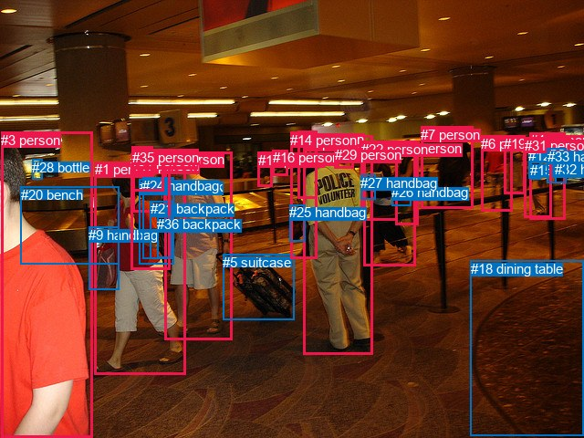
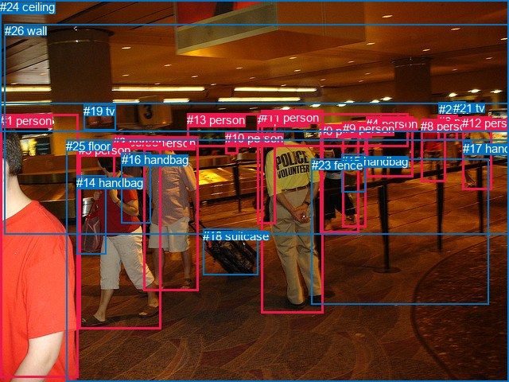

# 图片 1206：2371236.jpg

随机样本序号：315。图片 SHA256：`2757d460f5dc41dfaf6a8f7d61000663d697af89bb8dd7aa9b7771b2bc1c8776`。

红色框表示人，蓝色框表示其他物体。两个模式分别保留自身框编号，可依据位置比较对应对象。

## 自动检测框与输出

人的框编号：`[0, 1, 2, 3, 4, 6, 7, 8, 10, 11, 13, 14, 16, 17, 19, 22, 29, 30, 31, 34, 35]`。状态：`ok`。

### 自动检测全部物体框

| 编号 | 类别 | 是否为人 | 检测分数 | 像素坐标 xyxy |
|---|---|---|---|---|
| 0 | person | True | 0.9997 | 332.8, 148.0, 408.3, 388.2 |
| 1 | person | True | 0.9993 | 103.7, 177.4, 203.7, 410.8 |
| 2 | person | True | 0.9984 | 180.6, 166.1, 254.1, 372.0 |
| 3 | person | True | 0.9984 | 1.4, 144.5, 101.7, 480.0 |
| 4 | person | True | 0.9956 | 580.8, 145.3, 619.3, 240.2 |
| 5 | suitcase | False | 0.9948 | 244.3, 278.5, 322.9, 350.3 |
| 6 | person | True | 0.9945 | 527.0, 148.9, 561.5, 231.8 |
| 7 | person | True | 0.9941 | 461.4, 138.8, 518.5, 228.2 |
| 8 | person | True | 0.9869 | 398.5, 154.7, 455.1, 291.4 |
| 9 | handbag | False | 0.9840 | 97.2, 248.9, 130.1, 317.2 |
| 10 | person | True | 0.9556 | 433.5, 154.3, 459.0, 246.7 |
| 11 | person | True | 0.9435 | 282.6, 166.7, 298.3, 204.1 |
| 12 | handbag | False | 0.9046 | 579.2, 161.5, 592.5, 195.4 |
| 13 | person | True | 0.8806 | 326.4, 143.6, 347.4, 217.3 |
| 14 | person | True | 0.8460 | 318.4, 144.7, 347.3, 283.1 |
| 15 | handbag | False | 0.8082 | 581.3, 177.7, 592.0, 196.6 |
| 16 | person | True | 0.7961 | 298.5, 164.3, 315.6, 192.6 |
| 17 | person | True | 0.7549 | 145.1, 173.5, 181.0, 232.4 |
| 18 | dining table | False | 0.6801 | 515.5, 285.6, 640.0, 477.3 |
| 19 | person | True | 0.6706 | 552.4, 148.8, 575.8, 212.1 |
| 20 | bench | False | 0.6226 | 22.7, 204.8, 130.0, 289.6 |
| 21 | backpack | False | 0.6088 | 164.7, 220.4, 191.0, 283.2 |
| 22 | person | True | 0.5990 | 396.0, 155.0, 435.6, 241.8 |
| 23 | backpack | False | 0.5974 | 152.6, 196.3, 190.3, 289.5 |
| 24 | handbag | False | 0.5840 | 156.4, 194.6, 190.4, 283.6 |
| 25 | handbag | False | 0.5641 | 317.2, 224.1, 334.1, 264.3 |
| 26 | handbag | False | 0.5500 | 429.0, 202.2, 450.8, 225.2 |
| 27 | handbag | False | 0.5294 | 395.2, 191.7, 411.0, 219.0 |
| 28 | bottle | False | 0.5169 | 35.4, 174.7, 46.6, 196.5 |
| 29 | person | True | 0.4883 | 366.7, 161.4, 387.8, 184.6 |
| 30 | person | True | 0.4842 | 144.5, 161.0, 167.8, 183.0 |
| 31 | person | True | 0.4740 | 574.7, 150.9, 604.0, 238.7 |
| 32 | handbag | False | 0.4475 | 608.0, 176.8, 620.7, 200.8 |
| 33 | handbag | False | 0.4080 | 600.0, 162.6, 620.6, 200.8 |
| 34 | person | True | 0.4068 | 143.4, 168.2, 186.3, 295.0 |
| 35 | person | True | 0.3792 | 144.8, 163.7, 179.1, 209.2 |
| 36 | backpack | False | 0.3679 | 172.2, 237.1, 188.3, 282.5 |

### 自动检测 Top50 人相关候选

评分物体对：1332；人相关物体对：1092；输出关系：50。

| 排名 | 主语编号与类别 | 关系 | 宾语编号与类别 | 类型 | 人与人 | 排序分数 | 原始融合 logit |
|---|---|---|---|---|---|---|---|
| 1 | #14 person | pulling | #5 suitcase | semantic | False | 0.99275 | 4.9195 |
| 2 | #2 person | pulling | #5 suitcase | semantic | False | 0.99179 | 4.7944 |
| 3 | #0 person | pulling | #5 suitcase | semantic | False | 0.98971 | 4.5665 |
| 4 | #8 person | carrying | #26 handbag | semantic | False | 0.98189 | 3.9930 |
| 5 | #13 person | pulling | #5 suitcase | semantic | False | 0.98106 | 3.9474 |
| 6 | #10 person | carrying | #26 handbag | semantic | False | 0.98098 | 3.9429 |
| 7 | #31 person | carrying | #15 handbag | semantic | False | 0.98052 | 3.9189 |
| 8 | #1 person | carrying | #9 handbag | semantic | False | 0.97626 | 3.7168 |
| 9 | #1 person | pulling | #5 suitcase | semantic | False | 0.97230 | 3.5584 |
| 10 | #31 person | carrying | #12 handbag | semantic | False | 0.97176 | 3.5383 |
| 11 | #4 person | carrying | #15 handbag | semantic | False | 0.96931 | 3.4525 |
| 12 | #11 person | pulling | #5 suitcase | semantic | False | 0.96552 | 3.3322 |
| 13 | #34 person | wearing | #23 backpack | semantic | False | 0.96464 | 3.3061 |
| 14 | #16 person | pulling | #5 suitcase | semantic | False | 0.96454 | 3.3032 |
| 15 | #34 person | pulling | #5 suitcase | semantic | False | 0.95998 | 3.1774 |
| 16 | #31 person | walking on | #18 dining table | semantic | False | 0.95675 | 3.0965 |
| 17 | #4 person | carrying | #12 handbag | semantic | False | 0.95649 | 3.0903 |
| 18 | #4 person | walking on | #18 dining table | semantic | False | 0.95572 | 3.0720 |
| 19 | #4 person | wearing | #33 handbag | semantic | False | 0.95232 | 2.9944 |
| 20 | #34 person | wearing | #24 handbag | semantic | False | 0.94881 | 2.9197 |
| 21 | #4 person | carrying | #32 handbag | semantic | False | 0.94738 | 2.8906 |
| 22 | #14 person | carrying | #25 handbag | semantic | False | 0.94244 | 2.7956 |
| 23 | #1 person | wearing | #23 backpack | semantic | False | 0.94149 | 2.7782 |
| 24 | #34 person | wearing | #30 person | semantic | True | 0.94002 | 2.7519 |
| 25 | #7 person | walking on | #18 dining table | semantic | False | 0.93561 | 2.6763 |
| 26 | #1 person | carrying | #21 backpack | semantic | False | 0.93336 | 2.6395 |
| 27 | #34 person | wearing | #17 person | semantic | True | 0.92823 | 2.5599 |
| 28 | #0 person | wearing | #29 person | semantic | True | 0.92816 | 2.5587 |
| 29 | #6 person | walking on | #18 dining table | semantic | False | 0.92800 | 2.5563 |
| 30 | #8 person | pulling | #5 suitcase | semantic | False | 0.92725 | 2.5452 |
| 31 | #1 person | wearing | #24 handbag | semantic | False | 0.92218 | 2.4723 |
| 32 | #34 person | in | #23 backpack | spatial | False | 0.92112 | 2.4577 |
| 33 | #8 person | wearing | #22 person | semantic | True | 0.91905 | 2.4295 |
| 34 | #35 person | wearing | #30 person | semantic | True | 0.91877 | 2.4258 |
| 35 | #1 person | carrying | #36 backpack | semantic | False | 0.91810 | 2.4168 |
| 36 | #2 person | walking on | #18 dining table | semantic | False | 0.91015 | 2.3154 |
| 37 | #19 person | walking on | #18 dining table | semantic | False | 0.90960 | 2.3087 |
| 38 | #14 person | wearing | #13 person | semantic | True | 0.90390 | 2.2414 |
| 39 | #30 person | on | #35 person | spatial | True | 0.90033 | 2.2009 |
| 40 | #34 person | carrying | #21 backpack | semantic | False | 0.89797 | 2.1749 |
| 41 | #34 person | in | #24 handbag | spatial | False | 0.89165 | 2.1077 |
| 42 | #34 person | carrying | #36 backpack | semantic | False | 0.88955 | 2.0862 |
| 43 | #22 person | carrying | #26 handbag | semantic | False | 0.88888 | 2.0794 |
| 44 | #34 person | in | #17 person | spatial | True | 0.88074 | 1.9995 |
| 45 | #4 person | in | #33 handbag | spatial | False | 0.87959 | 1.9885 |
| 46 | #22 person | pulling | #5 suitcase | semantic | False | 0.87906 | 1.9836 |
| 47 | #10 person | pulling | #5 suitcase | semantic | False | 0.87523 | 1.9480 |
| 48 | #0 person | in | #29 person | spatial | True | 0.86540 | 1.8609 |
| 49 | #17 person | pulling | #5 suitcase | semantic | False | 0.86434 | 1.8518 |
| 50 | #34 person | in | #35 person | spatial | True | 0.86067 | 1.8209 |

### 自动检测逐条人相关 GT 核验

R@50：20.00%；命中 2/10。

| GT 主语编号 | GT 关系 | GT 宾语编号 | 结果阶段 | 匹配预测主语编号 | 匹配预测宾语编号 |
|---|---|---|---|---|---|
| 2 | pulling | 18 | hit50 | [2] | [5] |
| 2 | walking on | 25 | endpoint_missing_or_wrong_class | [2] | [] |
| 5 | in front of | 2 | wrong_predicate | [1] | [2] |
| 5 | beside | 3 | wrong_predicate | [1] | [17, 35] |
| 5 | carrying | 14 | hit50 | [1] | [9] |
| 5 | carrying | 16 | wrong_predicate | [1] | [24] |
| 5 | walking on | 25 | endpoint_missing_or_wrong_class | [1] | [] |
| 9 | beside | 0 | wrong_predicate | [10] | [8] |
| 11 | standing on | 25 | endpoint_missing_or_wrong_class | [0] | [] |
| 24 | over | 11 | endpoint_missing_or_wrong_class | [] | [0] |

## 真实框与输出

人的框编号：`[0, 1, 2, 3, 4, 5, 6, 7, 8, 9, 10, 11, 12, 13]`。

### 真实框全部物体框

| 编号 | 类别 | 是否为人 | 检测分数 | 像素坐标 xyxy |
|---|---|---|---|---|
| 0 | person | True | GT | 402.0, 156.0, 451.0, 292.0 |
| 1 | person | True | GT | 0.0, 143.0, 98.0, 474.0 |
| 2 | person | True | GT | 181.0, 171.0, 249.0, 365.0 |
| 3 | person | True | GT | 142.0, 170.0, 182.0, 227.0 |
| 4 | person | True | GT | 460.0, 147.0, 519.0, 223.0 |
| 5 | person | True | GT | 99.0, 180.0, 202.0, 414.0 |
| 6 | person | True | GT | 551.0, 144.0, 576.0, 176.0 |
| 7 | person | True | GT | 324.0, 142.0, 347.0, 282.0 |
| 8 | person | True | GT | 529.0, 150.0, 560.0, 229.0 |
| 9 | person | True | GT | 431.0, 153.0, 461.0, 285.0 |
| 10 | person | True | GT | 283.0, 165.0, 299.0, 194.0 |
| 11 | person | True | GT | 328.0, 139.0, 406.0, 394.0 |
| 12 | person | True | GT | 581.0, 146.0, 618.0, 238.0 |
| 13 | person | True | GT | 235.0, 142.0, 513.0, 184.0 |
| 14 | handbag | False | GT | 96.0, 221.0, 134.0, 320.0 |
| 15 | handbag | False | GT | 429.0, 194.0, 459.0, 241.0 |
| 16 | handbag | False | GT | 153.0, 192.0, 190.0, 281.0 |
| 17 | handbag | False | GT | 582.0, 178.0, 592.0, 194.0 |
| 18 | suitcase | False | GT | 255.0, 288.0, 324.0, 346.0 |
| 19 | tv | False | GT | 105.0, 131.0, 145.0, 163.0 |
| 20 | tv | False | GT | 552.0, 129.0, 569.0, 141.0 |
| 21 | tv | False | GT | 570.0, 127.0, 586.0, 139.0 |
| 22 | light | False | GT | 0.0, 0.0, 640.0, 166.0 |
| 23 | fence | False | GT | 392.0, 199.0, 615.0, 382.0 |
| 24 | ceiling | False | GT | 0.0, 0.0, 640.0, 130.0 |
| 25 | floor | False | GT | 83.0, 175.0, 640.0, 480.0 |
| 26 | wall | False | GT | 6.0, 30.0, 640.0, 294.0 |

### 真实框 Top50 人相关候选

评分物体对：702；人相关物体对：546；输出关系：50。

| 排名 | 主语编号与类别 | 关系 | 宾语编号与类别 | 类型 | 人与人 | 排序分数 | 原始融合 logit |
|---|---|---|---|---|---|---|---|
| 1 | #11 person | pulling | #18 suitcase | semantic | False | 0.99282 | 4.9296 |
| 2 | #7 person | pulling | #18 suitcase | semantic | False | 0.99000 | 4.5950 |
| 3 | #9 person | carrying | #15 handbag | semantic | False | 0.98843 | 4.4475 |
| 4 | #4 person | walking on | #25 floor | semantic | False | 0.98601 | 4.2550 |
| 5 | #2 person | pulling | #18 suitcase | semantic | False | 0.98594 | 4.2502 |
| 6 | #5 person | carrying | #14 handbag | semantic | False | 0.98528 | 4.2039 |
| 7 | #0 person | walking on | #25 floor | semantic | False | 0.98265 | 4.0365 |
| 8 | #8 person | walking on | #25 floor | semantic | False | 0.97971 | 3.8772 |
| 9 | #9 person | walking on | #25 floor | semantic | False | 0.97847 | 3.8164 |
| 10 | #12 person | carrying | #17 handbag | semantic | False | 0.97792 | 3.7909 |
| 11 | #0 person | carrying | #15 handbag | semantic | False | 0.97705 | 3.7512 |
| 12 | #12 person | walking on | #25 floor | semantic | False | 0.97703 | 3.7504 |
| 13 | #4 person | walking on | #23 fence | semantic | False | 0.97439 | 3.6387 |
| 14 | #11 person | standing on | #25 floor | semantic | False | 0.96936 | 3.4544 |
| 15 | #8 person | walking on | #23 fence | semantic | False | 0.96848 | 3.4250 |
| 16 | #12 person | walking on | #23 fence | semantic | False | 0.96541 | 3.3290 |
| 17 | #7 person | walking on | #25 floor | semantic | False | 0.96403 | 3.2884 |
| 18 | #2 person | walking on | #25 floor | semantic | False | 0.96340 | 3.2704 |
| 19 | #5 person | walking on | #25 floor | semantic | False | 0.96289 | 3.2560 |
| 20 | #5 person | pulling | #18 suitcase | semantic | False | 0.95822 | 3.1327 |
| 21 | #5 person | carrying | #16 handbag | semantic | False | 0.95628 | 3.0852 |
| 22 | #0 person | walking on | #23 fence | semantic | False | 0.95602 | 3.0790 |
| 23 | #9 person | walking on | #23 fence | semantic | False | 0.95431 | 3.0392 |
| 24 | #1 person | walking on | #25 floor | semantic | False | 0.95409 | 3.0341 |
| 25 | #13 person | in | #26 wall | spatial | False | 0.94427 | 2.8299 |
| 26 | #10 person | pulling | #18 suitcase | semantic | False | 0.94335 | 2.8126 |
| 27 | #10 person | walking on | #25 floor | semantic | False | 0.94172 | 2.7825 |
| 28 | #11 person | on | #25 floor | spatial | False | 0.92761 | 2.5506 |
| 29 | #4 person | on | #25 floor | spatial | False | 0.91951 | 2.4357 |
| 30 | #9 person | pulling | #18 suitcase | semantic | False | 0.91866 | 2.4243 |
| 31 | #0 person | pulling | #18 suitcase | semantic | False | 0.90889 | 2.3002 |
| 32 | #7 person | on | #25 floor | spatial | False | 0.90730 | 2.2811 |
| 33 | #8 person | on | #25 floor | spatial | False | 0.89420 | 2.1344 |
| 34 | #5 person | on | #25 floor | spatial | False | 0.89146 | 2.1057 |
| 35 | #1 person | on | #25 floor | spatial | False | 0.89015 | 2.0922 |
| 36 | #2 person | on | #25 floor | spatial | False | 0.88936 | 2.0842 |
| 37 | #0 person | on | #25 floor | spatial | False | 0.88559 | 2.0465 |
| 38 | #12 person | on | #25 floor | spatial | False | 0.87682 | 1.9626 |
| 39 | #5 person | wearing | #3 person | semantic | True | 0.87173 | 1.9164 |
| 40 | #9 person | on | #25 floor | spatial | False | 0.86630 | 1.8686 |
| 41 | #8 person | on | #23 fence | spatial | False | 0.86052 | 1.8197 |
| 42 | #4 person | on | #23 fence | spatial | False | 0.85982 | 1.8138 |
| 43 | #9 person | in | #15 handbag | spatial | False | 0.85739 | 1.7938 |
| 44 | #5 person | in | #16 handbag | spatial | False | 0.85594 | 1.7820 |
| 45 | #12 person | on | #23 fence | spatial | False | 0.85298 | 1.7581 |
| 46 | #8 person | carrying | #6 person | semantic | True | 0.83394 | 1.6138 |
| 47 | #3 person | pulling | #18 suitcase | semantic | False | 0.82166 | 1.5277 |
| 48 | #10 person | in | #26 wall | spatial | False | 0.82144 | 1.5262 |
| 49 | #10 person | on | #25 floor | spatial | False | 0.81692 | 1.4956 |
| 50 | #4 person | in | #26 wall | spatial | False | 0.80977 | 1.4485 |

### 真实框逐条人相关 GT 核验

R@50：60.00%；命中 6/10。

| GT 主语编号 | GT 关系 | GT 宾语编号 | 结果阶段 | 匹配预测主语编号 | 匹配预测宾语编号 |
|---|---|---|---|---|---|
| 2 | pulling | 18 | hit50 | [2] | [18] |
| 2 | walking on | 25 | hit50 | [2] | [25] |
| 5 | in front of | 2 | wrong_predicate | [5] | [2] |
| 5 | beside | 3 | wrong_predicate | [5] | [3] |
| 5 | carrying | 14 | hit50 | [5] | [14] |
| 5 | carrying | 16 | hit50 | [5] | [16] |
| 5 | walking on | 25 | hit50 | [5] | [25] |
| 9 | beside | 0 | rank_below50 | [9] | [0] |
| 11 | standing on | 25 | hit50 | [11] | [25] |
| 24 | over | 11 | rank_below50 | [24] | [11] |

## 全部人相关 GT

| 主语编号与类别 | 关系 | 宾语编号与类别 |
|---|---|---|
| #2 person | pulling | #18 suitcase |
| #2 person | walking on | #25 floor |
| #5 person | in front of | #2 person |
| #5 person | beside | #3 person |
| #5 person | carrying | #14 handbag |
| #5 person | carrying | #16 handbag |
| #5 person | walking on | #25 floor |
| #9 person | beside | #0 person |
| #11 person | standing on | #25 floor |
| #24 ceiling | over | #11 person |

原始记录、全部人相关物体对的两项预测与分项分数见 [逐图证据 JSON](../evidence/cases/1206.json)。全部56类 logits 保留于本机 HOR/output/random500/logits/。

<!-- HOR_COMPLETE_RESULTS -->

## 六组条件的完整输出对照

以下保留同一图片三种框与候选模式、两种谓词输出规则的全部 Top50。框编号各自在所属模式内解释。

### 自动检测框完整枚举：空间与语义各保留一个谓词

| 排名 | 主语编号与类别 | 谓词 | 宾语编号与类别 | 分组 | 排序分数 | predicate logit | pair logit |
|---|---|---|---|---|---|---|---|
| 1 | #14 person | pulling | #5 suitcase | semantic | 0.9927500 | 5.2315640 | -0.3120774 |
| 2 | #2 person | pulling | #5 suitcase | semantic | 0.9917923 | 5.0510716 | -0.2566281 |
| 3 | #0 person | pulling | #5 suitcase | semantic | 0.9897122 | 4.8103070 | -0.2438469 |
| 4 | #8 person | carrying | #26 handbag | semantic | 0.9818906 | 3.6107554 | 0.3822922 |
| 5 | #13 person | pulling | #5 suitcase | semantic | 0.9810611 | 4.7501531 | -0.8027349 |
| 6 | #10 person | carrying | #26 handbag | semantic | 0.9809779 | 3.6592870 | 0.2836618 |
| 7 | #31 person | carrying | #15 handbag | semantic | 0.9805233 | 3.8883662 | 0.0304972 |
| 8 | #1 person | carrying | #9 handbag | semantic | 0.9762647 | 3.5253425 | 0.1914259 |
| 9 | #1 person | pulling | #5 suitcase | semantic | 0.9723034 | 4.0881896 | -0.5298308 |
| 10 | #31 person | carrying | #12 handbag | semantic | 0.9717591 | 3.6289954 | -0.0906577 |
| 11 | #4 person | carrying | #15 handbag | semantic | 0.9693053 | 3.4395289 | 0.0129619 |
| 12 | #11 person | pulling | #5 suitcase | semantic | 0.9655173 | 4.2686601 | -0.9364514 |
| 13 | #34 person | wearing | #23 backpack | semantic | 0.9646369 | 3.2504435 | 0.0556401 |
| 14 | #16 person | pulling | #5 suitcase | semantic | 0.9645377 | 4.2085071 | -0.9053254 |
| 15 | #34 person | pulling | #5 suitcase | semantic | 0.9599758 | 3.9076715 | -0.7302499 |
| 16 | #31 person | walking on | #18 dining table | semantic | 0.9567476 | 3.2920461 | -0.1955592 |
| 17 | #4 person | carrying | #12 handbag | semantic | 0.9564891 | 3.1918082 | -0.1015512 |
| 18 | #4 person | walking on | #18 dining table | semantic | 0.9557239 | 3.2469163 | -0.1748903 |
| 19 | #4 person | wearing | #33 handbag | semantic | 0.9523183 | 2.9215503 | 0.0728014 |
| 20 | #34 person | wearing | #24 handbag | semantic | 0.9488103 | 2.8628707 | 0.0567999 |
| 21 | #4 person | carrying | #32 handbag | semantic | 0.9473776 | 2.7175384 | 0.1730182 |
| 22 | #14 person | carrying | #25 handbag | semantic | 0.9424366 | 2.8194628 | -0.0238820 |
| 23 | #1 person | wearing | #23 backpack | semantic | 0.9414863 | 2.5897942 | 0.1884043 |
| 24 | #34 person | wearing | #30 person | semantic | 0.9400233 | 2.7820773 | -0.0301298 |
| 25 | #7 person | walking on | #18 dining table | semantic | 0.9356122 | 3.3101087 | -0.6338327 |
| 26 | #1 person | carrying | #21 backpack | semantic | 0.9333630 | 2.5115600 | 0.1279742 |
| 27 | #34 person | wearing | #17 person | semantic | 0.9282342 | 2.7086554 | -0.1487796 |
| 28 | #0 person | wearing | #29 person | semantic | 0.9281577 | 2.3672733 | 0.1914552 |
| 29 | #6 person | walking on | #18 dining table | semantic | 0.9279987 | 2.9971547 | -0.4408090 |
| 30 | #8 person | pulling | #5 suitcase | semantic | 0.9272516 | 3.4261842 | -0.8809657 |
| 31 | #1 person | wearing | #24 handbag | semantic | 0.9221804 | 2.3174696 | 0.1548771 |
| 32 | #34 person | in | #23 backpack | spatial | 0.9211225 | 2.4020572 | 0.0556401 |
| 33 | #8 person | wearing | #22 person | semantic | 0.9190513 | 2.5017757 | -0.0722485 |
| 34 | #35 person | wearing | #30 person | semantic | 0.9187700 | 2.9126749 | -0.4869242 |
| 35 | #1 person | carrying | #36 backpack | semantic | 0.9181006 | 2.2733598 | 0.1434559 |
| 36 | #2 person | walking on | #18 dining table | semantic | 0.9101481 | 2.7564526 | -0.4410076 |
| 37 | #19 person | walking on | #18 dining table | semantic | 0.9095975 | 2.6962562 | -0.3875261 |
| 38 | #14 person | wearing | #13 person | semantic | 0.9039019 | 2.5133657 | -0.2720145 |
| 39 | #30 person | on | #35 person | spatial | 0.9003288 | 2.7295098 | -0.5286272 |
| 40 | #34 person | carrying | #21 backpack | semantic | 0.8979725 | 2.1075578 | 0.0673382 |
| 41 | #34 person | in | #24 handbag | spatial | 0.8916511 | 2.0509181 | 0.0567999 |
| 42 | #34 person | carrying | #36 backpack | semantic | 0.8895505 | 2.0266047 | 0.0595529 |
| 43 | #22 person | carrying | #26 handbag | semantic | 0.8888821 | 2.1182432 | -0.0388699 |
| 44 | #34 person | in | #17 person | spatial | 0.8807420 | 2.1482549 | -0.1487796 |
| 45 | #4 person | in | #33 handbag | spatial | 0.8795866 | 1.9157200 | 0.0728014 |
| 46 | #22 person | pulling | #5 suitcase | semantic | 0.8790606 | 3.1856546 | -1.2020907 |
| 47 | #10 person | pulling | #5 suitcase | semantic | 0.8752257 | 3.1856227 | -1.2376472 |
| 48 | #0 person | in | #29 person | spatial | 0.8654019 | 1.6694455 | 0.1914552 |
| 49 | #17 person | pulling | #5 suitcase | semantic | 0.8643411 | 3.1254210 | -1.2735972 |
| 50 | #34 person | in | #35 person | spatial | 0.8606735 | 1.7561784 | 0.0647167 |

GT 命中：2/10，R@50=20.00%。

| GT主语 | GT谓词 | GT宾语 | 结果阶段 | 匹配主语框 | 匹配宾语框 |
|---|---|---|---|---|---|
| 2 | pulling | 18 | hit50 | [2] | [5] |
| 2 | walking on | 25 | endpoint_missing_or_wrong_class | [2] | [] |
| 5 | in front of | 2 | wrong_predicate | [1] | [2] |
| 5 | beside | 3 | wrong_predicate | [1] | [17, 35] |
| 5 | carrying | 14 | hit50 | [1] | [9] |
| 5 | carrying | 16 | wrong_predicate | [1] | [24] |
| 5 | walking on | 25 | endpoint_missing_or_wrong_class | [1] | [] |
| 9 | beside | 0 | wrong_predicate | [10] | [8] |
| 11 | standing on | 25 | endpoint_missing_or_wrong_class | [0] | [] |
| 24 | over | 11 | endpoint_missing_or_wrong_class | [] | [0] |

### 自动检测框完整枚举：每对只保留一个谓词

| 排名 | 主语编号与类别 | 谓词 | 宾语编号与类别 | 分组 | 排序分数 | predicate logit | pair logit |
|---|---|---|---|---|---|---|---|
| 1 | #14 person | pulling | #5 suitcase | single | 0.9927500 | 5.2315640 | -0.3120774 |
| 2 | #2 person | pulling | #5 suitcase | single | 0.9917923 | 5.0510716 | -0.2566281 |
| 3 | #0 person | pulling | #5 suitcase | single | 0.9897122 | 4.8103070 | -0.2438469 |
| 4 | #8 person | carrying | #26 handbag | single | 0.9818906 | 3.6107554 | 0.3822922 |
| 5 | #13 person | pulling | #5 suitcase | single | 0.9810611 | 4.7501531 | -0.8027349 |
| 6 | #10 person | carrying | #26 handbag | single | 0.9809779 | 3.6592870 | 0.2836618 |
| 7 | #31 person | carrying | #15 handbag | single | 0.9805233 | 3.8883662 | 0.0304972 |
| 8 | #1 person | carrying | #9 handbag | single | 0.9762647 | 3.5253425 | 0.1914259 |
| 9 | #1 person | pulling | #5 suitcase | single | 0.9723034 | 4.0881896 | -0.5298308 |
| 10 | #31 person | carrying | #12 handbag | single | 0.9717591 | 3.6289954 | -0.0906577 |
| 11 | #4 person | carrying | #15 handbag | single | 0.9693053 | 3.4395289 | 0.0129619 |
| 12 | #11 person | pulling | #5 suitcase | single | 0.9655173 | 4.2686601 | -0.9364514 |
| 13 | #34 person | wearing | #23 backpack | single | 0.9646369 | 3.2504435 | 0.0556401 |
| 14 | #16 person | pulling | #5 suitcase | single | 0.9645377 | 4.2085071 | -0.9053254 |
| 15 | #34 person | pulling | #5 suitcase | single | 0.9599758 | 3.9076715 | -0.7302499 |
| 16 | #31 person | walking on | #18 dining table | single | 0.9567476 | 3.2920461 | -0.1955592 |
| 17 | #4 person | carrying | #12 handbag | single | 0.9564891 | 3.1918082 | -0.1015512 |
| 18 | #4 person | walking on | #18 dining table | single | 0.9557239 | 3.2469163 | -0.1748903 |
| 19 | #4 person | wearing | #33 handbag | single | 0.9523183 | 2.9215503 | 0.0728014 |
| 20 | #34 person | wearing | #24 handbag | single | 0.9488103 | 2.8628707 | 0.0567999 |
| 21 | #4 person | carrying | #32 handbag | single | 0.9473776 | 2.7175384 | 0.1730182 |
| 22 | #14 person | carrying | #25 handbag | single | 0.9424366 | 2.8194628 | -0.0238820 |
| 23 | #1 person | wearing | #23 backpack | single | 0.9414863 | 2.5897942 | 0.1884043 |
| 24 | #34 person | wearing | #30 person | single | 0.9400233 | 2.7820773 | -0.0301298 |
| 25 | #7 person | walking on | #18 dining table | single | 0.9356122 | 3.3101087 | -0.6338327 |
| 26 | #1 person | carrying | #21 backpack | single | 0.9333630 | 2.5115600 | 0.1279742 |
| 27 | #34 person | wearing | #17 person | single | 0.9282342 | 2.7086554 | -0.1487796 |
| 28 | #0 person | wearing | #29 person | single | 0.9281577 | 2.3672733 | 0.1914552 |
| 29 | #6 person | walking on | #18 dining table | single | 0.9279987 | 2.9971547 | -0.4408090 |
| 30 | #8 person | pulling | #5 suitcase | single | 0.9272516 | 3.4261842 | -0.8809657 |
| 31 | #1 person | wearing | #24 handbag | single | 0.9221804 | 2.3174696 | 0.1548771 |
| 32 | #8 person | wearing | #22 person | single | 0.9190513 | 2.5017757 | -0.0722485 |
| 33 | #35 person | wearing | #30 person | single | 0.9187700 | 2.9126749 | -0.4869242 |
| 34 | #1 person | carrying | #36 backpack | single | 0.9181006 | 2.2733598 | 0.1434559 |
| 35 | #2 person | walking on | #18 dining table | single | 0.9101481 | 2.7564526 | -0.4410076 |
| 36 | #19 person | walking on | #18 dining table | single | 0.9095975 | 2.6962562 | -0.3875261 |
| 37 | #14 person | wearing | #13 person | single | 0.9039019 | 2.5133657 | -0.2720145 |
| 38 | #30 person | on | #35 person | single | 0.9003288 | 2.7295098 | -0.5286272 |
| 39 | #34 person | carrying | #21 backpack | single | 0.8979725 | 2.1075578 | 0.0673382 |
| 40 | #34 person | carrying | #36 backpack | single | 0.8895505 | 2.0266047 | 0.0595529 |
| 41 | #22 person | carrying | #26 handbag | single | 0.8888821 | 2.1182432 | -0.0388699 |
| 42 | #22 person | pulling | #5 suitcase | single | 0.8790606 | 3.1856546 | -1.2020907 |
| 43 | #10 person | pulling | #5 suitcase | single | 0.8752257 | 3.1856227 | -1.2376472 |
| 44 | #17 person | pulling | #5 suitcase | single | 0.8643411 | 3.1254210 | -1.2735972 |
| 45 | #34 person | in | #35 person | single | 0.8606735 | 1.7561784 | 0.0647167 |
| 46 | #1 person | walking on | #18 dining table | single | 0.8590667 | 2.4405017 | -0.6329422 |
| 47 | #3 person | wearing | #28 bottle | single | 0.8510969 | 1.7344604 | 0.0087692 |
| 48 | #8 person | walking on | #18 dining table | single | 0.8266844 | 2.3923192 | -0.8300104 |
| 49 | #0 person | walking on | #18 dining table | single | 0.8203968 | 2.3742981 | -0.8552603 |
| 50 | #31 person | carrying | #33 handbag | single | 0.8049055 | 1.4030437 | 0.0141971 |

GT 命中：2/10，R@50=20.00%。

| GT主语 | GT谓词 | GT宾语 | 结果阶段 | 匹配主语框 | 匹配宾语框 |
|---|---|---|---|---|---|
| 2 | pulling | 18 | hit50 | [2] | [5] |
| 2 | walking on | 25 | endpoint_missing_or_wrong_class | [2] | [] |
| 5 | in front of | 2 | wrong_predicate | [1] | [2] |
| 5 | beside | 3 | wrong_predicate | [1] | [17, 35] |
| 5 | carrying | 14 | hit50 | [1] | [9] |
| 5 | carrying | 16 | wrong_predicate | [1] | [24] |
| 5 | walking on | 25 | endpoint_missing_or_wrong_class | [1] | [] |
| 9 | beside | 0 | wrong_predicate | [10] | [8] |
| 11 | standing on | 25 | endpoint_missing_or_wrong_class | [0] | [] |
| 24 | over | 11 | endpoint_missing_or_wrong_class | [] | [0] |

### 真实框完整枚举：空间与语义各保留一个谓词

| 排名 | 主语编号与类别 | 谓词 | 宾语编号与类别 | 分组 | 排序分数 | predicate logit | pair logit |
|---|---|---|---|---|---|---|---|
| 1 | #11 person | pulling | #18 suitcase | semantic | 0.9928225 | 5.2314906 | -0.3018943 |
| 2 | #7 person | pulling | #18 suitcase | semantic | 0.9899983 | 4.9306035 | -0.3356535 |
| 3 | #9 person | carrying | #15 handbag | semantic | 0.9884271 | 4.0988059 | 0.3486486 |
| 4 | #4 person | walking on | #25 floor | semantic | 0.9860061 | 4.3361945 | -0.0811526 |
| 5 | #2 person | pulling | #18 suitcase | semantic | 0.9859387 | 4.5695510 | -0.3193866 |
| 6 | #5 person | carrying | #14 handbag | semantic | 0.9852831 | 3.9718509 | 0.2320881 |
| 7 | #0 person | walking on | #25 floor | semantic | 0.9826465 | 4.1345735 | -0.0981226 |
| 8 | #8 person | walking on | #25 floor | semantic | 0.9797118 | 3.9149165 | -0.0376978 |
| 9 | #9 person | walking on | #25 floor | semantic | 0.9784679 | 3.9119058 | -0.0954595 |
| 10 | #12 person | carrying | #17 handbag | semantic | 0.9779226 | 3.7913032 | -0.0004297 |
| 11 | #0 person | carrying | #15 handbag | semantic | 0.9770492 | 3.3723559 | 0.3788258 |
| 12 | #12 person | walking on | #25 floor | semantic | 0.9770322 | 3.8065944 | -0.0561664 |
| 13 | #4 person | walking on | #23 fence | semantic | 0.9743868 | 3.9359622 | -0.2972600 |
| 14 | #11 person | standing on | #25 floor | semantic | 0.9693606 | 3.6223855 | -0.1680352 |
| 15 | #8 person | walking on | #23 fence | semantic | 0.9684777 | 3.6230083 | -0.1979798 |
| 16 | #12 person | walking on | #23 fence | semantic | 0.9654099 | 3.5116744 | -0.1826888 |
| 17 | #7 person | walking on | #25 floor | semantic | 0.9640294 | 3.3161578 | -0.0277390 |
| 18 | #2 person | walking on | #25 floor | semantic | 0.9633999 | 3.2920742 | -0.0216565 |
| 19 | #5 person | walking on | #25 floor | semantic | 0.9628899 | 3.4425159 | -0.1864662 |
| 20 | #5 person | pulling | #18 suitcase | semantic | 0.9582232 | 3.7872148 | -0.6544751 |
| 21 | #5 person | carrying | #16 handbag | semantic | 0.9562770 | 2.9487481 | 0.1364248 |
| 22 | #0 person | walking on | #23 fence | semantic | 0.9560184 | 3.3672252 | -0.2882184 |
| 23 | #9 person | walking on | #23 fence | semantic | 0.9543141 | 3.2619133 | -0.2227110 |
| 24 | #1 person | walking on | #25 floor | semantic | 0.9540917 | 3.2168674 | -0.1827525 |
| 25 | #13 person | in | #26 wall | spatial | 0.9442689 | 3.0770965 | -0.2472253 |
| 26 | #10 person | pulling | #18 suitcase | semantic | 0.9433538 | 3.8472934 | -1.0346751 |
| 27 | #10 person | walking on | #25 floor | semantic | 0.9417224 | 2.9339895 | -0.1514961 |
| 28 | #11 person | on | #25 floor | spatial | 0.9276128 | 2.7186208 | -0.1680352 |
| 29 | #4 person | on | #25 floor | spatial | 0.9195109 | 2.5168729 | -0.0811526 |
| 30 | #9 person | pulling | #18 suitcase | semantic | 0.9186630 | 3.4862704 | -1.0619533 |
| 31 | #0 person | pulling | #18 suitcase | semantic | 0.9088904 | 3.1853609 | -0.8852001 |
| 32 | #7 person | on | #25 floor | spatial | 0.9072973 | 2.3088121 | -0.0277390 |
| 33 | #8 person | on | #25 floor | spatial | 0.8942034 | 2.1721125 | -0.0376978 |
| 34 | #5 person | on | #25 floor | spatial | 0.8914581 | 2.2921877 | -0.1864662 |
| 35 | #1 person | on | #25 floor | spatial | 0.8901458 | 2.2749844 | -0.1827525 |
| 36 | #2 person | on | #25 floor | spatial | 0.8893628 | 2.1059060 | -0.0216565 |
| 37 | #0 person | on | #25 floor | spatial | 0.8855911 | 2.1445990 | -0.0981226 |
| 38 | #12 person | on | #25 floor | spatial | 0.8768165 | 2.0187888 | -0.0561664 |
| 39 | #5 person | wearing | #3 person | semantic | 0.8717319 | 1.9041696 | 0.0121897 |
| 40 | #9 person | on | #25 floor | spatial | 0.8662952 | 1.9640512 | -0.0954595 |
| 41 | #8 person | on | #23 fence | spatial | 0.8605242 | 2.0176311 | -0.1979798 |
| 42 | #4 person | on | #23 fence | spatial | 0.8598207 | 2.1110611 | -0.2972600 |
| 43 | #9 person | in | #15 handbag | spatial | 0.8573871 | 1.4451070 | 0.3486486 |
| 44 | #5 person | in | #16 handbag | spatial | 0.8559426 | 1.6455665 | 0.1364248 |
| 45 | #12 person | on | #23 fence | spatial | 0.8529759 | 1.9408240 | -0.1826888 |
| 46 | #8 person | carrying | #6 person | semantic | 0.8339438 | 1.9640923 | -0.3502527 |
| 47 | #3 person | pulling | #18 suitcase | semantic | 0.8216632 | 2.9447818 | -1.4171252 |
| 48 | #10 person | in | #26 wall | spatial | 0.8214430 | 1.7137022 | -0.1875475 |
| 49 | #10 person | on | #25 floor | spatial | 0.8169169 | 1.6470938 | -0.1514961 |
| 50 | #4 person | in | #26 wall | spatial | 0.8097680 | 1.7716789 | -0.3231754 |

GT 命中：6/10，R@50=60.00%。

| GT主语 | GT谓词 | GT宾语 | 结果阶段 | 匹配主语框 | 匹配宾语框 |
|---|---|---|---|---|---|
| 2 | pulling | 18 | hit50 | [2] | [18] |
| 2 | walking on | 25 | hit50 | [2] | [25] |
| 5 | in front of | 2 | wrong_predicate | [5] | [2] |
| 5 | beside | 3 | wrong_predicate | [5] | [3] |
| 5 | carrying | 14 | hit50 | [5] | [14] |
| 5 | carrying | 16 | hit50 | [5] | [16] |
| 5 | walking on | 25 | hit50 | [5] | [25] |
| 9 | beside | 0 | rank_below50 | [9] | [0] |
| 11 | standing on | 25 | hit50 | [11] | [25] |
| 24 | over | 11 | rank_below50 | [24] | [11] |

### 真实框完整枚举：每对只保留一个谓词

| 排名 | 主语编号与类别 | 谓词 | 宾语编号与类别 | 分组 | 排序分数 | predicate logit | pair logit |
|---|---|---|---|---|---|---|---|
| 1 | #11 person | pulling | #18 suitcase | single | 0.9928225 | 5.2314906 | -0.3018943 |
| 2 | #7 person | pulling | #18 suitcase | single | 0.9899983 | 4.9306035 | -0.3356535 |
| 3 | #9 person | carrying | #15 handbag | single | 0.9884271 | 4.0988059 | 0.3486486 |
| 4 | #4 person | walking on | #25 floor | single | 0.9860061 | 4.3361945 | -0.0811526 |
| 5 | #2 person | pulling | #18 suitcase | single | 0.9859387 | 4.5695510 | -0.3193866 |
| 6 | #5 person | carrying | #14 handbag | single | 0.9852831 | 3.9718509 | 0.2320881 |
| 7 | #0 person | walking on | #25 floor | single | 0.9826465 | 4.1345735 | -0.0981226 |
| 8 | #8 person | walking on | #25 floor | single | 0.9797118 | 3.9149165 | -0.0376978 |
| 9 | #9 person | walking on | #25 floor | single | 0.9784679 | 3.9119058 | -0.0954595 |
| 10 | #12 person | carrying | #17 handbag | single | 0.9779226 | 3.7913032 | -0.0004297 |
| 11 | #0 person | carrying | #15 handbag | single | 0.9770492 | 3.3723559 | 0.3788258 |
| 12 | #12 person | walking on | #25 floor | single | 0.9770322 | 3.8065944 | -0.0561664 |
| 13 | #4 person | walking on | #23 fence | single | 0.9743868 | 3.9359622 | -0.2972600 |
| 14 | #11 person | standing on | #25 floor | single | 0.9693606 | 3.6223855 | -0.1680352 |
| 15 | #8 person | walking on | #23 fence | single | 0.9684777 | 3.6230083 | -0.1979798 |
| 16 | #12 person | walking on | #23 fence | single | 0.9654099 | 3.5116744 | -0.1826888 |
| 17 | #7 person | walking on | #25 floor | single | 0.9640294 | 3.3161578 | -0.0277390 |
| 18 | #2 person | walking on | #25 floor | single | 0.9633999 | 3.2920742 | -0.0216565 |
| 19 | #5 person | walking on | #25 floor | single | 0.9628899 | 3.4425159 | -0.1864662 |
| 20 | #5 person | pulling | #18 suitcase | single | 0.9582232 | 3.7872148 | -0.6544751 |
| 21 | #5 person | carrying | #16 handbag | single | 0.9562770 | 2.9487481 | 0.1364248 |
| 22 | #0 person | walking on | #23 fence | single | 0.9560184 | 3.3672252 | -0.2882184 |
| 23 | #9 person | walking on | #23 fence | single | 0.9543141 | 3.2619133 | -0.2227110 |
| 24 | #1 person | walking on | #25 floor | single | 0.9540917 | 3.2168674 | -0.1827525 |
| 25 | #13 person | in | #26 wall | single | 0.9442689 | 3.0770965 | -0.2472253 |
| 26 | #10 person | pulling | #18 suitcase | single | 0.9433538 | 3.8472934 | -1.0346751 |
| 27 | #10 person | walking on | #25 floor | single | 0.9417224 | 2.9339895 | -0.1514961 |
| 28 | #9 person | pulling | #18 suitcase | single | 0.9186630 | 3.4862704 | -1.0619533 |
| 29 | #0 person | pulling | #18 suitcase | single | 0.9088904 | 3.1853609 | -0.8852001 |
| 30 | #5 person | wearing | #3 person | single | 0.8717319 | 1.9041696 | 0.0121897 |
| 31 | #8 person | carrying | #6 person | single | 0.8339438 | 1.9640923 | -0.3502527 |
| 32 | #3 person | pulling | #18 suitcase | single | 0.8216632 | 2.9447818 | -1.4171252 |
| 33 | #10 person | in | #26 wall | single | 0.8214430 | 1.7137022 | -0.1875475 |
| 34 | #4 person | in | #26 wall | single | 0.8097680 | 1.7716789 | -0.3231754 |
| 35 | #3 person | wearing | #16 handbag | single | 0.8022297 | 2.0296507 | -0.6293620 |
| 36 | #10 person | looking at | #13 person | single | 0.7910096 | 1.6684184 | -0.3373967 |
| 37 | #8 person | pulling | #18 suitcase | single | 0.7759407 | 2.7342315 | -1.4920659 |
| 38 | #6 person | walking on | #25 floor | single | 0.7737918 | 1.3993635 | -0.1695158 |
| 39 | #11 person | walking on | #23 fence | single | 0.7642132 | 2.0492735 | -0.8733545 |
| 40 | #12 person | in | #26 wall | single | 0.7108514 | 1.1295838 | -0.2300613 |
| 41 | #6 person | walking on | #23 fence | single | 0.7058887 | 1.2127533 | -0.3372539 |
| 42 | #13 person | in | #22 light | single | 0.6839566 | 1.3065901 | -0.5345755 |
| 43 | #2 person | carrying | #16 handbag | single | 0.6815811 | 0.7942286 | -0.0331810 |
| 44 | #8 person | in | #26 wall | single | 0.6798383 | 1.0061231 | -0.2530942 |
| 45 | #14 handbag | carrying | #5 person | single | 0.6584603 | 1.3723526 | -0.7159125 |
| 46 | #4 person | pulling | #18 suitcase | single | 0.6511819 | 2.0421791 | -1.4179410 |
| 47 | #11 person | holding | #7 person | single | 0.6485627 | 1.3954849 | -0.7827575 |
| 48 | #4 person | walking on | #13 person | single | 0.6212757 | 1.1916938 | -0.6967275 |
| 49 | #6 person | pushing | #8 person | single | 0.6112512 | 1.1392312 | -0.6866566 |
| 50 | #12 person | pulling | #18 suitcase | single | 0.5945922 | 1.9219179 | -1.5389359 |

GT 命中：6/10，R@50=60.00%。

| GT主语 | GT谓词 | GT宾语 | 结果阶段 | 匹配主语框 | 匹配宾语框 |
|---|---|---|---|---|---|
| 2 | pulling | 18 | hit50 | [2] | [18] |
| 2 | walking on | 25 | hit50 | [2] | [25] |
| 5 | in front of | 2 | wrong_predicate | [5] | [2] |
| 5 | beside | 3 | wrong_predicate | [5] | [3] |
| 5 | carrying | 14 | hit50 | [5] | [14] |
| 5 | carrying | 16 | hit50 | [5] | [16] |
| 5 | walking on | 25 | hit50 | [5] | [25] |
| 9 | beside | 0 | wrong_predicate | [9] | [0] |
| 11 | standing on | 25 | hit50 | [11] | [25] |
| 24 | over | 11 | rank_below50 | [24] | [11] |

### 真实框400候选：空间与语义各保留一个谓词

| 排名 | 主语编号与类别 | 谓词 | 宾语编号与类别 | 分组 | 排序分数 | predicate logit | pair logit |
|---|---|---|---|---|---|---|---|
| 1 | #11 person | pulling | #18 suitcase | semantic | 0.9928226 | 5.2315097 | -0.3018943 |
| 2 | #4 person | walking on | #25 floor | semantic | 0.9893540 | 4.6130233 | -0.0811526 |
| 3 | #9 person | carrying | #15 handbag | semantic | 0.9890200 | 4.1519980 | 0.3486486 |
| 4 | #7 person | pulling | #18 suitcase | semantic | 0.9887334 | 4.8102384 | -0.3356535 |
| 5 | #2 person | pulling | #18 suitcase | semantic | 0.9867490 | 4.6297269 | -0.3193866 |
| 6 | #8 person | walking on | #25 floor | semantic | 0.9854748 | 4.2549386 | -0.0376978 |
| 7 | #0 person | walking on | #25 floor | semantic | 0.9852980 | 4.3030791 | -0.0981226 |
| 8 | #5 person | carrying | #14 handbag | semantic | 0.9852831 | 3.9718509 | 0.2320881 |
| 9 | #4 person | walking on | #23 fence | semantic | 0.9837793 | 4.4023709 | -0.2972600 |
| 10 | #9 person | walking on | #25 floor | semantic | 0.9817461 | 4.0804114 | -0.0954595 |
| 11 | #12 person | walking on | #25 floor | semantic | 0.9805819 | 3.9781108 | -0.0561664 |
| 12 | #12 person | carrying | #17 handbag | semantic | 0.9778722 | 3.7889733 | -0.0004297 |
| 13 | #8 person | walking on | #23 fence | semantic | 0.9777543 | 3.9810920 | -0.1979798 |
| 14 | #12 person | walking on | #23 fence | semantic | 0.9753504 | 3.8607268 | -0.1826888 |
| 15 | #5 person | walking on | #25 floor | semantic | 0.9746731 | 3.8367000 | -0.1864662 |
| 16 | #0 person | carrying | #15 handbag | semantic | 0.9743062 | 3.2566504 | 0.3788258 |
| 17 | #2 person | walking on | #25 floor | semantic | 0.9720844 | 3.5719132 | -0.0216565 |
| 18 | #10 person | walking on | #25 floor | semantic | 0.9717436 | 3.6892676 | -0.1514961 |
| 19 | #11 person | standing on | #25 floor | semantic | 0.9667764 | 3.5387425 | -0.1680352 |
| 20 | #7 person | walking on | #25 floor | semantic | 0.9657616 | 3.3673091 | -0.0277390 |
| 21 | #1 person | walking on | #25 floor | semantic | 0.9650062 | 3.4997153 | -0.1827525 |
| 22 | #5 person | pulling | #18 suitcase | semantic | 0.9648811 | 3.9677424 | -0.6544751 |
| 23 | #0 person | walking on | #23 fence | semantic | 0.9632288 | 3.5537944 | -0.2882184 |
| 24 | #9 person | walking on | #23 fence | semantic | 0.9617926 | 3.4484811 | -0.2227110 |
| 25 | #5 person | carrying | #16 handbag | semantic | 0.9584479 | 3.0019407 | 0.1364248 |
| 26 | #13 person | in | #26 wall | spatial | 0.9502746 | 3.1974616 | -0.2472253 |
| 27 | #4 person | on | #25 floor | spatial | 0.9339454 | 2.7300897 | -0.0811526 |
| 28 | #11 person | on | #25 floor | spatial | 0.9272268 | 2.7128859 | -0.1680352 |
| 29 | #5 person | on | #25 floor | spatial | 0.9160623 | 2.5764766 | -0.1864662 |
| 30 | #8 person | on | #25 floor | spatial | 0.9123111 | 2.3798838 | -0.0376978 |
| 31 | #1 person | on | #25 floor | spatial | 0.9093272 | 2.4882007 | -0.1827525 |
| 32 | #7 person | on | #25 floor | spatial | 0.9091129 | 2.3305912 | -0.0277390 |
| 33 | #2 person | on | #25 floor | spatial | 0.9025947 | 2.2480502 | -0.0216565 |
| 34 | #4 person | on | #23 fence | spatial | 0.9018946 | 2.5157146 | -0.2972600 |
| 35 | #8 person | on | #23 fence | spatial | 0.9014477 | 2.4113946 | -0.1979798 |
| 36 | #0 person | on | #25 floor | spatial | 0.8961967 | 2.2537847 | -0.0981226 |
| 37 | #12 person | on | #25 floor | spatial | 0.8913656 | 2.1609335 | -0.0561664 |
| 38 | #12 person | on | #23 fence | spatial | 0.8868586 | 2.2417364 | -0.1826888 |
| 39 | #4 person | in | #26 wall | spatial | 0.8842254 | 2.3562422 | -0.3231754 |
| 40 | #10 person | on | #25 floor | spatial | 0.8777533 | 2.1228199 | -0.1514961 |
| 41 | #9 person | on | #25 floor | spatial | 0.8742834 | 2.0348339 | -0.0954595 |
| 42 | #0 person | pulling | #18 suitcase | semantic | 0.8709101 | 2.7942295 | -0.8852001 |
| 43 | #9 person | pulling | #18 suitcase | semantic | 0.8679261 | 2.9446983 | -1.0619533 |
| 44 | #5 person | wearing | #3 person | semantic | 0.8612947 | 1.8138957 | 0.0121897 |
| 45 | #9 person | in | #15 handbag | spatial | 0.8540821 | 1.4183345 | 0.3486486 |
| 46 | #5 person | in | #16 handbag | spatial | 0.8500615 | 1.5986590 | 0.1364248 |
| 47 | #8 person | in | #26 wall | spatial | 0.8256158 | 1.8079624 | -0.2530942 |
| 48 | #12 person | in | #26 wall | spatial | 0.8196795 | 1.7442389 | -0.2300613 |
| 49 | #0 person | on | #23 fence | spatial | 0.8094659 | 1.7347617 | -0.2882184 |
| 50 | #4 person | walking on | #26 wall | semantic | 0.8084936 | 1.7634273 | -0.3231754 |

GT 命中：6/10，R@50=60.00%。

| GT主语 | GT谓词 | GT宾语 | 结果阶段 | 匹配主语框 | 匹配宾语框 |
|---|---|---|---|---|---|
| 2 | pulling | 18 | hit50 | [2] | [18] |
| 2 | walking on | 25 | hit50 | [2] | [25] |
| 5 | in front of | 2 | wrong_predicate | [5] | [2] |
| 5 | beside | 3 | wrong_predicate | [5] | [3] |
| 5 | carrying | 14 | hit50 | [5] | [14] |
| 5 | carrying | 16 | hit50 | [5] | [16] |
| 5 | walking on | 25 | hit50 | [5] | [25] |
| 9 | beside | 0 | rank_below50 | [9] | [0] |
| 11 | standing on | 25 | hit50 | [11] | [25] |
| 24 | over | 11 | rank_below50 | [24] | [11] |

### 真实框400候选：每对只保留一个谓词

| 排名 | 主语编号与类别 | 谓词 | 宾语编号与类别 | 分组 | 排序分数 | predicate logit | pair logit |
|---|---|---|---|---|---|---|---|
| 1 | #11 person | pulling | #18 suitcase | single | 0.9928226 | 5.2315097 | -0.3018943 |
| 2 | #4 person | walking on | #25 floor | single | 0.9893540 | 4.6130233 | -0.0811526 |
| 3 | #9 person | carrying | #15 handbag | single | 0.9890200 | 4.1519980 | 0.3486486 |
| 4 | #7 person | pulling | #18 suitcase | single | 0.9887334 | 4.8102384 | -0.3356535 |
| 5 | #2 person | pulling | #18 suitcase | single | 0.9867490 | 4.6297269 | -0.3193866 |
| 6 | #8 person | walking on | #25 floor | single | 0.9854748 | 4.2549386 | -0.0376978 |
| 7 | #0 person | walking on | #25 floor | single | 0.9852980 | 4.3030791 | -0.0981226 |
| 8 | #5 person | carrying | #14 handbag | single | 0.9852831 | 3.9718509 | 0.2320881 |
| 9 | #4 person | walking on | #23 fence | single | 0.9837793 | 4.4023709 | -0.2972600 |
| 10 | #9 person | walking on | #25 floor | single | 0.9817461 | 4.0804114 | -0.0954595 |
| 11 | #12 person | walking on | #25 floor | single | 0.9805819 | 3.9781108 | -0.0561664 |
| 12 | #12 person | carrying | #17 handbag | single | 0.9778722 | 3.7889733 | -0.0004297 |
| 13 | #8 person | walking on | #23 fence | single | 0.9777543 | 3.9810920 | -0.1979798 |
| 14 | #12 person | walking on | #23 fence | single | 0.9753504 | 3.8607268 | -0.1826888 |
| 15 | #5 person | walking on | #25 floor | single | 0.9746731 | 3.8367000 | -0.1864662 |
| 16 | #0 person | carrying | #15 handbag | single | 0.9743062 | 3.2566504 | 0.3788258 |
| 17 | #2 person | walking on | #25 floor | single | 0.9720844 | 3.5719132 | -0.0216565 |
| 18 | #10 person | walking on | #25 floor | single | 0.9717436 | 3.6892676 | -0.1514961 |
| 19 | #11 person | standing on | #25 floor | single | 0.9667764 | 3.5387425 | -0.1680352 |
| 20 | #7 person | walking on | #25 floor | single | 0.9657616 | 3.3673091 | -0.0277390 |
| 21 | #1 person | walking on | #25 floor | single | 0.9650062 | 3.4997153 | -0.1827525 |
| 22 | #5 person | pulling | #18 suitcase | single | 0.9648811 | 3.9677424 | -0.6544751 |
| 23 | #0 person | walking on | #23 fence | single | 0.9632288 | 3.5537944 | -0.2882184 |
| 24 | #9 person | walking on | #23 fence | single | 0.9617926 | 3.4484811 | -0.2227110 |
| 25 | #5 person | carrying | #16 handbag | single | 0.9584479 | 3.0019407 | 0.1364248 |
| 26 | #13 person | in | #26 wall | single | 0.9502746 | 3.1974616 | -0.2472253 |
| 27 | #4 person | in | #26 wall | single | 0.8842254 | 2.3562422 | -0.3231754 |
| 28 | #0 person | pulling | #18 suitcase | single | 0.8709101 | 2.7942295 | -0.8852001 |
| 29 | #9 person | pulling | #18 suitcase | single | 0.8679261 | 2.9446983 | -1.0619533 |
| 30 | #5 person | wearing | #3 person | single | 0.8612947 | 1.8138957 | 0.0121897 |
| 31 | #8 person | in | #26 wall | single | 0.8256158 | 1.8079624 | -0.2530942 |
| 32 | #12 person | in | #26 wall | single | 0.8196795 | 1.7442389 | -0.2300613 |
| 33 | #6 person | walking on | #23 fence | single | 0.8044146 | 1.7513714 | -0.3372539 |
| 34 | #8 person | carrying | #6 person | single | 0.7935590 | 1.6967659 | -0.3502527 |
| 35 | #10 person | looking at | #13 person | single | 0.7934199 | 1.6830611 | -0.3373967 |
| 36 | #3 person | wearing | #16 handbag | single | 0.7742084 | 1.8615904 | -0.6293620 |
| 37 | #11 person | walking on | #23 fence | single | 0.7695922 | 2.0793643 | -0.8733545 |
| 38 | #3 person | walking on | #25 floor | single | 0.7594486 | 2.0794206 | -0.9297615 |
| 39 | #6 person | in | #26 wall | single | 0.6615250 | 0.8886313 | -0.2185337 |
| 40 | #10 person | in | #26 wall | single | 0.6372520 | 0.7510042 | -0.1875475 |
| 41 | #14 handbag | carrying | #5 person | single | 0.6370705 | 1.2785840 | -0.7159125 |
| 42 | #11 person | holding | #7 person | single | 0.6331000 | 1.3282967 | -0.7827575 |
| 43 | #4 person | walking on | #13 person | single | 0.6311374 | 1.2338266 | -0.6967275 |
| 44 | #13 person | in | #22 light | single | 0.6305562 | 1.0691791 | -0.5345755 |
| 45 | #9 person | in | #26 wall | single | 0.6283107 | 1.1061301 | -0.5811535 |
| 46 | #2 person | carrying | #16 handbag | single | 0.6266772 | 0.5511689 | -0.0331810 |
| 47 | #0 person | in | #26 wall | single | 0.6220874 | 1.1264882 | -0.6280707 |
| 48 | #7 person | talking to | #11 person | single | 0.5854437 | 1.3562074 | -1.0110461 |
| 49 | #1 person | looking at | #5 person | single | 0.5644256 | 1.2318010 | -0.9726578 |
| 50 | #3 person | in | #26 wall | single | 0.5559757 | 1.5402369 | -1.3153915 |

GT 命中：6/10，R@50=60.00%。

| GT主语 | GT谓词 | GT宾语 | 结果阶段 | 匹配主语框 | 匹配宾语框 |
|---|---|---|---|---|---|
| 2 | pulling | 18 | hit50 | [2] | [18] |
| 2 | walking on | 25 | hit50 | [2] | [25] |
| 5 | in front of | 2 | wrong_predicate | [5] | [2] |
| 5 | beside | 3 | wrong_predicate | [5] | [3] |
| 5 | carrying | 14 | hit50 | [5] | [14] |
| 5 | carrying | 16 | hit50 | [5] | [16] |
| 5 | walking on | 25 | hit50 | [5] | [25] |
| 9 | beside | 0 | wrong_predicate | [9] | [0] |
| 11 | standing on | 25 | hit50 | [11] | [25] |
| 24 | over | 11 | rank_below50 | [24] | [11] |
