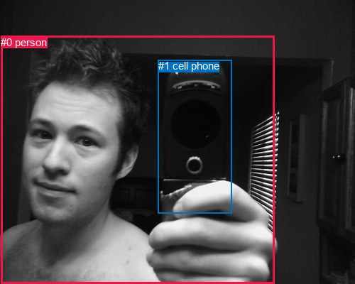
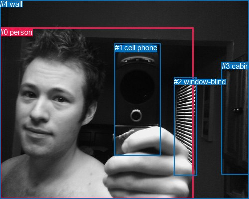

# 图片 1211：2371415.jpg

随机样本序号：415。图片 SHA256：`b36479fb1a1caddbdf286730e3eac7d43cec5ad175f0edb3e17b8519439afe77`。

红色框表示人，蓝色框表示其他物体。两个模式分别保留自身框编号，可依据位置比较对应对象。

## 自动检测框与输出

人的框编号：`[0]`。状态：`ok`。

### 自动检测全部物体框

| 编号 | 类别 | 是否为人 | 检测分数 | 像素坐标 xyxy |
|---|---|---|---|---|
| 0 | person | True | 0.9986 | 1.4, 50.7, 386.2, 400.0 |
| 1 | cell phone | False | 0.6921 | 222.5, 84.2, 326.1, 300.8 |

### 自动检测 Top50 人相关候选

评分物体对：2；人相关物体对：2；输出关系：4。

| 排名 | 主语编号与类别 | 关系 | 宾语编号与类别 | 类型 | 人与人 | 排序分数 | 原始融合 logit |
|---|---|---|---|---|---|---|---|
| 1 | #0 person | holding | #1 cell phone | semantic | False | 0.99316 | 4.9778 |
| 2 | #0 person | in front of | #1 cell phone | spatial | False | 0.78060 | 1.2692 |
| 3 | #1 cell phone | beside | #0 person | spatial | False | 0.04275 | -3.1088 |
| 4 | #1 cell phone | holding | #0 person | semantic | False | 0.00462 | -5.3722 |

### 自动检测逐条人相关 GT 核验

R@50：50.00%；命中 1/2。

| GT 主语编号 | GT 关系 | GT 宾语编号 | 结果阶段 | 匹配预测主语编号 | 匹配预测宾语编号 |
|---|---|---|---|---|---|
| 0 | holding | 1 | hit50 | [0] | [1] |
| 4 | enclosing | 0 | endpoint_missing_or_wrong_class | [] | [0] |

## 真实框与输出

人的框编号：`[0]`。

### 真实框全部物体框

| 编号 | 类别 | 是否为人 | 检测分数 | 像素坐标 xyxy |
|---|---|---|---|---|
| 0 | person | True | GT | 0.0, 56.0, 388.0, 400.0 |
| 1 | cell phone | False | GT | 230.0, 87.0, 323.0, 313.0 |
| 2 | window-blind | False | GT | 349.0, 155.0, 395.0, 352.0 |
| 3 | cabinet | False | GT | 445.0, 124.0, 500.0, 351.0 |
| 4 | wall | False | GT | 0.0, 0.0, 500.0, 400.0 |

### 真实框 Top50 人相关候选

评分物体对：20；人相关物体对：8；输出关系：16。

| 排名 | 主语编号与类别 | 关系 | 宾语编号与类别 | 类型 | 人与人 | 排序分数 | 原始融合 logit |
|---|---|---|---|---|---|---|---|
| 1 | #0 person | holding | #1 cell phone | semantic | False | 0.99885 | 6.7664 |
| 2 | #0 person | beside | #1 cell phone | spatial | False | 0.97022 | 3.4838 |
| 3 | #0 person | looking at | #2 window-blind | semantic | False | 0.95194 | 2.9861 |
| 4 | #0 person | looking at | #4 wall | semantic | False | 0.94827 | 2.9087 |
| 5 | #1 cell phone | beside | #0 person | spatial | False | 0.94204 | 2.7883 |
| 6 | #0 person | beside | #2 window-blind | spatial | False | 0.93494 | 2.6651 |
| 7 | #2 window-blind | beside | #0 person | spatial | False | 0.93234 | 2.6232 |
| 8 | #0 person | beside | #3 cabinet | spatial | False | 0.92584 | 2.5245 |
| 9 | #0 person | beside | #4 wall | spatial | False | 0.91870 | 2.4248 |
| 10 | #4 wall | enclosing | #0 person | spatial | False | 0.89183 | 2.1096 |
| 11 | #0 person | looking at | #3 cabinet | semantic | False | 0.81266 | 1.4674 |
| 12 | #3 cabinet | beside | #0 person | spatial | False | 0.45159 | -0.1943 |
| 13 | #2 window-blind | guiding | #0 person | semantic | False | 0.35087 | -0.6152 |
| 14 | #4 wall | opening | #0 person | semantic | False | 0.25844 | -1.0541 |
| 15 | #1 cell phone | holding | #0 person | semantic | False | 0.18798 | -1.4632 |
| 16 | #3 cabinet | holding | #0 person | semantic | False | 0.05443 | -2.8548 |

### 真实框逐条人相关 GT 核验

R@50：100.00%；命中 2/2。

| GT 主语编号 | GT 关系 | GT 宾语编号 | 结果阶段 | 匹配预测主语编号 | 匹配预测宾语编号 |
|---|---|---|---|---|---|
| 0 | holding | 1 | hit50 | [0] | [1] |
| 4 | enclosing | 0 | hit50 | [4] | [0] |

## 全部人相关 GT

| 主语编号与类别 | 关系 | 宾语编号与类别 |
|---|---|---|
| #0 person | holding | #1 cell phone |
| #4 wall | enclosing | #0 person |

原始记录、全部人相关物体对的两项预测与分项分数见 [逐图证据 JSON](../evidence/cases/1211.json)。全部56类 logits 保留于本机 HOR/output/random500/logits/。

<!-- HOR_COMPLETE_RESULTS -->

## 六组条件的完整输出对照

以下保留同一图片三种框与候选模式、两种谓词输出规则的全部 Top50。框编号各自在所属模式内解释。

### 自动检测框完整枚举：空间与语义各保留一个谓词

| 排名 | 主语编号与类别 | 谓词 | 宾语编号与类别 | 分组 | 排序分数 | predicate logit | pair logit |
|---|---|---|---|---|---|---|---|
| 1 | #0 person | holding | #1 cell phone | semantic | 0.9931583 | 2.9972486 | 1.9805970 |
| 2 | #0 person | in front of | #1 cell phone | spatial | 0.7806011 | -0.7114241 | 1.9805970 |
| 3 | #1 cell phone | beside | #0 person | spatial | 0.0427455 | -1.8902547 | -1.2185502 |
| 4 | #1 cell phone | holding | #0 person | semantic | 0.0046223 | -4.1536703 | -1.2185502 |

GT 命中：1/2，R@50=50.00%。

| GT主语 | GT谓词 | GT宾语 | 结果阶段 | 匹配主语框 | 匹配宾语框 |
|---|---|---|---|---|---|
| 0 | holding | 1 | hit50 | [0] | [1] |
| 4 | enclosing | 0 | endpoint_missing_or_wrong_class | [] | [0] |

### 自动检测框完整枚举：每对只保留一个谓词

| 排名 | 主语编号与类别 | 谓词 | 宾语编号与类别 | 分组 | 排序分数 | predicate logit | pair logit |
|---|---|---|---|---|---|---|---|
| 1 | #0 person | holding | #1 cell phone | single | 0.9931583 | 2.9972486 | 1.9805970 |
| 2 | #1 cell phone | beside | #0 person | single | 0.0427455 | -1.8902547 | -1.2185502 |

GT 命中：1/2，R@50=50.00%。

| GT主语 | GT谓词 | GT宾语 | 结果阶段 | 匹配主语框 | 匹配宾语框 |
|---|---|---|---|---|---|
| 0 | holding | 1 | hit50 | [0] | [1] |
| 4 | enclosing | 0 | endpoint_missing_or_wrong_class | [] | [0] |

### 真实框完整枚举：空间与语义各保留一个谓词

| 排名 | 主语编号与类别 | 谓词 | 宾语编号与类别 | 分组 | 排序分数 | predicate logit | pair logit |
|---|---|---|---|---|---|---|---|
| 1 | #0 person | holding | #1 cell phone | semantic | 0.9988495 | 4.7971549 | 1.9692800 |
| 2 | #0 person | beside | #1 cell phone | spatial | 0.9702247 | 1.5145664 | 1.9692800 |
| 3 | #0 person | looking at | #2 window-blind | semantic | 0.9519422 | 3.2107420 | -0.2246413 |
| 4 | #0 person | looking at | #4 wall | semantic | 0.9482734 | 2.5038924 | 0.4047770 |
| 5 | #1 cell phone | beside | #0 person | spatial | 0.9420390 | 3.9365315 | -1.1482550 |
| 6 | #0 person | beside | #2 window-blind | spatial | 0.9349383 | 2.8897867 | -0.2246413 |
| 7 | #2 window-blind | beside | #0 person | spatial | 0.9323385 | 2.8464103 | -0.2232306 |
| 8 | #0 person | beside | #3 cabinet | spatial | 0.9258432 | 2.3750119 | 0.1495114 |
| 9 | #0 person | beside | #4 wall | spatial | 0.9186997 | 2.0200319 | 0.4047770 |
| 10 | #4 wall | enclosing | #0 person | spatial | 0.8918341 | 2.6937675 | -0.5841533 |
| 11 | #0 person | looking at | #3 cabinet | semantic | 0.8126622 | 1.3178906 | 0.1495114 |
| 12 | #3 cabinet | beside | #0 person | spatial | 0.4515871 | -0.1554871 | -0.0387729 |
| 13 | #2 window-blind | guiding | #0 person | semantic | 0.3508723 | -0.3919764 | -0.2232306 |
| 14 | #4 wall | opening | #0 person | semantic | 0.2584403 | -0.4699378 | -0.5841533 |
| 15 | #1 cell phone | holding | #0 person | semantic | 0.1879845 | -0.3149052 | -1.1482550 |
| 16 | #3 cabinet | holding | #0 person | semantic | 0.0544340 | -2.8160219 | -0.0387729 |

GT 命中：2/2，R@50=100.00%。

| GT主语 | GT谓词 | GT宾语 | 结果阶段 | 匹配主语框 | 匹配宾语框 |
|---|---|---|---|---|---|
| 0 | holding | 1 | hit50 | [0] | [1] |
| 4 | enclosing | 0 | hit50 | [4] | [0] |

### 真实框完整枚举：每对只保留一个谓词

| 排名 | 主语编号与类别 | 谓词 | 宾语编号与类别 | 分组 | 排序分数 | predicate logit | pair logit |
|---|---|---|---|---|---|---|---|
| 1 | #0 person | holding | #1 cell phone | single | 0.9988495 | 4.7971549 | 1.9692800 |
| 2 | #0 person | looking at | #2 window-blind | single | 0.9519422 | 3.2107420 | -0.2246413 |
| 3 | #0 person | looking at | #4 wall | single | 0.9482734 | 2.5038924 | 0.4047770 |
| 4 | #1 cell phone | beside | #0 person | single | 0.9420390 | 3.9365315 | -1.1482550 |
| 5 | #2 window-blind | beside | #0 person | single | 0.9323385 | 2.8464103 | -0.2232306 |
| 6 | #0 person | beside | #3 cabinet | single | 0.9258432 | 2.3750119 | 0.1495114 |
| 7 | #4 wall | enclosing | #0 person | single | 0.8918341 | 2.6937675 | -0.5841533 |
| 8 | #3 cabinet | beside | #0 person | single | 0.4515871 | -0.1554871 | -0.0387729 |

GT 命中：2/2，R@50=100.00%。

| GT主语 | GT谓词 | GT宾语 | 结果阶段 | 匹配主语框 | 匹配宾语框 |
|---|---|---|---|---|---|
| 0 | holding | 1 | hit50 | [0] | [1] |
| 4 | enclosing | 0 | hit50 | [4] | [0] |

### 真实框400候选：空间与语义各保留一个谓词

| 排名 | 主语编号与类别 | 谓词 | 宾语编号与类别 | 分组 | 排序分数 | predicate logit | pair logit |
|---|---|---|---|---|---|---|---|
| 1 | #0 person | holding | #1 cell phone | semantic | 0.9988563 | 4.8030629 | 1.9692800 |
| 2 | #0 person | beside | #1 cell phone | spatial | 0.9702247 | 1.5145664 | 1.9692800 |
| 3 | #0 person | looking at | #2 window-blind | semantic | 0.9519422 | 3.2107420 | -0.2246413 |
| 4 | #0 person | looking at | #4 wall | semantic | 0.9482391 | 2.5031948 | 0.4047770 |
| 5 | #1 cell phone | beside | #0 person | spatial | 0.9420373 | 3.9365001 | -1.1482550 |
| 6 | #0 person | beside | #2 window-blind | spatial | 0.9349393 | 2.8898015 | -0.2246413 |
| 7 | #2 window-blind | beside | #0 person | spatial | 0.9323385 | 2.8464103 | -0.2232306 |
| 8 | #0 person | beside | #3 cabinet | spatial | 0.9278820 | 2.4050889 | 0.1495114 |
| 9 | #0 person | beside | #4 wall | spatial | 0.9164314 | 1.9900417 | 0.4047770 |
| 10 | #4 wall | enclosing | #0 person | spatial | 0.8918341 | 2.6937675 | -0.5841533 |
| 11 | #0 person | looking at | #3 cabinet | semantic | 0.8172004 | 1.3479819 | 0.1495114 |
| 12 | #3 cabinet | beside | #0 person | spatial | 0.4515729 | -0.1555448 | -0.0387729 |
| 13 | #2 window-blind | guiding | #0 person | semantic | 0.3508723 | -0.3919764 | -0.2232306 |
| 14 | #4 wall | opening | #0 person | semantic | 0.2528256 | -0.4994454 | -0.5841533 |
| 15 | #1 cell phone | holding | #0 person | semantic | 0.1912464 | -0.2936764 | -1.1482550 |
| 16 | #3 cabinet | holding | #0 person | semantic | 0.0543201 | -2.8182375 | -0.0387729 |

GT 命中：2/2，R@50=100.00%。

| GT主语 | GT谓词 | GT宾语 | 结果阶段 | 匹配主语框 | 匹配宾语框 |
|---|---|---|---|---|---|
| 0 | holding | 1 | hit50 | [0] | [1] |
| 4 | enclosing | 0 | hit50 | [4] | [0] |

### 真实框400候选：每对只保留一个谓词

| 排名 | 主语编号与类别 | 谓词 | 宾语编号与类别 | 分组 | 排序分数 | predicate logit | pair logit |
|---|---|---|---|---|---|---|---|
| 1 | #0 person | holding | #1 cell phone | single | 0.9988563 | 4.8030629 | 1.9692800 |
| 2 | #0 person | looking at | #2 window-blind | single | 0.9519422 | 3.2107420 | -0.2246413 |
| 3 | #0 person | looking at | #4 wall | single | 0.9482391 | 2.5031948 | 0.4047770 |
| 4 | #1 cell phone | beside | #0 person | single | 0.9420373 | 3.9365001 | -1.1482550 |
| 5 | #2 window-blind | beside | #0 person | single | 0.9323385 | 2.8464103 | -0.2232306 |
| 6 | #0 person | beside | #3 cabinet | single | 0.9278820 | 2.4050889 | 0.1495114 |
| 7 | #4 wall | enclosing | #0 person | single | 0.8918341 | 2.6937675 | -0.5841533 |
| 8 | #3 cabinet | beside | #0 person | single | 0.4515729 | -0.1555448 | -0.0387729 |

GT 命中：2/2，R@50=100.00%。

| GT主语 | GT谓词 | GT宾语 | 结果阶段 | 匹配主语框 | 匹配宾语框 |
|---|---|---|---|---|---|
| 0 | holding | 1 | hit50 | [0] | [1] |
| 4 | enclosing | 0 | hit50 | [4] | [0] |
