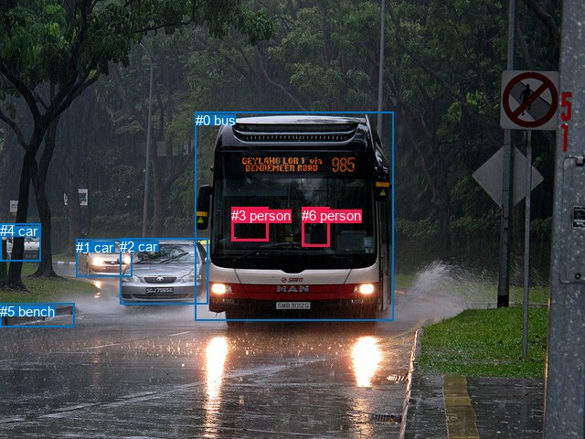
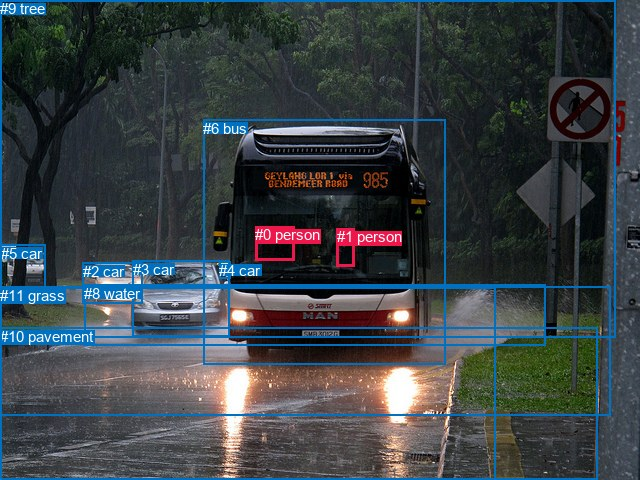

# 图片 1218：2371757.jpg

随机样本序号：285。图片 SHA256：`74de1d85ded730e719dbf35407dc4160976d9da86f2b310f8df6bb388586afa3`。

红色框表示人，蓝色框表示其他物体。两个模式分别保留自身框编号，可依据位置比较对应对象。

## 自动检测框与输出

人的框编号：`[3, 6]`。状态：`ok`。

### 自动检测全部物体框

| 编号 | 类别 | 是否为人 | 检测分数 | 像素坐标 xyxy |
|---|---|---|---|---|
| 0 | bus | False | 0.9995 | 213.7, 122.9, 431.0, 350.5 |
| 1 | car | False | 0.9993 | 83.1, 261.7, 144.3, 302.6 |
| 2 | car | False | 0.9986 | 131.4, 261.0, 227.1, 332.9 |
| 3 | person | True | 0.9366 | 253.2, 227.0, 293.7, 263.1 |
| 4 | car | False | 0.8407 | 0.0, 244.4, 44.4, 285.1 |
| 5 | bench | False | 0.8162 | 0.1, 331.5, 81.1, 357.8 |
| 6 | person | True | 0.7064 | 330.2, 226.8, 360.7, 269.9 |

### 自动检测 Top50 人相关候选

评分物体对：42；人相关物体对：22；输出关系：44。

| 排名 | 主语编号与类别 | 关系 | 宾语编号与类别 | 类型 | 人与人 | 排序分数 | 原始融合 logit |
|---|---|---|---|---|---|---|---|
| 1 | #3 person | driving | #0 bus | semantic | False | 0.98850 | 4.4540 |
| 2 | #6 person | driving | #0 bus | semantic | False | 0.98669 | 4.3055 |
| 3 | #6 person | in | #0 bus | spatial | False | 0.96546 | 3.3304 |
| 4 | #3 person | in | #0 bus | spatial | False | 0.95844 | 3.1381 |
| 5 | #3 person | driving | #2 car | semantic | False | 0.71556 | 0.9225 |
| 6 | #6 person | driving | #2 car | semantic | False | 0.41947 | -0.3250 |
| 7 | #0 bus | driving | #6 person | semantic | False | 0.28969 | -0.8969 |
| 8 | #0 bus | beside | #6 person | spatial | False | 0.26628 | -1.0136 |
| 9 | #6 person | walking on | #5 bench | semantic | False | 0.14286 | -1.7918 |
| 10 | #6 person | beside | #3 person | spatial | True | 0.12370 | -1.9578 |
| 11 | #0 bus | driving | #3 person | semantic | False | 0.11755 | -2.0158 |
| 12 | #3 person | beside | #6 person | spatial | True | 0.11088 | -2.0818 |
| 13 | #3 person | in | #2 car | spatial | False | 0.10975 | -2.0933 |
| 14 | #3 person | riding | #6 person | semantic | True | 0.09215 | -2.2876 |
| 15 | #3 person | driving | #1 car | semantic | False | 0.06995 | -2.5874 |
| 16 | #3 person | walking on | #5 bench | semantic | False | 0.06004 | -2.7508 |
| 17 | #0 bus | beside | #3 person | spatial | False | 0.05234 | -2.8962 |
| 18 | #6 person | driving | #1 car | semantic | False | 0.05062 | -2.9315 |
| 19 | #6 person | in | #5 bench | spatial | False | 0.05034 | -2.9373 |
| 20 | #6 person | looking at | #3 person | semantic | True | 0.03228 | -3.4006 |
| 21 | #6 person | in | #2 car | spatial | False | 0.03127 | -3.4332 |
| 22 | #2 car | driving | #6 person | semantic | False | 0.02305 | -3.7466 |
| 23 | #3 person | in | #5 bench | spatial | False | 0.01965 | -3.9097 |
| 24 | #2 car | driving | #3 person | semantic | False | 0.01619 | -4.1070 |
| 25 | #6 person | driving | #4 car | semantic | False | 0.01002 | -4.5934 |
| 26 | #2 car | beside | #3 person | spatial | False | 0.00944 | -4.6531 |
| 27 | #3 person | walking on | #4 car | semantic | False | 0.00681 | -4.9828 |
| 28 | #1 car | driving | #3 person | semantic | False | 0.00502 | -5.2889 |
| 29 | #1 car | driving | #6 person | semantic | False | 0.00499 | -5.2949 |
| 30 | #3 person | in | #1 car | spatial | False | 0.00317 | -5.7504 |
| 31 | #2 car | in front of | #6 person | spatial | False | 0.00251 | -5.9841 |
| 32 | #6 person | in | #1 car | spatial | False | 0.00231 | -6.0696 |
| 33 | #4 car | parked on | #6 person | semantic | False | 0.00196 | -6.2338 |
| 34 | #6 person | in | #4 car | spatial | False | 0.00188 | -6.2747 |
| 35 | #3 person | in | #4 car | spatial | False | 0.00149 | -6.5061 |
| 36 | #4 car | driving | #3 person | semantic | False | 0.00114 | -6.7774 |
| 37 | #5 bench | in | #6 person | spatial | False | 0.00056 | -7.4811 |
| 38 | #1 car | in front of | #3 person | spatial | False | 0.00042 | -7.7652 |
| 39 | #1 car | in front of | #6 person | spatial | False | 0.00039 | -7.8589 |
| 40 | #5 bench | in | #3 person | spatial | False | 0.00031 | -8.0939 |
| 41 | #5 bench | holding | #6 person | semantic | False | 0.00030 | -8.0994 |
| 42 | #4 car | in front of | #6 person | spatial | False | 0.00019 | -8.5784 |
| 43 | #5 bench | playing | #3 person | semantic | False | 0.00017 | -8.6509 |
| 44 | #4 car | in front of | #3 person | spatial | False | 0.00011 | -9.1104 |

### 自动检测逐条人相关 GT 核验

R@50：100.00%；命中 1/1。

| GT 主语编号 | GT 关系 | GT 宾语编号 | 结果阶段 | 匹配预测主语编号 | 匹配预测宾语编号 |
|---|---|---|---|---|---|
| 0 | driving | 6 | hit50 | [3] | [0] |

## 真实框与输出

人的框编号：`[0, 1]`。

### 真实框全部物体框

| 编号 | 类别 | 是否为人 | 检测分数 | 像素坐标 xyxy |
|---|---|---|---|---|
| 0 | person | True | GT | 255.0, 226.0, 294.0, 260.0 |
| 1 | person | True | GT | 337.0, 228.0, 355.0, 266.0 |
| 2 | car | False | GT | 83.0, 263.0, 142.0, 304.0 |
| 3 | car | False | GT | 133.0, 261.0, 230.0, 337.0 |
| 4 | car | False | GT | 219.0, 262.0, 230.0, 279.0 |
| 5 | car | False | GT | 1.0, 245.0, 46.0, 289.0 |
| 6 | bus | False | GT | 203.0, 120.0, 445.0, 365.0 |
| 7 | road | False | GT | 0.0, 287.0, 495.0, 480.0 |
| 8 | water | False | GT | 84.0, 285.0, 545.0, 346.0 |
| 9 | tree | False | GT | 0.0, 0.0, 616.0, 337.0 |
| 10 | pavement | False | GT | 0.0, 328.0, 598.0, 480.0 |
| 11 | grass | False | GT | 0.0, 287.0, 611.0, 416.0 |

### 真实框 Top50 人相关候选

评分物体对：132；人相关物体对：42；输出关系：50。

| 排名 | 主语编号与类别 | 关系 | 宾语编号与类别 | 类型 | 人与人 | 排序分数 | 原始融合 logit |
|---|---|---|---|---|---|---|---|
| 1 | #0 person | driving on | #6 bus | semantic | False | 0.99441 | 5.1812 |
| 2 | #1 person | driving on | #6 bus | semantic | False | 0.99193 | 4.8115 |
| 3 | #1 person | in | #6 bus | spatial | False | 0.97966 | 3.8744 |
| 4 | #0 person | in | #6 bus | spatial | False | 0.97223 | 3.5556 |
| 5 | #6 bus | carrying | #1 person | semantic | False | 0.19702 | -1.4050 |
| 6 | #0 person | driving on | #3 car | semantic | False | 0.09420 | -2.2634 |
| 7 | #6 bus | carrying | #0 person | semantic | False | 0.07693 | -2.4848 |
| 8 | #6 bus | in | #1 person | spatial | False | 0.06910 | -2.6006 |
| 9 | #6 bus | in | #0 person | spatial | False | 0.06122 | -2.7301 |
| 10 | #1 person | driving on | #7 road | semantic | False | 0.05923 | -2.7654 |
| 11 | #0 person | in | #7 road | spatial | False | 0.05517 | -2.8405 |
| 12 | #1 person | driving on | #3 car | semantic | False | 0.05147 | -2.9139 |
| 13 | #0 person | driving on | #7 road | semantic | False | 0.04570 | -3.0388 |
| 14 | #0 person | in | #3 car | spatial | False | 0.04516 | -3.0513 |
| 15 | #0 person | in | #10 pavement | spatial | False | 0.04347 | -3.0913 |
| 16 | #1 person | pushing | #8 water | semantic | False | 0.04296 | -3.1035 |
| 17 | #1 person | in | #7 road | spatial | False | 0.04196 | -3.1282 |
| 18 | #0 person | driving on | #10 pavement | semantic | False | 0.04113 | -3.1491 |
| 19 | #1 person | driving on | #10 pavement | semantic | False | 0.04095 | -3.1535 |
| 20 | #0 person | in | #11 grass | spatial | False | 0.03645 | -3.2746 |
| 21 | #0 person | sitting on | #1 person | semantic | True | 0.03237 | -3.3975 |
| 22 | #0 person | in | #9 tree | spatial | False | 0.03173 | -3.4182 |
| 23 | #1 person | in | #9 tree | spatial | False | 0.03173 | -3.4183 |
| 24 | #1 person | driving | #11 grass | semantic | False | 0.03123 | -3.4347 |
| 25 | #1 person | in | #11 grass | spatial | False | 0.03092 | -3.4450 |
| 26 | #1 person | in | #10 pavement | spatial | False | 0.02883 | -3.5171 |
| 27 | #1 person | in | #3 car | spatial | False | 0.02307 | -3.7461 |
| 28 | #0 person | driving | #11 grass | semantic | False | 0.01751 | -4.0276 |
| 29 | #0 person | in | #4 car | spatial | False | 0.01459 | -4.2126 |
| 30 | #0 person | pushing | #8 water | semantic | False | 0.01438 | -4.2276 |
| 31 | #0 person | on | #1 person | spatial | True | 0.01266 | -4.3567 |
| 32 | #1 person | looking at | #9 tree | semantic | False | 0.01242 | -4.3759 |
| 33 | #0 person | in | #8 water | spatial | False | 0.01231 | -4.3850 |
| 34 | #1 person | driving on | #2 car | semantic | False | 0.01099 | -4.4999 |
| 35 | #1 person | in | #8 water | spatial | False | 0.01033 | -4.5625 |
| 36 | #1 person | in | #2 car | spatial | False | 0.00941 | -4.6569 |
| 37 | #0 person | looking at | #9 tree | semantic | False | 0.00937 | -4.6605 |
| 38 | #0 person | driving on | #2 car | semantic | False | 0.00826 | -4.7884 |
| 39 | #1 person | on | #0 person | spatial | True | 0.00807 | -4.8116 |
| 40 | #0 person | sitting on | #4 car | semantic | False | 0.00793 | -4.8287 |
| 41 | #1 person | looking at | #0 person | semantic | True | 0.00767 | -4.8626 |
| 42 | #1 person | walking on | #5 car | semantic | False | 0.00738 | -4.9019 |
| 43 | #0 person | in | #2 car | spatial | False | 0.00707 | -4.9453 |
| 44 | #1 person | in | #4 car | spatial | False | 0.00640 | -5.0447 |
| 45 | #1 person | in | #5 car | spatial | False | 0.00637 | -5.0505 |
| 46 | #4 car | on | #0 person | spatial | False | 0.00573 | -5.1570 |
| 47 | #8 water | in | #1 person | spatial | False | 0.00497 | -5.2989 |
| 48 | #4 car | on | #1 person | spatial | False | 0.00378 | -5.5743 |
| 49 | #0 person | standing on | #5 car | semantic | False | 0.00372 | -5.5893 |
| 50 | #0 person | in | #5 car | spatial | False | 0.00335 | -5.6946 |

### 真实框逐条人相关 GT 核验

R@50：0.00%；命中 0/1。

| GT 主语编号 | GT 关系 | GT 宾语编号 | 结果阶段 | 匹配预测主语编号 | 匹配预测宾语编号 |
|---|---|---|---|---|---|
| 0 | driving | 6 | wrong_predicate | [0] | [6] |

## 全部人相关 GT

| 主语编号与类别 | 关系 | 宾语编号与类别 |
|---|---|---|
| #0 person | driving | #6 bus |

原始记录、全部人相关物体对的两项预测与分项分数见 [逐图证据 JSON](../evidence/cases/1218.json)。全部56类 logits 保留于本机 HOR/output/random500/logits/。

<!-- HOR_COMPLETE_RESULTS -->

## 六组条件的完整输出对照

以下保留同一图片三种框与候选模式、两种谓词输出规则的全部 Top50。框编号各自在所属模式内解释。

### 自动检测框完整枚举：空间与语义各保留一个谓词

| 排名 | 主语编号与类别 | 谓词 | 宾语编号与类别 | 分组 | 排序分数 | predicate logit | pair logit |
|---|---|---|---|---|---|---|---|
| 1 | #3 person | driving | #0 bus | semantic | 0.9885020 | 4.1487222 | 0.3052958 |
| 2 | #6 person | driving | #0 bus | semantic | 0.9866852 | 3.9079804 | 0.3974968 |
| 3 | #6 person | in | #0 bus | spatial | 0.9654555 | 2.9328532 | 0.3974968 |
| 4 | #3 person | in | #0 bus | spatial | 0.9584389 | 2.8328457 | 0.3052958 |
| 5 | #3 person | driving | #2 car | semantic | 0.7155570 | 1.3504562 | -0.4279279 |
| 6 | #6 person | driving | #2 car | semantic | 0.4194693 | 0.5079927 | -0.8329450 |
| 7 | #0 bus | driving | #6 person | semantic | 0.2896866 | -0.2438540 | -0.6530527 |
| 8 | #0 bus | beside | #6 person | spatial | 0.2662819 | -0.3605165 | -0.6530527 |
| 9 | #6 person | walking on | #5 bench | semantic | 0.1428550 | -0.0556507 | -1.7361262 |
| 10 | #6 person | beside | #3 person | spatial | 0.1237034 | -1.4534693 | -0.5043480 |
| 11 | #0 bus | driving | #3 person | semantic | 0.1175520 | -1.1617093 | -0.8541092 |
| 12 | #3 person | beside | #6 person | spatial | 0.1108809 | -1.7216592 | -0.3601152 |
| 13 | #3 person | in | #2 car | spatial | 0.1097498 | -1.6653709 | -0.4279279 |
| 14 | #3 person | riding | #6 person | semantic | 0.0921525 | -1.9275162 | -0.3601152 |
| 15 | #3 person | driving | #1 car | semantic | 0.0699529 | -1.1468666 | -1.4405468 |
| 16 | #3 person | walking on | #5 bench | semantic | 0.0600424 | -0.5318422 | -2.2189415 |
| 17 | #0 bus | beside | #3 person | spatial | 0.0523413 | -2.0420988 | -0.8541092 |
| 18 | #6 person | driving | #1 car | semantic | 0.0506179 | -1.4025865 | -1.5289204 |
| 19 | #6 person | in | #5 bench | spatial | 0.0503407 | -1.2011626 | -1.7361262 |
| 20 | #6 person | looking at | #3 person | semantic | 0.0322766 | -2.8962564 | -0.5043480 |
| 21 | #6 person | in | #2 car | spatial | 0.0312739 | -2.6002536 | -0.8329450 |
| 22 | #2 car | driving | #6 person | semantic | 0.0230548 | -2.3951883 | -1.3513682 |
| 23 | #3 person | in | #5 bench | spatial | 0.0196526 | -1.6907575 | -2.2189415 |
| 24 | #2 car | driving | #3 person | semantic | 0.0161901 | -3.0346136 | -1.0724170 |
| 25 | #6 person | driving | #4 car | semantic | 0.0100174 | -2.6962779 | -1.8970841 |
| 26 | #2 car | beside | #3 person | spatial | 0.0094422 | -3.5806613 | -1.0724170 |
| 27 | #3 person | walking on | #4 car | semantic | 0.0068079 | -2.8075016 | -2.1753397 |
| 28 | #1 car | driving | #3 person | semantic | 0.0050219 | -3.5686007 | -1.7203079 |
| 29 | #1 car | driving | #6 person | semantic | 0.0049921 | -3.5159049 | -1.7789879 |
| 30 | #3 person | in | #1 car | spatial | 0.0031714 | -4.3098745 | -1.4405468 |
| 31 | #2 car | in front of | #6 person | spatial | 0.0025122 | -4.6327090 | -1.3513682 |
| 32 | #6 person | in | #1 car | spatial | 0.0023067 | -4.5407066 | -1.5289204 |
| 33 | #4 car | parked on | #6 person | semantic | 0.0019582 | -4.2603483 | -1.9734197 |
| 34 | #6 person | in | #4 car | spatial | 0.0018798 | -4.3776331 | -1.8970841 |
| 35 | #3 person | in | #4 car | spatial | 0.0014921 | -4.3307257 | -2.1753397 |
| 36 | #4 car | driving | #3 person | semantic | 0.0011379 | -4.3696752 | -2.4077449 |
| 37 | #5 bench | in | #6 person | spatial | 0.0005633 | -5.3740644 | -2.1070261 |
| 38 | #1 car | in front of | #3 person | spatial | 0.0004241 | -6.0448732 | -1.7203079 |
| 39 | #1 car | in front of | #6 person | spatial | 0.0003862 | -6.0798836 | -1.7789879 |
| 40 | #5 bench | in | #3 person | spatial | 0.0003053 | -5.6089306 | -2.4849999 |
| 41 | #5 bench | holding | #6 person | semantic | 0.0003036 | -5.9923277 | -2.1070261 |
| 42 | #4 car | in front of | #6 person | spatial | 0.0001881 | -6.6050024 | -1.9734197 |
| 43 | #5 bench | playing | #3 person | semantic | 0.0001749 | -6.1659346 | -2.4849999 |
| 44 | #4 car | in front of | #3 person | spatial | 0.0001105 | -6.7026458 | -2.4077449 |

GT 命中：1/1，R@50=100.00%。

| GT主语 | GT谓词 | GT宾语 | 结果阶段 | 匹配主语框 | 匹配宾语框 |
|---|---|---|---|---|---|
| 0 | driving | 6 | hit50 | [3] | [0] |

### 自动检测框完整枚举：每对只保留一个谓词

| 排名 | 主语编号与类别 | 谓词 | 宾语编号与类别 | 分组 | 排序分数 | predicate logit | pair logit |
|---|---|---|---|---|---|---|---|
| 1 | #3 person | driving | #0 bus | single | 0.9885020 | 4.1487222 | 0.3052958 |
| 2 | #6 person | driving | #0 bus | single | 0.9866852 | 3.9079804 | 0.3974968 |
| 3 | #3 person | driving | #2 car | single | 0.7155570 | 1.3504562 | -0.4279279 |
| 4 | #6 person | driving | #2 car | single | 0.4194693 | 0.5079927 | -0.8329450 |
| 5 | #0 bus | driving | #6 person | single | 0.2896866 | -0.2438540 | -0.6530527 |
| 6 | #6 person | walking on | #5 bench | single | 0.1428550 | -0.0556507 | -1.7361262 |
| 7 | #6 person | beside | #3 person | single | 0.1237034 | -1.4534693 | -0.5043480 |
| 8 | #0 bus | driving | #3 person | single | 0.1175520 | -1.1617093 | -0.8541092 |
| 9 | #3 person | beside | #6 person | single | 0.1108809 | -1.7216592 | -0.3601152 |
| 10 | #3 person | driving | #1 car | single | 0.0699529 | -1.1468666 | -1.4405468 |
| 11 | #3 person | walking on | #5 bench | single | 0.0600424 | -0.5318422 | -2.2189415 |
| 12 | #6 person | driving | #1 car | single | 0.0506179 | -1.4025865 | -1.5289204 |
| 13 | #2 car | driving | #6 person | single | 0.0230548 | -2.3951883 | -1.3513682 |
| 14 | #2 car | driving | #3 person | single | 0.0161901 | -3.0346136 | -1.0724170 |
| 15 | #6 person | driving | #4 car | single | 0.0100174 | -2.6962779 | -1.8970841 |
| 16 | #3 person | walking on | #4 car | single | 0.0068079 | -2.8075016 | -2.1753397 |
| 17 | #1 car | driving | #3 person | single | 0.0050219 | -3.5686007 | -1.7203079 |
| 18 | #1 car | driving | #6 person | single | 0.0049921 | -3.5159049 | -1.7789879 |
| 19 | #4 car | parked on | #6 person | single | 0.0019582 | -4.2603483 | -1.9734197 |
| 20 | #4 car | driving | #3 person | single | 0.0011379 | -4.3696752 | -2.4077449 |
| 21 | #5 bench | in | #6 person | single | 0.0005633 | -5.3740644 | -2.1070261 |
| 22 | #5 bench | in | #3 person | single | 0.0003053 | -5.6089306 | -2.4849999 |

GT 命中：1/1，R@50=100.00%。

| GT主语 | GT谓词 | GT宾语 | 结果阶段 | 匹配主语框 | 匹配宾语框 |
|---|---|---|---|---|---|
| 0 | driving | 6 | hit50 | [3] | [0] |

### 真实框完整枚举：空间与语义各保留一个谓词

| 排名 | 主语编号与类别 | 谓词 | 宾语编号与类别 | 分组 | 排序分数 | predicate logit | pair logit |
|---|---|---|---|---|---|---|---|
| 1 | #0 person | driving on | #6 bus | semantic | 0.9944099 | 4.8673196 | 0.3138372 |
| 2 | #1 person | driving on | #6 bus | semantic | 0.9919300 | 4.3859315 | 0.4255600 |
| 3 | #1 person | in | #6 bus | spatial | 0.9796556 | 3.4488358 | 0.4255600 |
| 4 | #0 person | in | #6 bus | spatial | 0.9722283 | 3.2417388 | 0.3138372 |
| 5 | #6 bus | carrying | #1 person | semantic | 0.1970207 | -0.7503109 | -0.6547091 |
| 6 | #0 person | driving on | #3 car | semantic | 0.0941975 | -1.8404109 | -0.4230165 |
| 7 | #6 bus | carrying | #0 person | semantic | 0.0769276 | -1.6445930 | -0.8402505 |
| 8 | #6 bus | in | #1 person | spatial | 0.0691021 | -1.9458551 | -0.6547091 |
| 9 | #6 bus | in | #0 person | spatial | 0.0612203 | -1.8898513 | -0.8402505 |
| 10 | #1 person | driving on | #7 road | semantic | 0.0592253 | -1.2393382 | -1.5260174 |
| 11 | #0 person | in | #7 road | spatial | 0.0551723 | -1.2515204 | -1.5890207 |
| 12 | #1 person | driving on | #3 car | semantic | 0.0514688 | -2.0810304 | -0.8329093 |
| 13 | #0 person | driving on | #7 road | semantic | 0.0457021 | -1.4498098 | -1.5890207 |
| 14 | #0 person | in | #3 car | spatial | 0.0451615 | -2.6282806 | -0.4230165 |
| 15 | #0 person | in | #10 pavement | spatial | 0.0434656 | -1.4822938 | -1.6090527 |
| 16 | #1 person | pushing | #8 water | semantic | 0.0429644 | -1.4629328 | -1.6405351 |
| 17 | #1 person | in | #7 road | spatial | 0.0419585 | -1.6021936 | -1.5260174 |
| 18 | #0 person | driving on | #10 pavement | semantic | 0.0411262 | -1.5400610 | -1.6090527 |
| 19 | #1 person | driving on | #10 pavement | semantic | 0.0409532 | -1.6153750 | -1.5381346 |
| 20 | #0 person | in | #11 grass | spatial | 0.0364523 | -1.4318755 | -1.8427429 |
| 21 | #0 person | sitting on | #1 person | semantic | 0.0323729 | -3.0179725 | -0.3795515 |
| 22 | #0 person | in | #9 tree | spatial | 0.0317328 | -1.8779426 | -1.5402143 |
| 23 | #1 person | in | #9 tree | spatial | 0.0317288 | -1.9904556 | -1.4278318 |
| 24 | #1 person | driving | #11 grass | semantic | 0.0312282 | -1.6733513 | -1.7613560 |
| 25 | #1 person | in | #11 grass | spatial | 0.0309174 | -1.6836748 | -1.7613560 |
| 26 | #1 person | in | #10 pavement | spatial | 0.0288294 | -1.9789715 | -1.5381346 |
| 27 | #1 person | in | #3 car | spatial | 0.0230659 | -2.9131560 | -0.8329093 |
| 28 | #0 person | driving | #11 grass | semantic | 0.0175058 | -2.1848180 | -1.8427429 |
| 29 | #0 person | in | #4 car | spatial | 0.0145921 | -3.5352881 | -0.6772900 |
| 30 | #0 person | pushing | #8 water | semantic | 0.0143780 | -2.5308433 | -1.6967292 |
| 31 | #0 person | on | #1 person | spatial | 0.0126579 | -3.9771807 | -0.3795515 |
| 32 | #1 person | looking at | #9 tree | semantic | 0.0124206 | -2.9480667 | -1.4278318 |
| 33 | #0 person | in | #8 water | spatial | 0.0123090 | -2.6883116 | -1.6967292 |
| 34 | #1 person | driving on | #2 car | semantic | 0.0109884 | -2.9680672 | -1.5318017 |
| 35 | #1 person | in | #8 water | spatial | 0.0103281 | -2.9219689 | -1.6405351 |
| 36 | #1 person | in | #2 car | spatial | 0.0094068 | -3.1250696 | -1.5318017 |
| 37 | #0 person | looking at | #9 tree | semantic | 0.0093734 | -3.1202469 | -1.5402143 |
| 38 | #0 person | driving on | #2 car | semantic | 0.0082571 | -3.3366013 | -1.4517864 |
| 39 | #1 person | on | #0 person | spatial | 0.0080695 | -4.2940984 | -0.5174593 |
| 40 | #0 person | sitting on | #4 car | semantic | 0.0079331 | -4.1514540 | -0.6772900 |
| 41 | #1 person | looking at | #0 person | semantic | 0.0076710 | -4.3451509 | -0.5174593 |
| 42 | #1 person | walking on | #5 car | semantic | 0.0073774 | -3.0120077 | -1.8899190 |
| 43 | #0 person | in | #2 car | spatial | 0.0070664 | -3.4935205 | -1.4517864 |
| 44 | #1 person | in | #4 car | spatial | 0.0064019 | -3.9556246 | -1.0891128 |
| 45 | #1 person | in | #5 car | spatial | 0.0063653 | -3.1605842 | -1.8899190 |
| 46 | #4 car | on | #0 person | spatial | 0.0057261 | -4.0001988 | -1.1567838 |
| 47 | #8 water | in | #1 person | spatial | 0.0049720 | -3.8893561 | -1.4095867 |
| 48 | #4 car | on | #1 person | spatial | 0.0037799 | -4.1446314 | -1.4296360 |
| 49 | #0 person | standing on | #5 car | semantic | 0.0037239 | -3.4334064 | -2.1558518 |
| 50 | #0 person | in | #5 car | spatial | 0.0033527 | -3.5387688 | -2.1558518 |

GT 命中：0/1，R@50=0.00%。

| GT主语 | GT谓词 | GT宾语 | 结果阶段 | 匹配主语框 | 匹配宾语框 |
|---|---|---|---|---|---|
| 0 | driving | 6 | wrong_predicate | [0] | [6] |

### 真实框完整枚举：每对只保留一个谓词

| 排名 | 主语编号与类别 | 谓词 | 宾语编号与类别 | 分组 | 排序分数 | predicate logit | pair logit |
|---|---|---|---|---|---|---|---|
| 1 | #0 person | driving on | #6 bus | single | 0.9944099 | 4.8673196 | 0.3138372 |
| 2 | #1 person | driving on | #6 bus | single | 0.9919300 | 4.3859315 | 0.4255600 |
| 3 | #6 bus | carrying | #1 person | single | 0.1970207 | -0.7503109 | -0.6547091 |
| 4 | #0 person | driving on | #3 car | single | 0.0941975 | -1.8404109 | -0.4230165 |
| 5 | #6 bus | carrying | #0 person | single | 0.0769276 | -1.6445930 | -0.8402505 |
| 6 | #1 person | driving on | #7 road | single | 0.0592253 | -1.2393382 | -1.5260174 |
| 7 | #0 person | in | #7 road | single | 0.0551723 | -1.2515204 | -1.5890207 |
| 8 | #1 person | driving on | #3 car | single | 0.0514688 | -2.0810304 | -0.8329093 |
| 9 | #0 person | in | #10 pavement | single | 0.0434656 | -1.4822938 | -1.6090527 |
| 10 | #1 person | pushing | #8 water | single | 0.0429644 | -1.4629328 | -1.6405351 |
| 11 | #1 person | driving on | #10 pavement | single | 0.0409532 | -1.6153750 | -1.5381346 |
| 12 | #0 person | in | #11 grass | single | 0.0364523 | -1.4318755 | -1.8427429 |
| 13 | #0 person | sitting on | #1 person | single | 0.0323729 | -3.0179725 | -0.3795515 |
| 14 | #0 person | in | #9 tree | single | 0.0317328 | -1.8779426 | -1.5402143 |
| 15 | #1 person | in | #9 tree | single | 0.0317288 | -1.9904556 | -1.4278318 |
| 16 | #1 person | driving | #11 grass | single | 0.0312282 | -1.6733513 | -1.7613560 |
| 17 | #0 person | in | #4 car | single | 0.0145921 | -3.5352881 | -0.6772900 |
| 18 | #0 person | pushing | #8 water | single | 0.0143780 | -2.5308433 | -1.6967292 |
| 19 | #1 person | driving on | #2 car | single | 0.0109884 | -2.9680672 | -1.5318017 |
| 20 | #0 person | driving on | #2 car | single | 0.0082571 | -3.3366013 | -1.4517864 |
| 21 | #1 person | on | #0 person | single | 0.0080695 | -4.2940984 | -0.5174593 |
| 22 | #1 person | walking on | #5 car | single | 0.0073774 | -3.0120077 | -1.8899190 |
| 23 | #1 person | in | #4 car | single | 0.0064019 | -3.9556246 | -1.0891128 |
| 24 | #4 car | on | #0 person | single | 0.0057261 | -4.0001988 | -1.1567838 |
| 25 | #8 water | in | #1 person | single | 0.0049720 | -3.8893561 | -1.4095867 |
| 26 | #4 car | on | #1 person | single | 0.0037799 | -4.1446314 | -1.4296360 |
| 27 | #0 person | standing on | #5 car | single | 0.0037239 | -3.4334064 | -2.1558518 |
| 28 | #8 water | in | #0 person | single | 0.0032915 | -4.1013203 | -1.6117806 |
| 29 | #3 car | in | #0 person | single | 0.0017018 | -5.2977710 | -1.0766127 |
| 30 | #5 car | parked on | #1 person | single | 0.0014363 | -4.5688710 | -1.9753563 |
| 31 | #3 car | in | #1 person | single | 0.0010395 | -5.5122952 | -1.3557112 |
| 32 | #11 grass | in | #0 person | single | 0.0010156 | -4.9383988 | -1.9528537 |
| 33 | #11 grass | in | #1 person | single | 0.0010038 | -4.9880157 | -1.9149889 |
| 34 | #2 car | driving | #0 person | single | 0.0009103 | -5.2686176 | -1.7321602 |
| 35 | #5 car | parked on | #0 person | single | 0.0007538 | -4.7761378 | -2.4134476 |
| 36 | #2 car | in | #1 person | single | 0.0006304 | -5.5832028 | -1.7853076 |
| 37 | #7 road | on | #1 person | single | 0.0006143 | -5.4396243 | -1.9548270 |
| 38 | #7 road | in | #0 person | single | 0.0005948 | -5.4642835 | -1.9624240 |
| 39 | #10 pavement | in | #1 person | single | 0.0005067 | -5.6155343 | -1.9715728 |
| 40 | #10 pavement | in | #0 person | single | 0.0004578 | -5.6618080 | -2.0267811 |
| 41 | #9 tree | on | #1 person | single | 0.0004364 | -5.8445725 | -1.8918629 |
| 42 | #9 tree | in | #0 person | single | 0.0003779 | -5.7784195 | -2.1020124 |

GT 命中：0/1，R@50=0.00%。

| GT主语 | GT谓词 | GT宾语 | 结果阶段 | 匹配主语框 | 匹配宾语框 |
|---|---|---|---|---|---|
| 0 | driving | 6 | wrong_predicate | [0] | [6] |

### 真实框400候选：空间与语义各保留一个谓词

| 排名 | 主语编号与类别 | 谓词 | 宾语编号与类别 | 分组 | 排序分数 | predicate logit | pair logit |
|---|---|---|---|---|---|---|---|
| 1 | #0 person | driving on | #6 bus | semantic | 0.9944099 | 4.8673196 | 0.3138372 |
| 2 | #1 person | driving on | #6 bus | semantic | 0.9919299 | 4.3859277 | 0.4255600 |
| 3 | #1 person | in | #6 bus | spatial | 0.9796556 | 3.4488358 | 0.4255600 |
| 4 | #0 person | in | #6 bus | spatial | 0.9722283 | 3.2417388 | 0.3138372 |
| 5 | #6 bus | carrying | #1 person | semantic | 0.1924846 | -0.7792368 | -0.6547091 |
| 6 | #0 person | driving on | #3 car | semantic | 0.0954889 | -1.8253677 | -0.4230165 |
| 7 | #6 bus | carrying | #0 person | semantic | 0.0788375 | -1.6179967 | -0.8402505 |
| 8 | #6 bus | in | #1 person | spatial | 0.0680353 | -1.9625599 | -0.6547091 |
| 9 | #6 bus | in | #0 person | spatial | 0.0611250 | -1.8915107 | -0.8402505 |
| 10 | #1 person | driving on | #7 road | semantic | 0.0609233 | -1.2092648 | -1.5260174 |
| 11 | #0 person | in | #7 road | spatial | 0.0563857 | -1.2284813 | -1.5890207 |
| 12 | #1 person | driving on | #3 car | semantic | 0.0529573 | -2.0509484 | -0.8329093 |
| 13 | #0 person | in | #3 car | spatial | 0.0456699 | -2.6165540 | -0.4230165 |
| 14 | #0 person | driving on | #7 road | semantic | 0.0444085 | -1.4798784 | -1.5890207 |
| 15 | #1 person | pushing | #8 water | semantic | 0.0429646 | -1.4629300 | -1.6405351 |
| 16 | #0 person | in | #10 pavement | spatial | 0.0423913 | -1.5084443 | -1.6090527 |
| 17 | #1 person | in | #7 road | spatial | 0.0423650 | -1.5921261 | -1.5260174 |
| 18 | #1 person | driving on | #10 pavement | semantic | 0.0421508 | -1.5853019 | -1.5381346 |
| 19 | #0 person | driving on | #10 pavement | semantic | 0.0405371 | -1.5551021 | -1.6090527 |
| 20 | #0 person | in | #11 grass | spatial | 0.0373000 | -1.4080069 | -1.8427429 |
| 21 | #0 person | sitting on | #1 person | semantic | 0.0326570 | -3.0089436 | -0.3795515 |
| 22 | #0 person | in | #9 tree | spatial | 0.0318605 | -1.8737941 | -1.5402143 |
| 23 | #1 person | driving | #11 grass | semantic | 0.0316866 | -1.6583066 | -1.7613560 |
| 24 | #1 person | in | #9 tree | spatial | 0.0316779 | -1.9921150 | -1.4278318 |
| 25 | #1 person | in | #11 grass | spatial | 0.0308677 | -1.6853342 | -1.7613560 |
| 26 | #1 person | in | #10 pavement | spatial | 0.0293008 | -1.9622667 | -1.5381346 |
| 27 | #1 person | in | #3 car | spatial | 0.0240272 | -2.8713379 | -0.8329093 |
| 28 | #0 person | driving | #11 grass | semantic | 0.0175059 | -2.1848159 | -1.8427429 |
| 29 | #0 person | in | #4 car | spatial | 0.0148100 | -3.5202425 | -0.6772900 |
| 30 | #0 person | pushing | #8 water | semantic | 0.0141664 | -2.5458858 | -1.6967292 |
| 31 | #0 person | on | #1 person | spatial | 0.0127181 | -3.9723802 | -0.3795515 |
| 32 | #1 person | looking at | #9 tree | semantic | 0.0124206 | -2.9480667 | -1.4278318 |
| 33 | #0 person | in | #8 water | spatial | 0.0121622 | -2.7004533 | -1.6967292 |
| 34 | #1 person | driving on | #2 car | semantic | 0.0110703 | -2.9605534 | -1.5318017 |
| 35 | #1 person | in | #8 water | spatial | 0.0103281 | -2.9219689 | -1.6405351 |
| 36 | #0 person | looking at | #9 tree | semantic | 0.0095820 | -3.0980272 | -1.5402143 |
| 37 | #1 person | in | #2 car | spatial | 0.0093991 | -3.1258993 | -1.5318017 |
| 38 | #0 person | driving on | #2 car | semantic | 0.0082572 | -3.3365967 | -1.4517864 |
| 39 | #0 person | sitting on | #4 car | semantic | 0.0081446 | -4.1249366 | -0.6772900 |
| 40 | #1 person | on | #0 person | spatial | 0.0081023 | -4.2900147 | -0.5174593 |
| 41 | #1 person | looking at | #0 person | semantic | 0.0077979 | -4.3286171 | -0.5174593 |
| 42 | #1 person | walking on | #5 car | semantic | 0.0074216 | -3.0059900 | -1.8899190 |
| 43 | #0 person | in | #2 car | spatial | 0.0071194 | -3.4859977 | -1.4517864 |
| 44 | #1 person | in | #4 car | spatial | 0.0064876 | -3.9422383 | -1.0891128 |
| 45 | #1 person | in | #5 car | spatial | 0.0062968 | -3.1714816 | -1.8899190 |
| 46 | #4 car | on | #0 person | spatial | 0.0057261 | -4.0001988 | -1.1567838 |
| 47 | #8 water | in | #1 person | spatial | 0.0049475 | -3.8943341 | -1.4095867 |
| 48 | #4 car | on | #1 person | spatial | 0.0037799 | -4.1446314 | -1.4296360 |
| 49 | #0 person | standing on | #5 car | semantic | 0.0036819 | -3.4447799 | -2.1558518 |
| 50 | #1 person | looking at | #4 car | semantic | 0.0033245 | -4.6140018 | -1.0891128 |

GT 命中：0/1，R@50=0.00%。

| GT主语 | GT谓词 | GT宾语 | 结果阶段 | 匹配主语框 | 匹配宾语框 |
|---|---|---|---|---|---|
| 0 | driving | 6 | wrong_predicate | [0] | [6] |

### 真实框400候选：每对只保留一个谓词

| 排名 | 主语编号与类别 | 谓词 | 宾语编号与类别 | 分组 | 排序分数 | predicate logit | pair logit |
|---|---|---|---|---|---|---|---|
| 1 | #0 person | driving on | #6 bus | single | 0.9944099 | 4.8673196 | 0.3138372 |
| 2 | #1 person | driving on | #6 bus | single | 0.9919299 | 4.3859277 | 0.4255600 |
| 3 | #6 bus | carrying | #1 person | single | 0.1924846 | -0.7792368 | -0.6547091 |
| 4 | #0 person | driving on | #3 car | single | 0.0954889 | -1.8253677 | -0.4230165 |
| 5 | #6 bus | carrying | #0 person | single | 0.0788375 | -1.6179967 | -0.8402505 |
| 6 | #1 person | driving on | #7 road | single | 0.0609233 | -1.2092648 | -1.5260174 |
| 7 | #0 person | in | #7 road | single | 0.0563857 | -1.2284813 | -1.5890207 |
| 8 | #1 person | driving on | #3 car | single | 0.0529573 | -2.0509484 | -0.8329093 |
| 9 | #1 person | pushing | #8 water | single | 0.0429646 | -1.4629300 | -1.6405351 |
| 10 | #0 person | in | #10 pavement | single | 0.0423913 | -1.5084443 | -1.6090527 |
| 11 | #1 person | driving on | #10 pavement | single | 0.0421508 | -1.5853019 | -1.5381346 |
| 12 | #0 person | in | #11 grass | single | 0.0373000 | -1.4080069 | -1.8427429 |
| 13 | #0 person | sitting on | #1 person | single | 0.0326570 | -3.0089436 | -0.3795515 |
| 14 | #0 person | in | #9 tree | single | 0.0318605 | -1.8737941 | -1.5402143 |
| 15 | #1 person | driving | #11 grass | single | 0.0316866 | -1.6583066 | -1.7613560 |
| 16 | #1 person | in | #9 tree | single | 0.0316779 | -1.9921150 | -1.4278318 |
| 17 | #0 person | in | #4 car | single | 0.0148100 | -3.5202425 | -0.6772900 |
| 18 | #0 person | pushing | #8 water | single | 0.0141664 | -2.5458858 | -1.6967292 |
| 19 | #1 person | driving on | #2 car | single | 0.0110703 | -2.9605534 | -1.5318017 |
| 20 | #0 person | driving on | #2 car | single | 0.0082572 | -3.3365967 | -1.4517864 |
| 21 | #1 person | on | #0 person | single | 0.0081023 | -4.2900147 | -0.5174593 |
| 22 | #1 person | walking on | #5 car | single | 0.0074216 | -3.0059900 | -1.8899190 |
| 23 | #1 person | in | #4 car | single | 0.0064876 | -3.9422383 | -1.0891128 |
| 24 | #4 car | on | #0 person | single | 0.0057261 | -4.0001988 | -1.1567838 |
| 25 | #8 water | in | #1 person | single | 0.0049475 | -3.8943341 | -1.4095867 |
| 26 | #4 car | on | #1 person | single | 0.0037799 | -4.1446314 | -1.4296360 |
| 27 | #0 person | standing on | #5 car | single | 0.0036819 | -3.4447799 | -2.1558518 |
| 28 | #8 water | in | #0 person | single | 0.0032724 | -4.1071835 | -1.6117806 |
| 29 | #3 car | in | #0 person | single | 0.0016881 | -5.3058333 | -1.0766127 |
| 30 | #5 car | parked on | #1 person | single | 0.0014256 | -4.5763936 | -1.9753563 |
| 31 | #3 car | in | #1 person | single | 0.0010344 | -5.5172224 | -1.3557112 |
| 32 | #11 grass | in | #0 person | single | 0.0010067 | -4.9471941 | -1.9528537 |
| 33 | #11 grass | in | #1 person | single | 0.0009917 | -5.0001292 | -1.9149889 |
| 34 | #2 car | driving | #0 person | single | 0.0009001 | -5.2799006 | -1.7321602 |
| 35 | #5 car | parked on | #0 person | single | 0.0007500 | -4.7813044 | -2.4134476 |
| 36 | #2 car | in | #1 person | single | 0.0006286 | -5.5861349 | -1.7853076 |
| 37 | #7 road | on | #1 person | single | 0.0006095 | -5.4474692 | -1.9548270 |
| 38 | #7 road | in | #0 person | single | 0.0005896 | -5.4730577 | -1.9624240 |
| 39 | #10 pavement | in | #1 person | single | 0.0005059 | -5.6170001 | -1.9715728 |
| 40 | #10 pavement | in | #0 person | single | 0.0004607 | -5.6555576 | -2.0267811 |
| 41 | #9 tree | on | #1 person | single | 0.0004343 | -5.8493729 | -1.8918629 |
| 42 | #9 tree | in | #0 person | single | 0.0003813 | -5.7696242 | -2.1020124 |

GT 命中：0/1，R@50=0.00%。

| GT主语 | GT谓词 | GT宾语 | 结果阶段 | 匹配主语框 | 匹配宾语框 |
|---|---|---|---|---|---|
| 0 | driving | 6 | wrong_predicate | [0] | [6] |
