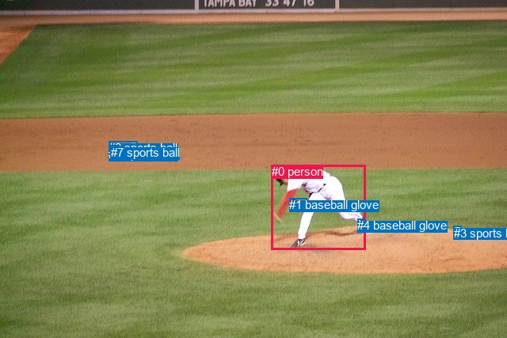
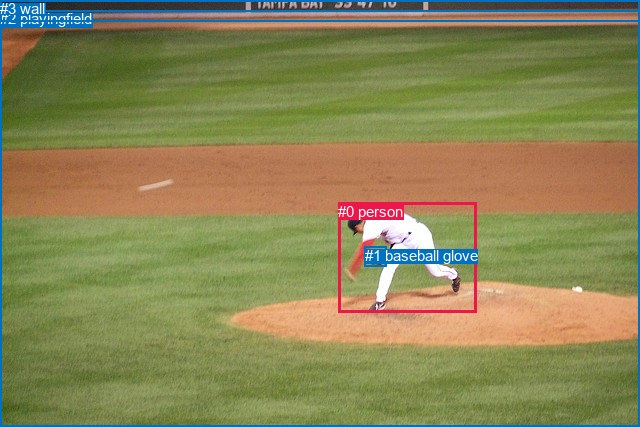

# 图片 1219：2371806.jpg

随机样本序号：61。图片 SHA256：`5c54b158f361a854da3855830074cb79f190470605bcf8d12be4ffa39994470f`。

红色框表示人，蓝色框表示其他物体。两个模式分别保留自身框编号，可依据位置比较对应对象。

## 自动检测框与输出

人的框编号：`[0]`。状态：`ok`。

### 自动检测全部物体框

| 编号 | 类别 | 是否为人 | 检测分数 | 像素坐标 xyxy |
|---|---|---|---|---|
| 0 | person | True | 0.9998 | 342.7, 208.1, 461.3, 315.1 |
| 1 | baseball glove | False | 0.9991 | 365.1, 250.2, 387.7, 266.4 |
| 2 | sports ball | False | 0.9311 | 137.3, 178.2, 173.9, 193.4 |
| 3 | sports ball | False | 0.9292 | 572.9, 286.0, 582.7, 292.9 |
| 4 | baseball glove | False | 0.6695 | 451.4, 276.1, 460.8, 292.7 |
| 5 | sports ball | False | 0.6551 | 137.1, 183.9, 150.2, 195.3 |
| 6 | sports ball | False | 0.5823 | 137.2, 186.1, 145.0, 192.2 |
| 7 | sports ball | False | 0.3691 | 139.8, 184.3, 152.9, 192.3 |

### 自动检测 Top50 人相关候选

评分物体对：56；人相关物体对：14；输出关系：28。

| 排名 | 主语编号与类别 | 关系 | 宾语编号与类别 | 类型 | 人与人 | 排序分数 | 原始融合 logit |
|---|---|---|---|---|---|---|---|
| 1 | #0 person | throwing | #6 sports ball | semantic | False | 0.99568 | 5.4393 |
| 2 | #0 person | throwing | #7 sports ball | semantic | False | 0.99541 | 5.3791 |
| 3 | #0 person | throwing | #5 sports ball | semantic | False | 0.99511 | 5.3157 |
| 4 | #0 person | throwing | #2 sports ball | semantic | False | 0.99492 | 5.2766 |
| 5 | #0 person | throwing | #3 sports ball | semantic | False | 0.98788 | 4.4007 |
| 6 | #0 person | wearing | #4 baseball glove | semantic | False | 0.98115 | 3.9520 |
| 7 | #0 person | wearing | #1 baseball glove | semantic | False | 0.97630 | 3.7184 |
| 8 | #0 person | in | #1 baseball glove | spatial | False | 0.87990 | 1.9915 |
| 9 | #0 person | on | #4 baseball glove | spatial | False | 0.86726 | 1.8770 |
| 10 | #4 baseball glove | on | #0 person | spatial | False | 0.81914 | 1.5105 |
| 11 | #0 person | in | #3 sports ball | spatial | False | 0.81684 | 1.4951 |
| 12 | #1 baseball glove | on | #0 person | spatial | False | 0.76986 | 1.2075 |
| 13 | #0 person | on | #2 sports ball | spatial | False | 0.58988 | 0.3635 |
| 14 | #0 person | on | #5 sports ball | spatial | False | 0.52053 | 0.0822 |
| 15 | #0 person | on | #7 sports ball | spatial | False | 0.50565 | 0.0226 |
| 16 | #0 person | on | #6 sports ball | spatial | False | 0.48250 | -0.0700 |
| 17 | #3 sports ball | on | #0 person | spatial | False | 0.35647 | -0.5907 |
| 18 | #4 baseball glove | wearing | #0 person | semantic | False | 0.17447 | -1.5543 |
| 19 | #1 baseball glove | wearing | #0 person | semantic | False | 0.15093 | -1.7273 |
| 20 | #3 sports ball | holding | #0 person | semantic | False | 0.08233 | -2.4111 |
| 21 | #2 sports ball | flying over | #0 person | semantic | False | 0.04372 | -3.0853 |
| 22 | #2 sports ball | in | #0 person | spatial | False | 0.03787 | -3.2349 |
| 23 | #7 sports ball | flying over | #0 person | semantic | False | 0.03666 | -3.2688 |
| 24 | #6 sports ball | flying over | #0 person | semantic | False | 0.03324 | -3.3703 |
| 25 | #5 sports ball | flying over | #0 person | semantic | False | 0.03122 | -3.4349 |
| 26 | #5 sports ball | in | #0 person | spatial | False | 0.02621 | -3.6150 |
| 27 | #7 sports ball | in | #0 person | spatial | False | 0.02353 | -3.7259 |
| 28 | #6 sports ball | in | #0 person | spatial | False | 0.01965 | -3.9099 |

### 自动检测逐条人相关 GT 核验

R@50：50.00%；命中 1/2。

| GT 主语编号 | GT 关系 | GT 宾语编号 | 结果阶段 | 匹配预测主语编号 | 匹配预测宾语编号 |
|---|---|---|---|---|---|
| 0 | wearing | 1 | hit50 | [0] | [1] |
| 0 | running on | 2 | endpoint_missing_or_wrong_class | [0] | [] |

## 真实框与输出

人的框编号：`[0]`。

### 真实框全部物体框

| 编号 | 类别 | 是否为人 | 检测分数 | 像素坐标 xyxy |
|---|---|---|---|---|
| 0 | person | True | GT | 338.0, 203.0, 477.0, 313.0 |
| 1 | baseball glove | False | GT | 365.0, 247.0, 387.0, 267.0 |
| 2 | playingfield | False | GT | 0.0, 10.0, 640.0, 427.0 |
| 3 | wall | False | GT | 0.0, 0.0, 640.0, 21.0 |

### 真实框 Top50 人相关候选

评分物体对：12；人相关物体对：6；输出关系：12。

| 排名 | 主语编号与类别 | 关系 | 宾语编号与类别 | 类型 | 人与人 | 排序分数 | 原始融合 logit |
|---|---|---|---|---|---|---|---|
| 1 | #0 person | wearing | #1 baseball glove | semantic | False | 0.97913 | 3.8483 |
| 2 | #0 person | on | #2 playingfield | spatial | False | 0.96908 | 3.4450 |
| 3 | #1 baseball glove | on | #0 person | spatial | False | 0.91616 | 2.3913 |
| 4 | #0 person | playing | #2 playingfield | semantic | False | 0.91342 | 2.3561 |
| 5 | #0 person | on | #1 baseball glove | spatial | False | 0.85869 | 1.8044 |
| 6 | #0 person | playing | #3 wall | semantic | False | 0.40767 | -0.3736 |
| 7 | #1 baseball glove | wearing | #0 person | semantic | False | 0.36181 | -0.5675 |
| 8 | #0 person | on | #3 wall | spatial | False | 0.34940 | -0.6217 |
| 9 | #2 playingfield | in | #0 person | spatial | False | 0.26900 | -0.9997 |
| 10 | #3 wall | beside | #0 person | spatial | False | 0.26029 | -1.0445 |
| 11 | #2 playingfield | holding | #0 person | semantic | False | 0.11540 | -2.0367 |
| 12 | #3 wall | holding | #0 person | semantic | False | 0.06637 | -2.6439 |

### 真实框逐条人相关 GT 核验

R@50：50.00%；命中 1/2。

| GT 主语编号 | GT 关系 | GT 宾语编号 | 结果阶段 | 匹配预测主语编号 | 匹配预测宾语编号 |
|---|---|---|---|---|---|
| 0 | wearing | 1 | hit50 | [0] | [1] |
| 0 | running on | 2 | wrong_predicate | [0] | [2] |

## 全部人相关 GT

| 主语编号与类别 | 关系 | 宾语编号与类别 |
|---|---|---|
| #0 person | wearing | #1 baseball glove |
| #0 person | running on | #2 playingfield |

原始记录、全部人相关物体对的两项预测与分项分数见 [逐图证据 JSON](../evidence/cases/1219.json)。全部56类 logits 保留于本机 HOR/output/random500/logits/。

<!-- HOR_COMPLETE_RESULTS -->

## 六组条件的完整输出对照

以下保留同一图片三种框与候选模式、两种谓词输出规则的全部 Top50。框编号各自在所属模式内解释。

### 自动检测框完整枚举：空间与语义各保留一个谓词

| 排名 | 主语编号与类别 | 谓词 | 宾语编号与类别 | 分组 | 排序分数 | predicate logit | pair logit |
|---|---|---|---|---|---|---|---|
| 1 | #0 person | throwing | #6 sports ball | semantic | 0.9956763 | 5.9825892 | -0.5432578 |
| 2 | #0 person | throwing | #7 sports ball | semantic | 0.9954094 | 5.9229159 | -0.5437716 |
| 3 | #0 person | throwing | #5 sports ball | semantic | 0.9951100 | 5.8629041 | -0.5472495 |
| 4 | #0 person | throwing | #2 sports ball | semantic | 0.9949163 | 5.8030620 | -0.5264387 |
| 5 | #0 person | throwing | #3 sports ball | semantic | 0.9878795 | 5.2560649 | -0.8554111 |
| 6 | #0 person | wearing | #4 baseball glove | semantic | 0.9811454 | 4.0576453 | -0.1056787 |
| 7 | #0 person | wearing | #1 baseball glove | semantic | 0.9763020 | 3.6715760 | 0.0468022 |
| 8 | #0 person | in | #1 baseball glove | spatial | 0.8799018 | 1.9446983 | 0.0468022 |
| 9 | #0 person | on | #4 baseball glove | spatial | 0.8672624 | 1.9826455 | -0.1056787 |
| 10 | #4 baseball glove | on | #0 person | spatial | 0.8191375 | 1.9316716 | -0.4211568 |
| 11 | #0 person | in | #3 sports ball | spatial | 0.8168401 | 2.3504949 | -0.8554111 |
| 12 | #1 baseball glove | on | #0 person | spatial | 0.7698599 | 1.7668791 | -0.5593590 |
| 13 | #0 person | on | #2 sports ball | spatial | 0.5898826 | 0.8899188 | -0.5264387 |
| 14 | #0 person | on | #5 sports ball | spatial | 0.5205280 | 0.6294079 | -0.5472495 |
| 15 | #0 person | on | #7 sports ball | spatial | 0.5056464 | 0.5663581 | -0.5437716 |
| 16 | #0 person | on | #6 sports ball | spatial | 0.4824971 | 0.4732175 | -0.5432578 |
| 17 | #3 sports ball | on | #0 person | spatial | 0.3564665 | 0.3846526 | -0.9753863 |
| 18 | #4 baseball glove | wearing | #0 person | semantic | 0.1744658 | -1.1331451 | -0.4211568 |
| 19 | #1 baseball glove | wearing | #0 person | semantic | 0.1509287 | -1.1679766 | -0.5593590 |
| 20 | #3 sports ball | holding | #0 person | semantic | 0.0823337 | -1.4356670 | -0.9753863 |
| 21 | #2 sports ball | flying over | #0 person | semantic | 0.0437185 | -1.9185560 | -1.1667243 |
| 22 | #2 sports ball | in | #0 person | spatial | 0.0378721 | -2.0682082 | -1.1667243 |
| 23 | #7 sports ball | flying over | #0 person | semantic | 0.0366577 | -2.0996249 | -1.1691613 |
| 24 | #6 sports ball | flying over | #0 person | semantic | 0.0332362 | -2.2050447 | -1.1652714 |
| 25 | #5 sports ball | flying over | #0 person | semantic | 0.0312213 | -2.2647994 | -1.1701354 |
| 26 | #5 sports ball | in | #0 person | spatial | 0.0262115 | -2.4448597 | -1.1701354 |
| 27 | #7 sports ball | in | #0 person | spatial | 0.0235254 | -2.5567055 | -1.1691613 |
| 28 | #6 sports ball | in | #0 person | spatial | 0.0196491 | -2.7446086 | -1.1652714 |

GT 命中：1/2，R@50=50.00%。

| GT主语 | GT谓词 | GT宾语 | 结果阶段 | 匹配主语框 | 匹配宾语框 |
|---|---|---|---|---|---|
| 0 | wearing | 1 | hit50 | [0] | [1] |
| 0 | running on | 2 | endpoint_missing_or_wrong_class | [0] | [] |

### 自动检测框完整枚举：每对只保留一个谓词

| 排名 | 主语编号与类别 | 谓词 | 宾语编号与类别 | 分组 | 排序分数 | predicate logit | pair logit |
|---|---|---|---|---|---|---|---|
| 1 | #0 person | throwing | #6 sports ball | single | 0.9956763 | 5.9825892 | -0.5432578 |
| 2 | #0 person | throwing | #7 sports ball | single | 0.9954094 | 5.9229159 | -0.5437716 |
| 3 | #0 person | throwing | #5 sports ball | single | 0.9951100 | 5.8629041 | -0.5472495 |
| 4 | #0 person | throwing | #2 sports ball | single | 0.9949163 | 5.8030620 | -0.5264387 |
| 5 | #0 person | throwing | #3 sports ball | single | 0.9878795 | 5.2560649 | -0.8554111 |
| 6 | #0 person | wearing | #4 baseball glove | single | 0.9811454 | 4.0576453 | -0.1056787 |
| 7 | #0 person | wearing | #1 baseball glove | single | 0.9763020 | 3.6715760 | 0.0468022 |
| 8 | #4 baseball glove | on | #0 person | single | 0.8191375 | 1.9316716 | -0.4211568 |
| 9 | #1 baseball glove | on | #0 person | single | 0.7698599 | 1.7668791 | -0.5593590 |
| 10 | #3 sports ball | on | #0 person | single | 0.3564665 | 0.3846526 | -0.9753863 |
| 11 | #2 sports ball | flying over | #0 person | single | 0.0437185 | -1.9185560 | -1.1667243 |
| 12 | #7 sports ball | flying over | #0 person | single | 0.0366577 | -2.0996249 | -1.1691613 |
| 13 | #6 sports ball | flying over | #0 person | single | 0.0332362 | -2.2050447 | -1.1652714 |
| 14 | #5 sports ball | flying over | #0 person | single | 0.0312213 | -2.2647994 | -1.1701354 |

GT 命中：1/2，R@50=50.00%。

| GT主语 | GT谓词 | GT宾语 | 结果阶段 | 匹配主语框 | 匹配宾语框 |
|---|---|---|---|---|---|
| 0 | wearing | 1 | hit50 | [0] | [1] |
| 0 | running on | 2 | endpoint_missing_or_wrong_class | [0] | [] |

### 真实框完整枚举：空间与语义各保留一个谓词

| 排名 | 主语编号与类别 | 谓词 | 宾语编号与类别 | 分组 | 排序分数 | predicate logit | pair logit |
|---|---|---|---|---|---|---|---|
| 1 | #0 person | wearing | #1 baseball glove | semantic | 0.9791297 | 3.5937896 | 0.2545480 |
| 2 | #0 person | on | #2 playingfield | spatial | 0.9690824 | 3.5910048 | -0.1459805 |
| 3 | #1 baseball glove | on | #0 person | spatial | 0.9161605 | 2.8286748 | -0.4373883 |
| 4 | #0 person | playing | #2 playingfield | semantic | 0.9134212 | 2.5021229 | -0.1459805 |
| 5 | #0 person | on | #1 baseball glove | spatial | 0.8586894 | 1.5498991 | 0.2545480 |
| 6 | #0 person | playing | #3 wall | semantic | 0.4076730 | 1.0448489 | -1.4184422 |
| 7 | #1 baseball glove | wearing | #0 person | semantic | 0.3618094 | -0.1301312 | -0.4373883 |
| 8 | #0 person | on | #3 wall | spatial | 0.3494029 | 0.7967772 | -1.4184422 |
| 9 | #2 playingfield | in | #0 person | spatial | 0.2689989 | 0.0980635 | -1.0977714 |
| 10 | #3 wall | beside | #0 person | spatial | 0.2602896 | -0.1363177 | -0.9081460 |
| 11 | #2 playingfield | holding | #0 person | semantic | 0.1154034 | -0.9389267 | -1.0977714 |
| 12 | #3 wall | holding | #0 person | semantic | 0.0663658 | -1.7357562 | -0.9081460 |

GT 命中：1/2，R@50=50.00%。

| GT主语 | GT谓词 | GT宾语 | 结果阶段 | 匹配主语框 | 匹配宾语框 |
|---|---|---|---|---|---|
| 0 | wearing | 1 | hit50 | [0] | [1] |
| 0 | running on | 2 | wrong_predicate | [0] | [2] |

### 真实框完整枚举：每对只保留一个谓词

| 排名 | 主语编号与类别 | 谓词 | 宾语编号与类别 | 分组 | 排序分数 | predicate logit | pair logit |
|---|---|---|---|---|---|---|---|
| 1 | #0 person | wearing | #1 baseball glove | single | 0.9791297 | 3.5937896 | 0.2545480 |
| 2 | #0 person | on | #2 playingfield | single | 0.9690824 | 3.5910048 | -0.1459805 |
| 3 | #1 baseball glove | on | #0 person | single | 0.9161605 | 2.8286748 | -0.4373883 |
| 4 | #0 person | playing | #3 wall | single | 0.4076730 | 1.0448489 | -1.4184422 |
| 5 | #2 playingfield | in | #0 person | single | 0.2689989 | 0.0980635 | -1.0977714 |
| 6 | #3 wall | beside | #0 person | single | 0.2602896 | -0.1363177 | -0.9081460 |

GT 命中：1/2，R@50=50.00%。

| GT主语 | GT谓词 | GT宾语 | 结果阶段 | 匹配主语框 | 匹配宾语框 |
|---|---|---|---|---|---|
| 0 | wearing | 1 | hit50 | [0] | [1] |
| 0 | running on | 2 | wrong_predicate | [0] | [2] |

### 真实框400候选：空间与语义各保留一个谓词

| 排名 | 主语编号与类别 | 谓词 | 宾语编号与类别 | 分组 | 排序分数 | predicate logit | pair logit |
|---|---|---|---|---|---|---|---|
| 1 | #0 person | wearing | #1 baseball glove | semantic | 0.9791297 | 3.5937896 | 0.2545480 |
| 2 | #0 person | on | #2 playingfield | spatial | 0.9690824 | 3.5910048 | -0.1459805 |
| 3 | #1 baseball glove | on | #0 person | spatial | 0.9161605 | 2.8286748 | -0.4373883 |
| 4 | #0 person | playing | #2 playingfield | semantic | 0.9134212 | 2.5021229 | -0.1459805 |
| 5 | #0 person | on | #1 baseball glove | spatial | 0.8586894 | 1.5498991 | 0.2545480 |
| 6 | #0 person | playing | #3 wall | semantic | 0.4015918 | 1.0196052 | -1.4184422 |
| 7 | #1 baseball glove | wearing | #0 person | semantic | 0.3631653 | -0.1242638 | -0.4373883 |
| 8 | #0 person | on | #3 wall | spatial | 0.3494029 | 0.7967772 | -1.4184422 |
| 9 | #2 playingfield | in | #0 person | spatial | 0.2689989 | 0.0980635 | -1.0977714 |
| 10 | #3 wall | beside | #0 person | spatial | 0.2545488 | -0.1663513 | -0.9081460 |
| 11 | #2 playingfield | holding | #0 person | semantic | 0.1152527 | -0.9404037 | -1.0977714 |
| 12 | #3 wall | holding | #0 person | semantic | 0.0651692 | -1.7552330 | -0.9081460 |

GT 命中：1/2，R@50=50.00%。

| GT主语 | GT谓词 | GT宾语 | 结果阶段 | 匹配主语框 | 匹配宾语框 |
|---|---|---|---|---|---|
| 0 | wearing | 1 | hit50 | [0] | [1] |
| 0 | running on | 2 | wrong_predicate | [0] | [2] |

### 真实框400候选：每对只保留一个谓词

| 排名 | 主语编号与类别 | 谓词 | 宾语编号与类别 | 分组 | 排序分数 | predicate logit | pair logit |
|---|---|---|---|---|---|---|---|
| 1 | #0 person | wearing | #1 baseball glove | single | 0.9791297 | 3.5937896 | 0.2545480 |
| 2 | #0 person | on | #2 playingfield | single | 0.9690824 | 3.5910048 | -0.1459805 |
| 3 | #1 baseball glove | on | #0 person | single | 0.9161605 | 2.8286748 | -0.4373883 |
| 4 | #0 person | playing | #3 wall | single | 0.4015918 | 1.0196052 | -1.4184422 |
| 5 | #2 playingfield | in | #0 person | single | 0.2689989 | 0.0980635 | -1.0977714 |
| 6 | #3 wall | beside | #0 person | single | 0.2545488 | -0.1663513 | -0.9081460 |

GT 命中：1/2，R@50=50.00%。

| GT主语 | GT谓词 | GT宾语 | 结果阶段 | 匹配主语框 | 匹配宾语框 |
|---|---|---|---|---|---|
| 0 | wearing | 1 | hit50 | [0] | [1] |
| 0 | running on | 2 | wrong_predicate | [0] | [2] |
