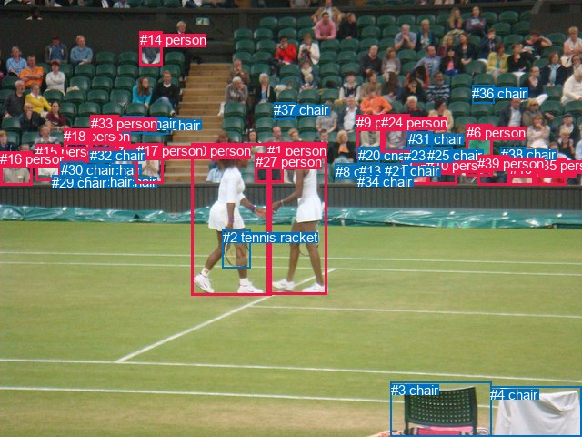
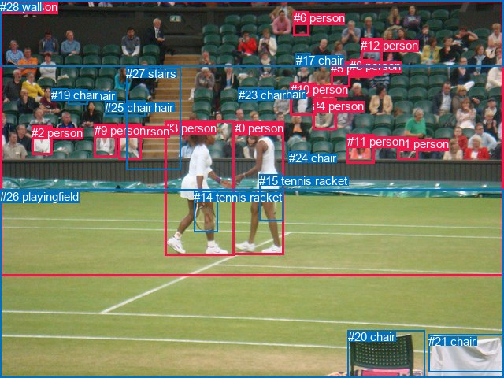

# 图片 1237：2372495.jpg

随机样本序号：277。图片 SHA256：`ffc672262fe65dfaa7c8ffd499dbb40b06e699aafdf041db3ec50f615fd33436`。

红色框表示人，蓝色框表示其他物体。两个模式分别保留自身框编号，可依据位置比较对应对象。

## 自动检测框与输出

人的框编号：`[0, 1, 5, 6, 7, 9, 10, 14, 15, 16, 17, 18, 19, 24, 27, 33, 35, 39]`。状态：`ok`。

### 自动检测全部物体框

| 编号 | 类别 | 是否为人 | 检测分数 | 像素坐标 xyxy |
|---|---|---|---|---|
| 0 | person | True | 0.9973 | 210.5, 157.4, 298.4, 324.7 |
| 1 | person | True | 0.9964 | 293.6, 156.5, 359.2, 323.8 |
| 2 | tennis racket | False | 0.9926 | 245.0, 252.3, 275.7, 294.0 |
| 3 | chair | False | 0.9695 | 429.7, 419.6, 540.6, 480.0 |
| 4 | chair | False | 0.9680 | 539.4, 424.8, 639.9, 480.0 |
| 5 | person | True | 0.8965 | 441.6, 174.9, 472.5, 202.9 |
| 6 | person | True | 0.8841 | 512.8, 136.8, 541.6, 193.9 |
| 7 | person | True | 0.8832 | 120.3, 158.9, 147.7, 195.3 |
| 8 | chair | False | 0.8731 | 368.6, 179.6, 396.0, 196.5 |
| 9 | person | True | 0.8685 | 392.4, 126.3, 423.1, 174.2 |
| 10 | person | True | 0.8500 | 468.6, 172.9, 502.9, 202.6 |
| 11 | chair | False | 0.8442 | 111.6, 191.5, 139.6, 202.1 |
| 12 | chair | False | 0.8412 | 94.5, 177.9, 121.0, 192.4 |
| 13 | chair | False | 0.8367 | 395.0, 179.3, 422.8, 197.5 |
| 14 | person | True | 0.8274 | 153.6, 34.7, 178.2, 72.4 |
| 15 | person | True | 0.8272 | 39.2, 158.0, 66.8, 198.7 |
| 16 | person | True | 0.8197 | 0.1, 166.3, 35.5, 203.7 |
| 17 | person | True | 0.8193 | 149.6, 157.4, 179.4, 201.2 |
| 18 | person | True | 0.8184 | 70.1, 141.1, 99.3, 178.9 |
| 19 | person | True | 0.8178 | 560.8, 177.1, 588.0, 203.2 |
| 20 | chair | False | 0.8098 | 393.6, 161.6, 417.6, 179.5 |
| 21 | chair | False | 0.8004 | 423.0, 179.1, 450.3, 194.6 |
| 22 | chair | False | 0.7786 | 84.7, 191.0, 112.7, 202.6 |
| 23 | chair | False | 0.7697 | 443.8, 162.1, 471.9, 178.8 |
| 24 | person | True | 0.7563 | 418.9, 125.6, 450.2, 167.5 |
| 25 | chair | False | 0.7548 | 470.2, 161.7, 497.7, 178.1 |
| 26 | chair | False | 0.7507 | 160.1, 128.7, 184.7, 147.1 |
| 27 | person | True | 0.7479 | 281.0, 168.9, 311.3, 200.8 |
| 28 | chair | False | 0.7425 | 134.2, 127.4, 158.7, 146.8 |
| 29 | chair | False | 0.7410 | 57.3, 192.1, 86.9, 202.3 |
| 30 | chair | False | 0.7398 | 66.8, 177.9, 92.6, 196.8 |
| 31 | chair | False | 0.7360 | 449.0, 144.2, 476.0, 164.6 |
| 32 | chair | False | 0.7336 | 98.5, 162.0, 125.4, 178.2 |
| 33 | person | True | 0.7272 | 99.9, 126.6, 130.5, 165.9 |
| 34 | chair | False | 0.7241 | 393.3, 190.9, 421.1, 202.3 |
| 35 | person | True | 0.7185 | 588.3, 173.1, 622.5, 203.9 |
| 36 | chair | False | 0.6973 | 519.3, 93.7, 543.9, 113.0 |
| 37 | chair | False | 0.6966 | 301.2, 112.1, 325.7, 131.1 |
| 38 | chair | False | 0.6962 | 550.8, 161.2, 577.3, 176.1 |
| 39 | person | True | 0.6956 | 525.2, 170.7, 560.7, 203.3 |

### 自动检测 Top50 人相关候选

评分物体对：1560；人相关物体对：1098；输出关系：50。

| 排名 | 主语编号与类别 | 关系 | 宾语编号与类别 | 类型 | 人与人 | 排序分数 | 原始融合 logit |
|---|---|---|---|---|---|---|---|
| 1 | #0 person | wearing | #2 tennis racket | semantic | False | 0.98857 | 4.4599 |
| 2 | #7 person | sitting on | #11 chair | semantic | False | 0.96736 | 3.3889 |
| 3 | #1 person | holding | #27 person | semantic | True | 0.96450 | 3.3020 |
| 4 | #15 person | sitting on | #29 chair | semantic | False | 0.96303 | 3.2599 |
| 5 | #9 person | sitting on | #20 chair | semantic | False | 0.96093 | 3.2026 |
| 6 | #17 person | sitting on | #26 chair | semantic | False | 0.95593 | 3.0770 |
| 7 | #1 person | playing with | #0 person | semantic | True | 0.94390 | 2.8229 |
| 8 | #0 person | playing with | #1 person | semantic | True | 0.93683 | 2.6966 |
| 9 | #0 person | holding | #27 person | semantic | True | 0.93487 | 2.6640 |
| 10 | #17 person | sitting on | #28 chair | semantic | False | 0.91239 | 2.3431 |
| 11 | #10 person | sitting on | #25 chair | semantic | False | 0.90921 | 2.3040 |
| 12 | #0 person | in | #2 tennis racket | spatial | False | 0.90248 | 2.2250 |
| 13 | #5 person | sitting on | #23 chair | semantic | False | 0.89924 | 2.1888 |
| 14 | #1 person | holding | #2 tennis racket | semantic | False | 0.89771 | 2.1720 |
| 15 | #15 person | sitting on | #22 chair | semantic | False | 0.89619 | 2.1556 |
| 16 | #16 person | sitting on | #29 chair | semantic | False | 0.89594 | 2.1529 |
| 17 | #18 person | sitting on | #22 chair | semantic | False | 0.89380 | 2.1301 |
| 18 | #7 person | sitting on | #28 chair | semantic | False | 0.87757 | 1.9696 |
| 19 | #5 person | sitting on | #21 chair | semantic | False | 0.86335 | 1.8434 |
| 20 | #33 person | sitting on | #28 chair | semantic | False | 0.85896 | 1.8067 |
| 21 | #16 person | sitting on | #22 chair | semantic | False | 0.85199 | 1.7503 |
| 22 | #18 person | sitting on | #30 chair | semantic | False | 0.85168 | 1.7478 |
| 23 | #7 person | sitting on | #12 chair | semantic | False | 0.84962 | 1.7316 |
| 24 | #18 person | wearing | #32 chair | semantic | False | 0.84327 | 1.6827 |
| 25 | #5 person | sitting on | #34 chair | semantic | False | 0.83695 | 1.6357 |
| 26 | #17 person | sitting on | #11 chair | semantic | False | 0.83634 | 1.6313 |
| 27 | #7 person | sitting on | #22 chair | semantic | False | 0.83234 | 1.6023 |
| 28 | #33 person | sitting on | #22 chair | semantic | False | 0.83222 | 1.6014 |
| 29 | #33 person | wearing | #32 chair | semantic | False | 0.83207 | 1.6004 |
| 30 | #15 person | sitting on | #30 chair | semantic | False | 0.82691 | 1.5639 |
| 31 | #1 person | in | #27 person | spatial | True | 0.82157 | 1.5270 |
| 32 | #7 person | sitting on | #32 chair | semantic | False | 0.81747 | 1.4993 |
| 33 | #9 person | in | #20 chair | spatial | False | 0.81222 | 1.4645 |
| 34 | #10 person | sitting on | #34 chair | semantic | False | 0.81204 | 1.4633 |
| 35 | #15 person | in | #29 chair | spatial | False | 0.81009 | 1.4506 |
| 36 | #9 person | sitting on | #13 chair | semantic | False | 0.79384 | 1.3482 |
| 37 | #6 person | sitting on | #36 chair | semantic | False | 0.79296 | 1.3429 |
| 38 | #18 person | sitting on | #12 chair | semantic | False | 0.78540 | 1.2974 |
| 39 | #18 person | sitting on | #29 chair | semantic | False | 0.78512 | 1.2957 |
| 40 | #7 person | in | #11 chair | spatial | False | 0.78052 | 1.2687 |
| 41 | #9 person | sitting on | #34 chair | semantic | False | 0.77075 | 1.2126 |
| 42 | #9 person | sitting on | #8 chair | semantic | False | 0.76828 | 1.1986 |
| 43 | #18 person | in | #30 chair | spatial | False | 0.73447 | 1.0174 |
| 44 | #7 person | sitting on | #26 chair | semantic | False | 0.72610 | 0.9749 |
| 45 | #39 person | sitting on | #38 chair | semantic | False | 0.72176 | 0.9532 |
| 46 | #1 person | beside | #0 person | spatial | True | 0.72006 | 0.9447 |
| 47 | #17 person | sitting on | #22 chair | semantic | False | 0.71876 | 0.9383 |
| 48 | #0 person | beside | #1 person | spatial | True | 0.71735 | 0.9313 |
| 49 | #16 person | in | #29 chair | spatial | False | 0.71615 | 0.9254 |
| 50 | #16 person | sitting on | #30 chair | semantic | False | 0.71597 | 0.9246 |

### 自动检测逐条人相关 GT 核验

R@50：0.00%；命中 0/6。

| GT 主语编号 | GT 关系 | GT 宾语编号 | 结果阶段 | 匹配预测主语编号 | 匹配预测宾语编号 |
|---|---|---|---|---|---|
| 0 | holding | 15 | endpoint_missing_or_wrong_class | [1] | [] |
| 0 | standing on | 26 | endpoint_missing_or_wrong_class | [1] | [] |
| 3 | looking at | 0 | wrong_predicate | [0] | [1] |
| 3 | talking to | 0 | wrong_predicate | [0] | [1] |
| 3 | holding | 14 | wrong_predicate | [0] | [2] |
| 7 | beside | 9 | wrong_predicate | [17] | [7] |

## 真实框与输出

人的框编号：`[0, 1, 2, 3, 4, 5, 6, 7, 8, 9, 10, 11, 12, 13]`。

### 真实框全部物体框

| 编号 | 类别 | 是否为人 | 检测分数 | 像素坐标 xyxy |
|---|---|---|---|---|
| 0 | person | True | GT | 295.0, 154.0, 360.0, 324.0 |
| 1 | person | True | GT | 505.0, 174.0, 531.0, 202.0 |
| 2 | person | True | GT | 40.0, 160.0, 66.0, 197.0 |
| 3 | person | True | GT | 210.0, 154.0, 298.0, 325.0 |
| 4 | person | True | GT | 397.0, 126.0, 427.0, 165.0 |
| 5 | person | True | GT | 420.0, 78.0, 444.0, 110.0 |
| 6 | person | True | GT | 373.0, 14.0, 393.0, 45.0 |
| 7 | person | True | GT | 150.0, 158.0, 179.0, 202.0 |
| 8 | person | True | GT | 444.0, 75.0, 474.0, 98.0 |
| 9 | person | True | GT | 120.0, 157.0, 149.0, 199.0 |
| 10 | person | True | GT | 369.0, 105.0, 402.0, 146.0 |
| 11 | person | True | GT | 441.0, 171.0, 476.0, 208.0 |
| 12 | person | True | GT | 458.0, 49.0, 485.0, 85.0 |
| 13 | person | True | GT | 0.0, 0.0, 640.0, 351.0 |
| 14 | tennis racket | False | GT | 246.0, 242.0, 276.0, 295.0 |
| 15 | tennis racket | False | GT | 329.0, 221.0, 359.0, 280.0 |
| 16 | chair | False | GT | 160.0, 128.0, 185.0, 148.0 |
| 17 | chair | False | GT | 376.0, 68.0, 395.0, 84.0 |
| 18 | chair | False | GT | 86.0, 113.0, 111.0, 132.0 |
| 19 | chair | False | GT | 65.0, 112.0, 85.0, 127.0 |
| 20 | chair | False | GT | 442.0, 419.0, 540.0, 480.0 |
| 21 | chair | False | GT | 544.0, 425.0, 640.0, 473.0 |
| 22 | chair | False | GT | 327.0, 111.0, 348.0, 127.0 |
| 23 | chair | False | GT | 303.0, 112.0, 327.0, 128.0 |
| 24 | chair | False | GT | 367.0, 192.0, 394.0, 201.0 |
| 25 | chair | False | GT | 133.0, 128.0, 158.0, 147.0 |
| 26 | playingfield | False | GT | 0.0, 241.0, 640.0, 480.0 |
| 27 | stairs | False | GT | 160.0, 85.0, 229.0, 215.0 |
| 28 | wall | False | GT | 0.0, 0.0, 640.0, 85.0 |

### 真实框 Top50 人相关候选

评分物体对：812；人相关物体对：602；输出关系：50。

| 排名 | 主语编号与类别 | 关系 | 宾语编号与类别 | 类型 | 人与人 | 排序分数 | 原始融合 logit |
|---|---|---|---|---|---|---|---|
| 1 | #0 person | wearing | #15 tennis racket | semantic | False | 0.99151 | 4.7600 |
| 2 | #3 person | wearing | #14 tennis racket | semantic | False | 0.98861 | 4.4632 |
| 3 | #7 person | sitting on | #27 stairs | semantic | False | 0.97863 | 3.8242 |
| 4 | #3 person | playing | #26 playingfield | semantic | False | 0.97833 | 3.8099 |
| 5 | #27 stairs | in | #13 person | spatial | False | 0.97434 | 3.6367 |
| 6 | #0 person | playing | #26 playingfield | semantic | False | 0.96368 | 3.2785 |
| 7 | #6 person | in | #28 wall | spatial | False | 0.94549 | 2.8533 |
| 8 | #0 person | on | #26 playingfield | spatial | False | 0.94477 | 2.8394 |
| 9 | #3 person | on | #26 playingfield | spatial | False | 0.94227 | 2.7925 |
| 10 | #28 wall | in | #13 person | spatial | False | 0.93902 | 2.7343 |
| 11 | #3 person | holding | #0 person | semantic | True | 0.92614 | 2.5289 |
| 12 | #7 person | sitting on | #16 chair | semantic | False | 0.92061 | 2.4507 |
| 13 | #7 person | sitting on | #25 chair | semantic | False | 0.91467 | 2.3721 |
| 14 | #9 person | sitting on | #25 chair | semantic | False | 0.90926 | 2.3046 |
| 15 | #0 person | in | #15 tennis racket | spatial | False | 0.90924 | 2.3044 |
| 16 | #6 person | in | #13 person | spatial | True | 0.90129 | 2.2117 |
| 17 | #0 person | holding | #3 person | semantic | True | 0.88299 | 2.0210 |
| 18 | #6 person | sitting on | #28 wall | semantic | False | 0.88131 | 2.0049 |
| 19 | #3 person | in | #14 tennis racket | spatial | False | 0.87487 | 1.9447 |
| 20 | #13 person | playing | #26 playingfield | semantic | False | 0.86643 | 1.8697 |
| 21 | #17 chair | in | #13 person | spatial | False | 0.85416 | 1.7676 |
| 22 | #10 person | in | #13 person | spatial | True | 0.83247 | 1.6033 |
| 23 | #1 person | looking at | #26 playingfield | semantic | False | 0.82307 | 1.5373 |
| 24 | #10 person | sitting on | #24 chair | semantic | False | 0.82246 | 1.5331 |
| 25 | #1 person | sitting on | #24 chair | semantic | False | 0.81566 | 1.4872 |
| 26 | #4 person | sitting on | #24 chair | semantic | False | 0.80977 | 1.4485 |
| 27 | #11 person | sitting on | #24 chair | semantic | False | 0.80473 | 1.4161 |
| 28 | #5 person | in | #13 person | spatial | True | 0.79315 | 1.3440 |
| 29 | #28 wall | looking at | #13 person | semantic | False | 0.78429 | 1.2908 |
| 30 | #16 chair | in | #13 person | spatial | False | 0.78379 | 1.2879 |
| 31 | #10 person | in | #17 chair | spatial | False | 0.77974 | 1.2642 |
| 32 | #6 person | looking at | #13 person | semantic | True | 0.77584 | 1.2416 |
| 33 | #2 person | looking at | #26 playingfield | semantic | False | 0.76415 | 1.1756 |
| 34 | #7 person | in | #27 stairs | spatial | False | 0.76142 | 1.1605 |
| 35 | #10 person | looking at | #13 person | semantic | True | 0.74306 | 1.0619 |
| 36 | #11 person | looking at | #26 playingfield | semantic | False | 0.71497 | 0.9196 |
| 37 | #12 person | in | #13 person | spatial | True | 0.69826 | 0.8390 |
| 38 | #9 person | sitting on | #16 chair | semantic | False | 0.69569 | 0.8269 |
| 39 | #9 person | looking at | #26 playingfield | semantic | False | 0.68691 | 0.7857 |
| 40 | #7 person | looking at | #26 playingfield | semantic | False | 0.68214 | 0.7636 |
| 41 | #12 person | in | #28 wall | spatial | False | 0.67606 | 0.7357 |
| 42 | #14 tennis racket | on | #3 person | spatial | False | 0.67506 | 0.7312 |
| 43 | #1 person | looking at | #13 person | semantic | True | 0.66892 | 0.7033 |
| 44 | #3 person | playing | #13 person | semantic | True | 0.65073 | 0.6223 |
| 45 | #5 person | looking at | #13 person | semantic | True | 0.64960 | 0.6173 |
| 46 | #8 person | in | #13 person | spatial | True | 0.63753 | 0.5647 |
| 47 | #7 person | looking at | #3 person | semantic | True | 0.63108 | 0.5368 |
| 48 | #1 person | in | #13 person | spatial | True | 0.63051 | 0.5344 |
| 49 | #0 person | holding | #14 tennis racket | semantic | False | 0.62609 | 0.5155 |
| 50 | #7 person | in | #25 chair | spatial | False | 0.62403 | 0.5067 |

### 真实框逐条人相关 GT 核验

R@50：0.00%；命中 0/6。

| GT 主语编号 | GT 关系 | GT 宾语编号 | 结果阶段 | 匹配预测主语编号 | 匹配预测宾语编号 |
|---|---|---|---|---|---|
| 0 | holding | 15 | wrong_predicate | [0] | [15] |
| 0 | standing on | 26 | wrong_predicate | [0] | [26] |
| 3 | looking at | 0 | wrong_predicate | [3] | [0] |
| 3 | talking to | 0 | wrong_predicate | [3] | [0] |
| 3 | holding | 14 | wrong_predicate | [3] | [14] |
| 7 | beside | 9 | rank_below50 | [7] | [9] |

## 全部人相关 GT

| 主语编号与类别 | 关系 | 宾语编号与类别 |
|---|---|---|
| #0 person | holding | #15 tennis racket |
| #0 person | standing on | #26 playingfield |
| #3 person | looking at | #0 person |
| #3 person | talking to | #0 person |
| #3 person | holding | #14 tennis racket |
| #7 person | beside | #9 person |

原始记录、全部人相关物体对的两项预测与分项分数见 [逐图证据 JSON](../evidence/cases/1237.json)。全部56类 logits 保留于本机 HOR/output/random500/logits/。

<!-- HOR_COMPLETE_RESULTS -->

## 六组条件的完整输出对照

以下保留同一图片三种框与候选模式、两种谓词输出规则的全部 Top50。框编号各自在所属模式内解释。

### 自动检测框完整枚举：空间与语义各保留一个谓词

| 排名 | 主语编号与类别 | 谓词 | 宾语编号与类别 | 分组 | 排序分数 | predicate logit | pair logit |
|---|---|---|---|---|---|---|---|
| 1 | #0 person | wearing | #2 tennis racket | semantic | 0.9885688 | 3.9109473 | 0.5489577 |
| 2 | #7 person | sitting on | #11 chair | semantic | 0.9673570 | 3.7045522 | -0.3156180 |
| 3 | #1 person | holding | #27 person | semantic | 0.9644971 | 3.2461624 | 0.0558311 |
| 4 | #15 person | sitting on | #29 chair | semantic | 0.9630263 | 3.6864953 | -0.4266205 |
| 5 | #9 person | sitting on | #20 chair | semantic | 0.9609304 | 3.5360541 | -0.3334970 |
| 6 | #17 person | sitting on | #26 chair | semantic | 0.9559321 | 3.5691342 | -0.4921791 |
| 7 | #1 person | playing with | #0 person | semantic | 0.9439012 | 3.4647155 | -0.6418071 |
| 8 | #0 person | playing with | #1 person | semantic | 0.9368277 | 3.2310019 | -0.5343695 |
| 9 | #0 person | holding | #27 person | semantic | 0.9348716 | 2.6819835 | -0.0179350 |
| 10 | #17 person | sitting on | #28 chair | semantic | 0.9123877 | 2.9432425 | -0.6000999 |
| 11 | #10 person | sitting on | #25 chair | semantic | 0.9092066 | 2.3142829 | -0.0102977 |
| 12 | #0 person | in | #2 tennis racket | spatial | 0.9024758 | 1.6760831 | 0.5489577 |
| 13 | #5 person | sitting on | #23 chair | semantic | 0.8992413 | 2.1728559 | 0.0159677 |
| 14 | #1 person | holding | #2 tennis racket | semantic | 0.8977106 | 2.0638704 | 0.1081715 |
| 15 | #15 person | sitting on | #22 chair | semantic | 0.8961894 | 2.6543798 | -0.4987960 |
| 16 | #16 person | sitting on | #29 chair | semantic | 0.8959388 | 2.3955593 | -0.2426667 |
| 17 | #18 person | sitting on | #22 chair | semantic | 0.8937984 | 2.8168688 | -0.6867280 |
| 18 | #7 person | sitting on | #28 chair | semantic | 0.8775687 | 2.6573839 | -0.6877788 |
| 19 | #5 person | sitting on | #21 chair | semantic | 0.8633530 | 1.7215028 | 0.1219202 |
| 20 | #33 person | sitting on | #28 chair | semantic | 0.8589616 | 2.3925557 | -0.5858638 |
| 21 | #16 person | sitting on | #22 chair | semantic | 0.8519935 | 2.0946789 | -0.3443561 |
| 22 | #18 person | sitting on | #30 chair | semantic | 0.8516755 | 2.4166541 | -0.6688514 |
| 23 | #7 person | sitting on | #12 chair | semantic | 0.8496162 | 2.1608706 | -0.4292769 |
| 24 | #18 person | wearing | #32 chair | semantic | 0.8432667 | 2.2896338 | -0.6068964 |
| 25 | #5 person | sitting on | #34 chair | semantic | 0.8369502 | 1.5290022 | 0.1067065 |
| 26 | #17 person | sitting on | #11 chair | semantic | 0.8363417 | 1.8990455 | -0.2677886 |
| 27 | #7 person | sitting on | #22 chair | semantic | 0.8323414 | 2.0946789 | -0.4923658 |
| 28 | #33 person | sitting on | #22 chair | semantic | 0.8322166 | 2.0134025 | -0.4119840 |
| 29 | #33 person | wearing | #32 chair | semantic | 0.8320712 | 2.1259379 | -0.5255601 |
| 30 | #15 person | sitting on | #30 chair | semantic | 0.8269066 | 2.0254512 | -0.4615912 |
| 31 | #1 person | in | #27 person | spatial | 0.8215702 | 1.4711909 | 0.0558311 |
| 32 | #7 person | sitting on | #32 chair | semantic | 0.8174727 | 1.9261484 | -0.4268306 |
| 33 | #9 person | in | #20 chair | spatial | 0.8122244 | 1.7980266 | -0.3334970 |
| 34 | #10 person | sitting on | #34 chair | semantic | 0.8120364 | 1.3303962 | 0.1329006 |
| 35 | #15 person | in | #29 chair | spatial | 0.8100924 | 1.8772311 | -0.4266205 |
| 36 | #9 person | sitting on | #13 chair | semantic | 0.7938422 | 1.7817812 | -0.4335384 |
| 37 | #6 person | sitting on | #36 chair | semantic | 0.7929605 | 1.5650859 | -0.2222221 |
| 38 | #18 person | sitting on | #12 chair | semantic | 0.7853959 | 1.9773188 | -0.6799254 |
| 39 | #18 person | sitting on | #29 chair | semantic | 0.7851151 | 1.9652691 | -0.6695414 |
| 40 | #7 person | in | #11 chair | spatial | 0.7805157 | 1.5842919 | -0.3156180 |
| 41 | #9 person | sitting on | #34 chair | semantic | 0.7707505 | 1.6102467 | -0.3976928 |
| 42 | #9 person | sitting on | #8 chair | semantic | 0.7682801 | 1.3785620 | -0.1799368 |
| 43 | #18 person | in | #30 chair | spatial | 0.7344719 | 1.6862822 | -0.6688514 |
| 44 | #7 person | sitting on | #26 chair | semantic | 0.7260965 | 1.5921569 | -0.6172502 |
| 45 | #39 person | sitting on | #38 chair | semantic | 0.7217602 | 0.9060187 | 0.0471904 |
| 46 | #1 person | beside | #0 person | spatial | 0.7200558 | 1.5865455 | -0.6418071 |
| 47 | #17 person | sitting on | #22 chair | semantic | 0.7187625 | 1.3815022 | -0.4431705 |
| 48 | #0 person | beside | #1 person | spatial | 0.7173488 | 1.4657178 | -0.5343695 |
| 49 | #16 person | in | #29 chair | spatial | 0.7161466 | 1.1680937 | -0.2426667 |
| 50 | #16 person | sitting on | #30 chair | semantic | 0.7159739 | 1.2310295 | -0.3064518 |

GT 命中：0/6，R@50=0.00%。

| GT主语 | GT谓词 | GT宾语 | 结果阶段 | 匹配主语框 | 匹配宾语框 |
|---|---|---|---|---|---|
| 0 | holding | 15 | endpoint_missing_or_wrong_class | [1] | [] |
| 0 | standing on | 26 | endpoint_missing_or_wrong_class | [1] | [] |
| 3 | looking at | 0 | wrong_predicate | [0] | [1] |
| 3 | talking to | 0 | wrong_predicate | [0] | [1] |
| 3 | holding | 14 | wrong_predicate | [0] | [2] |
| 7 | beside | 9 | wrong_predicate | [17] | [7] |

### 自动检测框完整枚举：每对只保留一个谓词

| 排名 | 主语编号与类别 | 谓词 | 宾语编号与类别 | 分组 | 排序分数 | predicate logit | pair logit |
|---|---|---|---|---|---|---|---|
| 1 | #0 person | wearing | #2 tennis racket | single | 0.9885688 | 3.9109473 | 0.5489577 |
| 2 | #7 person | sitting on | #11 chair | single | 0.9673570 | 3.7045522 | -0.3156180 |
| 3 | #1 person | holding | #27 person | single | 0.9644971 | 3.2461624 | 0.0558311 |
| 4 | #15 person | sitting on | #29 chair | single | 0.9630263 | 3.6864953 | -0.4266205 |
| 5 | #9 person | sitting on | #20 chair | single | 0.9609304 | 3.5360541 | -0.3334970 |
| 6 | #17 person | sitting on | #26 chair | single | 0.9559321 | 3.5691342 | -0.4921791 |
| 7 | #1 person | playing with | #0 person | single | 0.9439012 | 3.4647155 | -0.6418071 |
| 8 | #0 person | playing with | #1 person | single | 0.9368277 | 3.2310019 | -0.5343695 |
| 9 | #0 person | holding | #27 person | single | 0.9348716 | 2.6819835 | -0.0179350 |
| 10 | #17 person | sitting on | #28 chair | single | 0.9123877 | 2.9432425 | -0.6000999 |
| 11 | #10 person | sitting on | #25 chair | single | 0.9092066 | 2.3142829 | -0.0102977 |
| 12 | #5 person | sitting on | #23 chair | single | 0.8992413 | 2.1728559 | 0.0159677 |
| 13 | #1 person | holding | #2 tennis racket | single | 0.8977106 | 2.0638704 | 0.1081715 |
| 14 | #15 person | sitting on | #22 chair | single | 0.8961894 | 2.6543798 | -0.4987960 |
| 15 | #16 person | sitting on | #29 chair | single | 0.8959388 | 2.3955593 | -0.2426667 |
| 16 | #18 person | sitting on | #22 chair | single | 0.8937984 | 2.8168688 | -0.6867280 |
| 17 | #7 person | sitting on | #28 chair | single | 0.8775687 | 2.6573839 | -0.6877788 |
| 18 | #5 person | sitting on | #21 chair | single | 0.8633530 | 1.7215028 | 0.1219202 |
| 19 | #33 person | sitting on | #28 chair | single | 0.8589616 | 2.3925557 | -0.5858638 |
| 20 | #16 person | sitting on | #22 chair | single | 0.8519935 | 2.0946789 | -0.3443561 |
| 21 | #18 person | sitting on | #30 chair | single | 0.8516755 | 2.4166541 | -0.6688514 |
| 22 | #7 person | sitting on | #12 chair | single | 0.8496162 | 2.1608706 | -0.4292769 |
| 23 | #18 person | wearing | #32 chair | single | 0.8432667 | 2.2896338 | -0.6068964 |
| 24 | #5 person | sitting on | #34 chair | single | 0.8369502 | 1.5290022 | 0.1067065 |
| 25 | #17 person | sitting on | #11 chair | single | 0.8363417 | 1.8990455 | -0.2677886 |
| 26 | #7 person | sitting on | #22 chair | single | 0.8323414 | 2.0946789 | -0.4923658 |
| 27 | #33 person | sitting on | #22 chair | single | 0.8322166 | 2.0134025 | -0.4119840 |
| 28 | #33 person | wearing | #32 chair | single | 0.8320712 | 2.1259379 | -0.5255601 |
| 29 | #15 person | sitting on | #30 chair | single | 0.8269066 | 2.0254512 | -0.4615912 |
| 30 | #7 person | sitting on | #32 chair | single | 0.8174727 | 1.9261484 | -0.4268306 |
| 31 | #10 person | sitting on | #34 chair | single | 0.8120364 | 1.3303962 | 0.1329006 |
| 32 | #9 person | sitting on | #13 chair | single | 0.7938422 | 1.7817812 | -0.4335384 |
| 33 | #6 person | sitting on | #36 chair | single | 0.7929605 | 1.5650859 | -0.2222221 |
| 34 | #18 person | sitting on | #12 chair | single | 0.7853959 | 1.9773188 | -0.6799254 |
| 35 | #18 person | sitting on | #29 chair | single | 0.7851151 | 1.9652691 | -0.6695414 |
| 36 | #9 person | sitting on | #34 chair | single | 0.7707505 | 1.6102467 | -0.3976928 |
| 37 | #9 person | sitting on | #8 chair | single | 0.7682801 | 1.3785620 | -0.1799368 |
| 38 | #7 person | sitting on | #26 chair | single | 0.7260965 | 1.5921569 | -0.6172502 |
| 39 | #39 person | sitting on | #38 chair | single | 0.7217602 | 0.9060187 | 0.0471904 |
| 40 | #17 person | sitting on | #22 chair | single | 0.7187625 | 1.3815022 | -0.4431705 |
| 41 | #16 person | sitting on | #30 chair | single | 0.7159739 | 1.2310295 | -0.3064518 |
| 42 | #14 person | looking at | #0 person | single | 0.7085925 | 2.1225758 | -1.2340178 |
| 43 | #33 person | sitting on | #11 chair | single | 0.7084892 | 1.3182673 | -0.4302099 |
| 44 | #5 person | sitting on | #13 chair | single | 0.7064130 | 0.8398919 | 0.0381340 |
| 45 | #18 person | sitting on | #11 chair | single | 0.7061979 | 1.5319424 | -0.6549535 |
| 46 | #10 person | sitting on | #8 chair | single | 0.6997434 | 0.7556744 | 0.0904021 |
| 47 | #24 person | sitting on | #20 chair | single | 0.6876496 | 1.1678748 | -0.3787209 |
| 48 | #5 person | sitting on | #25 chair | single | 0.6860026 | 0.8638306 | -0.0823338 |
| 49 | #10 person | sitting on | #23 chair | single | 0.6792940 | 0.7224193 | 0.0281104 |
| 50 | #10 person | sitting on | #13 chair | single | 0.6767920 | 0.6774020 | 0.0616660 |

GT 命中：0/6，R@50=0.00%。

| GT主语 | GT谓词 | GT宾语 | 结果阶段 | 匹配主语框 | 匹配宾语框 |
|---|---|---|---|---|---|
| 0 | holding | 15 | endpoint_missing_or_wrong_class | [1] | [] |
| 0 | standing on | 26 | endpoint_missing_or_wrong_class | [1] | [] |
| 3 | looking at | 0 | wrong_predicate | [0] | [1] |
| 3 | talking to | 0 | wrong_predicate | [0] | [1] |
| 3 | holding | 14 | wrong_predicate | [0] | [2] |
| 7 | beside | 9 | wrong_predicate | [17] | [7] |

### 真实框完整枚举：空间与语义各保留一个谓词

| 排名 | 主语编号与类别 | 谓词 | 宾语编号与类别 | 分组 | 排序分数 | predicate logit | pair logit |
|---|---|---|---|---|---|---|---|
| 1 | #0 person | wearing | #15 tennis racket | semantic | 0.9915071 | 4.3808179 | 0.3791781 |
| 2 | #3 person | wearing | #14 tennis racket | semantic | 0.9886054 | 3.9007163 | 0.5624414 |
| 3 | #7 person | sitting on | #27 stairs | semantic | 0.9786310 | 4.3183951 | -0.4941795 |
| 4 | #3 person | playing | #26 playingfield | semantic | 0.9783288 | 3.8305249 | -0.0206629 |
| 5 | #27 stairs | in | #13 person | spatial | 0.9743376 | 3.7656541 | -0.1289242 |
| 6 | #0 person | playing | #26 playingfield | semantic | 0.9636843 | 3.4048114 | -0.1262963 |
| 7 | #6 person | in | #28 wall | spatial | 0.9454893 | 2.5938969 | 0.2594097 |
| 8 | #0 person | on | #26 playingfield | spatial | 0.9447665 | 2.9656639 | -0.1262963 |
| 9 | #3 person | on | #26 playingfield | spatial | 0.9422717 | 2.8132095 | -0.0206629 |
| 10 | #28 wall | in | #13 person | spatial | 0.9390218 | 2.7584982 | -0.0241778 |
| 11 | #3 person | holding | #0 person | semantic | 0.9261418 | 3.1143994 | -0.5855196 |
| 12 | #7 person | sitting on | #16 chair | semantic | 0.9206132 | 2.9613004 | -0.5105930 |
| 13 | #7 person | sitting on | #25 chair | semantic | 0.9146712 | 2.9823627 | -0.6103097 |
| 14 | #9 person | sitting on | #25 chair | semantic | 0.9092568 | 3.0034251 | -0.6988325 |
| 15 | #0 person | in | #15 tennis racket | spatial | 0.9092416 | 1.9252310 | 0.3791781 |
| 16 | #6 person | in | #13 person | spatial | 0.9012938 | 2.1290302 | 0.0826526 |
| 17 | #0 person | holding | #3 person | semantic | 0.8829885 | 2.7414875 | -0.7204477 |
| 18 | #6 person | sitting on | #28 wall | semantic | 0.8813089 | 1.7454734 | 0.2594097 |
| 19 | #3 person | in | #14 tennis racket | spatial | 0.8748670 | 1.3822536 | 0.5624414 |
| 20 | #13 person | playing | #26 playingfield | semantic | 0.8664275 | 2.5731883 | -0.7034540 |
| 21 | #17 chair | in | #13 person | spatial | 0.8541612 | 1.7396045 | 0.0280137 |
| 22 | #10 person | in | #13 person | spatial | 0.8324738 | 1.8679428 | -0.2646815 |
| 23 | #1 person | looking at | #26 playingfield | semantic | 0.8230672 | 2.1366301 | -0.5993621 |
| 24 | #10 person | sitting on | #24 chair | semantic | 0.8224551 | 1.6012020 | -0.0681311 |
| 25 | #1 person | sitting on | #24 chair | semantic | 0.8156561 | 1.4929180 | -0.0057283 |
| 26 | #4 person | sitting on | #24 chair | semantic | 0.8097723 | 1.5711265 | -0.1225953 |
| 27 | #11 person | sitting on | #24 chair | semantic | 0.8047302 | 1.2672095 | 0.1489154 |
| 28 | #5 person | in | #13 person | spatial | 0.7931485 | 1.6369457 | -0.2929364 |
| 29 | #28 wall | looking at | #13 person | semantic | 0.7842851 | 1.3149929 | -0.0241778 |
| 30 | #16 chair | in | #13 person | spatial | 0.7837932 | 1.4532828 | -0.1653733 |
| 31 | #10 person | in | #17 chair | spatial | 0.7797422 | 1.7159281 | -0.4517635 |
| 32 | #6 person | looking at | #13 person | semantic | 0.7758444 | 1.1589589 | 0.0826526 |
| 33 | #2 person | looking at | #26 playingfield | semantic | 0.7641543 | 2.1758947 | -1.0003031 |
| 34 | #7 person | in | #27 stairs | spatial | 0.7614187 | 1.6546531 | -0.4941795 |
| 35 | #10 person | looking at | #13 person | semantic | 0.7430583 | 1.3266068 | -0.2646815 |
| 36 | #11 person | looking at | #26 playingfield | semantic | 0.7149676 | 1.7675161 | -0.8478817 |
| 37 | #12 person | in | #13 person | spatial | 0.6982640 | 0.9135418 | -0.0744970 |
| 38 | #9 person | sitting on | #16 chair | semantic | 0.6956925 | 1.4537339 | -0.6268644 |
| 39 | #9 person | looking at | #26 playingfield | semantic | 0.6869071 | 1.9449263 | -1.1592274 |
| 40 | #7 person | looking at | #26 playingfield | semantic | 0.6821369 | 1.7101231 | -0.9465134 |
| 41 | #12 person | in | #28 wall | spatial | 0.6760616 | 0.8330026 | -0.0972715 |
| 42 | #14 tennis racket | on | #3 person | spatial | 0.6750613 | 1.1358037 | -0.4046367 |
| 43 | #1 person | looking at | #13 person | semantic | 0.6689213 | 0.5036836 | 0.1996267 |
| 44 | #3 person | playing | #13 person | semantic | 0.6507347 | 1.2885962 | -0.6663260 |
| 45 | #5 person | looking at | #13 person | semantic | 0.6495982 | 0.9102097 | -0.2929364 |
| 46 | #8 person | in | #13 person | spatial | 0.6375294 | 0.8479362 | -0.2832789 |
| 47 | #7 person | looking at | #3 person | semantic | 0.6310790 | 1.6306567 | -1.0938081 |
| 48 | #1 person | in | #13 person | spatial | 0.6305118 | 0.3347864 | 0.1996267 |
| 49 | #0 person | holding | #14 tennis racket | semantic | 0.6260945 | 0.3634210 | 0.1520771 |
| 50 | #7 person | in | #25 chair | spatial | 0.6240296 | 1.1169972 | -0.6103097 |

GT 命中：0/6，R@50=0.00%。

| GT主语 | GT谓词 | GT宾语 | 结果阶段 | 匹配主语框 | 匹配宾语框 |
|---|---|---|---|---|---|
| 0 | holding | 15 | wrong_predicate | [0] | [15] |
| 0 | standing on | 26 | wrong_predicate | [0] | [26] |
| 3 | looking at | 0 | wrong_predicate | [3] | [0] |
| 3 | talking to | 0 | wrong_predicate | [3] | [0] |
| 3 | holding | 14 | wrong_predicate | [3] | [14] |
| 7 | beside | 9 | rank_below50 | [7] | [9] |

### 真实框完整枚举：每对只保留一个谓词

| 排名 | 主语编号与类别 | 谓词 | 宾语编号与类别 | 分组 | 排序分数 | predicate logit | pair logit |
|---|---|---|---|---|---|---|---|
| 1 | #0 person | wearing | #15 tennis racket | single | 0.9915071 | 4.3808179 | 0.3791781 |
| 2 | #3 person | wearing | #14 tennis racket | single | 0.9886054 | 3.9007163 | 0.5624414 |
| 3 | #7 person | sitting on | #27 stairs | single | 0.9786310 | 4.3183951 | -0.4941795 |
| 4 | #3 person | playing | #26 playingfield | single | 0.9783288 | 3.8305249 | -0.0206629 |
| 5 | #27 stairs | in | #13 person | single | 0.9743376 | 3.7656541 | -0.1289242 |
| 6 | #0 person | playing | #26 playingfield | single | 0.9636843 | 3.4048114 | -0.1262963 |
| 7 | #6 person | in | #28 wall | single | 0.9454893 | 2.5938969 | 0.2594097 |
| 8 | #28 wall | in | #13 person | single | 0.9390218 | 2.7584982 | -0.0241778 |
| 9 | #3 person | holding | #0 person | single | 0.9261418 | 3.1143994 | -0.5855196 |
| 10 | #7 person | sitting on | #16 chair | single | 0.9206132 | 2.9613004 | -0.5105930 |
| 11 | #7 person | sitting on | #25 chair | single | 0.9146712 | 2.9823627 | -0.6103097 |
| 12 | #9 person | sitting on | #25 chair | single | 0.9092568 | 3.0034251 | -0.6988325 |
| 13 | #6 person | in | #13 person | single | 0.9012938 | 2.1290302 | 0.0826526 |
| 14 | #0 person | holding | #3 person | single | 0.8829885 | 2.7414875 | -0.7204477 |
| 15 | #13 person | playing | #26 playingfield | single | 0.8664275 | 2.5731883 | -0.7034540 |
| 16 | #17 chair | in | #13 person | single | 0.8541612 | 1.7396045 | 0.0280137 |
| 17 | #10 person | in | #13 person | single | 0.8324738 | 1.8679428 | -0.2646815 |
| 18 | #1 person | looking at | #26 playingfield | single | 0.8230672 | 2.1366301 | -0.5993621 |
| 19 | #10 person | sitting on | #24 chair | single | 0.8224551 | 1.6012020 | -0.0681311 |
| 20 | #1 person | sitting on | #24 chair | single | 0.8156561 | 1.4929180 | -0.0057283 |
| 21 | #4 person | sitting on | #24 chair | single | 0.8097723 | 1.5711265 | -0.1225953 |
| 22 | #11 person | sitting on | #24 chair | single | 0.8047302 | 1.2672095 | 0.1489154 |
| 23 | #5 person | in | #13 person | single | 0.7931485 | 1.6369457 | -0.2929364 |
| 24 | #16 chair | in | #13 person | single | 0.7837932 | 1.4532828 | -0.1653733 |
| 25 | #10 person | in | #17 chair | single | 0.7797422 | 1.7159281 | -0.4517635 |
| 26 | #2 person | looking at | #26 playingfield | single | 0.7641543 | 2.1758947 | -1.0003031 |
| 27 | #11 person | looking at | #26 playingfield | single | 0.7149676 | 1.7675161 | -0.8478817 |
| 28 | #12 person | in | #13 person | single | 0.6982640 | 0.9135418 | -0.0744970 |
| 29 | #9 person | sitting on | #16 chair | single | 0.6956925 | 1.4537339 | -0.6268644 |
| 30 | #9 person | looking at | #26 playingfield | single | 0.6869071 | 1.9449263 | -1.1592274 |
| 31 | #7 person | looking at | #26 playingfield | single | 0.6821369 | 1.7101231 | -0.9465134 |
| 32 | #12 person | in | #28 wall | single | 0.6760616 | 0.8330026 | -0.0972715 |
| 33 | #14 tennis racket | on | #3 person | single | 0.6750613 | 1.1358037 | -0.4046367 |
| 34 | #1 person | looking at | #13 person | single | 0.6689213 | 0.5036836 | 0.1996267 |
| 35 | #3 person | playing | #13 person | single | 0.6507347 | 1.2885962 | -0.6663260 |
| 36 | #8 person | in | #13 person | single | 0.6375294 | 0.8479362 | -0.2832789 |
| 37 | #7 person | looking at | #3 person | single | 0.6310790 | 1.6306567 | -1.0938081 |
| 38 | #0 person | holding | #14 tennis racket | single | 0.6260945 | 0.3634210 | 0.1520771 |
| 39 | #4 person | in | #13 person | single | 0.6123539 | 0.9867773 | -0.5295597 |
| 40 | #0 person | playing | #13 person | single | 0.5926029 | 1.0119219 | -0.6371859 |
| 41 | #9 person | sitting on | #27 stairs | single | 0.5847065 | 1.0535188 | -0.7113941 |
| 42 | #11 person | looking at | #13 person | single | 0.5797102 | 0.6230030 | -0.3014190 |
| 43 | #5 person | looking at | #26 playingfield | single | 0.5746118 | 1.4721818 | -1.1714890 |
| 44 | #6 person | looking at | #26 playingfield | single | 0.5726725 | 1.2114711 | -0.9187078 |
| 45 | #22 chair | in | #13 person | single | 0.5571809 | 0.2862601 | -0.0565315 |
| 46 | #10 person | looking at | #26 playingfield | single | 0.5569210 | 1.4683471 | -1.2396717 |
| 47 | #12 person | looking at | #26 playingfield | single | 0.5457467 | 1.1460595 | -0.9625596 |
| 48 | #19 chair | in | #13 person | single | 0.5449114 | 0.6063161 | -0.4261850 |
| 49 | #13 person | in | #28 wall | single | 0.5448037 | 0.7472405 | -0.5675435 |
| 50 | #23 chair | in | #13 person | single | 0.5419874 | 0.1275067 | 0.0408393 |

GT 命中：0/6，R@50=0.00%。

| GT主语 | GT谓词 | GT宾语 | 结果阶段 | 匹配主语框 | 匹配宾语框 |
|---|---|---|---|---|---|
| 0 | holding | 15 | wrong_predicate | [0] | [15] |
| 0 | standing on | 26 | wrong_predicate | [0] | [26] |
| 3 | looking at | 0 | wrong_predicate | [3] | [0] |
| 3 | talking to | 0 | wrong_predicate | [3] | [0] |
| 3 | holding | 14 | wrong_predicate | [3] | [14] |
| 7 | beside | 9 | rank_below50 | [7] | [9] |

### 真实框400候选：空间与语义各保留一个谓词

| 排名 | 主语编号与类别 | 谓词 | 宾语编号与类别 | 分组 | 排序分数 | predicate logit | pair logit |
|---|---|---|---|---|---|---|---|
| 1 | #0 person | wearing | #15 tennis racket | semantic | 0.9918107 | 4.4175286 | 0.3791781 |
| 2 | #3 person | wearing | #14 tennis racket | semantic | 0.9886054 | 3.9007163 | 0.5624414 |
| 3 | #3 person | playing with | #26 playingfield | semantic | 0.9805655 | 3.9417453 | -0.0206629 |
| 4 | #7 person | sitting on | #27 stairs | semantic | 0.9724940 | 4.0596395 | -0.4941795 |
| 5 | #27 stairs | in | #13 person | spatial | 0.9722449 | 3.6851134 | -0.1289242 |
| 6 | #0 person | playing | #26 playingfield | semantic | 0.9696312 | 3.5897946 | -0.1262963 |
| 7 | #28 wall | in | #13 person | spatial | 0.9362798 | 2.7115898 | -0.0241778 |
| 8 | #0 person | on | #26 playingfield | spatial | 0.9352154 | 2.7960057 | -0.1262963 |
| 9 | #3 person | on | #26 playingfield | spatial | 0.9305633 | 2.6160378 | -0.0206629 |
| 10 | #6 person | in | #28 wall | spatial | 0.9180303 | 2.1564708 | 0.2594097 |
| 11 | #3 person | holding | #0 person | semantic | 0.9179206 | 2.9999428 | -0.5855196 |
| 12 | #13 person | playing | #26 playingfield | semantic | 0.9124171 | 3.0469642 | -0.7034540 |
| 13 | #0 person | in | #15 tennis racket | spatial | 0.8957073 | 1.7712340 | 0.3791781 |
| 14 | #6 person | sitting on | #28 wall | semantic | 0.8927591 | 1.8598299 | 0.2594097 |
| 15 | #0 person | chasing | #3 person | semantic | 0.8879315 | 2.7902327 | -0.7204477 |
| 16 | #6 person | in | #13 person | spatial | 0.8673333 | 1.7949305 | 0.0826526 |
| 17 | #3 person | in | #14 tennis racket | spatial | 0.8634496 | 1.2818007 | 0.5624414 |
| 18 | #2 person | looking at | #26 playingfield | semantic | 0.8609909 | 2.8238478 | -1.0003031 |
| 19 | #9 person | sitting on | #25 chair | semantic | 0.8539578 | 2.4648190 | -0.6988325 |
| 20 | #7 person | sitting on | #25 chair | semantic | 0.8448838 | 2.3053341 | -0.6103097 |
| 21 | #1 person | sitting on | #24 chair | semantic | 0.8400667 | 1.6644526 | -0.0057283 |
| 22 | #10 person | in | #13 person | spatial | 0.8338576 | 1.8778987 | -0.2646815 |
| 23 | #17 chair | in | #13 person | spatial | 0.8250274 | 1.5227737 | 0.0280137 |
| 24 | #7 person | sitting on | #16 chair | semantic | 0.8166521 | 2.0044208 | -0.5105930 |
| 25 | #11 person | sitting on | #24 chair | semantic | 0.8153797 | 1.3364372 | 0.1489154 |
| 26 | #28 wall | looking at | #13 person | semantic | 0.8124158 | 1.4899621 | -0.0241778 |
| 27 | #10 person | looking at | #26 playingfield | semantic | 0.8080217 | 2.6768780 | -1.2396717 |
| 28 | #9 person | looking at | #26 playingfield | semantic | 0.8066011 | 2.5873017 | -1.1592274 |
| 29 | #16 chair | in | #13 person | spatial | 0.8055462 | 1.5866995 | -0.1653733 |
| 30 | #5 person | in | #13 person | spatial | 0.7926035 | 1.6336274 | -0.2929364 |
| 31 | #11 person | looking at | #26 playingfield | semantic | 0.7891046 | 2.1674180 | -0.8478817 |
| 32 | #3 person | playing | #13 person | semantic | 0.7714314 | 1.8827376 | -0.6663260 |
| 33 | #7 person | looking at | #26 playingfield | semantic | 0.7558267 | 2.0764475 | -0.9465134 |
| 34 | #4 person | looking at | #26 playingfield | semantic | 0.7382119 | 2.4347534 | -1.3980577 |
| 35 | #4 person | sitting on | #24 chair | semantic | 0.7067844 | 1.0024128 | -0.1225953 |
| 36 | #0 person | playing | #13 person | semantic | 0.7065328 | 1.5157895 | -0.6371859 |
| 37 | #12 person | in | #13 person | spatial | 0.7056936 | 0.9490566 | -0.0744970 |
| 38 | #1 person | looking at | #26 playingfield | semantic | 0.6729739 | 1.3210287 | -0.5993621 |
| 39 | #6 person | sitting on | #13 person | semantic | 0.6654503 | 0.6050262 | 0.0826526 |
| 40 | #1 person | in | #13 person | spatial | 0.6527530 | 0.4315357 | 0.1996267 |
| 41 | #10 person | looking at | #13 person | semantic | 0.6503702 | 0.8853483 | -0.2646815 |
| 42 | #12 person | in | #28 wall | spatial | 0.6462362 | 0.6998072 | -0.0972715 |
| 43 | #4 person | in | #13 person | spatial | 0.6455647 | 1.1291595 | -0.5295597 |
| 44 | #8 person | in | #13 person | spatial | 0.6279415 | 0.8066750 | -0.2832789 |
| 45 | #13 person | on | #26 playingfield | spatial | 0.6198910 | 1.1925397 | -0.7034540 |
| 46 | #19 chair | in | #13 person | spatial | 0.6196125 | 0.9140887 | -0.4261850 |
| 47 | #7 person | in | #27 stairs | spatial | 0.6182424 | 0.9762745 | -0.4941795 |
| 48 | #7 person | looking at | #3 person | semantic | 0.6177840 | 1.5739608 | -1.0938081 |
| 49 | #10 person | in | #17 chair | spatial | 0.6158708 | 0.9238219 | -0.4517635 |
| 50 | #26 playingfield | in front of | #13 person | spatial | 0.6089845 | 1.5071287 | -1.0640832 |

GT 命中：0/6，R@50=0.00%。

| GT主语 | GT谓词 | GT宾语 | 结果阶段 | 匹配主语框 | 匹配宾语框 |
|---|---|---|---|---|---|
| 0 | holding | 15 | wrong_predicate | [0] | [15] |
| 0 | standing on | 26 | wrong_predicate | [0] | [26] |
| 3 | looking at | 0 | wrong_predicate | [3] | [0] |
| 3 | talking to | 0 | wrong_predicate | [3] | [0] |
| 3 | holding | 14 | wrong_predicate | [3] | [14] |
| 7 | beside | 9 | rank_below50 | [7] | [9] |

### 真实框400候选：每对只保留一个谓词

| 排名 | 主语编号与类别 | 谓词 | 宾语编号与类别 | 分组 | 排序分数 | predicate logit | pair logit |
|---|---|---|---|---|---|---|---|
| 1 | #0 person | wearing | #15 tennis racket | single | 0.9918107 | 4.4175286 | 0.3791781 |
| 2 | #3 person | wearing | #14 tennis racket | single | 0.9886054 | 3.9007163 | 0.5624414 |
| 3 | #3 person | playing with | #26 playingfield | single | 0.9805655 | 3.9417453 | -0.0206629 |
| 4 | #7 person | sitting on | #27 stairs | single | 0.9724940 | 4.0596395 | -0.4941795 |
| 5 | #27 stairs | in | #13 person | single | 0.9722449 | 3.6851134 | -0.1289242 |
| 6 | #0 person | playing | #26 playingfield | single | 0.9696312 | 3.5897946 | -0.1262963 |
| 7 | #28 wall | in | #13 person | single | 0.9362798 | 2.7115898 | -0.0241778 |
| 8 | #6 person | in | #28 wall | single | 0.9180303 | 2.1564708 | 0.2594097 |
| 9 | #3 person | holding | #0 person | single | 0.9179206 | 2.9999428 | -0.5855196 |
| 10 | #13 person | playing | #26 playingfield | single | 0.9124171 | 3.0469642 | -0.7034540 |
| 11 | #0 person | chasing | #3 person | single | 0.8879315 | 2.7902327 | -0.7204477 |
| 12 | #6 person | in | #13 person | single | 0.8673333 | 1.7949305 | 0.0826526 |
| 13 | #2 person | looking at | #26 playingfield | single | 0.8609909 | 2.8238478 | -1.0003031 |
| 14 | #9 person | sitting on | #25 chair | single | 0.8539578 | 2.4648190 | -0.6988325 |
| 15 | #7 person | sitting on | #25 chair | single | 0.8448838 | 2.3053341 | -0.6103097 |
| 16 | #1 person | sitting on | #24 chair | single | 0.8400667 | 1.6644526 | -0.0057283 |
| 17 | #10 person | in | #13 person | single | 0.8338576 | 1.8778987 | -0.2646815 |
| 18 | #17 chair | in | #13 person | single | 0.8250274 | 1.5227737 | 0.0280137 |
| 19 | #7 person | sitting on | #16 chair | single | 0.8166521 | 2.0044208 | -0.5105930 |
| 20 | #11 person | sitting on | #24 chair | single | 0.8153797 | 1.3364372 | 0.1489154 |
| 21 | #10 person | looking at | #26 playingfield | single | 0.8080217 | 2.6768780 | -1.2396717 |
| 22 | #9 person | looking at | #26 playingfield | single | 0.8066011 | 2.5873017 | -1.1592274 |
| 23 | #16 chair | in | #13 person | single | 0.8055462 | 1.5866995 | -0.1653733 |
| 24 | #5 person | in | #13 person | single | 0.7926035 | 1.6336274 | -0.2929364 |
| 25 | #11 person | looking at | #26 playingfield | single | 0.7891046 | 2.1674180 | -0.8478817 |
| 26 | #3 person | playing | #13 person | single | 0.7714314 | 1.8827376 | -0.6663260 |
| 27 | #7 person | looking at | #26 playingfield | single | 0.7558267 | 2.0764475 | -0.9465134 |
| 28 | #4 person | looking at | #26 playingfield | single | 0.7382119 | 2.4347534 | -1.3980577 |
| 29 | #4 person | sitting on | #24 chair | single | 0.7067844 | 1.0024128 | -0.1225953 |
| 30 | #0 person | playing | #13 person | single | 0.7065328 | 1.5157895 | -0.6371859 |
| 31 | #12 person | in | #13 person | single | 0.7056936 | 0.9490566 | -0.0744970 |
| 32 | #1 person | looking at | #26 playingfield | single | 0.6729739 | 1.3210287 | -0.5993621 |
| 33 | #1 person | in | #13 person | single | 0.6527530 | 0.4315357 | 0.1996267 |
| 34 | #12 person | in | #28 wall | single | 0.6462362 | 0.6998072 | -0.0972715 |
| 35 | #4 person | in | #13 person | single | 0.6455647 | 1.1291595 | -0.5295597 |
| 36 | #8 person | in | #13 person | single | 0.6279415 | 0.8066750 | -0.2832789 |
| 37 | #19 chair | in | #13 person | single | 0.6196125 | 0.9140887 | -0.4261850 |
| 38 | #7 person | looking at | #3 person | single | 0.6177840 | 1.5739608 | -1.0938081 |
| 39 | #10 person | in | #17 chair | single | 0.6158708 | 0.9238219 | -0.4517635 |
| 40 | #26 playingfield | in front of | #13 person | single | 0.6089845 | 1.5071287 | -1.0640832 |
| 41 | #2 person | in | #13 person | single | 0.5965761 | 0.8332248 | -0.4420059 |
| 42 | #18 chair | in | #13 person | single | 0.5760775 | 0.3575115 | -0.0508198 |
| 43 | #22 chair | in | #13 person | single | 0.5737619 | 0.3537478 | -0.0565315 |
| 44 | #11 person | in | #13 person | single | 0.5701877 | 0.5840359 | -0.3014190 |
| 45 | #25 chair | in | #13 person | single | 0.5669577 | 0.2885876 | -0.0191382 |
| 46 | #14 tennis racket | on | #3 person | single | 0.5640782 | 0.6623669 | -0.4046367 |
| 47 | #9 person | sitting on | #27 stairs | single | 0.5604168 | 0.9542480 | -0.7113941 |
| 48 | #23 chair | in | #13 person | single | 0.5537166 | 0.1748595 | 0.0408393 |
| 49 | #7 person | in | #13 person | single | 0.5532763 | 0.4375057 | -0.2235885 |
| 50 | #5 person | looking at | #26 playingfield | single | 0.5305213 | 1.2937264 | -1.1714890 |

GT 命中：0/6，R@50=0.00%。

| GT主语 | GT谓词 | GT宾语 | 结果阶段 | 匹配主语框 | 匹配宾语框 |
|---|---|---|---|---|---|
| 0 | holding | 15 | wrong_predicate | [0] | [15] |
| 0 | standing on | 26 | wrong_predicate | [0] | [26] |
| 3 | looking at | 0 | wrong_predicate | [3] | [0] |
| 3 | talking to | 0 | wrong_predicate | [3] | [0] |
| 3 | holding | 14 | wrong_predicate | [3] | [14] |
| 7 | beside | 9 | wrong_predicate | [7] | [9] |
