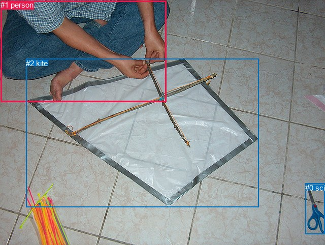
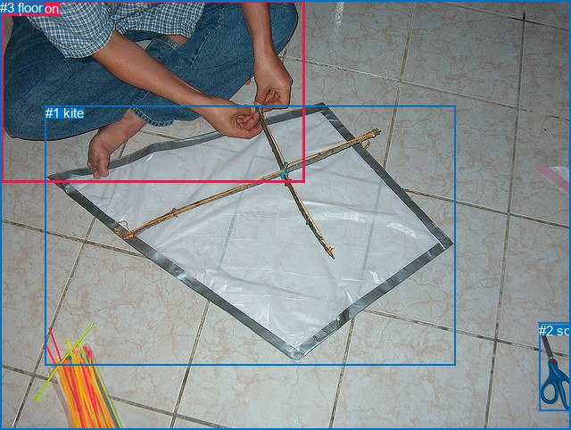

# 图片 1241：2372547.jpg

随机样本序号：342。图片 SHA256：`b4fcb2faf1245d03bc09e0964bd345c13e01eb8aef4deb403cbf14379875c3b4`。

红色框表示人，蓝色框表示其他物体。两个模式分别保留自身框编号，可依据位置比较对应对象。

## 自动检测框与输出

人的框编号：`[1]`。状态：`ok`。

### 自动检测全部物体框

| 编号 | 类别 | 是否为人 | 检测分数 | 像素坐标 xyxy |
|---|---|---|---|---|
| 0 | scissors | False | 0.9986 | 601.2, 360.9, 640.0, 460.4 |
| 1 | person | True | 0.9971 | 1.4, 1.2, 327.5, 200.7 |
| 2 | kite | False | 0.9619 | 51.3, 115.6, 509.1, 407.3 |

### 自动检测 Top50 人相关候选

评分物体对：6；人相关物体对：4；输出关系：8。

| 排名 | 主语编号与类别 | 关系 | 宾语编号与类别 | 类型 | 人与人 | 排序分数 | 原始融合 logit |
|---|---|---|---|---|---|---|---|
| 1 | #1 person | holding | #2 kite | semantic | False | 0.92783 | 2.5538 |
| 2 | #1 person | on | #2 kite | spatial | False | 0.85866 | 1.8042 |
| 3 | #0 scissors | beside | #1 person | spatial | False | 0.64916 | 0.6154 |
| 4 | #1 person | beside | #0 scissors | spatial | False | 0.45335 | -0.1871 |
| 5 | #2 kite | on | #1 person | spatial | False | 0.38530 | -0.4671 |
| 6 | #1 person | holding | #0 scissors | semantic | False | 0.17948 | -1.5199 |
| 7 | #0 scissors | sitting on | #1 person | semantic | False | 0.07879 | -2.4588 |
| 8 | #2 kite | wearing | #1 person | semantic | False | 0.05490 | -2.8458 |

### 自动检测逐条人相关 GT 核验

R@50：0.00%；命中 0/3。

| GT 主语编号 | GT 关系 | GT 宾语编号 | 结果阶段 | 匹配预测主语编号 | 匹配预测宾语编号 |
|---|---|---|---|---|---|
| 0 | touching | 1 | wrong_predicate | [1] | [2] |
| 0 | sitting on | 3 | endpoint_missing_or_wrong_class | [1] | [] |
| 1 | in front of | 0 | wrong_predicate | [2] | [1] |

## 真实框与输出

人的框编号：`[0]`。

### 真实框全部物体框

| 编号 | 类别 | 是否为人 | 检测分数 | 像素坐标 xyxy |
|---|---|---|---|---|
| 0 | person | True | GT | 1.0, 1.0, 341.0, 204.0 |
| 1 | kite | False | GT | 51.0, 118.0, 510.0, 409.0 |
| 2 | scissors | False | GT | 604.0, 362.0, 640.0, 461.0 |
| 3 | floor | False | GT | 0.0, 0.0, 640.0, 482.0 |

### 真实框 Top50 人相关候选

评分物体对：12；人相关物体对：6；输出关系：12。

| 排名 | 主语编号与类别 | 关系 | 宾语编号与类别 | 类型 | 人与人 | 排序分数 | 原始融合 logit |
|---|---|---|---|---|---|---|---|
| 1 | #0 person | sitting on | #3 floor | semantic | False | 0.98424 | 4.1341 |
| 2 | #0 person | on | #3 floor | spatial | False | 0.96219 | 3.2368 |
| 3 | #0 person | holding | #1 kite | semantic | False | 0.95690 | 3.1001 |
| 4 | #0 person | on | #1 kite | spatial | False | 0.85800 | 1.7987 |
| 5 | #1 kite | beside | #0 person | spatial | False | 0.38420 | -0.4718 |
| 6 | #2 scissors | beside | #0 person | spatial | False | 0.28835 | -0.9034 |
| 7 | #1 kite | holding | #0 person | semantic | False | 0.12135 | -1.9797 |
| 8 | #3 floor | beside | #0 person | spatial | False | 0.07696 | -2.4844 |
| 9 | #0 person | holding | #2 scissors | semantic | False | 0.05226 | -2.8979 |
| 10 | #0 person | in | #2 scissors | spatial | False | 0.04302 | -3.1022 |
| 11 | #2 scissors | looking at | #0 person | semantic | False | 0.03669 | -3.2680 |
| 12 | #3 floor | holding | #0 person | semantic | False | 0.03278 | -3.3846 |

### 真实框逐条人相关 GT 核验

R@50：33.33%；命中 1/3。

| GT 主语编号 | GT 关系 | GT 宾语编号 | 结果阶段 | 匹配预测主语编号 | 匹配预测宾语编号 |
|---|---|---|---|---|---|
| 0 | touching | 1 | wrong_predicate | [0] | [1] |
| 0 | sitting on | 3 | hit50 | [0] | [3] |
| 1 | in front of | 0 | wrong_predicate | [1] | [0] |

## 全部人相关 GT

| 主语编号与类别 | 关系 | 宾语编号与类别 |
|---|---|---|
| #0 person | touching | #1 kite |
| #0 person | sitting on | #3 floor |
| #1 kite | in front of | #0 person |

原始记录、全部人相关物体对的两项预测与分项分数见 [逐图证据 JSON](../evidence/cases/1241.json)。全部56类 logits 保留于本机 HOR/output/random500/logits/。

<!-- HOR_COMPLETE_RESULTS -->

## 六组条件的完整输出对照

以下保留同一图片三种框与候选模式、两种谓词输出规则的全部 Top50。框编号各自在所属模式内解释。

### 自动检测框完整枚举：空间与语义各保留一个谓词

| 排名 | 主语编号与类别 | 谓词 | 宾语编号与类别 | 分组 | 排序分数 | predicate logit | pair logit |
|---|---|---|---|---|---|---|---|
| 1 | #1 person | holding | #2 kite | semantic | 0.9278297 | 3.0825019 | -0.5286822 |
| 2 | #1 person | on | #2 kite | spatial | 0.8586556 | 2.3328505 | -0.5286822 |
| 3 | #0 scissors | beside | #1 person | spatial | 0.6491608 | 2.1174898 | -1.5021374 |
| 4 | #1 person | beside | #0 scissors | spatial | 0.4533538 | 1.2407384 | -1.4278674 |
| 5 | #2 kite | on | #1 person | spatial | 0.3852991 | 0.9249039 | -1.3920195 |
| 6 | #1 person | holding | #0 scissors | semantic | 0.1794751 | -0.0920401 | -1.4278674 |
| 7 | #0 scissors | sitting on | #1 person | semantic | 0.0787948 | -0.9566982 | -1.5021374 |
| 8 | #2 kite | wearing | #1 person | semantic | 0.0548994 | -1.4537704 | -1.3920195 |

GT 命中：0/3，R@50=0.00%。

| GT主语 | GT谓词 | GT宾语 | 结果阶段 | 匹配主语框 | 匹配宾语框 |
|---|---|---|---|---|---|
| 0 | touching | 1 | wrong_predicate | [1] | [2] |
| 0 | sitting on | 3 | endpoint_missing_or_wrong_class | [1] | [] |
| 1 | in front of | 0 | wrong_predicate | [2] | [1] |

### 自动检测框完整枚举：每对只保留一个谓词

| 排名 | 主语编号与类别 | 谓词 | 宾语编号与类别 | 分组 | 排序分数 | predicate logit | pair logit |
|---|---|---|---|---|---|---|---|
| 1 | #1 person | holding | #2 kite | single | 0.9278297 | 3.0825019 | -0.5286822 |
| 2 | #0 scissors | beside | #1 person | single | 0.6491608 | 2.1174898 | -1.5021374 |
| 3 | #1 person | beside | #0 scissors | single | 0.4533538 | 1.2407384 | -1.4278674 |
| 4 | #2 kite | on | #1 person | single | 0.3852991 | 0.9249039 | -1.3920195 |

GT 命中：0/3，R@50=0.00%。

| GT主语 | GT谓词 | GT宾语 | 结果阶段 | 匹配主语框 | 匹配宾语框 |
|---|---|---|---|---|---|
| 0 | touching | 1 | wrong_predicate | [1] | [2] |
| 0 | sitting on | 3 | endpoint_missing_or_wrong_class | [1] | [] |
| 1 | in front of | 0 | wrong_predicate | [2] | [1] |

### 真实框完整枚举：空间与语义各保留一个谓词

| 排名 | 主语编号与类别 | 谓词 | 宾语编号与类别 | 分组 | 排序分数 | predicate logit | pair logit |
|---|---|---|---|---|---|---|---|
| 1 | #0 person | sitting on | #3 floor | semantic | 0.9842356 | 4.0716558 | 0.0624593 |
| 2 | #0 person | on | #3 floor | spatial | 0.9621945 | 3.1743045 | 0.0624593 |
| 3 | #0 person | holding | #1 kite | semantic | 0.9568953 | 3.5728240 | -0.4727633 |
| 4 | #0 person | on | #1 kite | spatial | 0.8579963 | 2.2715101 | -0.4727633 |
| 5 | #1 kite | beside | #0 person | spatial | 0.3842006 | 0.8609438 | -1.3327003 |
| 6 | #2 scissors | beside | #0 person | spatial | 0.2883466 | 0.5292463 | -1.4326742 |
| 7 | #1 kite | holding | #0 person | semantic | 0.1213458 | -0.6470466 | -1.3327003 |
| 8 | #3 floor | beside | #0 person | spatial | 0.0769613 | -1.2599974 | -1.2243712 |
| 9 | #0 person | holding | #2 scissors | semantic | 0.0522589 | -1.4837728 | -1.4140992 |
| 10 | #0 person | in | #2 scissors | spatial | 0.0430168 | -1.6880963 | -1.4140992 |
| 11 | #2 scissors | looking at | #0 person | semantic | 0.0366865 | -1.8352950 | -1.4326742 |
| 12 | #3 floor | holding | #0 person | semantic | 0.0327808 | -2.1602120 | -1.2243712 |

GT 命中：1/3，R@50=33.33%。

| GT主语 | GT谓词 | GT宾语 | 结果阶段 | 匹配主语框 | 匹配宾语框 |
|---|---|---|---|---|---|
| 0 | touching | 1 | wrong_predicate | [0] | [1] |
| 0 | sitting on | 3 | hit50 | [0] | [3] |
| 1 | in front of | 0 | wrong_predicate | [1] | [0] |

### 真实框完整枚举：每对只保留一个谓词

| 排名 | 主语编号与类别 | 谓词 | 宾语编号与类别 | 分组 | 排序分数 | predicate logit | pair logit |
|---|---|---|---|---|---|---|---|
| 1 | #0 person | sitting on | #3 floor | single | 0.9842356 | 4.0716558 | 0.0624593 |
| 2 | #0 person | holding | #1 kite | single | 0.9568953 | 3.5728240 | -0.4727633 |
| 3 | #1 kite | beside | #0 person | single | 0.3842006 | 0.8609438 | -1.3327003 |
| 4 | #2 scissors | beside | #0 person | single | 0.2883466 | 0.5292463 | -1.4326742 |
| 5 | #3 floor | beside | #0 person | single | 0.0769613 | -1.2599974 | -1.2243712 |
| 6 | #0 person | holding | #2 scissors | single | 0.0522589 | -1.4837728 | -1.4140992 |

GT 命中：1/3，R@50=33.33%。

| GT主语 | GT谓词 | GT宾语 | 结果阶段 | 匹配主语框 | 匹配宾语框 |
|---|---|---|---|---|---|
| 0 | touching | 1 | wrong_predicate | [0] | [1] |
| 0 | sitting on | 3 | hit50 | [0] | [3] |
| 1 | in front of | 0 | wrong_predicate | [1] | [0] |

### 真实框400候选：空间与语义各保留一个谓词

| 排名 | 主语编号与类别 | 谓词 | 宾语编号与类别 | 分组 | 排序分数 | predicate logit | pair logit |
|---|---|---|---|---|---|---|---|
| 1 | #0 person | sitting on | #3 floor | semantic | 0.9842356 | 4.0716558 | 0.0624593 |
| 2 | #0 person | on | #3 floor | spatial | 0.9631827 | 3.2018180 | 0.0624593 |
| 3 | #0 person | holding | #1 kite | semantic | 0.9567732 | 3.5698705 | -0.4727633 |
| 4 | #0 person | on | #1 kite | spatial | 0.8579963 | 2.2715101 | -0.4727633 |
| 5 | #1 kite | beside | #0 person | spatial | 0.3771338 | 0.8309684 | -1.3327003 |
| 6 | #2 scissors | beside | #0 person | spatial | 0.2945605 | 0.5593376 | -1.4326742 |
| 7 | #1 kite | holding | #0 person | semantic | 0.1213458 | -0.6470466 | -1.3327003 |
| 8 | #3 floor | beside | #0 person | spatial | 0.0769613 | -1.2599974 | -1.2243712 |
| 9 | #0 person | holding | #2 scissors | semantic | 0.0535444 | -1.4581127 | -1.4140992 |
| 10 | #0 person | in | #2 scissors | spatial | 0.0441150 | -1.6617389 | -1.4140992 |
| 11 | #2 scissors | looking at | #0 person | semantic | 0.0367112 | -1.8345976 | -1.4326742 |
| 12 | #3 floor | holding | #0 person | semantic | 0.0327983 | -2.1596584 | -1.2243712 |

GT 命中：1/3，R@50=33.33%。

| GT主语 | GT谓词 | GT宾语 | 结果阶段 | 匹配主语框 | 匹配宾语框 |
|---|---|---|---|---|---|
| 0 | touching | 1 | wrong_predicate | [0] | [1] |
| 0 | sitting on | 3 | hit50 | [0] | [3] |
| 1 | in front of | 0 | wrong_predicate | [1] | [0] |

### 真实框400候选：每对只保留一个谓词

| 排名 | 主语编号与类别 | 谓词 | 宾语编号与类别 | 分组 | 排序分数 | predicate logit | pair logit |
|---|---|---|---|---|---|---|---|
| 1 | #0 person | sitting on | #3 floor | single | 0.9842356 | 4.0716558 | 0.0624593 |
| 2 | #0 person | holding | #1 kite | single | 0.9567732 | 3.5698705 | -0.4727633 |
| 3 | #1 kite | beside | #0 person | single | 0.3771338 | 0.8309684 | -1.3327003 |
| 4 | #2 scissors | beside | #0 person | single | 0.2945605 | 0.5593376 | -1.4326742 |
| 5 | #3 floor | beside | #0 person | single | 0.0769613 | -1.2599974 | -1.2243712 |
| 6 | #0 person | holding | #2 scissors | single | 0.0535444 | -1.4581127 | -1.4140992 |

GT 命中：1/3，R@50=33.33%。

| GT主语 | GT谓词 | GT宾语 | 结果阶段 | 匹配主语框 | 匹配宾语框 |
|---|---|---|---|---|---|
| 0 | touching | 1 | wrong_predicate | [0] | [1] |
| 0 | sitting on | 3 | hit50 | [0] | [3] |
| 1 | in front of | 0 | wrong_predicate | [1] | [0] |
