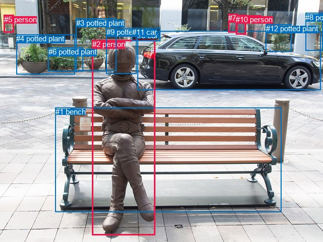
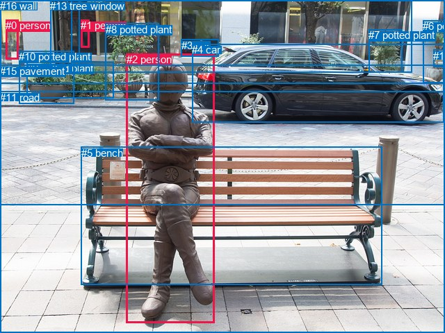

# 图片 1242：2372650.jpg

随机样本序号：49。图片 SHA256：`fd7fe9e831b97c31d2996209d4eb152558e46d752089d3a2b1b5e0cb21f343fe`。

红色框表示人，蓝色框表示其他物体。两个模式分别保留自身框编号，可依据位置比较对应对象。

## 自动检测框与输出

人的框编号：`[2, 5, 7, 10]`。状态：`ok`。

### 自动检测全部物体框

| 编号 | 类别 | 是否为人 | 检测分数 | 像素坐标 xyxy |
|---|---|---|---|---|
| 0 | car | False | 0.9998 | 272.4, 62.0, 636.0, 178.9 |
| 1 | bench | False | 0.9996 | 109.8, 213.4, 557.1, 420.1 |
| 2 | person | True | 0.9993 | 182.7, 79.3, 308.0, 467.0 |
| 3 | potted plant | False | 0.9848 | 150.8, 36.9, 230.3, 140.2 |
| 4 | potted plant | False | 0.9025 | 32.1, 68.2, 148.9, 147.7 |
| 5 | person | True | 0.8669 | 8.0, 29.6, 27.5, 64.1 |
| 6 | potted plant | False | 0.8242 | 96.0, 94.4, 164.1, 141.4 |
| 7 | person | True | 0.7957 | 452.2, 27.3, 470.6, 64.4 |
| 8 | potted plant | False | 0.7090 | 605.1, 26.0, 639.8, 100.5 |
| 9 | potted plant | False | 0.6522 | 210.9, 55.2, 270.9, 146.7 |
| 10 | person | True | 0.6346 | 467.5, 29.7, 487.0, 68.6 |
| 11 | car | False | 0.5633 | 262.0, 55.0, 317.7, 81.7 |
| 12 | potted plant | False | 0.3561 | 526.7, 48.2, 577.3, 102.6 |

### 自动检测 Top50 人相关候选

评分物体对：156；人相关物体对：84；输出关系：50。

| 排名 | 主语编号与类别 | 关系 | 宾语编号与类别 | 类型 | 人与人 | 排序分数 | 原始融合 logit |
|---|---|---|---|---|---|---|---|
| 1 | #2 person | sitting on | #1 bench | semantic | False | 0.98598 | 4.2530 |
| 2 | #2 person | on | #1 bench | spatial | False | 0.97158 | 3.5318 |
| 3 | #2 person | wearing | #9 potted plant | semantic | False | 0.96064 | 3.1947 |
| 4 | #7 person | looking at | #0 car | semantic | False | 0.94579 | 2.8592 |
| 5 | #10 person | in | #0 car | spatial | False | 0.92480 | 2.5094 |
| 6 | #10 person | looking at | #0 car | semantic | False | 0.91885 | 2.4269 |
| 7 | #7 person | looking at | #10 person | semantic | True | 0.91668 | 2.3981 |
| 8 | #9 potted plant | on | #2 person | spatial | False | 0.88703 | 2.0607 |
| 9 | #7 person | in | #0 car | spatial | False | 0.86957 | 1.8972 |
| 10 | #10 person | looking at | #7 person | semantic | True | 0.85776 | 1.7968 |
| 11 | #2 person | in | #9 potted plant | spatial | False | 0.80490 | 1.4172 |
| 12 | #10 person | beside | #7 person | spatial | True | 0.73143 | 1.0019 |
| 13 | #7 person | beside | #10 person | spatial | True | 0.70187 | 0.8562 |
| 14 | #5 person | looking at | #4 potted plant | semantic | False | 0.58432 | 0.3405 |
| 15 | #10 person | looking at | #12 potted plant | semantic | False | 0.56713 | 0.2701 |
| 16 | #5 person | looking at | #0 car | semantic | False | 0.56567 | 0.2642 |
| 17 | #10 person | looking at | #2 person | semantic | True | 0.56051 | 0.2432 |
| 18 | #7 person | looking at | #2 person | semantic | True | 0.49311 | -0.0276 |
| 19 | #0 car | parked on | #10 person | semantic | False | 0.43773 | -0.2504 |
| 20 | #7 person | looking at | #12 potted plant | semantic | False | 0.43544 | -0.2597 |
| 21 | #0 car | in | #10 person | spatial | False | 0.41804 | -0.3308 |
| 22 | #5 person | beside | #4 potted plant | spatial | False | 0.40909 | -0.3677 |
| 23 | #2 person | in front of | #0 car | spatial | False | 0.39559 | -0.4239 |
| 24 | #7 person | looking at | #11 car | semantic | False | 0.35418 | -0.6007 |
| 25 | #10 person | looking at | #11 car | semantic | False | 0.33910 | -0.6673 |
| 26 | #0 car | in | #7 person | spatial | False | 0.29845 | -0.8547 |
| 27 | #5 person | looking at | #2 person | semantic | True | 0.29468 | -0.8728 |
| 28 | #2 person | wearing | #0 car | semantic | False | 0.29170 | -0.8871 |
| 29 | #5 person | beside | #0 car | spatial | False | 0.28635 | -0.9132 |
| 30 | #0 car | parked on | #7 person | semantic | False | 0.28606 | -0.9146 |
| 31 | #10 person | in | #12 potted plant | spatial | False | 0.28146 | -0.9372 |
| 32 | #0 car | beside | #2 person | spatial | False | 0.27988 | -0.9451 |
| 33 | #1 bench | holding | #2 person | semantic | False | 0.26931 | -0.9981 |
| 34 | #5 person | in | #11 car | spatial | False | 0.26201 | -1.0356 |
| 35 | #0 car | parked on | #5 person | semantic | False | 0.26117 | -1.0399 |
| 36 | #7 person | in | #12 potted plant | spatial | False | 0.25551 | -1.0694 |
| 37 | #5 person | looking at | #11 car | semantic | False | 0.22784 | -1.2206 |
| 38 | #0 car | parked on | #2 person | semantic | False | 0.21550 | -1.2921 |
| 39 | #5 person | looking at | #3 potted plant | semantic | False | 0.21281 | -1.3081 |
| 40 | #5 person | looking at | #6 potted plant | semantic | False | 0.21094 | -1.3193 |
| 41 | #1 bench | in | #2 person | spatial | False | 0.20482 | -1.3564 |
| 42 | #2 person | wearing | #11 car | semantic | False | 0.19946 | -1.3897 |
| 43 | #4 potted plant | beside | #5 person | spatial | False | 0.19906 | -1.3922 |
| 44 | #9 potted plant | holding | #2 person | semantic | False | 0.17582 | -1.5449 |
| 45 | #11 car | in | #5 person | spatial | False | 0.16840 | -1.5970 |
| 46 | #5 person | on | #6 potted plant | spatial | False | 0.16342 | -1.6330 |
| 47 | #4 potted plant | beside | #2 person | spatial | False | 0.14902 | -1.7423 |
| 48 | #8 potted plant | in | #5 person | spatial | False | 0.12256 | -1.9684 |
| 49 | #3 potted plant | beside | #2 person | spatial | False | 0.11810 | -2.0106 |
| 50 | #2 person | looking at | #5 person | semantic | True | 0.11731 | -2.0182 |

### 自动检测逐条人相关 GT 核验

R@50：100.00%；命中 1/1。

| GT 主语编号 | GT 关系 | GT 宾语编号 | 结果阶段 | 匹配预测主语编号 | 匹配预测宾语编号 |
|---|---|---|---|---|---|
| 2 | sitting on | 5 | hit50 | [2] | [1] |

## 真实框与输出

人的框编号：`[0, 1, 2]`。

### 真实框全部物体框

| 编号 | 类别 | 是否为人 | 检测分数 | 像素坐标 xyxy |
|---|---|---|---|---|
| 0 | person | True | GT | 8.0, 28.0, 27.0, 86.0 |
| 1 | person | True | GT | 116.0, 28.0, 129.0, 68.0 |
| 2 | person | True | GT | 182.0, 77.0, 309.0, 465.0 |
| 3 | car | False | GT | 261.0, 57.0, 315.0, 82.0 |
| 4 | car | False | GT | 276.0, 63.0, 638.0, 177.0 |
| 5 | bench | False | GT | 117.0, 212.0, 550.0, 411.0 |
| 6 | potted plant | False | GT | 608.0, 29.0, 640.0, 119.0 |
| 7 | potted plant | False | GT | 530.0, 42.0, 578.0, 104.0 |
| 8 | potted plant | False | GT | 152.0, 34.0, 229.0, 144.0 |
| 9 | potted plant | False | GT | 39.0, 90.0, 164.0, 142.0 |
| 10 | potted plant | False | GT | 27.0, 73.0, 106.0, 149.0 |
| 11 | road | False | GT | 0.0, 132.0, 640.0, 296.0 |
| 12 | window | False | GT | 102.0, 0.0, 592.0, 104.0 |
| 13 | tree | False | GT | 72.0, 0.0, 114.0, 107.0 |
| 14 | floor | False | GT | 623.0, 72.0, 640.0, 97.0 |
| 15 | pavement | False | GT | 0.0, 94.0, 640.0, 480.0 |
| 16 | wall | False | GT | 0.0, 0.0, 640.0, 121.0 |

### 真实框 Top50 人相关候选

评分物体对：272；人相关物体对：90；输出关系：50。

| 排名 | 主语编号与类别 | 关系 | 宾语编号与类别 | 类型 | 人与人 | 排序分数 | 原始融合 logit |
|---|---|---|---|---|---|---|---|
| 1 | #2 person | sitting on | #5 bench | semantic | False | 0.98962 | 4.5576 |
| 2 | #0 person | walking on | #11 road | semantic | False | 0.97922 | 3.8529 |
| 3 | #0 person | in | #16 wall | spatial | False | 0.96641 | 3.3594 |
| 4 | #2 person | on | #5 bench | spatial | False | 0.96356 | 3.2749 |
| 5 | #0 person | walking on | #15 pavement | semantic | False | 0.95700 | 3.1025 |
| 6 | #1 person | walking on | #11 road | semantic | False | 0.95055 | 2.9560 |
| 7 | #1 person | in | #16 wall | spatial | False | 0.94606 | 2.8644 |
| 8 | #1 person | in | #12 window | spatial | False | 0.94188 | 2.7854 |
| 9 | #2 person | on | #15 pavement | spatial | False | 0.90792 | 2.2884 |
| 10 | #2 person | sitting on | #15 pavement | semantic | False | 0.90228 | 2.2228 |
| 11 | #1 person | walking on | #16 wall | semantic | False | 0.87183 | 1.9173 |
| 12 | #1 person | walking on | #15 pavement | semantic | False | 0.85512 | 1.7754 |
| 13 | #0 person | on | #11 road | spatial | False | 0.82051 | 1.5198 |
| 14 | #0 person | walking on | #16 wall | semantic | False | 0.80340 | 1.4077 |
| 15 | #1 person | looking at | #12 window | semantic | False | 0.79825 | 1.3754 |
| 16 | #0 person | on | #15 pavement | spatial | False | 0.78125 | 1.2730 |
| 17 | #1 person | in | #13 tree | spatial | False | 0.61852 | 0.4833 |
| 18 | #1 person | standing on | #13 tree | semantic | False | 0.54222 | 0.1693 |
| 19 | #1 person | looking at | #2 person | semantic | True | 0.47804 | -0.0879 |
| 20 | #1 person | on | #11 road | spatial | False | 0.45554 | -0.1783 |
| 21 | #0 person | in | #12 window | spatial | False | 0.43477 | -0.2624 |
| 22 | #1 person | looking at | #9 potted plant | semantic | False | 0.41564 | -0.3407 |
| 23 | #5 bench | holding | #2 person | semantic | False | 0.39757 | -0.4156 |
| 24 | #2 person | sitting on | #11 road | semantic | False | 0.37820 | -0.4972 |
| 25 | #2 person | on | #11 road | spatial | False | 0.36725 | -0.5440 |
| 26 | #1 person | on | #15 pavement | spatial | False | 0.34932 | -0.6221 |
| 27 | #1 person | looking at | #8 potted plant | semantic | False | 0.30522 | -0.8226 |
| 28 | #1 person | in | #9 potted plant | spatial | False | 0.28919 | -0.8993 |
| 29 | #0 person | looking at | #12 window | semantic | False | 0.25288 | -1.0833 |
| 30 | #5 bench | beside | #2 person | spatial | False | 0.24933 | -1.1022 |
| 31 | #1 person | looking at | #10 potted plant | semantic | False | 0.24646 | -1.1176 |
| 32 | #8 potted plant | beside | #2 person | spatial | False | 0.19625 | -1.4099 |
| 33 | #0 person | looking at | #10 potted plant | semantic | False | 0.19417 | -1.4231 |
| 34 | #0 person | looking at | #2 person | semantic | True | 0.19359 | -1.4268 |
| 35 | #10 potted plant | beside | #2 person | spatial | False | 0.19313 | -1.4298 |
| 36 | #9 potted plant | beside | #2 person | spatial | False | 0.17708 | -1.5363 |
| 37 | #4 car | beside | #2 person | spatial | False | 0.17424 | -1.5559 |
| 38 | #2 person | in front of | #4 car | spatial | False | 0.17221 | -1.5701 |
| 39 | #2 person | looking at | #4 car | semantic | False | 0.15465 | -1.6986 |
| 40 | #1 person | in | #10 potted plant | spatial | False | 0.11384 | -2.0521 |
| 41 | #0 person | on | #13 tree | spatial | False | 0.10990 | -2.0917 |
| 42 | #1 person | in | #8 potted plant | spatial | False | 0.10960 | -2.0948 |
| 43 | #2 person | wearing | #3 car | semantic | False | 0.10590 | -2.1333 |
| 44 | #0 person | beside | #10 potted plant | spatial | False | 0.10405 | -2.1530 |
| 45 | #1 person | in | #0 person | spatial | True | 0.09912 | -2.2070 |
| 46 | #0 person | looking at | #9 potted plant | semantic | False | 0.09800 | -2.2196 |
| 47 | #1 person | looking at | #4 car | semantic | False | 0.08829 | -2.3347 |
| 48 | #1 person | looking at | #0 person | semantic | True | 0.08734 | -2.3465 |
| 49 | #1 person | beside | #2 person | spatial | True | 0.08567 | -2.3677 |
| 50 | #0 person | looking at | #13 tree | semantic | False | 0.08479 | -2.3789 |

### 真实框逐条人相关 GT 核验

R@50：100.00%；命中 1/1。

| GT 主语编号 | GT 关系 | GT 宾语编号 | 结果阶段 | 匹配预测主语编号 | 匹配预测宾语编号 |
|---|---|---|---|---|---|
| 2 | sitting on | 5 | hit50 | [2] | [5] |

## 全部人相关 GT

| 主语编号与类别 | 关系 | 宾语编号与类别 |
|---|---|---|
| #2 person | sitting on | #5 bench |

原始记录、全部人相关物体对的两项预测与分项分数见 [逐图证据 JSON](../evidence/cases/1242.json)。全部56类 logits 保留于本机 HOR/output/random500/logits/。

<!-- HOR_COMPLETE_RESULTS -->

## 六组条件的完整输出对照

以下保留同一图片三种框与候选模式、两种谓词输出规则的全部 Top50。框编号各自在所属模式内解释。

### 自动检测框完整枚举：空间与语义各保留一个谓词

| 排名 | 主语编号与类别 | 谓词 | 宾语编号与类别 | 分组 | 排序分数 | predicate logit | pair logit |
|---|---|---|---|---|---|---|---|
| 1 | #2 person | sitting on | #1 bench | semantic | 0.9859783 | 3.6925998 | 0.5604274 |
| 2 | #2 person | on | #1 bench | spatial | 0.9715798 | 2.9713979 | 0.5604274 |
| 3 | #2 person | wearing | #9 potted plant | semantic | 0.9606359 | 3.0345430 | 0.1601982 |
| 4 | #7 person | looking at | #0 car | semantic | 0.9457916 | 3.1456780 | -0.2864906 |
| 5 | #10 person | in | #0 car | spatial | 0.9247964 | 2.7523055 | -0.2429314 |
| 6 | #10 person | looking at | #0 car | semantic | 0.9188531 | 2.6697969 | -0.2429314 |
| 7 | #7 person | looking at | #10 person | semantic | 0.9166812 | 2.7865434 | -0.3884577 |
| 8 | #9 potted plant | on | #2 person | spatial | 0.8870286 | 2.2480502 | -0.1873078 |
| 9 | #7 person | in | #0 car | spatial | 0.8695717 | 2.1836681 | -0.2864906 |
| 10 | #10 person | looking at | #7 person | semantic | 0.8577586 | 2.2172508 | -0.4204535 |
| 11 | #2 person | in | #9 potted plant | spatial | 0.8049006 | 1.2570114 | 0.1601982 |
| 12 | #10 person | beside | #7 person | spatial | 0.7314267 | 1.4223266 | -0.4204535 |
| 13 | #7 person | beside | #10 person | spatial | 0.7018749 | 1.2446995 | -0.3884577 |
| 14 | #5 person | looking at | #4 potted plant | semantic | 0.5843171 | 1.1128302 | -0.7723088 |
| 15 | #10 person | looking at | #12 potted plant | semantic | 0.5671275 | 0.8717513 | -0.6016101 |
| 16 | #5 person | looking at | #0 car | semantic | 0.5656685 | 1.4053750 | -1.1411748 |
| 17 | #10 person | looking at | #2 person | semantic | 0.5605121 | 1.4983296 | -1.2550893 |
| 18 | #7 person | looking at | #2 person | semantic | 0.4931091 | 1.2240219 | -1.2515874 |
| 19 | #0 car | parked on | #10 person | semantic | 0.4377270 | 0.4150524 | -0.6654443 |
| 20 | #7 person | looking at | #12 potted plant | semantic | 0.4354437 | 0.4277043 | -0.6873791 |
| 21 | #0 car | in | #10 person | spatial | 0.4180363 | 0.3346043 | -0.6654443 |
| 22 | #5 person | beside | #4 potted plant | spatial | 0.4090884 | 0.4045734 | -0.7723088 |
| 23 | #2 person | in front of | #0 car | spatial | 0.3955857 | 0.5345597 | -0.9584523 |
| 24 | #7 person | looking at | #11 car | semantic | 0.3541795 | 0.3577600 | -0.9584777 |
| 25 | #10 person | looking at | #11 car | semantic | 0.3391009 | 0.2653947 | -0.9326982 |
| 26 | #0 car | in | #7 person | spatial | 0.2984456 | -0.0964065 | -0.7583044 |
| 27 | #5 person | looking at | #2 person | semantic | 0.2946771 | 0.6435723 | -1.5163478 |
| 28 | #2 person | wearing | #0 car | semantic | 0.2917017 | 0.0713186 | -0.9584523 |
| 29 | #5 person | beside | #0 car | spatial | 0.2863479 | 0.2279868 | -1.1411748 |
| 30 | #0 car | parked on | #7 person | semantic | 0.2860617 | -0.1562848 | -0.7583044 |
| 31 | #10 person | in | #12 potted plant | spatial | 0.2814644 | -0.3355989 | -0.6016101 |
| 32 | #0 car | beside | #2 person | spatial | 0.2798753 | -0.0796695 | -0.8654106 |
| 33 | #1 bench | holding | #2 person | semantic | 0.2693055 | -0.1183586 | -0.8797905 |
| 34 | #5 person | in | #11 car | spatial | 0.2620081 | 0.3027325 | -1.3382897 |
| 35 | #0 car | parked on | #5 person | semantic | 0.2611735 | 0.2939367 | -1.3338146 |
| 36 | #7 person | in | #12 potted plant | spatial | 0.2555095 | -0.3820615 | -0.6873791 |
| 37 | #5 person | looking at | #11 car | semantic | 0.2278375 | 0.1177273 | -1.3382897 |
| 38 | #0 car | parked on | #2 person | semantic | 0.2154968 | -0.4266939 | -0.8654106 |
| 39 | #5 person | looking at | #3 potted plant | semantic | 0.2128079 | -0.0704904 | -1.2375922 |
| 40 | #5 person | looking at | #6 potted plant | semantic | 0.2109426 | -0.3259711 | -0.9932819 |
| 41 | #1 bench | in | #2 person | spatial | 0.2048202 | -0.4766450 | -0.8797905 |
| 42 | #2 person | wearing | #11 car | semantic | 0.1994573 | 0.0597286 | -1.4494183 |
| 43 | #4 potted plant | beside | #5 person | spatial | 0.1990578 | -0.7683351 | -0.6238582 |
| 44 | #9 potted plant | holding | #2 person | semantic | 0.1758244 | -1.3575897 | -0.1873078 |
| 45 | #11 car | in | #5 person | spatial | 0.1683958 | -0.5557485 | -1.0412906 |
| 46 | #5 person | on | #6 potted plant | spatial | 0.1634189 | -0.6397247 | -0.9932819 |
| 47 | #4 potted plant | beside | #2 person | spatial | 0.1490183 | -1.0586257 | -0.6836957 |
| 48 | #8 potted plant | in | #5 person | spatial | 0.1225635 | -0.6519313 | -1.3164443 |
| 49 | #3 potted plant | beside | #2 person | spatial | 0.1180972 | -1.3118424 | -0.6987315 |
| 50 | #2 person | looking at | #5 person | semantic | 0.1173088 | -0.1101031 | -1.9080622 |

GT 命中：1/1，R@50=100.00%。

| GT主语 | GT谓词 | GT宾语 | 结果阶段 | 匹配主语框 | 匹配宾语框 |
|---|---|---|---|---|---|
| 2 | sitting on | 5 | hit50 | [2] | [1] |

### 自动检测框完整枚举：每对只保留一个谓词

| 排名 | 主语编号与类别 | 谓词 | 宾语编号与类别 | 分组 | 排序分数 | predicate logit | pair logit |
|---|---|---|---|---|---|---|---|
| 1 | #2 person | sitting on | #1 bench | single | 0.9859783 | 3.6925998 | 0.5604274 |
| 2 | #2 person | wearing | #9 potted plant | single | 0.9606359 | 3.0345430 | 0.1601982 |
| 3 | #7 person | looking at | #0 car | single | 0.9457916 | 3.1456780 | -0.2864906 |
| 4 | #10 person | in | #0 car | single | 0.9247964 | 2.7523055 | -0.2429314 |
| 5 | #7 person | looking at | #10 person | single | 0.9166812 | 2.7865434 | -0.3884577 |
| 6 | #9 potted plant | on | #2 person | single | 0.8870286 | 2.2480502 | -0.1873078 |
| 7 | #10 person | looking at | #7 person | single | 0.8577586 | 2.2172508 | -0.4204535 |
| 8 | #5 person | looking at | #4 potted plant | single | 0.5843171 | 1.1128302 | -0.7723088 |
| 9 | #10 person | looking at | #12 potted plant | single | 0.5671275 | 0.8717513 | -0.6016101 |
| 10 | #5 person | looking at | #0 car | single | 0.5656685 | 1.4053750 | -1.1411748 |
| 11 | #10 person | looking at | #2 person | single | 0.5605121 | 1.4983296 | -1.2550893 |
| 12 | #7 person | looking at | #2 person | single | 0.4931091 | 1.2240219 | -1.2515874 |
| 13 | #0 car | parked on | #10 person | single | 0.4377270 | 0.4150524 | -0.6654443 |
| 14 | #7 person | looking at | #12 potted plant | single | 0.4354437 | 0.4277043 | -0.6873791 |
| 15 | #2 person | in front of | #0 car | single | 0.3955857 | 0.5345597 | -0.9584523 |
| 16 | #7 person | looking at | #11 car | single | 0.3541795 | 0.3577600 | -0.9584777 |
| 17 | #10 person | looking at | #11 car | single | 0.3391009 | 0.2653947 | -0.9326982 |
| 18 | #0 car | in | #7 person | single | 0.2984456 | -0.0964065 | -0.7583044 |
| 19 | #5 person | looking at | #2 person | single | 0.2946771 | 0.6435723 | -1.5163478 |
| 20 | #0 car | beside | #2 person | single | 0.2798753 | -0.0796695 | -0.8654106 |
| 21 | #1 bench | holding | #2 person | single | 0.2693055 | -0.1183586 | -0.8797905 |
| 22 | #5 person | in | #11 car | single | 0.2620081 | 0.3027325 | -1.3382897 |
| 23 | #0 car | parked on | #5 person | single | 0.2611735 | 0.2939367 | -1.3338146 |
| 24 | #5 person | looking at | #3 potted plant | single | 0.2128079 | -0.0704904 | -1.2375922 |
| 25 | #5 person | looking at | #6 potted plant | single | 0.2109426 | -0.3259711 | -0.9932819 |
| 26 | #2 person | wearing | #11 car | single | 0.1994573 | 0.0597286 | -1.4494183 |
| 27 | #4 potted plant | beside | #5 person | single | 0.1990578 | -0.7683351 | -0.6238582 |
| 28 | #11 car | in | #5 person | single | 0.1683958 | -0.5557485 | -1.0412906 |
| 29 | #4 potted plant | beside | #2 person | single | 0.1490183 | -1.0586257 | -0.6836957 |
| 30 | #8 potted plant | in | #5 person | single | 0.1225635 | -0.6519313 | -1.3164443 |
| 31 | #3 potted plant | beside | #2 person | single | 0.1180972 | -1.3118424 | -0.6987315 |
| 32 | #2 person | looking at | #5 person | single | 0.1173088 | -0.1101031 | -1.9080622 |
| 33 | #10 person | looking at | #5 person | single | 0.1168131 | -0.9300625 | -1.0928997 |
| 34 | #12 potted plant | in | #10 person | single | 0.1150942 | -1.2577429 | -0.7819878 |
| 35 | #10 person | looking at | #8 potted plant | single | 0.1144239 | -1.2497358 | -0.7965924 |
| 36 | #12 potted plant | in | #5 person | single | 0.1120172 | -0.4774141 | -1.5928854 |
| 37 | #7 person | in | #5 person | single | 0.1091569 | -0.9620309 | -1.1373509 |
| 38 | #10 person | looking at | #1 bench | single | 0.0957755 | -1.1484141 | -1.0966563 |
| 39 | #2 person | looking at | #10 person | single | 0.0860760 | -0.7385330 | -1.6239839 |
| 40 | #7 person | looking at | #8 potted plant | single | 0.0823750 | -1.4485207 | -0.9619867 |
| 41 | #6 potted plant | beside | #2 person | single | 0.0816035 | -1.6148944 | -0.8058631 |
| 42 | #12 potted plant | in | #7 person | single | 0.0786614 | -1.4918201 | -0.9688557 |
| 43 | #2 person | looking at | #7 person | single | 0.0774241 | -0.7757711 | -1.7020997 |
| 44 | #7 person | sitting on | #1 bench | single | 0.0773170 | -1.4742100 | -1.0051619 |
| 45 | #5 person | looking at | #1 bench | single | 0.0757078 | -1.0539026 | -1.4482440 |
| 46 | #5 person | looking at | #7 person | single | 0.0720487 | -1.2532547 | -1.3023820 |
| 47 | #11 car | parked on | #2 person | single | 0.0719029 | -1.4954767 | -1.0623426 |
| 48 | #2 person | in front of | #4 potted plant | single | 0.0670873 | -1.2394454 | -1.3928719 |
| 49 | #5 person | looking at | #10 person | single | 0.0655698 | -1.3401296 | -1.3166928 |
| 50 | #2 person | wearing | #3 potted plant | single | 0.0600178 | -1.3362775 | -1.4149423 |

GT 命中：1/1，R@50=100.00%。

| GT主语 | GT谓词 | GT宾语 | 结果阶段 | 匹配主语框 | 匹配宾语框 |
|---|---|---|---|---|---|
| 2 | sitting on | 5 | hit50 | [2] | [1] |

### 真实框完整枚举：空间与语义各保留一个谓词

| 排名 | 主语编号与类别 | 谓词 | 宾语编号与类别 | 分组 | 排序分数 | predicate logit | pair logit |
|---|---|---|---|---|---|---|---|
| 1 | #2 person | sitting on | #5 bench | semantic | 0.9896220 | 3.9905076 | 0.5671242 |
| 2 | #0 person | walking on | #11 road | semantic | 0.9792237 | 4.3301454 | -0.4772007 |
| 3 | #0 person | in | #16 wall | spatial | 0.9664120 | 3.3842015 | -0.0247793 |
| 4 | #2 person | on | #5 bench | spatial | 0.9635561 | 2.7077308 | 0.5671242 |
| 5 | #0 person | walking on | #15 pavement | semantic | 0.9569954 | 3.6410995 | -0.5386094 |
| 6 | #1 person | walking on | #11 road | semantic | 0.9505466 | 3.7132955 | -0.7572896 |
| 7 | #1 person | in | #16 wall | spatial | 0.9460566 | 2.9301820 | -0.0658157 |
| 8 | #1 person | in | #12 window | spatial | 0.9418839 | 3.0846238 | -0.2991852 |
| 9 | #2 person | on | #15 pavement | spatial | 0.9079152 | 2.4492188 | -0.1607777 |
| 10 | #2 person | sitting on | #15 pavement | semantic | 0.9022752 | 2.3835425 | -0.1607777 |
| 11 | #1 person | walking on | #16 wall | semantic | 0.8718350 | 1.9830976 | -0.0658157 |
| 12 | #1 person | walking on | #15 pavement | semantic | 0.8551229 | 2.7414002 | -0.9660413 |
| 13 | #0 person | on | #11 road | spatial | 0.8205103 | 1.9970098 | -0.4772007 |
| 14 | #0 person | walking on | #16 wall | semantic | 0.8034030 | 1.4324794 | -0.0247793 |
| 15 | #1 person | looking at | #12 window | semantic | 0.7982512 | 1.6745849 | -0.2991852 |
| 16 | #0 person | on | #15 pavement | spatial | 0.7812536 | 1.8115964 | -0.5386094 |
| 17 | #1 person | in | #13 tree | spatial | 0.6185199 | 0.8800106 | -0.3967400 |
| 18 | #1 person | standing on | #13 tree | semantic | 0.5422193 | 0.5660205 | -0.3967400 |
| 19 | #1 person | looking at | #2 person | semantic | 0.4780422 | 0.9860811 | -1.0739686 |
| 20 | #1 person | on | #11 road | spatial | 0.4555416 | 0.5789847 | -0.7572896 |
| 21 | #0 person | in | #12 window | spatial | 0.4347737 | 0.2345767 | -0.4969770 |
| 22 | #1 person | looking at | #9 potted plant | semantic | 0.4156382 | 0.2257814 | -0.5664865 |
| 23 | #5 bench | holding | #2 person | semantic | 0.3975690 | 0.4616885 | -0.8772930 |
| 24 | #2 person | sitting on | #11 road | semantic | 0.3781980 | 0.3885069 | -0.8857110 |
| 25 | #2 person | on | #11 road | spatial | 0.3672488 | 0.3416734 | -0.8857110 |
| 26 | #1 person | on | #15 pavement | spatial | 0.3493150 | 0.3439898 | -0.9660413 |
| 27 | #1 person | looking at | #8 potted plant | semantic | 0.3052171 | -0.2211213 | -0.6014549 |
| 28 | #1 person | in | #9 potted plant | spatial | 0.2891917 | -0.3328266 | -0.5664865 |
| 29 | #0 person | looking at | #12 window | semantic | 0.2528800 | -0.5863338 | -0.4969770 |
| 30 | #5 bench | beside | #2 person | spatial | 0.2493266 | -0.2249141 | -0.8772930 |
| 31 | #1 person | looking at | #10 potted plant | semantic | 0.2464593 | -0.5449777 | -0.5726086 |
| 32 | #8 potted plant | beside | #2 person | spatial | 0.1962535 | -0.7099340 | -0.6999428 |
| 33 | #0 person | looking at | #10 potted plant | semantic | 0.1941687 | -0.7305806 | -0.6925662 |
| 34 | #0 person | looking at | #2 person | semantic | 0.1935945 | -0.0201778 | -1.4066429 |
| 35 | #10 potted plant | beside | #2 person | spatial | 0.1931338 | -0.7425952 | -0.6871794 |
| 36 | #9 potted plant | beside | #2 person | spatial | 0.1770754 | -0.8009162 | -0.7353730 |
| 37 | #4 car | beside | #2 person | spatial | 0.1742421 | -0.6800928 | -0.8757629 |
| 38 | #2 person | in front of | #4 car | spatial | 0.1722086 | -0.6068401 | -0.9632149 |
| 39 | #2 person | looking at | #4 car | semantic | 0.1546469 | -0.7353952 | -0.9632149 |
| 40 | #1 person | in | #10 potted plant | spatial | 0.1138444 | -1.4794509 | -0.5726086 |
| 41 | #0 person | on | #13 tree | spatial | 0.1099030 | -1.6112463 | -0.4804862 |
| 42 | #1 person | in | #8 potted plant | spatial | 0.1096035 | -1.4933429 | -0.6014549 |
| 43 | #2 person | wearing | #3 car | semantic | 0.1058995 | -0.7219648 | -1.4113626 |
| 44 | #0 person | beside | #10 potted plant | spatial | 0.1040546 | -1.4603975 | -0.6925662 |
| 45 | #1 person | in | #0 person | spatial | 0.0991214 | -1.7708220 | -0.4362029 |
| 46 | #0 person | looking at | #9 potted plant | semantic | 0.0980036 | -1.4512014 | -0.7684054 |
| 47 | #1 person | looking at | #4 car | semantic | 0.0882875 | -1.7192879 | -0.6154388 |
| 48 | #1 person | looking at | #0 person | semantic | 0.0873412 | -1.9103377 | -0.4362029 |
| 49 | #1 person | beside | #2 person | spatial | 0.0856680 | -1.2937462 | -1.0739686 |
| 50 | #0 person | looking at | #13 tree | semantic | 0.0847946 | -1.8984301 | -0.4804862 |

GT 命中：1/1，R@50=100.00%。

| GT主语 | GT谓词 | GT宾语 | 结果阶段 | 匹配主语框 | 匹配宾语框 |
|---|---|---|---|---|---|
| 2 | sitting on | 5 | hit50 | [2] | [5] |

### 真实框完整枚举：每对只保留一个谓词

| 排名 | 主语编号与类别 | 谓词 | 宾语编号与类别 | 分组 | 排序分数 | predicate logit | pair logit |
|---|---|---|---|---|---|---|---|
| 1 | #2 person | sitting on | #5 bench | single | 0.9896220 | 3.9905076 | 0.5671242 |
| 2 | #0 person | walking on | #11 road | single | 0.9792237 | 4.3301454 | -0.4772007 |
| 3 | #0 person | in | #16 wall | single | 0.9664120 | 3.3842015 | -0.0247793 |
| 4 | #0 person | walking on | #15 pavement | single | 0.9569954 | 3.6410995 | -0.5386094 |
| 5 | #1 person | walking on | #11 road | single | 0.9505466 | 3.7132955 | -0.7572896 |
| 6 | #1 person | in | #16 wall | single | 0.9460566 | 2.9301820 | -0.0658157 |
| 7 | #1 person | in | #12 window | single | 0.9418839 | 3.0846238 | -0.2991852 |
| 8 | #2 person | on | #15 pavement | single | 0.9079152 | 2.4492188 | -0.1607777 |
| 9 | #1 person | walking on | #15 pavement | single | 0.8551229 | 2.7414002 | -0.9660413 |
| 10 | #1 person | in | #13 tree | single | 0.6185199 | 0.8800106 | -0.3967400 |
| 11 | #1 person | looking at | #2 person | single | 0.4780422 | 0.9860811 | -1.0739686 |
| 12 | #0 person | in | #12 window | single | 0.4347737 | 0.2345767 | -0.4969770 |
| 13 | #1 person | looking at | #9 potted plant | single | 0.4156382 | 0.2257814 | -0.5664865 |
| 14 | #5 bench | holding | #2 person | single | 0.3975690 | 0.4616885 | -0.8772930 |
| 15 | #2 person | sitting on | #11 road | single | 0.3781980 | 0.3885069 | -0.8857110 |
| 16 | #1 person | looking at | #8 potted plant | single | 0.3052171 | -0.2211213 | -0.6014549 |
| 17 | #1 person | looking at | #10 potted plant | single | 0.2464593 | -0.5449777 | -0.5726086 |
| 18 | #8 potted plant | beside | #2 person | single | 0.1962535 | -0.7099340 | -0.6999428 |
| 19 | #0 person | looking at | #10 potted plant | single | 0.1941687 | -0.7305806 | -0.6925662 |
| 20 | #0 person | looking at | #2 person | single | 0.1935945 | -0.0201778 | -1.4066429 |
| 21 | #10 potted plant | beside | #2 person | single | 0.1931338 | -0.7425952 | -0.6871794 |
| 22 | #9 potted plant | beside | #2 person | single | 0.1770754 | -0.8009162 | -0.7353730 |
| 23 | #4 car | beside | #2 person | single | 0.1742421 | -0.6800928 | -0.8757629 |
| 24 | #2 person | in front of | #4 car | single | 0.1722086 | -0.6068401 | -0.9632149 |
| 25 | #0 person | on | #13 tree | single | 0.1099030 | -1.6112463 | -0.4804862 |
| 26 | #2 person | wearing | #3 car | single | 0.1058995 | -0.7219648 | -1.4113626 |
| 27 | #1 person | in | #0 person | single | 0.0991214 | -1.7708220 | -0.4362029 |
| 28 | #0 person | looking at | #9 potted plant | single | 0.0980036 | -1.4512014 | -0.7684054 |
| 29 | #1 person | looking at | #4 car | single | 0.0882875 | -1.7192879 | -0.6154388 |
| 30 | #2 person | looking at | #16 wall | single | 0.0717926 | -1.3162479 | -1.2432251 |
| 31 | #0 person | looking at | #1 person | single | 0.0698038 | -1.8922637 | -0.6974432 |
| 32 | #2 person | looking at | #12 window | single | 0.0668724 | -1.2922578 | -1.3434978 |
| 33 | #10 potted plant | beside | #0 person | single | 0.0624570 | -2.1364458 | -0.5723378 |
| 34 | #2 person | holding | #8 potted plant | single | 0.0624408 | -1.3013093 | -1.4077513 |
| 35 | #1 person | in | #3 car | single | 0.0567789 | -1.8021071 | -1.0080292 |
| 36 | #1 person | on | #5 bench | single | 0.0519712 | -1.7122648 | -1.1914313 |
| 37 | #2 person | looking at | #1 person | single | 0.0513081 | -1.5759568 | -1.3412793 |
| 38 | #9 potted plant | beside | #0 person | single | 0.0466105 | -2.3922791 | -0.6259186 |
| 39 | #8 potted plant | in | #1 person | single | 0.0448283 | -2.3880060 | -0.6710452 |
| 40 | #15 pavement | in | #2 person | single | 0.0411570 | -2.0011806 | -1.1471515 |
| 41 | #13 tree | beside | #0 person | single | 0.0408149 | -2.4972372 | -0.6598007 |
| 42 | #16 wall | in | #0 person | single | 0.0402791 | -2.3537159 | -0.8170927 |
| 43 | #13 tree | beside | #2 person | single | 0.0388072 | -2.1108215 | -1.0987484 |
| 44 | #2 person | looking at | #0 person | single | 0.0345194 | -1.4675212 | -1.8635833 |
| 45 | #0 person | looking at | #8 potted plant | single | 0.0324119 | -2.2727349 | -1.1235468 |
| 46 | #0 person | beside | #5 bench | single | 0.0318741 | -2.0624032 | -1.3511641 |
| 47 | #11 road | beside | #2 person | single | 0.0313929 | -2.3201303 | -1.1091475 |
| 48 | #6 potted plant | beside | #2 person | single | 0.0304367 | -2.1115446 | -1.3496509 |
| 49 | #0 person | looking at | #4 car | single | 0.0301560 | -2.3765452 | -1.0942051 |
| 50 | #9 potted plant | beside | #1 person | single | 0.0270105 | -2.8050654 | -0.7790807 |

GT 命中：1/1，R@50=100.00%。

| GT主语 | GT谓词 | GT宾语 | 结果阶段 | 匹配主语框 | 匹配宾语框 |
|---|---|---|---|---|---|
| 2 | sitting on | 5 | hit50 | [2] | [5] |

### 真实框400候选：空间与语义各保留一个谓词

| 排名 | 主语编号与类别 | 谓词 | 宾语编号与类别 | 分组 | 排序分数 | predicate logit | pair logit |
|---|---|---|---|---|---|---|---|
| 1 | #2 person | sitting on | #5 bench | semantic | 0.9896220 | 3.9905076 | 0.5671242 |
| 2 | #0 person | walking on | #11 road | semantic | 0.9791623 | 4.3271346 | -0.4772007 |
| 3 | #0 person | in | #16 wall | spatial | 0.9666268 | 3.3908391 | -0.0247793 |
| 4 | #2 person | on | #5 bench | spatial | 0.9635561 | 2.7077308 | 0.5671242 |
| 5 | #0 person | walking on | #15 pavement | semantic | 0.9569954 | 3.6410995 | -0.5386094 |
| 6 | #1 person | in | #16 wall | spatial | 0.9460566 | 2.9301820 | -0.0658157 |
| 7 | #1 person | walking on | #11 road | semantic | 0.9448861 | 3.5989509 | -0.7572896 |
| 8 | #1 person | in | #12 window | spatial | 0.9418839 | 3.0846238 | -0.2991852 |
| 9 | #2 person | on | #15 pavement | spatial | 0.9079152 | 2.4492188 | -0.1607777 |
| 10 | #2 person | sitting on | #15 pavement | semantic | 0.9022752 | 2.3835425 | -0.1607777 |
| 11 | #1 person | walking on | #16 wall | semantic | 0.8687785 | 1.9560170 | -0.0658157 |
| 12 | #1 person | walking on | #15 pavement | semantic | 0.8656023 | 2.8286633 | -0.9660413 |
| 13 | #0 person | on | #11 road | spatial | 0.8213108 | 2.0024543 | -0.4772007 |
| 14 | #0 person | walking on | #16 wall | semantic | 0.8034030 | 1.4324794 | -0.0247793 |
| 15 | #1 person | looking at | #12 window | semantic | 0.7982512 | 1.6745849 | -0.2991852 |
| 16 | #0 person | on | #15 pavement | spatial | 0.7736678 | 1.7677484 | -0.5386094 |
| 17 | #1 person | in | #13 tree | spatial | 0.6113949 | 0.8499193 | -0.3967400 |
| 18 | #1 person | standing on | #13 tree | semantic | 0.5403959 | 0.5586762 | -0.3967400 |
| 19 | #1 person | looking at | #2 person | semantic | 0.4853809 | 1.0154757 | -1.0739686 |
| 20 | #1 person | on | #11 road | spatial | 0.4420019 | 0.5242481 | -0.7572896 |
| 21 | #0 person | in | #12 window | spatial | 0.4339584 | 0.2312579 | -0.4969770 |
| 22 | #1 person | looking at | #9 potted plant | semantic | 0.4156382 | 0.2257814 | -0.5664865 |
| 23 | #5 bench | holding | #2 person | semantic | 0.3982769 | 0.4646430 | -0.8772930 |
| 24 | #2 person | sitting on | #11 road | semantic | 0.3803236 | 0.3975358 | -0.8857110 |
| 25 | #2 person | on | #11 road | spatial | 0.3672488 | 0.3416734 | -0.8857110 |
| 26 | #1 person | on | #15 pavement | spatial | 0.3618569 | 0.3987274 | -0.9660413 |
| 27 | #1 person | looking at | #8 potted plant | semantic | 0.3051802 | -0.2212954 | -0.6014549 |
| 28 | #1 person | in | #9 potted plant | spatial | 0.2888507 | -0.3344860 | -0.5664865 |
| 29 | #0 person | looking at | #12 window | semantic | 0.2528142 | -0.5866823 | -0.4969770 |
| 30 | #5 bench | beside | #2 person | spatial | 0.2493374 | -0.2248564 | -0.8772930 |
| 31 | #1 person | looking at | #10 potted plant | semantic | 0.2464270 | -0.5451517 | -0.5726086 |
| 32 | #8 potted plant | beside | #2 person | spatial | 0.1962426 | -0.7100029 | -0.6999428 |
| 33 | #10 potted plant | beside | #2 person | spatial | 0.1931361 | -0.7425804 | -0.6871794 |
| 34 | #0 person | looking at | #10 potted plant | semantic | 0.1895305 | -0.7604973 | -0.6925662 |
| 35 | #0 person | looking at | #2 person | semantic | 0.1890469 | -0.0495720 | -1.4066429 |
| 36 | #9 potted plant | beside | #2 person | spatial | 0.1770843 | -0.8008547 | -0.7353730 |
| 37 | #4 car | beside | #2 person | spatial | 0.1742445 | -0.6800761 | -0.8757629 |
| 38 | #2 person | in front of | #4 car | spatial | 0.1680361 | -0.6363955 | -0.9632149 |
| 39 | #2 person | looking at | #4 car | semantic | 0.1546469 | -0.7353952 | -0.9632149 |
| 40 | #1 person | in | #10 potted plant | spatial | 0.1114176 | -1.5037341 | -0.5726086 |
| 41 | #0 person | on | #13 tree | spatial | 0.1099030 | -1.6112463 | -0.4804862 |
| 42 | #1 person | in | #8 potted plant | spatial | 0.1096035 | -1.4933429 | -0.6014549 |
| 43 | #2 person | wearing | #3 car | semantic | 0.1058995 | -0.7219648 | -1.4113626 |
| 44 | #0 person | beside | #10 potted plant | spatial | 0.1012888 | -1.4904201 | -0.6925662 |
| 45 | #1 person | in | #0 person | spatial | 0.1002484 | -1.7582653 | -0.4362029 |
| 46 | #0 person | looking at | #9 potted plant | semantic | 0.0966968 | -1.4660726 | -0.7684054 |
| 47 | #1 person | looking at | #0 person | semantic | 0.0885127 | -1.8957281 | -0.4362029 |
| 48 | #1 person | beside | #2 person | spatial | 0.0868516 | -1.2787294 | -1.0739686 |
| 49 | #1 person | looking at | #4 car | semantic | 0.0858952 | -1.7493789 | -0.6154388 |
| 50 | #0 person | looking at | #13 tree | semantic | 0.0847845 | -1.8985608 | -0.4804862 |

GT 命中：1/1，R@50=100.00%。

| GT主语 | GT谓词 | GT宾语 | 结果阶段 | 匹配主语框 | 匹配宾语框 |
|---|---|---|---|---|---|
| 2 | sitting on | 5 | hit50 | [2] | [5] |

### 真实框400候选：每对只保留一个谓词

| 排名 | 主语编号与类别 | 谓词 | 宾语编号与类别 | 分组 | 排序分数 | predicate logit | pair logit |
|---|---|---|---|---|---|---|---|
| 1 | #2 person | sitting on | #5 bench | single | 0.9896220 | 3.9905076 | 0.5671242 |
| 2 | #0 person | walking on | #11 road | single | 0.9791623 | 4.3271346 | -0.4772007 |
| 3 | #0 person | in | #16 wall | single | 0.9666268 | 3.3908391 | -0.0247793 |
| 4 | #0 person | walking on | #15 pavement | single | 0.9569954 | 3.6410995 | -0.5386094 |
| 5 | #1 person | in | #16 wall | single | 0.9460566 | 2.9301820 | -0.0658157 |
| 6 | #1 person | walking on | #11 road | single | 0.9448861 | 3.5989509 | -0.7572896 |
| 7 | #1 person | in | #12 window | single | 0.9418839 | 3.0846238 | -0.2991852 |
| 8 | #2 person | on | #15 pavement | single | 0.9079152 | 2.4492188 | -0.1607777 |
| 9 | #1 person | walking on | #15 pavement | single | 0.8656023 | 2.8286633 | -0.9660413 |
| 10 | #1 person | in | #13 tree | single | 0.6113949 | 0.8499193 | -0.3967400 |
| 11 | #1 person | looking at | #2 person | single | 0.4853809 | 1.0154757 | -1.0739686 |
| 12 | #0 person | in | #12 window | single | 0.4339584 | 0.2312579 | -0.4969770 |
| 13 | #1 person | looking at | #9 potted plant | single | 0.4156382 | 0.2257814 | -0.5664865 |
| 14 | #5 bench | holding | #2 person | single | 0.3982769 | 0.4646430 | -0.8772930 |
| 15 | #2 person | sitting on | #11 road | single | 0.3803236 | 0.3975358 | -0.8857110 |
| 16 | #1 person | looking at | #8 potted plant | single | 0.3051802 | -0.2212954 | -0.6014549 |
| 17 | #1 person | looking at | #10 potted plant | single | 0.2464270 | -0.5451517 | -0.5726086 |
| 18 | #8 potted plant | beside | #2 person | single | 0.1962426 | -0.7100029 | -0.6999428 |
| 19 | #10 potted plant | beside | #2 person | single | 0.1931361 | -0.7425804 | -0.6871794 |
| 20 | #0 person | looking at | #10 potted plant | single | 0.1895305 | -0.7604973 | -0.6925662 |
| 21 | #0 person | looking at | #2 person | single | 0.1890469 | -0.0495720 | -1.4066429 |
| 22 | #9 potted plant | beside | #2 person | single | 0.1770843 | -0.8008547 | -0.7353730 |
| 23 | #4 car | beside | #2 person | single | 0.1742445 | -0.6800761 | -0.8757629 |
| 24 | #2 person | in front of | #4 car | single | 0.1680361 | -0.6363955 | -0.9632149 |
| 25 | #0 person | on | #13 tree | single | 0.1099030 | -1.6112463 | -0.4804862 |
| 26 | #2 person | wearing | #3 car | single | 0.1058995 | -0.7219648 | -1.4113626 |
| 27 | #1 person | in | #0 person | single | 0.1002484 | -1.7582653 | -0.4362029 |
| 28 | #0 person | looking at | #9 potted plant | single | 0.0966968 | -1.4660726 | -0.7684054 |
| 29 | #1 person | looking at | #4 car | single | 0.0858952 | -1.7493789 | -0.6154388 |
| 30 | #2 person | looking at | #16 wall | single | 0.0728018 | -1.3012021 | -1.2432251 |
| 31 | #0 person | looking at | #1 person | single | 0.0688611 | -1.9068737 | -0.6974432 |
| 32 | #2 person | looking at | #12 window | single | 0.0659504 | -1.3071289 | -1.3434978 |
| 33 | #2 person | holding | #8 potted plant | single | 0.0623544 | -1.3027864 | -1.4077513 |
| 34 | #10 potted plant | beside | #0 person | single | 0.0615793 | -2.1515348 | -0.5723378 |
| 35 | #1 person | in | #3 car | single | 0.0553620 | -1.8288796 | -1.0080292 |
| 36 | #2 person | looking at | #1 person | single | 0.0527709 | -1.5463016 | -1.3412793 |
| 37 | #1 person | on | #5 bench | single | 0.0517036 | -1.7177093 | -1.1914313 |
| 38 | #9 potted plant | beside | #0 person | single | 0.0459458 | -2.4073393 | -0.6259186 |
| 39 | #8 potted plant | in | #1 person | single | 0.0448283 | -2.3880060 | -0.6710452 |
| 40 | #15 pavement | in | #2 person | single | 0.0417466 | -1.9863424 | -1.1471515 |
| 41 | #16 wall | in | #0 person | single | 0.0408648 | -2.3386703 | -0.8170927 |
| 42 | #13 tree | beside | #0 person | single | 0.0402310 | -2.5122538 | -0.6598007 |
| 43 | #13 tree | beside | #2 person | single | 0.0388082 | -2.1107926 | -1.0987484 |
| 44 | #2 person | looking at | #0 person | single | 0.0345252 | -1.4673469 | -1.8635833 |
| 45 | #0 person | looking at | #8 potted plant | single | 0.0319524 | -2.2874863 | -1.1235468 |
| 46 | #0 person | beside | #5 bench | single | 0.0318737 | -2.0624175 | -1.3511641 |
| 47 | #0 person | looking at | #4 car | single | 0.0314979 | -2.3316262 | -1.0942051 |
| 48 | #11 road | beside | #2 person | single | 0.0313929 | -2.3201303 | -1.1091475 |
| 49 | #6 potted plant | beside | #2 person | single | 0.0299959 | -2.1265903 | -1.3496509 |
| 50 | #9 potted plant | beside | #1 person | single | 0.0270105 | -2.8050654 | -0.7790807 |

GT 命中：1/1，R@50=100.00%。

| GT主语 | GT谓词 | GT宾语 | 结果阶段 | 匹配主语框 | 匹配宾语框 |
|---|---|---|---|---|---|
| 2 | sitting on | 5 | hit50 | [2] | [5] |
