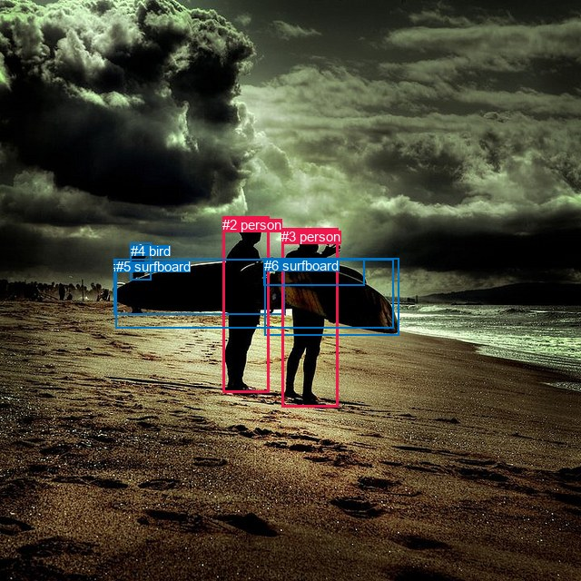
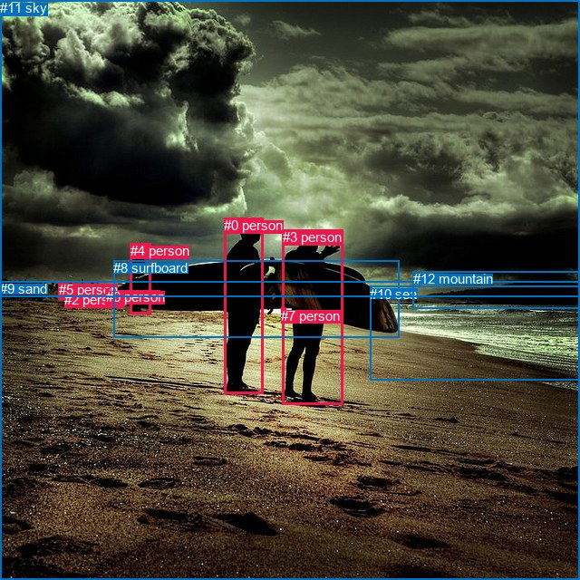

# 图片 1251：2373084.jpg

随机样本序号：366。图片 SHA256：`2393ceaf53e25a0142c9ae3ede9e2d6369c6fab030987bb984e0e00cd3c80e81`。

红色框表示人，蓝色框表示其他物体。两个模式分别保留自身框编号，可依据位置比较对应对象。

## 自动检测框与输出

人的框编号：`[2, 3]`。状态：`ok`。

### 自动检测全部物体框

| 编号 | 类别 | 是否为人 | 检测分数 | 像素坐标 xyxy |
|---|---|---|---|---|
| 0 | surfboard | False | 0.9984 | 291.3, 284.8, 439.6, 369.6 |
| 1 | surfboard | False | 0.9960 | 125.0, 285.2, 313.8, 346.6 |
| 2 | person | True | 0.9946 | 245.2, 238.7, 296.2, 432.1 |
| 3 | person | True | 0.9928 | 310.1, 252.0, 372.1, 448.9 |
| 4 | bird | False | 0.5671 | 143.8, 267.5, 166.1, 308.9 |
| 5 | surfboard | False | 0.4415 | 127.9, 285.2, 433.8, 362.0 |
| 6 | surfboard | False | 0.4044 | 290.9, 284.4, 401.7, 314.7 |

### 自动检测 Top50 人相关候选

评分物体对：42；人相关物体对：22；输出关系：44。

| 排名 | 主语编号与类别 | 关系 | 宾语编号与类别 | 类型 | 人与人 | 排序分数 | 原始融合 logit |
|---|---|---|---|---|---|---|---|
| 1 | #2 person | carrying | #5 surfboard | semantic | False | 0.99642 | 5.6301 |
| 2 | #3 person | carrying | #0 surfboard | semantic | False | 0.99633 | 5.6051 |
| 3 | #3 person | carrying | #5 surfboard | semantic | False | 0.99580 | 5.4695 |
| 4 | #2 person | carrying | #0 surfboard | semantic | False | 0.99520 | 5.3335 |
| 5 | #2 person | carrying | #1 surfboard | semantic | False | 0.99461 | 5.2187 |
| 6 | #3 person | beside | #2 person | spatial | True | 0.99100 | 4.7016 |
| 7 | #2 person | beside | #3 person | spatial | True | 0.98947 | 4.5427 |
| 8 | #3 person | carrying | #1 surfboard | semantic | False | 0.98143 | 3.9675 |
| 9 | #3 person | wearing | #6 surfboard | semantic | False | 0.96656 | 3.3639 |
| 10 | #2 person | looking at | #3 person | semantic | True | 0.96441 | 3.2994 |
| 11 | #2 person | wearing | #6 surfboard | semantic | False | 0.95609 | 3.0808 |
| 12 | #3 person | looking at | #2 person | semantic | True | 0.95085 | 2.9626 |
| 13 | #4 bird | looking at | #3 person | semantic | False | 0.93551 | 2.6747 |
| 14 | #4 bird | looking at | #2 person | semantic | False | 0.93525 | 2.6702 |
| 15 | #0 surfboard | beside | #2 person | spatial | False | 0.90610 | 2.2669 |
| 16 | #2 person | beside | #4 bird | spatial | False | 0.87437 | 1.9402 |
| 17 | #2 person | beside | #5 surfboard | spatial | False | 0.86104 | 1.8239 |
| 18 | #2 person | beside | #0 surfboard | spatial | False | 0.85594 | 1.7819 |
| 19 | #6 surfboard | on | #3 person | spatial | False | 0.83365 | 1.6117 |
| 20 | #3 person | beside | #0 surfboard | spatial | False | 0.83263 | 1.6044 |
| 21 | #2 person | looking at | #4 bird | semantic | False | 0.81936 | 1.5120 |
| 22 | #4 bird | beside | #2 person | spatial | False | 0.81501 | 1.4829 |
| 23 | #3 person | beside | #5 surfboard | spatial | False | 0.81205 | 1.4634 |
| 24 | #0 surfboard | beside | #3 person | spatial | False | 0.80176 | 1.3973 |
| 25 | #2 person | beside | #1 surfboard | spatial | False | 0.79006 | 1.3253 |
| 26 | #1 surfboard | beside | #2 person | spatial | False | 0.75304 | 1.1149 |
| 27 | #3 person | in front of | #4 bird | spatial | False | 0.74549 | 1.0747 |
| 28 | #1 surfboard | beside | #3 person | spatial | False | 0.74329 | 1.0632 |
| 29 | #3 person | beside | #1 surfboard | spatial | False | 0.73929 | 1.0423 |
| 30 | #5 surfboard | beside | #3 person | spatial | False | 0.73507 | 1.0205 |
| 31 | #3 person | looking at | #4 bird | semantic | False | 0.70576 | 0.8749 |
| 32 | #5 surfboard | beside | #2 person | spatial | False | 0.69102 | 0.8049 |
| 33 | #4 bird | beside | #3 person | spatial | False | 0.61282 | 0.4592 |
| 34 | #6 surfboard | on | #2 person | spatial | False | 0.60071 | 0.4084 |
| 35 | #3 person | beside | #6 surfboard | spatial | False | 0.59591 | 0.3885 |
| 36 | #6 surfboard | wearing | #3 person | semantic | False | 0.46274 | -0.1493 |
| 37 | #2 person | beside | #6 surfboard | spatial | False | 0.43631 | -0.2562 |
| 38 | #0 surfboard | holding | #3 person | semantic | False | 0.35256 | -0.6078 |
| 39 | #0 surfboard | holding | #2 person | semantic | False | 0.35040 | -0.6173 |
| 40 | #1 surfboard | carrying | #3 person | semantic | False | 0.33382 | -0.6910 |
| 41 | #5 surfboard | holding | #3 person | semantic | False | 0.33161 | -0.7009 |
| 42 | #1 surfboard | holding | #2 person | semantic | False | 0.31341 | -0.7842 |
| 43 | #5 surfboard | carrying | #2 person | semantic | False | 0.31254 | -0.7883 |
| 44 | #6 surfboard | wearing | #2 person | semantic | False | 0.31192 | -0.7912 |

### 自动检测逐条人相关 GT 核验

R@50：25.00%；命中 1/4。

| GT 主语编号 | GT 关系 | GT 宾语编号 | 结果阶段 | 匹配预测主语编号 | 匹配预测宾语编号 |
|---|---|---|---|---|---|
| 0 | standing on | 9 | endpoint_missing_or_wrong_class | [2] | [] |
| 3 | talking to | 0 | wrong_predicate | [3] | [2] |
| 3 | carrying | 8 | hit50 | [3] | [5] |
| 4 | standing on | 9 | endpoint_missing_or_wrong_class | [] | [] |

## 真实框与输出

人的框编号：`[0, 1, 2, 3, 4, 5, 6, 7]`。

### 真实框全部物体框

| 编号 | 类别 | 是否为人 | 检测分数 | 像素坐标 xyxy |
|---|---|---|---|---|
| 0 | person | True | GT | 247.0, 240.0, 290.0, 434.0 |
| 1 | person | True | GT | 112.0, 317.0, 118.0, 331.0 |
| 2 | person | True | GT | 71.0, 322.0, 80.0, 331.0 |
| 3 | person | True | GT | 312.0, 253.0, 379.0, 446.0 |
| 4 | person | True | GT | 144.0, 268.0, 166.0, 346.0 |
| 5 | person | True | GT | 65.0, 311.0, 72.0, 331.0 |
| 6 | person | True | GT | 117.0, 319.0, 121.0, 332.0 |
| 7 | person | True | GT | 310.0, 340.0, 315.0, 347.0 |
| 8 | surfboard | False | GT | 125.0, 287.0, 440.0, 372.0 |
| 9 | sand | False | GT | 0.0, 310.0, 640.0, 640.0 |
| 10 | sea | False | GT | 408.0, 316.0, 640.0, 420.0 |
| 11 | sky | False | GT | 0.0, 0.0, 640.0, 327.0 |
| 12 | mountain | False | GT | 456.0, 299.0, 640.0, 341.0 |

### 真实框 Top50 人相关候选

评分物体对：156；人相关物体对：136；输出关系：50。

| 排名 | 主语编号与类别 | 关系 | 宾语编号与类别 | 类型 | 人与人 | 排序分数 | 原始融合 logit |
|---|---|---|---|---|---|---|---|
| 1 | #3 person | carrying | #8 surfboard | semantic | False | 0.99692 | 5.7813 |
| 2 | #0 person | carrying | #8 surfboard | semantic | False | 0.99683 | 5.7495 |
| 3 | #0 person | standing on | #9 sand | semantic | False | 0.98812 | 4.4210 |
| 4 | #3 person | standing on | #9 sand | semantic | False | 0.98785 | 4.3985 |
| 5 | #4 person | standing on | #9 sand | semantic | False | 0.98784 | 4.3973 |
| 6 | #2 person | walking on | #9 sand | semantic | False | 0.98775 | 4.3899 |
| 7 | #5 person | walking on | #9 sand | semantic | False | 0.98761 | 4.3780 |
| 8 | #4 person | carrying | #8 surfboard | semantic | False | 0.98602 | 4.2562 |
| 9 | #0 person | beside | #3 person | spatial | True | 0.98466 | 4.1617 |
| 10 | #1 person | walking on | #9 sand | semantic | False | 0.98350 | 4.0875 |
| 11 | #3 person | beside | #0 person | spatial | True | 0.98228 | 4.0149 |
| 12 | #6 person | walking on | #9 sand | semantic | False | 0.97790 | 3.7898 |
| 13 | #3 person | looking at | #10 sea | semantic | False | 0.96778 | 3.4024 |
| 14 | #0 person | on | #9 sand | spatial | False | 0.95217 | 2.9910 |
| 15 | #3 person | on | #9 sand | spatial | False | 0.95020 | 2.9486 |
| 16 | #0 person | looking at | #3 person | semantic | True | 0.94283 | 2.8028 |
| 17 | #2 person | on | #9 sand | spatial | False | 0.93846 | 2.7246 |
| 18 | #1 person | on | #9 sand | spatial | False | 0.93589 | 2.6809 |
| 19 | #6 person | on | #9 sand | spatial | False | 0.93451 | 2.6581 |
| 20 | #5 person | on | #9 sand | spatial | False | 0.93198 | 2.6174 |
| 21 | #3 person | looking at | #0 person | semantic | True | 0.92955 | 2.5798 |
| 22 | #0 person | looking at | #10 sea | semantic | False | 0.92711 | 2.5432 |
| 23 | #4 person | on | #9 sand | spatial | False | 0.92533 | 2.5171 |
| 24 | #0 person | beside | #8 surfboard | spatial | False | 0.91075 | 2.3228 |
| 25 | #3 person | beside | #8 surfboard | spatial | False | 0.87645 | 1.9593 |
| 26 | #3 person | holding | #7 person | semantic | True | 0.86416 | 1.8503 |
| 27 | #8 surfboard | beside | #3 person | spatial | False | 0.85282 | 1.7569 |
| 28 | #3 person | looking at | #12 mountain | semantic | False | 0.81330 | 1.4716 |
| 29 | #3 person | beside | #10 sea | spatial | False | 0.79602 | 1.3616 |
| 30 | #4 person | looking at | #3 person | semantic | True | 0.77560 | 1.2402 |
| 31 | #4 person | looking at | #0 person | semantic | True | 0.75196 | 1.1091 |
| 32 | #4 person | beside | #0 person | spatial | True | 0.74758 | 1.0857 |
| 33 | #11 sky | over | #3 person | spatial | False | 0.71105 | 0.9005 |
| 34 | #0 person | beside | #4 person | spatial | True | 0.67665 | 0.7384 |
| 35 | #8 surfboard | beside | #0 person | spatial | False | 0.67135 | 0.7143 |
| 36 | #4 person | beside | #8 surfboard | spatial | False | 0.66058 | 0.6659 |
| 37 | #0 person | looking at | #12 mountain | semantic | False | 0.64051 | 0.5776 |
| 38 | #4 person | looking at | #10 sea | semantic | False | 0.61387 | 0.4636 |
| 39 | #5 person | looking at | #3 person | semantic | True | 0.61065 | 0.4500 |
| 40 | #7 person | holding | #8 surfboard | semantic | False | 0.60850 | 0.4410 |
| 41 | #0 person | beside | #10 sea | spatial | False | 0.57897 | 0.3186 |
| 42 | #4 person | beside | #3 person | spatial | True | 0.54736 | 0.1900 |
| 43 | #11 sky | over | #0 person | spatial | False | 0.53537 | 0.1417 |
| 44 | #5 person | looking at | #10 sea | semantic | False | 0.53114 | 0.1247 |
| 45 | #2 person | looking at | #3 person | semantic | True | 0.51810 | 0.0724 |
| 46 | #7 person | on | #8 surfboard | spatial | False | 0.51165 | 0.0466 |
| 47 | #5 person | looking at | #0 person | semantic | True | 0.49208 | -0.0317 |
| 48 | #3 person | looking at | #11 sky | semantic | False | 0.48059 | -0.0777 |
| 49 | #4 person | looking at | #11 sky | semantic | False | 0.46252 | -0.1502 |
| 50 | #5 person | looking at | #12 mountain | semantic | False | 0.45793 | -0.1687 |

### 真实框逐条人相关 GT 核验

R@50：75.00%；命中 3/4。

| GT 主语编号 | GT 关系 | GT 宾语编号 | 结果阶段 | 匹配预测主语编号 | 匹配预测宾语编号 |
|---|---|---|---|---|---|
| 0 | standing on | 9 | hit50 | [0] | [9] |
| 3 | talking to | 0 | wrong_predicate | [3] | [0] |
| 3 | carrying | 8 | hit50 | [3] | [8] |
| 4 | standing on | 9 | hit50 | [4] | [9] |

## 全部人相关 GT

| 主语编号与类别 | 关系 | 宾语编号与类别 |
|---|---|---|
| #0 person | standing on | #9 sand |
| #3 person | talking to | #0 person |
| #3 person | carrying | #8 surfboard |
| #4 person | standing on | #9 sand |

原始记录、全部人相关物体对的两项预测与分项分数见 [逐图证据 JSON](../evidence/cases/1251.json)。全部56类 logits 保留于本机 HOR/output/random500/logits/。

<!-- HOR_COMPLETE_RESULTS -->

## 六组条件的完整输出对照

以下保留同一图片三种框与候选模式、两种谓词输出规则的全部 Top50。框编号各自在所属模式内解释。

### 自动检测框完整枚举：空间与语义各保留一个谓词

| 排名 | 主语编号与类别 | 谓词 | 宾语编号与类别 | 分组 | 排序分数 | predicate logit | pair logit |
|---|---|---|---|---|---|---|---|
| 1 | #2 person | carrying | #5 surfboard | semantic | 0.9964245 | 4.8333774 | 0.7966843 |
| 2 | #3 person | carrying | #0 surfboard | semantic | 0.9963346 | 4.9677224 | 0.6374059 |
| 3 | #3 person | carrying | #5 surfboard | semantic | 0.9958046 | 4.7339826 | 0.7355643 |
| 4 | #2 person | carrying | #0 surfboard | semantic | 0.9951962 | 4.9980130 | 0.3355168 |
| 5 | #2 person | carrying | #1 surfboard | semantic | 0.9946147 | 4.6504998 | 0.5681880 |
| 6 | #3 person | beside | #2 person | spatial | 0.9910008 | 4.4299474 | 0.2716402 |
| 7 | #2 person | beside | #3 person | spatial | 0.9894674 | 4.2518296 | 0.2908685 |
| 8 | #3 person | carrying | #1 surfboard | semantic | 0.9814305 | 3.7722278 | 0.1952610 |
| 9 | #3 person | wearing | #6 surfboard | semantic | 0.9665580 | 2.9537506 | 0.4101768 |
| 10 | #2 person | looking at | #3 person | semantic | 0.9644098 | 3.0085788 | 0.2908685 |
| 11 | #2 person | wearing | #6 surfboard | semantic | 0.9560934 | 2.9847393 | 0.0960522 |
| 12 | #3 person | looking at | #2 person | semantic | 0.9508543 | 2.6909323 | 0.2716402 |
| 13 | #4 bird | looking at | #3 person | semantic | 0.9355141 | 2.8280311 | -0.1533809 |
| 14 | #4 bird | looking at | #2 person | semantic | 0.9352470 | 2.7293901 | -0.0591599 |
| 15 | #0 surfboard | beside | #2 person | spatial | 0.9061005 | 2.4133720 | -0.1464460 |
| 16 | #2 person | beside | #4 bird | spatial | 0.8743731 | 2.1366382 | -0.1964473 |
| 17 | #2 person | beside | #5 surfboard | spatial | 0.8610386 | 1.0272589 | 0.7966843 |
| 18 | #2 person | beside | #0 surfboard | spatial | 0.8559357 | 1.4464188 | 0.3355168 |
| 19 | #6 surfboard | on | #3 person | spatial | 0.8336453 | 1.8600211 | -0.2483355 |
| 20 | #3 person | beside | #0 surfboard | spatial | 0.8326329 | 0.9669971 | 0.6374059 |
| 21 | #2 person | looking at | #4 bird | semantic | 0.8193635 | 1.7084885 | -0.1964473 |
| 22 | #4 bird | beside | #2 person | spatial | 0.8150052 | 1.5420270 | -0.0591599 |
| 23 | #3 person | beside | #5 surfboard | spatial | 0.8120483 | 0.7278104 | 0.7355643 |
| 24 | #0 surfboard | beside | #3 person | spatial | 0.8017592 | 1.4504519 | -0.0531264 |
| 25 | #2 person | beside | #1 surfboard | spatial | 0.7900606 | 0.7571030 | 0.5681880 |
| 26 | #1 surfboard | beside | #2 person | spatial | 0.7530355 | 1.1208506 | -0.0059831 |
| 27 | #3 person | in front of | #4 bird | spatial | 0.7454898 | 1.2501531 | -0.1754522 |
| 28 | #1 surfboard | beside | #3 person | spatial | 0.7432939 | 1.1212549 | -0.0580954 |
| 29 | #3 person | beside | #1 surfboard | spatial | 0.7392874 | 0.8470073 | 0.1952610 |
| 30 | #5 surfboard | beside | #3 person | spatial | 0.7350675 | 1.0009627 | 0.0195245 |
| 31 | #3 person | looking at | #4 bird | semantic | 0.7057567 | 1.0503159 | -0.1754522 |
| 32 | #5 surfboard | beside | #2 person | spatial | 0.6910174 | 0.7902007 | 0.0146797 |
| 33 | #4 bird | beside | #3 person | spatial | 0.6128243 | 0.6125808 | -0.1533809 |
| 34 | #6 surfboard | on | #2 person | spatial | 0.6007100 | 0.7930698 | -0.3846454 |
| 35 | #3 person | beside | #6 surfboard | spatial | 0.5959145 | -0.0217061 | 0.4101768 |
| 36 | #6 surfboard | wearing | #3 person | semantic | 0.4627376 | 0.0990090 | -0.2483355 |
| 37 | #2 person | beside | #6 surfboard | spatial | 0.4363064 | -0.3522182 | 0.0960522 |
| 38 | #0 surfboard | holding | #3 person | semantic | 0.3525627 | -0.5546670 | -0.0531264 |
| 39 | #0 surfboard | holding | #2 person | semantic | 0.3503965 | -0.4708509 | -0.1464460 |
| 40 | #1 surfboard | carrying | #3 person | semantic | 0.3338170 | -0.6328759 | -0.0580954 |
| 41 | #5 surfboard | holding | #3 person | semantic | 0.3316084 | -0.7204437 | 0.0195245 |
| 42 | #1 surfboard | holding | #2 person | semantic | 0.3134145 | -0.7782211 | -0.0059831 |
| 43 | #5 surfboard | carrying | #2 person | semantic | 0.3125429 | -0.8029375 | 0.0146797 |
| 44 | #6 surfboard | wearing | #2 person | semantic | 0.3119166 | -0.4065289 | -0.3846454 |

GT 命中：1/4，R@50=25.00%。

| GT主语 | GT谓词 | GT宾语 | 结果阶段 | 匹配主语框 | 匹配宾语框 |
|---|---|---|---|---|---|
| 0 | standing on | 9 | endpoint_missing_or_wrong_class | [2] | [] |
| 3 | talking to | 0 | wrong_predicate | [3] | [2] |
| 3 | carrying | 8 | hit50 | [3] | [5] |
| 4 | standing on | 9 | endpoint_missing_or_wrong_class | [] | [] |

### 自动检测框完整枚举：每对只保留一个谓词

| 排名 | 主语编号与类别 | 谓词 | 宾语编号与类别 | 分组 | 排序分数 | predicate logit | pair logit |
|---|---|---|---|---|---|---|---|
| 1 | #2 person | carrying | #5 surfboard | single | 0.9964245 | 4.8333774 | 0.7966843 |
| 2 | #3 person | carrying | #0 surfboard | single | 0.9963346 | 4.9677224 | 0.6374059 |
| 3 | #3 person | carrying | #5 surfboard | single | 0.9958046 | 4.7339826 | 0.7355643 |
| 4 | #2 person | carrying | #0 surfboard | single | 0.9951962 | 4.9980130 | 0.3355168 |
| 5 | #2 person | carrying | #1 surfboard | single | 0.9946147 | 4.6504998 | 0.5681880 |
| 6 | #3 person | beside | #2 person | single | 0.9910008 | 4.4299474 | 0.2716402 |
| 7 | #2 person | beside | #3 person | single | 0.9894674 | 4.2518296 | 0.2908685 |
| 8 | #3 person | carrying | #1 surfboard | single | 0.9814305 | 3.7722278 | 0.1952610 |
| 9 | #3 person | wearing | #6 surfboard | single | 0.9665580 | 2.9537506 | 0.4101768 |
| 10 | #2 person | wearing | #6 surfboard | single | 0.9560934 | 2.9847393 | 0.0960522 |
| 11 | #4 bird | looking at | #3 person | single | 0.9355141 | 2.8280311 | -0.1533809 |
| 12 | #4 bird | looking at | #2 person | single | 0.9352470 | 2.7293901 | -0.0591599 |
| 13 | #0 surfboard | beside | #2 person | single | 0.9061005 | 2.4133720 | -0.1464460 |
| 14 | #2 person | beside | #4 bird | single | 0.8743731 | 2.1366382 | -0.1964473 |
| 15 | #6 surfboard | on | #3 person | single | 0.8336453 | 1.8600211 | -0.2483355 |
| 16 | #0 surfboard | beside | #3 person | single | 0.8017592 | 1.4504519 | -0.0531264 |
| 17 | #1 surfboard | beside | #2 person | single | 0.7530355 | 1.1208506 | -0.0059831 |
| 18 | #3 person | in front of | #4 bird | single | 0.7454898 | 1.2501531 | -0.1754522 |
| 19 | #1 surfboard | beside | #3 person | single | 0.7432939 | 1.1212549 | -0.0580954 |
| 20 | #5 surfboard | beside | #3 person | single | 0.7350675 | 1.0009627 | 0.0195245 |
| 21 | #5 surfboard | beside | #2 person | single | 0.6910174 | 0.7902007 | 0.0146797 |
| 22 | #6 surfboard | on | #2 person | single | 0.6007100 | 0.7930698 | -0.3846454 |

GT 命中：1/4，R@50=25.00%。

| GT主语 | GT谓词 | GT宾语 | 结果阶段 | 匹配主语框 | 匹配宾语框 |
|---|---|---|---|---|---|
| 0 | standing on | 9 | endpoint_missing_or_wrong_class | [2] | [] |
| 3 | talking to | 0 | wrong_predicate | [3] | [2] |
| 3 | carrying | 8 | hit50 | [3] | [5] |
| 4 | standing on | 9 | endpoint_missing_or_wrong_class | [] | [] |

### 真实框完整枚举：空间与语义各保留一个谓词

| 排名 | 主语编号与类别 | 谓词 | 宾语编号与类别 | 分组 | 排序分数 | predicate logit | pair logit |
|---|---|---|---|---|---|---|---|
| 1 | #3 person | carrying | #8 surfboard | semantic | 0.9969248 | 5.0306344 | 0.7506635 |
| 2 | #0 person | carrying | #8 surfboard | semantic | 0.9968258 | 4.9634624 | 0.7860650 |
| 3 | #0 person | standing on | #9 sand | semantic | 0.9881206 | 4.3841548 | 0.0368454 |
| 4 | #3 person | standing on | #9 sand | semantic | 0.9878539 | 4.2945952 | 0.1039242 |
| 5 | #4 person | standing on | #9 sand | semantic | 0.9878387 | 4.2652192 | 0.1320444 |
| 6 | #2 person | walking on | #9 sand | semantic | 0.9877496 | 4.1225867 | 0.2672910 |
| 7 | #5 person | walking on | #9 sand | semantic | 0.9876057 | 4.1195760 | 0.2584693 |
| 8 | #4 person | carrying | #8 surfboard | semantic | 0.9860217 | 4.4082389 | -0.1520716 |
| 9 | #0 person | beside | #3 person | spatial | 0.9846575 | 3.8977895 | 0.2638763 |
| 10 | #1 person | walking on | #9 sand | semantic | 0.9834967 | 4.0112529 | 0.0762962 |
| 11 | #3 person | beside | #0 person | spatial | 0.9822756 | 3.7733760 | 0.2415526 |
| 12 | #6 person | walking on | #9 sand | semantic | 0.9778991 | 3.7855763 | 0.0042099 |
| 13 | #3 person | looking at | #10 sea | semantic | 0.9677799 | 3.5256000 | -0.1231844 |
| 14 | #0 person | on | #9 sand | spatial | 0.9521677 | 2.9541950 | 0.0368454 |
| 15 | #3 person | on | #9 sand | spatial | 0.9501994 | 2.8447199 | 0.1039242 |
| 16 | #0 person | looking at | #3 person | semantic | 0.9428297 | 2.5389729 | 0.2638763 |
| 17 | #2 person | on | #9 sand | spatial | 0.9384605 | 2.4572697 | 0.2672910 |
| 18 | #1 person | on | #9 sand | spatial | 0.9358881 | 2.6045690 | 0.0762962 |
| 19 | #6 person | on | #9 sand | spatial | 0.9345067 | 2.6538620 | 0.0042099 |
| 20 | #5 person | on | #9 sand | spatial | 0.9319758 | 2.3589735 | 0.2584693 |
| 21 | #3 person | looking at | #0 person | semantic | 0.9295474 | 2.3382044 | 0.2415526 |
| 22 | #0 person | looking at | #10 sea | semantic | 0.9271146 | 2.8670788 | -0.3238896 |
| 23 | #4 person | on | #9 sand | spatial | 0.9253308 | 2.3850393 | 0.1320444 |
| 24 | #0 person | beside | #8 surfboard | spatial | 0.9107490 | 1.5367503 | 0.7860650 |
| 25 | #3 person | beside | #8 surfboard | spatial | 0.8764534 | 1.2086015 | 0.7506635 |
| 26 | #3 person | holding | #7 person | semantic | 0.8641572 | 1.5034051 | 0.3468512 |
| 27 | #8 surfboard | beside | #3 person | spatial | 0.8528192 | 1.7540822 | 0.0028037 |
| 28 | #3 person | looking at | #12 mountain | semantic | 0.8133004 | 1.8377008 | -0.3661011 |
| 29 | #3 person | beside | #10 sea | spatial | 0.7960164 | 1.4847646 | -0.1231844 |
| 30 | #4 person | looking at | #3 person | semantic | 0.7755985 | 1.2695618 | -0.0293637 |
| 31 | #4 person | looking at | #0 person | semantic | 0.7519609 | 1.0516014 | 0.0574965 |
| 32 | #4 person | beside | #0 person | spatial | 0.7475786 | 1.0282426 | 0.0574965 |
| 33 | #11 sky | over | #3 person | spatial | 0.7110536 | 1.0162053 | -0.1156991 |
| 34 | #0 person | beside | #4 person | spatial | 0.6766460 | 0.8190961 | -0.0806956 |
| 35 | #8 surfboard | beside | #0 person | spatial | 0.6713546 | 0.7010188 | 0.0132994 |
| 36 | #4 person | beside | #8 surfboard | spatial | 0.6605838 | 0.8179684 | -0.1520716 |
| 37 | #0 person | looking at | #12 mountain | semantic | 0.6405099 | 1.0923920 | -0.5148141 |
| 38 | #4 person | looking at | #10 sea | semantic | 0.6138732 | 0.8208737 | -0.3572511 |
| 39 | #5 person | looking at | #3 person | semantic | 0.6106457 | 0.7544160 | -0.3043891 |
| 40 | #7 person | holding | #8 surfboard | semantic | 0.6085033 | 0.5575318 | -0.1165069 |
| 41 | #0 person | beside | #10 sea | spatial | 0.5789713 | 0.6424413 | -0.3238896 |
| 42 | #4 person | beside | #3 person | spatial | 0.5473648 | 0.2193928 | -0.0293637 |
| 43 | #11 sky | over | #0 person | spatial | 0.5353663 | 0.3482776 | -0.2065758 |
| 44 | #5 person | looking at | #10 sea | semantic | 0.5311365 | 0.3218737 | -0.1971662 |
| 45 | #2 person | looking at | #3 person | semantic | 0.5181028 | 0.3926234 | -0.3201805 |
| 46 | #7 person | on | #8 surfboard | spatial | 0.5116522 | 0.1631241 | -0.1165069 |
| 47 | #5 person | looking at | #0 person | semantic | 0.4920779 | 0.2026629 | -0.2343538 |
| 48 | #3 person | looking at | #11 sky | semantic | 0.4805863 | 0.3581085 | -0.4358027 |
| 49 | #4 person | looking at | #11 sky | semantic | 0.4625218 | 0.5701418 | -0.7203362 |
| 50 | #5 person | looking at | #12 mountain | semantic | 0.4579291 | 0.1280775 | -0.2967598 |

GT 命中：3/4，R@50=75.00%。

| GT主语 | GT谓词 | GT宾语 | 结果阶段 | 匹配主语框 | 匹配宾语框 |
|---|---|---|---|---|---|
| 0 | standing on | 9 | hit50 | [0] | [9] |
| 3 | talking to | 0 | wrong_predicate | [3] | [0] |
| 3 | carrying | 8 | hit50 | [3] | [8] |
| 4 | standing on | 9 | hit50 | [4] | [9] |

### 真实框完整枚举：每对只保留一个谓词

| 排名 | 主语编号与类别 | 谓词 | 宾语编号与类别 | 分组 | 排序分数 | predicate logit | pair logit |
|---|---|---|---|---|---|---|---|
| 1 | #3 person | carrying | #8 surfboard | single | 0.9969248 | 5.0306344 | 0.7506635 |
| 2 | #0 person | carrying | #8 surfboard | single | 0.9968258 | 4.9634624 | 0.7860650 |
| 3 | #0 person | standing on | #9 sand | single | 0.9881206 | 4.3841548 | 0.0368454 |
| 4 | #3 person | standing on | #9 sand | single | 0.9878539 | 4.2945952 | 0.1039242 |
| 5 | #4 person | standing on | #9 sand | single | 0.9878387 | 4.2652192 | 0.1320444 |
| 6 | #2 person | walking on | #9 sand | single | 0.9877496 | 4.1225867 | 0.2672910 |
| 7 | #5 person | walking on | #9 sand | single | 0.9876057 | 4.1195760 | 0.2584693 |
| 8 | #4 person | carrying | #8 surfboard | single | 0.9860217 | 4.4082389 | -0.1520716 |
| 9 | #0 person | beside | #3 person | single | 0.9846575 | 3.8977895 | 0.2638763 |
| 10 | #1 person | walking on | #9 sand | single | 0.9834967 | 4.0112529 | 0.0762962 |
| 11 | #3 person | beside | #0 person | single | 0.9822756 | 3.7733760 | 0.2415526 |
| 12 | #6 person | walking on | #9 sand | single | 0.9778991 | 3.7855763 | 0.0042099 |
| 13 | #3 person | looking at | #10 sea | single | 0.9677799 | 3.5256000 | -0.1231844 |
| 14 | #0 person | looking at | #10 sea | single | 0.9271146 | 2.8670788 | -0.3238896 |
| 15 | #3 person | holding | #7 person | single | 0.8641572 | 1.5034051 | 0.3468512 |
| 16 | #8 surfboard | beside | #3 person | single | 0.8528192 | 1.7540822 | 0.0028037 |
| 17 | #3 person | looking at | #12 mountain | single | 0.8133004 | 1.8377008 | -0.3661011 |
| 18 | #4 person | looking at | #3 person | single | 0.7755985 | 1.2695618 | -0.0293637 |
| 19 | #4 person | looking at | #0 person | single | 0.7519609 | 1.0516014 | 0.0574965 |
| 20 | #11 sky | over | #3 person | single | 0.7110536 | 1.0162053 | -0.1156991 |
| 21 | #0 person | beside | #4 person | single | 0.6766460 | 0.8190961 | -0.0806956 |
| 22 | #8 surfboard | beside | #0 person | single | 0.6713546 | 0.7010188 | 0.0132994 |
| 23 | #0 person | looking at | #12 mountain | single | 0.6405099 | 1.0923920 | -0.5148141 |
| 24 | #4 person | looking at | #10 sea | single | 0.6138732 | 0.8208737 | -0.3572511 |
| 25 | #5 person | looking at | #3 person | single | 0.6106457 | 0.7544160 | -0.3043891 |
| 26 | #7 person | holding | #8 surfboard | single | 0.6085033 | 0.5575318 | -0.1165069 |
| 27 | #11 sky | over | #0 person | single | 0.5353663 | 0.3482776 | -0.2065758 |
| 28 | #5 person | looking at | #10 sea | single | 0.5311365 | 0.3218737 | -0.1971662 |
| 29 | #2 person | looking at | #3 person | single | 0.5181028 | 0.3926234 | -0.3201805 |
| 30 | #5 person | looking at | #0 person | single | 0.4920779 | 0.2026629 | -0.2343538 |
| 31 | #3 person | looking at | #11 sky | single | 0.4805863 | 0.3581085 | -0.4358027 |
| 32 | #4 person | looking at | #11 sky | single | 0.4625218 | 0.5701418 | -0.7203362 |
| 33 | #5 person | looking at | #12 mountain | single | 0.4579291 | 0.1280775 | -0.2967598 |
| 34 | #2 person | looking at | #0 person | single | 0.4440313 | 0.0252533 | -0.2500702 |
| 35 | #2 person | looking at | #10 sea | single | 0.4381466 | -0.0063415 | -0.2423460 |
| 36 | #0 person | looking at | #11 sky | single | 0.4362054 | 0.2135792 | -0.4701560 |
| 37 | #1 person | looking at | #3 person | single | 0.3966383 | -0.0855904 | -0.3339016 |
| 38 | #2 person | looking at | #8 surfboard | single | 0.3734038 | 0.2111387 | -0.7287807 |
| 39 | #10 sea | beside | #3 person | single | 0.3718261 | -0.0499682 | -0.4744224 |
| 40 | #5 person | looking at | #8 surfboard | single | 0.3638691 | 0.2090468 | -0.7676569 |
| 41 | #2 person | looking at | #12 mountain | single | 0.3432516 | -0.2959890 | -0.3528482 |
| 42 | #1 person | looking at | #0 person | single | 0.3412155 | -0.3906860 | -0.2671964 |
| 43 | #4 person | looking at | #12 mountain | single | 0.3369043 | -0.2714758 | -0.4056448 |
| 44 | #6 person | looking at | #3 person | single | 0.3238384 | -0.3964391 | -0.3397487 |
| 45 | #1 person | carrying | #6 person | single | 0.3186437 | -0.1442256 | -0.6157863 |
| 46 | #1 person | looking at | #10 sea | single | 0.2946690 | -0.3316584 | -0.5411561 |
| 47 | #6 person | carrying | #1 person | single | 0.2632108 | -0.3177824 | -0.7115644 |
| 48 | #5 person | looking at | #11 sky | single | 0.2605387 | -0.1329818 | -0.9101886 |
| 49 | #7 person | carrying | #3 person | single | 0.2565859 | -0.6530638 | -0.4107260 |
| 50 | #1 person | looking at | #8 surfboard | single | 0.2498599 | -0.5633678 | -0.5359920 |

GT 命中：3/4，R@50=75.00%。

| GT主语 | GT谓词 | GT宾语 | 结果阶段 | 匹配主语框 | 匹配宾语框 |
|---|---|---|---|---|---|
| 0 | standing on | 9 | hit50 | [0] | [9] |
| 3 | talking to | 0 | wrong_predicate | [3] | [0] |
| 3 | carrying | 8 | hit50 | [3] | [8] |
| 4 | standing on | 9 | hit50 | [4] | [9] |

### 真实框400候选：空间与语义各保留一个谓词

| 排名 | 主语编号与类别 | 谓词 | 宾语编号与类别 | 分组 | 排序分数 | predicate logit | pair logit |
|---|---|---|---|---|---|---|---|
| 1 | #3 person | carrying | #8 surfboard | semantic | 0.9969248 | 5.0306344 | 0.7506635 |
| 2 | #0 person | carrying | #8 surfboard | semantic | 0.9968295 | 4.9646268 | 0.7860650 |
| 3 | #2 person | walking on | #9 sand | semantic | 0.9883880 | 4.1767478 | 0.2672910 |
| 4 | #0 person | standing on | #9 sand | semantic | 0.9881206 | 4.3841548 | 0.0368454 |
| 5 | #3 person | standing on | #9 sand | semantic | 0.9878539 | 4.2945952 | 0.1039242 |
| 6 | #4 person | standing on | #9 sand | semantic | 0.9878387 | 4.2652192 | 0.1320444 |
| 7 | #5 person | walking on | #9 sand | semantic | 0.9876057 | 4.1195760 | 0.2584693 |
| 8 | #4 person | carrying | #8 surfboard | semantic | 0.9860536 | 4.4105687 | -0.1520716 |
| 9 | #0 person | beside | #3 person | spatial | 0.9837230 | 3.8377223 | 0.2638763 |
| 10 | #1 person | walking on | #9 sand | semantic | 0.9834967 | 4.0112529 | 0.0762962 |
| 11 | #3 person | beside | #0 person | spatial | 0.9822776 | 3.7734923 | 0.2415526 |
| 12 | #6 person | walking on | #9 sand | semantic | 0.9778991 | 3.7855763 | 0.0042099 |
| 13 | #3 person | looking at | #10 sea | semantic | 0.9678017 | 3.5262971 | -0.1231844 |
| 14 | #0 person | on | #9 sand | spatial | 0.9521677 | 2.9541950 | 0.0368454 |
| 15 | #3 person | on | #9 sand | spatial | 0.9501994 | 2.8447199 | 0.1039242 |
| 16 | #0 person | looking at | #3 person | semantic | 0.9428672 | 2.5396695 | 0.2638763 |
| 17 | #2 person | on | #9 sand | spatial | 0.9384605 | 2.4572697 | 0.2672910 |
| 18 | #1 person | on | #9 sand | spatial | 0.9358881 | 2.6045690 | 0.0762962 |
| 19 | #6 person | on | #9 sand | spatial | 0.9345067 | 2.6538620 | 0.0042099 |
| 20 | #5 person | on | #9 sand | spatial | 0.9323201 | 2.3644180 | 0.2584693 |
| 21 | #3 person | looking at | #0 person | semantic | 0.9295474 | 2.3382044 | 0.2415526 |
| 22 | #0 person | looking at | #10 sea | semantic | 0.9271618 | 2.8677754 | -0.3238896 |
| 23 | #4 person | on | #9 sand | spatial | 0.9253308 | 2.3850393 | 0.1320444 |
| 24 | #0 person | beside | #8 surfboard | spatial | 0.9131575 | 1.5667472 | 0.7860650 |
| 25 | #3 person | beside | #8 surfboard | spatial | 0.8764530 | 1.2085981 | 0.7506635 |
| 26 | #3 person | holding | #7 person | semantic | 0.8609399 | 1.4762678 | 0.3468512 |
| 27 | #8 surfboard | beside | #3 person | spatial | 0.8565456 | 1.7840867 | 0.0028037 |
| 28 | #3 person | looking at | #12 mountain | semantic | 0.8134063 | 1.8383985 | -0.3661011 |
| 29 | #3 person | beside | #10 sea | spatial | 0.7960211 | 1.4847937 | -0.1231844 |
| 30 | #4 person | looking at | #3 person | semantic | 0.7806730 | 1.2989559 | -0.0293637 |
| 31 | #4 person | beside | #0 person | spatial | 0.7531989 | 1.0582500 | 0.0574965 |
| 32 | #4 person | looking at | #0 person | semantic | 0.7519609 | 1.0516014 | 0.0574965 |
| 33 | #11 sky | over | #3 person | spatial | 0.7105099 | 1.0135608 | -0.1156991 |
| 34 | #0 person | beside | #4 person | spatial | 0.6766515 | 0.8191214 | -0.0806956 |
| 35 | #8 surfboard | beside | #0 person | spatial | 0.6713514 | 0.7010040 | 0.0132994 |
| 36 | #4 person | beside | #8 surfboard | spatial | 0.6605911 | 0.8180008 | -0.1520716 |
| 37 | #0 person | looking at | #12 mountain | semantic | 0.6406705 | 1.0930896 | -0.5148141 |
| 38 | #4 person | looking at | #10 sea | semantic | 0.6138732 | 0.8208737 | -0.3572511 |
| 39 | #5 person | looking at | #3 person | semantic | 0.6106457 | 0.7544160 | -0.3043891 |
| 40 | #7 person | holding | #8 surfboard | semantic | 0.6070948 | 0.5516233 | -0.1165069 |
| 41 | #0 person | beside | #10 sea | spatial | 0.5789713 | 0.6424413 | -0.3238896 |
| 42 | #4 person | beside | #3 person | spatial | 0.5473863 | 0.2194796 | -0.0293637 |
| 43 | #11 sky | over | #0 person | spatial | 0.5360240 | 0.3509221 | -0.2065758 |
| 44 | #5 person | looking at | #10 sea | semantic | 0.5311365 | 0.3218737 | -0.1971662 |
| 45 | #2 person | looking at | #3 person | semantic | 0.5107606 | 0.3632298 | -0.3201805 |
| 46 | #7 person | on | #8 surfboard | spatial | 0.5089309 | 0.1522341 | -0.1165069 |
| 47 | #5 person | looking at | #0 person | semantic | 0.4920779 | 0.2026629 | -0.2343538 |
| 48 | #3 person | looking at | #11 sky | semantic | 0.4804992 | 0.3577600 | -0.4358027 |
| 49 | #4 person | looking at | #11 sky | semantic | 0.4625218 | 0.5701418 | -0.7203362 |
| 50 | #5 person | looking at | #12 mountain | semantic | 0.4577560 | 0.1273799 | -0.2967598 |

GT 命中：3/4，R@50=75.00%。

| GT主语 | GT谓词 | GT宾语 | 结果阶段 | 匹配主语框 | 匹配宾语框 |
|---|---|---|---|---|---|
| 0 | standing on | 9 | hit50 | [0] | [9] |
| 3 | talking to | 0 | wrong_predicate | [3] | [0] |
| 3 | carrying | 8 | hit50 | [3] | [8] |
| 4 | standing on | 9 | hit50 | [4] | [9] |

### 真实框400候选：每对只保留一个谓词

| 排名 | 主语编号与类别 | 谓词 | 宾语编号与类别 | 分组 | 排序分数 | predicate logit | pair logit |
|---|---|---|---|---|---|---|---|
| 1 | #3 person | carrying | #8 surfboard | single | 0.9969248 | 5.0306344 | 0.7506635 |
| 2 | #0 person | carrying | #8 surfboard | single | 0.9968295 | 4.9646268 | 0.7860650 |
| 3 | #2 person | walking on | #9 sand | single | 0.9883880 | 4.1767478 | 0.2672910 |
| 4 | #0 person | standing on | #9 sand | single | 0.9881206 | 4.3841548 | 0.0368454 |
| 5 | #3 person | standing on | #9 sand | single | 0.9878539 | 4.2945952 | 0.1039242 |
| 6 | #4 person | standing on | #9 sand | single | 0.9878387 | 4.2652192 | 0.1320444 |
| 7 | #5 person | walking on | #9 sand | single | 0.9876057 | 4.1195760 | 0.2584693 |
| 8 | #4 person | carrying | #8 surfboard | single | 0.9860536 | 4.4105687 | -0.1520716 |
| 9 | #0 person | beside | #3 person | single | 0.9837230 | 3.8377223 | 0.2638763 |
| 10 | #1 person | walking on | #9 sand | single | 0.9834967 | 4.0112529 | 0.0762962 |
| 11 | #3 person | beside | #0 person | single | 0.9822776 | 3.7734923 | 0.2415526 |
| 12 | #6 person | walking on | #9 sand | single | 0.9778991 | 3.7855763 | 0.0042099 |
| 13 | #3 person | looking at | #10 sea | single | 0.9678017 | 3.5262971 | -0.1231844 |
| 14 | #0 person | looking at | #10 sea | single | 0.9271618 | 2.8677754 | -0.3238896 |
| 15 | #3 person | holding | #7 person | single | 0.8609399 | 1.4762678 | 0.3468512 |
| 16 | #8 surfboard | beside | #3 person | single | 0.8565456 | 1.7840867 | 0.0028037 |
| 17 | #3 person | looking at | #12 mountain | single | 0.8134063 | 1.8383985 | -0.3661011 |
| 18 | #4 person | looking at | #3 person | single | 0.7806730 | 1.2989559 | -0.0293637 |
| 19 | #4 person | beside | #0 person | single | 0.7531989 | 1.0582500 | 0.0574965 |
| 20 | #11 sky | over | #3 person | single | 0.7105099 | 1.0135608 | -0.1156991 |
| 21 | #0 person | beside | #4 person | single | 0.6766515 | 0.8191214 | -0.0806956 |
| 22 | #8 surfboard | beside | #0 person | single | 0.6713514 | 0.7010040 | 0.0132994 |
| 23 | #0 person | looking at | #12 mountain | single | 0.6406705 | 1.0930896 | -0.5148141 |
| 24 | #4 person | looking at | #10 sea | single | 0.6138732 | 0.8208737 | -0.3572511 |
| 25 | #5 person | looking at | #3 person | single | 0.6106457 | 0.7544160 | -0.3043891 |
| 26 | #7 person | holding | #8 surfboard | single | 0.6070948 | 0.5516233 | -0.1165069 |
| 27 | #11 sky | over | #0 person | single | 0.5360240 | 0.3509221 | -0.2065758 |
| 28 | #5 person | looking at | #10 sea | single | 0.5311365 | 0.3218737 | -0.1971662 |
| 29 | #2 person | looking at | #3 person | single | 0.5107606 | 0.3632298 | -0.3201805 |
| 30 | #5 person | looking at | #0 person | single | 0.4920779 | 0.2026629 | -0.2343538 |
| 31 | #3 person | looking at | #11 sky | single | 0.4804992 | 0.3577600 | -0.4358027 |
| 32 | #4 person | looking at | #11 sky | single | 0.4625218 | 0.5701418 | -0.7203362 |
| 33 | #5 person | looking at | #12 mountain | single | 0.4577560 | 0.1273799 | -0.2967598 |
| 34 | #2 person | looking at | #0 person | single | 0.4439451 | 0.0249043 | -0.2500702 |
| 35 | #2 person | looking at | #10 sea | single | 0.4381466 | -0.0063415 | -0.2423460 |
| 36 | #0 person | looking at | #11 sky | single | 0.4362911 | 0.2139277 | -0.4701560 |
| 37 | #1 person | looking at | #3 person | single | 0.4037777 | -0.0558476 | -0.3339016 |
| 38 | #2 person | looking at | #8 surfboard | single | 0.3803885 | 0.2408810 | -0.7287807 |
| 39 | #10 sea | beside | #3 person | single | 0.3718193 | -0.0499973 | -0.4744224 |
| 40 | #5 person | looking at | #8 surfboard | single | 0.3707810 | 0.2387891 | -0.7676569 |
| 41 | #2 person | looking at | #12 mountain | single | 0.3433303 | -0.2956400 | -0.3528482 |
| 42 | #4 person | looking at | #12 mountain | single | 0.3369043 | -0.2714758 | -0.4056448 |
| 43 | #1 person | looking at | #0 person | single | 0.3346003 | -0.4202547 | -0.2671964 |
| 44 | #1 person | carrying | #6 person | single | 0.3315918 | -0.0852079 | -0.6157863 |
| 45 | #6 person | looking at | #3 person | single | 0.3173223 | -0.4263563 | -0.3397487 |
| 46 | #1 person | looking at | #10 sea | single | 0.2947415 | -0.3313098 | -0.5411561 |
| 47 | #6 person | carrying | #1 person | single | 0.2690877 | -0.2876916 | -0.7115644 |
| 48 | #5 person | looking at | #11 sky | single | 0.2605387 | -0.1329818 | -0.9101886 |
| 49 | #7 person | carrying | #3 person | single | 0.2511072 | -0.6819897 | -0.4107260 |
| 50 | #1 person | looking at | #8 surfboard | single | 0.2498271 | -0.5635424 | -0.5359920 |

GT 命中：3/4，R@50=75.00%。

| GT主语 | GT谓词 | GT宾语 | 结果阶段 | 匹配主语框 | 匹配宾语框 |
|---|---|---|---|---|---|
| 0 | standing on | 9 | hit50 | [0] | [9] |
| 3 | talking to | 0 | wrong_predicate | [3] | [0] |
| 3 | carrying | 8 | hit50 | [3] | [8] |
| 4 | standing on | 9 | hit50 | [4] | [9] |
