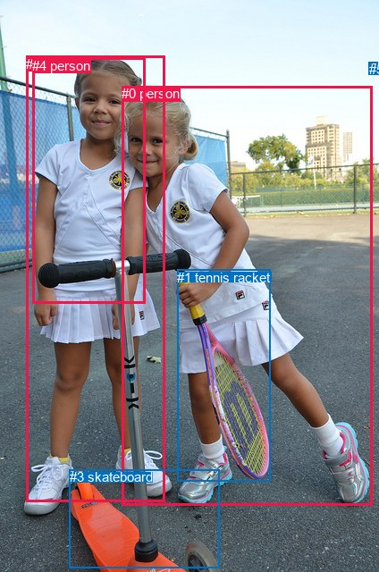
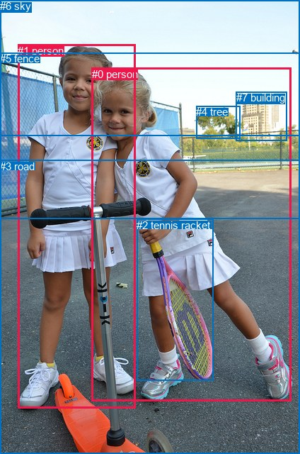

# 图片 1259：2373413.jpg

随机样本序号：306。图片 SHA256：`b13b6ba1b399210e9cfd2aa3f14e7a4c209e543ee33cdca18d482bef4ff8dab4`。

红色框表示人，蓝色框表示其他物体。两个模式分别保留自身框编号，可依据位置比较对应对象。

## 自动检测框与输出

人的框编号：`[0, 2, 4]`。状态：`ok`。

### 自动检测全部物体框

| 编号 | 类别 | 是否为人 | 检测分数 | 像素坐标 xyxy |
|---|---|---|---|---|
| 0 | person | True | 0.9997 | 136.4, 96.5, 416.3, 565.9 |
| 1 | tennis racket | False | 0.9990 | 198.1, 301.5, 302.8, 538.7 |
| 2 | person | True | 0.9962 | 29.0, 63.0, 184.8, 561.3 |
| 3 | skateboard | False | 0.9934 | 77.5, 525.4, 245.1, 635.2 |
| 4 | person | True | 0.6655 | 36.3, 64.7, 162.0, 339.9 |
| 5 | kite | False | 0.5446 | 412.8, 69.0, 422.5, 76.8 |

### 自动检测 Top50 人相关候选

评分物体对：30；人相关物体对：24；输出关系：48。

| 排名 | 主语编号与类别 | 关系 | 宾语编号与类别 | 类型 | 人与人 | 排序分数 | 原始融合 logit |
|---|---|---|---|---|---|---|---|
| 1 | #0 person | holding | #1 tennis racket | semantic | False | 0.99591 | 5.4943 |
| 2 | #2 person | wearing | #4 person | semantic | True | 0.97100 | 3.5110 |
| 3 | #2 person | holding | #1 tennis racket | semantic | False | 0.94072 | 2.7644 |
| 4 | #2 person | in | #4 person | spatial | True | 0.91351 | 2.3573 |
| 5 | #0 person | playing | #3 skateboard | semantic | False | 0.90433 | 2.2463 |
| 6 | #5 kite | over | #0 person | spatial | False | 0.87334 | 1.9309 |
| 7 | #2 person | holding | #3 skateboard | semantic | False | 0.84081 | 1.6643 |
| 8 | #5 kite | flying over | #0 person | semantic | False | 0.82995 | 1.5853 |
| 9 | #2 person | on | #3 skateboard | spatial | False | 0.82753 | 1.5682 |
| 10 | #0 person | on | #1 tennis racket | spatial | False | 0.82411 | 1.5445 |
| 11 | #0 person | on | #3 skateboard | spatial | False | 0.81743 | 1.4990 |
| 12 | #4 person | holding | #1 tennis racket | semantic | False | 0.77392 | 1.2306 |
| 13 | #2 person | standing on | #0 person | semantic | True | 0.69396 | 0.8187 |
| 14 | #0 person | playing | #5 kite | semantic | False | 0.68775 | 0.7896 |
| 15 | #4 person | on | #2 person | spatial | True | 0.68067 | 0.7568 |
| 16 | #2 person | looking at | #5 kite | semantic | False | 0.64131 | 0.5810 |
| 17 | #2 person | beside | #0 person | spatial | True | 0.58341 | 0.3368 |
| 18 | #5 kite | over | #2 person | spatial | False | 0.56960 | 0.2802 |
| 19 | #3 skateboard | beside | #2 person | spatial | False | 0.55101 | 0.2048 |
| 20 | #0 person | playing with | #2 person | semantic | True | 0.48768 | -0.0493 |
| 21 | #0 person | beside | #2 person | spatial | True | 0.44980 | -0.2015 |
| 22 | #4 person | looking at | #5 kite | semantic | False | 0.42930 | -0.2847 |
| 23 | #3 skateboard | beside | #0 person | spatial | False | 0.42148 | -0.3167 |
| 24 | #1 tennis racket | holding | #0 person | semantic | False | 0.37793 | -0.4983 |
| 25 | #5 kite | over | #4 person | spatial | False | 0.35627 | -0.5916 |
| 26 | #1 tennis racket | in | #0 person | spatial | False | 0.30584 | -0.8197 |
| 27 | #0 person | wearing | #4 person | semantic | True | 0.30520 | -0.8226 |
| 28 | #4 person | wearing | #2 person | semantic | True | 0.29836 | -0.8551 |
| 29 | #2 person | on | #1 tennis racket | spatial | False | 0.29047 | -0.8931 |
| 30 | #4 person | beside | #0 person | spatial | True | 0.22548 | -1.2340 |
| 31 | #4 person | standing on | #0 person | semantic | True | 0.20338 | -1.3653 |
| 32 | #0 person | in | #5 kite | spatial | False | 0.19336 | -1.4283 |
| 33 | #0 person | in | #4 person | spatial | True | 0.16497 | -1.6217 |
| 34 | #2 person | in | #5 kite | spatial | False | 0.16407 | -1.6283 |
| 35 | #4 person | playing | #3 skateboard | semantic | False | 0.16301 | -1.6360 |
| 36 | #4 person | on | #3 skateboard | spatial | False | 0.15399 | -1.7037 |
| 37 | #3 skateboard | holding | #2 person | semantic | False | 0.14793 | -1.7509 |
| 38 | #3 skateboard | beside | #4 person | spatial | False | 0.12269 | -1.9672 |
| 39 | #4 person | on | #1 tennis racket | spatial | False | 0.12202 | -1.9734 |
| 40 | #5 kite | flying over | #2 person | semantic | False | 0.11942 | -1.9979 |
| 41 | #3 skateboard | holding | #0 person | semantic | False | 0.09949 | -2.2029 |
| 42 | #4 person | in | #5 kite | spatial | False | 0.09823 | -2.2171 |
| 43 | #1 tennis racket | holding | #2 person | semantic | False | 0.07241 | -2.5502 |
| 44 | #1 tennis racket | in | #2 person | spatial | False | 0.06606 | -2.6488 |
| 45 | #5 kite | looking at | #4 person | semantic | False | 0.05314 | -2.8802 |
| 46 | #1 tennis racket | in | #4 person | spatial | False | 0.03044 | -3.4610 |
| 47 | #1 tennis racket | holding | #4 person | semantic | False | 0.01912 | -3.9375 |
| 48 | #3 skateboard | holding | #4 person | semantic | False | 0.01784 | -4.0083 |

### 自动检测逐条人相关 GT 核验

R@50：25.00%；命中 1/4。

| GT 主语编号 | GT 关系 | GT 宾语编号 | 结果阶段 | 匹配预测主语编号 | 匹配预测宾语编号 |
|---|---|---|---|---|---|
| 0 | leaning on | 1 | wrong_predicate | [0] | [2] |
| 0 | holding | 2 | hit50 | [0] | [1] |
| 0 | on | 3 | endpoint_missing_or_wrong_class | [0] | [] |
| 1 | standing on | 3 | endpoint_missing_or_wrong_class | [2] | [] |

## 真实框与输出

人的框编号：`[0, 1]`。

### 真实框全部物体框

| 编号 | 类别 | 是否为人 | 检测分数 | 像素坐标 xyxy |
|---|---|---|---|---|
| 0 | person | True | GT | 130.0, 96.0, 412.0, 566.0 |
| 1 | person | True | GT | 25.0, 63.0, 191.0, 575.0 |
| 2 | tennis racket | False | GT | 193.0, 309.0, 301.0, 536.0 |
| 3 | road | False | GT | 0.0, 226.0, 424.0, 640.0 |
| 4 | tree | False | GT | 277.0, 149.0, 339.0, 196.0 |
| 5 | fence | False | GT | 0.0, 74.0, 424.0, 308.0 |
| 6 | sky | False | GT | 0.0, 0.0, 424.0, 191.0 |
| 7 | building | False | GT | 334.0, 129.0, 406.0, 198.0 |

### 真实框 Top50 人相关候选

评分物体对：56；人相关物体对：26；输出关系：50。

| 排名 | 主语编号与类别 | 关系 | 宾语编号与类别 | 类型 | 人与人 | 排序分数 | 原始融合 logit |
|---|---|---|---|---|---|---|---|
| 1 | #0 person | holding | #2 tennis racket | semantic | False | 0.99611 | 5.5456 |
| 2 | #1 person | standing on | #3 road | semantic | False | 0.97394 | 3.6208 |
| 3 | #0 person | playing with | #3 road | semantic | False | 0.97027 | 3.4855 |
| 4 | #1 person | holding | #2 tennis racket | semantic | False | 0.96970 | 3.4658 |
| 5 | #1 person | on | #3 road | spatial | False | 0.95883 | 3.1479 |
| 6 | #0 person | on | #3 road | spatial | False | 0.95019 | 2.9485 |
| 7 | #5 fence | beside | #0 person | spatial | False | 0.87755 | 1.9695 |
| 8 | #1 person | beside | #0 person | spatial | True | 0.86316 | 1.8418 |
| 9 | #5 fence | beside | #1 person | spatial | False | 0.85554 | 1.7788 |
| 10 | #0 person | playing with | #1 person | semantic | True | 0.83799 | 1.6433 |
| 11 | #0 person | beside | #1 person | spatial | True | 0.83055 | 1.5896 |
| 12 | #0 person | on | #2 tennis racket | spatial | False | 0.82438 | 1.5463 |
| 13 | #1 person | standing on | #0 person | semantic | True | 0.74740 | 1.0848 |
| 14 | #1 person | beside | #5 fence | spatial | False | 0.72070 | 0.9480 |
| 15 | #0 person | beside | #5 fence | spatial | False | 0.64231 | 0.5854 |
| 16 | #1 person | standing on | #5 fence | semantic | False | 0.53443 | 0.1380 |
| 17 | #2 tennis racket | holding | #0 person | semantic | False | 0.53429 | 0.1374 |
| 18 | #6 sky | over | #1 person | spatial | False | 0.53331 | 0.1334 |
| 19 | #2 tennis racket | beside | #0 person | spatial | False | 0.46724 | -0.1312 |
| 20 | #6 sky | over | #0 person | spatial | False | 0.43934 | -0.2438 |
| 21 | #1 person | on | #2 tennis racket | spatial | False | 0.43886 | -0.2458 |
| 22 | #5 fence | looking at | #0 person | semantic | False | 0.34903 | -0.6233 |
| 23 | #0 person | looking at | #5 fence | semantic | False | 0.30321 | -0.8321 |
| 24 | #3 road | beside | #0 person | spatial | False | 0.22905 | -1.2137 |
| 25 | #2 tennis racket | holding | #1 person | semantic | False | 0.22692 | -1.2258 |
| 26 | #2 tennis racket | beside | #1 person | spatial | False | 0.20531 | -1.3534 |
| 27 | #5 fence | holding | #1 person | semantic | False | 0.20105 | -1.3797 |
| 28 | #3 road | beside | #1 person | spatial | False | 0.14666 | -1.7610 |
| 29 | #1 person | looking at | #6 sky | semantic | False | 0.12292 | -1.9650 |
| 30 | #0 person | looking at | #6 sky | semantic | False | 0.11427 | -2.0478 |
| 31 | #3 road | holding | #0 person | semantic | False | 0.11188 | -2.0716 |
| 32 | #4 tree | looking at | #0 person | semantic | False | 0.10353 | -2.1586 |
| 33 | #4 tree | beside | #0 person | spatial | False | 0.10351 | -2.1589 |
| 34 | #7 building | looking at | #0 person | semantic | False | 0.09675 | -2.2338 |
| 35 | #3 road | holding | #1 person | semantic | False | 0.07491 | -2.5136 |
| 36 | #1 person | in | #6 sky | spatial | False | 0.06240 | -2.7098 |
| 37 | #7 building | beside | #0 person | spatial | False | 0.05256 | -2.8918 |
| 38 | #0 person | in | #6 sky | spatial | False | 0.04884 | -2.9692 |
| 39 | #4 tree | beside | #1 person | spatial | False | 0.04784 | -2.9908 |
| 40 | #0 person | looking at | #4 tree | semantic | False | 0.04498 | -3.0556 |
| 41 | #7 building | looking at | #1 person | semantic | False | 0.04267 | -3.1105 |
| 42 | #0 person | looking at | #7 building | semantic | False | 0.04149 | -3.1400 |
| 43 | #1 person | looking at | #7 building | semantic | False | 0.03787 | -3.2350 |
| 44 | #1 person | looking at | #4 tree | semantic | False | 0.03715 | -3.2550 |
| 45 | #6 sky | holding | #1 person | semantic | False | 0.03525 | -3.3094 |
| 46 | #0 person | beside | #4 tree | spatial | False | 0.03164 | -3.4213 |
| 47 | #6 sky | holding | #0 person | semantic | False | 0.03145 | -3.4274 |
| 48 | #0 person | in front of | #7 building | spatial | False | 0.03094 | -3.4443 |
| 49 | #7 building | beside | #1 person | spatial | False | 0.03074 | -3.4511 |
| 50 | #1 person | in front of | #7 building | spatial | False | 0.02121 | -3.8316 |

### 真实框逐条人相关 GT 核验

R@50：75.00%；命中 3/4。

| GT 主语编号 | GT 关系 | GT 宾语编号 | 结果阶段 | 匹配预测主语编号 | 匹配预测宾语编号 |
|---|---|---|---|---|---|
| 0 | leaning on | 1 | wrong_predicate | [0] | [1] |
| 0 | holding | 2 | hit50 | [0] | [2] |
| 0 | on | 3 | hit50 | [0] | [3] |
| 1 | standing on | 3 | hit50 | [1] | [3] |

## 全部人相关 GT

| 主语编号与类别 | 关系 | 宾语编号与类别 |
|---|---|---|
| #0 person | leaning on | #1 person |
| #0 person | holding | #2 tennis racket |
| #0 person | on | #3 road |
| #1 person | standing on | #3 road |

原始记录、全部人相关物体对的两项预测与分项分数见 [逐图证据 JSON](../evidence/cases/1259.json)。全部56类 logits 保留于本机 HOR/output/random500/logits/。

<!-- HOR_COMPLETE_RESULTS -->

## 六组条件的完整输出对照

以下保留同一图片三种框与候选模式、两种谓词输出规则的全部 Top50。框编号各自在所属模式内解释。

### 自动检测框完整枚举：空间与语义各保留一个谓词

| 排名 | 主语编号与类别 | 谓词 | 宾语编号与类别 | 分组 | 排序分数 | predicate logit | pair logit |
|---|---|---|---|---|---|---|---|
| 1 | #0 person | holding | #1 tennis racket | semantic | 0.9959066 | 4.8910108 | 0.6032726 |
| 2 | #2 person | wearing | #4 person | semantic | 0.9710003 | 4.1268487 | -0.6158078 |
| 3 | #2 person | holding | #1 tennis racket | semantic | 0.9407228 | 2.8373804 | -0.0729567 |
| 4 | #2 person | in | #4 person | spatial | 0.9135139 | 2.9731231 | -0.6158078 |
| 5 | #0 person | playing | #3 skateboard | semantic | 0.9043285 | 2.3080387 | -0.0617666 |
| 6 | #5 kite | over | #0 person | spatial | 0.8733449 | 2.6568770 | -0.7260140 |
| 7 | #2 person | holding | #3 skateboard | semantic | 0.8408126 | 1.7367892 | -0.0725028 |
| 8 | #5 kite | flying over | #0 person | semantic | 0.8299496 | 2.3112836 | -0.7260140 |
| 9 | #2 person | on | #3 skateboard | spatial | 0.8275338 | 1.6407518 | -0.0725028 |
| 10 | #0 person | on | #1 tennis racket | spatial | 0.8241113 | 0.9411812 | 0.6032726 |
| 11 | #0 person | on | #3 skateboard | spatial | 0.8174286 | 1.5607891 | -0.0617666 |
| 12 | #4 person | holding | #1 tennis racket | semantic | 0.7739213 | 2.0018315 | -0.7712444 |
| 13 | #2 person | standing on | #0 person | semantic | 0.6939591 | 1.2612948 | -0.4426006 |
| 14 | #0 person | playing | #5 kite | semantic | 0.6877536 | 2.1089249 | -1.3192866 |
| 15 | #4 person | on | #2 person | spatial | 0.6806694 | 1.5611353 | -0.8042856 |
| 16 | #2 person | looking at | #5 kite | semantic | 0.6413060 | 1.8039913 | -1.2229544 |
| 17 | #2 person | beside | #0 person | spatial | 0.5834133 | 0.7794018 | -0.4426006 |
| 18 | #5 kite | over | #2 person | spatial | 0.5695960 | 1.2831192 | -1.0029161 |
| 19 | #3 skateboard | beside | #2 person | spatial | 0.5510116 | 1.0090294 | -0.8042707 |
| 20 | #0 person | playing with | #2 person | semantic | 0.4876814 | 0.4786248 | -0.5279090 |
| 21 | #0 person | beside | #2 person | spatial | 0.4497961 | 0.3264141 | -0.5279090 |
| 22 | #4 person | looking at | #5 kite | semantic | 0.4293039 | 0.9903078 | -1.2749997 |
| 23 | #3 skateboard | beside | #0 person | spatial | 0.4214776 | 0.6194043 | -0.9361150 |
| 24 | #1 tennis racket | holding | #0 person | semantic | 0.3779291 | 0.4534550 | -0.9518023 |
| 25 | #5 kite | over | #4 person | spatial | 0.3562687 | 0.4442153 | -1.0358117 |
| 26 | #1 tennis racket | in | #0 person | spatial | 0.3058356 | 0.1321411 | -0.9518023 |
| 27 | #0 person | wearing | #4 person | semantic | 0.3052021 | -0.2396803 | -0.5829664 |
| 28 | #4 person | wearing | #2 person | semantic | 0.2983584 | -0.0508418 | -0.8042856 |
| 29 | #2 person | on | #1 tennis racket | spatial | 0.2904679 | -0.8201559 | -0.0729567 |
| 30 | #4 person | beside | #0 person | spatial | 0.2254842 | -0.5757446 | -0.6582434 |
| 31 | #4 person | standing on | #0 person | semantic | 0.2033762 | -0.7070818 | -0.6582434 |
| 32 | #0 person | in | #5 kite | spatial | 0.1933573 | -0.1090546 | -1.3192866 |
| 33 | #0 person | in | #4 person | spatial | 0.1649660 | -1.0387669 | -0.5829664 |
| 34 | #2 person | in | #5 kite | spatial | 0.1640679 | -0.4053125 | -1.2229544 |
| 35 | #4 person | playing | #3 skateboard | semantic | 0.1630096 | -0.9654117 | -0.6705915 |
| 36 | #4 person | on | #3 skateboard | spatial | 0.1539860 | -1.0330825 | -0.6705915 |
| 37 | #3 skateboard | holding | #2 person | semantic | 0.1479309 | -0.9466517 | -0.8042707 |
| 38 | #3 skateboard | beside | #4 person | spatial | 0.1226908 | -0.5858355 | -1.3813570 |
| 39 | #4 person | on | #1 tennis racket | spatial | 0.1220236 | -1.2021613 | -0.7712444 |
| 40 | #5 kite | flying over | #2 person | semantic | 0.1194213 | -0.9950061 | -1.0029161 |
| 41 | #3 skateboard | holding | #0 person | semantic | 0.0994920 | -1.2667668 | -0.9361150 |
| 42 | #4 person | in | #5 kite | spatial | 0.0982274 | -0.9420781 | -1.2749997 |
| 43 | #1 tennis racket | holding | #2 person | semantic | 0.0724107 | -1.2482829 | -1.3019526 |
| 44 | #1 tennis racket | in | #2 person | spatial | 0.0660620 | -1.3468630 | -1.3019526 |
| 45 | #5 kite | looking at | #4 person | semantic | 0.0531431 | -1.8443480 | -1.0358117 |
| 46 | #1 tennis racket | in | #4 person | spatial | 0.0304436 | -1.8259151 | -1.6350485 |
| 47 | #1 tennis racket | holding | #4 person | semantic | 0.0191249 | -2.3024049 | -1.6350485 |
| 48 | #3 skateboard | holding | #4 person | semantic | 0.0178406 | -2.6269224 | -1.3813570 |

GT 命中：1/4，R@50=25.00%。

| GT主语 | GT谓词 | GT宾语 | 结果阶段 | 匹配主语框 | 匹配宾语框 |
|---|---|---|---|---|---|
| 0 | leaning on | 1 | wrong_predicate | [0] | [2] |
| 0 | holding | 2 | hit50 | [0] | [1] |
| 0 | on | 3 | endpoint_missing_or_wrong_class | [0] | [] |
| 1 | standing on | 3 | endpoint_missing_or_wrong_class | [2] | [] |

### 自动检测框完整枚举：每对只保留一个谓词

| 排名 | 主语编号与类别 | 谓词 | 宾语编号与类别 | 分组 | 排序分数 | predicate logit | pair logit |
|---|---|---|---|---|---|---|---|
| 1 | #0 person | holding | #1 tennis racket | single | 0.9959066 | 4.8910108 | 0.6032726 |
| 2 | #2 person | wearing | #4 person | single | 0.9710003 | 4.1268487 | -0.6158078 |
| 3 | #2 person | holding | #1 tennis racket | single | 0.9407228 | 2.8373804 | -0.0729567 |
| 4 | #0 person | playing | #3 skateboard | single | 0.9043285 | 2.3080387 | -0.0617666 |
| 5 | #5 kite | over | #0 person | single | 0.8733449 | 2.6568770 | -0.7260140 |
| 6 | #2 person | holding | #3 skateboard | single | 0.8408126 | 1.7367892 | -0.0725028 |
| 7 | #4 person | holding | #1 tennis racket | single | 0.7739213 | 2.0018315 | -0.7712444 |
| 8 | #2 person | standing on | #0 person | single | 0.6939591 | 1.2612948 | -0.4426006 |
| 9 | #0 person | playing | #5 kite | single | 0.6877536 | 2.1089249 | -1.3192866 |
| 10 | #4 person | on | #2 person | single | 0.6806694 | 1.5611353 | -0.8042856 |
| 11 | #2 person | looking at | #5 kite | single | 0.6413060 | 1.8039913 | -1.2229544 |
| 12 | #5 kite | over | #2 person | single | 0.5695960 | 1.2831192 | -1.0029161 |
| 13 | #3 skateboard | beside | #2 person | single | 0.5510116 | 1.0090294 | -0.8042707 |
| 14 | #0 person | playing with | #2 person | single | 0.4876814 | 0.4786248 | -0.5279090 |
| 15 | #4 person | looking at | #5 kite | single | 0.4293039 | 0.9903078 | -1.2749997 |
| 16 | #3 skateboard | beside | #0 person | single | 0.4214776 | 0.6194043 | -0.9361150 |
| 17 | #1 tennis racket | holding | #0 person | single | 0.3779291 | 0.4534550 | -0.9518023 |
| 18 | #5 kite | over | #4 person | single | 0.3562687 | 0.4442153 | -1.0358117 |
| 19 | #0 person | wearing | #4 person | single | 0.3052021 | -0.2396803 | -0.5829664 |
| 20 | #4 person | beside | #0 person | single | 0.2254842 | -0.5757446 | -0.6582434 |
| 21 | #4 person | playing | #3 skateboard | single | 0.1630096 | -0.9654117 | -0.6705915 |
| 22 | #3 skateboard | beside | #4 person | single | 0.1226908 | -0.5858355 | -1.3813570 |
| 23 | #1 tennis racket | holding | #2 person | single | 0.0724107 | -1.2482829 | -1.3019526 |
| 24 | #1 tennis racket | in | #4 person | single | 0.0304436 | -1.8259151 | -1.6350485 |

GT 命中：1/4，R@50=25.00%。

| GT主语 | GT谓词 | GT宾语 | 结果阶段 | 匹配主语框 | 匹配宾语框 |
|---|---|---|---|---|---|
| 0 | leaning on | 1 | wrong_predicate | [0] | [2] |
| 0 | holding | 2 | hit50 | [0] | [1] |
| 0 | on | 3 | endpoint_missing_or_wrong_class | [0] | [] |
| 1 | standing on | 3 | endpoint_missing_or_wrong_class | [2] | [] |

### 真实框完整枚举：空间与语义各保留一个谓词

| 排名 | 主语编号与类别 | 谓词 | 宾语编号与类别 | 分组 | 排序分数 | predicate logit | pair logit |
|---|---|---|---|---|---|---|---|
| 1 | #0 person | holding | #2 tennis racket | semantic | 0.9961107 | 4.9866443 | 0.5589936 |
| 2 | #1 person | standing on | #3 road | semantic | 0.9739358 | 3.8202806 | -0.1995010 |
| 3 | #0 person | playing with | #3 road | semantic | 0.9702729 | 3.6448417 | -0.1593247 |
| 4 | #1 person | holding | #2 tennis racket | semantic | 0.9696982 | 3.5691915 | -0.1034150 |
| 5 | #1 person | on | #3 road | spatial | 0.9588251 | 3.3473802 | -0.1995010 |
| 6 | #0 person | on | #3 road | spatial | 0.9501917 | 3.1078076 | -0.1593247 |
| 7 | #5 fence | beside | #0 person | spatial | 0.8775547 | 2.0336351 | -0.0641610 |
| 8 | #1 person | beside | #0 person | spatial | 0.8631620 | 2.2810731 | -0.4392681 |
| 9 | #5 fence | beside | #1 person | spatial | 0.8555426 | 1.8526249 | -0.0738738 |
| 10 | #0 person | playing with | #1 person | semantic | 0.8379892 | 2.1537313 | -0.5103893 |
| 11 | #0 person | beside | #1 person | spatial | 0.8305538 | 2.0999470 | -0.5103893 |
| 12 | #0 person | on | #2 tennis racket | spatial | 0.8243803 | 0.9873176 | 0.5589936 |
| 13 | #1 person | standing on | #0 person | semantic | 0.7473992 | 1.5240569 | -0.4392681 |
| 14 | #1 person | beside | #5 fence | spatial | 0.7207049 | 1.7655897 | -0.8176289 |
| 15 | #0 person | beside | #5 fence | spatial | 0.6423094 | 1.5242815 | -0.9388797 |
| 16 | #1 person | standing on | #5 fence | semantic | 0.5344330 | 0.9555793 | -0.8176289 |
| 17 | #2 tennis racket | holding | #0 person | semantic | 0.5342866 | 1.0992532 | -0.9618911 |
| 18 | #6 sky | over | #1 person | spatial | 0.5333093 | 0.8819885 | -0.7485539 |
| 19 | #2 tennis racket | beside | #0 person | spatial | 0.4672439 | 0.8306789 | -0.9618911 |
| 20 | #6 sky | over | #0 person | spatial | 0.4393417 | 0.4432087 | -0.6870428 |
| 21 | #1 person | on | #2 tennis racket | spatial | 0.4388556 | -0.1423931 | -0.1034150 |
| 22 | #5 fence | looking at | #0 person | semantic | 0.3490311 | -0.5591402 | -0.0641610 |
| 23 | #0 person | looking at | #5 fence | semantic | 0.3032078 | 0.1068110 | -0.9388797 |
| 24 | #3 road | beside | #0 person | spatial | 0.2290460 | -0.2545428 | -0.9591630 |
| 25 | #2 tennis racket | holding | #1 person | semantic | 0.2269171 | 0.0541639 | -1.2799652 |
| 26 | #2 tennis racket | beside | #1 person | spatial | 0.2053085 | -0.0734749 | -1.2799652 |
| 27 | #5 fence | holding | #1 person | semantic | 0.2010533 | -1.3058505 | -0.0738738 |
| 28 | #3 road | beside | #1 person | spatial | 0.1466649 | -0.8571918 | -0.9038100 |
| 29 | #1 person | looking at | #6 sky | semantic | 0.1229240 | -0.8927157 | -1.0723118 |
| 30 | #0 person | looking at | #6 sky | semantic | 0.1142719 | -0.7975607 | -1.2502685 |
| 31 | #3 road | holding | #0 person | semantic | 0.1118849 | -1.1124678 | -0.9591630 |
| 32 | #4 tree | looking at | #0 person | semantic | 0.1035346 | -1.7438552 | -0.4146981 |
| 33 | #4 tree | beside | #0 person | spatial | 0.1035056 | -1.7441680 | -0.4146981 |
| 34 | #7 building | looking at | #0 person | semantic | 0.0967518 | -1.7435608 | -0.4902876 |
| 35 | #3 road | holding | #1 person | semantic | 0.0749091 | -1.6098068 | -0.9038100 |
| 36 | #1 person | in | #6 sky | spatial | 0.0623965 | -1.6375055 | -1.0723118 |
| 37 | #7 building | beside | #0 person | spatial | 0.0525597 | -2.4015276 | -0.4902876 |
| 38 | #0 person | in | #6 sky | spatial | 0.0488371 | -1.7189262 | -1.2502685 |
| 39 | #4 tree | beside | #1 person | spatial | 0.0478424 | -2.0644994 | -0.9263198 |
| 40 | #0 person | looking at | #4 tree | semantic | 0.0449766 | -1.4995301 | -1.5560634 |
| 41 | #7 building | looking at | #1 person | semantic | 0.0426745 | -2.2736440 | -0.8368975 |
| 42 | #0 person | looking at | #7 building | semantic | 0.0414855 | -1.4035039 | -1.7365363 |
| 43 | #1 person | looking at | #7 building | semantic | 0.0378709 | -1.3543906 | -1.8805742 |
| 44 | #1 person | looking at | #4 tree | semantic | 0.0371477 | -1.2316182 | -2.0233803 |
| 45 | #6 sky | holding | #1 person | semantic | 0.0352486 | -2.5608900 | -0.7485539 |
| 46 | #0 person | beside | #4 tree | spatial | 0.0316367 | -1.8652270 | -1.5560634 |
| 47 | #6 sky | holding | #0 person | semantic | 0.0314509 | -2.7403295 | -0.6870428 |
| 48 | #0 person | in front of | #7 building | spatial | 0.0309402 | -1.7077334 | -1.7365363 |
| 49 | #7 building | beside | #1 person | spatial | 0.0307368 | -2.6141796 | -0.8368975 |
| 50 | #1 person | in front of | #7 building | spatial | 0.0212142 | -1.9510674 | -1.8805742 |

GT 命中：3/4，R@50=75.00%。

| GT主语 | GT谓词 | GT宾语 | 结果阶段 | 匹配主语框 | 匹配宾语框 |
|---|---|---|---|---|---|
| 0 | leaning on | 1 | wrong_predicate | [0] | [1] |
| 0 | holding | 2 | hit50 | [0] | [2] |
| 0 | on | 3 | hit50 | [0] | [3] |
| 1 | standing on | 3 | hit50 | [1] | [3] |

### 真实框完整枚举：每对只保留一个谓词

| 排名 | 主语编号与类别 | 谓词 | 宾语编号与类别 | 分组 | 排序分数 | predicate logit | pair logit |
|---|---|---|---|---|---|---|---|
| 1 | #0 person | holding | #2 tennis racket | single | 0.9961107 | 4.9866443 | 0.5589936 |
| 2 | #1 person | standing on | #3 road | single | 0.9739358 | 3.8202806 | -0.1995010 |
| 3 | #0 person | playing with | #3 road | single | 0.9702729 | 3.6448417 | -0.1593247 |
| 4 | #1 person | holding | #2 tennis racket | single | 0.9696982 | 3.5691915 | -0.1034150 |
| 5 | #5 fence | beside | #0 person | single | 0.8775547 | 2.0336351 | -0.0641610 |
| 6 | #1 person | beside | #0 person | single | 0.8631620 | 2.2810731 | -0.4392681 |
| 7 | #5 fence | beside | #1 person | single | 0.8555426 | 1.8526249 | -0.0738738 |
| 8 | #0 person | playing with | #1 person | single | 0.8379892 | 2.1537313 | -0.5103893 |
| 9 | #1 person | beside | #5 fence | single | 0.7207049 | 1.7655897 | -0.8176289 |
| 10 | #0 person | beside | #5 fence | single | 0.6423094 | 1.5242815 | -0.9388797 |
| 11 | #2 tennis racket | holding | #0 person | single | 0.5342866 | 1.0992532 | -0.9618911 |
| 12 | #6 sky | over | #1 person | single | 0.5333093 | 0.8819885 | -0.7485539 |
| 13 | #6 sky | over | #0 person | single | 0.4393417 | 0.4432087 | -0.6870428 |
| 14 | #3 road | beside | #0 person | single | 0.2290460 | -0.2545428 | -0.9591630 |
| 15 | #2 tennis racket | holding | #1 person | single | 0.2269171 | 0.0541639 | -1.2799652 |
| 16 | #3 road | beside | #1 person | single | 0.1466649 | -0.8571918 | -0.9038100 |
| 17 | #1 person | looking at | #6 sky | single | 0.1229240 | -0.8927157 | -1.0723118 |
| 18 | #0 person | looking at | #6 sky | single | 0.1142719 | -0.7975607 | -1.2502685 |
| 19 | #4 tree | looking at | #0 person | single | 0.1035346 | -1.7438552 | -0.4146981 |
| 20 | #7 building | looking at | #0 person | single | 0.0967518 | -1.7435608 | -0.4902876 |
| 21 | #4 tree | beside | #1 person | single | 0.0478424 | -2.0644994 | -0.9263198 |
| 22 | #0 person | looking at | #4 tree | single | 0.0449766 | -1.4995301 | -1.5560634 |
| 23 | #7 building | looking at | #1 person | single | 0.0426745 | -2.2736440 | -0.8368975 |
| 24 | #0 person | looking at | #7 building | single | 0.0414855 | -1.4035039 | -1.7365363 |
| 25 | #1 person | looking at | #7 building | single | 0.0378709 | -1.3543906 | -1.8805742 |
| 26 | #1 person | looking at | #4 tree | single | 0.0371477 | -1.2316182 | -2.0233803 |

GT 命中：2/4，R@50=50.00%。

| GT主语 | GT谓词 | GT宾语 | 结果阶段 | 匹配主语框 | 匹配宾语框 |
|---|---|---|---|---|---|
| 0 | leaning on | 1 | wrong_predicate | [0] | [1] |
| 0 | holding | 2 | hit50 | [0] | [2] |
| 0 | on | 3 | wrong_predicate | [0] | [3] |
| 1 | standing on | 3 | hit50 | [1] | [3] |

### 真实框400候选：空间与语义各保留一个谓词

| 排名 | 主语编号与类别 | 谓词 | 宾语编号与类别 | 分组 | 排序分数 | predicate logit | pair logit |
|---|---|---|---|---|---|---|---|
| 1 | #0 person | holding | #2 tennis racket | semantic | 0.9961107 | 4.9866443 | 0.5589936 |
| 2 | #1 person | standing on | #3 road | semantic | 0.9739358 | 3.8202806 | -0.1995010 |
| 3 | #1 person | holding | #2 tennis racket | semantic | 0.9696982 | 3.5691915 | -0.1034150 |
| 4 | #0 person | playing with | #3 road | semantic | 0.9685481 | 3.5866647 | -0.1593247 |
| 5 | #1 person | on | #3 road | spatial | 0.9588251 | 3.3473802 | -0.1995010 |
| 6 | #0 person | on | #3 road | spatial | 0.9483425 | 3.0694046 | -0.1593247 |
| 7 | #5 fence | beside | #0 person | spatial | 0.8775421 | 2.0335193 | -0.0641610 |
| 8 | #1 person | beside | #0 person | spatial | 0.8595828 | 2.2510972 | -0.4392681 |
| 9 | #5 fence | beside | #1 person | spatial | 0.8592080 | 1.8826008 | -0.0738738 |
| 10 | #0 person | playing with | #1 person | semantic | 0.8418996 | 2.1828203 | -0.5103893 |
| 11 | #0 person | beside | #1 person | spatial | 0.8305377 | 2.0998316 | -0.5103893 |
| 12 | #0 person | on | #2 tennis racket | spatial | 0.8243803 | 0.9873176 | 0.5589936 |
| 13 | #1 person | standing on | #0 person | semantic | 0.7473992 | 1.5240569 | -0.4392681 |
| 14 | #1 person | beside | #5 fence | spatial | 0.7146078 | 1.7354984 | -0.8176289 |
| 15 | #0 person | beside | #5 fence | spatial | 0.6353936 | 1.4943061 | -0.9388797 |
| 16 | #1 person | standing on | #5 fence | semantic | 0.5344330 | 0.9555793 | -0.8176289 |
| 17 | #6 sky | over | #1 person | spatial | 0.5326511 | 0.8793445 | -0.7485539 |
| 18 | #2 tennis racket | holding | #0 person | semantic | 0.5267920 | 1.0691619 | -0.9618911 |
| 19 | #2 tennis racket | beside | #0 person | spatial | 0.4672583 | 0.8307366 | -0.9618911 |
| 20 | #6 sky | over | #0 person | spatial | 0.4393417 | 0.4432087 | -0.6870428 |
| 21 | #1 person | on | #2 tennis racket | spatial | 0.4388556 | -0.1423931 | -0.1034150 |
| 22 | #5 fence | looking at | #0 person | semantic | 0.3490311 | -0.5591402 | -0.0641610 |
| 23 | #0 person | looking at | #5 fence | semantic | 0.2969610 | 0.0770683 | -0.9388797 |
| 24 | #2 tennis racket | holding | #1 person | semantic | 0.2311874 | 0.0783467 | -1.2799652 |
| 25 | #3 road | beside | #0 person | spatial | 0.2290562 | -0.2544851 | -0.9591630 |
| 26 | #2 tennis racket | beside | #1 person | spatial | 0.2102329 | -0.0435572 | -1.2799652 |
| 27 | #5 fence | holding | #1 person | semantic | 0.2054477 | -1.2787135 | -0.0738738 |
| 28 | #3 road | beside | #1 person | spatial | 0.1466613 | -0.8572206 | -0.9038100 |
| 29 | #1 person | looking at | #6 sky | semantic | 0.1229428 | -0.8925414 | -1.0723118 |
| 30 | #0 person | looking at | #6 sky | semantic | 0.1141925 | -0.7983456 | -1.2502685 |
| 31 | #3 road | holding | #0 person | semantic | 0.1121788 | -1.1095138 | -0.9591630 |
| 32 | #4 tree | looking at | #0 person | semantic | 0.1035185 | -1.7440295 | -0.4146981 |
| 33 | #4 tree | beside | #0 person | spatial | 0.1035066 | -1.7441573 | -0.4146981 |
| 34 | #7 building | looking at | #0 person | semantic | 0.0981055 | -1.7281666 | -0.4902876 |
| 35 | #3 road | holding | #1 person | semantic | 0.0749731 | -1.6088836 | -0.9038100 |
| 36 | #1 person | in | #6 sky | spatial | 0.0622027 | -1.6408243 | -1.0723118 |
| 37 | #7 building | beside | #0 person | spatial | 0.0540762 | -2.3714797 | -0.4902876 |
| 38 | #4 tree | beside | #1 person | spatial | 0.0478397 | -2.0645573 | -0.9263198 |
| 39 | #0 person | in | #6 sky | spatial | 0.0475332 | -1.7473581 | -1.2502685 |
| 40 | #0 person | looking at | #4 tree | semantic | 0.0430879 | -1.5444055 | -1.5560634 |
| 41 | #7 building | looking at | #1 person | semantic | 0.0426603 | -2.2739925 | -0.8368975 |
| 42 | #0 person | looking at | #7 building | semantic | 0.0408982 | -1.4183753 | -1.7365363 |
| 43 | #1 person | looking at | #7 building | semantic | 0.0389827 | -1.3242993 | -1.8805742 |
| 44 | #1 person | looking at | #4 tree | semantic | 0.0366194 | -1.2464893 | -2.0233803 |
| 45 | #6 sky | holding | #1 person | semantic | 0.0351922 | -2.5625517 | -0.7485539 |
| 46 | #6 sky | holding | #0 person | semantic | 0.0314621 | -2.7399602 | -0.6870428 |
| 47 | #7 building | beside | #1 person | spatial | 0.0307364 | -2.6141922 | -0.8368975 |
| 48 | #0 person | in front of | #7 building | spatial | 0.0304968 | -1.7226257 | -1.7365363 |
| 49 | #0 person | beside | #4 tree | spatial | 0.0302836 | -1.9103348 | -1.5560634 |
| 50 | #1 person | in front of | #7 building | spatial | 0.0215289 | -1.9360216 | -1.8805742 |

GT 命中：3/4，R@50=75.00%。

| GT主语 | GT谓词 | GT宾语 | 结果阶段 | 匹配主语框 | 匹配宾语框 |
|---|---|---|---|---|---|
| 0 | leaning on | 1 | wrong_predicate | [0] | [1] |
| 0 | holding | 2 | hit50 | [0] | [2] |
| 0 | on | 3 | hit50 | [0] | [3] |
| 1 | standing on | 3 | hit50 | [1] | [3] |

### 真实框400候选：每对只保留一个谓词

| 排名 | 主语编号与类别 | 谓词 | 宾语编号与类别 | 分组 | 排序分数 | predicate logit | pair logit |
|---|---|---|---|---|---|---|---|
| 1 | #0 person | holding | #2 tennis racket | single | 0.9961107 | 4.9866443 | 0.5589936 |
| 2 | #1 person | standing on | #3 road | single | 0.9739358 | 3.8202806 | -0.1995010 |
| 3 | #1 person | holding | #2 tennis racket | single | 0.9696982 | 3.5691915 | -0.1034150 |
| 4 | #0 person | playing with | #3 road | single | 0.9685481 | 3.5866647 | -0.1593247 |
| 5 | #5 fence | beside | #0 person | single | 0.8775421 | 2.0335193 | -0.0641610 |
| 6 | #1 person | beside | #0 person | single | 0.8595828 | 2.2510972 | -0.4392681 |
| 7 | #5 fence | beside | #1 person | single | 0.8592080 | 1.8826008 | -0.0738738 |
| 8 | #0 person | playing with | #1 person | single | 0.8418996 | 2.1828203 | -0.5103893 |
| 9 | #1 person | beside | #5 fence | single | 0.7146078 | 1.7354984 | -0.8176289 |
| 10 | #0 person | beside | #5 fence | single | 0.6353936 | 1.4943061 | -0.9388797 |
| 11 | #6 sky | over | #1 person | single | 0.5326511 | 0.8793445 | -0.7485539 |
| 12 | #2 tennis racket | holding | #0 person | single | 0.5267920 | 1.0691619 | -0.9618911 |
| 13 | #6 sky | over | #0 person | single | 0.4393417 | 0.4432087 | -0.6870428 |
| 14 | #2 tennis racket | holding | #1 person | single | 0.2311874 | 0.0783467 | -1.2799652 |
| 15 | #3 road | beside | #0 person | single | 0.2290562 | -0.2544851 | -0.9591630 |
| 16 | #3 road | beside | #1 person | single | 0.1466613 | -0.8572206 | -0.9038100 |
| 17 | #1 person | looking at | #6 sky | single | 0.1229428 | -0.8925414 | -1.0723118 |
| 18 | #0 person | looking at | #6 sky | single | 0.1141925 | -0.7983456 | -1.2502685 |
| 19 | #4 tree | looking at | #0 person | single | 0.1035185 | -1.7440295 | -0.4146981 |
| 20 | #7 building | looking at | #0 person | single | 0.0981055 | -1.7281666 | -0.4902876 |
| 21 | #4 tree | beside | #1 person | single | 0.0478397 | -2.0645573 | -0.9263198 |
| 22 | #0 person | looking at | #4 tree | single | 0.0430879 | -1.5444055 | -1.5560634 |
| 23 | #7 building | looking at | #1 person | single | 0.0426603 | -2.2739925 | -0.8368975 |
| 24 | #0 person | looking at | #7 building | single | 0.0408982 | -1.4183753 | -1.7365363 |
| 25 | #1 person | looking at | #7 building | single | 0.0389827 | -1.3242993 | -1.8805742 |
| 26 | #1 person | looking at | #4 tree | single | 0.0366194 | -1.2464893 | -2.0233803 |

GT 命中：2/4，R@50=50.00%。

| GT主语 | GT谓词 | GT宾语 | 结果阶段 | 匹配主语框 | 匹配宾语框 |
|---|---|---|---|---|---|
| 0 | leaning on | 1 | wrong_predicate | [0] | [1] |
| 0 | holding | 2 | hit50 | [0] | [2] |
| 0 | on | 3 | wrong_predicate | [0] | [3] |
| 1 | standing on | 3 | hit50 | [1] | [3] |
