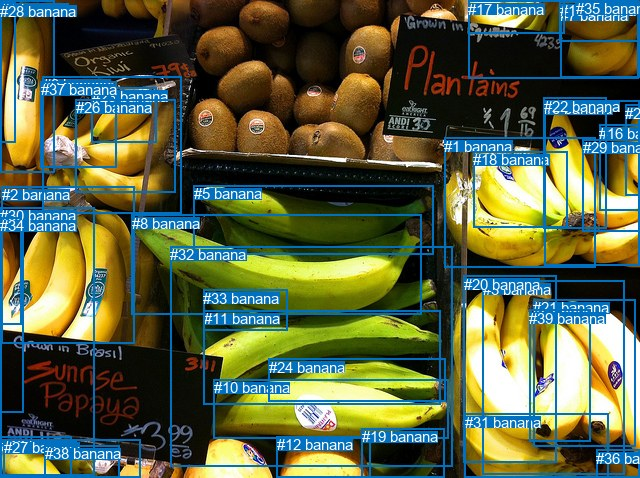
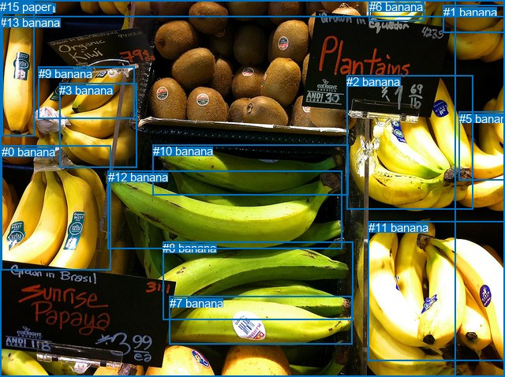

# 图片 1278：2374799.jpg

随机样本序号：193。图片 SHA256：`59b1da30af12f76b691990363e0d221050a59cf53fc4a97e776bcb00228c6c2a`。

红色框表示人，蓝色框表示其他物体。两个模式分别保留自身框编号，可依据位置比较对应对象。

## 自动检测框与输出

人的框编号：`[]`。状态：`no_person`。

### 自动检测全部物体框

| 编号 | 类别 | 是否为人 | 检测分数 | 像素坐标 xyxy |
|---|---|---|---|---|
| 0 | banana | False | 0.9777 | 468.6, 0.2, 638.5, 79.0 |
| 1 | banana | False | 0.9699 | 444.4, 137.7, 596.0, 268.0 |
| 2 | banana | False | 0.9668 | 2.0, 186.5, 134.3, 343.1 |
| 3 | banana | False | 0.9633 | 482.8, 280.9, 624.1, 474.4 |
| 4 | banana | False | 0.9598 | 0.6, 1.0, 54.0, 172.7 |
| 5 | banana | False | 0.9577 | 193.6, 185.5, 433.9, 254.4 |
| 6 | banana | False | 0.9506 | 544.2, 100.2, 640.0, 265.1 |
| 7 | banana | False | 0.9398 | 560.0, 6.6, 640.0, 77.4 |
| 8 | banana | False | 0.9325 | 131.8, 215.0, 421.5, 314.5 |
| 9 | banana | False | 0.9262 | 42.8, 76.4, 181.3, 213.4 |
| 10 | banana | False | 0.9251 | 213.5, 379.1, 448.3, 438.8 |
| 11 | banana | False | 0.9112 | 203.6, 310.3, 440.1, 404.7 |
| 12 | banana | False | 0.8791 | 276.6, 436.2, 370.9, 478.0 |
| 13 | banana | False | 0.7595 | 0.9, 437.0, 71.1, 477.3 |
| 14 | banana | False | 0.7484 | 0.4, 217.4, 23.9, 412.9 |
| 15 | banana | False | 0.7225 | 559.6, 1.7, 640.0, 41.1 |
| 16 | banana | False | 0.7204 | 599.4, 124.7, 639.1, 210.7 |
| 17 | banana | False | 0.7082 | 468.3, 0.5, 564.3, 33.0 |
| 18 | banana | False | 0.6760 | 473.3, 151.2, 567.0, 227.3 |
| 19 | banana | False | 0.6669 | 361.6, 428.2, 444.8, 477.3 |
| 20 | banana | False | 0.6434 | 463.7, 276.0, 556.9, 462.4 |
| 21 | banana | False | 0.6360 | 533.0, 299.3, 635.1, 446.0 |
| 22 | banana | False | 0.6347 | 543.9, 97.8, 606.0, 228.2 |
| 23 | banana | False | 0.6129 | 91.5, 87.9, 156.5, 142.5 |
| 24 | banana | False | 0.6089 | 268.5, 358.6, 445.4, 401.0 |
| 25 | banana | False | 0.6021 | 625.2, 104.7, 639.9, 195.1 |
| 26 | banana | False | 0.5798 | 75.5, 99.5, 175.3, 192.3 |
| 27 | banana | False | 0.5690 | 4.0, 439.3, 140.6, 478.0 |
| 28 | banana | False | 0.5680 | 0.3, 2.6, 15.5, 142.8 |
| 29 | banana | False | 0.5297 | 582.5, 139.4, 639.4, 231.9 |
| 30 | banana | False | 0.5147 | 0.0, 207.4, 94.3, 475.2 |
| 31 | banana | False | 0.4978 | 464.6, 413.9, 608.4, 477.6 |
| 32 | banana | False | 0.4783 | 170.2, 246.0, 452.7, 466.6 |
| 33 | banana | False | 0.4637 | 203.3, 289.7, 287.2, 330.7 |
| 34 | banana | False | 0.4548 | 0.4, 217.1, 21.3, 324.1 |
| 35 | banana | False | 0.4528 | 575.6, 0.1, 612.9, 12.7 |
| 36 | banana | False | 0.4513 | 596.4, 449.5, 640.0, 477.1 |
| 37 | banana | False | 0.4366 | 40.9, 81.3, 116.0, 168.0 |
| 38 | banana | False | 0.4304 | 44.9, 445.4, 119.4, 477.1 |
| 39 | banana | False | 0.3983 | 529.3, 309.7, 590.4, 441.4 |

### 自动检测 Top50 人相关候选

评分物体对：0；人相关物体对：0；输出关系：0。

| 排名 | 主语编号与类别 | 关系 | 宾语编号与类别 | 类型 | 人与人 | 排序分数 | 原始融合 logit |
|---|---|---|---|---|---|---|---|

### 自动检测逐条人相关 GT 核验

本图没有人相关 GT，R@50 无分母；预测候选继续展示。

## 真实框与输出

人的框编号：`[]`。

### 真实框全部物体框

| 编号 | 类别 | 是否为人 | 检测分数 | 像素坐标 xyxy |
|---|---|---|---|---|
| 0 | banana | False | GT | 2.0, 184.0, 140.0, 343.0 |
| 1 | banana | False | GT | 562.0, 7.0, 640.0, 41.0 |
| 2 | banana | False | GT | 439.0, 95.0, 599.0, 266.0 |
| 3 | banana | False | GT | 75.0, 106.0, 174.0, 213.0 |
| 4 | banana | False | GT | 2.0, 2.0, 44.0, 173.0 |
| 5 | banana | False | GT | 582.0, 142.0, 640.0, 228.0 |
| 6 | banana | False | GT | 468.0, 0.0, 538.0, 26.0 |
| 7 | banana | False | GT | 215.0, 376.0, 447.0, 437.0 |
| 8 | banana | False | GT | 206.0, 306.0, 447.0, 405.0 |
| 9 | banana | False | GT | 49.0, 85.0, 170.0, 151.0 |
| 10 | banana | False | GT | 194.0, 183.0, 441.0, 247.0 |
| 11 | banana | False | GT | 467.0, 280.0, 640.0, 457.0 |
| 12 | banana | False | GT | 137.0, 216.0, 434.0, 316.0 |
| 13 | banana | False | GT | 0.0, 20.0, 640.0, 478.0 |
| 14 | fruit | False | GT | 0.0, 0.0, 640.0, 478.0 |
| 15 | paper | False | GT | 0.0, 0.0, 578.0, 478.0 |

### 真实框 Top50 人相关候选

评分物体对：0；人相关物体对：0；输出关系：0。

| 排名 | 主语编号与类别 | 关系 | 宾语编号与类别 | 类型 | 人与人 | 排序分数 | 原始融合 logit |
|---|---|---|---|---|---|---|---|

### 真实框逐条人相关 GT 核验

本图没有人相关 GT，R@50 无分母；预测候选继续展示。

## 全部人相关 GT

| 主语编号与类别 | 关系 | 宾语编号与类别 |
|---|---|---|

原始记录、全部人相关物体对的两项预测与分项分数见 [逐图证据 JSON](../evidence/cases/1278.json)。全部56类 logits 保留于本机 HOR/output/random500/logits/。

<!-- HOR_COMPLETE_RESULTS -->

## 六组条件的完整输出对照

以下保留同一图片三种框与候选模式、两种谓词输出规则的全部 Top50。框编号各自在所属模式内解释。

### 自动检测框完整枚举：空间与语义各保留一个谓词

| 排名 | 主语编号与类别 | 谓词 | 宾语编号与类别 | 分组 | 排序分数 | predicate logit | pair logit |
|---|---|---|---|---|---|---|---|

没有人相关 GT，本条件的召回率无分母。

### 自动检测框完整枚举：每对只保留一个谓词

| 排名 | 主语编号与类别 | 谓词 | 宾语编号与类别 | 分组 | 排序分数 | predicate logit | pair logit |
|---|---|---|---|---|---|---|---|

没有人相关 GT，本条件的召回率无分母。

### 真实框完整枚举：空间与语义各保留一个谓词

| 排名 | 主语编号与类别 | 谓词 | 宾语编号与类别 | 分组 | 排序分数 | predicate logit | pair logit |
|---|---|---|---|---|---|---|---|

没有人相关 GT，本条件的召回率无分母。

### 真实框完整枚举：每对只保留一个谓词

| 排名 | 主语编号与类别 | 谓词 | 宾语编号与类别 | 分组 | 排序分数 | predicate logit | pair logit |
|---|---|---|---|---|---|---|---|

没有人相关 GT，本条件的召回率无分母。

### 真实框400候选：空间与语义各保留一个谓词

| 排名 | 主语编号与类别 | 谓词 | 宾语编号与类别 | 分组 | 排序分数 | predicate logit | pair logit |
|---|---|---|---|---|---|---|---|

没有人相关 GT，本条件的召回率无分母。

### 真实框400候选：每对只保留一个谓词

| 排名 | 主语编号与类别 | 谓词 | 宾语编号与类别 | 分组 | 排序分数 | predicate logit | pair logit |
|---|---|---|---|---|---|---|---|

没有人相关 GT，本条件的召回率无分母。
