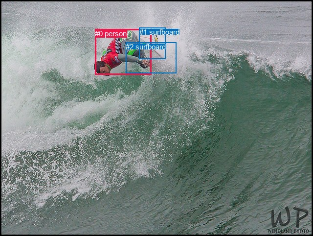
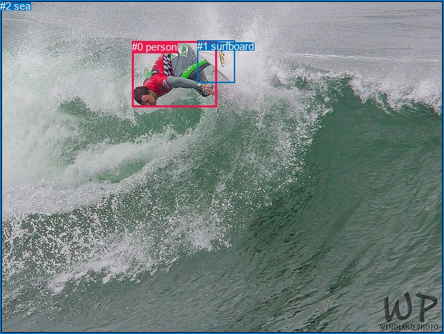

# 图片 1286：2375241.jpg

随机样本序号：157。图片 SHA256：`b088f1fc8e86da21084e8c98b7dc9406c0da61d74e740925af6a7adeda3c3f34`。

红色框表示人，蓝色框表示其他物体。两个模式分别保留自身框编号，可依据位置比较对应对象。

## 自动检测框与输出

人的框编号：`[0]`。状态：`ok`。

### 自动检测全部物体框

| 编号 | 类别 | 是否为人 | 检测分数 | 像素坐标 xyxy |
|---|---|---|---|---|
| 0 | person | True | 0.9984 | 194.3, 60.0, 309.5, 153.0 |
| 1 | surfboard | False | 0.9597 | 284.6, 56.7, 338.5, 120.4 |
| 2 | surfboard | False | 0.4364 | 257.0, 87.0, 360.1, 149.5 |

### 自动检测 Top50 人相关候选

评分物体对：6；人相关物体对：4；输出关系：8。

| 排名 | 主语编号与类别 | 关系 | 宾语编号与类别 | 类型 | 人与人 | 排序分数 | 原始融合 logit |
|---|---|---|---|---|---|---|---|
| 1 | #0 person | riding | #2 surfboard | semantic | False | 0.95862 | 3.1428 |
| 2 | #0 person | riding | #1 surfboard | semantic | False | 0.95229 | 2.9937 |
| 3 | #0 person | on | #2 surfboard | spatial | False | 0.89855 | 2.1812 |
| 4 | #0 person | on | #1 surfboard | spatial | False | 0.86154 | 1.8281 |
| 5 | #1 surfboard | in | #0 person | spatial | False | 0.30232 | -0.8363 |
| 6 | #2 surfboard | in | #0 person | spatial | False | 0.22176 | -1.2554 |
| 7 | #2 surfboard | wearing | #0 person | semantic | False | 0.16285 | -1.6372 |
| 8 | #1 surfboard | wearing | #0 person | semantic | False | 0.15341 | -1.7081 |

### 自动检测逐条人相关 GT 核验

R@50：0.00%；命中 0/3。

| GT 主语编号 | GT 关系 | GT 宾语编号 | 结果阶段 | 匹配预测主语编号 | 匹配预测宾语编号 |
|---|---|---|---|---|---|
| 0 | standing on | 1 | wrong_predicate | [0] | [1] |
| 0 | playing | 1 | wrong_predicate | [0] | [1] |
| 0 | looking at | 2 | endpoint_missing_or_wrong_class | [0] | [] |

## 真实框与输出

人的框编号：`[0]`。

### 真实框全部物体框

| 编号 | 类别 | 是否为人 | 检测分数 | 像素坐标 xyxy |
|---|---|---|---|---|
| 0 | person | True | GT | 190.0, 59.0, 312.0, 154.0 |
| 1 | surfboard | False | GT | 284.0, 58.0, 338.0, 119.0 |
| 2 | sea | False | GT | 0.0, 0.0, 640.0, 482.0 |

### 真实框 Top50 人相关候选

评分物体对：6；人相关物体对：4；输出关系：8。

| 排名 | 主语编号与类别 | 关系 | 宾语编号与类别 | 类型 | 人与人 | 排序分数 | 原始融合 logit |
|---|---|---|---|---|---|---|---|
| 1 | #0 person | in | #2 sea | spatial | False | 0.96623 | 3.3539 |
| 2 | #0 person | on | #1 surfboard | spatial | False | 0.94350 | 2.8154 |
| 3 | #0 person | riding | #1 surfboard | semantic | False | 0.91883 | 2.4266 |
| 4 | #1 surfboard | beside | #0 person | spatial | False | 0.81169 | 1.4610 |
| 5 | #0 person | riding | #2 sea | semantic | False | 0.77965 | 1.2636 |
| 6 | #1 surfboard | holding | #0 person | semantic | False | 0.36779 | -0.5417 |
| 7 | #2 sea | beside | #0 person | spatial | False | 0.30864 | -0.8065 |
| 8 | #2 sea | catching | #0 person | semantic | False | 0.08788 | -2.3398 |

### 真实框逐条人相关 GT 核验

R@50：0.00%；命中 0/3。

| GT 主语编号 | GT 关系 | GT 宾语编号 | 结果阶段 | 匹配预测主语编号 | 匹配预测宾语编号 |
|---|---|---|---|---|---|
| 0 | standing on | 1 | wrong_predicate | [0] | [1] |
| 0 | playing | 1 | wrong_predicate | [0] | [1] |
| 0 | looking at | 2 | wrong_predicate | [0] | [2] |

## 全部人相关 GT

| 主语编号与类别 | 关系 | 宾语编号与类别 |
|---|---|---|
| #0 person | standing on | #1 surfboard |
| #0 person | playing | #1 surfboard |
| #0 person | looking at | #2 sea |

原始记录、全部人相关物体对的两项预测与分项分数见 [逐图证据 JSON](../evidence/cases/1286.json)。全部56类 logits 保留于本机 HOR/output/random500/logits/。

<!-- HOR_COMPLETE_RESULTS -->

## 六组条件的完整输出对照

以下保留同一图片三种框与候选模式、两种谓词输出规则的全部 Top50。框编号各自在所属模式内解释。

### 自动检测框完整枚举：空间与语义各保留一个谓词

| 排名 | 主语编号与类别 | 谓词 | 宾语编号与类别 | 分组 | 排序分数 | predicate logit | pair logit |
|---|---|---|---|---|---|---|---|
| 1 | #0 person | riding | #2 surfboard | semantic | 0.9586229 | 4.4230380 | -1.2802682 |
| 2 | #0 person | riding | #1 surfboard | semantic | 0.9522880 | 4.1226144 | -1.1289299 |
| 3 | #0 person | on | #2 surfboard | spatial | 0.8985451 | 3.4614310 | -1.2802682 |
| 4 | #0 person | on | #1 surfboard | spatial | 0.8615357 | 2.9570336 | -1.1289299 |
| 5 | #1 surfboard | in | #0 person | spatial | 0.3023224 | 0.1719661 | -1.0082293 |
| 6 | #2 surfboard | in | #0 person | spatial | 0.2217586 | 0.1292672 | -1.3847144 |
| 7 | #2 surfboard | wearing | #0 person | semantic | 0.1628500 | -0.2524595 | -1.3847144 |
| 8 | #1 surfboard | wearing | #0 person | semantic | 0.1534143 | -0.6998401 | -1.0082293 |

GT 命中：0/3，R@50=0.00%。

| GT主语 | GT谓词 | GT宾语 | 结果阶段 | 匹配主语框 | 匹配宾语框 |
|---|---|---|---|---|---|
| 0 | standing on | 1 | wrong_predicate | [0] | [1] |
| 0 | playing | 1 | wrong_predicate | [0] | [1] |
| 0 | looking at | 2 | endpoint_missing_or_wrong_class | [0] | [] |

### 自动检测框完整枚举：每对只保留一个谓词

| 排名 | 主语编号与类别 | 谓词 | 宾语编号与类别 | 分组 | 排序分数 | predicate logit | pair logit |
|---|---|---|---|---|---|---|---|
| 1 | #0 person | riding | #2 surfboard | single | 0.9586229 | 4.4230380 | -1.2802682 |
| 2 | #0 person | riding | #1 surfboard | single | 0.9522880 | 4.1226144 | -1.1289299 |
| 3 | #1 surfboard | in | #0 person | single | 0.3023224 | 0.1719661 | -1.0082293 |
| 4 | #2 surfboard | in | #0 person | single | 0.2217586 | 0.1292672 | -1.3847144 |

GT 命中：0/3，R@50=0.00%。

| GT主语 | GT谓词 | GT宾语 | 结果阶段 | 匹配主语框 | 匹配宾语框 |
|---|---|---|---|---|---|
| 0 | standing on | 1 | wrong_predicate | [0] | [1] |
| 0 | playing | 1 | wrong_predicate | [0] | [1] |
| 0 | looking at | 2 | endpoint_missing_or_wrong_class | [0] | [] |

### 真实框完整枚举：空间与语义各保留一个谓词

| 排名 | 主语编号与类别 | 谓词 | 宾语编号与类别 | 分组 | 排序分数 | predicate logit | pair logit |
|---|---|---|---|---|---|---|---|
| 1 | #0 person | in | #2 sea | spatial | 0.9662339 | 4.2648416 | -0.9108928 |
| 2 | #0 person | on | #1 surfboard | spatial | 0.9435043 | 3.9159570 | -1.1005214 |
| 3 | #0 person | riding | #1 surfboard | semantic | 0.9188349 | 3.5271430 | -1.1005214 |
| 4 | #1 surfboard | beside | #0 person | spatial | 0.8116897 | 2.4206581 | -0.9596311 |
| 5 | #0 person | riding | #2 sea | semantic | 0.7796469 | 2.1745024 | -0.9108928 |
| 6 | #1 surfboard | holding | #0 person | semantic | 0.3677905 | 0.4179239 | -0.9596311 |
| 7 | #2 sea | beside | #0 person | spatial | 0.3086424 | 0.7096782 | -1.5161519 |
| 8 | #2 sea | catching | #0 person | semantic | 0.0878790 | -0.8236601 | -1.5161519 |

GT 命中：0/3，R@50=0.00%。

| GT主语 | GT谓词 | GT宾语 | 结果阶段 | 匹配主语框 | 匹配宾语框 |
|---|---|---|---|---|---|
| 0 | standing on | 1 | wrong_predicate | [0] | [1] |
| 0 | playing | 1 | wrong_predicate | [0] | [1] |
| 0 | looking at | 2 | wrong_predicate | [0] | [2] |

### 真实框完整枚举：每对只保留一个谓词

| 排名 | 主语编号与类别 | 谓词 | 宾语编号与类别 | 分组 | 排序分数 | predicate logit | pair logit |
|---|---|---|---|---|---|---|---|
| 1 | #0 person | in | #2 sea | single | 0.9662339 | 4.2648416 | -0.9108928 |
| 2 | #0 person | on | #1 surfboard | single | 0.9435043 | 3.9159570 | -1.1005214 |
| 3 | #1 surfboard | beside | #0 person | single | 0.8116897 | 2.4206581 | -0.9596311 |
| 4 | #2 sea | beside | #0 person | single | 0.3086424 | 0.7096782 | -1.5161519 |

GT 命中：0/3，R@50=0.00%。

| GT主语 | GT谓词 | GT宾语 | 结果阶段 | 匹配主语框 | 匹配宾语框 |
|---|---|---|---|---|---|
| 0 | standing on | 1 | wrong_predicate | [0] | [1] |
| 0 | playing | 1 | wrong_predicate | [0] | [1] |
| 0 | looking at | 2 | wrong_predicate | [0] | [2] |

### 真实框400候选：空间与语义各保留一个谓词

| 排名 | 主语编号与类别 | 谓词 | 宾语编号与类别 | 分组 | 排序分数 | predicate logit | pair logit |
|---|---|---|---|---|---|---|---|
| 1 | #0 person | in | #2 sea | spatial | 0.9664497 | 4.2714791 | -0.9108928 |
| 2 | #0 person | on | #1 surfboard | spatial | 0.9435043 | 3.9159570 | -1.1005214 |
| 3 | #0 person | riding | #1 surfboard | semantic | 0.9188349 | 3.5271430 | -1.1005214 |
| 4 | #1 surfboard | beside | #0 person | spatial | 0.8116897 | 2.4206581 | -0.9596311 |
| 5 | #0 person | riding | #2 sea | semantic | 0.7796469 | 2.1745024 | -0.9108928 |
| 6 | #1 surfboard | holding | #0 person | semantic | 0.3664178 | 0.4120154 | -0.9596311 |
| 7 | #2 sea | beside | #0 person | spatial | 0.3086424 | 0.7096782 | -1.5161519 |
| 8 | #2 sea | catching | #0 person | semantic | 0.0877734 | -0.8249779 | -1.5161519 |

GT 命中：0/3，R@50=0.00%。

| GT主语 | GT谓词 | GT宾语 | 结果阶段 | 匹配主语框 | 匹配宾语框 |
|---|---|---|---|---|---|
| 0 | standing on | 1 | wrong_predicate | [0] | [1] |
| 0 | playing | 1 | wrong_predicate | [0] | [1] |
| 0 | looking at | 2 | wrong_predicate | [0] | [2] |

### 真实框400候选：每对只保留一个谓词

| 排名 | 主语编号与类别 | 谓词 | 宾语编号与类别 | 分组 | 排序分数 | predicate logit | pair logit |
|---|---|---|---|---|---|---|---|
| 1 | #0 person | in | #2 sea | single | 0.9664497 | 4.2714791 | -0.9108928 |
| 2 | #0 person | on | #1 surfboard | single | 0.9435043 | 3.9159570 | -1.1005214 |
| 3 | #1 surfboard | beside | #0 person | single | 0.8116897 | 2.4206581 | -0.9596311 |
| 4 | #2 sea | beside | #0 person | single | 0.3086424 | 0.7096782 | -1.5161519 |

GT 命中：0/3，R@50=0.00%。

| GT主语 | GT谓词 | GT宾语 | 结果阶段 | 匹配主语框 | 匹配宾语框 |
|---|---|---|---|---|---|
| 0 | standing on | 1 | wrong_predicate | [0] | [1] |
| 0 | playing | 1 | wrong_predicate | [0] | [1] |
| 0 | looking at | 2 | wrong_predicate | [0] | [2] |
