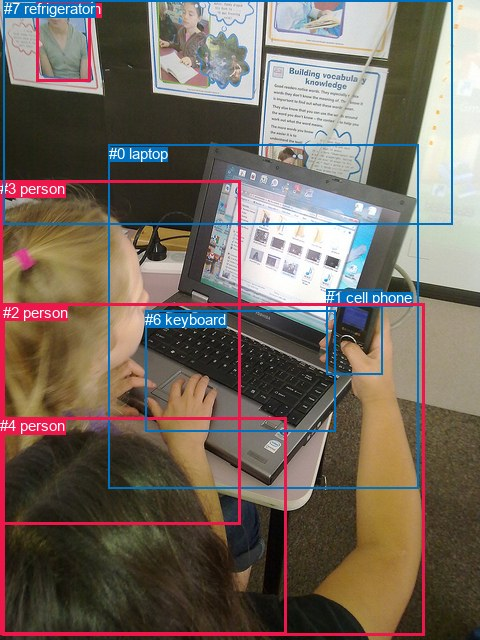
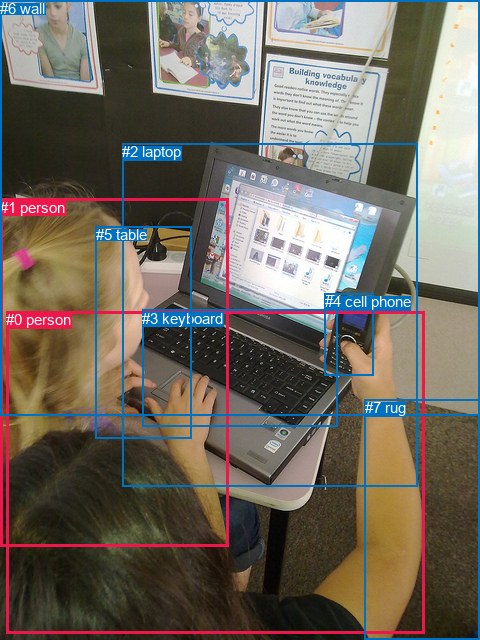

# 图片 1293：2375622.jpg

随机样本序号：127。图片 SHA256：`ba7802a366dfb88aeb301abd2d4f938158a3880d62f46d9908220127a7013bfa`。

红色框表示人，蓝色框表示其他物体。两个模式分别保留自身框编号，可依据位置比较对应对象。

## 自动检测框与输出

人的框编号：`[2, 3, 4, 5]`。状态：`ok`。

### 自动检测全部物体框

| 编号 | 类别 | 是否为人 | 检测分数 | 像素坐标 xyxy |
|---|---|---|---|---|
| 0 | laptop | False | 0.9998 | 108.9, 144.8, 418.6, 488.1 |
| 1 | cell phone | False | 0.9950 | 326.4, 289.0, 382.7, 374.1 |
| 2 | person | True | 0.9915 | 2.7, 303.9, 424.4, 635.8 |
| 3 | person | True | 0.9512 | 0.5, 180.4, 240.1, 525.0 |
| 4 | person | True | 0.7984 | 0.0, 417.3, 286.7, 635.0 |
| 5 | person | True | 0.7880 | 36.2, 0.0, 90.8, 81.6 |
| 6 | keyboard | False | 0.5741 | 145.0, 310.6, 336.0, 431.5 |
| 7 | refrigerator | False | 0.4143 | 3.7, 0.0, 452.6, 224.3 |

### 自动检测 Top50 人相关候选

评分物体对：56；人相关物体对：44；输出关系：50。

| 排名 | 主语编号与类别 | 关系 | 宾语编号与类别 | 类型 | 人与人 | 排序分数 | 原始融合 logit |
|---|---|---|---|---|---|---|---|
| 1 | #2 person | holding | #1 cell phone | semantic | False | 0.97682 | 3.7411 |
| 2 | #5 person | on | #7 refrigerator | spatial | False | 0.97402 | 3.6242 |
| 3 | #3 person | holding | #0 laptop | semantic | False | 0.95246 | 2.9976 |
| 4 | #2 person | holding | #0 laptop | semantic | False | 0.94478 | 2.8397 |
| 5 | #2 person | on | #0 laptop | spatial | False | 0.91563 | 2.3844 |
| 6 | #4 person | on | #2 person | spatial | True | 0.91205 | 2.3390 |
| 7 | #3 person | on | #0 laptop | spatial | False | 0.88328 | 2.0239 |
| 8 | #4 person | on | #3 person | spatial | True | 0.79102 | 1.3311 |
| 9 | #2 person | in | #4 person | spatial | True | 0.77716 | 1.2492 |
| 10 | #2 person | wearing | #4 person | semantic | True | 0.71838 | 0.9365 |
| 11 | #2 person | holding | #6 keyboard | semantic | False | 0.67751 | 0.7423 |
| 12 | #2 person | in | #3 person | spatial | True | 0.64001 | 0.5754 |
| 13 | #3 person | holding | #6 keyboard | semantic | False | 0.62161 | 0.4964 |
| 14 | #5 person | standing on | #7 refrigerator | semantic | False | 0.60402 | 0.4222 |
| 15 | #3 person | in | #2 person | spatial | True | 0.59548 | 0.3867 |
| 16 | #3 person | wearing | #4 person | semantic | True | 0.57432 | 0.2995 |
| 17 | #2 person | on | #1 cell phone | spatial | False | 0.57123 | 0.2869 |
| 18 | #2 person | on | #6 keyboard | spatial | False | 0.55260 | 0.2112 |
| 19 | #2 person | holding | #3 person | semantic | True | 0.49724 | -0.0111 |
| 20 | #3 person | holding | #1 cell phone | semantic | False | 0.47383 | -0.1048 |
| 21 | #3 person | in | #4 person | spatial | True | 0.43043 | -0.2801 |
| 22 | #3 person | on | #6 keyboard | spatial | False | 0.39503 | -0.4262 |
| 23 | #3 person | wearing | #2 person | semantic | True | 0.32224 | -0.7435 |
| 24 | #4 person | wearing | #2 person | semantic | True | 0.17620 | -1.5423 |
| 25 | #0 laptop | in | #3 person | spatial | False | 0.13840 | -1.8287 |
| 26 | #4 person | holding | #3 person | semantic | True | 0.13609 | -1.8481 |
| 27 | #1 cell phone | on | #2 person | spatial | False | 0.13272 | -1.8772 |
| 28 | #0 laptop | in | #2 person | spatial | False | 0.12687 | -1.9289 |
| 29 | #1 cell phone | holding | #2 person | semantic | False | 0.09699 | -2.2311 |
| 30 | #7 refrigerator | in | #5 person | spatial | False | 0.09319 | -2.2753 |
| 31 | #3 person | beside | #7 refrigerator | spatial | False | 0.08838 | -2.3335 |
| 32 | #5 person | on | #0 laptop | spatial | False | 0.08578 | -2.3663 |
| 33 | #7 refrigerator | holding | #5 person | semantic | False | 0.06282 | -2.7026 |
| 34 | #4 person | holding | #0 laptop | semantic | False | 0.06178 | -2.7204 |
| 35 | #0 laptop | holding | #2 person | semantic | False | 0.06025 | -2.7470 |
| 36 | #4 person | on | #0 laptop | spatial | False | 0.06015 | -2.7490 |
| 37 | #5 person | looking at | #0 laptop | semantic | False | 0.05490 | -2.8458 |
| 38 | #3 person | on | #1 cell phone | spatial | False | 0.04921 | -2.9611 |
| 39 | #0 laptop | holding | #3 person | semantic | False | 0.04091 | -3.1547 |
| 40 | #5 person | on | #3 person | spatial | True | 0.04002 | -3.1775 |
| 41 | #3 person | looking at | #7 refrigerator | semantic | False | 0.03710 | -3.2564 |
| 42 | #6 keyboard | on | #2 person | spatial | False | 0.03195 | -3.4112 |
| 43 | #7 refrigerator | beside | #3 person | spatial | False | 0.03157 | -3.4234 |
| 44 | #6 keyboard | on | #3 person | spatial | False | 0.02963 | -3.4888 |
| 45 | #4 person | holding | #6 keyboard | semantic | False | 0.01978 | -3.9030 |
| 46 | #2 person | in | #7 refrigerator | spatial | False | 0.01787 | -4.0065 |
| 47 | #1 cell phone | on | #3 person | spatial | False | 0.01616 | -4.1089 |
| 48 | #4 person | holding | #1 cell phone | semantic | False | 0.01504 | -4.1820 |
| 49 | #0 laptop | in | #4 person | spatial | False | 0.01135 | -4.4674 |
| 50 | #5 person | looking at | #3 person | semantic | True | 0.01059 | -4.5371 |

### 自动检测逐条人相关 GT 核验

R@50：33.33%；命中 1/3。

| GT 主语编号 | GT 关系 | GT 宾语编号 | 结果阶段 | 匹配预测主语编号 | 匹配预测宾语编号 |
|---|---|---|---|---|---|
| 0 | holding | 4 | hit50 | [2] | [1] |
| 1 | looking at | 2 | wrong_predicate | [3] | [0] |
| 1 | touching | 2 | wrong_predicate | [3] | [0] |

## 真实框与输出

人的框编号：`[0, 1]`。

### 真实框全部物体框

| 编号 | 类别 | 是否为人 | 检测分数 | 像素坐标 xyxy |
|---|---|---|---|---|
| 0 | person | True | GT | 6.0, 311.0, 425.0, 634.0 |
| 1 | person | True | GT | 0.0, 199.0, 229.0, 547.0 |
| 2 | laptop | False | GT | 122.0, 143.0, 417.0, 486.0 |
| 3 | keyboard | False | GT | 142.0, 310.0, 338.0, 427.0 |
| 4 | cell phone | False | GT | 325.0, 293.0, 374.0, 375.0 |
| 5 | table | False | GT | 96.0, 226.0, 191.0, 438.0 |
| 6 | wall | False | GT | 0.0, 0.0, 480.0, 416.0 |
| 7 | rug | False | GT | 365.0, 399.0, 480.0, 640.0 |

### 真实框 Top50 人相关候选

评分物体对：56；人相关物体对：26；输出关系：50。

| 排名 | 主语编号与类别 | 关系 | 宾语编号与类别 | 类型 | 人与人 | 排序分数 | 原始融合 logit |
|---|---|---|---|---|---|---|---|
| 1 | #0 person | holding | #4 cell phone | semantic | False | 0.96622 | 3.3536 |
| 2 | #1 person | holding | #2 laptop | semantic | False | 0.93635 | 2.6886 |
| 3 | #0 person | holding | #2 laptop | semantic | False | 0.93250 | 2.6257 |
| 4 | #0 person | on | #2 laptop | spatial | False | 0.91811 | 2.4170 |
| 5 | #0 person | touching | #5 table | semantic | False | 0.89008 | 2.0916 |
| 6 | #1 person | on | #2 laptop | spatial | False | 0.87652 | 1.9599 |
| 7 | #0 person | sitting on | #7 rug | semantic | False | 0.86645 | 1.8699 |
| 8 | #0 person | on | #7 rug | spatial | False | 0.82102 | 1.5232 |
| 9 | #1 person | touching | #5 table | semantic | False | 0.79416 | 1.3502 |
| 10 | #0 person | holding | #3 keyboard | semantic | False | 0.66836 | 0.7008 |
| 11 | #1 person | on | #5 table | spatial | False | 0.65231 | 0.6292 |
| 12 | #0 person | on | #5 table | spatial | False | 0.64287 | 0.5879 |
| 13 | #1 person | holding | #3 keyboard | semantic | False | 0.64097 | 0.5796 |
| 14 | #0 person | on | #3 keyboard | spatial | False | 0.62352 | 0.5045 |
| 15 | #0 person | in | #1 person | spatial | True | 0.58294 | 0.3348 |
| 16 | #1 person | holding | #4 cell phone | semantic | False | 0.57736 | 0.3120 |
| 17 | #0 person | on | #4 cell phone | spatial | False | 0.57471 | 0.3011 |
| 18 | #1 person | on | #3 keyboard | spatial | False | 0.50768 | 0.0307 |
| 19 | #1 person | in | #0 person | spatial | True | 0.42625 | -0.2972 |
| 20 | #1 person | in | #6 wall | spatial | False | 0.40427 | -0.3877 |
| 21 | #1 person | on | #7 rug | spatial | False | 0.40103 | -0.4012 |
| 22 | #1 person | sitting on | #7 rug | semantic | False | 0.38716 | -0.4593 |
| 23 | #5 table | on | #1 person | spatial | False | 0.37002 | -0.5321 |
| 24 | #0 person | holding | #1 person | semantic | True | 0.33673 | -0.6779 |
| 25 | #1 person | looking at | #6 wall | semantic | False | 0.27040 | -0.9926 |
| 26 | #1 person | wearing | #0 person | semantic | True | 0.23483 | -1.1812 |
| 27 | #0 person | looking at | #6 wall | semantic | False | 0.22128 | -1.2582 |
| 28 | #7 rug | beside | #0 person | spatial | False | 0.19238 | -1.4346 |
| 29 | #0 person | in | #6 wall | spatial | False | 0.13491 | -1.8582 |
| 30 | #2 laptop | in | #1 person | spatial | False | 0.12594 | -1.9374 |
| 31 | #1 person | on | #4 cell phone | spatial | False | 0.09778 | -2.2221 |
| 32 | #6 wall | on | #1 person | spatial | False | 0.09345 | -2.2722 |
| 33 | #4 cell phone | on | #0 person | spatial | False | 0.09216 | -2.2875 |
| 34 | #2 laptop | in | #0 person | spatial | False | 0.09022 | -2.3110 |
| 35 | #7 rug | beside | #1 person | spatial | False | 0.08851 | -2.3320 |
| 36 | #5 table | on | #0 person | spatial | False | 0.07849 | -2.4631 |
| 37 | #4 cell phone | holding | #0 person | semantic | False | 0.05561 | -2.8322 |
| 38 | #2 laptop | holding | #0 person | semantic | False | 0.05179 | -2.9074 |
| 39 | #2 laptop | holding | #1 person | semantic | False | 0.04595 | -3.0331 |
| 40 | #7 rug | holding | #0 person | semantic | False | 0.04563 | -3.0406 |
| 41 | #4 cell phone | on | #1 person | spatial | False | 0.03933 | -3.1958 |
| 42 | #3 keyboard | on | #1 person | spatial | False | 0.03874 | -3.2113 |
| 43 | #5 table | holding | #1 person | semantic | False | 0.02669 | -3.5964 |
| 44 | #6 wall | on | #0 person | spatial | False | 0.02569 | -3.6355 |
| 45 | #3 keyboard | on | #0 person | spatial | False | 0.02492 | -3.6670 |
| 46 | #7 rug | holding | #1 person | semantic | False | 0.02238 | -3.7768 |
| 47 | #6 wall | holding | #1 person | semantic | False | 0.01455 | -4.2154 |
| 48 | #5 table | holding | #0 person | semantic | False | 0.01340 | -4.2993 |
| 49 | #4 cell phone | holding | #1 person | semantic | False | 0.01161 | -4.4440 |
| 50 | #6 wall | holding | #0 person | semantic | False | 0.00521 | -5.2522 |

### 真实框逐条人相关 GT 核验

R@50：33.33%；命中 1/3。

| GT 主语编号 | GT 关系 | GT 宾语编号 | 结果阶段 | 匹配预测主语编号 | 匹配预测宾语编号 |
|---|---|---|---|---|---|
| 0 | holding | 4 | hit50 | [0] | [4] |
| 1 | looking at | 2 | wrong_predicate | [1] | [2] |
| 1 | touching | 2 | wrong_predicate | [1] | [2] |

## 全部人相关 GT

| 主语编号与类别 | 关系 | 宾语编号与类别 |
|---|---|---|
| #0 person | holding | #4 cell phone |
| #1 person | looking at | #2 laptop |
| #1 person | touching | #2 laptop |

原始记录、全部人相关物体对的两项预测与分项分数见 [逐图证据 JSON](../evidence/cases/1293.json)。全部56类 logits 保留于本机 HOR/output/random500/logits/。

<!-- HOR_COMPLETE_RESULTS -->

## 六组条件的完整输出对照

以下保留同一图片三种框与候选模式、两种谓词输出规则的全部 Top50。框编号各自在所属模式内解释。

### 自动检测框完整枚举：空间与语义各保留一个谓词

| 排名 | 主语编号与类别 | 谓词 | 宾语编号与类别 | 分组 | 排序分数 | predicate logit | pair logit |
|---|---|---|---|---|---|---|---|
| 1 | #2 person | holding | #1 cell phone | semantic | 0.9768230 | 3.9357762 | -0.1946316 |
| 2 | #5 person | on | #7 refrigerator | spatial | 0.9740222 | 3.6076293 | 0.0165591 |
| 3 | #3 person | holding | #0 laptop | semantic | 0.9524643 | 2.9425554 | 0.0550162 |
| 4 | #2 person | holding | #0 laptop | semantic | 0.9447846 | 2.6239176 | 0.2157966 |
| 5 | #2 person | on | #0 laptop | spatial | 0.9156305 | 2.1686091 | 0.2157966 |
| 6 | #4 person | on | #2 person | spatial | 0.9120539 | 2.6974206 | -0.3584451 |
| 7 | #3 person | on | #0 laptop | spatial | 0.8832813 | 1.9688601 | 0.0550162 |
| 8 | #4 person | on | #3 person | spatial | 0.7910187 | 1.6743178 | -0.3432411 |
| 9 | #2 person | in | #4 person | spatial | 0.7771553 | 1.2140903 | 0.0350748 |
| 10 | #2 person | wearing | #4 person | semantic | 0.7183842 | 0.9013858 | 0.0350748 |
| 11 | #2 person | holding | #6 keyboard | semantic | 0.6775069 | 1.3800459 | -0.6377082 |
| 12 | #2 person | in | #3 person | spatial | 0.6400119 | 1.0070133 | -0.4315975 |
| 13 | #3 person | holding | #6 keyboard | semantic | 0.6216139 | 1.3198638 | -0.8234598 |
| 14 | #5 person | standing on | #7 refrigerator | semantic | 0.6040187 | 0.4056792 | 0.0165591 |
| 15 | #3 person | in | #2 person | spatial | 0.5954779 | 0.9687262 | -0.5820683 |
| 16 | #3 person | wearing | #4 person | semantic | 0.5743227 | 0.5652661 | -0.2657563 |
| 17 | #2 person | on | #1 cell phone | spatial | 0.5712294 | 0.4815006 | -0.1946316 |
| 18 | #2 person | on | #6 keyboard | spatial | 0.5526049 | 0.8489094 | -0.6377082 |
| 19 | #2 person | holding | #3 person | semantic | 0.4972355 | 0.4205394 | -0.4315975 |
| 20 | #3 person | holding | #1 cell phone | semantic | 0.4738278 | 0.6072750 | -0.7120594 |
| 21 | #3 person | in | #4 person | spatial | 0.4304329 | -0.0143290 | -0.2657563 |
| 22 | #3 person | on | #6 keyboard | spatial | 0.3950319 | 0.3972507 | -0.8234598 |
| 23 | #3 person | wearing | #2 person | semantic | 0.3222386 | -0.1614347 | -0.5820683 |
| 24 | #4 person | wearing | #2 person | semantic | 0.1762023 | -1.1838467 | -0.3584451 |
| 25 | #0 laptop | in | #3 person | spatial | 0.1383960 | -0.5374956 | -1.2911814 |
| 26 | #4 person | holding | #3 person | semantic | 0.1360934 | -1.5048821 | -0.3432411 |
| 27 | #1 cell phone | on | #2 person | spatial | 0.1327156 | -1.0959589 | -0.7811998 |
| 28 | #0 laptop | in | #2 person | spatial | 0.1268726 | -0.5908179 | -1.3380803 |
| 29 | #1 cell phone | holding | #2 person | semantic | 0.0969897 | -1.4499290 | -0.7811998 |
| 30 | #7 refrigerator | in | #5 person | spatial | 0.0931867 | -0.9833398 | -1.2919922 |
| 31 | #3 person | beside | #7 refrigerator | spatial | 0.0883850 | -0.7376943 | -1.5958213 |
| 32 | #5 person | on | #0 laptop | spatial | 0.0857790 | -1.4050674 | -0.9612300 |
| 33 | #7 refrigerator | holding | #5 person | semantic | 0.0628208 | -1.4105959 | -1.2919922 |
| 34 | #4 person | holding | #0 laptop | semantic | 0.0617799 | -1.6039283 | -1.1164777 |
| 35 | #0 laptop | holding | #2 person | semantic | 0.0602546 | -1.4089491 | -1.3380803 |
| 36 | #4 person | on | #0 laptop | spatial | 0.0601458 | -1.6324749 | -1.1164777 |
| 37 | #5 person | looking at | #0 laptop | semantic | 0.0549010 | -1.8845282 | -0.9612300 |
| 38 | #3 person | on | #1 cell phone | spatial | 0.0492131 | -2.2490699 | -0.7120594 |
| 39 | #0 laptop | holding | #3 person | semantic | 0.0409058 | -1.8635366 | -1.2911814 |
| 40 | #5 person | on | #3 person | spatial | 0.0400208 | -2.4009044 | -0.7766085 |
| 41 | #3 person | looking at | #7 refrigerator | semantic | 0.0370985 | -1.6605542 | -1.5958213 |
| 42 | #6 keyboard | on | #2 person | spatial | 0.0319476 | -1.7797172 | -1.6314714 |
| 43 | #7 refrigerator | beside | #3 person | spatial | 0.0315725 | -2.0605671 | -1.3628201 |
| 44 | #6 keyboard | on | #3 person | spatial | 0.0296324 | -1.9351258 | -1.5536804 |
| 45 | #4 person | holding | #6 keyboard | semantic | 0.0197811 | -2.0275061 | -1.8755409 |
| 46 | #2 person | in | #7 refrigerator | spatial | 0.0178723 | -2.0664427 | -1.9400275 |
| 47 | #1 cell phone | on | #3 person | spatial | 0.0161602 | -2.9070091 | -1.2019039 |
| 48 | #4 person | holding | #1 cell phone | semantic | 0.0150385 | -2.1734660 | -2.0085249 |
| 49 | #0 laptop | in | #4 person | spatial | 0.0113464 | -2.5662165 | -1.9012234 |
| 50 | #5 person | looking at | #3 person | semantic | 0.0105915 | -3.7604482 | -0.7766085 |

GT 命中：1/3，R@50=33.33%。

| GT主语 | GT谓词 | GT宾语 | 结果阶段 | 匹配主语框 | 匹配宾语框 |
|---|---|---|---|---|---|
| 0 | holding | 4 | hit50 | [2] | [1] |
| 1 | looking at | 2 | wrong_predicate | [3] | [0] |
| 1 | touching | 2 | wrong_predicate | [3] | [0] |

### 自动检测框完整枚举：每对只保留一个谓词

| 排名 | 主语编号与类别 | 谓词 | 宾语编号与类别 | 分组 | 排序分数 | predicate logit | pair logit |
|---|---|---|---|---|---|---|---|
| 1 | #2 person | holding | #1 cell phone | single | 0.9768230 | 3.9357762 | -0.1946316 |
| 2 | #5 person | on | #7 refrigerator | single | 0.9740222 | 3.6076293 | 0.0165591 |
| 3 | #3 person | holding | #0 laptop | single | 0.9524643 | 2.9425554 | 0.0550162 |
| 4 | #2 person | holding | #0 laptop | single | 0.9447846 | 2.6239176 | 0.2157966 |
| 5 | #4 person | on | #2 person | single | 0.9120539 | 2.6974206 | -0.3584451 |
| 6 | #4 person | on | #3 person | single | 0.7910187 | 1.6743178 | -0.3432411 |
| 7 | #2 person | in | #4 person | single | 0.7771553 | 1.2140903 | 0.0350748 |
| 8 | #2 person | holding | #6 keyboard | single | 0.6775069 | 1.3800459 | -0.6377082 |
| 9 | #2 person | in | #3 person | single | 0.6400119 | 1.0070133 | -0.4315975 |
| 10 | #3 person | holding | #6 keyboard | single | 0.6216139 | 1.3198638 | -0.8234598 |
| 11 | #3 person | in | #2 person | single | 0.5954779 | 0.9687262 | -0.5820683 |
| 12 | #3 person | wearing | #4 person | single | 0.5743227 | 0.5652661 | -0.2657563 |
| 13 | #3 person | holding | #1 cell phone | single | 0.4738278 | 0.6072750 | -0.7120594 |
| 14 | #0 laptop | in | #3 person | single | 0.1383960 | -0.5374956 | -1.2911814 |
| 15 | #1 cell phone | on | #2 person | single | 0.1327156 | -1.0959589 | -0.7811998 |
| 16 | #0 laptop | in | #2 person | single | 0.1268726 | -0.5908179 | -1.3380803 |
| 17 | #7 refrigerator | in | #5 person | single | 0.0931867 | -0.9833398 | -1.2919922 |
| 18 | #3 person | beside | #7 refrigerator | single | 0.0883850 | -0.7376943 | -1.5958213 |
| 19 | #5 person | on | #0 laptop | single | 0.0857790 | -1.4050674 | -0.9612300 |
| 20 | #4 person | holding | #0 laptop | single | 0.0617799 | -1.6039283 | -1.1164777 |
| 21 | #5 person | on | #3 person | single | 0.0400208 | -2.4009044 | -0.7766085 |
| 22 | #6 keyboard | on | #2 person | single | 0.0319476 | -1.7797172 | -1.6314714 |
| 23 | #7 refrigerator | beside | #3 person | single | 0.0315725 | -2.0605671 | -1.3628201 |
| 24 | #6 keyboard | on | #3 person | single | 0.0296324 | -1.9351258 | -1.5536804 |
| 25 | #4 person | holding | #6 keyboard | single | 0.0197811 | -2.0275061 | -1.8755409 |
| 26 | #2 person | in | #7 refrigerator | single | 0.0178723 | -2.0664427 | -1.9400275 |
| 27 | #1 cell phone | on | #3 person | single | 0.0161602 | -2.9070091 | -1.2019039 |
| 28 | #4 person | holding | #1 cell phone | single | 0.0150385 | -2.1734660 | -2.0085249 |
| 29 | #0 laptop | in | #4 person | single | 0.0113464 | -2.5662165 | -1.9012234 |
| 30 | #3 person | wearing | #5 person | single | 0.0103646 | -3.3168080 | -1.2421317 |
| 31 | #7 refrigerator | beside | #2 person | single | 0.0085315 | -3.3761339 | -1.3792926 |
| 32 | #5 person | on | #1 cell phone | single | 0.0057078 | -2.9629159 | -2.1972766 |
| 33 | #5 person | on | #2 person | single | 0.0041898 | -3.9383147 | -1.5325775 |
| 34 | #6 keyboard | on | #4 person | single | 0.0041211 | -3.4396160 | -2.0478871 |
| 35 | #0 laptop | in | #5 person | single | 0.0036819 | -3.1506281 | -2.4500055 |
| 36 | #4 person | in | #7 refrigerator | single | 0.0035719 | -3.1857378 | -2.4453373 |
| 37 | #2 person | wearing | #5 person | single | 0.0032918 | -4.1204095 | -1.5926087 |
| 38 | #5 person | on | #4 person | single | 0.0027069 | -4.1221566 | -1.7870703 |
| 39 | #1 cell phone | on | #4 person | single | 0.0024197 | -4.1268492 | -1.8948394 |
| 40 | #5 person | on | #6 keyboard | single | 0.0018205 | -3.6656613 | -2.6411638 |
| 41 | #1 cell phone | on | #5 person | single | 0.0015315 | -3.8097610 | -2.6701863 |
| 42 | #4 person | wearing | #5 person | single | 0.0015066 | -4.4835663 | -2.0128422 |
| 43 | #7 refrigerator | on | #4 person | single | 0.0005823 | -4.9073167 | -2.5405684 |
| 44 | #6 keyboard | on | #5 person | single | 0.0003649 | -4.5229292 | -3.3927028 |

GT 命中：1/3，R@50=33.33%。

| GT主语 | GT谓词 | GT宾语 | 结果阶段 | 匹配主语框 | 匹配宾语框 |
|---|---|---|---|---|---|
| 0 | holding | 4 | hit50 | [2] | [1] |
| 1 | looking at | 2 | wrong_predicate | [3] | [0] |
| 1 | touching | 2 | wrong_predicate | [3] | [0] |

### 真实框完整枚举：空间与语义各保留一个谓词

| 排名 | 主语编号与类别 | 谓词 | 宾语编号与类别 | 分组 | 排序分数 | predicate logit | pair logit |
|---|---|---|---|---|---|---|---|
| 1 | #0 person | holding | #4 cell phone | semantic | 0.9662234 | 3.6082759 | -0.2546503 |
| 2 | #1 person | holding | #2 laptop | semantic | 0.9363512 | 2.6623220 | 0.0262868 |
| 3 | #0 person | holding | #2 laptop | semantic | 0.9324959 | 2.4156842 | 0.2099918 |
| 4 | #0 person | on | #2 laptop | spatial | 0.9181148 | 2.2070127 | 0.2099918 |
| 5 | #0 person | touching | #5 table | semantic | 0.8900849 | 2.4223151 | -0.3307061 |
| 6 | #1 person | on | #2 laptop | spatial | 0.8765221 | 1.9336133 | 0.0262868 |
| 7 | #0 person | sitting on | #7 rug | semantic | 0.8664515 | 2.6062140 | -0.7362728 |
| 8 | #0 person | on | #7 rug | spatial | 0.8210160 | 2.2595186 | -0.7362728 |
| 9 | #1 person | touching | #5 table | semantic | 0.7941608 | 1.6982636 | -0.3480729 |
| 10 | #0 person | holding | #3 keyboard | semantic | 0.6683607 | 1.3134065 | -0.6126266 |
| 11 | #1 person | on | #5 table | spatial | 0.6523070 | 0.9772682 | -0.3480729 |
| 12 | #0 person | on | #5 table | spatial | 0.6428730 | 0.9185619 | -0.3307061 |
| 13 | #1 person | holding | #3 keyboard | semantic | 0.6409708 | 1.3977709 | -0.8181905 |
| 14 | #0 person | on | #3 keyboard | spatial | 0.6235224 | 1.1171527 | -0.6126266 |
| 15 | #0 person | in | #1 person | spatial | 0.5829369 | 0.7620735 | -0.4272320 |
| 16 | #1 person | holding | #4 cell phone | semantic | 0.5773630 | 1.1160617 | -0.8041044 |
| 17 | #0 person | on | #4 cell phone | spatial | 0.5747063 | 0.5557294 | -0.2546503 |
| 18 | #1 person | on | #3 keyboard | spatial | 0.5076792 | 0.8489094 | -0.8181905 |
| 19 | #1 person | in | #0 person | spatial | 0.4262540 | 0.2998590 | -0.5970104 |
| 20 | #1 person | in | #6 wall | spatial | 0.4042650 | 0.7056556 | -1.0933809 |
| 21 | #1 person | on | #7 rug | spatial | 0.4010274 | 0.6632347 | -1.0644209 |
| 22 | #1 person | sitting on | #7 rug | semantic | 0.3871560 | 0.6051383 | -1.0644209 |
| 23 | #5 table | on | #1 person | spatial | 0.3700211 | 0.1290359 | -0.6611621 |
| 24 | #0 person | holding | #1 person | semantic | 0.3367296 | -0.2506704 | -0.4272320 |
| 25 | #1 person | looking at | #6 wall | semantic | 0.2703978 | 0.1007757 | -1.0933809 |
| 26 | #1 person | wearing | #0 person | semantic | 0.2348319 | -0.5842152 | -0.5970104 |
| 27 | #0 person | looking at | #6 wall | semantic | 0.2212754 | -0.0989466 | -1.1593028 |
| 28 | #7 rug | beside | #0 person | spatial | 0.1923838 | -0.5858355 | -0.8487589 |
| 29 | #0 person | in | #6 wall | spatial | 0.1349127 | -0.6988995 | -1.1593028 |
| 30 | #2 laptop | in | #1 person | spatial | 0.1259381 | -0.6495638 | -1.2877966 |
| 31 | #1 person | on | #4 cell phone | spatial | 0.0977844 | -1.4179838 | -0.8041044 |
| 32 | #6 wall | on | #1 person | spatial | 0.0934542 | -0.7494893 | -1.5226805 |
| 33 | #4 cell phone | on | #0 person | spatial | 0.0921623 | -1.4870005 | -0.8005137 |
| 34 | #2 laptop | in | #0 person | spatial | 0.0902169 | -0.9516902 | -1.3592991 |
| 35 | #7 rug | beside | #1 person | spatial | 0.0885081 | -1.1276951 | -1.2042930 |
| 36 | #5 table | on | #0 person | spatial | 0.0784852 | -1.4335659 | -1.0295426 |
| 37 | #4 cell phone | holding | #0 person | semantic | 0.0556067 | -2.0317254 | -0.8005137 |
| 38 | #2 laptop | holding | #0 person | semantic | 0.0517913 | -1.5480523 | -1.3592991 |
| 39 | #2 laptop | holding | #1 person | semantic | 0.0459532 | -1.7452922 | -1.2877966 |
| 40 | #7 rug | holding | #0 person | semantic | 0.0456255 | -2.1918306 | -0.8487589 |
| 41 | #4 cell phone | on | #1 person | spatial | 0.0393255 | -1.9770262 | -1.2187364 |
| 42 | #3 keyboard | on | #1 person | spatial | 0.0387433 | -1.7470918 | -1.4641922 |
| 43 | #5 table | holding | #1 person | semantic | 0.0266895 | -2.9352689 | -0.6611621 |
| 44 | #6 wall | on | #0 person | spatial | 0.0256921 | -2.1991837 | -1.4363611 |
| 45 | #3 keyboard | on | #0 person | spatial | 0.0249165 | -2.0576341 | -1.6093606 |
| 46 | #7 rug | holding | #1 person | semantic | 0.0223831 | -2.5725172 | -1.2042930 |
| 47 | #6 wall | holding | #1 person | semantic | 0.0145514 | -2.6927278 | -1.5226805 |
| 48 | #5 table | holding | #0 person | semantic | 0.0133966 | -3.2697237 | -1.0295426 |
| 49 | #4 cell phone | holding | #1 person | semantic | 0.0116119 | -3.2253127 | -1.2187364 |
| 50 | #6 wall | holding | #0 person | semantic | 0.0052088 | -3.8158226 | -1.4363611 |

GT 命中：1/3，R@50=33.33%。

| GT主语 | GT谓词 | GT宾语 | 结果阶段 | 匹配主语框 | 匹配宾语框 |
|---|---|---|---|---|---|
| 0 | holding | 4 | hit50 | [0] | [4] |
| 1 | looking at | 2 | wrong_predicate | [1] | [2] |
| 1 | touching | 2 | wrong_predicate | [1] | [2] |

### 真实框完整枚举：每对只保留一个谓词

| 排名 | 主语编号与类别 | 谓词 | 宾语编号与类别 | 分组 | 排序分数 | predicate logit | pair logit |
|---|---|---|---|---|---|---|---|
| 1 | #0 person | holding | #4 cell phone | single | 0.9662234 | 3.6082759 | -0.2546503 |
| 2 | #1 person | holding | #2 laptop | single | 0.9363512 | 2.6623220 | 0.0262868 |
| 3 | #0 person | holding | #2 laptop | single | 0.9324959 | 2.4156842 | 0.2099918 |
| 4 | #0 person | touching | #5 table | single | 0.8900849 | 2.4223151 | -0.3307061 |
| 5 | #0 person | sitting on | #7 rug | single | 0.8664515 | 2.6062140 | -0.7362728 |
| 6 | #1 person | touching | #5 table | single | 0.7941608 | 1.6982636 | -0.3480729 |
| 7 | #0 person | holding | #3 keyboard | single | 0.6683607 | 1.3134065 | -0.6126266 |
| 8 | #1 person | holding | #3 keyboard | single | 0.6409708 | 1.3977709 | -0.8181905 |
| 9 | #0 person | in | #1 person | single | 0.5829369 | 0.7620735 | -0.4272320 |
| 10 | #1 person | holding | #4 cell phone | single | 0.5773630 | 1.1160617 | -0.8041044 |
| 11 | #1 person | in | #0 person | single | 0.4262540 | 0.2998590 | -0.5970104 |
| 12 | #1 person | in | #6 wall | single | 0.4042650 | 0.7056556 | -1.0933809 |
| 13 | #1 person | on | #7 rug | single | 0.4010274 | 0.6632347 | -1.0644209 |
| 14 | #5 table | on | #1 person | single | 0.3700211 | 0.1290359 | -0.6611621 |
| 15 | #0 person | looking at | #6 wall | single | 0.2212754 | -0.0989466 | -1.1593028 |
| 16 | #7 rug | beside | #0 person | single | 0.1923838 | -0.5858355 | -0.8487589 |
| 17 | #2 laptop | in | #1 person | single | 0.1259381 | -0.6495638 | -1.2877966 |
| 18 | #6 wall | on | #1 person | single | 0.0934542 | -0.7494893 | -1.5226805 |
| 19 | #4 cell phone | on | #0 person | single | 0.0921623 | -1.4870005 | -0.8005137 |
| 20 | #2 laptop | in | #0 person | single | 0.0902169 | -0.9516902 | -1.3592991 |
| 21 | #7 rug | beside | #1 person | single | 0.0885081 | -1.1276951 | -1.2042930 |
| 22 | #5 table | on | #0 person | single | 0.0784852 | -1.4335659 | -1.0295426 |
| 23 | #4 cell phone | on | #1 person | single | 0.0393255 | -1.9770262 | -1.2187364 |
| 24 | #3 keyboard | on | #1 person | single | 0.0387433 | -1.7470918 | -1.4641922 |
| 25 | #6 wall | on | #0 person | single | 0.0256921 | -2.1991837 | -1.4363611 |
| 26 | #3 keyboard | on | #0 person | single | 0.0249165 | -2.0576341 | -1.6093606 |

GT 命中：1/3，R@50=33.33%。

| GT主语 | GT谓词 | GT宾语 | 结果阶段 | 匹配主语框 | 匹配宾语框 |
|---|---|---|---|---|---|
| 0 | holding | 4 | hit50 | [0] | [4] |
| 1 | looking at | 2 | wrong_predicate | [1] | [2] |
| 1 | touching | 2 | wrong_predicate | [1] | [2] |

### 真实框400候选：空间与语义各保留一个谓词

| 排名 | 主语编号与类别 | 谓词 | 宾语编号与类别 | 分组 | 排序分数 | predicate logit | pair logit |
|---|---|---|---|---|---|---|---|
| 1 | #0 person | holding | #4 cell phone | semantic | 0.9663196 | 3.6112304 | -0.2546503 |
| 2 | #1 person | holding | #2 laptop | semantic | 0.9361749 | 2.6593680 | 0.0262868 |
| 3 | #0 person | holding | #2 laptop | semantic | 0.9324959 | 2.4156842 | 0.2099918 |
| 4 | #0 person | on | #2 laptop | spatial | 0.9181148 | 2.2070127 | 0.2099918 |
| 5 | #0 person | touching | #5 table | semantic | 0.8929877 | 2.4523354 | -0.3307061 |
| 6 | #1 person | on | #2 laptop | spatial | 0.8765221 | 1.9336133 | 0.0262868 |
| 7 | #0 person | sitting on | #7 rug | semantic | 0.8639954 | 2.5851517 | -0.7362728 |
| 8 | #0 person | on | #7 rug | spatial | 0.8265899 | 2.2979221 | -0.7362728 |
| 9 | #1 person | touching | #5 table | semantic | 0.7892078 | 1.6682301 | -0.3480729 |
| 10 | #0 person | holding | #3 keyboard | semantic | 0.6680332 | 1.3119292 | -0.6126266 |
| 11 | #1 person | on | #5 table | spatial | 0.6566491 | 0.9964695 | -0.3480729 |
| 12 | #0 person | on | #5 table | spatial | 0.6428730 | 0.9185619 | -0.3307061 |
| 13 | #1 person | holding | #3 keyboard | semantic | 0.6353870 | 1.3735881 | -0.8181905 |
| 14 | #0 person | on | #3 keyboard | spatial | 0.6280191 | 1.1363544 | -0.6126266 |
| 15 | #0 person | in | #1 person | spatial | 0.5821300 | 0.7587552 | -0.4272320 |
| 16 | #0 person | on | #4 cell phone | spatial | 0.5793928 | 0.5749316 | -0.2546503 |
| 17 | #1 person | holding | #4 cell phone | semantic | 0.5766418 | 1.1131072 | -0.8041044 |
| 18 | #1 person | on | #3 keyboard | spatial | 0.5028794 | 0.8297081 | -0.8181905 |
| 19 | #1 person | in | #0 person | spatial | 0.4319996 | 0.3233128 | -0.5970104 |
| 20 | #1 person | on | #7 rug | spatial | 0.4056483 | 0.6824365 | -1.0644209 |
| 21 | #1 person | in | #6 wall | spatial | 0.4034660 | 0.7023368 | -1.0933809 |
| 22 | #1 person | sitting on | #7 rug | semantic | 0.3850160 | 0.5961094 | -1.0644209 |
| 23 | #5 table | on | #1 person | spatial | 0.3700211 | 0.1290359 | -0.6611621 |
| 24 | #0 person | holding | #1 person | semantic | 0.3428170 | -0.2235336 | -0.4272320 |
| 25 | #1 person | looking at | #6 wall | semantic | 0.2701228 | 0.0993814 | -1.0933809 |
| 26 | #1 person | wearing | #0 person | semantic | 0.2348319 | -0.5842152 | -0.5970104 |
| 27 | #0 person | looking at | #6 wall | semantic | 0.2212154 | -0.0992951 | -1.1593028 |
| 28 | #7 rug | beside | #0 person | spatial | 0.1923793 | -0.5858645 | -0.8487589 |
| 29 | #0 person | in | #6 wall | spatial | 0.1347192 | -0.7005589 | -1.1593028 |
| 30 | #2 laptop | in | #1 person | spatial | 0.1261209 | -0.6479044 | -1.2877966 |
| 31 | #1 person | on | #4 cell phone | spatial | 0.0977844 | -1.4179838 | -0.8041044 |
| 32 | #4 cell phone | on | #0 person | spatial | 0.0943615 | -1.4609931 | -0.8005137 |
| 33 | #6 wall | on | #1 person | spatial | 0.0909359 | -0.7795806 | -1.5226805 |
| 34 | #2 laptop | in | #0 person | spatial | 0.0900808 | -0.9533496 | -1.3592991 |
| 35 | #7 rug | beside | #1 person | spatial | 0.0885105 | -1.1276662 | -1.2042930 |
| 36 | #5 table | on | #0 person | spatial | 0.0802864 | -1.4089193 | -1.0295426 |
| 37 | #4 cell phone | holding | #0 person | semantic | 0.0564021 | -2.0166800 | -0.8005137 |
| 38 | #2 laptop | holding | #0 person | semantic | 0.0512366 | -1.5594053 | -1.3592991 |
| 39 | #2 laptop | holding | #1 person | semantic | 0.0459856 | -1.7445538 | -1.2877966 |
| 40 | #7 rug | holding | #0 person | semantic | 0.0456577 | -2.1910923 | -0.8487589 |
| 41 | #4 cell phone | on | #1 person | spatial | 0.0403067 | -1.9513588 | -1.2187364 |
| 42 | #3 keyboard | on | #1 person | spatial | 0.0387433 | -1.7470918 | -1.4641922 |
| 43 | #5 table | holding | #1 person | semantic | 0.0266895 | -2.9352689 | -0.6611621 |
| 44 | #6 wall | on | #0 person | spatial | 0.0253517 | -2.2128682 | -1.4363611 |
| 45 | #3 keyboard | on | #0 person | spatial | 0.0248504 | -2.0603564 | -1.6093606 |
| 46 | #7 rug | holding | #1 person | semantic | 0.0223791 | -2.5727019 | -1.2042930 |
| 47 | #6 wall | holding | #1 person | semantic | 0.0141468 | -2.7213421 | -1.5226805 |
| 48 | #5 table | holding | #0 person | semantic | 0.0134866 | -3.2629395 | -1.0295426 |
| 49 | #4 cell phone | holding | #1 person | semantic | 0.0119275 | -3.1981757 | -1.2187364 |
| 50 | #6 wall | holding | #0 person | semantic | 0.0051390 | -3.8293912 | -1.4363611 |

GT 命中：1/3，R@50=33.33%。

| GT主语 | GT谓词 | GT宾语 | 结果阶段 | 匹配主语框 | 匹配宾语框 |
|---|---|---|---|---|---|
| 0 | holding | 4 | hit50 | [0] | [4] |
| 1 | looking at | 2 | wrong_predicate | [1] | [2] |
| 1 | touching | 2 | wrong_predicate | [1] | [2] |

### 真实框400候选：每对只保留一个谓词

| 排名 | 主语编号与类别 | 谓词 | 宾语编号与类别 | 分组 | 排序分数 | predicate logit | pair logit |
|---|---|---|---|---|---|---|---|
| 1 | #0 person | holding | #4 cell phone | single | 0.9663196 | 3.6112304 | -0.2546503 |
| 2 | #1 person | holding | #2 laptop | single | 0.9361749 | 2.6593680 | 0.0262868 |
| 3 | #0 person | holding | #2 laptop | single | 0.9324959 | 2.4156842 | 0.2099918 |
| 4 | #0 person | touching | #5 table | single | 0.8929877 | 2.4523354 | -0.3307061 |
| 5 | #0 person | sitting on | #7 rug | single | 0.8639954 | 2.5851517 | -0.7362728 |
| 6 | #1 person | touching | #5 table | single | 0.7892078 | 1.6682301 | -0.3480729 |
| 7 | #0 person | holding | #3 keyboard | single | 0.6680332 | 1.3119292 | -0.6126266 |
| 8 | #1 person | holding | #3 keyboard | single | 0.6353870 | 1.3735881 | -0.8181905 |
| 9 | #0 person | in | #1 person | single | 0.5821300 | 0.7587552 | -0.4272320 |
| 10 | #1 person | holding | #4 cell phone | single | 0.5766418 | 1.1131072 | -0.8041044 |
| 11 | #1 person | in | #0 person | single | 0.4319996 | 0.3233128 | -0.5970104 |
| 12 | #1 person | on | #7 rug | single | 0.4056483 | 0.6824365 | -1.0644209 |
| 13 | #1 person | in | #6 wall | single | 0.4034660 | 0.7023368 | -1.0933809 |
| 14 | #5 table | on | #1 person | single | 0.3700211 | 0.1290359 | -0.6611621 |
| 15 | #0 person | looking at | #6 wall | single | 0.2212154 | -0.0992951 | -1.1593028 |
| 16 | #7 rug | beside | #0 person | single | 0.1923793 | -0.5858645 | -0.8487589 |
| 17 | #2 laptop | in | #1 person | single | 0.1261209 | -0.6479044 | -1.2877966 |
| 18 | #4 cell phone | on | #0 person | single | 0.0943615 | -1.4609931 | -0.8005137 |
| 19 | #6 wall | on | #1 person | single | 0.0909359 | -0.7795806 | -1.5226805 |
| 20 | #2 laptop | in | #0 person | single | 0.0900808 | -0.9533496 | -1.3592991 |
| 21 | #7 rug | beside | #1 person | single | 0.0885105 | -1.1276662 | -1.2042930 |
| 22 | #5 table | on | #0 person | single | 0.0802864 | -1.4089193 | -1.0295426 |
| 23 | #4 cell phone | on | #1 person | single | 0.0403067 | -1.9513588 | -1.2187364 |
| 24 | #3 keyboard | on | #1 person | single | 0.0387433 | -1.7470918 | -1.4641922 |
| 25 | #6 wall | on | #0 person | single | 0.0253517 | -2.2128682 | -1.4363611 |
| 26 | #3 keyboard | on | #0 person | single | 0.0248504 | -2.0603564 | -1.6093606 |

GT 命中：1/3，R@50=33.33%。

| GT主语 | GT谓词 | GT宾语 | 结果阶段 | 匹配主语框 | 匹配宾语框 |
|---|---|---|---|---|---|
| 0 | holding | 4 | hit50 | [0] | [4] |
| 1 | looking at | 2 | wrong_predicate | [1] | [2] |
| 1 | touching | 2 | wrong_predicate | [1] | [2] |
