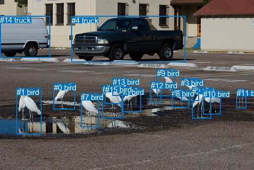
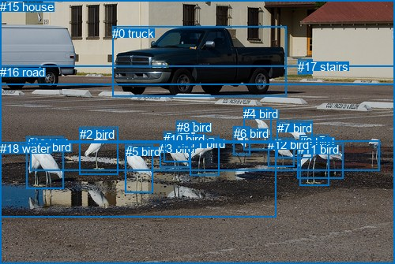

# 图片 1296：2375733.jpg

随机样本序号：45。图片 SHA256：`e59b0329626d914f7ebdbc2d9215e2559e4ac3938dfddc309c1bf9f1390ce7c6`。

红色框表示人，蓝色框表示其他物体。两个模式分别保留自身框编号，可依据位置比较对应对象。

## 自动检测框与输出

人的框编号：`[]`。状态：`no_person`。

### 自动检测全部物体框

| 编号 | 类别 | 是否为人 | 检测分数 | 像素坐标 xyxy |
|---|---|---|---|---|
| 0 | bird | False | 0.9947 | 105.7, 163.7, 147.0, 215.2 |
| 1 | bird | False | 0.9906 | 32.9, 173.2, 81.7, 264.3 |
| 2 | bird | False | 0.9902 | 378.3, 171.7, 415.3, 233.7 |
| 3 | bird | False | 0.9859 | 356.2, 154.7, 391.6, 198.1 |
| 4 | truck | False | 0.9852 | 140.9, 31.6, 364.3, 122.5 |
| 5 | bird | False | 0.9782 | 239.5, 172.8, 277.3, 220.1 |
| 6 | bird | False | 0.9763 | 201.8, 167.2, 242.2, 232.1 |
| 7 | bird | False | 0.9749 | 159.2, 183.4, 194.9, 250.2 |
| 8 | bird | False | 0.9666 | 338.4, 176.2, 373.0, 211.8 |
| 9 | bird | False | 0.9644 | 308.8, 136.3, 343.7, 189.9 |
| 10 | bird | False | 0.9631 | 399.9, 177.2, 434.5, 225.8 |
| 11 | bird | False | 0.9559 | 465.6, 175.3, 484.4, 213.8 |
| 12 | bird | False | 0.9471 | 296.6, 160.4, 317.3, 202.5 |
| 13 | bird | False | 0.9307 | 221.7, 153.3, 251.6, 188.8 |
| 14 | truck | False | 0.9269 | 0.0, 31.2, 98.3, 113.7 |
| 15 | bird | False | 0.4110 | 206.7, 167.5, 240.4, 204.4 |

### 自动检测 Top50 人相关候选

评分物体对：0；人相关物体对：0；输出关系：0。

| 排名 | 主语编号与类别 | 关系 | 宾语编号与类别 | 类型 | 人与人 | 排序分数 | 原始融合 logit |
|---|---|---|---|---|---|---|---|

### 自动检测逐条人相关 GT 核验

本图没有人相关 GT，R@50 无分母；预测候选继续展示。

## 真实框与输出

人的框编号：`[]`。

### 真实框全部物体框

| 编号 | 类别 | 是否为人 | 检测分数 | 像素坐标 xyxy |
|---|---|---|---|---|
| 0 | truck | False | GT | 142.0, 34.0, 362.0, 122.0 |
| 1 | bird | False | GT | 241.0, 174.0, 278.0, 223.0 |
| 2 | bird | False | GT | 101.0, 162.0, 150.0, 222.0 |
| 3 | bird | False | GT | 202.0, 180.0, 240.0, 213.0 |
| 4 | bird | False | GT | 308.0, 136.0, 343.0, 190.0 |
| 5 | bird | False | GT | 159.0, 184.0, 194.0, 245.0 |
| 6 | bird | False | GT | 296.0, 161.0, 317.0, 197.0 |
| 7 | bird | False | GT | 351.0, 154.0, 396.0, 201.0 |
| 8 | bird | False | GT | 224.0, 153.0, 249.0, 188.0 |
| 9 | bird | False | GT | 379.0, 172.0, 416.0, 236.0 |
| 10 | bird | False | GT | 207.0, 168.0, 241.0, 206.0 |
| 11 | bird | False | GT | 377.0, 181.0, 435.0, 226.0 |
| 12 | bird | False | GT | 339.0, 175.0, 372.0, 211.0 |
| 13 | bird | False | GT | 34.0, 174.0, 80.0, 240.0 |
| 14 | bird | False | GT | 38.0, 178.0, 481.0, 216.0 |
| 15 | house | False | GT | 0.0, 0.0, 500.0, 107.0 |
| 16 | road | False | GT | 0.0, 83.0, 500.0, 335.0 |
| 17 | stairs | False | GT | 377.0, 76.0, 395.0, 94.0 |
| 18 | water | False | GT | 0.0, 180.0, 350.0, 275.0 |

### 真实框 Top50 人相关候选

评分物体对：0；人相关物体对：0；输出关系：0。

| 排名 | 主语编号与类别 | 关系 | 宾语编号与类别 | 类型 | 人与人 | 排序分数 | 原始融合 logit |
|---|---|---|---|---|---|---|---|

### 真实框逐条人相关 GT 核验

本图没有人相关 GT，R@50 无分母；预测候选继续展示。

## 全部人相关 GT

| 主语编号与类别 | 关系 | 宾语编号与类别 |
|---|---|---|

原始记录、全部人相关物体对的两项预测与分项分数见 [逐图证据 JSON](../evidence/cases/1296.json)。全部56类 logits 保留于本机 HOR/output/random500/logits/。

<!-- HOR_COMPLETE_RESULTS -->

## 六组条件的完整输出对照

以下保留同一图片三种框与候选模式、两种谓词输出规则的全部 Top50。框编号各自在所属模式内解释。

### 自动检测框完整枚举：空间与语义各保留一个谓词

| 排名 | 主语编号与类别 | 谓词 | 宾语编号与类别 | 分组 | 排序分数 | predicate logit | pair logit |
|---|---|---|---|---|---|---|---|

没有人相关 GT，本条件的召回率无分母。

### 自动检测框完整枚举：每对只保留一个谓词

| 排名 | 主语编号与类别 | 谓词 | 宾语编号与类别 | 分组 | 排序分数 | predicate logit | pair logit |
|---|---|---|---|---|---|---|---|

没有人相关 GT，本条件的召回率无分母。

### 真实框完整枚举：空间与语义各保留一个谓词

| 排名 | 主语编号与类别 | 谓词 | 宾语编号与类别 | 分组 | 排序分数 | predicate logit | pair logit |
|---|---|---|---|---|---|---|---|

没有人相关 GT，本条件的召回率无分母。

### 真实框完整枚举：每对只保留一个谓词

| 排名 | 主语编号与类别 | 谓词 | 宾语编号与类别 | 分组 | 排序分数 | predicate logit | pair logit |
|---|---|---|---|---|---|---|---|

没有人相关 GT，本条件的召回率无分母。

### 真实框400候选：空间与语义各保留一个谓词

| 排名 | 主语编号与类别 | 谓词 | 宾语编号与类别 | 分组 | 排序分数 | predicate logit | pair logit |
|---|---|---|---|---|---|---|---|

没有人相关 GT，本条件的召回率无分母。

### 真实框400候选：每对只保留一个谓词

| 排名 | 主语编号与类别 | 谓词 | 宾语编号与类别 | 分组 | 排序分数 | predicate logit | pair logit |
|---|---|---|---|---|---|---|---|

没有人相关 GT，本条件的召回率无分母。
