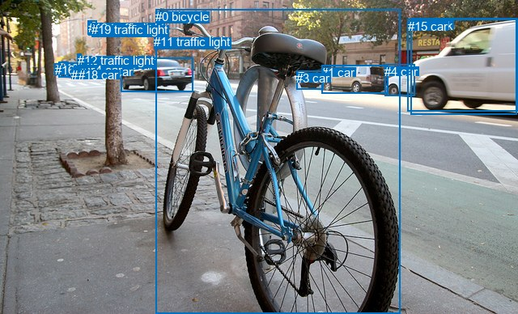
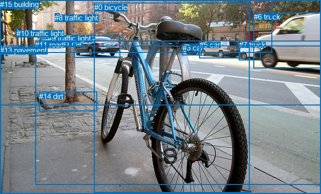

# 图片 1297：2375791.jpg

随机样本序号：47。图片 SHA256：`41fab00aad97dad3eb7d035420b8cc61ed0ca8f4f0b66a4fbc1bd0bba6f8a5b3`。

红色框表示人，蓝色框表示其他物体。两个模式分别保留自身框编号，可依据位置比较对应对象。

## 自动检测框与输出

人的框编号：`[]`。状态：`no_person`。

### 自动检测全部物体框

| 编号 | 类别 | 是否为人 | 检测分数 | 像素坐标 xyxy |
|---|---|---|---|---|
| 0 | bicycle | False | 0.9988 | 192.4, 11.6, 494.3, 388.0 |
| 1 | car | False | 0.9945 | 397.2, 80.6, 479.2, 115.6 |
| 2 | car | False | 0.9874 | 149.3, 71.9, 238.8, 113.3 |
| 3 | car | False | 0.9831 | 366.1, 87.6, 399.6, 110.5 |
| 4 | car | False | 0.9829 | 475.2, 79.6, 512.3, 118.7 |
| 5 | traffic light | False | 0.9723 | 95.0, 67.5, 100.9, 75.6 |
| 6 | truck | False | 0.8956 | 507.5, 22.8, 638.5, 141.1 |
| 7 | car | False | 0.8952 | 80.4, 77.6, 100.6, 95.7 |
| 8 | traffic light | False | 0.8721 | 109.1, 26.3, 113.7, 37.5 |
| 9 | car | False | 0.8506 | 122.6, 79.8, 131.8, 93.7 |
| 10 | car | False | 0.8385 | 72.5, 76.4, 84.4, 95.3 |
| 11 | traffic light | False | 0.8098 | 190.5, 43.5, 195.0, 49.0 |
| 12 | traffic light | False | 0.7904 | 95.8, 66.3, 100.5, 72.7 |
| 13 | traffic light | False | 0.7719 | 108.9, 25.9, 119.5, 38.5 |
| 14 | car | False | 0.6625 | 101.5, 77.6, 115.2, 91.4 |
| 15 | car | False | 0.5650 | 503.9, 23.6, 639.8, 137.8 |
| 16 | car | False | 0.5031 | 67.7, 78.4, 74.6, 93.0 |
| 17 | car | False | 0.4084 | 88.4, 83.9, 107.5, 95.0 |
| 18 | car | False | 0.3882 | 97.1, 83.5, 108.7, 94.7 |
| 19 | traffic light | False | 0.3811 | 113.2, 28.1, 118.2, 37.9 |

### 自动检测 Top50 人相关候选

评分物体对：0；人相关物体对：0；输出关系：0。

| 排名 | 主语编号与类别 | 关系 | 宾语编号与类别 | 类型 | 人与人 | 排序分数 | 原始融合 logit |
|---|---|---|---|---|---|---|---|

### 自动检测逐条人相关 GT 核验

本图没有人相关 GT，R@50 无分母；预测候选继续展示。

## 真实框与输出

人的框编号：`[]`。

### 真实框全部物体框

| 编号 | 类别 | 是否为人 | 检测分数 | 像素坐标 xyxy |
|---|---|---|---|---|
| 0 | bicycle | False | GT | 188.0, 6.0, 498.0, 386.0 |
| 1 | car | False | GT | 123.0, 79.0, 132.0, 94.0 |
| 2 | car | False | GT | 81.0, 76.0, 108.0, 95.0 |
| 3 | car | False | GT | 364.0, 87.0, 396.0, 110.0 |
| 4 | car | False | GT | 148.0, 72.0, 240.0, 116.0 |
| 5 | car | False | GT | 398.0, 81.0, 479.0, 117.0 |
| 6 | truck | False | GT | 506.0, 25.0, 640.0, 137.0 |
| 7 | truck | False | GT | 477.0, 81.0, 520.0, 121.0 |
| 8 | traffic light | False | GT | 109.0, 27.0, 118.0, 38.0 |
| 9 | traffic light | False | GT | 95.0, 68.0, 102.0, 76.0 |
| 10 | traffic light | False | GT | 33.0, 58.0, 38.0, 62.0 |
| 11 | road | False | GT | 70.0, 81.0, 640.0, 369.0 |
| 12 | tree | False | GT | 0.0, 0.0, 640.0, 210.0 |
| 13 | pavement | False | GT | 0.0, 92.0, 640.0, 388.0 |
| 14 | dirt | False | GT | 78.0, 184.0, 193.0, 223.0 |
| 15 | building | False | GT | 0.0, 0.0, 543.0, 106.0 |

### 真实框 Top50 人相关候选

评分物体对：0；人相关物体对：0；输出关系：0。

| 排名 | 主语编号与类别 | 关系 | 宾语编号与类别 | 类型 | 人与人 | 排序分数 | 原始融合 logit |
|---|---|---|---|---|---|---|---|

### 真实框逐条人相关 GT 核验

本图没有人相关 GT，R@50 无分母；预测候选继续展示。

## 全部人相关 GT

| 主语编号与类别 | 关系 | 宾语编号与类别 |
|---|---|---|

原始记录、全部人相关物体对的两项预测与分项分数见 [逐图证据 JSON](../evidence/cases/1297.json)。全部56类 logits 保留于本机 HOR/output/random500/logits/。

<!-- HOR_COMPLETE_RESULTS -->

## 六组条件的完整输出对照

以下保留同一图片三种框与候选模式、两种谓词输出规则的全部 Top50。框编号各自在所属模式内解释。

### 自动检测框完整枚举：空间与语义各保留一个谓词

| 排名 | 主语编号与类别 | 谓词 | 宾语编号与类别 | 分组 | 排序分数 | predicate logit | pair logit |
|---|---|---|---|---|---|---|---|

没有人相关 GT，本条件的召回率无分母。

### 自动检测框完整枚举：每对只保留一个谓词

| 排名 | 主语编号与类别 | 谓词 | 宾语编号与类别 | 分组 | 排序分数 | predicate logit | pair logit |
|---|---|---|---|---|---|---|---|

没有人相关 GT，本条件的召回率无分母。

### 真实框完整枚举：空间与语义各保留一个谓词

| 排名 | 主语编号与类别 | 谓词 | 宾语编号与类别 | 分组 | 排序分数 | predicate logit | pair logit |
|---|---|---|---|---|---|---|---|

没有人相关 GT，本条件的召回率无分母。

### 真实框完整枚举：每对只保留一个谓词

| 排名 | 主语编号与类别 | 谓词 | 宾语编号与类别 | 分组 | 排序分数 | predicate logit | pair logit |
|---|---|---|---|---|---|---|---|

没有人相关 GT，本条件的召回率无分母。

### 真实框400候选：空间与语义各保留一个谓词

| 排名 | 主语编号与类别 | 谓词 | 宾语编号与类别 | 分组 | 排序分数 | predicate logit | pair logit |
|---|---|---|---|---|---|---|---|

没有人相关 GT，本条件的召回率无分母。

### 真实框400候选：每对只保留一个谓词

| 排名 | 主语编号与类别 | 谓词 | 宾语编号与类别 | 分组 | 排序分数 | predicate logit | pair logit |
|---|---|---|---|---|---|---|---|

没有人相关 GT，本条件的召回率无分母。
