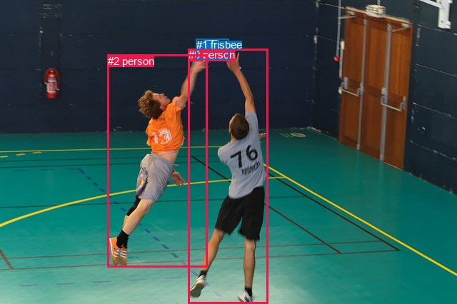
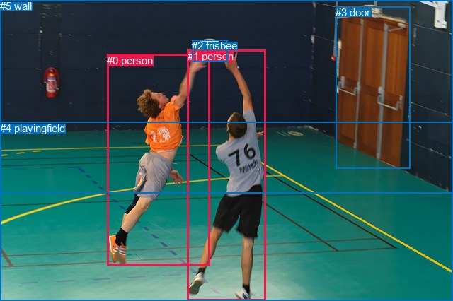

# 图片 1300：2376047.jpg

随机样本序号：121。图片 SHA256：`3567db9db76a5bba0b606d7225fb49e6d92089eb5cdb8cc30f39aa2a7314c1de`。

红色框表示人，蓝色框表示其他物体。两个模式分别保留自身框编号，可依据位置比较对应对象。

## 自动检测框与输出

人的框编号：`[0, 2]`。状态：`ok`。

### 自动检测全部物体框

| 编号 | 类别 | 是否为人 | 检测分数 | 像素坐标 xyxy |
|---|---|---|---|---|
| 0 | person | True | 0.9992 | 263.7, 68.2, 375.2, 426.0 |
| 1 | frisbee | False | 0.9992 | 274.7, 54.4, 320.6, 83.7 |
| 2 | person | True | 0.9987 | 150.8, 76.9, 291.0, 374.9 |

### 自动检测 Top50 人相关候选

评分物体对：6；人相关物体对：6；输出关系：12。

| 排名 | 主语编号与类别 | 关系 | 宾语编号与类别 | 类型 | 人与人 | 排序分数 | 原始融合 logit |
|---|---|---|---|---|---|---|---|
| 1 | #2 person | catching | #1 frisbee | semantic | False | 0.98844 | 4.4489 |
| 2 | #0 person | catching | #1 frisbee | semantic | False | 0.98424 | 4.1344 |
| 3 | #2 person | beside | #0 person | spatial | True | 0.92848 | 2.5636 |
| 4 | #0 person | beside | #2 person | spatial | True | 0.86160 | 1.8287 |
| 5 | #0 person | playing with | #2 person | semantic | True | 0.75917 | 1.1481 |
| 6 | #2 person | playing with | #0 person | semantic | True | 0.65424 | 0.6377 |
| 7 | #0 person | beside | #1 frisbee | spatial | False | 0.49632 | -0.0147 |
| 8 | #2 person | beside | #1 frisbee | spatial | False | 0.46126 | -0.1553 |
| 9 | #1 frisbee | over | #2 person | spatial | False | 0.16863 | -1.5954 |
| 10 | #1 frisbee | over | #0 person | spatial | False | 0.13825 | -1.8299 |
| 11 | #1 frisbee | flying over | #0 person | semantic | False | 0.04756 | -2.9970 |
| 12 | #1 frisbee | flying over | #2 person | semantic | False | 0.03606 | -3.2859 |

### 自动检测逐条人相关 GT 核验

R@50：20.00%；命中 1/5。

| GT 主语编号 | GT 关系 | GT 宾语编号 | 结果阶段 | 匹配预测主语编号 | 匹配预测宾语编号 |
|---|---|---|---|---|---|
| 0 | catching | 2 | hit50 | [2] | [1] |
| 0 | jumping from | 4 | endpoint_missing_or_wrong_class | [2] | [] |
| 1 | chasing | 2 | wrong_predicate | [0] | [1] |
| 1 | playing | 2 | wrong_predicate | [0] | [1] |
| 1 | jumping from | 4 | endpoint_missing_or_wrong_class | [0] | [] |

## 真实框与输出

人的框编号：`[0, 1]`。

### 真实框全部物体框

| 编号 | 类别 | 是否为人 | 检测分数 | 像素坐标 xyxy |
|---|---|---|---|---|
| 0 | person | True | GT | 151.0, 77.0, 296.0, 376.0 |
| 1 | person | True | GT | 265.0, 71.0, 376.0, 426.0 |
| 2 | frisbee | False | GT | 271.0, 56.0, 321.0, 87.0 |
| 3 | door | False | GT | 474.0, 9.0, 579.0, 239.0 |
| 4 | playingfield | False | GT | 0.0, 173.0, 640.0, 426.0 |
| 5 | wall | False | GT | 0.0, 0.0, 640.0, 274.0 |

### 真实框 Top50 人相关候选

评分物体对：30；人相关物体对：18；输出关系：36。

| 排名 | 主语编号与类别 | 关系 | 宾语编号与类别 | 类型 | 人与人 | 排序分数 | 原始融合 logit |
|---|---|---|---|---|---|---|---|
| 1 | #0 person | catching | #2 frisbee | semantic | False | 0.99600 | 5.5163 |
| 2 | #1 person | catching | #2 frisbee | semantic | False | 0.99563 | 5.4295 |
| 3 | #1 person | on | #4 playingfield | spatial | False | 0.95479 | 3.0502 |
| 4 | #0 person | on | #4 playingfield | spatial | False | 0.94325 | 2.8106 |
| 5 | #1 person | playing with | #0 person | semantic | True | 0.93834 | 2.7225 |
| 6 | #0 person | playing with | #4 playingfield | semantic | False | 0.93658 | 2.6925 |
| 7 | #1 person | playing | #4 playingfield | semantic | False | 0.92658 | 2.5353 |
| 8 | #0 person | playing with | #1 person | semantic | True | 0.90228 | 2.2228 |
| 9 | #0 person | in | #2 frisbee | spatial | False | 0.65903 | 0.6590 |
| 10 | #1 person | in | #2 frisbee | spatial | False | 0.65251 | 0.6301 |
| 11 | #0 person | beside | #1 person | spatial | True | 0.57096 | 0.2858 |
| 12 | #0 person | playing | #5 wall | semantic | False | 0.40567 | -0.3819 |
| 13 | #1 person | in | #0 person | spatial | True | 0.37974 | -0.4907 |
| 14 | #0 person | in | #5 wall | spatial | False | 0.36990 | -0.5326 |
| 15 | #2 frisbee | in | #0 person | spatial | False | 0.26318 | -1.0295 |
| 16 | #2 frisbee | holding | #1 person | semantic | False | 0.24789 | -1.1099 |
| 17 | #2 frisbee | holding | #0 person | semantic | False | 0.23332 | -1.1896 |
| 18 | #3 door | beside | #0 person | spatial | False | 0.20462 | -1.3577 |
| 19 | #1 person | playing | #5 wall | semantic | False | 0.16540 | -1.6186 |
| 20 | #2 frisbee | in | #1 person | spatial | False | 0.16182 | -1.6448 |
| 21 | #3 door | beside | #1 person | spatial | False | 0.15992 | -1.6589 |
| 22 | #1 person | in | #5 wall | spatial | False | 0.15828 | -1.6711 |
| 23 | #4 playingfield | in | #0 person | spatial | False | 0.12846 | -1.9146 |
| 24 | #4 playingfield | in | #1 person | spatial | False | 0.10667 | -2.1252 |
| 25 | #4 playingfield | holding | #0 person | semantic | False | 0.07464 | -2.5175 |
| 26 | #4 playingfield | holding | #1 person | semantic | False | 0.05860 | -2.7766 |
| 27 | #3 door | looking at | #0 person | semantic | False | 0.05020 | -2.9402 |
| 28 | #5 wall | beside | #0 person | spatial | False | 0.04825 | -2.9819 |
| 29 | #1 person | beside | #3 door | spatial | False | 0.04412 | -3.0757 |
| 30 | #3 door | looking at | #1 person | semantic | False | 0.04327 | -3.0961 |
| 31 | #0 person | playing | #3 door | semantic | False | 0.04286 | -3.1059 |
| 32 | #1 person | playing | #3 door | semantic | False | 0.03895 | -3.2057 |
| 33 | #0 person | in | #3 door | spatial | False | 0.03316 | -3.3727 |
| 34 | #5 wall | beside | #1 person | spatial | False | 0.01844 | -3.9744 |
| 35 | #5 wall | looking at | #0 person | semantic | False | 0.01408 | -4.2490 |
| 36 | #5 wall | looking at | #1 person | semantic | False | 0.00663 | -5.0092 |

### 真实框逐条人相关 GT 核验

R@50：20.00%；命中 1/5。

| GT 主语编号 | GT 关系 | GT 宾语编号 | 结果阶段 | 匹配预测主语编号 | 匹配预测宾语编号 |
|---|---|---|---|---|---|
| 0 | catching | 2 | hit50 | [0] | [2] |
| 0 | jumping from | 4 | wrong_predicate | [0] | [4] |
| 1 | chasing | 2 | wrong_predicate | [1] | [2] |
| 1 | playing | 2 | wrong_predicate | [1] | [2] |
| 1 | jumping from | 4 | wrong_predicate | [1] | [4] |

## 全部人相关 GT

| 主语编号与类别 | 关系 | 宾语编号与类别 |
|---|---|---|
| #0 person | catching | #2 frisbee |
| #0 person | jumping from | #4 playingfield |
| #1 person | chasing | #2 frisbee |
| #1 person | playing | #2 frisbee |
| #1 person | jumping from | #4 playingfield |

原始记录、全部人相关物体对的两项预测与分项分数见 [逐图证据 JSON](../evidence/cases/1300.json)。全部56类 logits 保留于本机 HOR/output/random500/logits/。

<!-- HOR_COMPLETE_RESULTS -->

## 六组条件的完整输出对照

以下保留同一图片三种框与候选模式、两种谓词输出规则的全部 Top50。框编号各自在所属模式内解释。

### 自动检测框完整枚举：空间与语义各保留一个谓词

| 排名 | 主语编号与类别 | 谓词 | 宾语编号与类别 | 分组 | 排序分数 | predicate logit | pair logit |
|---|---|---|---|---|---|---|---|
| 1 | #2 person | catching | #1 frisbee | semantic | 0.9884434 | 3.7205796 | 0.7282939 |
| 2 | #0 person | catching | #1 frisbee | semantic | 0.9842397 | 3.3546481 | 0.7797253 |
| 3 | #2 person | beside | #0 person | spatial | 0.9284832 | 3.4717698 | -0.9081501 |
| 4 | #0 person | beside | #2 person | spatial | 0.8616022 | 2.7820997 | -0.9534382 |
| 5 | #0 person | playing with | #2 person | semantic | 0.7591692 | 2.1015677 | -0.9534382 |
| 6 | #2 person | playing with | #0 person | semantic | 0.6542430 | 1.5458927 | -0.9081501 |
| 7 | #0 person | beside | #1 frisbee | spatial | 0.4963188 | -0.7944505 | 0.7797253 |
| 8 | #2 person | beside | #1 frisbee | spatial | 0.4612593 | -0.8835678 | 0.7282939 |
| 9 | #1 frisbee | over | #2 person | spatial | 0.1686290 | -0.6734428 | -0.9219320 |
| 10 | #1 frisbee | over | #0 person | spatial | 0.1382545 | -0.7312968 | -1.0985669 |
| 11 | #1 frisbee | flying over | #0 person | semantic | 0.0475622 | -1.8984194 | -1.0985669 |
| 12 | #1 frisbee | flying over | #2 person | semantic | 0.0360568 | -2.3640044 | -0.9219320 |

GT 命中：1/5，R@50=20.00%。

| GT主语 | GT谓词 | GT宾语 | 结果阶段 | 匹配主语框 | 匹配宾语框 |
|---|---|---|---|---|---|
| 0 | catching | 2 | hit50 | [2] | [1] |
| 0 | jumping from | 4 | endpoint_missing_or_wrong_class | [2] | [] |
| 1 | chasing | 2 | wrong_predicate | [0] | [1] |
| 1 | playing | 2 | wrong_predicate | [0] | [1] |
| 1 | jumping from | 4 | endpoint_missing_or_wrong_class | [0] | [] |

### 自动检测框完整枚举：每对只保留一个谓词

| 排名 | 主语编号与类别 | 谓词 | 宾语编号与类别 | 分组 | 排序分数 | predicate logit | pair logit |
|---|---|---|---|---|---|---|---|
| 1 | #2 person | catching | #1 frisbee | single | 0.9884434 | 3.7205796 | 0.7282939 |
| 2 | #0 person | catching | #1 frisbee | single | 0.9842397 | 3.3546481 | 0.7797253 |
| 3 | #2 person | beside | #0 person | single | 0.9284832 | 3.4717698 | -0.9081501 |
| 4 | #0 person | beside | #2 person | single | 0.8616022 | 2.7820997 | -0.9534382 |
| 5 | #1 frisbee | over | #2 person | single | 0.1686290 | -0.6734428 | -0.9219320 |
| 6 | #1 frisbee | over | #0 person | single | 0.1382545 | -0.7312968 | -1.0985669 |

GT 命中：1/5，R@50=20.00%。

| GT主语 | GT谓词 | GT宾语 | 结果阶段 | 匹配主语框 | 匹配宾语框 |
|---|---|---|---|---|---|
| 0 | catching | 2 | hit50 | [2] | [1] |
| 0 | jumping from | 4 | endpoint_missing_or_wrong_class | [2] | [] |
| 1 | chasing | 2 | wrong_predicate | [0] | [1] |
| 1 | playing | 2 | wrong_predicate | [0] | [1] |
| 1 | jumping from | 4 | endpoint_missing_or_wrong_class | [0] | [] |

### 真实框完整枚举：空间与语义各保留一个谓词

| 排名 | 主语编号与类别 | 谓词 | 宾语编号与类别 | 分组 | 排序分数 | predicate logit | pair logit |
|---|---|---|---|---|---|---|---|
| 1 | #0 person | catching | #2 frisbee | semantic | 0.9959955 | 4.8016639 | 0.7146674 |
| 2 | #1 person | catching | #2 frisbee | semantic | 0.9956337 | 4.6865697 | 0.7428892 |
| 3 | #1 person | on | #4 playingfield | spatial | 0.9547923 | 3.2734694 | -0.2232433 |
| 4 | #0 person | on | #4 playingfield | spatial | 0.9432458 | 3.1364803 | -0.3258813 |
| 5 | #1 person | playing with | #0 person | semantic | 0.9383407 | 3.6643481 | -0.9418604 |
| 6 | #0 person | playing with | #4 playingfield | semantic | 0.9365849 | 3.0184193 | -0.3258813 |
| 7 | #1 person | playing | #4 playingfield | semantic | 0.9265824 | 2.7585826 | -0.2232433 |
| 8 | #0 person | playing with | #1 person | semantic | 0.9022822 | 3.1317267 | -0.9088830 |
| 9 | #0 person | in | #2 frisbee | spatial | 0.6590256 | -0.0557122 | 0.7146674 |
| 10 | #1 person | in | #2 frisbee | spatial | 0.6525100 | -0.1127982 | 0.7428892 |
| 11 | #0 person | beside | #1 person | spatial | 0.5709634 | 1.1946659 | -0.9088830 |
| 12 | #0 person | playing | #5 wall | semantic | 0.4056685 | 0.5118957 | -0.8937967 |
| 13 | #1 person | in | #0 person | spatial | 0.3797393 | 0.4512053 | -0.9418604 |
| 14 | #0 person | in | #5 wall | spatial | 0.3699008 | 0.3611541 | -0.8937967 |
| 15 | #2 frisbee | in | #0 person | spatial | 0.2631784 | -0.1079206 | -0.9215930 |
| 16 | #2 frisbee | holding | #1 person | semantic | 0.2478933 | -0.0225158 | -1.0873642 |
| 17 | #2 frisbee | holding | #0 person | semantic | 0.2333217 | -0.2680564 | -0.9215930 |
| 18 | #3 door | beside | #0 person | spatial | 0.2046191 | -0.4370422 | -0.9206284 |
| 19 | #1 person | playing | #5 wall | semantic | 0.1653974 | -0.6127753 | -1.0058296 |
| 20 | #2 frisbee | in | #1 person | spatial | 0.1618168 | -0.5574079 | -1.0873642 |
| 21 | #3 door | beside | #1 person | spatial | 0.1599163 | -0.7368705 | -0.9219803 |
| 22 | #1 person | in | #5 wall | spatial | 0.1582780 | -0.6652670 | -1.0058296 |
| 23 | #4 playingfield | in | #0 person | spatial | 0.1284626 | -0.8648567 | -1.0497645 |
| 24 | #4 playingfield | in | #1 person | spatial | 0.1066743 | -1.0250466 | -1.1001248 |
| 25 | #4 playingfield | holding | #0 person | semantic | 0.0746433 | -1.4676940 | -1.0497645 |
| 26 | #4 playingfield | holding | #1 person | semantic | 0.0586018 | -1.6764765 | -1.1001248 |
| 27 | #3 door | looking at | #0 person | semantic | 0.0501998 | -2.0196114 | -0.9206284 |
| 28 | #5 wall | beside | #0 person | spatial | 0.0482502 | -2.2235465 | -0.7583565 |
| 29 | #1 person | beside | #3 door | spatial | 0.0441227 | -1.5476861 | -1.5279698 |
| 30 | #3 door | looking at | #1 person | semantic | 0.0432702 | -2.1740770 | -0.9219803 |
| 31 | #0 person | playing | #3 door | semantic | 0.0428649 | -1.3961537 | -1.7097371 |
| 32 | #1 person | playing | #3 door | semantic | 0.0389504 | -1.6777668 | -1.5279698 |
| 33 | #0 person | in | #3 door | spatial | 0.0331593 | -1.6629729 | -1.7097371 |
| 34 | #5 wall | beside | #1 person | spatial | 0.0184444 | -3.0284512 | -0.9459249 |
| 35 | #5 wall | looking at | #0 person | semantic | 0.0140778 | -3.4906235 | -0.7583565 |
| 36 | #5 wall | looking at | #1 person | semantic | 0.0066323 | -4.0632286 | -0.9459249 |

GT 命中：1/5，R@50=20.00%。

| GT主语 | GT谓词 | GT宾语 | 结果阶段 | 匹配主语框 | 匹配宾语框 |
|---|---|---|---|---|---|
| 0 | catching | 2 | hit50 | [0] | [2] |
| 0 | jumping from | 4 | wrong_predicate | [0] | [4] |
| 1 | chasing | 2 | wrong_predicate | [1] | [2] |
| 1 | playing | 2 | wrong_predicate | [1] | [2] |
| 1 | jumping from | 4 | wrong_predicate | [1] | [4] |

### 真实框完整枚举：每对只保留一个谓词

| 排名 | 主语编号与类别 | 谓词 | 宾语编号与类别 | 分组 | 排序分数 | predicate logit | pair logit |
|---|---|---|---|---|---|---|---|
| 1 | #0 person | catching | #2 frisbee | single | 0.9959955 | 4.8016639 | 0.7146674 |
| 2 | #1 person | catching | #2 frisbee | single | 0.9956337 | 4.6865697 | 0.7428892 |
| 3 | #1 person | on | #4 playingfield | single | 0.9547923 | 3.2734694 | -0.2232433 |
| 4 | #0 person | on | #4 playingfield | single | 0.9432458 | 3.1364803 | -0.3258813 |
| 5 | #1 person | playing with | #0 person | single | 0.9383407 | 3.6643481 | -0.9418604 |
| 6 | #0 person | playing with | #1 person | single | 0.9022822 | 3.1317267 | -0.9088830 |
| 7 | #0 person | playing | #5 wall | single | 0.4056685 | 0.5118957 | -0.8937967 |
| 8 | #2 frisbee | in | #0 person | single | 0.2631784 | -0.1079206 | -0.9215930 |
| 9 | #2 frisbee | holding | #1 person | single | 0.2478933 | -0.0225158 | -1.0873642 |
| 10 | #3 door | beside | #0 person | single | 0.2046191 | -0.4370422 | -0.9206284 |
| 11 | #1 person | playing | #5 wall | single | 0.1653974 | -0.6127753 | -1.0058296 |
| 12 | #3 door | beside | #1 person | single | 0.1599163 | -0.7368705 | -0.9219803 |
| 13 | #4 playingfield | in | #0 person | single | 0.1284626 | -0.8648567 | -1.0497645 |
| 14 | #4 playingfield | in | #1 person | single | 0.1066743 | -1.0250466 | -1.1001248 |
| 15 | #5 wall | beside | #0 person | single | 0.0482502 | -2.2235465 | -0.7583565 |
| 16 | #1 person | beside | #3 door | single | 0.0441227 | -1.5476861 | -1.5279698 |
| 17 | #0 person | playing | #3 door | single | 0.0428649 | -1.3961537 | -1.7097371 |
| 18 | #5 wall | beside | #1 person | single | 0.0184444 | -3.0284512 | -0.9459249 |

GT 命中：1/5，R@50=20.00%。

| GT主语 | GT谓词 | GT宾语 | 结果阶段 | 匹配主语框 | 匹配宾语框 |
|---|---|---|---|---|---|
| 0 | catching | 2 | hit50 | [0] | [2] |
| 0 | jumping from | 4 | wrong_predicate | [0] | [4] |
| 1 | chasing | 2 | wrong_predicate | [1] | [2] |
| 1 | playing | 2 | wrong_predicate | [1] | [2] |
| 1 | jumping from | 4 | wrong_predicate | [1] | [4] |

### 真实框400候选：空间与语义各保留一个谓词

| 排名 | 主语编号与类别 | 谓词 | 宾语编号与类别 | 分组 | 排序分数 | predicate logit | pair logit |
|---|---|---|---|---|---|---|---|
| 1 | #0 person | catching | #2 frisbee | semantic | 0.9959850 | 4.7990279 | 0.7146674 |
| 2 | #1 person | catching | #2 frisbee | semantic | 0.9956337 | 4.6865697 | 0.7428892 |
| 3 | #1 person | on | #4 playingfield | spatial | 0.9547923 | 3.2734694 | -0.2232433 |
| 4 | #0 person | on | #4 playingfield | spatial | 0.9432458 | 3.1364803 | -0.3258813 |
| 5 | #1 person | playing with | #0 person | semantic | 0.9383407 | 3.6643481 | -0.9418604 |
| 6 | #0 person | playing with | #4 playingfield | semantic | 0.9365849 | 3.0184193 | -0.3258813 |
| 7 | #1 person | playing | #4 playingfield | semantic | 0.9265824 | 2.7585826 | -0.2232433 |
| 8 | #0 person | playing with | #1 person | semantic | 0.9072087 | 3.1889029 | -0.9088830 |
| 9 | #0 person | in | #2 frisbee | spatial | 0.6650159 | -0.0289397 | 0.7146674 |
| 10 | #1 person | in | #2 frisbee | spatial | 0.6517572 | -0.1161170 | 0.7428892 |
| 11 | #0 person | beside | #1 person | spatial | 0.5636053 | 1.1646900 | -0.9088830 |
| 12 | #0 person | playing | #5 wall | semantic | 0.3995970 | 0.4866524 | -0.8937967 |
| 13 | #1 person | in | #0 person | spatial | 0.3805213 | 0.4545240 | -0.9418604 |
| 14 | #0 person | in | #5 wall | spatial | 0.3699008 | 0.3611541 | -0.8937967 |
| 15 | #2 frisbee | in | #0 person | spatial | 0.2638224 | -0.1046023 | -0.9215930 |
| 16 | #2 frisbee | holding | #1 person | semantic | 0.2478933 | -0.0225158 | -1.0873642 |
| 17 | #2 frisbee | holding | #0 person | semantic | 0.2333217 | -0.2680564 | -0.9215930 |
| 18 | #3 door | beside | #0 person | spatial | 0.2095529 | -0.4069943 | -0.9206284 |
| 19 | #1 person | playing | #5 wall | semantic | 0.1622713 | -0.6355953 | -1.0058296 |
| 20 | #2 frisbee | in | #1 person | spatial | 0.1622674 | -0.5540891 | -1.0873642 |
| 21 | #1 person | in | #5 wall | spatial | 0.1609790 | -0.6451321 | -1.0058296 |
| 22 | #3 door | beside | #1 person | spatial | 0.1599163 | -0.7368705 | -0.9219803 |
| 23 | #4 playingfield | in | #0 person | spatial | 0.1284626 | -0.8648567 | -1.0497645 |
| 24 | #4 playingfield | in | #1 person | spatial | 0.1071496 | -1.0200684 | -1.1001248 |
| 25 | #4 playingfield | holding | #0 person | semantic | 0.0745413 | -1.4691713 | -1.0497645 |
| 26 | #4 playingfield | holding | #1 person | semantic | 0.0600752 | -1.6500781 | -1.1001248 |
| 27 | #3 door | looking at | #0 person | semantic | 0.0516542 | -1.9895201 | -0.9206284 |
| 28 | #5 wall | beside | #0 person | spatial | 0.0482502 | -2.2235465 | -0.7583565 |
| 29 | #1 person | beside | #3 door | spatial | 0.0441227 | -1.5476861 | -1.5279698 |
| 30 | #3 door | looking at | #1 person | semantic | 0.0432630 | -2.1742513 | -0.9219803 |
| 31 | #0 person | playing | #3 door | semantic | 0.0417440 | -1.4238212 | -1.7097371 |
| 32 | #1 person | playing | #3 door | semantic | 0.0394256 | -1.6651449 | -1.5279698 |
| 33 | #0 person | in | #3 door | spatial | 0.0331062 | -1.6646323 | -1.7097371 |
| 34 | #5 wall | beside | #1 person | spatial | 0.0183098 | -3.0359161 | -0.9459249 |
| 35 | #5 wall | looking at | #0 person | semantic | 0.0141826 | -3.4831007 | -0.7583565 |
| 36 | #5 wall | looking at | #1 person | semantic | 0.0066326 | -4.0631852 | -0.9459249 |

GT 命中：1/5，R@50=20.00%。

| GT主语 | GT谓词 | GT宾语 | 结果阶段 | 匹配主语框 | 匹配宾语框 |
|---|---|---|---|---|---|
| 0 | catching | 2 | hit50 | [0] | [2] |
| 0 | jumping from | 4 | wrong_predicate | [0] | [4] |
| 1 | chasing | 2 | wrong_predicate | [1] | [2] |
| 1 | playing | 2 | wrong_predicate | [1] | [2] |
| 1 | jumping from | 4 | wrong_predicate | [1] | [4] |

### 真实框400候选：每对只保留一个谓词

| 排名 | 主语编号与类别 | 谓词 | 宾语编号与类别 | 分组 | 排序分数 | predicate logit | pair logit |
|---|---|---|---|---|---|---|---|
| 1 | #0 person | catching | #2 frisbee | single | 0.9959850 | 4.7990279 | 0.7146674 |
| 2 | #1 person | catching | #2 frisbee | single | 0.9956337 | 4.6865697 | 0.7428892 |
| 3 | #1 person | on | #4 playingfield | single | 0.9547923 | 3.2734694 | -0.2232433 |
| 4 | #0 person | on | #4 playingfield | single | 0.9432458 | 3.1364803 | -0.3258813 |
| 5 | #1 person | playing with | #0 person | single | 0.9383407 | 3.6643481 | -0.9418604 |
| 6 | #0 person | playing with | #1 person | single | 0.9072087 | 3.1889029 | -0.9088830 |
| 7 | #0 person | playing | #5 wall | single | 0.3995970 | 0.4866524 | -0.8937967 |
| 8 | #2 frisbee | in | #0 person | single | 0.2638224 | -0.1046023 | -0.9215930 |
| 9 | #2 frisbee | holding | #1 person | single | 0.2478933 | -0.0225158 | -1.0873642 |
| 10 | #3 door | beside | #0 person | single | 0.2095529 | -0.4069943 | -0.9206284 |
| 11 | #1 person | playing | #5 wall | single | 0.1622713 | -0.6355953 | -1.0058296 |
| 12 | #3 door | beside | #1 person | single | 0.1599163 | -0.7368705 | -0.9219803 |
| 13 | #4 playingfield | in | #0 person | single | 0.1284626 | -0.8648567 | -1.0497645 |
| 14 | #4 playingfield | in | #1 person | single | 0.1071496 | -1.0200684 | -1.1001248 |
| 15 | #5 wall | beside | #0 person | single | 0.0482502 | -2.2235465 | -0.7583565 |
| 16 | #1 person | beside | #3 door | single | 0.0441227 | -1.5476861 | -1.5279698 |
| 17 | #0 person | playing | #3 door | single | 0.0417440 | -1.4238212 | -1.7097371 |
| 18 | #5 wall | beside | #1 person | single | 0.0183098 | -3.0359161 | -0.9459249 |

GT 命中：1/5，R@50=20.00%。

| GT主语 | GT谓词 | GT宾语 | 结果阶段 | 匹配主语框 | 匹配宾语框 |
|---|---|---|---|---|---|
| 0 | catching | 2 | hit50 | [0] | [2] |
| 0 | jumping from | 4 | wrong_predicate | [0] | [4] |
| 1 | chasing | 2 | wrong_predicate | [1] | [2] |
| 1 | playing | 2 | wrong_predicate | [1] | [2] |
| 1 | jumping from | 4 | wrong_predicate | [1] | [4] |
