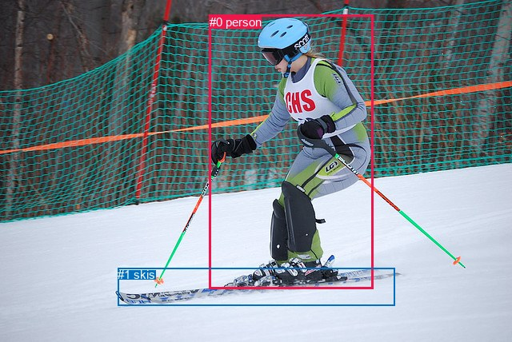
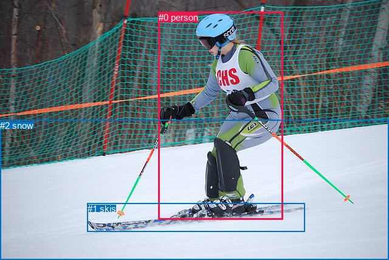

# 图片 1302：2376309.jpg

随机样本序号：188。图片 SHA256：`86fc446483d5e1e6a3d966047a6e3c703ed1d86b32a2ad1db62a4beef5b0d7db`。

红色框表示人，蓝色框表示其他物体。两个模式分别保留自身框编号，可依据位置比较对应对象。

## 自动检测框与输出

人的框编号：`[0]`。状态：`ok`。

### 自动检测全部物体框

| 编号 | 类别 | 是否为人 | 检测分数 | 像素坐标 xyxy |
|---|---|---|---|---|
| 0 | person | True | 0.9995 | 262.0, 18.6, 466.8, 361.9 |
| 1 | skis | False | 0.9802 | 147.4, 335.4, 493.7, 382.6 |

### 自动检测 Top50 人相关候选

评分物体对：2；人相关物体对：2；输出关系：4。

| 排名 | 主语编号与类别 | 关系 | 宾语编号与类别 | 类型 | 人与人 | 排序分数 | 原始融合 logit |
|---|---|---|---|---|---|---|---|
| 1 | #0 person | wearing | #1 skis | semantic | False | 0.98030 | 3.9071 |
| 2 | #0 person | on | #1 skis | spatial | False | 0.50007 | 0.0003 |
| 3 | #1 skis | on | #0 person | spatial | False | 0.00226 | -6.0909 |
| 4 | #1 skis | biting | #0 person | semantic | False | 0.00138 | -6.5821 |

### 自动检测逐条人相关 GT 核验

R@50：0.00%；命中 0/3。

| GT 主语编号 | GT 关系 | GT 宾语编号 | 结果阶段 | 匹配预测主语编号 | 匹配预测宾语编号 |
|---|---|---|---|---|---|
| 0 | standing on | 1 | wrong_predicate | [0] | [1] |
| 0 | playing | 1 | wrong_predicate | [0] | [1] |
| 0 | looking at | 2 | endpoint_missing_or_wrong_class | [0] | [] |

## 真实框与输出

人的框编号：`[0]`。

### 真实框全部物体框

| 编号 | 类别 | 是否为人 | 检测分数 | 像素坐标 xyxy |
|---|---|---|---|---|
| 0 | person | True | GT | 261.0, 20.0, 466.0, 362.0 |
| 1 | skis | False | GT | 144.0, 335.0, 502.0, 382.0 |
| 2 | snow | False | GT | 0.0, 198.0, 640.0, 428.0 |

### 真实框 Top50 人相关候选

评分物体对：6；人相关物体对：4；输出关系：8。

| 排名 | 主语编号与类别 | 关系 | 宾语编号与类别 | 类型 | 人与人 | 排序分数 | 原始融合 logit |
|---|---|---|---|---|---|---|---|
| 1 | #0 person | wearing | #1 skis | semantic | False | 0.98843 | 4.4476 |
| 2 | #0 person | on | #1 skis | spatial | False | 0.97892 | 3.8383 |
| 3 | #0 person | on | #2 snow | spatial | False | 0.96241 | 3.2428 |
| 4 | #0 person | going down | #2 snow | semantic | False | 0.73925 | 1.0421 |
| 5 | #1 skis | on | #0 person | spatial | False | 0.65860 | 0.6571 |
| 6 | #2 snow | beside | #0 person | spatial | False | 0.42354 | -0.3082 |
| 7 | #1 skis | wearing | #0 person | semantic | False | 0.15511 | -1.6951 |
| 8 | #2 snow | holding | #0 person | semantic | False | 0.06890 | -2.6037 |

### 真实框逐条人相关 GT 核验

R@50：0.00%；命中 0/3。

| GT 主语编号 | GT 关系 | GT 宾语编号 | 结果阶段 | 匹配预测主语编号 | 匹配预测宾语编号 |
|---|---|---|---|---|---|
| 0 | standing on | 1 | wrong_predicate | [0] | [1] |
| 0 | playing | 1 | wrong_predicate | [0] | [1] |
| 0 | looking at | 2 | wrong_predicate | [0] | [2] |

## 全部人相关 GT

| 主语编号与类别 | 关系 | 宾语编号与类别 |
|---|---|---|
| #0 person | standing on | #1 skis |
| #0 person | playing | #1 skis |
| #0 person | looking at | #2 snow |

原始记录、全部人相关物体对的两项预测与分项分数见 [逐图证据 JSON](../evidence/cases/1302.json)。全部56类 logits 保留于本机 HOR/output/random500/logits/。

<!-- HOR_COMPLETE_RESULTS -->

## 六组条件的完整输出对照

以下保留同一图片三种框与候选模式、两种谓词输出规则的全部 Top50。框编号各自在所属模式内解释。

### 自动检测框完整枚举：空间与语义各保留一个谓词

| 排名 | 主语编号与类别 | 谓词 | 宾语编号与类别 | 分组 | 排序分数 | predicate logit | pair logit |
|---|---|---|---|---|---|---|---|
| 1 | #0 person | wearing | #1 skis | semantic | 0.9802972 | 3.6554751 | 0.2516172 |
| 2 | #0 person | on | #1 skis | spatial | 0.5000748 | -0.2513180 | 0.2516172 |
| 3 | #1 skis | on | #0 person | spatial | 0.0022584 | -5.4531989 | -0.6376518 |
| 4 | #1 skis | biting | #0 person | semantic | 0.0013830 | -5.9444327 | -0.6376518 |

GT 命中：0/3，R@50=0.00%。

| GT主语 | GT谓词 | GT宾语 | 结果阶段 | 匹配主语框 | 匹配宾语框 |
|---|---|---|---|---|---|
| 0 | standing on | 1 | wrong_predicate | [0] | [1] |
| 0 | playing | 1 | wrong_predicate | [0] | [1] |
| 0 | looking at | 2 | endpoint_missing_or_wrong_class | [0] | [] |

### 自动检测框完整枚举：每对只保留一个谓词

| 排名 | 主语编号与类别 | 谓词 | 宾语编号与类别 | 分组 | 排序分数 | predicate logit | pair logit |
|---|---|---|---|---|---|---|---|
| 1 | #0 person | wearing | #1 skis | single | 0.9802972 | 3.6554751 | 0.2516172 |
| 2 | #1 skis | on | #0 person | single | 0.0022584 | -5.4531989 | -0.6376518 |

GT 命中：0/3，R@50=0.00%。

| GT主语 | GT谓词 | GT宾语 | 结果阶段 | 匹配主语框 | 匹配宾语框 |
|---|---|---|---|---|---|
| 0 | standing on | 1 | wrong_predicate | [0] | [1] |
| 0 | playing | 1 | wrong_predicate | [0] | [1] |
| 0 | looking at | 2 | endpoint_missing_or_wrong_class | [0] | [] |

### 真实框完整枚举：空间与语义各保留一个谓词

| 排名 | 主语编号与类别 | 谓词 | 宾语编号与类别 | 分组 | 排序分数 | predicate logit | pair logit |
|---|---|---|---|---|---|---|---|
| 1 | #0 person | wearing | #1 skis | semantic | 0.9884287 | 4.1911044 | 0.2564760 |
| 2 | #0 person | on | #1 skis | spatial | 0.9789231 | 3.5817962 | 0.2564760 |
| 3 | #0 person | on | #2 snow | spatial | 0.9624138 | 3.1891904 | 0.0536172 |
| 4 | #0 person | going down | #2 snow | semantic | 0.7392498 | 0.9884558 | 0.0536172 |
| 5 | #1 skis | on | #0 person | spatial | 0.6586031 | 1.2883158 | -0.6312401 |
| 6 | #2 snow | beside | #0 person | spatial | 0.4235432 | 0.3459234 | -0.6541685 |
| 7 | #1 skis | wearing | #0 person | semantic | 0.1551066 | -1.0638576 | -0.6312401 |
| 8 | #2 snow | holding | #0 person | semantic | 0.0689008 | -1.9495299 | -0.6541685 |

GT 命中：0/3，R@50=0.00%。

| GT主语 | GT谓词 | GT宾语 | 结果阶段 | 匹配主语框 | 匹配宾语框 |
|---|---|---|---|---|---|
| 0 | standing on | 1 | wrong_predicate | [0] | [1] |
| 0 | playing | 1 | wrong_predicate | [0] | [1] |
| 0 | looking at | 2 | wrong_predicate | [0] | [2] |

### 真实框完整枚举：每对只保留一个谓词

| 排名 | 主语编号与类别 | 谓词 | 宾语编号与类别 | 分组 | 排序分数 | predicate logit | pair logit |
|---|---|---|---|---|---|---|---|
| 1 | #0 person | wearing | #1 skis | single | 0.9884287 | 4.1911044 | 0.2564760 |
| 2 | #0 person | on | #2 snow | single | 0.9624138 | 3.1891904 | 0.0536172 |
| 3 | #1 skis | on | #0 person | single | 0.6586031 | 1.2883158 | -0.6312401 |
| 4 | #2 snow | beside | #0 person | single | 0.4235432 | 0.3459234 | -0.6541685 |

GT 命中：0/3，R@50=0.00%。

| GT主语 | GT谓词 | GT宾语 | 结果阶段 | 匹配主语框 | 匹配宾语框 |
|---|---|---|---|---|---|
| 0 | standing on | 1 | wrong_predicate | [0] | [1] |
| 0 | playing | 1 | wrong_predicate | [0] | [1] |
| 0 | looking at | 2 | wrong_predicate | [0] | [2] |

### 真实框400候选：空间与语义各保留一个谓词

| 排名 | 主语编号与类别 | 谓词 | 宾语编号与类别 | 分组 | 排序分数 | predicate logit | pair logit |
|---|---|---|---|---|---|---|---|
| 1 | #0 person | wearing | #1 skis | semantic | 0.9884287 | 4.1911044 | 0.2564760 |
| 2 | #0 person | on | #1 skis | spatial | 0.9789231 | 3.5817962 | 0.2564760 |
| 3 | #0 person | on | #2 snow | spatial | 0.9624138 | 3.1891904 | 0.0536172 |
| 4 | #0 person | going down | #2 snow | semantic | 0.7392498 | 0.9884558 | 0.0536172 |
| 5 | #1 skis | on | #0 person | spatial | 0.6586031 | 1.2883158 | -0.6312401 |
| 6 | #2 snow | beside | #0 person | spatial | 0.4235361 | 0.3458943 | -0.6541685 |
| 7 | #1 skis | wearing | #0 person | semantic | 0.1527650 | -1.0818372 | -0.6312401 |
| 8 | #2 snow | holding | #0 person | semantic | 0.0679769 | -1.9640217 | -0.6541685 |

GT 命中：0/3，R@50=0.00%。

| GT主语 | GT谓词 | GT宾语 | 结果阶段 | 匹配主语框 | 匹配宾语框 |
|---|---|---|---|---|---|
| 0 | standing on | 1 | wrong_predicate | [0] | [1] |
| 0 | playing | 1 | wrong_predicate | [0] | [1] |
| 0 | looking at | 2 | wrong_predicate | [0] | [2] |

### 真实框400候选：每对只保留一个谓词

| 排名 | 主语编号与类别 | 谓词 | 宾语编号与类别 | 分组 | 排序分数 | predicate logit | pair logit |
|---|---|---|---|---|---|---|---|
| 1 | #0 person | wearing | #1 skis | single | 0.9884287 | 4.1911044 | 0.2564760 |
| 2 | #0 person | on | #2 snow | single | 0.9624138 | 3.1891904 | 0.0536172 |
| 3 | #1 skis | on | #0 person | single | 0.6586031 | 1.2883158 | -0.6312401 |
| 4 | #2 snow | beside | #0 person | single | 0.4235361 | 0.3458943 | -0.6541685 |

GT 命中：0/3，R@50=0.00%。

| GT主语 | GT谓词 | GT宾语 | 结果阶段 | 匹配主语框 | 匹配宾语框 |
|---|---|---|---|---|---|
| 0 | standing on | 1 | wrong_predicate | [0] | [1] |
| 0 | playing | 1 | wrong_predicate | [0] | [1] |
| 0 | looking at | 2 | wrong_predicate | [0] | [2] |
