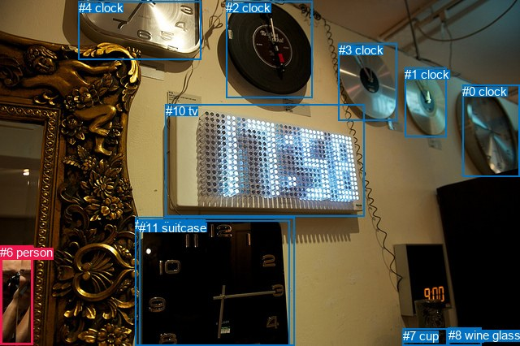
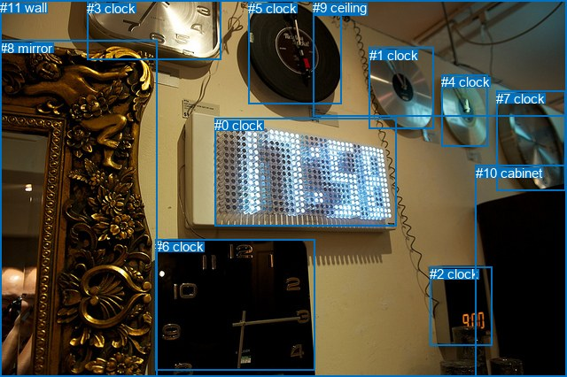

# 图片 1310：2376762.jpg

随机样本序号：290。图片 SHA256：`61049627b034266483211b8563cdf6b0330644935e52b9bd314b560bd679f412`。

红色框表示人，蓝色框表示其他物体。两个模式分别保留自身框编号，可依据位置比较对应对象。

## 自动检测框与输出

人的框编号：`[6]`。状态：`ok`。

### 自动检测全部物体框

| 编号 | 类别 | 是否为人 | 检测分数 | 像素坐标 xyxy |
|---|---|---|---|---|
| 0 | clock | False | 0.9915 | 569.2, 104.0, 639.8, 217.2 |
| 1 | clock | False | 0.9914 | 498.4, 83.5, 550.0, 168.7 |
| 2 | clock | False | 0.9657 | 278.1, 1.4, 384.2, 120.8 |
| 3 | clock | False | 0.9531 | 416.8, 53.5, 488.5, 148.3 |
| 4 | clock | False | 0.7471 | 96.7, 1.4, 247.5, 73.2 |
| 5 | cup | False | 0.7413 | 551.9, 404.3, 592.7, 425.6 |
| 6 | person | True | 0.6840 | 0.0, 302.4, 40.3, 424.2 |
| 7 | cup | False | 0.6638 | 495.7, 404.6, 550.3, 426.0 |
| 8 | wine glass | False | 0.6040 | 551.9, 404.0, 592.9, 426.0 |
| 9 | cell phone | False | 0.5173 | 166.5, 267.6, 362.9, 426.0 |
| 10 | tv | False | 0.4922 | 203.5, 128.5, 448.3, 266.2 |
| 11 | suitcase | False | 0.3729 | 171.4, 271.6, 356.0, 425.7 |

### 自动检测 Top50 人相关候选

评分物体对：132；人相关物体对：22；输出关系：44。

| 排名 | 主语编号与类别 | 关系 | 宾语编号与类别 | 类型 | 人与人 | 排序分数 | 原始融合 logit |
|---|---|---|---|---|---|---|---|
| 1 | #6 person | beside | #9 cell phone | spatial | False | 0.92371 | 2.4939 |
| 2 | #6 person | beside | #11 suitcase | spatial | False | 0.91799 | 2.4153 |
| 3 | #6 person | looking at | #10 tv | semantic | False | 0.85650 | 1.7865 |
| 4 | #6 person | holding | #11 suitcase | semantic | False | 0.79866 | 1.3780 |
| 5 | #6 person | looking at | #9 cell phone | semantic | False | 0.78874 | 1.3173 |
| 6 | #6 person | beside | #10 tv | spatial | False | 0.75711 | 1.1369 |
| 7 | #6 person | looking at | #4 clock | semantic | False | 0.68856 | 0.7934 |
| 8 | #6 person | beside | #4 clock | spatial | False | 0.56993 | 0.2816 |
| 9 | #6 person | looking at | #0 clock | semantic | False | 0.45766 | -0.1698 |
| 10 | #9 cell phone | beside | #6 person | spatial | False | 0.37639 | -0.5049 |
| 11 | #11 suitcase | beside | #6 person | spatial | False | 0.34579 | -0.6376 |
| 12 | #6 person | looking at | #2 clock | semantic | False | 0.25135 | -1.0914 |
| 13 | #10 tv | beside | #6 person | spatial | False | 0.12171 | -1.9763 |
| 14 | #4 clock | over | #6 person | spatial | False | 0.12006 | -1.9919 |
| 15 | #6 person | beside | #2 clock | spatial | False | 0.09072 | -2.3049 |
| 16 | #6 person | looking at | #1 clock | semantic | False | 0.07188 | -2.5582 |
| 17 | #6 person | holding | #5 cup | semantic | False | 0.06645 | -2.6426 |
| 18 | #6 person | holding | #8 wine glass | semantic | False | 0.06497 | -2.6666 |
| 19 | #6 person | in front of | #0 clock | spatial | False | 0.05693 | -2.8074 |
| 20 | #6 person | looking at | #7 cup | semantic | False | 0.03904 | -3.2033 |
| 21 | #6 person | looking at | #3 clock | semantic | False | 0.03717 | -3.2544 |
| 22 | #9 cell phone | holding | #6 person | semantic | False | 0.02367 | -3.7196 |
| 23 | #11 suitcase | holding | #6 person | semantic | False | 0.02264 | -3.7651 |
| 24 | #7 cup | in front of | #6 person | spatial | False | 0.02011 | -3.8862 |
| 25 | #8 wine glass | in front of | #6 person | spatial | False | 0.01606 | -4.1152 |
| 26 | #5 cup | in front of | #6 person | spatial | False | 0.01536 | -4.1606 |
| 27 | #6 person | in front of | #7 cup | spatial | False | 0.01313 | -4.3194 |
| 28 | #8 wine glass | holding | #6 person | semantic | False | 0.01038 | -4.5574 |
| 29 | #5 cup | holding | #6 person | semantic | False | 0.01003 | -4.5916 |
| 30 | #7 cup | holding | #6 person | semantic | False | 0.00883 | -4.7210 |
| 31 | #6 person | in | #5 cup | spatial | False | 0.00872 | -4.7332 |
| 32 | #6 person | in | #8 wine glass | spatial | False | 0.00861 | -4.7463 |
| 33 | #6 person | in | #1 clock | spatial | False | 0.00840 | -4.7708 |
| 34 | #4 clock | climbing | #6 person | semantic | False | 0.00837 | -4.7748 |
| 35 | #10 tv | standing on | #6 person | semantic | False | 0.00835 | -4.7766 |
| 36 | #6 person | in | #3 clock | spatial | False | 0.00804 | -4.8148 |
| 37 | #2 clock | over | #6 person | spatial | False | 0.00485 | -5.3236 |
| 38 | #2 clock | climbing | #6 person | semantic | False | 0.00218 | -6.1252 |
| 39 | #0 clock | looking at | #6 person | semantic | False | 0.00173 | -6.3607 |
| 40 | #0 clock | hanging from | #6 person | spatial | False | 0.00137 | -6.5924 |
| 41 | #3 clock | over | #6 person | spatial | False | 0.00125 | -6.6804 |
| 42 | #1 clock | hanging from | #6 person | spatial | False | 0.00038 | -7.8638 |
| 43 | #1 clock | looking at | #6 person | semantic | False | 0.00033 | -8.0103 |
| 44 | #3 clock | holding | #6 person | semantic | False | 0.00033 | -8.0213 |

### 自动检测逐条人相关 GT 核验

本图没有人相关 GT，R@50 无分母；预测候选继续展示。

## 真实框与输出

人的框编号：`[]`。

### 真实框全部物体框

| 编号 | 类别 | 是否为人 | 检测分数 | 像素坐标 xyxy |
|---|---|---|---|---|
| 0 | clock | False | GT | 242.0, 133.0, 447.0, 256.0 |
| 1 | clock | False | GT | 417.0, 54.0, 490.0, 146.0 |
| 2 | clock | False | GT | 485.0, 301.0, 555.0, 390.0 |
| 3 | clock | False | GT | 98.0, 1.0, 249.0, 67.0 |
| 4 | clock | False | GT | 498.0, 84.0, 550.0, 165.0 |
| 5 | clock | False | GT | 280.0, 1.0, 385.0, 117.0 |
| 6 | clock | False | GT | 175.0, 270.0, 355.0, 418.0 |
| 7 | clock | False | GT | 560.0, 103.0, 638.0, 216.0 |
| 8 | mirror | False | GT | 0.0, 46.0, 177.0, 426.0 |
| 9 | ceiling | False | GT | 353.0, 0.0, 640.0, 131.0 |
| 10 | cabinet | False | GT | 537.0, 187.0, 640.0, 426.0 |
| 11 | wall | False | GT | 0.0, 0.0, 640.0, 426.0 |

### 真实框 Top50 人相关候选

评分物体对：0；人相关物体对：0；输出关系：0。

| 排名 | 主语编号与类别 | 关系 | 宾语编号与类别 | 类型 | 人与人 | 排序分数 | 原始融合 logit |
|---|---|---|---|---|---|---|---|

### 真实框逐条人相关 GT 核验

本图没有人相关 GT，R@50 无分母；预测候选继续展示。

## 全部人相关 GT

| 主语编号与类别 | 关系 | 宾语编号与类别 |
|---|---|---|

原始记录、全部人相关物体对的两项预测与分项分数见 [逐图证据 JSON](../evidence/cases/1310.json)。全部56类 logits 保留于本机 HOR/output/random500/logits/。

<!-- HOR_COMPLETE_RESULTS -->

## 六组条件的完整输出对照

以下保留同一图片三种框与候选模式、两种谓词输出规则的全部 Top50。框编号各自在所属模式内解释。

### 自动检测框完整枚举：空间与语义各保留一个谓词

| 排名 | 主语编号与类别 | 谓词 | 宾语编号与类别 | 分组 | 排序分数 | predicate logit | pair logit |
|---|---|---|---|---|---|---|---|
| 1 | #6 person | beside | #9 cell phone | spatial | 0.9237108 | 3.8869748 | -1.3931065 |
| 2 | #6 person | beside | #11 suitcase | spatial | 0.9179876 | 3.8267932 | -1.4114795 |
| 3 | #6 person | looking at | #10 tv | semantic | 0.8564960 | 2.9748926 | -1.1884063 |
| 4 | #6 person | holding | #11 suitcase | semantic | 0.7986623 | 2.7894340 | -1.4114795 |
| 5 | #6 person | looking at | #9 cell phone | semantic | 0.7887403 | 2.7104554 | -1.3931065 |
| 6 | #6 person | beside | #10 tv | spatial | 0.7571080 | 2.3252954 | -1.1884063 |
| 7 | #6 person | looking at | #4 clock | semantic | 0.6885630 | 2.0236950 | -1.2302849 |
| 8 | #6 person | beside | #4 clock | spatial | 0.5699296 | 1.5118489 | -1.2302849 |
| 9 | #6 person | looking at | #0 clock | semantic | 0.4576564 | 0.9004483 | -1.0702293 |
| 10 | #9 cell phone | beside | #6 person | spatial | 0.3763888 | 1.2053275 | -1.7102321 |
| 11 | #11 suitcase | beside | #6 person | spatial | 0.3457861 | 1.1152415 | -1.7528558 |
| 12 | #6 person | looking at | #2 clock | semantic | 0.2513492 | 0.5033350 | -1.5947646 |
| 13 | #10 tv | beside | #6 person | spatial | 0.1217132 | -0.4815750 | -1.4947305 |
| 14 | #4 clock | over | #6 person | spatial | 0.1200600 | -0.4988313 | -1.4930304 |
| 15 | #6 person | beside | #2 clock | spatial | 0.0907163 | -0.7101562 | -1.5947646 |
| 16 | #6 person | looking at | #1 clock | semantic | 0.0718762 | -0.9491720 | -1.6090477 |
| 17 | #6 person | holding | #5 cup | semantic | 0.0664467 | -1.3546898 | -1.2879080 |
| 18 | #6 person | holding | #8 wine glass | semantic | 0.0649713 | -1.3790574 | -1.2875743 |
| 19 | #6 person | in front of | #0 clock | spatial | 0.0569272 | -1.7371407 | -1.0702293 |
| 20 | #6 person | looking at | #7 cup | semantic | 0.0390410 | -1.8544700 | -1.3488486 |
| 21 | #6 person | looking at | #3 clock | semantic | 0.0371702 | -1.5840516 | -1.6703186 |
| 22 | #9 cell phone | holding | #6 person | semantic | 0.0236709 | -2.0093222 | -1.7102321 |
| 23 | #11 suitcase | holding | #6 person | semantic | 0.0226401 | -2.0122764 | -1.7528558 |
| 24 | #7 cup | in front of | #6 person | spatial | 0.0201104 | -2.5191002 | -1.3671007 |
| 25 | #8 wine glass | in front of | #6 person | spatial | 0.0160612 | -2.7365136 | -1.3786407 |
| 26 | #5 cup | in front of | #6 person | spatial | 0.0153593 | -2.7807312 | -1.3798221 |
| 27 | #6 person | in front of | #7 cup | spatial | 0.0131326 | -2.9705935 | -1.3488486 |
| 28 | #8 wine glass | holding | #6 person | semantic | 0.0103806 | -3.1787386 | -1.3786407 |
| 29 | #5 cup | holding | #6 person | semantic | 0.0100348 | -3.2117839 | -1.3798221 |
| 30 | #7 cup | holding | #6 person | semantic | 0.0088274 | -3.3539262 | -1.3671007 |
| 31 | #6 person | in | #5 cup | spatial | 0.0087215 | -3.4452925 | -1.2879080 |
| 32 | #6 person | in | #8 wine glass | spatial | 0.0086094 | -3.4586787 | -1.2875743 |
| 33 | #6 person | in | #1 clock | spatial | 0.0084020 | -3.1617985 | -1.6090477 |
| 34 | #4 clock | climbing | #6 person | semantic | 0.0083690 | -3.2817857 | -1.4930304 |
| 35 | #10 tv | standing on | #6 person | semantic | 0.0083540 | -3.2818995 | -1.4947305 |
| 36 | #6 person | in | #3 clock | spatial | 0.0080436 | -3.1444864 | -1.6703186 |
| 37 | #2 clock | over | #6 person | spatial | 0.0048517 | -3.3275280 | -1.9960326 |
| 38 | #2 clock | climbing | #6 person | semantic | 0.0021823 | -4.1291566 | -1.9960326 |
| 39 | #0 clock | looking at | #6 person | semantic | 0.0017253 | -4.6515899 | -1.7090622 |
| 40 | #0 clock | hanging from | #6 person | spatial | 0.0013689 | -4.8833208 | -1.7090622 |
| 41 | #3 clock | over | #6 person | spatial | 0.0012537 | -4.2124138 | -2.4680209 |
| 42 | #1 clock | hanging from | #6 person | spatial | 0.0003843 | -5.3817019 | -2.4820724 |
| 43 | #1 clock | looking at | #6 person | semantic | 0.0003319 | -5.5282054 | -2.4820724 |
| 44 | #3 clock | holding | #6 person | semantic | 0.0003283 | -5.5533252 | -2.4680209 |

没有人相关 GT，本条件的召回率无分母。

### 自动检测框完整枚举：每对只保留一个谓词

| 排名 | 主语编号与类别 | 谓词 | 宾语编号与类别 | 分组 | 排序分数 | predicate logit | pair logit |
|---|---|---|---|---|---|---|---|
| 1 | #6 person | beside | #9 cell phone | single | 0.9237108 | 3.8869748 | -1.3931065 |
| 2 | #6 person | beside | #11 suitcase | single | 0.9179876 | 3.8267932 | -1.4114795 |
| 3 | #6 person | looking at | #10 tv | single | 0.8564960 | 2.9748926 | -1.1884063 |
| 4 | #6 person | looking at | #4 clock | single | 0.6885630 | 2.0236950 | -1.2302849 |
| 5 | #6 person | looking at | #0 clock | single | 0.4576564 | 0.9004483 | -1.0702293 |
| 6 | #9 cell phone | beside | #6 person | single | 0.3763888 | 1.2053275 | -1.7102321 |
| 7 | #11 suitcase | beside | #6 person | single | 0.3457861 | 1.1152415 | -1.7528558 |
| 8 | #6 person | looking at | #2 clock | single | 0.2513492 | 0.5033350 | -1.5947646 |
| 9 | #10 tv | beside | #6 person | single | 0.1217132 | -0.4815750 | -1.4947305 |
| 10 | #4 clock | over | #6 person | single | 0.1200600 | -0.4988313 | -1.4930304 |
| 11 | #6 person | looking at | #1 clock | single | 0.0718762 | -0.9491720 | -1.6090477 |
| 12 | #6 person | holding | #5 cup | single | 0.0664467 | -1.3546898 | -1.2879080 |
| 13 | #6 person | holding | #8 wine glass | single | 0.0649713 | -1.3790574 | -1.2875743 |
| 14 | #6 person | looking at | #7 cup | single | 0.0390410 | -1.8544700 | -1.3488486 |
| 15 | #6 person | looking at | #3 clock | single | 0.0371702 | -1.5840516 | -1.6703186 |
| 16 | #7 cup | in front of | #6 person | single | 0.0201104 | -2.5191002 | -1.3671007 |
| 17 | #8 wine glass | in front of | #6 person | single | 0.0160612 | -2.7365136 | -1.3786407 |
| 18 | #5 cup | in front of | #6 person | single | 0.0153593 | -2.7807312 | -1.3798221 |
| 19 | #2 clock | over | #6 person | single | 0.0048517 | -3.3275280 | -1.9960326 |
| 20 | #0 clock | looking at | #6 person | single | 0.0017253 | -4.6515899 | -1.7090622 |
| 21 | #3 clock | over | #6 person | single | 0.0012537 | -4.2124138 | -2.4680209 |
| 22 | #1 clock | hanging from | #6 person | single | 0.0003843 | -5.3817019 | -2.4820724 |

没有人相关 GT，本条件的召回率无分母。

### 真实框完整枚举：空间与语义各保留一个谓词

| 排名 | 主语编号与类别 | 谓词 | 宾语编号与类别 | 分组 | 排序分数 | predicate logit | pair logit |
|---|---|---|---|---|---|---|---|

没有人相关 GT，本条件的召回率无分母。

### 真实框完整枚举：每对只保留一个谓词

| 排名 | 主语编号与类别 | 谓词 | 宾语编号与类别 | 分组 | 排序分数 | predicate logit | pair logit |
|---|---|---|---|---|---|---|---|

没有人相关 GT，本条件的召回率无分母。

### 真实框400候选：空间与语义各保留一个谓词

| 排名 | 主语编号与类别 | 谓词 | 宾语编号与类别 | 分组 | 排序分数 | predicate logit | pair logit |
|---|---|---|---|---|---|---|---|

没有人相关 GT，本条件的召回率无分母。

### 真实框400候选：每对只保留一个谓词

| 排名 | 主语编号与类别 | 谓词 | 宾语编号与类别 | 分组 | 排序分数 | predicate logit | pair logit |
|---|---|---|---|---|---|---|---|

没有人相关 GT，本条件的召回率无分母。
