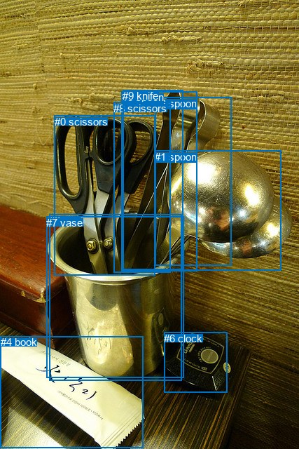
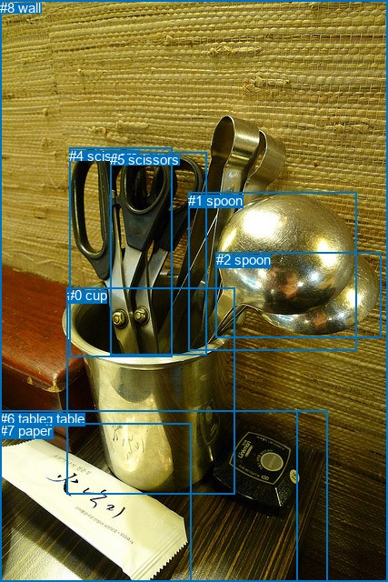

# 图片 1315：2376969.jpg

随机样本序号：279。图片 SHA256：`9b1c6ba2505428a1636929921ec7e901afe0c7f24591c51da997d0b1f398b521`。

红色框表示人，蓝色框表示其他物体。两个模式分别保留自身框编号，可依据位置比较对应对象。

## 自动检测框与输出

人的框编号：`[]`。状态：`no_person`。

### 自动检测全部物体框

| 编号 | 类别 | 是否为人 | 检测分数 | 像素坐标 xyxy |
|---|---|---|---|---|
| 0 | scissors | False | 0.9969 | 77.6, 164.9, 221.1, 392.6 |
| 1 | spoon | False | 0.9132 | 220.9, 214.7, 401.9, 385.9 |
| 2 | cup | False | 0.8913 | 70.1, 305.8, 259.3, 542.9 |
| 3 | spoon | False | 0.8722 | 221.2, 138.6, 330.2, 378.9 |
| 4 | book | False | 0.6156 | 1.0, 479.0, 204.2, 638.6 |
| 5 | spoon | False | 0.4850 | 173.9, 130.2, 281.5, 386.9 |
| 6 | clock | False | 0.4804 | 234.2, 473.9, 324.9, 559.1 |
| 7 | vase | False | 0.4221 | 66.3, 308.9, 262.4, 538.6 |
| 8 | scissors | False | 0.4187 | 162.2, 145.5, 243.1, 388.2 |
| 9 | knife | False | 0.4020 | 175.3, 128.2, 261.1, 384.3 |

### 自动检测 Top50 人相关候选

评分物体对：0；人相关物体对：0；输出关系：0。

| 排名 | 主语编号与类别 | 关系 | 宾语编号与类别 | 类型 | 人与人 | 排序分数 | 原始融合 logit |
|---|---|---|---|---|---|---|---|

### 自动检测逐条人相关 GT 核验

本图没有人相关 GT，R@50 无分母；预测候选继续展示。

## 真实框与输出

人的框编号：`[]`。

### 真实框全部物体框

| 编号 | 类别 | 是否为人 | 检测分数 | 像素坐标 xyxy |
|---|---|---|---|---|
| 0 | cup | False | GT | 74.0, 316.0, 258.0, 544.0 |
| 1 | spoon | False | GT | 207.0, 212.0, 392.0, 386.0 |
| 2 | spoon | False | GT | 238.0, 277.0, 420.0, 371.0 |
| 3 | dining table | False | GT | 0.0, 452.0, 361.0, 640.0 |
| 4 | scissors | False | GT | 76.0, 163.0, 189.0, 393.0 |
| 5 | scissors | False | GT | 121.0, 167.0, 227.0, 390.0 |
| 6 | table | False | GT | 0.0, 452.0, 327.0, 640.0 |
| 7 | paper | False | GT | 0.0, 465.0, 210.0, 640.0 |
| 8 | wall | False | GT | 0.0, 0.0, 427.0, 640.0 |

### 真实框 Top50 人相关候选

评分物体对：0；人相关物体对：0；输出关系：0。

| 排名 | 主语编号与类别 | 关系 | 宾语编号与类别 | 类型 | 人与人 | 排序分数 | 原始融合 logit |
|---|---|---|---|---|---|---|---|

### 真实框逐条人相关 GT 核验

本图没有人相关 GT，R@50 无分母；预测候选继续展示。

## 全部人相关 GT

| 主语编号与类别 | 关系 | 宾语编号与类别 |
|---|---|---|

原始记录、全部人相关物体对的两项预测与分项分数见 [逐图证据 JSON](../evidence/cases/1315.json)。全部56类 logits 保留于本机 HOR/output/random500/logits/。

<!-- HOR_COMPLETE_RESULTS -->

## 六组条件的完整输出对照

以下保留同一图片三种框与候选模式、两种谓词输出规则的全部 Top50。框编号各自在所属模式内解释。

### 自动检测框完整枚举：空间与语义各保留一个谓词

| 排名 | 主语编号与类别 | 谓词 | 宾语编号与类别 | 分组 | 排序分数 | predicate logit | pair logit |
|---|---|---|---|---|---|---|---|

没有人相关 GT，本条件的召回率无分母。

### 自动检测框完整枚举：每对只保留一个谓词

| 排名 | 主语编号与类别 | 谓词 | 宾语编号与类别 | 分组 | 排序分数 | predicate logit | pair logit |
|---|---|---|---|---|---|---|---|

没有人相关 GT，本条件的召回率无分母。

### 真实框完整枚举：空间与语义各保留一个谓词

| 排名 | 主语编号与类别 | 谓词 | 宾语编号与类别 | 分组 | 排序分数 | predicate logit | pair logit |
|---|---|---|---|---|---|---|---|

没有人相关 GT，本条件的召回率无分母。

### 真实框完整枚举：每对只保留一个谓词

| 排名 | 主语编号与类别 | 谓词 | 宾语编号与类别 | 分组 | 排序分数 | predicate logit | pair logit |
|---|---|---|---|---|---|---|---|

没有人相关 GT，本条件的召回率无分母。

### 真实框400候选：空间与语义各保留一个谓词

| 排名 | 主语编号与类别 | 谓词 | 宾语编号与类别 | 分组 | 排序分数 | predicate logit | pair logit |
|---|---|---|---|---|---|---|---|

没有人相关 GT，本条件的召回率无分母。

### 真实框400候选：每对只保留一个谓词

| 排名 | 主语编号与类别 | 谓词 | 宾语编号与类别 | 分组 | 排序分数 | predicate logit | pair logit |
|---|---|---|---|---|---|---|---|

没有人相关 GT，本条件的召回率无分母。
