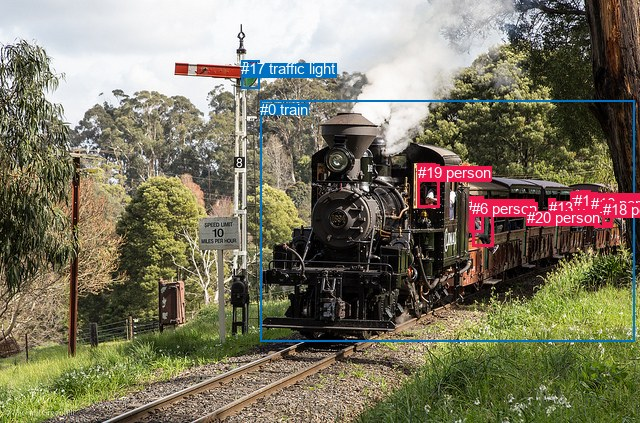
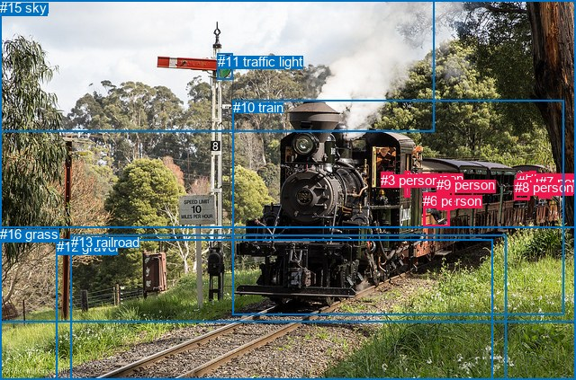

# 图片 1317：2377220.jpg

随机样本序号：225。图片 SHA256：`99509da727baae5b895c19430f06db4b0fed8aee999cfd9a21f177cff57085e2`。

红色框表示人，蓝色框表示其他物体。两个模式分别保留自身框编号，可依据位置比较对应对象。

## 自动检测框与输出

人的框编号：`[1, 2, 3, 4, 5, 6, 7, 8, 9, 10, 11, 12, 13, 14, 15, 16, 18, 19, 20]`。状态：`ok`。

### 自动检测全部物体框

| 编号 | 类别 | 是否为人 | 检测分数 | 像素坐标 xyxy |
|---|---|---|---|---|
| 0 | train | False | 0.9997 | 260.5, 100.9, 634.1, 341.1 |
| 1 | person | True | 0.8514 | 570.6, 192.5, 584.7, 218.0 |
| 2 | person | True | 0.8476 | 580.5, 190.1, 588.4, 202.5 |
| 3 | person | True | 0.7418 | 571.8, 191.7, 582.3, 209.1 |
| 4 | person | True | 0.7180 | 469.3, 196.4, 483.7, 233.0 |
| 5 | person | True | 0.7095 | 578.4, 198.0, 587.5, 216.2 |
| 6 | person | True | 0.6877 | 472.1, 199.6, 493.2, 246.9 |
| 7 | person | True | 0.6784 | 594.5, 194.5, 612.4, 227.5 |
| 8 | person | True | 0.6309 | 580.5, 191.0, 590.8, 214.2 |
| 9 | person | True | 0.5933 | 584.9, 192.5, 597.3, 215.3 |
| 10 | person | True | 0.5842 | 598.6, 194.4, 607.1, 203.9 |
| 11 | person | True | 0.5799 | 417.8, 164.7, 439.3, 207.7 |
| 12 | person | True | 0.5676 | 596.4, 194.4, 609.8, 213.9 |
| 13 | person | True | 0.5597 | 549.0, 198.7, 555.5, 207.8 |
| 14 | person | True | 0.5536 | 574.3, 191.7, 587.5, 212.0 |
| 15 | person | True | 0.5274 | 603.7, 200.0, 611.8, 214.4 |
| 16 | person | True | 0.5255 | 590.7, 194.8, 598.5, 214.4 |
| 17 | traffic light | False | 0.5212 | 241.4, 60.2, 259.8, 88.6 |
| 18 | person | True | 0.4898 | 602.6, 200.6, 612.1, 224.5 |
| 19 | person | True | 0.4164 | 418.4, 163.7, 435.7, 181.9 |
| 20 | person | True | 0.3558 | 526.7, 209.0, 533.1, 217.7 |

### 自动检测 Top50 人相关候选

评分物体对：420；人相关物体对：418；输出关系：50。

| 排名 | 主语编号与类别 | 关系 | 宾语编号与类别 | 类型 | 人与人 | 排序分数 | 原始融合 logit |
|---|---|---|---|---|---|---|---|
| 1 | #11 person | driving on | #0 train | semantic | False | 0.98977 | 4.5718 |
| 2 | #20 person | riding | #0 train | semantic | False | 0.98778 | 4.3925 |
| 3 | #1 person | riding | #0 train | semantic | False | 0.98774 | 4.3893 |
| 4 | #3 person | riding | #0 train | semantic | False | 0.98535 | 4.2082 |
| 5 | #14 person | riding | #0 train | semantic | False | 0.98530 | 4.2049 |
| 6 | #7 person | riding | #0 train | semantic | False | 0.98481 | 4.1721 |
| 7 | #12 person | riding | #0 train | semantic | False | 0.98443 | 4.1467 |
| 8 | #18 person | riding | #0 train | semantic | False | 0.98387 | 4.1108 |
| 9 | #8 person | riding | #0 train | semantic | False | 0.98386 | 4.1104 |
| 10 | #9 person | riding | #0 train | semantic | False | 0.98331 | 4.0759 |
| 11 | #5 person | riding | #0 train | semantic | False | 0.98303 | 4.0592 |
| 12 | #10 person | riding | #0 train | semantic | False | 0.98300 | 4.0576 |
| 13 | #15 person | riding | #0 train | semantic | False | 0.98277 | 4.0438 |
| 14 | #2 person | riding | #0 train | semantic | False | 0.98264 | 4.0359 |
| 15 | #16 person | riding | #0 train | semantic | False | 0.98231 | 4.0170 |
| 16 | #19 person | driving on | #0 train | semantic | False | 0.98223 | 4.0123 |
| 17 | #13 person | riding | #0 train | semantic | False | 0.97691 | 3.7451 |
| 18 | #4 person | driving on | #0 train | semantic | False | 0.97160 | 3.5327 |
| 19 | #6 person | driving on | #0 train | semantic | False | 0.96925 | 3.4508 |
| 20 | #7 person | in | #0 train | spatial | False | 0.93121 | 2.6054 |
| 21 | #9 person | in | #0 train | spatial | False | 0.91832 | 2.4197 |
| 22 | #12 person | in | #0 train | spatial | False | 0.91571 | 2.3855 |
| 23 | #18 person | in | #0 train | spatial | False | 0.91465 | 2.3718 |
| 24 | #11 person | on | #0 train | spatial | False | 0.91275 | 2.3476 |
| 25 | #5 person | in | #0 train | spatial | False | 0.90441 | 2.2472 |
| 26 | #1 person | in | #0 train | spatial | False | 0.90402 | 2.2427 |
| 27 | #15 person | in | #0 train | spatial | False | 0.90184 | 2.2179 |
| 28 | #8 person | in | #0 train | spatial | False | 0.90139 | 2.2127 |
| 29 | #16 person | in | #0 train | spatial | False | 0.90052 | 2.2030 |
| 30 | #19 person | on | #0 train | spatial | False | 0.89753 | 2.1701 |
| 31 | #14 person | in | #0 train | spatial | False | 0.89348 | 2.1268 |
| 32 | #3 person | on | #0 train | spatial | False | 0.89158 | 2.1070 |
| 33 | #10 person | on | #0 train | spatial | False | 0.88904 | 2.0809 |
| 34 | #2 person | on | #0 train | spatial | False | 0.88455 | 2.0362 |
| 35 | #13 person | on | #0 train | spatial | False | 0.88265 | 2.0178 |
| 36 | #6 person | on | #0 train | spatial | False | 0.88213 | 2.0128 |
| 37 | #4 person | on | #0 train | spatial | False | 0.86778 | 1.8815 |
| 38 | #0 train | pulling | #1 person | semantic | False | 0.85976 | 1.8133 |
| 39 | #0 train | pulling | #7 person | semantic | False | 0.84802 | 1.7192 |
| 40 | #0 train | pulling | #6 person | semantic | False | 0.84040 | 1.6612 |
| 41 | #0 train | pulling | #3 person | semantic | False | 0.83702 | 1.6362 |
| 42 | #0 train | pulling | #14 person | semantic | False | 0.83649 | 1.6323 |
| 43 | #20 person | in | #0 train | spatial | False | 0.83559 | 1.6257 |
| 44 | #0 train | pulling | #9 person | semantic | False | 0.78286 | 1.2824 |
| 45 | #8 person | wearing | #2 person | semantic | True | 0.77726 | 1.2498 |
| 46 | #1 person | wearing | #3 person | semantic | True | 0.76688 | 1.1908 |
| 47 | #0 train | pulling | #12 person | semantic | False | 0.76237 | 1.1657 |
| 48 | #0 train | pulling | #8 person | semantic | False | 0.75475 | 1.1241 |
| 49 | #0 train | pulling | #13 person | semantic | False | 0.72297 | 0.9592 |
| 50 | #0 train | pulling | #5 person | semantic | False | 0.69158 | 0.8075 |

### 自动检测逐条人相关 GT 核验

R@50：0.00%；命中 0/4。

| GT 主语编号 | GT 关系 | GT 宾语编号 | 结果阶段 | 匹配预测主语编号 | 匹配预测宾语编号 |
|---|---|---|---|---|---|
| 1 | in | 10 | endpoint_missing_or_wrong_class | [] | [0] |
| 3 | driving | 10 | endpoint_missing_or_wrong_class | [] | [0] |
| 6 | in | 10 | endpoint_missing_or_wrong_class | [] | [0] |
| 9 | in | 10 | endpoint_missing_or_wrong_class | [] | [0] |

## 真实框与输出

人的框编号：`[0, 1, 2, 3, 4, 5, 6, 7, 8, 9]`。

### 真实框全部物体框

| 编号 | 类别 | 是否为人 | 检测分数 | 像素坐标 xyxy |
|---|---|---|---|---|
| 0 | person | True | GT | 582.0, 191.0, 588.0, 202.0 |
| 1 | person | True | GT | 450.0, 190.0, 456.0, 219.0 |
| 2 | person | True | GT | 606.0, 198.0, 612.0, 213.0 |
| 3 | person | True | GT | 423.0, 192.0, 436.0, 209.0 |
| 4 | person | True | GT | 588.0, 191.0, 595.0, 206.0 |
| 5 | person | True | GT | 575.0, 193.0, 581.0, 205.0 |
| 6 | person | True | GT | 470.0, 215.0, 499.0, 253.0 |
| 7 | person | True | GT | 599.0, 194.0, 613.0, 220.0 |
| 8 | person | True | GT | 572.0, 200.0, 589.0, 222.0 |
| 9 | person | True | GT | 485.0, 197.0, 504.0, 233.0 |
| 10 | train | False | GT | 259.0, 111.0, 627.0, 350.0 |
| 11 | traffic light | False | GT | 242.0, 60.0, 259.0, 88.0 |
| 12 | gravel | False | GT | 63.0, 266.0, 548.0, 423.0 |
| 13 | railroad | False | GT | 79.0, 261.0, 563.0, 423.0 |
| 14 | tree | False | GT | 0.0, 0.0, 640.0, 359.0 |
| 15 | sky | False | GT | 0.0, 0.0, 483.0, 147.0 |
| 16 | grass | False | GT | 0.0, 252.0, 640.0, 423.0 |

### 真实框 Top50 人相关候选

评分物体对：272；人相关物体对：230；输出关系：50。

| 排名 | 主语编号与类别 | 关系 | 宾语编号与类别 | 类型 | 人与人 | 排序分数 | 原始融合 logit |
|---|---|---|---|---|---|---|---|
| 1 | #7 person | riding | #10 train | semantic | False | 0.98532 | 4.2068 |
| 2 | #2 person | riding | #10 train | semantic | False | 0.98524 | 4.2012 |
| 3 | #4 person | riding | #10 train | semantic | False | 0.98438 | 4.1437 |
| 4 | #0 person | riding | #10 train | semantic | False | 0.98249 | 4.0274 |
| 5 | #8 person | riding | #10 train | semantic | False | 0.98248 | 4.0266 |
| 6 | #5 person | riding | #10 train | semantic | False | 0.98233 | 4.0181 |
| 7 | #3 person | driving on | #10 train | semantic | False | 0.98227 | 4.0147 |
| 8 | #1 person | driving on | #10 train | semantic | False | 0.96467 | 3.3069 |
| 9 | #3 person | in | #10 train | spatial | False | 0.95812 | 3.1301 |
| 10 | #6 person | driving on | #10 train | semantic | False | 0.95205 | 2.9885 |
| 11 | #7 person | wearing | #2 person | semantic | True | 0.94827 | 2.9086 |
| 12 | #9 person | riding | #10 train | semantic | False | 0.94774 | 2.8978 |
| 13 | #6 person | on | #10 train | spatial | False | 0.94425 | 2.8295 |
| 14 | #8 person | in | #10 train | spatial | False | 0.94227 | 2.7925 |
| 15 | #1 person | in | #10 train | spatial | False | 0.93987 | 2.7492 |
| 16 | #9 person | in | #10 train | spatial | False | 0.93709 | 2.7011 |
| 17 | #7 person | in | #10 train | spatial | False | 0.92246 | 2.4763 |
| 18 | #5 person | on | #10 train | spatial | False | 0.91610 | 2.3906 |
| 19 | #0 person | on | #10 train | spatial | False | 0.91294 | 2.3500 |
| 20 | #2 person | on | #10 train | spatial | False | 0.90865 | 2.2972 |
| 21 | #4 person | in | #10 train | spatial | False | 0.90534 | 2.2580 |
| 22 | #10 train | pulling | #7 person | semantic | False | 0.77818 | 1.2551 |
| 23 | #10 train | pulling | #8 person | semantic | False | 0.74787 | 1.0873 |
| 24 | #2 person | riding | #7 person | semantic | True | 0.67603 | 0.7356 |
| 25 | #7 person | in | #2 person | spatial | True | 0.66365 | 0.6796 |
| 26 | #2 person | on | #7 person | spatial | True | 0.62278 | 0.5014 |
| 27 | #10 train | in | #6 person | spatial | False | 0.49759 | -0.0096 |
| 28 | #10 train | pulling | #4 person | semantic | False | 0.49148 | -0.0341 |
| 29 | #0 person | riding | #8 person | semantic | True | 0.43374 | -0.2666 |
| 30 | #10 train | carrying | #2 person | semantic | False | 0.42452 | -0.3043 |
| 31 | #10 train | carrying | #5 person | semantic | False | 0.42386 | -0.3070 |
| 32 | #10 train | pulling | #0 person | semantic | False | 0.40663 | -0.3779 |
| 33 | #0 person | on | #8 person | spatial | True | 0.36567 | -0.5509 |
| 34 | #5 person | on | #8 person | spatial | True | 0.36037 | -0.5738 |
| 35 | #5 person | riding | #8 person | semantic | True | 0.35029 | -0.6178 |
| 36 | #10 train | in | #9 person | spatial | False | 0.34540 | -0.6393 |
| 37 | #8 person | wearing | #5 person | semantic | True | 0.33176 | -0.7002 |
| 38 | #10 train | carrying | #9 person | semantic | False | 0.33017 | -0.7074 |
| 39 | #10 train | carrying | #6 person | semantic | False | 0.24416 | -1.1300 |
| 40 | #8 person | holding | #0 person | semantic | True | 0.22639 | -1.2288 |
| 41 | #8 person | on | #5 person | spatial | True | 0.22631 | -1.2293 |
| 42 | #7 person | in | #14 tree | spatial | False | 0.21704 | -1.2830 |
| 43 | #10 train | in | #5 person | spatial | False | 0.21063 | -1.3211 |
| 44 | #10 train | on | #3 person | spatial | False | 0.20946 | -1.3282 |
| 45 | #10 train | carrying | #3 person | semantic | False | 0.19763 | -1.4012 |
| 46 | #10 train | in | #1 person | spatial | False | 0.18416 | -1.4884 |
| 47 | #4 person | in | #14 tree | spatial | False | 0.18374 | -1.4912 |
| 48 | #8 person | on | #0 person | spatial | True | 0.18185 | -1.5039 |
| 49 | #2 person | in | #14 tree | spatial | False | 0.18052 | -1.5128 |
| 50 | #0 person | in | #14 tree | spatial | False | 0.17908 | -1.5226 |

### 真实框逐条人相关 GT 核验

R@50：50.00%；命中 2/4。

| GT 主语编号 | GT 关系 | GT 宾语编号 | 结果阶段 | 匹配预测主语编号 | 匹配预测宾语编号 |
|---|---|---|---|---|---|
| 1 | in | 10 | hit50 | [1] | [10] |
| 3 | driving | 10 | wrong_predicate | [3] | [10] |
| 6 | in | 10 | wrong_predicate | [6] | [10] |
| 9 | in | 10 | hit50 | [9] | [10] |

## 全部人相关 GT

| 主语编号与类别 | 关系 | 宾语编号与类别 |
|---|---|---|
| #1 person | in | #10 train |
| #3 person | driving | #10 train |
| #6 person | in | #10 train |
| #9 person | in | #10 train |

原始记录、全部人相关物体对的两项预测与分项分数见 [逐图证据 JSON](../evidence/cases/1317.json)。全部56类 logits 保留于本机 HOR/output/random500/logits/。

<!-- HOR_COMPLETE_RESULTS -->

## 六组条件的完整输出对照

以下保留同一图片三种框与候选模式、两种谓词输出规则的全部 Top50。框编号各自在所属模式内解释。

### 自动检测框完整枚举：空间与语义各保留一个谓词

| 排名 | 主语编号与类别 | 谓词 | 宾语编号与类别 | 分组 | 排序分数 | predicate logit | pair logit |
|---|---|---|---|---|---|---|---|
| 1 | #11 person | driving on | #0 train | semantic | 0.9897664 | 4.5069108 | 0.0648868 |
| 2 | #20 person | riding | #0 train | semantic | 0.9877819 | 4.4756455 | -0.0831032 |
| 3 | #1 person | riding | #0 train | semantic | 0.9877424 | 4.3016963 | 0.0875818 |
| 4 | #3 person | riding | #0 train | semantic | 0.9853453 | 4.1859727 | 0.0222561 |
| 5 | #14 person | riding | #0 train | semantic | 0.9852969 | 4.1228585 | 0.0820292 |
| 6 | #7 person | riding | #0 train | semantic | 0.9848142 | 4.0037160 | 0.1683763 |
| 7 | #12 person | riding | #0 train | semantic | 0.9844291 | 4.0039601 | 0.1426998 |
| 8 | #18 person | riding | #0 train | semantic | 0.9838693 | 3.9452443 | 0.1655188 |
| 9 | #8 person | riding | #0 train | semantic | 0.9838628 | 4.0029826 | 0.1073791 |
| 10 | #9 person | riding | #0 train | semantic | 0.9833066 | 3.9425559 | 0.1333531 |
| 11 | #5 person | riding | #0 train | semantic | 0.9830305 | 3.9410892 | 0.1181301 |
| 12 | #10 person | riding | #0 train | semantic | 0.9830037 | 3.9464650 | 0.1111554 |
| 13 | #15 person | riding | #0 train | semantic | 0.9827713 | 3.8848166 | 0.1589861 |
| 14 | #2 person | riding | #0 train | semantic | 0.9826369 | 4.0078702 | 0.0280204 |
| 15 | #16 person | riding | #0 train | semantic | 0.9823114 | 3.8828626 | 0.1341239 |
| 16 | #19 person | driving on | #0 train | semantic | 0.9822290 | 3.9054017 | 0.1068575 |
| 17 | #13 person | riding | #0 train | semantic | 0.9769118 | 3.7678723 | -0.0227988 |
| 18 | #4 person | driving on | #0 train | semantic | 0.9716049 | 3.5445237 | -0.0117866 |
| 19 | #6 person | driving on | #0 train | semantic | 0.9692550 | 3.4845948 | -0.0337975 |
| 20 | #7 person | in | #0 train | spatial | 0.9312084 | 2.4370251 | 0.1683763 |
| 21 | #9 person | in | #0 train | spatial | 0.9183173 | 2.2863469 | 0.1333531 |
| 22 | #12 person | in | #0 train | spatial | 0.9157116 | 2.2427578 | 0.1426998 |
| 23 | #18 person | in | #0 train | spatial | 0.9146492 | 2.2062521 | 0.1655188 |
| 24 | #11 person | on | #0 train | spatial | 0.9127458 | 2.2827458 | 0.0648868 |
| 25 | #5 person | in | #0 train | spatial | 0.9044053 | 2.1290302 | 0.1181301 |
| 26 | #1 person | in | #0 train | spatial | 0.9040204 | 2.1551347 | 0.0875818 |
| 27 | #15 person | in | #0 train | spatial | 0.9018435 | 2.0588913 | 0.1589861 |
| 28 | #8 person | in | #0 train | spatial | 0.9013870 | 2.1053534 | 0.1073791 |
| 29 | #16 person | in | #0 train | spatial | 0.9005161 | 2.0688477 | 0.1341239 |
| 30 | #19 person | on | #0 train | spatial | 0.8975297 | 2.0632162 | 0.1068575 |
| 31 | #14 person | in | #0 train | spatial | 0.8934766 | 2.0447264 | 0.0820292 |
| 32 | #3 person | on | #0 train | spatial | 0.8915780 | 2.0847058 | 0.0222561 |
| 33 | #10 person | on | #0 train | spatial | 0.8890369 | 1.9697852 | 0.1111554 |
| 34 | #2 person | on | #0 train | spatial | 0.8845466 | 2.0081887 | 0.0280204 |
| 35 | #13 person | on | #0 train | spatial | 0.8826501 | 2.0405679 | -0.0227988 |
| 36 | #6 person | on | #0 train | spatial | 0.8821339 | 2.0465922 | -0.0337975 |
| 37 | #4 person | on | #0 train | spatial | 0.8677813 | 1.8932691 | -0.0117866 |
| 38 | #0 train | pulling | #1 person | semantic | 0.8597628 | 2.6743021 | -0.8609803 |
| 39 | #0 train | pulling | #7 person | semantic | 0.8480194 | 2.7344427 | -1.0152923 |
| 40 | #0 train | pulling | #6 person | semantic | 0.8404004 | 2.2232885 | -0.5620780 |
| 41 | #0 train | pulling | #3 person | semantic | 0.8370219 | 2.4035540 | -0.7673202 |
| 42 | #0 train | pulling | #14 person | semantic | 0.8364893 | 2.5238547 | -0.8915197 |
| 43 | #20 person | in | #0 train | spatial | 0.8355855 | 1.7088451 | -0.0831032 |
| 44 | #0 train | pulling | #9 person | semantic | 0.7828574 | 2.2831411 | -1.0007451 |
| 45 | #8 person | wearing | #2 person | semantic | 0.7772611 | 1.7576175 | -0.5078410 |
| 46 | #1 person | wearing | #3 person | semantic | 0.7668837 | 1.7002959 | -0.5094980 |
| 47 | #0 train | pulling | #12 person | semantic | 0.7623716 | 2.1928964 | -1.0271704 |
| 48 | #0 train | pulling | #8 person | semantic | 0.7547506 | 2.0725474 | -0.9484355 |
| 49 | #0 train | pulling | #13 person | semantic | 0.7229688 | 1.3506875 | -0.3914513 |
| 50 | #0 train | pulling | #5 person | semantic | 0.6915767 | 1.7416010 | -0.9341002 |

GT 命中：0/4，R@50=0.00%。

| GT主语 | GT谓词 | GT宾语 | 结果阶段 | 匹配主语框 | 匹配宾语框 |
|---|---|---|---|---|---|
| 1 | in | 10 | endpoint_missing_or_wrong_class | [] | [0] |
| 3 | driving | 10 | endpoint_missing_or_wrong_class | [] | [0] |
| 6 | in | 10 | endpoint_missing_or_wrong_class | [] | [0] |
| 9 | in | 10 | endpoint_missing_or_wrong_class | [] | [0] |

### 自动检测框完整枚举：每对只保留一个谓词

| 排名 | 主语编号与类别 | 谓词 | 宾语编号与类别 | 分组 | 排序分数 | predicate logit | pair logit |
|---|---|---|---|---|---|---|---|
| 1 | #11 person | driving on | #0 train | single | 0.9897664 | 4.5069108 | 0.0648868 |
| 2 | #20 person | riding | #0 train | single | 0.9877819 | 4.4756455 | -0.0831032 |
| 3 | #1 person | riding | #0 train | single | 0.9877424 | 4.3016963 | 0.0875818 |
| 4 | #3 person | riding | #0 train | single | 0.9853453 | 4.1859727 | 0.0222561 |
| 5 | #14 person | riding | #0 train | single | 0.9852969 | 4.1228585 | 0.0820292 |
| 6 | #7 person | riding | #0 train | single | 0.9848142 | 4.0037160 | 0.1683763 |
| 7 | #12 person | riding | #0 train | single | 0.9844291 | 4.0039601 | 0.1426998 |
| 8 | #18 person | riding | #0 train | single | 0.9838693 | 3.9452443 | 0.1655188 |
| 9 | #8 person | riding | #0 train | single | 0.9838628 | 4.0029826 | 0.1073791 |
| 10 | #9 person | riding | #0 train | single | 0.9833066 | 3.9425559 | 0.1333531 |
| 11 | #5 person | riding | #0 train | single | 0.9830305 | 3.9410892 | 0.1181301 |
| 12 | #10 person | riding | #0 train | single | 0.9830037 | 3.9464650 | 0.1111554 |
| 13 | #15 person | riding | #0 train | single | 0.9827713 | 3.8848166 | 0.1589861 |
| 14 | #2 person | riding | #0 train | single | 0.9826369 | 4.0078702 | 0.0280204 |
| 15 | #16 person | riding | #0 train | single | 0.9823114 | 3.8828626 | 0.1341239 |
| 16 | #19 person | driving on | #0 train | single | 0.9822290 | 3.9054017 | 0.1068575 |
| 17 | #13 person | riding | #0 train | single | 0.9769118 | 3.7678723 | -0.0227988 |
| 18 | #4 person | driving on | #0 train | single | 0.9716049 | 3.5445237 | -0.0117866 |
| 19 | #6 person | driving on | #0 train | single | 0.9692550 | 3.4845948 | -0.0337975 |
| 20 | #0 train | pulling | #1 person | single | 0.8597628 | 2.6743021 | -0.8609803 |
| 21 | #0 train | pulling | #7 person | single | 0.8480194 | 2.7344427 | -1.0152923 |
| 22 | #0 train | pulling | #6 person | single | 0.8404004 | 2.2232885 | -0.5620780 |
| 23 | #0 train | pulling | #3 person | single | 0.8370219 | 2.4035540 | -0.7673202 |
| 24 | #0 train | pulling | #14 person | single | 0.8364893 | 2.5238547 | -0.8915197 |
| 25 | #0 train | pulling | #9 person | single | 0.7828574 | 2.2831411 | -1.0007451 |
| 26 | #8 person | wearing | #2 person | single | 0.7772611 | 1.7576175 | -0.5078410 |
| 27 | #1 person | wearing | #3 person | single | 0.7668837 | 1.7002959 | -0.5094980 |
| 28 | #0 train | pulling | #12 person | single | 0.7623716 | 2.1928964 | -1.0271704 |
| 29 | #0 train | pulling | #8 person | single | 0.7547506 | 2.0725474 | -0.9484355 |
| 30 | #0 train | pulling | #13 person | single | 0.7229688 | 1.3506875 | -0.3914513 |
| 31 | #0 train | pulling | #5 person | single | 0.6915767 | 1.7416010 | -0.9341002 |
| 32 | #0 train | pulling | #2 person | single | 0.6787358 | 1.6213036 | -0.8733355 |
| 33 | #0 train | pulling | #16 person | single | 0.6448566 | 1.5911608 | -0.9946543 |
| 34 | #12 person | wearing | #10 person | single | 0.6369662 | 1.1322479 | -0.5700270 |
| 35 | #0 train | pulling | #10 person | single | 0.6265226 | 1.5310297 | -1.0137024 |
| 36 | #0 train | pulling | #4 person | single | 0.6173308 | 1.0499282 | -0.5716942 |
| 37 | #7 person | wearing | #12 person | single | 0.6080089 | 1.0507760 | -0.6118260 |
| 38 | #18 person | wearing | #15 person | single | 0.6031720 | 1.0346761 | -0.6159766 |
| 39 | #0 train | pulling | #18 person | single | 0.5914235 | 1.3805704 | -1.0107174 |
| 40 | #15 person | riding | #7 person | single | 0.5586500 | 0.8764248 | -0.6407400 |
| 41 | #0 train | pulling | #15 person | single | 0.5532566 | 1.2602310 | -1.0463936 |
| 42 | #2 person | riding | #14 person | single | 0.4898269 | 0.5812545 | -0.6219525 |
| 43 | #10 person | riding | #12 person | single | 0.4860057 | 0.5844307 | -0.6404226 |
| 44 | #10 person | riding | #7 person | single | 0.4783975 | 0.6133008 | -0.6997645 |
| 45 | #3 person | riding | #1 person | single | 0.4651822 | 0.5547061 | -0.6942029 |
| 46 | #7 person | wearing | #10 person | single | 0.4464405 | 0.3461900 | -0.5612533 |
| 47 | #0 train | pulling | #11 person | single | 0.3859349 | 0.1774650 | -0.6418971 |
| 48 | #18 person | riding | #7 person | single | 0.3847999 | 0.1868916 | -0.6561157 |
| 49 | #2 person | riding | #8 person | single | 0.3742585 | 0.1687741 | -0.6827646 |
| 50 | #14 person | wearing | #2 person | single | 0.3734834 | 0.0267763 | -0.5440780 |

GT 命中：0/4，R@50=0.00%。

| GT主语 | GT谓词 | GT宾语 | 结果阶段 | 匹配主语框 | 匹配宾语框 |
|---|---|---|---|---|---|
| 1 | in | 10 | endpoint_missing_or_wrong_class | [] | [0] |
| 3 | driving | 10 | endpoint_missing_or_wrong_class | [] | [0] |
| 6 | in | 10 | endpoint_missing_or_wrong_class | [] | [0] |
| 9 | in | 10 | endpoint_missing_or_wrong_class | [] | [0] |

### 真实框完整枚举：空间与语义各保留一个谓词

| 排名 | 主语编号与类别 | 谓词 | 宾语编号与类别 | 分组 | 排序分数 | predicate logit | pair logit |
|---|---|---|---|---|---|---|---|
| 1 | #7 person | riding | #10 train | semantic | 0.9853241 | 4.0690284 | 0.1377332 |
| 2 | #2 person | riding | #10 train | semantic | 0.9852439 | 4.0695176 | 0.1317161 |
| 3 | #4 person | riding | #10 train | semantic | 0.9843835 | 4.0697618 | 0.0739281 |
| 4 | #0 person | riding | #10 train | semantic | 0.9824912 | 4.0125117 | 0.0148722 |
| 5 | #8 person | riding | #10 train | semantic | 0.9824768 | 3.9474425 | 0.0791085 |
| 6 | #5 person | riding | #10 train | semantic | 0.9823309 | 4.0120234 | 0.0060914 |
| 7 | #3 person | driving on | #10 train | semantic | 0.9822712 | 4.0253787 | -0.0106999 |
| 8 | #1 person | driving on | #10 train | semantic | 0.9646664 | 3.3038669 | 0.0030825 |
| 9 | #3 person | in | #10 train | spatial | 0.9581190 | 3.1408410 | -0.0106999 |
| 10 | #6 person | driving on | #10 train | semantic | 0.9520532 | 2.9435306 | 0.0449978 |
| 11 | #7 person | wearing | #2 person | semantic | 0.9482675 | 3.5087781 | -0.6002277 |
| 12 | #9 person | riding | #10 train | semantic | 0.9477388 | 2.9950299 | -0.0972046 |
| 13 | #6 person | on | #10 train | spatial | 0.9442511 | 2.7845373 | 0.0449978 |
| 14 | #8 person | in | #10 train | spatial | 0.9422681 | 2.7133718 | 0.0791085 |
| 15 | #1 person | in | #10 train | spatial | 0.9398679 | 2.7461128 | 0.0030825 |
| 16 | #9 person | in | #10 train | spatial | 0.9370925 | 2.7983227 | -0.0972046 |
| 17 | #7 person | in | #10 train | spatial | 0.9224629 | 2.3385563 | 0.1377332 |
| 18 | #5 person | on | #10 train | spatial | 0.9161040 | 2.3844600 | 0.0060914 |
| 19 | #0 person | on | #10 train | spatial | 0.9129373 | 2.3351669 | 0.0148722 |
| 20 | #2 person | on | #10 train | spatial | 0.9086470 | 2.1655092 | 0.1317161 |
| 21 | #4 person | in | #10 train | spatial | 0.9053420 | 2.1841135 | 0.0739281 |
| 22 | #10 train | pulling | #7 person | semantic | 0.7781815 | 2.3134055 | -1.0583055 |
| 23 | #10 train | pulling | #8 person | semantic | 0.7478654 | 1.9824915 | -0.8952310 |
| 24 | #2 person | riding | #7 person | semantic | 0.6760258 | 1.3505182 | -0.6149508 |
| 25 | #7 person | in | #2 person | spatial | 0.6636472 | 1.2798176 | -0.6002277 |
| 26 | #2 person | on | #7 person | spatial | 0.6227793 | 1.1163125 | -0.6149508 |
| 27 | #10 train | in | #6 person | spatial | 0.4975898 | 0.4877114 | -0.4973522 |
| 28 | #10 train | pulling | #4 person | semantic | 0.4914786 | 0.9595909 | -0.9936801 |
| 29 | #0 person | riding | #8 person | semantic | 0.4337406 | 0.4215989 | -0.6882049 |
| 30 | #10 train | carrying | #2 person | semantic | 0.4245182 | 0.7606425 | -1.0648953 |
| 31 | #10 train | carrying | #5 person | semantic | 0.4238583 | 0.4659548 | -0.7729093 |
| 32 | #10 train | pulling | #0 person | semantic | 0.4066334 | 0.5083342 | -0.8862344 |
| 33 | #0 person | on | #8 person | spatial | 0.3656654 | 0.1373472 | -0.6882049 |
| 34 | #5 person | on | #8 person | spatial | 0.3603692 | 0.1972408 | -0.7710029 |
| 35 | #5 person | riding | #8 person | semantic | 0.3502862 | 0.1532216 | -0.7710029 |
| 36 | #10 train | in | #9 person | spatial | 0.3454039 | 0.0114522 | -0.6507561 |
| 37 | #8 person | wearing | #5 person | semantic | 0.3317629 | -0.1730242 | -0.5271983 |
| 38 | #10 train | carrying | #9 person | semantic | 0.3301730 | -0.0566468 | -0.6507561 |
| 39 | #10 train | carrying | #6 person | semantic | 0.2441623 | -0.6326413 | -0.4973522 |
| 40 | #8 person | holding | #0 person | semantic | 0.2263938 | -0.6619878 | -0.5667992 |
| 41 | #8 person | on | #5 person | spatial | 0.2263080 | -0.7020788 | -0.5271983 |
| 42 | #7 person | in | #14 tree | spatial | 0.2170449 | -0.6647210 | -0.6182500 |
| 43 | #10 train | in | #5 person | spatial | 0.2106304 | -0.5482206 | -0.7729093 |
| 44 | #10 train | on | #3 person | spatial | 0.2094585 | -0.5519118 | -0.7762805 |
| 45 | #10 train | carrying | #3 person | semantic | 0.1976311 | -0.6248856 | -0.7762805 |
| 46 | #10 train | in | #1 person | spatial | 0.1841620 | -0.7358506 | -0.7525498 |
| 47 | #4 person | in | #14 tree | spatial | 0.1837444 | -0.8340976 | -0.6570844 |
| 48 | #8 person | on | #0 person | spatial | 0.1818485 | -0.9370744 | -0.5667992 |
| 49 | #2 person | in | #14 tree | spatial | 0.1805222 | -0.9037912 | -0.6090226 |
| 50 | #0 person | in | #14 tree | spatial | 0.1790776 | -0.8310015 | -0.6916080 |

GT 命中：2/4，R@50=50.00%。

| GT主语 | GT谓词 | GT宾语 | 结果阶段 | 匹配主语框 | 匹配宾语框 |
|---|---|---|---|---|---|
| 1 | in | 10 | hit50 | [1] | [10] |
| 3 | driving | 10 | wrong_predicate | [3] | [10] |
| 6 | in | 10 | wrong_predicate | [6] | [10] |
| 9 | in | 10 | hit50 | [9] | [10] |

### 真实框完整枚举：每对只保留一个谓词

| 排名 | 主语编号与类别 | 谓词 | 宾语编号与类别 | 分组 | 排序分数 | predicate logit | pair logit |
|---|---|---|---|---|---|---|---|
| 1 | #7 person | riding | #10 train | single | 0.9853241 | 4.0690284 | 0.1377332 |
| 2 | #2 person | riding | #10 train | single | 0.9852439 | 4.0695176 | 0.1317161 |
| 3 | #4 person | riding | #10 train | single | 0.9843835 | 4.0697618 | 0.0739281 |
| 4 | #0 person | riding | #10 train | single | 0.9824912 | 4.0125117 | 0.0148722 |
| 5 | #8 person | riding | #10 train | single | 0.9824768 | 3.9474425 | 0.0791085 |
| 6 | #5 person | riding | #10 train | single | 0.9823309 | 4.0120234 | 0.0060914 |
| 7 | #3 person | driving on | #10 train | single | 0.9822712 | 4.0253787 | -0.0106999 |
| 8 | #1 person | driving on | #10 train | single | 0.9646664 | 3.3038669 | 0.0030825 |
| 9 | #6 person | driving on | #10 train | single | 0.9520532 | 2.9435306 | 0.0449978 |
| 10 | #7 person | wearing | #2 person | single | 0.9482675 | 3.5087781 | -0.6002277 |
| 11 | #9 person | riding | #10 train | single | 0.9477388 | 2.9950299 | -0.0972046 |
| 12 | #10 train | pulling | #7 person | single | 0.7781815 | 2.3134055 | -1.0583055 |
| 13 | #10 train | pulling | #8 person | single | 0.7478654 | 1.9824915 | -0.8952310 |
| 14 | #2 person | riding | #7 person | single | 0.6760258 | 1.3505182 | -0.6149508 |
| 15 | #10 train | in | #6 person | single | 0.4975898 | 0.4877114 | -0.4973522 |
| 16 | #10 train | pulling | #4 person | single | 0.4914786 | 0.9595909 | -0.9936801 |
| 17 | #0 person | riding | #8 person | single | 0.4337406 | 0.4215989 | -0.6882049 |
| 18 | #10 train | carrying | #2 person | single | 0.4245182 | 0.7606425 | -1.0648953 |
| 19 | #10 train | carrying | #5 person | single | 0.4238583 | 0.4659548 | -0.7729093 |
| 20 | #10 train | pulling | #0 person | single | 0.4066334 | 0.5083342 | -0.8862344 |
| 21 | #5 person | on | #8 person | single | 0.3603692 | 0.1972408 | -0.7710029 |
| 22 | #10 train | in | #9 person | single | 0.3454039 | 0.0114522 | -0.6507561 |
| 23 | #8 person | wearing | #5 person | single | 0.3317629 | -0.1730242 | -0.5271983 |
| 24 | #8 person | holding | #0 person | single | 0.2263938 | -0.6619878 | -0.5667992 |
| 25 | #7 person | in | #14 tree | single | 0.2170449 | -0.6647210 | -0.6182500 |
| 26 | #10 train | on | #3 person | single | 0.2094585 | -0.5519118 | -0.7762805 |
| 27 | #10 train | in | #1 person | single | 0.1841620 | -0.7358506 | -0.7525498 |
| 28 | #4 person | in | #14 tree | single | 0.1837444 | -0.8340976 | -0.6570844 |
| 29 | #2 person | in | #14 tree | single | 0.1805222 | -0.9037912 | -0.6090226 |
| 30 | #0 person | in | #14 tree | single | 0.1790776 | -0.8310015 | -0.6916080 |
| 31 | #9 person | in | #14 tree | single | 0.1410426 | -0.5979009 | -1.2087567 |
| 32 | #8 person | in | #14 tree | single | 0.1362622 | -1.0312390 | -0.8154490 |
| 33 | #0 person | on | #16 grass | single | 0.1336642 | -0.8452084 | -1.0237337 |
| 34 | #5 person | in | #14 tree | single | 0.1307432 | -1.0833473 | -0.8110564 |
| 35 | #4 person | on | #8 person | single | 0.1233334 | -1.3269577 | -0.6342773 |
| 36 | #6 person | on | #9 person | single | 0.1152963 | -1.2137465 | -0.8240012 |
| 37 | #7 person | in | #16 grass | single | 0.1118927 | -1.0191174 | -1.0524350 |
| 38 | #2 person | in | #16 grass | single | 0.1028630 | -1.1203997 | -1.0454111 |
| 39 | #4 person | on | #16 grass | single | 0.1000637 | -1.1676104 | -1.0289065 |
| 40 | #3 person | in | #14 tree | single | 0.0824309 | -0.8724859 | -1.5372813 |
| 41 | #0 person | on | #13 railroad | single | 0.0770404 | -1.2775199 | -1.2057357 |
| 42 | #0 person | on | #12 gravel | single | 0.0728484 | -1.3295352 | -1.2142012 |
| 43 | #5 person | on | #16 grass | single | 0.0716342 | -1.4799914 | -1.0818613 |
| 44 | #8 person | holding | #4 person | single | 0.0701299 | -1.9032841 | -0.6814115 |
| 45 | #5 person | on | #13 railroad | single | 0.0607087 | -1.4936037 | -1.2454358 |
| 46 | #4 person | on | #13 railroad | single | 0.0587992 | -1.5590861 | -1.2139430 |
| 47 | #0 person | beside | #4 person | single | 0.0582062 | -2.1257515 | -0.6580426 |
| 48 | #5 person | on | #12 gravel | single | 0.0575712 | -1.5428963 | -1.2525413 |
| 49 | #5 person | on | #0 person | single | 0.0553566 | -2.2231207 | -0.6138906 |
| 50 | #0 person | on | #5 person | single | 0.0538937 | -2.3823087 | -0.4830319 |

GT 命中：0/4，R@50=0.00%。

| GT主语 | GT谓词 | GT宾语 | 结果阶段 | 匹配主语框 | 匹配宾语框 |
|---|---|---|---|---|---|
| 1 | in | 10 | wrong_predicate | [1] | [10] |
| 3 | driving | 10 | wrong_predicate | [3] | [10] |
| 6 | in | 10 | wrong_predicate | [6] | [10] |
| 9 | in | 10 | wrong_predicate | [9] | [10] |

### 真实框400候选：空间与语义各保留一个谓词

| 排名 | 主语编号与类别 | 谓词 | 宾语编号与类别 | 分组 | 排序分数 | predicate logit | pair logit |
|---|---|---|---|---|---|---|---|
| 1 | #7 person | riding | #10 train | semantic | 0.9853241 | 4.0690284 | 0.1377332 |
| 2 | #4 person | riding | #10 train | semantic | 0.9843835 | 4.0697618 | 0.0739281 |
| 3 | #2 person | riding | #10 train | semantic | 0.9843466 | 4.0095801 | 0.1317161 |
| 4 | #0 person | riding | #10 train | semantic | 0.9824869 | 4.0122676 | 0.0148722 |
| 5 | #5 person | riding | #10 train | semantic | 0.9823268 | 4.0117793 | 0.0060914 |
| 6 | #3 person | driving on | #10 train | semantic | 0.9822712 | 4.0253787 | -0.0106999 |
| 7 | #8 person | riding | #10 train | semantic | 0.9814145 | 3.8875041 | 0.0791085 |
| 8 | #1 person | driving on | #10 train | semantic | 0.9646664 | 3.3038669 | 0.0030825 |
| 9 | #3 person | in | #10 train | spatial | 0.9581190 | 3.1408410 | -0.0106999 |
| 10 | #6 person | driving on | #10 train | semantic | 0.9520532 | 2.9435306 | 0.0449978 |
| 11 | #7 person | wearing | #2 person | semantic | 0.9482675 | 3.5087781 | -0.6002277 |
| 12 | #9 person | riding | #10 train | semantic | 0.9477388 | 2.9950299 | -0.0972046 |
| 13 | #6 person | on | #10 train | spatial | 0.9442511 | 2.7845373 | 0.0449978 |
| 14 | #8 person | in | #10 train | spatial | 0.9420873 | 2.7100530 | 0.0791085 |
| 15 | #1 person | in | #10 train | spatial | 0.9398679 | 2.7461128 | 0.0030825 |
| 16 | #9 person | in | #10 train | spatial | 0.9370925 | 2.7983227 | -0.0972046 |
| 17 | #7 person | in | #10 train | spatial | 0.9224629 | 2.3385563 | 0.1377332 |
| 18 | #5 person | on | #10 train | spatial | 0.9161040 | 2.3844600 | 0.0060914 |
| 19 | #0 person | on | #10 train | spatial | 0.9129373 | 2.3351669 | 0.0148722 |
| 20 | #2 person | on | #10 train | spatial | 0.9086470 | 2.1655092 | 0.1317161 |
| 21 | #4 person | in | #10 train | spatial | 0.9053420 | 2.1841135 | 0.0739281 |
| 22 | #10 train | pulling | #7 person | semantic | 0.7781815 | 2.3134055 | -1.0583055 |
| 23 | #10 train | pulling | #8 person | semantic | 0.7478654 | 1.9824915 | -0.8952310 |
| 24 | #2 person | riding | #7 person | semantic | 0.6694549 | 1.3206716 | -0.6149508 |
| 25 | #7 person | in | #2 person | spatial | 0.6643876 | 1.2831364 | -0.6002277 |
| 26 | #2 person | on | #7 person | spatial | 0.6227793 | 1.1163125 | -0.6149508 |
| 27 | #10 train | pulling | #4 person | semantic | 0.4989997 | 0.9896789 | -0.9936801 |
| 28 | #10 train | in | #6 person | spatial | 0.4975898 | 0.4877114 | -0.4973522 |
| 29 | #10 train | carrying | #5 person | semantic | 0.4443142 | 0.5492382 | -0.7729093 |
| 30 | #0 person | riding | #8 person | semantic | 0.4264249 | 0.3917522 | -0.6882049 |
| 31 | #10 train | carrying | #2 person | semantic | 0.4242335 | 0.7594771 | -1.0648953 |
| 32 | #10 train | carrying | #0 person | semantic | 0.4061503 | 0.5063314 | -0.8862344 |
| 33 | #5 person | on | #8 person | spatial | 0.3660696 | 0.2218871 | -0.7710029 |
| 34 | #0 person | on | #8 person | spatial | 0.3574628 | 0.1018114 | -0.6882049 |
| 35 | #5 person | riding | #8 person | semantic | 0.3571649 | 0.1833124 | -0.7710029 |
| 36 | #10 train | in | #9 person | spatial | 0.3511038 | 0.0365653 | -0.6507561 |
| 37 | #8 person | wearing | #5 person | semantic | 0.3324136 | -0.1700907 | -0.5271983 |
| 38 | #10 train | carrying | #9 person | semantic | 0.3304306 | -0.0554819 | -0.6507561 |
| 39 | #10 train | carrying | #6 person | semantic | 0.2441623 | -0.6326413 | -0.4973522 |
| 40 | #8 person | on | #5 person | spatial | 0.2263080 | -0.7020788 | -0.5271983 |
| 41 | #8 person | holding | #0 person | semantic | 0.2216764 | -0.6891246 | -0.5667992 |
| 42 | #7 person | in | #14 tree | spatial | 0.2210571 | -0.6412668 | -0.6182500 |
| 43 | #10 train | in | #5 person | spatial | 0.2109064 | -0.5465612 | -0.7729093 |
| 44 | #10 train | on | #3 person | spatial | 0.2094585 | -0.5519118 | -0.7762805 |
| 45 | #10 train | carrying | #3 person | semantic | 0.1976311 | -0.6248856 | -0.7762805 |
| 46 | #10 train | in | #1 person | spatial | 0.1879651 | -0.7107375 | -0.7525498 |
| 47 | #4 person | in | #14 tree | spatial | 0.1877938 | -0.8073251 | -0.6570844 |
| 48 | #2 person | in | #14 tree | spatial | 0.1800317 | -0.9071100 | -0.6090226 |
| 49 | #0 person | in | #14 tree | spatial | 0.1790776 | -0.8310015 | -0.6916080 |
| 50 | #8 person | on | #0 person | spatial | 0.1790091 | -0.9562762 | -0.5667992 |

GT 命中：2/4，R@50=50.00%。

| GT主语 | GT谓词 | GT宾语 | 结果阶段 | 匹配主语框 | 匹配宾语框 |
|---|---|---|---|---|---|
| 1 | in | 10 | hit50 | [1] | [10] |
| 3 | driving | 10 | wrong_predicate | [3] | [10] |
| 6 | in | 10 | wrong_predicate | [6] | [10] |
| 9 | in | 10 | hit50 | [9] | [10] |

### 真实框400候选：每对只保留一个谓词

| 排名 | 主语编号与类别 | 谓词 | 宾语编号与类别 | 分组 | 排序分数 | predicate logit | pair logit |
|---|---|---|---|---|---|---|---|
| 1 | #7 person | riding | #10 train | single | 0.9853241 | 4.0690284 | 0.1377332 |
| 2 | #4 person | riding | #10 train | single | 0.9843835 | 4.0697618 | 0.0739281 |
| 3 | #2 person | riding | #10 train | single | 0.9843466 | 4.0095801 | 0.1317161 |
| 4 | #0 person | riding | #10 train | single | 0.9824869 | 4.0122676 | 0.0148722 |
| 5 | #5 person | riding | #10 train | single | 0.9823268 | 4.0117793 | 0.0060914 |
| 6 | #3 person | driving on | #10 train | single | 0.9822712 | 4.0253787 | -0.0106999 |
| 7 | #8 person | riding | #10 train | single | 0.9814145 | 3.8875041 | 0.0791085 |
| 8 | #1 person | driving on | #10 train | single | 0.9646664 | 3.3038669 | 0.0030825 |
| 9 | #6 person | driving on | #10 train | single | 0.9520532 | 2.9435306 | 0.0449978 |
| 10 | #7 person | wearing | #2 person | single | 0.9482675 | 3.5087781 | -0.6002277 |
| 11 | #9 person | riding | #10 train | single | 0.9477388 | 2.9950299 | -0.0972046 |
| 12 | #10 train | pulling | #7 person | single | 0.7781815 | 2.3134055 | -1.0583055 |
| 13 | #10 train | pulling | #8 person | single | 0.7478654 | 1.9824915 | -0.8952310 |
| 14 | #2 person | riding | #7 person | single | 0.6694549 | 1.3206716 | -0.6149508 |
| 15 | #10 train | pulling | #4 person | single | 0.4989997 | 0.9896789 | -0.9936801 |
| 16 | #10 train | in | #6 person | single | 0.4975898 | 0.4877114 | -0.4973522 |
| 17 | #10 train | carrying | #5 person | single | 0.4443142 | 0.5492382 | -0.7729093 |
| 18 | #0 person | riding | #8 person | single | 0.4264249 | 0.3917522 | -0.6882049 |
| 19 | #10 train | carrying | #2 person | single | 0.4242335 | 0.7594771 | -1.0648953 |
| 20 | #10 train | carrying | #0 person | single | 0.4061503 | 0.5063314 | -0.8862344 |
| 21 | #5 person | on | #8 person | single | 0.3660696 | 0.2218871 | -0.7710029 |
| 22 | #10 train | in | #9 person | single | 0.3511038 | 0.0365653 | -0.6507561 |
| 23 | #8 person | wearing | #5 person | single | 0.3324136 | -0.1700907 | -0.5271983 |
| 24 | #8 person | holding | #0 person | single | 0.2216764 | -0.6891246 | -0.5667992 |
| 25 | #7 person | in | #14 tree | single | 0.2210571 | -0.6412668 | -0.6182500 |
| 26 | #10 train | on | #3 person | single | 0.2094585 | -0.5519118 | -0.7762805 |
| 27 | #10 train | in | #1 person | single | 0.1879651 | -0.7107375 | -0.7525498 |
| 28 | #4 person | in | #14 tree | single | 0.1877938 | -0.8073251 | -0.6570844 |
| 29 | #2 person | in | #14 tree | single | 0.1800317 | -0.9071100 | -0.6090226 |
| 30 | #0 person | in | #14 tree | single | 0.1790776 | -0.8310015 | -0.6916080 |
| 31 | #9 person | in | #14 tree | single | 0.1408417 | -0.5995603 | -1.2087567 |
| 32 | #8 person | in | #14 tree | single | 0.1360670 | -1.0328984 | -0.8154490 |
| 33 | #0 person | on | #16 grass | single | 0.1305266 | -0.8725770 | -1.0237337 |
| 34 | #5 person | in | #14 tree | single | 0.1303665 | -1.0866661 | -0.8110564 |
| 35 | #4 person | on | #8 person | single | 0.1230394 | -1.3296802 | -0.6342773 |
| 36 | #6 person | on | #9 person | single | 0.1150189 | -1.2164688 | -0.8240012 |
| 37 | #7 person | in | #16 grass | single | 0.1113989 | -1.0240955 | -1.0524350 |
| 38 | #2 person | in | #16 grass | single | 0.1028630 | -1.1203997 | -1.0454111 |
| 39 | #4 person | on | #16 grass | single | 0.1023052 | -1.1429639 | -1.0289065 |
| 40 | #3 person | in | #14 tree | single | 0.0828082 | -0.8675077 | -1.5372813 |
| 41 | #0 person | on | #13 railroad | single | 0.0753061 | -1.3021662 | -1.2057357 |
| 42 | #5 person | on | #16 grass | single | 0.0709134 | -1.4908812 | -1.0818613 |
| 43 | #0 person | on | #12 gravel | single | 0.0708419 | -1.3596268 | -1.2142012 |
| 44 | #8 person | holding | #4 person | single | 0.0708253 | -1.8926697 | -0.6814115 |
| 45 | #5 person | on | #13 railroad | single | 0.0607087 | -1.4936037 | -1.2454358 |
| 46 | #5 person | on | #12 gravel | single | 0.0577191 | -1.5401740 | -1.2525413 |
| 47 | #4 person | on | #13 railroad | single | 0.0574499 | -1.5837326 | -1.2139430 |
| 48 | #0 person | beside | #4 person | single | 0.0573838 | -2.1408551 | -0.6580426 |
| 49 | #5 person | on | #0 person | single | 0.0551397 | -2.2272766 | -0.6138906 |
| 50 | #4 person | on | #12 gravel | single | 0.0533986 | -1.6507211 | -1.2243725 |

GT 命中：0/4，R@50=0.00%。

| GT主语 | GT谓词 | GT宾语 | 结果阶段 | 匹配主语框 | 匹配宾语框 |
|---|---|---|---|---|---|
| 1 | in | 10 | wrong_predicate | [1] | [10] |
| 3 | driving | 10 | wrong_predicate | [3] | [10] |
| 6 | in | 10 | wrong_predicate | [6] | [10] |
| 9 | in | 10 | wrong_predicate | [9] | [10] |
